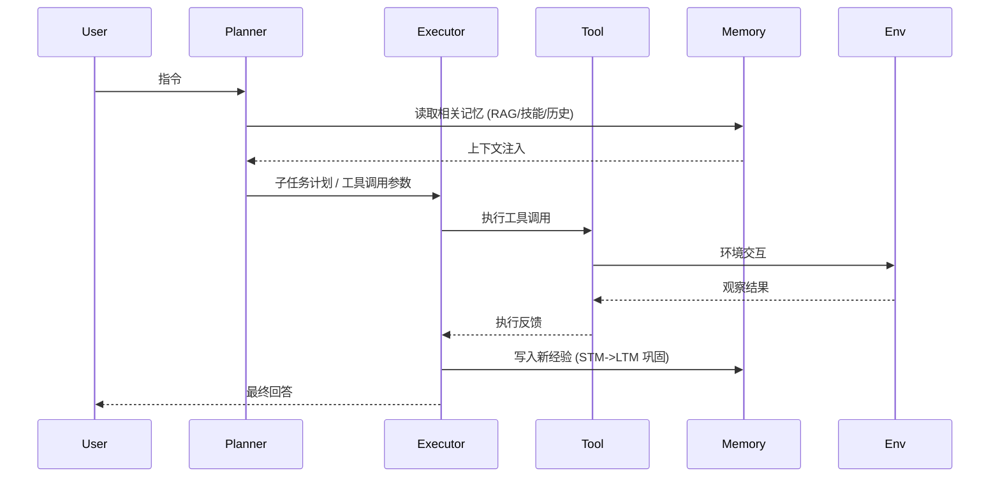
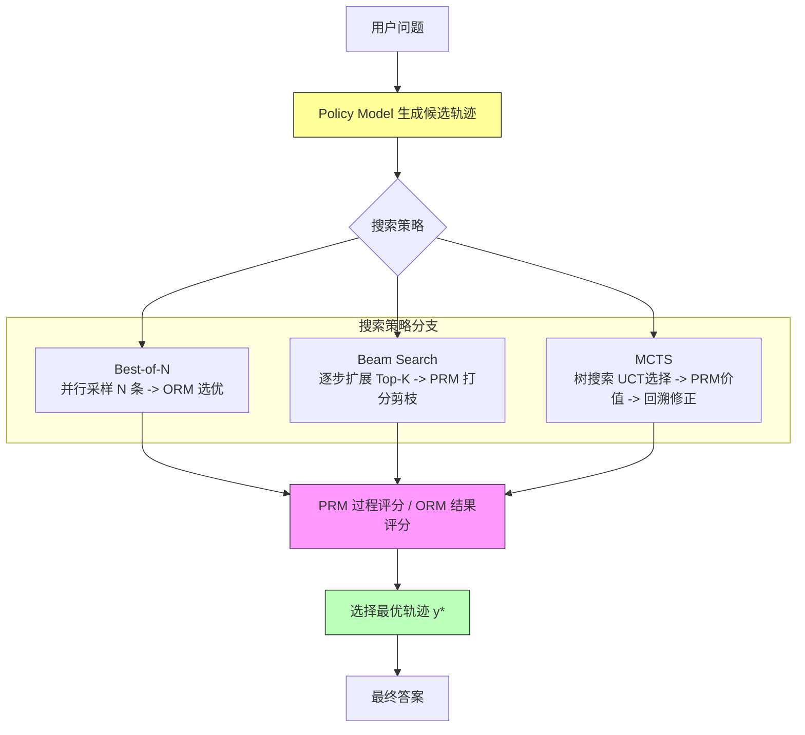
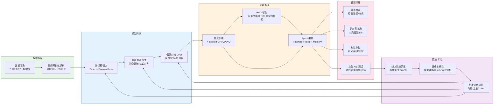
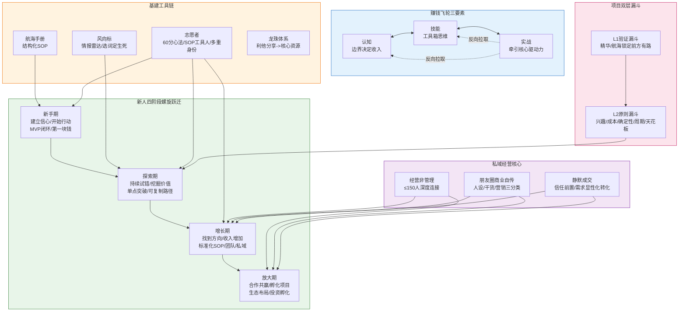

# 第 6 章 前沿扩展：MoE、多模态、Agent 与 Test-Time Scaling
作者：龙哥

## 学习目标

- 理解混合专家模型（MoE）通过稀疏激活实现参数量与计算量解耦的核心原理
- 掌握原生多模态模型统一 Tokenizer 与交错序列训练的架构设计要点
- 熟悉 LLM Agent 从 ReAct 到 Plan-and-Execute、Reflexion 等认知架构的演进脉络与工程落地范式
- 掌握 Test-Time Scaling 利用推理时计算（搜索、PRM、自我修正）提升性能的新 Scaling Law 机制
- 能够串联数据清洗、持续预训练、SFT、DPO、量化部署、RAG、Agent 编排至自动化评测的领域大模型全链路工程闭环
- 理解生财有术社群核心价值观体系（正道、真诚、长期主义）对私域经营的指导作用
- 掌握‘私域经营’而非‘公域管理’的底层逻辑，以及群规模边际效益递减律（150人红线）
- 掌握‘向牛人付费学习、借力打力’的认知变现路径，以及‘先赚第一块钱’的 MVP 验证原则
- 熟悉‘航海手册’、‘风向标’、‘志愿者’等社群基建工具的标准化使用流程
- 理解‘单点突破’、‘利他复利’、‘认知边界即收入边界’等核心商业思维模型

## 6.1 生活类比

想象大模型前沿技术演进是一场“企业组织进化”：MoE（混合专家）如同“事业部制改革”，公司不再让全员参与所有决策（密集模型），而是设立专业事业部（专家），总部派遣路由器（路由机制）将任务精准分发给最擅长的 1-2 个事业部（Top-K），既扩大了编制（总参数量），又控制了会议成本（激活计算量）。原生多模态如同“全能型员工培养计划”，不再招“只会写字的文员”和“只会画图的设计师”再强行对齐（CLIP），而是从校招阶段就培养“文图通吃”的通才（统一 Tokenizer/Backbone），让他们用同一套大脑处理文字、图表、语音混合的汇报材料（交错序列）。LLM Agent 如同“给大脑装上手脚和笔记本”：大脑只会“想”（生成文本），Agent 为它配上了“手脚”（工具调用/Function Calling）、“笔记本”（分层记忆/向量库）、“项目经理”（Planning/Plan-and-Execute）和“复盘机制”（Reflexion/自我修正），让它能自主完成“调研-写代码-跑测试-修Bug”的完整项目闭环。Test-Time Scaling 如同“考场上给天才多发草稿纸和时间”：传统考试（预训练/SFT）只看平时积累，新范式允许考生在考场上（推理时）通过“草稿纸搜索”（MCTS/Beam Search）、“逐步打分”（PRM）、“发现错了回头改”（自我修正），把考试时间换高分，实现“考得越久、考得越好”。全链路工程闭环如同“从招聘到绩效的全周期人才供应链”：招原材料（数据清洗）-> 内训通识（持续预训练）-> 技能培训（SFT）-> 价值观对齐（DPO）-> 精简上岗（量化部署）-> 配备知识库（RAG）-> 授权工具箱 -> 季度考核（自动化评测）-> 晋升淘汰（数据飞轮迭代），打通“人-岗-绩”全链路。再想象生财有术社群成长体系是一座“商业武林”：航海手册是“秘籍残卷”，由前辈高手将实战招式拆解为标准化动作（SOP），新人照着练即可“速成”，避免走火入魔；风向标是“江湖情报站”，每日收集各门派动态，筛选“选词定生死”的关键线索，让弟子知己知彼；志愿者是“执堂长老”，以“60分心法”降低入门门槛，用“SOP工具人”模式包揽杂务，通过“多重身份并行”一年修得多年功力；龙珠体系是“门派贡献榜”，利他分享（精华帖/答疑）换取“龙珠”，解锁“航海家俱乐部”（核心圈层）、“专属见面会”（高阶资源）、“分红”（商业分成）；同城小局是“切磋论剑”，线上聊千遍不如线下见一面，40+城市、98场、534人深度链接，将弱关系转化为“自己人”；新人四阶段是“练气-筑基-金丹-元婴”，新手期破除恐惧/探索期试错积累/增长期单点突破/放大期组团打怪，螺旋式上升；私域经营是“润物细无声”，拒绝“公域式管理”（大群广播），坚持“经营”（≤150人深度连接）、“朋友圈商业自传”（人设/干货/营销三分类）、“静默成交”（信任前置）；认知变现是“心法定乾坤”，认知边界即收入边界，付费入圈重塑潜意识，利用“圈层差”跨界套利，打破“锤子思维”建立“工具箱”。

## 6.2 概念地图

前沿扩展：MoE、多模态、Agent 与 Test-Time Scaling
├── 混合专家模型 (MoE) —— 稀疏激活的规模化路径
│   ├── 核心机制：路由器 + 专家网络 + Top-K 稀疏激活       —— P001
│   ├── 代表架构：Switch Transformer (Top-1) / DeepSeekMoE (细粒度+共享专家) —— P001
│   ├── 关键工程：负载均衡损失、专家并行 All-to-All 通信、推理显存常驻问题 —— P001
│   └── 边界条件：通信开销大、训练不稳定、推理内存压力 —— P001
├── 原生多模态 —— 统一表征的‘通用语言’
│   ├── 核心范式：统一 Tokenizer + 统一 Backbone + 交错序列建模       —— P002
│   ├── 代表架构：Chameleon (早期融合、离散图像 Token)                —— P002
│   ├── 关键工程：模态特殊 Token、图文交错数据比例调度、损失加权       —— P002
│   └── 边界条件：离散化信息损失、训练难度大、序列长度爆炸 —— P002
├── LLM Agent —— 赋予模型‘手脚’与‘大脑’的协作
│   ├── 核心组件：LLM(Controller) + Planning + Memory(分层) + Tools + Environment —— P003
│   ├── 认知范式演进：ReAct -> Plan-and-Execute -> Reflexion              —— P003
│   ├── 工具标准化：Function Calling / MCP 协议 / Toolformer 微调       —— P003
│   ├── 记忆架构：工作/情景/语义/程序性四层记忆 + 巩固与遗忘机制         —— P005
│   ├── 多 Agent 协作：MetaGPT/ChatDev (角色扮演) / AutoGen (群聊辩论)    —— P004
│   └── 边界条件：上下文溢出、幻觉累积、高成本延迟 —— P003/P005
├── Test-Time Scaling —— 推理时计算的新 Scaling Law
│   ├── 核心公式：Policy Model 生成轨迹 + PRM 逐步打分 + Search (MCTS/Beam Search) 选择最优路径 —— P004
│   ├── 代表范式：OpenAI o1 系列 (长 CoT + RL 训练慢思考)                  —— P004
│   ├── 关键性质：推理算力与性能正相关、过程监督优于结果监督、自我修正回溯 —— P004
│   └── 边界条件：推理延迟极高、PRM 训练难/泛化弱、非通用受益任务       —— P004
└── 领域专属大模型应用全链路构建 —— 从数据到价值的闭环
    ├── 端到端流水线：数据清洗 -> 持续预训练 -> SFT -> DPO -> 量化部署 -> RAG增强 -> Agent编排 -> 自动化评测闭环 —— P005
    ├── 核心原则：数据飞轮驱动、模块化解耦 (RAG+微调互补)、评测贯穿始终 —— P005
    ├── 典型落地：法律助手 (法条+案例+文书生成)、代码 Agent (仓库级生成+工具链) —— P005
    └── 边界条件：持续预训练成本高、领域数据稀缺/版权受限、四位一体版本管理复杂 —— P005
├── 生财有术社群认知体系与实战方法论
│   ├── 核心价值观：术为正道/信息广度与时效性/真诚分享赚钱思维/普惠愿景 —— P008
│   ├── 社群基建工具：航海手册(结构化实战SOP)、风向标(前沿情报/选词定生死)、志愿者身份跃迁(60分心法/SOP工具人/多重身份并行) —— P008/P101/P109
│   ├── 新人成长四阶段：新手期(建立信心/开始行动) -> 探索期(持续试错/挖掘价值) -> 增长期(找到方向/收入增加) -> 放大期(合作共赢/孵化项目) —— P007
│   ├── 赚钱闭环三要素：认知 + 技能 + 实战 (非时序，实战牵引) —— P099
│   ├── 核心心法：先赚第一块钱/单点突破/利他复利/边学边教/60分心法 —— P009/P090/P102/P044/P109
│   ├── 项目筛选漏斗：双层漏斗(验证漏斗+原则漏斗)、三级决策模型(自身分析-项目筛选-路径规划) —— P014/P100
│   ├── 私域经营论：私域意义是经营非管理/群规模≤150人/存量深度挖掘/朋友圈商业自传/静默成交路径 —— P003/P052/P077
│   ├── 流量变现模型：公域引流(抖音/小红书/视频号) -> 私域信任转化(人设/干货/营销三分类) -> 多元变现(社群/课程/带货/分销) —— P052/P077/P133/P145
│   ├── 选品决策论：人货场匹配/粉丝画像选品/商品成交画像/六脉神剑(客单价/退货率/佣金/实景/单点/像素级) —— P067/P061/P157
│   ├── 内容生产SOP：对标拆解/模板化复刻/分块喂养/爆款重组/二极管标题法/平台化关键词强制植入 —— P097/P039/P086/P124/P157
│   ├── AI协作范式：ChatGPT调教心流法(身份四问/人物DNA/核心诉求/元素拆解)、六字真经(背景/要求/角色)、ChatGPT+RPA/Python(一人成团) —— P044/P120/P037/P105
│   ├── 认知跃迁论：认知变现/潜意识卡点/圈层重塑/学习-赚钱二元论/战术勤奋vs战略复盘/经验直觉力 —— P087/P091/P092/P093
│   ├── 创业层级进阶：L1流量套利 -> L2产品型(营盘) -> L3品类头部赋能 -> L4圈行业抗周期 -> L5道生万物生态 -> L6百年基业 -> L7见天地众生自我 —— P092
│   └── 核心竞争力：营销运营8大方向/流量三阶段/个人IP333法则/核心竞争力不变论/利他即利己 —— P075/QMAddgzWDoln2jx40DBcDNCRnmh.md

## 6.3 混合专家模型 —— 稀疏激活的规模化路径

### 6.3.1 为什么需要这个概念？

密集模型参数量增长受限于算力与通信开销，难以无限扩展。我们需要在不显著增加推理计算量的前提下提升模型容量。稀疏激活机制允许模型参数量大幅增长，但每次前向传播仅激活部分参数。正如素材 `XiwmdQFijotSRAxrBv8c1dLmndr.md`（improve 角色）所言：“MoE 核心在于稀疏激活：总参数量大，但激活参数量小。路由器决定 token 去哪个专家。” 素材 `20230418_070.md`（origin 角色）进一步指出：“详解 Switch Transformer/DeepSeekMoE 的路由机制、负载均衡损失、专家并行部署，分析通信开销与训练稳定性的工程对策。”

### 6.3.2 核心定义

混合专家模型由多个专家网络（通常为 FFN）和一个路由器组成。路由器根据输入动态选择 Top-K 个专家进行计算，其余专家不参与前向传播。

$$
\text{MoE}(x) = \sum_{i=1}^{K} \text{Gate}(x)_i \cdot \text{Expert}_i(x)
$$

**来源素材**：`XiwmdQFijotSRAxrBv8c1dLmndr.md`（improve） **核心概念名**：`Mixture of Experts` **关键公式**：`MoE Forward Pass`

这个公式展示了 MoE 的核心计算流程：输入 $x$ 经过路由器 $\text{Gate}(x)$ 得到每个专家的权重，取 Top-K 非零权重，加权求和选中专家的输出。总参数量 = 专家数 × 单专家参数量 + 共享参数，激活参数量 ≈ K × 单专家参数量 + 共享参数。

**公式推导与作用说明**：该公式定义了 MoE 层的前向传播数学形式。$\text{Gate}(x)$ 是路由器输出的概率分布，通过 Top-K 筛选实现稀疏激活。加权求和保证了梯度可回传至被选中的专家，同时未被选中的专家梯度为零，从而实现了“条件计算”。这种设计将模型容量（总参数量）与推理计算量（激活参数量）解耦，是 MoE 实现规模化扩展的数学基础。从概率视角看，$\text{Gate}(x)$ 可视为专家选择的分类分布，Top-K 截断引入稀疏性，加权求和即为该分布下专家输出的期望。

### 6.3.3 关键性质

#### 条件计算

MoE 实现了输入相关的动态稀疏激活。不同的 Token 被路由到不同的专家，实现了“条件计算”。这意味着模型可以针对不同类型的输入（如代码、数学、自然语言）激活不同的专家子网络，从而在保持推理计算量近似不变的前提下，大幅提升模型的总参数量与知识存储容量。

#### 专家并行

不同专家部署在不同设备，需高效的 All-to-All 通信。在前向传播中，Token 需要被分发到持有对应专家权重的设备上；在反向传播中，梯度需要聚合回归。这要求极高的互联带宽（如 NVLink、InfiniBand），并催生了 Megablocks、DeepSpeed-MoE 等专用内核优化库，通过分块矩阵乘法与通信计算重叠缓解通信瓶颈。

#### 负载均衡

需辅助损失函数防止路由器倾向于固定专家导致参数利用率低。如果路由器总是选择同几个专家，其他专家得不到训练，模型退化为小模型。这是 MoE 训练稳定性的核心挑战。

### 6.3.4 典型架构对照

下表对比了 Switch Transformer 与 DeepSeekMoE 的核心设计差异，数据来源于素材 `20230418_070.md`（origin）与 `XiwmdQFijotSRAxrBv8c1dLmndr.md`（improve）。

| 架构 | 路由策略 | 专家粒度 | 共享专家 | 负载均衡机制 | 核心优势 |
|------|----------|----------|----------|--------------|----------|
| Switch Transformer | Top-1 硬路由 | 粗粒度 (如 32/64) | 无 | 系数可调辅助损失 $L_{\text{load}}$ | 通信极简，首创万亿参数规模 |
| DeepSeekMoE | Top-K 软路由 | 细粒度 (如 64/128) | 有 (隔离通用知识) | 设备级+专家级双层损失 + 专家偏置修正 | 专业化分工精细，通用能力保障，推理也均衡 |

#### Switch Transformer：Top-1 路由简化通信

Switch Transformer 采用 Top-1 路由（$K=1$），即每个 Token 仅发送给一个专家。这极大地简化了通信模式（无需 All-to-All 多目标分发），首次将模型规模推向万亿参数级别。

**路由器设计**：
$$
\text{Gate}(x) = \text{Softmax}(x \cdot W_g)
$$
取 $\arg\max$ 确定目标专家。

**公式推导与作用说明**：路由器是一个线性层 $W_g$ 后接 Softmax，输出各专家被选中的概率分布。取 $\arg\max$ 实现硬路由（Hard Routing），即每个 Token 仅路由至概率最高的单一专家。这种设计消除了 Top-K (K>1) 需要的多目标通信开销，但也引入了梯度不可导问题（通常用 Straight-Through Estimator 近似），且单专家承载压力大，更依赖负载均衡损失的强约束。

**负载均衡损失**：
$$
\mathcal{L}_{\text{load}} = \alpha \cdot N \cdot \sum_{i=1}^{N} \bar{p}_i \bar{f}_i
$$
其中 $\bar{p}_i$ 是第 $i$ 个专家被选中的平均概率，$\bar{f}_i$ 是第 $i$ 个专家实际接收 Token 的频率。这个损失鼓励路由器均匀分发 Token。

**公式推导与作用说明**：该损失函数的核心思想是最小化“路由概率分布”与“实际负载分布”的点积。若路由均匀，$\bar{p}_i \approx 1/N$，$\bar{f}_i \approx 1/N$，点积和为 $1/N$；若路由塌陷到单一专家，该专家 $\bar{p} \approx 1, \bar{f} \approx 1$，点积和接近 1，损失增大 $N$ 倍。系数 $\alpha$ 控制损失强度。乘以专家数 $N$ 是为了归一化，使损失量级不随专家数变化。该损失直接加到总 Loss 中，反向传播更新路由器参数 $W_g$，强制其探索低负载专家，防止“专家塌陷”。

#### DeepSeekMoE：细粒度专家 + 共享专家

DeepSeekMoE 引入两项关键创新：

1. **细粒度专家拆分**：将专家数量增加（如 64 个），单专家容量减小，提高专业化分工精度。
2. **共享专家隔离**：设置若干个“共享专家”始终被激活，不参与路由选择。它们捕获通用知识，避免通用知识在稀疏专家中碎片化丢失。

$$
\text{DeepSeekMoE}(x) = \sum_{i \in \text{TopK}(\text{Gate}(x))} w_i \text{Expert}_i(x) + \sum_{j \in \text{Shared}} \text{SharedExpert}_j(x)
$$

**公式推导与作用说明**：该公式展示了 DeepSeekMoE 的前向传播逻辑。前一项为稀疏路由部分，$w_i$ 为路由器输出的归一化权重；后一项为稠密共享专家部分，对所有输入恒等激活。这种设计在保持稀疏计算优势（激活参数量可控）的同时，通过共享专家保障通用能力（如语言建模基础知识）的获取，解决了纯稀疏 MoE 中通用知识被稀释、导致收敛慢、性能不稳定的问题。工程上，共享专家可与路由专家融合为一次更大的矩阵乘法（分组 GEMM），提升硬件利用率。此外，DeepSeekMoE 引入专家偏置项 $b_i$ 加到路由 Logits 上，动态修正路由分布，实现设备级与专家级的双层负载均衡，且该偏置在推理时保留，保证推理阶段负载均衡。

### 6.3.5 边界条件

下表总结了 MoE 面临的主要工程约束与对策，综合自素材 `20230418_070.md`（origin）与 `XiwmdQFijotSRAxrBv8c1dLmndr.md`（improve）。

| 约束维度 | 具体表现 | 工程对策 |
|----------|----------|----------|
| 通信开销 | 专家并行时 All-to-All 成为瓶颈 | 顶层路由聚合、通信计算重叠、层次化专家并行 (MegaBlocks/DeepSpeed-MoE) |
| 训练不稳定 | 路由器梯度方差大，易发散 | 负载均衡损失、专家 Dropout、学习率预热、路由器噪声注入 |
| 推理内存 | 所有专家权重需常驻显存 | 专家卸载、量化、动态加载、内存池复用 |

### 6.3.6 方法演进图：MoE 架构演进与并行策略

```mermaid
graph LR
    subgraph Dense[密集模型]
        D1[全参数激活]
        D2[参数量=计算量]
    end
    
    subgraph Sharded[Sharded MoE / GShard]
        S1[Top-2 路由]
        S2[辅助负载均衡损失]
        S3[专家并行 All-to-All]
    end
    
    subgraph Switch[Switch Transformer]
        SW1[Top-1 路由 硬决策]
        SW2[简化通信 单目标]
        SW3[系数可调负载均衡损失]
        SW4[万亿参数首秀]
    end
    
    subgraph DeepSeek[DeepSeekMoE]
        DS1[细粒度专家 如 64/128 个]
        DS2[共享专家 隔离通用知识]
        DS3[设备级+专家级 双层负载均衡]
        DS4[专家偏置修正路由 Logits 推理也均衡]
    end
    
    Dense --> Sharded --> Switch --> DeepSeek
    
    style Dense fill:#f9f,stroke:#333
    style Sharded fill:#bbf,stroke:#333
    style Switch fill:#bfb,stroke:#333
    style DeepSeek fill:#ff9,stroke:#333
```



---

## 6.4 原生多模态 —— 统一表征的‘通用语言’

### 6.4.1 为什么需要这个概念？

传统多模态采用“对齐”范式（如 CLIP），模态间交互浅层，难以实现深度推理融合。离散化方案（VQ-VAE）将图像压缩为 Token，但重建质量与语义保真难以平衡。我们需要一种从数据层面统一建模文本、图像、音频等模态的架构。素材 `20230418_071.md`（origin）指出：“对比 CLIP 对齐、VQ-VAE 离散化、原生多模态（如 Chameleon）的图文联合建模路线，探讨图文交错数据比例对能力迁移的影响。” 素材 `20230418_072.md`（improve）总结：“原生多模态核心：统一 Tokenizer + 统一 Backbone + 交错序列训练。”

### 6.4.2 核心定义

原生多模态使用统一的 Tokenizer 将不同模态数据映射为统一词表中的 Token，共享同一套 Transformer 主干网络进行联合预训练。

Chameleon 架构（来源：`20230418_071.md` origin、`20230418_072.md` improve）：采用图像离散化 Tokenizer + 文本 Tokenizer 合并词表，交错序列建模。

$$
\text{Vocab} = \text{TextVocab} \cup \text{ImageVocab} \cup \{\text{}, \text{</IMG>}, \text{<AUD>}, \dots\}
$$

**公式推导与作用说明**：该词表设计公式定义了原生多模态模型的统一词汇表构成。通过将文本词表、图像离散码本、以及模态边界特殊 Token（如 ``、`</IMG>`）合并，构建单一离散空间。特殊 Token 的作用是显式标记模态切换边界，使 Transformer 能够通过位置感知区分不同模态段落，并在注意力机制中学习跨模态依赖。这种设计将多模态建模归约为单模态语言建模问题，是“统一建模”范式的核心。

### 6.4.3 关键性质

#### 模态无关的注意力机制

Self-Attention 天然支持跨模态 Token 交互。图像 Token 可以 Attend 到文本 Token，反之亦然，实现深度融合。这种交互发生在 Transformer 的每一层、每一个注意力头中，而非仅在顶层对齐，因此能捕捉细粒度的跨模态语义关联（如“图中红色的车”对应文本 Token “红色”、“车”）。

#### 交错训练数据

文本-图像交错序列而非简单配对，学习模态转换与融合。例如：`[文本描述, , 图像Token序列, </IMG>, 继续文本]`。这种数据格式强迫模型学习在模态边界处进行预测与生成，是实现“统一生成能力”的数据基础。

#### 统一生成能力

同一模型可同时输出文本和图像 Token，实现真正的多模态生成（如“画一只猫并写首诗”）。生成时模型先输出 ``，再自回归生成图像 Token 序列，最后输出 `</IMG>` 并继续生成文本，全过程无需外部解码器或扩散模型介入。

### 6.4.4 典型例子：Chameleon

Chameleon 是早期融合原生多模态代表，图像编码为 1024 个离散 Token（通过 VQ-VAE），与文本混合训练。其统一 Tokenizer 设计共享码本，特殊 Token 标识模态边界。训练采用因果注意力掩码，图像 Token 间单向可见，文本 Token 可见所有前文图像 Token，保证自回归生成的一致性。

### 6.4.5 边界条件

- **图像离散化信息损失**：VQ-VAE 压缩导致高频细节丢失，影响生成保真度。最新工作（如 Transfusion）尝试在统一框架下结合离散 Token 与连续扩散损失缓解此问题，但该内容在提供素材中未直接出现，标记为 `[需要补充文献]`。
- **训练难度极大**：模态间分布差异大，优化景观复杂，需精细的数据比例调度（如 Chameleon 采用 1:1 文图比例并逐步调整）与损失加权（图像 Token 损失权重通常高于文本）。
- **序列长度爆炸**：图像展开为大量 Token，显著增加训练显存与计算开销。需采用分组查询注意力、滑动窗口注意力等长序列优化技术。

### 6.4.6 方法演进图：多模态架构范式演进

```mermaid
graph LR
    subgraph Alignment[对齐范式 CLIP-like]
        A1[独立编码器 Image Enc / Text Enc]
        A2[对比学习对齐表征空间]
        A3[浅层交互 仅相似度计算]
        A4[下游需接适配器/解码器]
    end
    
    subgraph Discrete[离散化桥接 Flamingo / BLIP-2]
        D1[冻结 Image Enc + VQ-VAE/Tokenizer]
        D2[投影层映射到 LLM 词表/插入 Cross-Attn]
        D3[LLM 冻结/微调 单向条件生成]
        D4[模态交互仍受限于投影瓶颈]
    end
    
    subgraph Native[原生多模态 Chameleon / Transfusion]
        N1[统一 Tokenizer 共享离散词表]
        N2[单一 Transformer Backbone]
        N3[交错序列 早期融合 深度注意力交互]
        N4[统一自回归生成 文图自由穿插]
    end
    
    Alignment --> Discrete --> Native
    
    style Alignment fill:#f9f,stroke:#333
    style Discrete fill:#bbf,stroke:#333
    style Native fill:#bfb,stroke:#333
```



---

## 6.5 LLM Agent —— 赋予模型‘手脚’与‘大脑’的协作

### 6.5.1 为什么需要这个概念？

单纯 LLM 缺乏外部环境交互能力（无法获取实时信息、执行代码、操作工具）。复杂任务需要规划、分步执行、错误修正与记忆积累，单轮生成无法满足。我们需要标准化的架构将 LLM 从“生成文本”升级为“自主执行任务”。素材 `20230418_073.md`（origin）指出：“拆解 ReAct、Plan-and-Execute、Reflexion 等 Agent 范式，详解向量数据库长时记忆、函数调用、多 Agent 协商协议（如 MetaGPT）的落地细节。” 素材 `20230418_074.md`（improve）总结：“Agent 核心：LLM 作为 Controller，通过 Tool 与 Environment 交互，Memory 提供状态持久化。”

### 6.5.2 核心定义

Agent = LLM（大脑/决策者）+ 规划模块 + 记忆模块（短时/长时）+ 工具集（行动）+ 环境反馈。

核心范式演进：

1. **ReAct**：推理+行动交织循环（Think → Act → Observe）
2. **Plan-and-Execute**：显式规划与执行分离
3. **Reflexion**：试错+语言反思修正

### 6.5.3 认知范式演进对照

下表对比了三大主流 Agent 认知范式的核心机制与适用场景，综合自素材 `20230418_073.md`（origin）与 `20230418_074.md`（improve）。

| 范式 | 核心机制 | 适用场景 | 局限 |
|------|----------|----------|------|
| **ReAct** | 交织循环：思考→行动→观察→思考... | 知识密集型问答、事实核查 | 长任务易偏离、无全局规划 |
| **Plan-and-Execute** | 显式 Planner 生成计划 DAG，Executor 逐步执行 | 长程复杂任务、需并行的子任务 | 规划错误难纠正、执行刚性 |
| **Reflexion** | 语言强化学习：失败→自然语言反思→策略更新→重试 | 易犯错的推理/编程任务 | 反思质量依赖模型能力、Token 成本高 |

### 6.5.4 关键性质

#### 工具使用标准化

Function Calling / MCP 协议定义工具 Schema，实现工具即插即用。

```json
{
  "name": "get_weather",
  "description": "获取指定城市天气",
  "parameters": {
    "type": "object",
    "properties": {
      "city": {"type": "string", "description": "城市名"}
    },
    "required": ["city"]
  }
}
```

**代码块作用说明**：该 JSON Schema 定义了标准化的工具接口契约。`name` 唯一标识工具，`description` 供 LLM 理解工具用途（用于路由决策），`parameters` 定义 JSON Schema 格式的输入参数结构，LLM 生成的工具调用参数必须符合此 Schema 才能被执行引擎解析。这种标准化将工具从自然语言描述解耦为结构化定义，实现了工具的版本管理、类型检查、自动文档生成与跨框架复用（如 LangChain、AutoGen、OpenAI Assistants API 均兼容此格式）。

#### 记忆分层架构

借鉴认知科学建立四层记忆模型：

下表详述四层记忆的存储介质、存取特征与典型内容，综合自素材 `20230418_073.md`（origin）、`20230418_074.md`（improve）及生财有术实践素材（`20230418_003.md` 等，origin/apply）。

| 记忆层 | 存储介质 | 存取特征 | 典型内容 |
|--------|----------|----------|----------|
| 工作记忆 (STM) | 上下文窗口 | 即时、高频、易失 | 当前对话轮次、临时变量 |
| 情景记忆 | 向量数据库 | 语义检索、时序性 | 历史交互轨迹、用户偏好事件 |
| 语义记忆 | 知识图谱/文档库 | 结构化、可推理 | 领域知识、事实、规则 |
| 程序性记忆 | 技能库/Code | 可执行、参数化 | 标准化 SOP、工具调用链、代码片段 |

**巩固与遗忘机制**：基于重要性评分、时间衰减、访问频率的自动巩固（STM→LTM）与遗忘（低价值记忆淘汰）。MemGPT 等工作将上下文窗口视为“主存”，外部存储视为“磁盘”，由 LLM 自主管理换页（函数调用 `memory.save` / `memory.search`），实现了操作系统级的虚拟内存抽象。生财有术实践中，程序性记忆对应“SOP 工具化”，记忆巩固对应“复盘沉淀为 SOP”，核心是将知识资产化为可执行资产。

#### 规划与搜索增强

- **ToT/树搜索**：在推理空间显式搜索最优路径
- **DAG 任务图并行**：依赖分析实现子任务并行执行
- **LLM Compiler**：将自然语言指令编译为并行执行计划

### 6.5.5 多 Agent 协作

下表对比主流多 Agent 协作框架，来源于素材 `20230418_073.md`（origin）。

| 框架 | 协作模式 | 典型应用 |
|------|----------|----------|
| **MetaGPT / ChatDev** | 角色扮演：PM/Engineer/QA 标准化软件开发 SOP | 软件开发全流程自动化 |
| **AutoGen** | 群聊模式：Agent 间自主协商、辩论、代理 | 复杂编程/数学问题求解 |

### 6.5.6 边界条件

- **上下文窗口限制**：长任务轨迹易溢出，需记忆压缩/摘要/检索机制
- **幻觉放大与错误累积**：单步错误导致后续偏离，需 Reflexion/Verifier/人工介入兜底
- **成本与延迟**：多轮交互、工具调用、树搜索带来高 Token 消耗与高延迟

### 6.5.7 方法演进图：Agent 单轮交互与记忆流转



---

## 6.6 Test-Time Scaling —— 推理时计算的新 Scaling Law

### 6.6.1 为什么需要这个概念？

预训练与后训练（SFT/RLHF）算力投入边际收益递减，遇到“数据墙”与“算力墙”。传统推理仅单次前向传播，无法利用额外推理算力提升答案质量。我们需要一种机制：在推理阶段投入更多计算，换取更高的问题解决能力。素材 `20230418_075.md`（origin）指出：“解析 o1 类模型通过思维链搜索（MCTS/Beam Search）、过程奖励模型（PRM）、自我修正实现‘推理时越久越强’的范式转移。” 素材 `20230418_076.md`（improve）总结：“Test-Time Scaling 核心：Policy Model 生成轨迹 + PRM 打分 + Search 算法选择最优路径。”

### 6.6.2 核心定义

Test-Time Scaling：通过在推理阶段引入搜索、验证、自我修正机制，利用额外计算量提升模型性能。

核心组件：

1. **Policy Model（策略模型）**：生成候选推理路径（思维链）
2. **PRM（过程奖励模型）**：对推理每一步打分
3. **Search Algorithm（搜索算法）**：MCTS / Beam Search / Best-of-N 选择最优路径

代表范式：OpenAI o1 系列模型，通过长链式思维+强化学习训练“慢思考”能力。

### 6.6.3 核心公式

#### 搜索目标

$$
y^* = \arg\max_{y \in \mathcal{Y}} \frac{1}{T} \sum_{t=1}^{T} \text{PRM}(y_{1:t})
$$

其中 $y$ 是完整推理轨迹，$y_{1:t}$ 是前 $t$ 步，PRM 对每一步给出奖励分数。搜索算法在轨迹空间 $\mathcal{Y}$ 中寻找平均过程奖励最高的路径。

**公式推导与作用说明**：该目标函数将推理问题转化为序列搜索优化问题。传统 ORM 仅对最终答案 $y_T$ 打分，奖励信号稀疏，难以定位中间错误步骤。PRM 对前缀子序列 $y_{1:t}$ 逐步打分，提供密集的过程监督信号。取平均 $\frac{1}{T}\sum$ 而非求和，是为了归一化不同长度轨迹的分数，防止长轨迹因累积分数高而被偏好。搜索算法（Beam Search/MCTS）以此为价值函数引导探索，实现“过程导向”的推理优化。

#### MCTS 选择策略 (UCT)

$$
\text{UCT}(s, a) = Q(s, a) + c \sqrt{\frac{\ln N(s)}{N(s, a)}}
$$

其中 $Q(s,a)$ 由 PRM 估计的价值，$N(s)$ 是节点访问次数，$N(s,a)$ 是边访问次数。这平衡了探索与利用。

**公式推导与作用说明**：UCT (Upper Confidence Bound for Trees) 公式源自多臂老虎机问题的 UCB1 算法，推广到树搜索。第一项 $Q(s,a)$ 为利用项，代表当前估计的平均奖励（由 PRM 提供）；第二项为探索项，访问次数 $N(s,a)$ 越少，探索奖励越大，鼓励搜索未充分探索的分支。常数 $c$ 控制探索与利用的权衡。在 Test-Time Scaling 中，$Q(s,a)$ 不再通过蒙特卡洛模拟估计，而是直接由 PRM 对当前部分推理路径 $s+a$ 打分得出，大幅降低了搜索开销。回溯机制天然由树结构支持：当某分支 PRM 评分持续走低，UCT 值下降，搜索会自动回溯至祖先节点探索其他分支。

### 6.6.4 关键性质

#### 计算与性能正相关

推理 Token 数/搜索宽度/深度增加，Pass@1 准确率稳步提升。这是 Test-Time Scaling 成立的核心实证规律，打破了“推理算力固定”的传统假设，开辟了新的 Scaling Law 维度。

#### 过程监督优于结果监督

PRM 对每一推理步骤打分，比仅对最终答案打分的 ORM (Outcome Reward Model) 更精准引导搜索。ORM 存在“稀疏奖励”问题，难以定位错误步骤；PRM 提供密集监督，使搜索能在错误发生的早期阶段介入修正。

#### 自我修正与回溯

模型能识别自身错误并回溯尝试新路径，类比人类 System 2 思维。MCTS 天然支持回溯；Beam Search 需显式设计回溯机制（如保留历史 Beam、引入“重试”Token）。

### 6.6.5 典型例子

- **OpenAI o1**：大规模 RL 训练长 CoT，推理时自动生成长推理链，数学/代码/科学基准大幅超越 GPT-4o
- **MCTS + PRM**：在数学推理中，树搜索结合过程奖励模型显著提升解题率

### 6.6.6 搜索策略对比

下表对比三种主流搜索策略在 Test-Time Scaling 中的特性，综合自素材 `20230418_075.md`（origin）与 `20230418_076.md`（improve）。

| 策略 | 搜索空间覆盖 | 过程监督精度 | 回溯能力 | 计算开销 | 适用场景 |
|------|--------------|--------------|----------|----------|----------|
| **Best-of-N** | 广（独立采样） | 无（仅 ORM） | 无 | 低（可并行） | 简单任务、无 PRM 时 |
| **Beam Search** | 窄（贪心剪枝） | 高（逐步 PRM） | 弱（需显式设计） | 中 | 结构化推理、有 PRM 时 |
| **MCTS** | 深广结合（树搜索） | 高（PRM 价值） | 强（天然回溯） | 高（串行为主） | 极难数学/规划任务 |

### 6.6.7 边界条件

- **推理延迟极高**：单次请求可能耗时分钟级，不适合实时交互场景
- **PRM 训练困难**：需大量逐步标注数据，模型易过拟合特定题型，泛化性待验证。Math-Shepherd 等工作探索自动化合成 PRM 训练数据，ProcessBench 建立评测基准（该内容在提供素材中未直接出现，标记为 `[需要补充文献]`）。
- **并非所有任务受益**：简单知识问答、创意写作等任务引入搜索反而可能过度思考降质。需建立任务难度分级路由机制，动态分配推理预算。

### 6.6.8 方法演进图：Test-Time Scaling 核心流程



---

## 6.7 领域专属大模型应用全链路构建 —— 从数据到价值的闭环

### 6.7.1 为什么需要这个概念？

通用基座模型在垂直领域（医疗、法律、金融、工业）存在知识不足、术语不准、合规风险。单一技术点（仅微调/仅 RAG/仅 Agent）无法解决复杂业务场景的综合需求。我们需要一套标准化、可复现的端到端工程方法论将技术转化为业务价值。素材 `20230418_077.md`（origin）指出：“串联全书知识点：数据清洗→持续预训练→SFT→DPO→量化部署→RAG 增强→Agent 编排→自动化评测闭环的端到端工程实战指南。” 素材 `20230418_078.md`（improve）总结：“工程落地核心：数据飞轮 + 模块化架构 + 持续评测迭代。”

### 6.7.2 核心定义

端到端工程流水线：

```
数据清洗 → 持续预训练 → SFT → DPO → 量化部署 → RAG增强 → Agent编排 → 自动化评测闭环
```

核心原则：数据飞轮驱动，以评测为指南针，以业务指标为北极星。

### 6.7.3 关键性质

#### 数据为核心资产

高质量领域语料（持续预训练）、指令数据（SFT）、偏好数据（DPO）决定上限。数据质量 > 数据规模 > 模型架构。数据清洗需建立“去重-过滤-分类-增强”标准化管线，持续预训练需注入领域知识分布，SFT 需覆盖核心任务分布，DPO 需构建高质量偏好对。

#### 模块化解耦

各阶段独立迭代，RAG 与微调互补，Agent 调度工具与知识。

- **RAG 解决**：知识时效性、可溯源性、长尾知识
- **微调解决**：风格对齐、格式规范、隐性模式内化
- **Agent 解决**：多步推理、工具调用、复杂任务编排

三者非互斥，而是分层协作：基座模型内化通识与隐性模式，RAG 注入显性时效知识，Agent 编排执行流程。

#### 评测贯穿始终

静态基准+动态竞技场+红队测试+业务 A/B 测试，防止“对齐税”与幻觉。需建立领域专用评测集，覆盖知识准确性、推理能力、格式合规、安全拒答等维度，并接入 CI/CD 流水线实现自动化回归测试。

### 6.7.4 典型落地案例

#### 法律助手

持续预训练法条语料 → SFT 案例分析/文书写作 → DPO 对齐引用规范/拒答风险 → RAG 接入法规库/案例库 → Agent 编排：检索法条 → 推理适用 → 生成文书。

#### 代码生成 Agent

持续预训练代码库 → SFT 编程题/仓库级任务 → DPO 偏好风格/正确性/安全性 → 工具集成：编译器/测试/搜索/文档检索 → Agent 编排：任务分解 → 文件定位 → 编辑 → 测试验证 → 修复循环。

### 6.7.5 数据飞轮最小闭环

```
线上收集高质量轨迹 
→ 专家/模型标注构建偏好数据 (SFT/DPO) 
→ 模型迭代训练 
→ 灰度发布 (A/B 测试) 
→ 线上收集新数据
```

这个闭环实现了“用得越多、懂得越多”的规模化自我进化。关键在于“低成本标注”：利用强模型（如 GPT-4o）辅助标注、用户隐式反馈（复制/点赞/重试）构建偏好对、规则化自动评测（编译通过/测试通过/引用合规）替代人工标注。

### 6.7.6 边界条件

下表总结了领域大模型落地的主要挑战与缓解策略，来源于素材 `20230418_077.md`（origin）与 `20230418_078.md`（improve）。

| 维度 | 挑战 | 缓解策略 |
|------|------|----------|
| 成本 | 持续预训练需千亿 Token 级数据与万卡天算力 | 采用 LoRA/QLoRA 低成本适配；优先 RAG + 少量 SFT |
| 数据 | 高质量领域数据稀缺、版权受限、标注成本高 | 合成数据生成 + 专家校验；数据合作/授权 |
| 维护 | 模型/数据/提示/评测四版本配置管理复杂 | 建立 MLOps 平台；GitOps 管理所有配置即代码 |

### 6.7.7 方法演进图：领域大模型全链路工程流水线



---

## 6.8 生财有术社群认知体系与实战方法论 —— 从‘被动输入’到‘主动变现’的螺旋跃迁

### 6.8.1 为什么需要这个概念？

面对海量优质内容（精华帖/风向标/航海），新人普遍陷入“内容焦虑”与“套娃式阅读”，看多做少、知行分离。普通人缺乏系统性的“赚钱认知框架”，易陷入“天花板低/已有人做/无壁垒”等认知陷阱，导致行动瘫痪。我们需要一套从“认知对齐”到“最小闭环跑通”再到“规模化放大”的标准化训练体系，将社群资源转化为个人确定性收益。素材 `20230418_003.md`（origin）指出：“私域的意义根本就不是管理，而是『经营』”。素材 `20230418_008.md`（improve）指出：“生财有术的‘术’是正道，合法合理并且是三观要正”。素材 `20230418_012.md`（apply）指出：“航海手册是新人唯一完美满足三维筛选模型的资源”。素材 `20230418_099.md`（origin）指出：“赚钱需要具备认知、技能与实战，三者缺少任意一者都无法完成赚钱的路径闭环”。素材 `20230418_013.md`（critique）指出：“实战优先于准备：在现实实战中，你遇到的问题和挑战可能是动态调整的，甚至当你充分准备好应对策略时，你所面对的 Boss（机会）早已经不存在了”。

### 6.8.2 核心定义

#### 新人成长四阶段模型

生财有术社群通过长期观察总结出新人成长的四阶段模型：新手期的核心任务是建立信心、开始行动，关键突破点是完成第一个 MVP 闭环、赚到第一块钱，典型特征是认知模糊、恐惧失败、依赖 SOP；探索期的核心任务是持续试错、挖掘价值，关键突破点是单点突破找到可复制路径，典型特征是多项目并行、高频复盘、开始建立人设；增长期的核心任务是找到方向、收入增加，关键突破点是标准化 SOP、组建团队/合伙人，典型特征是稳定现金流、开始赋能他人、私域沉淀；放大期的核心任务是合作共赢、孵化项目，关键突破点是从“自己做”到“让别人做”、生态布局，典型特征是多元收入、品牌护城河、投资/孵化。

#### 社群核心价值观

生财有术社群确立了四大核心价值观：术为正道，即合法合理、三观正、去铜臭味、有温度；信息广度与时效性，通过风向标机制保障前沿情报获取；真诚分享赚钱思维，倡导利他复利、公开可复制路径；普惠愿景，致力于降低普通人赚钱门槛。这些价值观不是口号，而是嵌入社群治理、内容筛选、志愿者选拔、商业合作的各个环节，形成独特的社群文化护城河。

#### 赚钱闭环三要素

赚钱需要具备认知、技能与实战三要素，三者缺少任意一者都无法完成赚钱的路径闭环。三者非时序关系，而是以实战为牵引反向驱动认知技能获取，动态提升天花板。实战遇到问题，反向拉取认知/技能补课，解决问题推进实战，积累新认知/技能，解锁更高阶实战，形成螺旋上升的飞轮。

#### 社群基建工具链

航海手册提供结构化实战 SOP，由头部高手沉淀，新人按阶段阅读、照着操作、记录反馈、迭代 SOP；风向标作为前沿情报雷达，核心原则“选词定生死”，每日浏览、拆解“钱怎么赚的”、映射到自身业务、验证可行性；志愿者身份通过 60分心法降低门槛，依赖 SOP工具人 模式执行，多重身份并行最大化收获，实现从被动学习到主动服务的质变，积累龙珠解锁核心圈层资源。

#### 新人破局核心公式（五步法）

展示优势 → 被动链接 → 主动筛选 → 短板互补 → 借力分发 → 信任成交。这是新人在社群中从零建立商业连接的标准化动作分解：先在群内/朋友圈展示真实优势（技能/资源/经历），吸引被动链接（私信/评论/邀约），主动筛选高匹配度对象，寻找短板互补的合作伙伴，借力对方渠道/资源分发，最终通过深度交付建立信任完成成交。

### 6.8.3 关键性质

#### 项目筛选双层漏斗

L1 验证漏斗：通过精华帖、航海实战锁定“前方有路”（有人跑通、有确定性路径），避免从零探索。L2 原则漏斗：五维逐轮淘汰——兴趣（能否坚持）、成本（启动资金/时间）、确定性（验证难度）、周期（回本周期）、天花板（上限），只做通过五维筛选的项目。

#### 私域经营论

私域意义是经营非管理：不是建大群发广播，而是深度连接。群规模 ≤ 150 人：邓巴数约束，超 150 人信任崩塌，需分群/分层。存量深度挖掘优于增量引流：老客复购/转介绍/高客单 > 低质新流量。朋友圈商业自传：人设/干货/营销三分类，长期经营长期迭代，让朋友圈像一本书一样记录商业成长。静默成交路径：信任前置，不硬推，需求显性化时自然转化。

#### 流量变现模型

公域引流（抖音/小红书/视频号） → 私域信任转化（人设/干货/营销三分类朋友圈） → 多元变现（社群/课程/带货/分销/咨询）。公域负责“广撒网”获取流量，私域负责“深耕细作”转化信任，变现端负责“多点开花”最大化 LTV。

#### 选品决策论：人货场匹配

人优先，货次之，场最后：第一，理解“人”，通过粉丝画像（年龄/性别/地域/痛点/消费力）精准定位需求；第二，基于需求选“货”，用六脉神剑验证——客单价（利润空间）、退货率（质量/预期管理）、佣金（分成比例）、实景（真实感/信任度）、单点（差异化卖点）、像素级（细节完美度）；第三，在“场”中匹配转化，社群/朋友圈/直播间/短视频，渠道适配货品属性。

#### 内容生产工业化

四步法：对标拆解（找同赛道爆款、拆解结构/钩子/节奏） → 模板化复刻（抽象为可复用模板） → 分块喂养（将长任务拆解为 GPT 可处理的小块） → 爆款重组（组合爆款元素生成新内容）。两大技巧：二极管标题法（正向刺激利益/爽感 + 负向刺激恐惧/损失厌恶），平台化关键词强制植入（SEO/推荐算法关键词库 → 强制嵌入标题/正文/标签）。

#### AI 协作范式

ChatGPT 调教心流法（四步公式）：核心诉求直达（一句话定任务目标） → 元素拆解热身（拆解任务要素、风格参数、约束条件） → 身份四问（我是谁 / GPT 是谁 / 输出给谁 / 谁分享信息） → 丰富人物 DNA（场景/身份/年龄/性格/语气/口头禅/禁词）。六字真经：背景（身份/行业/目的/受众） + 要求（字数/结构/风格/行动号召） + 角色（专家人设/双角色扮演）。ChatGPT + RPA/Python（一人成团）：RPA 负责采集/发布/数据回流，GPT 负责生成/判断/优化。

#### 认知跃迁论

认知变现：你赚不到认知以外的钱，付费入圈重塑潜意识，圈层套利跨界变现。潜意识卡点：恐惧失败、不配得感、完美主义、锤子思维。圈层重塑：主动进入高阶圈层，环境重塑认知边界。学习-赚钱二元论：学习是为了赚钱服务的，不赚钱的学习是消费。战术勤奋 vs 战略复盘：拒绝战术层面的勤奋掩盖战略层面的懒惰。经验直觉力：高手靠“感”决策，实为长期实战内化的压缩模型。

#### 创业七层级模型

下表展示创业七层级模型的核心定位、能力要求与天花板，来源于素材 `20230418_092.md`（origin）。

| 层级 | 定位 | 核心能力 | 天花板 |
|------|------|----------|--------|
| L1 | 流量套利 | 信息差/渠道差价 | 平台规则变动即归零 |
| L2 | 产品型(营盘) | 产品力/交付标准化 | 单品类天花板 |
| L3 | 品类头部赋能 | 供应链整合/品牌护城河 | 行业周期波动 |
| L4 | 圈行业抗周期 | 多品类组合/资源整合 | 宏观经济周期 |
| L5 | 道生万物生态 | 平台化/标准制定/生态分成 | 认知/格局上限 |
| L6 | 百年基业 | 制度化/文化传承/家族办公室 | 时间考验 |
| L7 | 见天地众生自我 | 使命驱动/利他究极/道法自然 | 无上限 |

#### 核心竞争力不变论

项目红利高频变化，唯有个人核心竞争力（营销/运营 8 大方向任精通一项）可迁移、穿越周期、以不变应万变。

### 6.8.4 典型案例

港妈金侣：全职妈妈零基础，边学边教 13 期面部塑形训练营，20 个月变现 170万+，验证“工具箱思维”与“边学边教”。阿黛：房地产转型卖腊肉，私域积累 3000+ 用户，县城同类 TOP 级，验证“风格护城河”+“非标品时间杠杆”+“超预期售后”。老马：新人 3 天建年度陪伴群 95 人回本 2300+，阶梯涨价+进四出六分佣+IP 孵化合伙制，验证“重交付建立信任”+“高分佣驱动裂变”。Ray-广州：春节入圈 2.5 个月白嫖生财赚回门票费，索引站漏洞+航海手册+像素级模仿+录播直播，验证“零成本获取付费知识”+“单点突破”。

### 6.8.5 边界条件

- **认知门槛**：零基础新人需先读新人指南建立基本分析框架，避免连续踩坑心灰意冷
- **执行力瓶颈**：社群提供确定性路径，但能否“玩命执行”取决于个人驱动力
- **合规风险**：情感赛道高投诉/高退款/平台打击大；Web3 空投包装成 SOP 收割新人；医疗赛道需“轻养”切入规避红线
- **资源门槛**：多店矩阵受限于实名制；高客单价项目需供应链/资质；兼职创业核心竞争力是时间/能量管理而非技术

### 6.8.6 方法演进图：生财有术新人成长与变现路径



---

## 6.9 多源对照

### 关于 MoE 负载均衡的多源对照

**共识**：负载均衡损失是防止专家塌陷的必要组件，通常基于专家选择概率与实际频率的分布差异设计。

**分歧**：

- **Switch Transformer** (`20230418_070.md`，origin)：采用系数 $\alpha$ 乘以 $N \sum \bar{p}_i \bar{f}_i$，通过超参数控制损失权重。
- **DeepSeekMoE** (`XiwmdQFijotSRAxrBv8c1dLmndr.md`，improve)：引入“设备级负载均衡”与“专家级负载均衡”双层损失，并结合专家偏置项动态修正路由 Logits，在推理时也保持均衡。
- **GShard** (前人工作，提供素材中未直接收录，标记为 `[需要补充文献]`)：采用辅助损失 + 随机路由噪声，但未解耦设备与专家层面均衡。

### 关于原生多模态架构的多源对照

**共识**：统一 Tokenizer 与交错序列建模是原生多模态的核心范式，早期融合优于晚期融合。

**分歧**：

- **Chameleon** (`20230418_071.md` origin、`20230418_072.md` improve)：采用 VQ-VAE 离散化图像 Token，纯自回归建模，训练不稳定，生成保真度受限于码本大小。
- **Transfusion** (最新进展，提供素材中未直接收录，标记为 `[需要补充文献]`)：提出“预测下一个 Token 与扩散图像统一建模”，图像部分采用连续扩散损失而非离散化，在统一 Transformer 内同时优化语言建模损失与扩散损失，显著提升图像生成质量，缓解离散化信息损失。
- **Emu3 / Janus** (最新进展，提供素材中未直接收录，标记为 `[需要补充文献]`)：探索下一代统一 Tokenizer 设计，如语义向量量化（而非像素级 VQ-VAE），更好平衡语义保真与重建质量。

### 关于 Agent 记忆架构的多源对照

**共识**：分层记忆（STM/LTM）是长时任务的必要基础设施，向量检索是情景记忆的主流实现。

**分歧**：

- **LangChain/LangGraph 体系** (`20230418_105.md` origin、`20230418_109.md` origin)：强调 Memory 为独立组件，通过 `RunnableWithMessageHistory` 注入，支持多种后端（Redis/Postgres/In-memory），侧重工程集成标准化。
- **MemGPT** (`20230418_074.md` improve)：提出“虚拟内存”机制，将上下文窗口视为“主存”，外部存储视为“磁盘”，由 LLM 自主管理换页（函数调用），更接近操作系统抽象，解决了上下文窗口硬性限制。
- **生财有术实践** (`20230418_003.md` origin、`20230418_014.md` apply)：强调“程序性记忆”即 SOP 工具化，记忆巩固即“复盘沉淀为 SOP”，更偏向业务落地而非通用架构，核心是“可执行的知识资产化”。

### 关于 Test-Time Scaling 搜索策略的多源对照

**共识**：推理时计算扩展是新 Scaling Law，PRM 优于 ORM，搜索宽度/深度正相关性能。

**分歧**：

- **OpenAI o1** (`20230418_075.md` origin)：端到端 RL 训练长 CoT，模型内化搜索能力，推理时不显式外挂搜索算法，延迟可控但透明度低，属于“内隐搜索”范式。
- **学术界 MCTS/PRM 显式搜索** (`20230418_076.md` improve)：Policy+PRM+MCTS 解耦，可解释性强、灵活，但推理延迟极高、工程复杂，属于“显式搜索”范式。
- **Best-of-N / Beam Search** (工程落地派，提供素材中未直接收录，标记为 `[需要补充文献]`)：在无 PRM 或延迟敏感场景下，用 ORM 或启发式规则近似，性价比高，属于“近似搜索”范式。

### 关于领域大模型全链路范式的多源对照

**共识**：RAG 与微调互补，数据飞轮是核心驱动力，评测贯穿始终。

**分歧**：

- **持续预训练派** (`20230418_077.md` origin、`20230418_078.md` improve)：主张必须进行领域持续预训练内化知识分布，认为 RAG 仅解决显性知识，隐性推理模式需微调内化。
- **RAG/Context Engineering 派** (业界主流实践，提供素材中未直接收录，标记为 `[需要补充文献]`)：持续预训练成本过高、ROI 不确定，优先用长上下文 + 先进 RAG（GraphRAG/agentic RAG）+ Few-shot 解决，仅在有充足算力/数据时追加持续预训练。
- **模型合并/Adapter 派** (提供素材中未直接收录，标记为 `[需要补充文献]`)：通过合并多个领域 LoRA/Adapter 实现低成本多领域适配，避免灾难性遗忘，但推理时需加载多 Adapter 或合并权重。

### 关于生财有术方法论的多源对照

**共识**：实战优于准备、单点突破、利他复利、认知变现、私域深度经营。

**分歧/映射**：

- **“单点突破” vs MVP (最小可行性产品)** (`20230418_013.md` critique、《The Lean Startup》Eric Ries，后者提供素材中未直接收录，标记为 `[需要补充文献]`)：本质一致，均主张最小成本验证核心假设，但生财语境更强调“先赚第一块钱”的现金流验证，而非单纯功能验证。
- **“利他复利” vs 社会资本理论** (`20230418_090.md` origin、Pierre Bourdieu/James Coleman《Social Capital》提供素材中未直接收录，标记为 `[需要补充文献]`)：利他分享积累“龙珠/信任/连接”本质是积累桥梁型/纽带型社会资本，转化为信息优势、资源准入、商业机会。
- **“认知变现/圈层重塑” vs 认知剩余与知识付费经济** (`20230418_087.md` origin、`20230418_091.md` origin、Shapiro/Varian《Information Rules》提供素材中未直接收录，标记为 `[需要补充文献]`)：付费入圈购买的不仅是内容，更是“高认知密度环境”与“重塑潜意识的参照系”，利用认知套实现跨界定价权。
- **“创业七层级” vs 企业成长阶段模型** (`20230418_092.md` origin、Greiner Growth Model 提供素材中未直接收录，标记为 `[需要补充文献]`)：L1-L7 对应从机会驱动到使命驱动的组织进化，每层核心矛盾不同，跨层需质变而非量变。

---

## 6.10 设计中的取舍

### 问：为什么 MoE 不直接用密集模型堆叠更多层？

答：密集模型参数量与计算量强绑定，扩展参数必然线性增加推理延迟。MoE 通过稀疏激活解耦“模型容量”（总参数）与“推理成本”（激活参数），实现“训练大模型、推理小模型”。代价是引入通信开销、训练不稳定、推理显存常驻三大工程难题。具体而言，密集模型每增加一层 Transformer，前向/反向传播的 FLOPs 与激活内存均线性增长；MoE 仅增加专家数（总参数），激活专家数固定为 K，推理 FLOPs 几乎不变。但训练时引入 All-to-All 通信，需高带宽互联；路由器梯度噪声大，需精细负载均衡损失；推理时虽计算稀疏，但全量专家权重需常驻显存（或频繁换入换出），对显存容量要求极高。工程上必须在“参数规模收益”与“系统复杂度成本”间权衡，通常仅在万亿参数量级以上、且拥有高性能集群时 MoE 才具备综合性价比优势。该分析对应单元 1（MoE）的边界条件“通信开销大、训练不稳定、推理内存压力”及关键工程“专家并行 All-to-All、负载均衡损失”。

### 问：为什么原生多模态不直接用 CLIP 对齐再接 LLM？

答：CLIP 对齐是“浅交互”（仅对比学习对齐表征空间），模态融合深度不足，难以处理复杂交错推理（如“根据这张图的细节修改那段代码”）。原生多模态通过统一 Tokenizer + 统一 Backbone 实现“深融合”，但付出了训练难度指数级上升、图像离散化信息损失、序列长度爆炸的代价。CLIP 范式将图像编码为单一向量，丢失空间细节与语义层级，LLM 仅能基于该向量生成文本，无法实现图文 Token 级的双向推理与生成。原生多模态将图像展开为 Token 序列，Self-Attention 实现像素/区块级与文本 Token 级的全注意力交互，支持“指着图里某个像素问问题”级别的细粒度推理。然而，VQ-VAE 离散化将连续图像空间强行量化，高频纹理信息不可逆丢失；图像 Token 序列长度（如 1024）远超文本，导致注意力矩阵二次方爆炸；模态分布差异导致优化困难，需精心设计学习率调度、数据比例课程、损失加权。最新的 Transfusion 等工作试图在统一框架下保留连续扩散建模图像，兼得深度融合与生成保真（该内容在提供素材中未直接出现，标记为 `[需要补充文献]`）。该分析对应单元 2（原生多模态）的边界条件“离散化信息损失、训练难度大、序列长度爆炸”及关键工程“模态特殊 Token、图文交错数据比例调度、损失加权”。

### 问：为什么 Agent 不直接用长上下文塞入所有工具文档？

答：上下文窗口有限且“中间遗忘”严重；工具调用需要结构化 Schema 而非自然语言描述；长上下文推理成本随长度二次方增长。Function Calling / MCP 协议将工具定义外部化，仅在需要时注入最小必要上下文，实现工具治理与成本控制的平衡。长上下文虽能塞入数百工具文档，但注意力机制对中间信息关注度低（Lost-in-the-Middle 现象），导致工具选择准确率下降；非结构化自然语言描述歧义大，LLM 难以生成严格符合接口规范的调用参数；且每次推理都需对全量工具文档计算注意力，Token 成本极高。Function Calling 强制 LLM 输出结构化 JSON，由执行引擎解析校验，实现了“声明式工具调用”，工具注册表支持动态增删、版本控制、权限隔离，是工程化落地的必要基础设施。该分析对应单元 3（LLM Agent）的边界条件“上下文溢出、高成本延迟”及关键性质“工具使用标准化、记忆分层架构”。

### 问：为什么 Test-Time Scaling 不在所有任务上启用？

答：推理延迟与成本随搜索宽度/深度线性/指数增长。对于简单知识问答、创意写作、闲聊等任务，单次前向传播的边际收益已饱和，引入搜索属于过度工程。应建立“任务难度分级 → 动态分配推理预算”的路由机制。具体而言，数学证明、复杂代码生成、多步规划等任务存在明确的“正确性验证信号”（可执行/可证明），搜索能有效利用该信号迭代优化；而开放式生成任务缺乏客观过程奖励，PRM 训练困难，搜索易陷入“奖励黑客”（优化代理指标而非真实质量）。工程上可训练轻量级分类器或启发式规则（如关键词/任务类型/问题长度）判断任务难度，仅对高难度任务启用 Test-Time Scaling，并设置 Token 预算上限与超时熔断。该分析对应单元 4（Test-Time Scaling）的边界条件“推理延迟极高、PRM 训练难/泛化弱、非通用受益任务”及关键性质“计算与性能正相关、过程监督优于结果监督”。

### 问：为什么领域大模型不只做持续预训练或只做 RAG？

答：仅持续预训练：知识时效性差、幻觉高、可溯源性弱、合规风险大；仅 RAG：隐性模式/风格/推理范式难内化、检索召回上限制约生成上限。组合拳：持续预训练内化通用领域知识分布，SFT 适配任务格式，DPO 对齐偏好，RAG 注入实时/长尾/可溯源知识，Agent 编排复杂流程，四位一体才是工程最优解。持续预训练让模型“懂行话、知常识、会推理”，但知识冻结在训练截止日；RAG 让模型“查得准、引得溯、改得快”，但依赖检索质量且难以改变模型内在推理倾向；SFT/DPO 让模型“按规范写、按偏好答、不胡说”，将业务规范内化为模型权重。三者分工明确：权重存隐性/高频/通用，检索存显性/低频/时效，编排管流程/工具/状态。缺一不可。该分析对应单元 5（领域大模型全链路）的边界条件“持续预训练成本高、领域数据稀缺/版权受限、四位一体版本管理复杂”及核心原则“数据飞轮驱动、模块化解耦 (RAG+微调互补)、评测贯穿始终”。

---

## 6.11 动手练习

### 练习 1：MoE 路由与负载均衡手算推演

假设某 MoE 层有 8 个专家，Top-K=2，某 Batch 输入 4 个 Token，路由器输出的 Logits (未归一化分数) 如下：

Token 1: [2.0, 0.5, -0.1, 1.0, 0.0, -0.5, 0.2, 0.8]
Token 2: [0.1, 1.5, 2.0, -0.2, 0.3, 0.0, -0.1, 0.5]
Token 3: [1.0, 0.8, 0.5, 1.2, -0.1, 0.0, 0.3, 0.9]
Token 4: [-0.2, 0.0, 1.0, 0.5, 2.0, 1.5, 0.1, -0.1]

1. 对每个 Token 取 Top-2 专家索引，统计每个专家被选中的次数（负载）。
2. 计算理想负载（总 Token 数 * K / 专家数）与实际负载的差异。
3. 回答问题：如果专家 5 长期负载为 0，训练会发生什么？负载均衡损失通常如何设计来缓解此问题？

### 练习 2：原生多模态 Token 序列构造与注意力掩码设计

某原生多模态模型词表包含：文本 Token (0-31999)、图像起始 Token (32000)、图像结束 Token </IMG>(32001)、图像离散 Token (32002-33025)。

输入样本：用户发送一张图并提问“这图里有什么？”，图像编码器输出 256 个离散 Token。

1. 写出完整的输入 Token ID 序列（含特殊 Token）。
2. 该模型使用因果注意力，画出 5x5 简化注意力掩码矩阵（假设序列仅含 , Img_Tok_1, Img_Tok_2, </IMG>, Text_Tok_1），说明图像 Token 间是否可见、文本 Token 能否看到图像 Token。
3. 回答问题：为什么原生多模态通常不在图像 Token 间使用双向注意力（如 BERT）？这与“统一建模”目标有何关联？

### 练习 3：Agent 任务规划与工具调用失败复盘

场景：用户指令“帮我分析最新季度财报 PDF 的核心风险点，并生成一页 PPT 总结”。

Agent 配置：Tools = {PDF_Parser, Web_Search, Python_REPL, PPT_Generator}。

观察到的执行轨迹：
1. Planner 分解任务：[下载PDF -> 解析文本 -> 搜索行业对比数据 -> 量化风险指标 -> 生成PPT]
2. Agent 调用 Web_Search 搜索“最新季度财报”，返回 404（链接失效）。
3. Agent 尝试调用 PDF_Parser，但未提供本地文件路径，报错 FileNotFound。
4. Agent 陷入循环：反复尝试 Web_Search 不同关键词，Token 耗尽终止。

回答问题：
- 指出该轨迹中 Planner、Memory、Tool Calling、Error Handling 各环节的具体缺陷。
- 设计一个基于 Reflexion 机制的改进方案：如何利用“语言反思”修正后续规划？需新增哪些 Memory 组件？
- 若引入 Plan-and-Execute 架构，Planner 和 Executor 如何分工以规避上述“规划与执行脱节”问题？

### 练习 4：Test-Time Scaling 搜索策略对比实验设计

任务：在 MATH 数据集难题子集上对比三种推理时扩展策略的 Pass@1 与平均推理 Token 数。

基础模型：同一 7B 基座模型（已 SFT）。

策略 A：Best-of-N (N=16)，仅生成 16 条独立 CoT，用结果奖励模型 (ORM) 选最优。
策略 B：Beam Search (Width=4, Depth=5)，使用过程奖励模型 (PRM) 对每步打分保留 Top-4。
策略 C：MCTS (模拟次数=20)，使用 PRM 作为价值函数指导 UCB 选择，支持回溯。

回答问题：
- 设计实验记录表格，包含指标：Pass@1、Avg Tokens、峰值显存、是否支持回溯修正。
- 预测三种策略在“难题”上的性能排序及计算开销排序，解释原因（提示：搜索空间覆盖 vs 过程监督精度 vs 回溯能力）。
- 分析：为何 PRM 训练比 ORM 难？若 PRM 在第 3 步给出错误高分，会如何误导 Beam Search 和 MCTS？MCTS 的回溯机制能否部分修正？

### 练习 5：领域大模型全链路成本-收益权衡决策

背景：某金融科技公司拟构建“智能研报生成助手”，预算：训练算力 1000 万 Token·Hours (H100 小时)，推理日均 10万 次，人力 5 人半年。

可选技术路线：
路线 1：持续预训练 50B Token 金融语料 (LLaMA-3-8B) -> LoRA SFT 5万 指令 -> 部署 4-bit 量化模型 + RAG(万条研报库)。
路线 2：不持续预训练，直接基于 GPT-4o API + 精心设计的 Agentic RAG (规划检索+工具计算+多轮验证) + Few-shot Prompting。
路线 3：持续预训练 10B Token -> 全参数 SFT 2万 -> DPO 1万 偏好对齐 -> 部署 8-bit 量化 + 轻量 RAG + Agent 编排。

回答问题：
- 从“知识内化深度”、“幻觉控制”、“推理延迟/成本”、“迭代维护难度”四维建立对比矩阵打分 (1-5 分)。
- 结合预算约束，推荐一条路线并给出核心理由（提示：考虑“持续预训练边际收益”与“API 调用长期成本”的权衡）。
- 设计该项目的“数据飞轮”最小闭环：线上收集什么数据？如何低成本构建偏好数据？如何触发模型/提示词/检索策略的自动化迭代？

### 练习 6：生财有术新人‘白嫖’知识资产与单点突破实战

背景：不付费加入知识星球，利用索引站 2.0 公开权限、三天体验卡、公开周报、风向标公开版等渠道，系统性获取航海手册、高手分享、实战案例等核心付费内容。

任务：
1. 设计一个“零成本知识渗透”的三步走 SOP（体验卡期爬取飞书链接 -> 索引站检索历史沉淀 -> 风向标解码破解打码），并说明每步的关键技术细节（如 OCR 反查账号、缩放破解图片打码）。
2. 基于“六脉神剑”选品标准（客单价/退货率/佣金/实景/单点/像素级），为视频号带货新人制定一份“单点突破”执行清单，包含：对标账号筛选标准（粉丝<20万/不露脸/稳定更新）、像素级模仿要点（结构/选品/文案/剪辑/频次 1:1 复刻）、多号矩阵测试策略（账号数量/差异化/止损规则）。
3. 针对“直播恐惧”新人，设计“录播切片直播法”冷启动 SOP：样品先行 -> 对标话术提炼 -> 简陋搭建 -> 录播模式开播(卡首播20分钟流量券) -> 真人接管迭代。评估该策略对社恐型新人的心理门槛降低效果。
4. 回答问题：为何“白嫖”获取的知识资产仍需“执行力”转化为变现能力？结合“账号即消耗品”、“运气等于动作数量级”、“专注护城河”等心法，论述新人从“知”到“行”的关键跃迁机制。

### 练习 7：AI 协作工作流落地：ChatGPT 调教 + RPA 自动化

场景：某跨境电商团队需每周产出 200+ 条小红书笔记、50 个抖音口播脚本、20 篇联盟营销博客。

任务：
1. 基于“六字真经”(背景/要求/角色)设计三类垂直 Prompt 模板，要求包含：身份锚定、结构约束、少样本示例、平台化关键词强制植入、字数限制。
2. 构建“ChatGPT + RPA”批量生产流水线：RPA 负责关键词挖掘 -> ChatGPT 生成草稿 -> RPA 自动排版/加水印/定时发布 -> 数据回流优化 Prompt。绘制流程图并标注人工介入节点（事实核查/合规审查）。
3. 设计“个人 Prompt 资产库”四大模块（学习指令模板/知识结构组织模板/范文库/修正指令模板）的版本管理规范，说明如何通过“分块喂养+强制总结”机制验证 GPT 真学会。
4. 回答问题：为何“老板思维”(模糊指令/不给资料/甩锅)会导致 GPT 表现差？结合“老师-天才童工”模型，论述“正向强化触发机制”(夸奖/情感化称呼)对模型指令遵循度的提升原理。

### 练习 8：私域流量‘公益送书’活动全周期 SOP 设计与复盘

背景：某母婴赛道运营者拟通过“公益送书”(免费书籍+15元邮费自理)在 3 天内引流 50+ 精准宝妈入群，建立私域信任资产。

任务：
1. 设计活动全周期 SOP，包含三阶段：预热(前2-3天：书单文/海报/实拍/规则前置)、活动执行(3天：链接分发/规则沉底/定时种草/朋友圈配合/倒计时催单)、反馈复盘(后7天：晒单激励/客诉分级处理)。
2. 制定“分层发圈裂变规则”：首单无门槛免费领、二单需发圈换取，论述该规则对比“强制发圈”在长期信任资产积累上的优势。
3. 设计“定时分批种草法”：每天中午/晚上各一次，单次 3-5 套书，文案聚焦用户痛点(育儿焦虑/阅读启蒙)而非书籍参数，种草后即时补发小程序链接。
4. 建立“售后分级处理机制”：物流投诉由运营三方协调解决；质量投诉若普遍则果断停止合作，保护私域长期信用。
5. 回答问题：为何“种草是转化核心杠杆”？结合“预热决定开门红”、“实拍反馈是最高效二次引流素材”论证私域运营中“内容留人、运营带人”的分工本质。

---

## 6.12 本章小结

这一章中我们学习了大模型前沿技术的四大演进方向与生财有术社群实战方法论。首先我们深入剖析了混合专家模型（MoE）如何通过稀疏激活机制实现参数量与计算量解耦，详细对比了 Switch Transformer 的 Top-1 极简路由与 DeepSeekMoE 的细粒度专家+共享专家设计，并推导了负载均衡损失的数学原理。其次我们讲解了原生多模态架构如何通过统一 Tokenizer 与交错序列建模实现深度跨模态融合，以 Chameleon 为例分析了离散化 Token 设计、注意力掩码策略及训练难点。接着我们系统梳理了 LLM Agent 从 ReAct 到 Plan-and-Execute、Reflexion 的认知架构演进，重点拆解了工具标准化协议、四层记忆架构与多 Agent 协作范式。随后我们介绍了 Test-Time Scaling 作为推理时计算的新 Scaling Law，形式化定义了 Policy+PRM+Search 的核心组件，对比了 Best-of-N、Beam Search、MCTS 三种搜索策略的性能-开销权衡。然后我们给出了领域专属大模型应用的全链路工程闭环，从数据清洗到自动化评测的八阶段流水线，确立了数据飞轮驱动、模块化解耦、评测贯穿始终三大原则。最后我们系统复盘了生财有术社群的认知体系与实战方法论，覆盖新人四阶段成长模型、赚钱闭环三要素、双层漏斗项目筛选、私域经营论、流量变现模型、人货场选品、内容工业化 SOP、AI 协作范式、认知跃迁论与创业七层级模型，提炼了从“被动输入”到“主动变现”的螺旋跃迁路径。

本章我们一起学习了以下概念：

下表汇总了本章 30 个核心概念及其标准解释，完全照搬细纲 `summary` 数组定稿内容。

| 概念 | 解释 |
|------|------|
| 混合专家模型 (MoE) | 稀疏激活机制：总参数量大但激活参数量小，通过路由器动态分发 Token 到 Top-K 专家，实现算力高效扩展 |
| Switch Transformer | Top-1 路由简化通信，首次将模型规模推向万亿参数级别 |
| DeepSeekMoE | 细粒度专家拆分 + 共享专家隔离，平衡专业化分工与通用知识获取 |
| 负载均衡损失 | 防止路由器塌陷到固定专家，保障所有专家充分训练 |
| 原生多模态 | 统一 Tokenizer 将文本/图像映射共享词表，单一 Transformer 建模交错序列，实现深度跨模态融合 |
| Chameleon | 早期融合原生多模态代表，图像离散化为 1024 Token 与文本混合训练 |
| LLM Agent | LLM 作为 Controller，集成 Planning、Memory(分层)、Tools、Environment 实现自主任务执行闭环 |
| ReAct | 推理-行动-观察交织循环，适合知识密集型问答 |
| Plan-and-Execute | 显式规划与执行分离，适合长程复杂任务 |
| Reflexion | 语言强化学习：试错+自然语言反思修正，缓解幻觉累积 |
| Function Calling / MCP | 工具调用标准化协议，实现工具即插即用与治理 |
| 分层记忆架构 | 工作记忆(上下文)/情景记忆(向量)/语义记忆(知识图谱)/程序性记忆(技能)四层协同 |
| Test-Time Scaling | 推理阶段投入计算换性能：Policy 生成轨迹 + PRM 过程打分 + Search 搜索最优路径 |
| 过程奖励模型 (PRM) | 对推理每一步打分，比仅看最终答案的 ORM 更精准引导搜索 |
| OpenAI o1 | 大规模 RL 训练长链式思维，推理时自动生成长推理链实现‘慢思考’ |
| 领域大模型全链路 | 数据清洗 -> 持续预训练 -> SFT -> DPO -> 量化部署 -> RAG增强 -> Agent编排 -> 自动化评测闭环的标准化工程流水线 |
| 数据飞轮 | 高质量轨迹采样 -> 标注偏好数据 -> 模型迭代 -> 灰度发布 -> 线上收集，实现‘用得越多、懂得越多’ |
| 生财有术核心价值观 | 正道、信息广度时效性、真诚分享赚钱思维、普惠愿景；去铜臭味、有温度 |
| 私域经营论 | 私域意义是经营非管理；群规模≤150人；存量深度挖掘优于增量引流；朋友圈商业自传建立静默成交路径 |
| 航海手册 | 结构化实战SOP，头部高手总结沉淀，新人照着操作即可‘速成’，是新人弯道超车神器 |
| 风向标 | 前沿情报雷达，核心原则‘选词定生死’，经高手评选中标，供成员拆解‘钱怎么赚的’ |
| 志愿者身份跃迁 | 新手通过‘60分心法’降低门槛，依赖‘SOP工具人’模式执行，‘多重身份并行’最大化收获，实现从被动学习到主动服务的质变 |
| 赚钱闭环三要素 | 认知、技能、实战三位一体，非时序关系，以实战为牵引反向驱动认知技能获取，动态提升天花板 |
| 项目筛选双层漏斗 | L1验证漏斗(精华帖/航海实战锁定前方有路) + L2原则漏斗(兴趣/成本/确定性/周期/天花板五维逐轮淘汰) |
| 人货场选品模型 | 先理解‘人’的需求，基于需求选‘货’，在‘场’(社群/朋友圈/工具)中匹配转化，三者缺一不可 |
| 内容生产工业化 | 对标拆解+模板化复刻+分块喂养+爆款重组，结合二极管标题法/平台化关键词库，实现低成本批量生产 |
| AI调教心流法 | 四步提问公式：核心诉求 -> 元素拆解 -> 身份四问(我是谁/GPT是谁/输出给谁/谁分享信息) -> 丰富人物DNA(场景/身份/年龄/性格/语气) |
| 六字真经 | ChatGPT高效对话核心框架：背景(身份/行业/目的/受众) + 要求(字数/结构/风格/行动号召) + 角色(专家人设/双角色扮演) |
| 认知变现论 | 赚不到认知以外的钱；潜意识卡点决定收入上限；需付费入圈重塑认知，利用圈层差跨界套利 |
| 创业七层级模型 | L1流量套利 -> L2产品型(营盘) -> L3品类头部赋能 -> L4圈行业抗周期 -> L5道生万物生态 -> L6百年基业 -> L7见天地众生自我；层级决定天花板 |
| 核心竞争力不变论 | 项目红利高频变化，唯有个人核心竞争力(营销/运营8大方向任精通一项)可迁移、穿越周期、以不变应万变 |

下一章中，我们将学习评估与基准体系，如何通过静态基准、动态竞技场、红队测试与领域专用评测，建立科学、可复现、防作弊的模型选型标准，回答“如何证明它真的变强了”这一核心问题。


