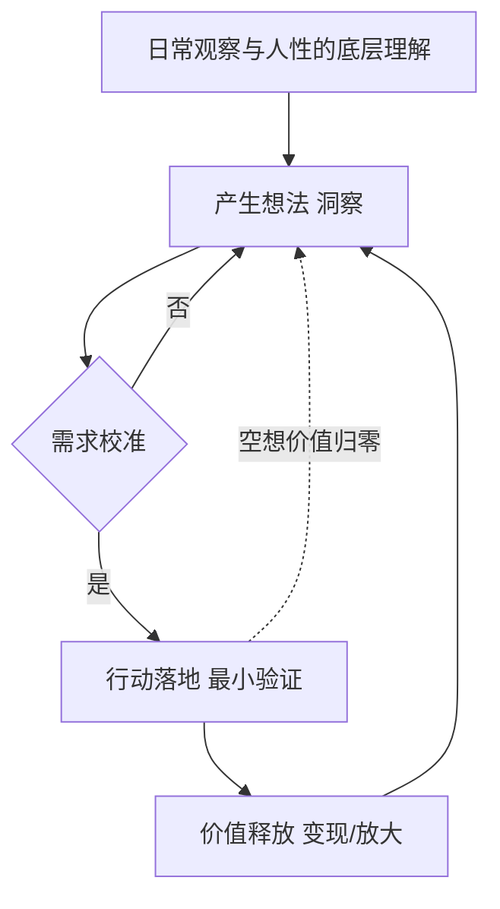
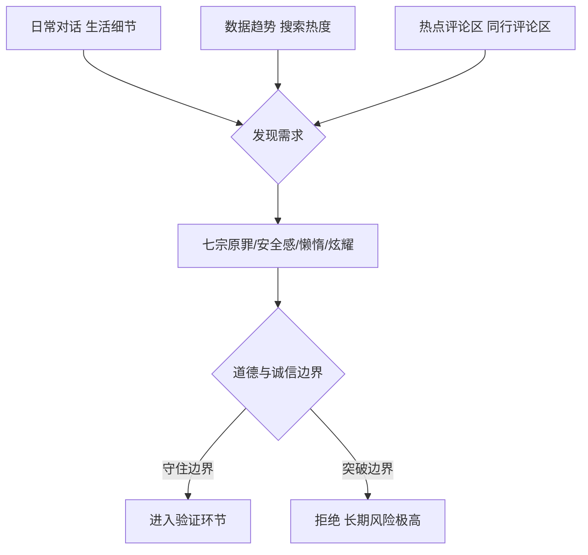
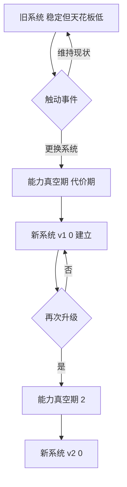
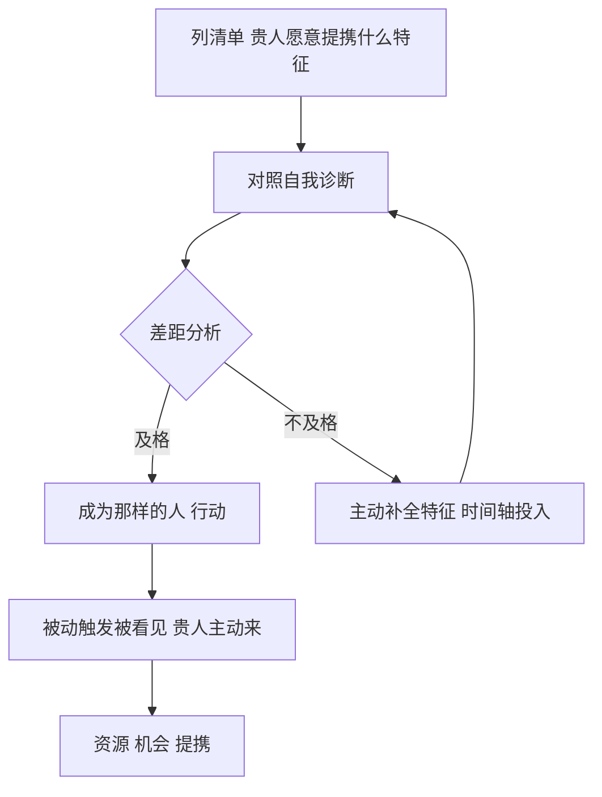
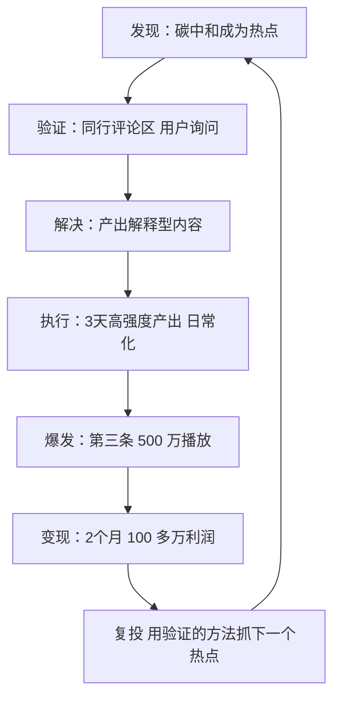

# 第 1 章 认知破局 —— 从打工人思维到创富思维

## 学习目标

- 理解并区分想法与项目的价值差异，掌握想法本位论的核心主张
- 掌握人性需求驱动论，能够从生活、数据、热点中发现隐藏需求
- 学会应用发现-验证-解决需求三连击，构建从想法到金钱的完整闭环
- 理解逆袭的本质是自我运作系统的彻底更换，而非单纯的加倍努力
- 掌握决策决定论，认识关键决策对阶层跃升的杠杆效应
- 认识创业敬畏论的内涵，能够建立日常化的创业心态与行动节奏
- 掌握自我救赎的方法，主动列出贵人特征清单并成为那样的人
- 理解投资逻辑替代从零盲动的优势，学会识别并介入已跑通的盘
- 能够通过实证案例复盘，将抽象方法论转化为可参照的操作流程

## 1.1 生活类比

创富思维像一种种菜园的园丁经营法。想法，是菜园中最珍贵的种子——它决定了来年能长出什么，是潜在价值所在；项目，是树上已经结出的果实——它可见、可尝、可交易，但也有限、易腐、人人可摘。人性需求，是土壤的养分——它看不见却决定了万物可否生长，只要土壤足够肥沃，种什么都有机会；发现-验证-解决需求，是园丁的农事流程——发现是勘测哪块地肥沃，验证是试种一小块地看能否发芽，解决是精耕细作收获果实。决策，是播种时的选择——你选种萝卜还是种人参，决定了收成量级；逆袭的本质，是更换菜园的基础设施——不是换一种肥料多施一点（那是努力），而是把整片灌溉系统、土壤结构、种植节奏全部推倒重来；创业敬畏，是园丁日常的巡视——不是丰收时的狂欢，而是每日清晨检查土壤湿度、虫害、风向的静默劳作；成为自己的贵人，是先把自己培养成丰收园丁——贵人的援手只有在你已经满手泥土、菜苗可见时才最有价值；投资逻辑替代从零盲动，是先买下一块肥沃的田地来耕作——而不是从一块荒地开始垦荒，前者跨越了"验土、引水、防虫"的死亡谷。

## 1.2 概念地图

```
创富认知体系
├── 价值本源
│   ├── 想法本位论 —— 想法比项目更值钱
│   └── 人性需求驱动论 —— 人性背后尽是需求
├── 操作方法论
│   ├── 发现-验证-解决需求三连击
│   ├── 决策决定论
│   └── 投资逻辑替代从零盲动
├── 心态与系统
│   ├── 逆袭的本质（系统更换）
│   ├── 创业敬畏论
│   └── 自我救赎
└── 实证验证（碳中和爆款案例）
```

## 1.3 想法本位论——让种子比果实更值钱

[P001, p.1] "项目不值钱，想法值钱。"

> "项目不值钱，想法值钱。想法本身最值钱，思考产生的创意可贵。"
>
> ——《把想法变成钱》

这段话几乎颠覆了我们从小接受的直觉。我们通常认为，一个看得见、摸得着的项目（比如一家奶茶店、一个APP、一个自媒体账号）是值钱的，而那个只存在于脑中的想法（“也许老年人需要代买药的服务”）是虚无缥缈的。作者明确地提出了反直觉的主张：**想法是种子，项目是果实；种子比果实更值钱。**

为什么种子比果实值钱？我们需要逐一拆解深层逻辑。

**第一，高杠杆。**一个想法的价值可以被无限放大。你今天思考出的一个关于"如何帮人缓解孤独"的洞察，可以用来做一档播客、一个社群、一套课程、一款产品，甚至一个品牌。想法是乘法器，项目是加法器——一个想法可以同时作用于十个项目，产生十倍的乘数效应。而一个具体的项目，它的增长天花板是线性的：多开一家店，多一份收入，但变量有限。

**第二，可复用。**成熟的想法不是一次性消费品。当你掌握了"如何从人性中发现需求"这个元想法，你可以在不同行业反复应用。它像一套武功心法，而项目只是招式——换一个招式，心法依然适用。

**第三，护城河。**项目极易被模仿。你开了一家生意不错的咖啡馆，三个月后隔壁就能照抄一家一模一样的。但"为什么选这个地址、为什么做这个品类、为什么定这个价格"背后的思考过程，是模仿者看不到的。认知壁垒是最深的护城河。

<figure>
<figcaption>图 1.1 项目与想法的价值对比（来源：《把想法变成钱》）</figcaption>

| 维度 | 项目（果实） | 想法（种子） |
|------|--------------|--------------|
| 性质 | 可见、可复制、有限 | 不可见、难以复制、无限 |
| 增长模式 | 线性增长 | 指数增长（乘数效应） |
| 护城河 | 极浅，易被模仿 | 极深，认知壁垒 |
| 天花板 | 单一项目的市场容量 | 无限扩展的应用场景 |
| 案例 | 一家咖啡馆、一个APP | “帮人省钱”这一洞察可衍生数百个项目 |

</figure>

当然，想法本位论有一个至关重要的前提——**行动力兜底**。一个停留在脑中的想法，价值为零。只有经过行动落地、验证迭代的想法才真正值钱。同时，想法的价值必须经过需求的校准：一个脱离真实需求的想法，即使再精妙，也只是自嗨。

> **想法本位论**定义（来源：《把想法变成钱》）

$$
V_{\text{idea}} = \text{Reach}(\text{Idea}) \times \text{Depth}(\text{Insight}) \times \text{Action}(\text{Execution})
$$

我们将想法价值拆解为三个因子的乘积。`Reach`（覆盖范围）代表这个想法能触达多少人、应用到多少场景；`Depth`（洞察深度）代表它触及了多底层的人性需求；`Action`（执行力度）代表你把想法落地的真实程度。注意它是乘积关系——任何一个因子为零，整体价值就为零。

这个公式展示了：真正值钱的想法 = 广覆盖 × 深洞察 × 强执行。你可以用一个想法覆盖不同人群、不同场景（广覆盖），也可以把一个需求挖掘到七宗罪的层级（深洞察），但最关键的是最后一项——如果不落地执行，前两项再大的数乘上零，结果仍是零。这正是"想法比项目值钱"但"空想一文不值"的统一解释。

### 与直觉的冲突

我们从小到大被教导"做完比想完重要""执行力高于一切"。这句话在项目层面是对的，但在想法层面容易误导。事实是：**低质量的想法配上超强的执行力，只会让你在南辕北辙的路上跑得更快。** 这并非否认真执行的价值，而是提醒你：先花时间把想法的质量做上去，再谈执行。



这段流程图展示了想法的生命周期。一个想法从日常观察中产生，必须经过需求校准——问自己"这是真实需求还是自嗨？"——再进入行动落地。行动产生的数据和反馈，反过来会催生更高质量的新想法，形成正循环。图中虚线标注的路径提醒你：卡在"需求校准"之前的想法，全都停留在空想层面，价值为零。

## 1.4 人性需求驱动论——一切商业的源头活水

理解了想法值钱之后，你自然会追问：那**什么样的想法**才值钱？答案藏在人性里。

[P001, p.3] "人性背后尽是需求，需求无处不在，多留心。"

> "人性背后尽是需求。需求无处不在，多留心。"
>
> ——《把想法变成钱》

商业的本质，是满足人的需求；而需求的源头，是人性的底层结构。作者提出了**人性需求驱动论**：一个值钱的想法，必然是精准命中某种人性需求的想法。

哪些需求藏在人性深处？我们需要细数：

- **基本欲望（七宗原罪）**：贪婪（想要更多便宜）、懒惰（想花更少力气）、虚荣（想被看见和赞美）、嫉妒（不想输给他人）、暴食（感官享受）、色欲（亲密渴望）、愤怒（不公平感）。
- **安全感**：对确定性的渴求，对风险的厌恶。保险、备忘、理财、备份，都在卖安全感。
- **懒惰（便利性）**：人们愿意为"多省一点时间"和"少动一点脑筋"付费。
- **炫耀（社交资本）**：人们需要通过消费和分享来构建社会身份。

人性需求有三个关键特征，使其远比行业风口更可靠：

| 特征 | 含义 | 商业意义 |
|------|------|----------|
| 普遍性 | 存在于所有人群、所有文化 | 市场足够大，无须教育 |
| 稳定性 | 几千年不变，不随潮流消退 | 不是风口，没有熄火期 |
| 洞察性 | 需求不会写在台面上，需要主动发现 | 发现者得先机 |

关于第三点，作者特别强调：需求不会自己浮出水面，它藏在生活细节里、数据趋势里、热点评论区里。你必须主动留心。但这里有一个必须守住的边界：**人性需求是起点，不是终点**——洞察人性之后，仍须经历验证环节（见 1.5 节），确保你收到的不是幻觉信号。

同时，**必须守住道德与诚信底线**：利用人性弱点来作恶（比如利用贪欲做割韭菜的盘），会带来法律与口碑的双重重罚，这与本章的核心价值观"长期主义"背道而驰。我们看到，本章定位是"教人做有价值的事"，而非"教人钻人性的空子"。



这张数据流图展示了需求发现的三个信号源：生活对话、数据趋势、热点评论区。它们汇聚后，你需要将观察结果归类到人性的底层需求框架中（七宗原罪、安全感、懒惰、炫耀），然后过一道道德与诚信的边界检测。通过检测的需求，才进入验证环节（1.5 节）。

## 1.5 发现-验证-解决需求——让想法落地的三连击

[P001, p.4-6] "发现需求、验证需求、解决需求。看同行评论区验证需求。"

> "发现需求、验证需求、解决需求。"
>
> ——《把想法变成钱》

仅有想法和人性洞察还不够。现实中大量创业者死于**自嗨式创业**——他们的想法确实洞察了一种需求，但他们从未验证这个需求是否真实、是否为痛点、是否有支付意愿，就闷头做了三个月产品，最后无人问津。你需要的是一条完整可执行的操作链条，把抽象想法变成具体财富路径。

作者给出了极具操作性的**三连击**：

> **发现-验证-解决需求**方法（来源：《把想法变成钱》）

```
1. 发现需求：从生活、数据、热点、同行评论区中嗅出潜在需求
2. 验证需求：观察市场反馈（同行评论区是最廉价、最真实的验证场）
3. 解决需求：提供产品、内容或服务，变现闭环
```

- **发现（Sense）**：从生活细节、搜索数据、热点事件、同行评论区中寻找未被满足的需求信号。
- **验证（Validate）**：市场反馈是唯一裁判。最廉价的验证场是**同行评论区**——如果你想做"帮上班族带饭"的生意，先找到已有的带饭博主/店家的评论区，看看用户在抱怨什么、称赞什么、要什么但没人给。
- **解决（Solve）**：验证通过后，用产品、内容或服务去满足需求，完成变现。

这三步并非简单串行，它有几个关键特性：

**可逆推**。如果在"验证"环节发现需求不存在或太弱，你可以回到"发现"重新寻找需求，而不是硬着头皮推进"解决"。

**低风险**。比起从 0 到 1 开创一个全新市场（那是 1.9 节中"从零盲动"的坑），先在已有反馈的场地验证，风险大幅下降。

**循序渐进**。每一步建立在上一步的确认基石之上——"发现"降低了方向错误的风险，"验证"降低了自嗨的风险，"解决"才进入投入环节。

> **三连击**伪代码（来源：《把想法变成钱》）

```
Algorithm 1: 想法变现三连击流程
Input: 初始想法 idea₀，初步需求假设 need₀
Output: 变现方案 solution

1  while not verified(need):
2      sense_from_life_and_data()          # 发现：从生活/数据/热点中收集信号
3      need ← refine_hypothesis(signals)   # 修正需求假设
4      validation ← check_comments()       # 验证：看同行评论区/市场反馈
5      if  validation == PASS:
6          solution ← build_solution(need)  # 解决：提供产品/内容/服务
7          return solution
8      else:
9          continue                         # 未通过验证则回到发现重新循环
```

这段伪代码展示了三连击的循环本质。中间有一个 while 循环：只要需求未被验证通过，就反复在"发现"和"验证"之间迭代，直到市场给出了积极的反馈信号，才进入"解决"阶段。循环的出口条件是 `validation == PASS`——这保证了你的资源投入不会浪费在未经验证的方向上。

### 1.5.1 碳中和案例的具象化

这个方法论在碳中和内容创作中有完整的实证（详细复盘见 1.10 节）。我们可以先给出一个三维坐标图，展示三连击在真实案例中的落点：

| 环节 | 碳中和案例中的操作 | 对应的人性需求 |
|------|-------------------|----------------|
| 发现 | 发现"碳中和"成为政策热点，相关搜索量与讨论激增 | 安全感、对未来的焦虑 |
| 验证 | 查看同行的碳中和账号评论区，发现大量用户询问"普通人如何参与碳中和" | 懒惰（想要简单的参与方式） |
| 解决 | 产出解释型内容，提供低成本参与方案，第三条视频收割 500 万播放 | 炫耀（分享环保身份的社交价值） |

## 1.6 逆袭的本质——彻底更换自我运作系统

我们完成"需求侧"的讨论后，将视角切到更宏观的层面：**为什么有些人能逆袭，而大多数人不能？** 这引出本章的核心观点之一。

[P002, p.1] "逆袭是彻底更换甚至多次更换。人往上走拼的是决策能力。"

很多人把逆袭理解成"更努力""更能吃苦"。这本身没有错，但远远不够——**单纯的努力只能改善现状，无法实现阶层的跃迁**。为什么？因为你在旧系统里跑得再快，也到不了新系统的终点。

作者用一个精妙的比喻说明：大多数人想逆袭时，只试图更换手机里的应用（换一个新项目、学一项新技能），却舍不得更换操作系统（思维模式、行为习惯、认知框架）。结果就是：在旧操作系统上装了再多的新 App，整体性能依旧受限于旧内核。

> **逆袭定义**（来源：《白手起家赚千万认知》）

$$
\text{逆袭} = \underbrace{\text{思维转换}}_{\text{认知层}} + \underbrace{\text{行为重编}}_{\text{行动层}} + \underbrace{\text{系统重装}}_{\text{架构层}}
$$

逆袭不是单点优化，而是三项叠加的系统工程。思维转换是第一层——如何看待金钱、风险、时间；行为重编是第二层——把新思维转译成具体的新习惯；系统重装是第三层——把你习以为常的整套运作框架（决策机制、信息输入、社交圈层）推翻重建。

**为什么这三者缺一不可？** 如果你只有思维转换（"我要有钱"），没有行为重编，那只是愿望而非逆袭；如果你有行为重编（每天多干两小时），但没有思维转换，那只是低效的重复；如果你有了前两者，但拒绝系统重建（继续用旧决策逻辑做人生关键选择），那你在新轨道上也会被旧引力拉回。

**系统性**——逆袭不是优化单个方法，而是重构整套思维框架。**彻底性**——旧系统中"天经地义"的设定（比如"稳定的工作最好""不要冒险"），在新系统中可能是最大的拖累。**持续性**——一次更换并不一劳永逸，你需要多次迭代升级，就像手机系统每年都要更新版本。

这里必须诚实警告：**更换系统代价巨大，你会经历一次"能力真空期"**——旧技能不再完全适用，新技能尚未完全建立，你会有一段笨拙而低效的过渡期。这是逆袭途中最容易放弃的时刻。认识到"真空期是系统的固有成本"，才能挺过它。



数据流图展示了逆袭的完整轨迹：旧系统在触动事件（比如负债、失业、一次重要的失败）面前有两个选择——维持或更换。选择更换意味着先进入能力真空期，然后建立新系统 v1.0。但这远未结束：新系统 v1.0 之后，你依然要面对"是否再次升级"的选择，循环往复。这正是作者所说"彻底更换**甚至多次更换**"的真实意涵。顺带一提，这张图也解释了为什么大多数人无法逆袭：在"维持现状"的岔路口，绝大多数人选择了最舒适的那条路，因为"能力真空期"太吓人了。

## 1.7 决策决定论——阶层跃升的终极较量

理解了系统更换的必要性后，下一个问题是：**更换系统的关键抓手是什么？** 答案指向一个看似平常但被严重低估的能力——决策。

[P002, p.2] "人往上走拼的是决策能力。选择是匹配自己最优解。"

> "人往上走拼的是决策能力，选择是匹配自己最优解。"
>
> ——《白手起家赚千万认知》

作者提出了**决策决定论**：一个人的命运，由人生中少数几个关键决策决定。你高考后选哪个城市、毕业时选哪条赛道、在某个机会窗口期是否敢下注、在某个危机来临时如何应对——这些节点的决策质量，远超你平时努力的总和。

这听起来反直觉。我们都以为"日拱一卒"才是人生最优策略。但实际上：

> **决策决定论定义**（来源：《白手起家赚千万认知》）

$$
\text{命运} = \sum_{i=1}^{n} w_i \cdot \text{Decision}_i, \quad \text{其中} \quad w_i \text{ 为第 } i \text{ 个关键决策的权重}
$$

命运不是一个均匀加权函数，而是一个奇异的加权和——其中少数几个关键决策的权重 w_i 远大于其他决策。你平时做的 99 个常规决策（今天吃什么、要不要加班一小时）权重几乎为零；而你人生的 3-5 个关键决策（选哪座城市、进哪个行业、是否创业）权重极高，它们决定了你命运的走向。

这个公式揭示了三层含义：

- **可积累性**：每个正确决策带来资源与信息的优势，让你下一个决策的输入质量更高。正确决策是有复利的。
- **排他性**：一次正确的关键决策，其价值可能超过你长时间错误方向上的努力之和。所谓"选择比努力更重要"，本质是正确决策的权重压倒了常规努力的累加。
- **非对称性**：决策的收益和风险是不对称的。一个关键决策的上行空间（比如抓住一次红利期的收益）远大于下行风险（试错成本有限）。正确的策略是用最小可行试错——用可控的成本去验证，而不是用全部身家去赌。

当然，决策能力并非天生，它依赖高质量的信息输入。这解释了为什么"贵人提携"（1.8 节）和"跑通的盘"（1.9 节）如此重要——它们都是高质量信息的来源。一个人如果信息来源单一且质量低（比如只看营销号），他的决策质量就会系统性低于信息来源丰富的人。

<figure>
<figcaption>表 1.1 常规决策 vs 关键决策的杠杆效应对比</figcaption>

| 维度 | 常规决策 | 关键决策 |
|------|----------|----------|
| 频率 | 每天无数个 | 一生 3-5 个 |
| 权重 w_i | 接近于零 | 极大 |
| 案例 | 通勤方式、饮食选择 | 城市选择、赛道选择、是否创业 |
| 累积效应 | 边际改善 | 数倍杠杆 |
| 错误成本 | 低，可快速修正 | 极高，难以逆转 |

</figure>

一句话总结：**你不需要每一项决策都对，只需要在人生的 3-5 个关键节点上做对。** 而这 3-5 次做对的能力，来自你日常喂养给大脑的信息质量。

## 1.8 创业敬畏论——把创业当成日常事而非激情事

我们现在进入"心态建设"层面。在思维方式与决策框架都搭建完毕后，你需要一种能够长期维持的心智状态。很多人的创业失败，既不缺想法，也不缺决策能力——他们败在了心态上。

[P002, p.3] "创业者凌晨 3 点秒回是日常。日常化是最牛法门。"

很多人把创业想象成"灵光一现、轰烈一场"的激情戏：一个绝妙的点子，一笔融资，一场发布会，然后坐收回报。但真实的创业是：**凌晨 3 点回答客户消息、连续 30 天没有周末、在数据没起色时仍要持续产出。** 作者直言：创业启动容易，坚持难。大多数人低估了真实创业的强度。

> **创业敬畏论方法**（来源：《白手起家赚千万认知》）

```
1. 常态化：创业不是爆发式努力，而是随时待命的永动机
2. 敬畏伴随谨慎：对市场、每一分钱、每一次决策保持敬畏
3. 门槛重塑：对创业敬畏的人反对"从 0 到 1"的名目创业，倾向找已跑通的盘
```

**常态化**。创业不是冲刺型的短期爆发，而是马拉松式的永续运转。别人以为"成功那一刻"是高潮，但真正的创业者知道：最值钱的动作发生在无人看见的日常——那些不带聚光灯的伏案、回复、迭代。作者说"日常化是最牛法门"，这里有深刻的管理学洞见：当一件事变成"日常"，它就不消耗意志力了。如果你只在有激情时才行动，那么激情退去后行动就会停止；但如果你把高强度视为默认状态，你就不需要每一次都靠打鸡血来启动。

**敬畏伴随谨慎**。对创业保持敬畏，自然衍生出谨慎：敬畏市场（不敢轻敌）、敬畏每一分钱（不敢乱烧）、敬畏每一次决策（不敢莽撞）。这种"怕"不可耻，它正是守住底线的力量。

**门槛重塑**。一个敬畏创业的人，会自然而然反对"从 0 到 1 名目创业"——即带着一个概念和一笔钱就冲进陌生的赛道，号称要"开创一个全新品类"。因为敬畏者深知：从 0 到 1 的死亡率极高。他们宁愿找到一条已被验证的路径（1.9 节的投资逻辑），也不愿在未知的荒野里裸奔。

<figure>
<figcaption>表 1.2 激情创业者 vs 敬畏创业者的对比（依据《白手起家赚千万认知》整理）</figcaption>

| 维度 | 激情创业者 | 敬畏创业者 |
|------|------------|------------|
| 状态 | 灵感驱动，间歇性高强度 | 日常驱动，持续中强度 |
| 对市场 | 轻视或高估 | 敬畏 |
| 对资金 | 烧钱换增长 | 敬畏每一分钱的去向 |
| 对项目 | 热衷"从 0 到 1 开创" | 倾向"已跑通的盘" |
| 失败原因 | 激情退去后无法坚持 | 极少数因过度保守错失机会 |

</figure>

这里需要平衡：敬畏不等于畏惧不前。如果你因为害怕而不行动，那是恐惧而非敬畏。敬畏是"清楚知道风险，仍选择入场"，恐惧是"因为知道风险而拒绝入场"。高手与懦夫的区别，在于前者把敬畏转化为谨慎的行动——寻找已被验证的路径来降低风险，后者把恐惧转化为不行动。

## 1.9 自我救赎——主动成为自己的贵人

有一种普遍困境：抱怨"我怀才不遇，只是没遇到贵人"。这类人把人生的希望寄托于外部的机缘提携，本质上放弃了人生的主导权。本章给出的解药颇具颠覆性——**与其等待贵人的提携，不如主动成为贵人愿意提携的那种人。**

[P002, p.5] "列贵人会提携什么样的人。不存在闷声发大财机会。"

> "列贵人会提携什么样的人。不存在闷声发大财机会。"
>
> ——《白手起家赚千万认知》

这句话前半句是策略，后半句是洞察。"不存在闷声发大财的机会"——这打破了很多人的幻想（低调攒大招、被埋没的宝藏）。事实上，在信息高度流动的时代，真正有价值的人和事一定会被看见，前提是你要主动进入那个"被看见"的场域。

> **自我救赎方法**（来源：《白手起家赚千万认知》）

```
1. 列清单：列出"贵人愿意提携什么样的人"的特征清单
2. 对照诊断：诚实对照，看自己在哪些特征上及格、哪些不及格
3. 主动补全：把你缺失的特征在时间轴上填补起来
4. 成为那样的人：不是演戏，而是真的变成那个值得被提携的人
```

这套方法的底层逻辑有三个支柱：

**自主性**。救赎的主动权在自己手上。把希望寄托在贵人身上，是把自己的命运交给他人裁决；而"成为贵人愿意提携之人"，是把选择权拿回自己手里。你不再等待被看见，你主动去成为一个"无法不被看见"的人。

**主动性**。这不是被动等待机会，而是主动触发"被看见"的机制。怎么触发？高频输出、进入圈子、展现价值。你要做的不是等贵人经过，而是站到贵人必经过的路口。

**价值基础**。成为贵人青睐之人，本质上是在某维度上不断自我增值的人。贵人为什么会提携你？因为你值得，因为你身上有贵人看重的品质或潜力。自我增值是底牌——没有这张底牌，一切"主动"都只是骚扰。

值得注意：**自我救赎不等于单打独斗**。这不是让你拒绝一切外部帮助，自己做一座孤岛。恰恰相反，你"成为值得被提携的人"是为了更好地善用外部资源——贵人仍然是重要的，只是你们的互动关系从"单向索取"变为了"双向奔赴"。你付出价值和潜力，贵人付出资源和机会。



这张流程图展示了"自我救赎"的循环：从列清单到对照诊断，再到差距分析和主动补全，形成一个反馈回路；当你真正成为那样的"贵人所青睐之人"后，机会会自动向你靠拢——不是因为你找了他们，而是因为你变得值得被找到。

## 1.10 投资逻辑替代从零盲动——让创业省去试错成本

有了敬畏之心，你自然会追问：那到底该怎么创业？作者的回答是：**别做从零到一的开创者，去做一个已经跑通的盘的投资者。**

[P002, p.6] "找到已跑通的盘投资入局。不轻易从 0 到 1。"

> "找到已跑通的盘投资入局，不轻易从 0 到 1。"
>
> ——《白手起家赚千万认知》

大多数人从 0 到 1 的项目，本质是**重复发明轮子**——他们以为自己在创新，但实际做的都是别人做过但没做成的事，且毫无资源优势。

> **投资逻辑方法**（来源：《白手起家赚千万认知》）

```
1. 找盘：找到已被验证、正在赚钱的赛道或项目
2. 评估：用资本运作思维看——趋势、数据、团队、回报率，而非情怀与构想
3. 入局：用资源（资金、精力、技能）换取确定性
4. 赋能：入场后必须为盘增值，而非单纯搭便车
```

这套方法与投资逻辑高度同构：**看趋势、数据、团队、回报率，而非情怀、构想、故事。** 你把选择的项目看作一个"盘"——它已经有了现金流、有了客户、有了验证过的打法。

**降低不确定性**。跑通的盘意味着它已经跨越了"死亡谷"——即创业中死亡率最高的早期阶段（产品反复迭代、验证市场、寻找付费客户）。你入局时它已经活了，这大大降低了不确定性。

**可借力**。你借的是他人的已验证势能——对方的品牌、渠道、口碑已经跑出结果，你顺势而为，高效很多。

**这里有一个关键警告**：投资逻辑入场也**需要赋能**——如果只是搭便车、摘桃子，后期你的价值会被稀释，这在合伙人关系和盘方谈判中都是大忌。好盘要的是"带资源进场、能增值"的合作伙伴，而不要"只出钱"的闲人。

<figure>
<figcaption>表 1.3 从零盲动 vs 投资逻辑（综合《白手起家赚千万认知》与《把想法变成钱》）</figcaption>

| 维度 | 从零到一盲动 | 投资逻辑入局 |
|------|--------------|--------------|
| 风险 | 极高，九死一生 | 中低，已跨越死亡谷 |
| 时间成本 | 试错周期长 | 验证周期短 |
| 资源要求 | 从零开始积累 | 用资源换确定性 |
| 创新程度 | 高（但多为重复发明轮子） | 中（延续已有模式） |
| 对能力要求 | 全能型 | 资源整合型 |
| 适用人群 | 极少数的天才开拓者 | 大多数务实创业者 |

</figure>

这个方法论的适用范围值得细讲。我们并非主张所有人都不该创新——天才开拓者依然可以创造全新的品类（比如乔布斯）。但对**绝大多数的普通人**而言，从零到一的死亡率太高，而"找到已跑通的盘，用资源换取确定性入场"的成功率高得多。这并非保守，而是敬畏之下的智慧。

### 与想法本位论的兼容性

有人会问：1.3 节说"想法比项目值钱"，这里又说"不轻易从 0 到 1"，两者是否矛盾？不矛盾。**"想法"是认知层面的高价资产，而"项目"是资本层面的高风险标的。** 你可以带着一个值钱的想法去入局一个已跑通的盘——那个盘提供了基础设施与客户，你的想法提供了差异化与升级空间。想法的价值不是在真空里创造，而是在现实土壤中生根。

## 1.11 实证复盘——碳中和爆款是怎样炼成的

前述所有方法论，都还停留在理论层。需要用一个真实案例来证明：**这些方法不只正确，而且可复制。**

[P001, p.7-8] "第三条 500 万播放。2 个月带来 100 多万利润。"

> "第三条 500 万播放，2个月带来100多万利润。"
>
> ——《把想法变成钱》

这是一个真实的"从想法到金钱"的完整闭环案例：作者团队发现"碳中和"是一个潜在的需求方向，通过同行评论区验证需求，随后高强度执行内容创作，第 3 条视频即收获 500 万播放，2 个月带来 100 多万利润。

我们需要把它拆解成一张完整的流程表，对照前文的三连击框架：

> **碳中和案例全链路复盘**（来源：《把想法变成钱》）

```
 阶段         具体操作                                        对应方法论
 ─────────────────────────────────────────────────────────────────
 发现        发现"碳中和"成为政策热点，搜索与讨论激增        人性需求驱动论
 验证        查看同行碳中和账号评论区，                        发现-验证-解决
             发现大量用户询问"普通人如何参与碳中和"              三连击之验证
 解决        产出解释型内容，提供低成本参与方案                 发现-验证-解决
                                                                三连击之解决
 执行        高强度投入，3天高产出内容                        创业敬畏论 日常化
 爆发        第三条视频收获 500 万播放                        高杠杆 一次爆款
 变现        2 个月带来 100 多万利润                          强杠杆远超线性劳动
```

这张表格展示了每一个环节如何被前面的方法论覆盖：`发现`对应人性需求驱动论；`验证`对应三连击的中间环节；`执行`对应创业敬畏论的常态化；`爆发`和`变现`则对应想法本位论中"高杠杆"的论述——一次爆款带来的收益，远超常规线性劳动的总和。

### 复盘：哪些可复制，哪些不可复制？

我们需要对案例做一个诚实拆解。

**可复制的方法论（流程与节奏）**：

- 三连击的流程框架——发现、验证、解决——是可照搬的。
- "高强度日常化"的执行节奏——3 天内密集构思 + 产出，是刻意为之，不是天才的灵光一现。
- 从同行评论区做需求验证，是任何人都可以执行的廉价而高效的方法。

**不可复制的热点（时代窗口期）**：

- "碳中和"这一热点本身有特定的政策窗口期和公众注意力周期。同样的内容在今天复制，大概率不会有同样的数据。
- 爆款概率天然具有随机性——即使方法论完全正确，播放量依然有波动。你应关注的是"正确的方法论能否持续产生高于平均的收益"，而非"每一条都爆款"。

这个案例给了我们一个关键启示：**方法论可复制，热点不可复制。** 你可以复制流程、节奏、验证方法，但无法复制"那个时间点上的那个风口"。所以，正确的策略是：用一套可复制的方法论，去捕捉下一个不可复制的热点。

### 数据流图：从想法到金钱的闭环



这张图展示了完整的闭环：从发现、验证、解决、执行、爆发到变现，最后利润作为资本和信心回流，去捕捉下一个热点。注意右下角——方法论让这个闭环**可重复**。这就是前文所有理论的最终落地形态：一套可复制、可循环、可持续的创富机器。

## 1.12 多源对照

本章的两大素材源——《把想法变成钱》和《白手起家赚千万认知》——在多个主题上形成互补与相互印证。我们将它们的共识与分歧逐一梳理。

### 共识

两篇素材在以下核心主张上高度一致：
1. **想法/认知高于项目/执行**。两篇都强调"认知先行"——先有正确的想法与思维方式，再谈具体的项目与执行。
2. **反对从零开创**。两篇都强烈建议不要在无资源、无验证的情况下从 0 到 1 开创市场。
3. **需求验证至关重要**。两篇都承认"发现需求"只是第一步，必须经过验证才能进入投入环节。
4. **高强度投入是常态**。两篇都真实呈现了创富者的高负荷工作状态，不美化、不粉饰。

### 分歧

两篇素材在侧重点上存在明显分工：

- **出发点不同**：P001（《把想法变成钱》）从"发现需求"切入，方法论是向外探索（市场、同行、热点）；P002（《白手起家赚千万认知》）从"认知重建"切入，方法论是向内修炼（思维系统、决策能力、自我救赎）。
- **对"项目"的态度**：P001 更强调"想法 > 项目"，认为项目只是想法的载体；P002 则强调"项目应选已跑通的盘"，更务实于项目层面的选择逻辑。两者可以统一：想法是认知层面的资产，项目是资本层面的标的，两者不在同一竞争维度。
- **对"贵人"的解释**：P001 完全没有讨论"贵人"问题；P002 提出"成为自己的贵人"，是本源的补充，填补了 P001 在外部资源维度上的空白。
- **对"失败归因"的不同**：P001 把失败更多归因于"没有验证需求"（方法论层面）；P002 把失败更深层地归因于"思维系统未更换"（认知层面）。前者给的是手术刀，后者给的是换脑术。

## 1.13 设计中的取舍

- **为什么不用"努力决定论"而用"决策决定论"？**

努力当然重要，但努力的力量有上限。两点原因支撑决策决定论的优越性：其一，努力是线性投入，决策是幂次影响——你连续努力一年（每天比别人多干 2 小时），产出是 +30% 的边际改善；而正确选择一个爆发式赛道（或错误选择一条死路），产出是数倍或归零。其二，努力不产生复利，但正确决策产生复利——一个正确决策带来的资源与信息优势，会提高你下一个决策的输入质量，形成正循环。所以不是否定努力，而是把努力用在"提升决策质量"上，让努力的价值被正确决策放大。

- **为什么不用"从 0 到 1 创新"而强调"投资已跑通的盘"？**

从 0 到 1 的诱惑在于"开创者的超额收益"——你第一个做，你可以吃下整个市场。但它的代价极高：市场教育成本全由你承担、产品不确定性极高、失败率 90% 以上。投资已跑通的盘牺牲了"开创者的超额收益"，换来的是"跨过死亡谷后的确定性"。前者适合极少数天才，后者适合绝大多数普通人。这个 trade-off 的本质是：**你愿不愿意用超额收益的可能，换取存活率的确定性。** 对于敬畏创业的人，答案通常是"愿意"。

- **为什么"自我救赎"不强调"主动社交"？**

一个直觉方案是"主动去认识贵人、多跑饭局、多递名片"，但作者没有选择这条路。区别在于：主动社交是在"索取"——你在向贵人说"请给我机会"；而主动成为贵人青睐之人是在"供给"——你在向世界说"我有你需要的价值"。前者的核心痛点在于：当你自己价值不足时，再多的社交也只是打扰。所以作者把努力的重心放在"成为那样的人"，而非"认识那样的人"——主动性体现在自我建设上，而非社交表演上。

## 1.14 动手练习

- **想法-项目价值评估练习**：列举三个热门创业项目，分析其核心想法与项目形式，评估每个想法的可复制性、可迁移性，识别其底层可迁移的元想法。
- **需求发现实战**：记录一天内你听到的所有对话、刷到的高频热点、关注的同行账号，分析其中隐藏的人性需求，并设计一个最小可行的验证方案（比如在评论区提问或发一条测试内容）。
- **自我运作系统诊断**：绘制你面对一个赚钱机会时的思维决策流程图（包含"第一反应是什么""会找谁商量""会做哪些调研""会否拖延"），对比本章提出的"更换系统"路线与你自己当前默认路线的差异。
- **贵人清单设计**：访谈一位你认识的事业有成者，问"你的贵人当初为什么愿意提携你"，列出至少五条"贵人愿意提携之人的特征"，并对照诊断自己目前及格几条、不及格几条。
- **跑通的盘识别**：在你感兴趣的领域找出三个"已跑通的盘"（已有稳定现金流和客户的项目），分别用投资逻辑（趋势、数据、团队、回报率）评估其入局价值，并分析你有哪些资源可以用于入局。
- **碳中和案例复盘**：用本章的"发现-验证-解决"三连击框架复盘碳中和爆款案例的完整链路，分析其中哪些环节是任何人可复制的、哪些环节依赖特殊窗口期，并思考：如果今天重新做这件事，你会怎么调整？

## 1.15 本章小结

这一章中，我们完成了从"打工人思维"到"创富思维"的认知破局。首先，我们确立了价值本源——想法本位论告诉我们"想法比项目值钱"（想法是种子、项目是果实），人性需求驱动论告诉我们"值钱的想法藏在人性深处"；其次，我们搭建了操作方法论——用"发现-验证-解决"三连击把想法落地为金钱，用决策决定论指导我们在人生关键节点做出高权重选择，用投资逻辑替代从零盲动来降低创业风险；接着，我们重塑了心态与系统——逆袭的本质是彻底更换自我运作系统而非单纯加倍努力，创业敬畏论要求我们把高强度投入日常化而非激情化，自我救赎让我们"成为自己的贵人"而非等待贵人；最后，我们用碳中和爆款案例验证了这套方法的可复制性——发现需求、验证需求、解决需求的全流程在真实商业环境中跑出了 500 万播放与 100 万利润的实证结果。

本章我们一起学习了以下概念：

| 概念 | 解释 |
|------|------|
| 想法本位论 | 想法价值高于项目，项目是壳想法是核 |
| 人性需求驱动论 | 商业本质是满足人性深处需求 |
| 发现-验证-解决需求 | 从想法到金钱的三连击方法论 |
| 逆袭的本质 | 逆袭是自我运作系统的彻底更换 |
| 决策决定论 | 阶层跃升核心在于关键决策能力 |
| 创业敬畏论 | 把高强度投入视为日常 |
| 自我救赎 | 成为自己的贵人 |
| 投资逻辑替代从零盲动 | 寻找已跑通的盘入局 |
| 碳中和爆款实证 | 3天输出500万播放2个月100万利润 |

下一章中，我们将从"认知破局"进入"行动破局"，学习如何将本章的认知框架转化为具体的行动节奏，探索"从想做到做到"的中间地带——包括时间管理、精力分配与团队杠杆，把认知上的领先转化为现实中的复利。

