《996开发者的航海复盘：“利他”不是口号，是每一天的行动》

我叫巴菲，白天在互联网公司做开发，过着996的生活。我是赚钱的老会员，潜水近一年，这一次才真正参与航海。初次下水，我在1.5万人的实战中冲到第二，视频账号涨了一万多粉。也是这次经历让我明白：没有资源，也没有熟人网络的人，同样能在此找到机会。靠着一条条不起眼的图片视频，我赚到了副业的第一笔收入。下面是我的完整复盘，写给还在观望的朋友们。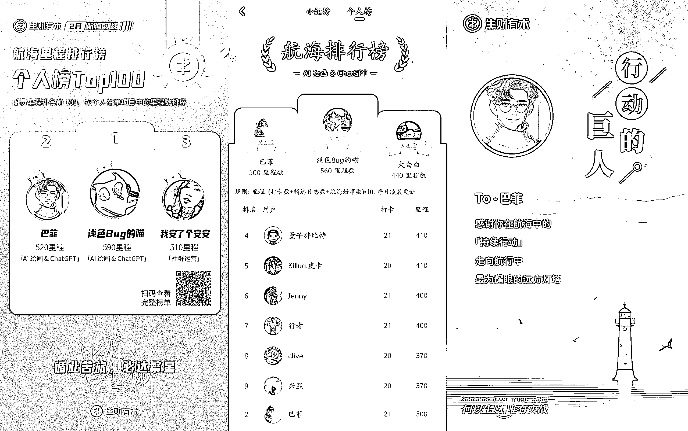

## 一、从“收藏干货”到真正下水

2022年4月18日，我正式成为赚钱社群的一员。最初进来时，和多数人一样，总想着马上挖到“赚钱秘诀”。社区里的项目拆解确实多，几乎市面上能叫出名字的玩法都有。我见到有用的帖子就存下来，存了很久，笔记塞满文件夹，可钱包并没有跟着鼓起来。

转机发生在二月。鱼丸提醒我报名航海，我看了一眼：那是一轮收官之行。当时想，如果这次不试，以后可能更不会试。于是我没再犹豫，选了那阵子最热门的AI出图与ChatGPT方向。

刚进实战群的时候，我很慌：群里的头像我一个都不认识。以前从没主动和大家建立过连接，整个人像是闯进了一场别人的聚会。最开始我连发言都要做心理建设，结果21天之后，我成了群里最活跃的几个之一。

启动会上，子安讲了一套行动准则：读手册、持续做、敢提问、多答疑、勤交流。这五个关键词，后来成了我每天的行动纲领。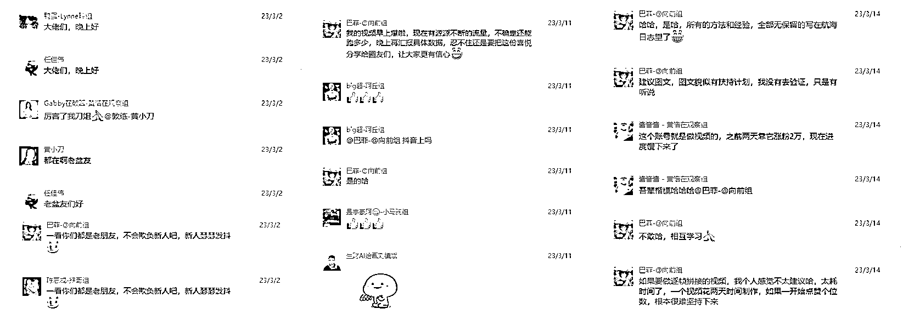

## 二、从零到第一条爆款

开营首日，我认真过了一遍项目手册。内容非常细，我看了很久，后来挑重点又读了几遍，很快就能生成像样的图。打卡模板里有个设置我很喜欢：每天都要写下一个新目标。为了不让自己懈怠，我在第一份打卡里写：七天内，在视频平台发出第一条内容。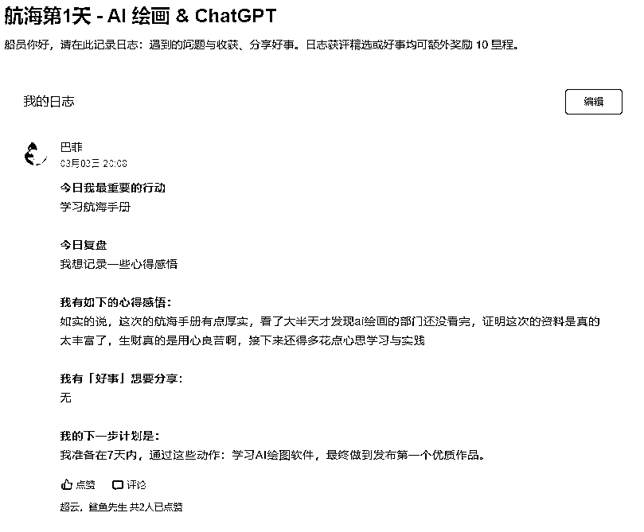

次日，教练天辉点头同意我复用他整理的学习资料。我把这些资料发到社交动态，用很低的费用找人结伴共学。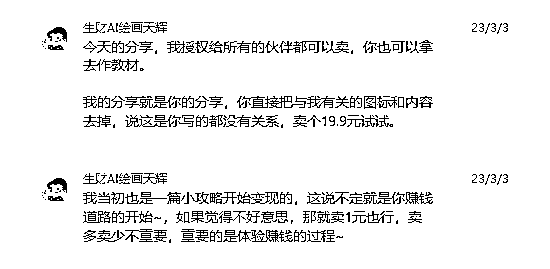 为了显得有诚意，我模仿了“原价29.9，前10名报名只需19.9”的促销方式。当天就卖出几份，成了小组里最早因为行动迅速拿到正向反馈的人。钱不多，但心里的火被点着了。我把操作细节发进群，不少人给我点赞。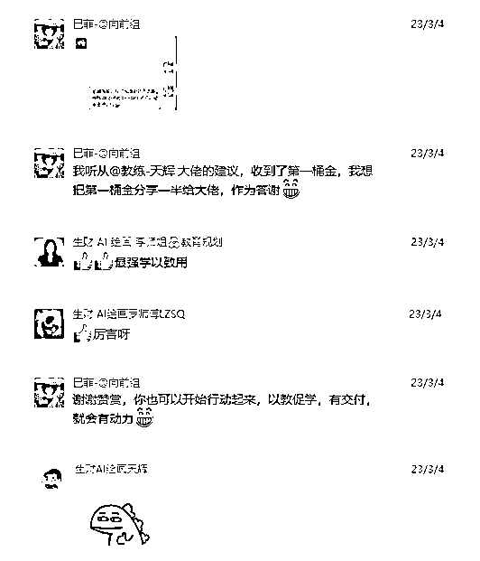 他们陆续加我好友，说我行动快、愿意掏心窝分享。那天，我的打卡记录里也多了一个“好事”标记。

做对别人有价值的事，同时得到回应，这件事真的会上瘾。第三日，我的出图质量已经从“勉强能看”变成“人物稳定”，我把遇到的坑写进打卡，意外被推为精选。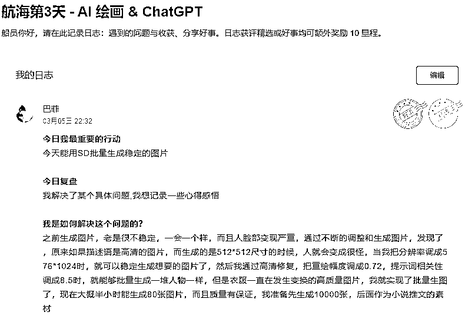 那一次我特别确定：每天踏实做事、遇到问题不藏着、主动向大家求助，既解决自己的卡点，也能顺手帮到别人。

之后我每天琢磨一个新问题，解决完就写进打卡。多数记录都拿到精选，人脉也这样一点点铺开。我开始相信：分享不是付出，是收获。

第七日，我在两个视频平台同步发了一条作品，兑现了第一周的承诺。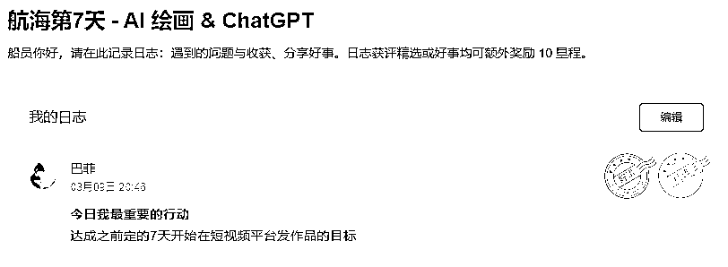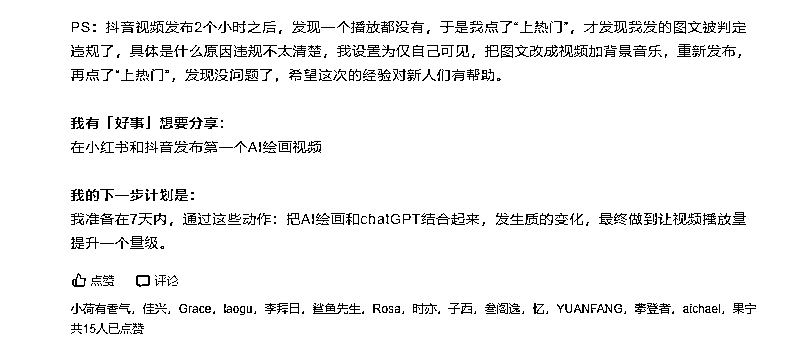 接着我把目标提了一档：七天后再看数据，至少上一个台阶。到了第九日，我把它写得更具体——出一支十万量级的小爆款。

现实给了一盆冷水。第一条片子发布24小时，粉丝只涨个位数，点赞也少得可怜。随后我又连发两条，效果依然平淡，还有一条被平台判为内容质量不足。我一度很受挫，但翻看自己的图，又觉得没道理——身边人都说好看。于是我去刷同类账号，发现那些爆款在背景音乐上很讲究。我把同样的音乐拿来套用，又发了一条。结果不到一天，播放冲到2万，涨了一千粉。

尝到甜头后，我当天又用同一模板连发三条。爆款带流量，新内容稳关注，主页一进来就知道我能持续提供这类图片。

到两周节点，十万级爆款还是没出现，最高一条7.6万。虽然没破目标，但已经足够近。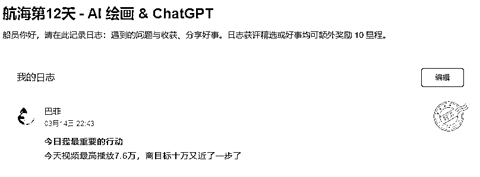 我冷静下来想，光有播放不够，项目得形成闭环。于是把下一个目标改成：写完一套AI出图入门课的大纲。接下来几天，抖音继续涨粉，小红书也跨过一千。到收官那天，前者8600，后者2700。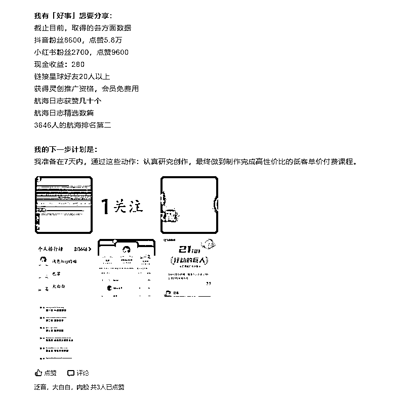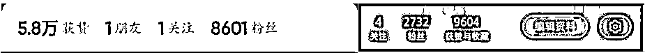 那段时间，视频风格和更新频率都没变，我每天发三条，其他时间都交给备课。

## 三、从免费分享到慢慢变现

最初我对AI出图完全是门外汉，真正开始赚钱，是在壁纸类视频火了之后。我从手册里看到一种变现方式：把粉丝引到“神图壁纸”小程序下载图片，每次下载我能分到0.27元，有人开通会员还有额外分成。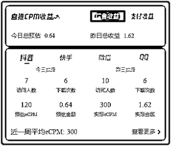

后来我又在后台看到“灵创小程序”在找推广合作，要求账号粉丝达到五千。当时我的粉丝刚到六千，勉强够格。于是我把两个方向合并：在抖音分享AI作品，引导感兴趣的人关注公众号，再推出入门课，并把课程和灵创小程序绑定，等于一次操作，两条收入线。

方案定下来后，我马上开工。初次做课，根本不知道从哪里下手。幸好我曾在其他伙伴的打卡里看到“用ChatGPT列大纲”的思路，翻回去研究了几遍，再结合自己的想法，总算把课程框架搭好。这时21天已经走到尾声。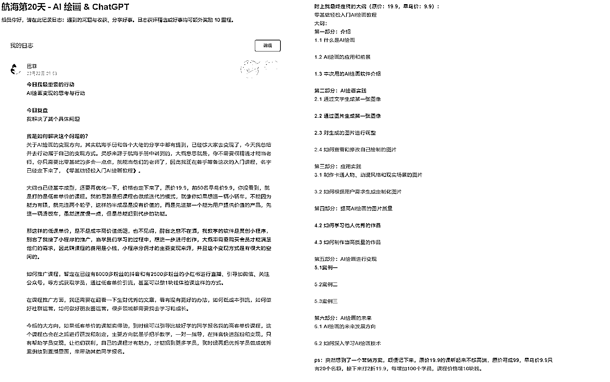

但结束没有让我停下来。因为经验不足、时间紧张、平台未定，我没法等到完美再做，直接在社交动态挂出大纲，开启预售。我在航海期间每天都在更新作品，大家对我做的东西已经有印象，所以仅凭一份极简大纲图，当天就有人付款。收了钱，也就没了退路。之后遇到任何困难，我只有一个念头：必须做完。

那段时间我经常九点多才下班，回家录课到凌晨。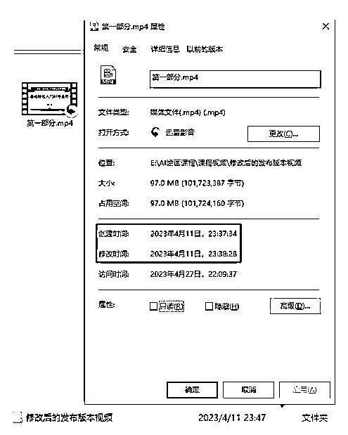 后来成片里声音很轻，就是怕吵醒家人和邻居。

做课的过程简直是连环坑。我先不知道PPT和抖音自带的字体可能不能商用，等视频全部录好准备上架，群里的嘟嘟提醒我赶紧检查。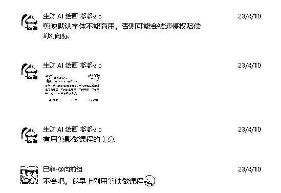 那一瞬间，我真的想放弃。但想想已经收过的学费，只能重录。花了两天时间，把字体换成可商用授权。再交给平台审核，商务又说PPT角落出现了个人联系方式，审核没能通过。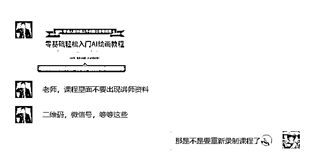 我这才想起自己每页都放了水印，又一次返工。好在只剩最后一步，我咬着牙又熬了一晚。

全部视频完成后，我终于睡了个整觉。这门课前前后后做了二十天，上架当天，加上预售一共卖出二十多份。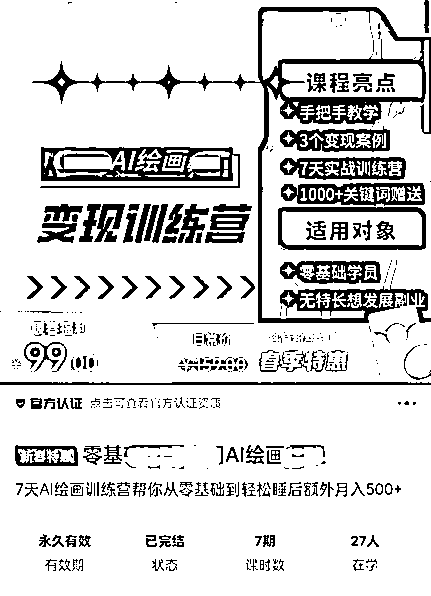 客单价不高，却是我的第一个产品。为了让大家学得更好，我又把课程改成七天学习营，每天布置小练习。这个方法很有用，不少学员在一次次练习中喜欢上AI出图，结营前就有人问有没有更深入的课程。可惜我暂时没有精力再做新课。

我抓住这批用户的热情，顺势建起知识星球，最终有5位学员以399元加入。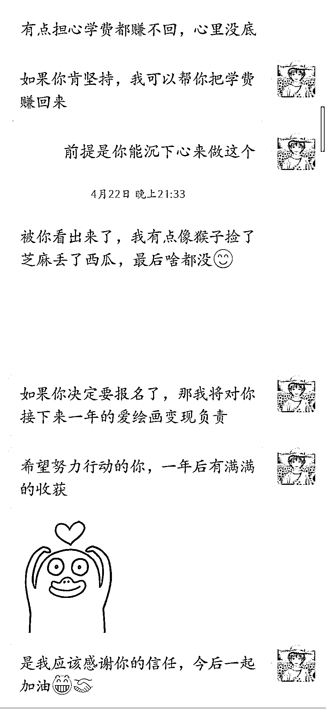 我的收入模型就这样一点点搭起来：一开始是0.27元的壁纸分成，后来是399元的星球服务。之后我还想继续往高客单价走，做999、1999的深度指导，带着更多人用AI图片在抖音这样的内容平台上找到收入。

## 四、真正让我跑起来的是社群环境

如果没有这次航行，我一定不会主动去学AI出图。以前总觉得时间不够用，新东西学不动。但航海把手册、案例、高手经验都放在我面前，我要做的只是跟着走。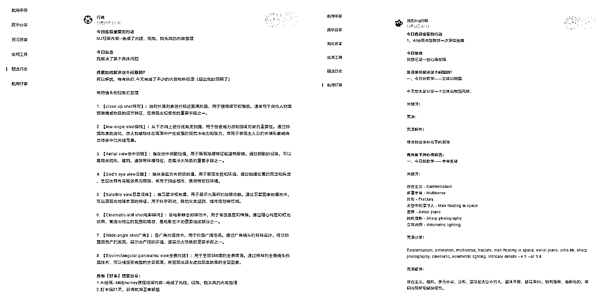 我每天都会翻精选打卡，从他人的分享里找灵感：图片质量提升有思路，播放数据怎么提升也有方法，就连用ChatGPT列大纲也是模仿来的。可以说，我每一步关键选择都有其他人的影子。那些愿意把经验写出来的人，是我的隐形助攻。

变现路径同样来自手册里的教程。它整理了几十种玩法，列出操作步骤和适用场景，我对照自己的账号数据，挑了几条最合适的路线。

## 五、那些推我一把的人

过去一年，我常听人说起“利他”，总觉得像句客套话。这次亲身经历后，我开始相信：利他就是把路让给别人走，顺便也把自己带到更远的地方。我进群时没有熟人，但最后得到了最多的善意。

子西给了我最初的关键帮助。我和她特别投缘，她懂命理，信息处理能力强，教我做课、经营社交圈、打理社群，还鼓励我主动去认识更多优秀的人。

天辉则带着我把内容打磨成个人品牌。他教我在社交动态稳定输出，增加课程曝光；课程结营后，又是他给了转化方案，让我顺利把学员送进知识星球。

何伟建领队一直提醒我“多实战”。他看到我认真打卡，鼓励我盯着榜单冲一冲。那时我才知道自己在AI出图方向已经排进前十，后来竟然冲到全榜第二。

饼公子在我请教问题时毫无保留，帮我解决了不少疑惑，让我对做课更有底气。嘟嘟MD经常和我讨论问题，也是他最早提醒我字体版权。一三建议我把课程分层次，用低价课吸引、主课承接转化。Loiy卢艺告诉我，课程介绍里要放具体数字，用户才会觉得值。组长向前一直给我鼓励。榜单第一的浅色bug的喵虽然没直接聊过，但他的每日输出让我学到很多，也让我知道还有差距。和风在聊天中给了我不少创作灵感。还有同群的伙伴们，我们互相支持，走完了这一程。

## 六、写在最后

这次航行带给我的，有收入，也有成长。我从AI出图零基础，到能带入门学习营，再到成为AI绘画联盟的合伙人，初次感受到“被看见”的力量。希望这篇复盘，能给还没下水的朋友一些真实参考。

我一路受助太多，也想把善意传下去。我已经申请做5月AI出图航线的教练和志愿者，如果你对AI图像有兴趣，我们到时候见；有关于航行或AI出图的问题，也欢迎来和我交流，一起探索，一起赚钱。

最后，我想谢谢自己。谢谢那个白天写代码、晚上还肯花三小时死磕的人；谢谢那个课程返工好几次也不放弃的人；谢谢那个明明社恐，却坚持每天分享的人。

我确实是重度社恐，但这一次我明白了：默默努力值得尊重，可如果把经验摊开，帮助的不只是别人，还有你自己。做人低调，做事不妨高调。在一次又一次的分享里，你会建立信任，也会看到更多可能性。

从今以后，一起做那个愿意分享、敢于行动的人吧。