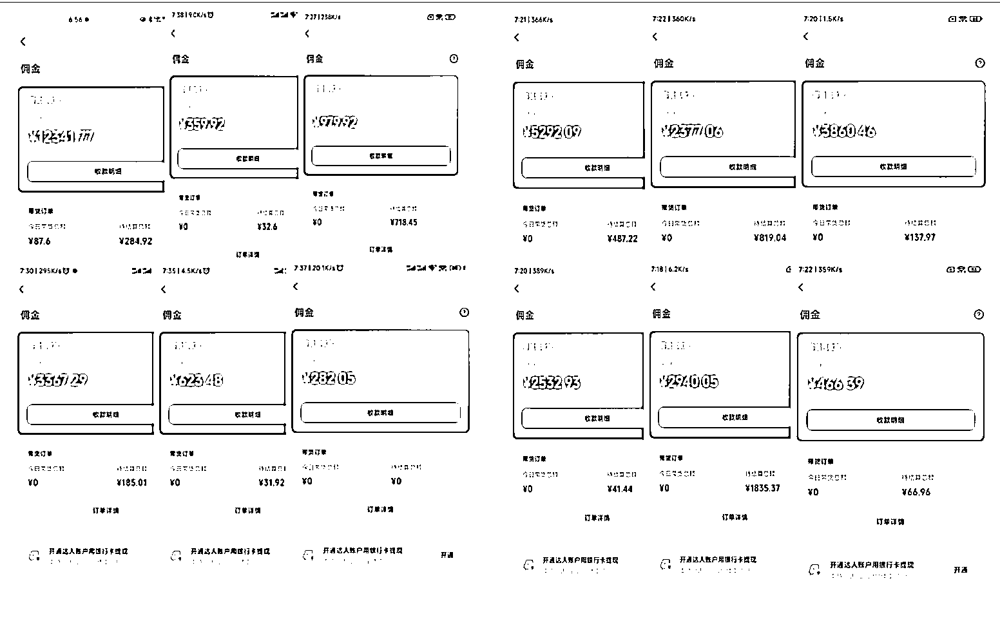
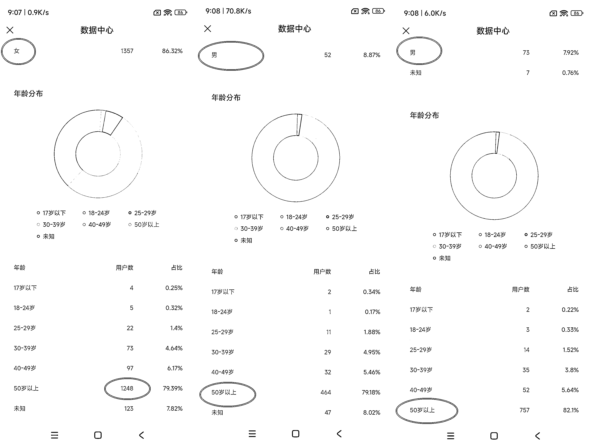
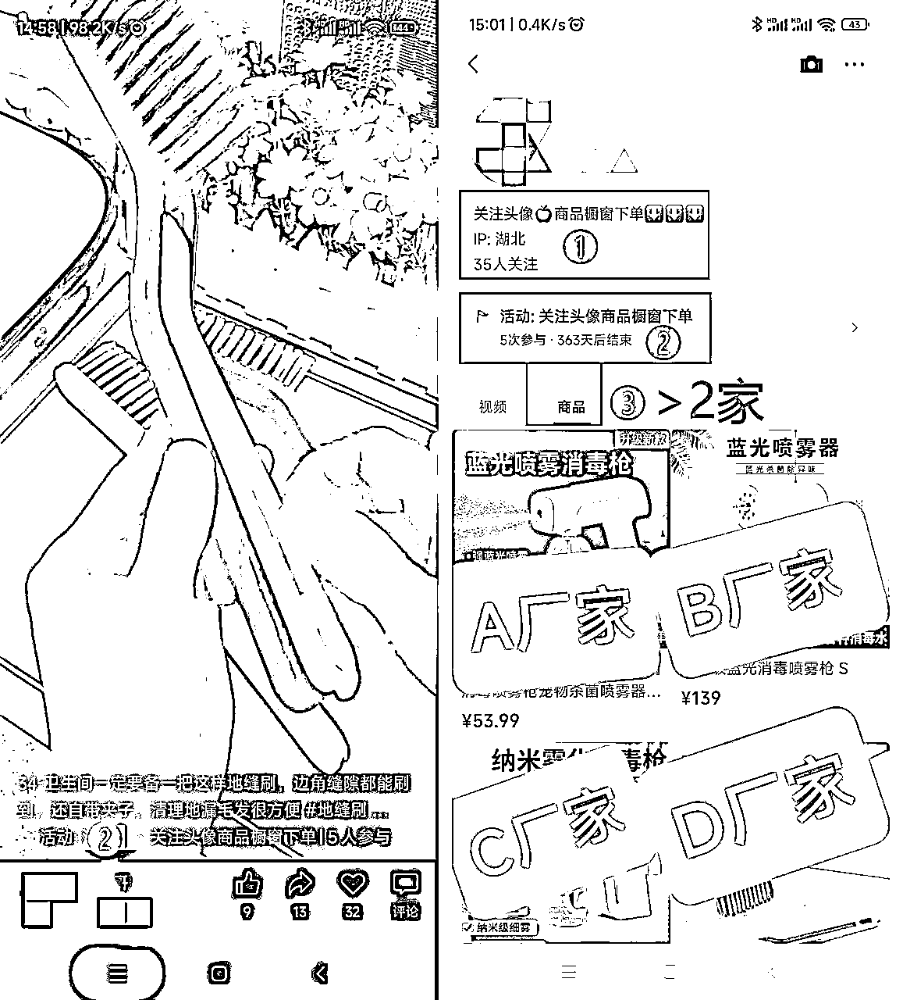
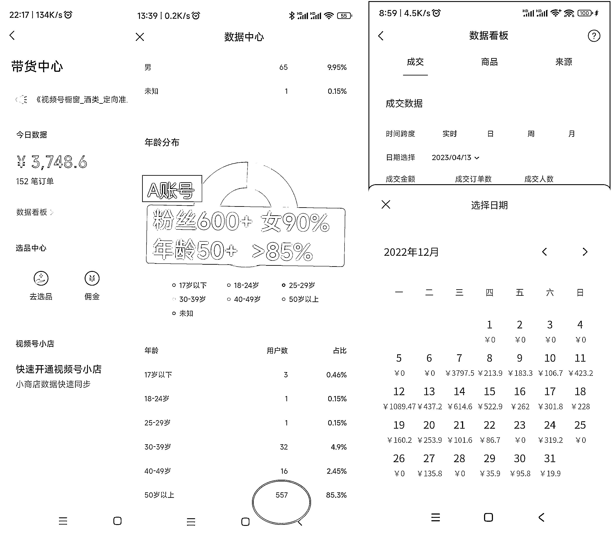

# 80后深漂转视频号带货：把赚钱的事做十遍，账号从3个做到20多个

> 原文：[`www.yuque.com/for_lazy/thfiu8/xeppwim32gb33qg5`](https://www.yuque.com/for_lazy/thfiu8/xeppwim32gb33qg5)

## 精华帖《80 后赚钱圈友分享视频号带货经验，赚钱的事多做十遍》

作者：东哥
日期：2023-05-11

大家好，我是东哥，一个普通的80后。工厂流水线干过，销售跑过，多年深漂，后来落脚湖北十堰。年前还在公司打卡，年后转成全职做视频号短视频带货。今天把我从零到一的实战路径，和一路踩坑的细节，整理出来分享。刚好航海又在招视频号带货，给准备下场的人一点参考。

先说个结果。2022年4月我加入赚钱，到现在一共参与了4期视频号航海，分别是6月、8月、12月和次年2月。年前的账号只有3到5个，年后持续扩号运营，现在稳定在20多个账号。单号最高月收益破1万，全部账号累计已经超过4万元。

### 一、视频号带货怎么流程化放大？

总结下来就是一句话：把流程跑通，把细节优化好，多开账号做流程化复制，赚钱的事就多做十遍。

发片、上架、看数据、管店铺、盯发货，这一套带货人每天都在做。看似普通，但一旦能稳定重复十遍、百遍，量级就完全不一样了。在跑通放大的过程中，我也吃过亏，下面这些实操细节供参考。

1.1【弄清视频号用户画像】

视频号用户里女性占比很高，年龄偏大。具体来看女性占85%以上，50岁以上占比超过80%。

1.2【账号安全先行】

一个身份证最多认证5个号，命名为A1到A5。让A2到A5的运营者都绑定A1，电脑端视频号助手用A1登录即可在后台切换发布。5个号共用一个银行卡收款。手机号建议每隔大半个月打个电话，保持号码正常。理论上1个号可运营绑定20个号，但风险高，不建议操作。不同人A、B、C的号要分开管理，不要互相绑定，安全第一。另外给所有账号编号，能大幅提升管理效率。

1.3【登录与硬件准备】

一个微信可切换登录5个号，安卓手机可双开，一个手机就能操作10个号。建议配性能好的手机，避免同时登录多个号导致卡顿。我当时入手了3台小米红米Note 11T，8+128G，单价1700元左右。

1.4【测品上架，盯紧数据】

开局让不同账号测不同品，发布时同步上架2到3个商品链接。至少隔半天看一次各号流量。关键节点是出现1到2单后，立刻联系2到3家供货店铺，加留言加电话确认库存是否充足、发货速度如何，后续每天核对是否2天内发出，拖到3到5天很容易触发退款。确认爆款后，用多个账号同步推同款，短视频引流到统一的橱窗店铺，集中抢量，速战速决。

1.5【橱窗设置和转化技巧】

在视频号助手活动管理里新建活动，标题写成“关注头像商品橱窗下单”，有效期设1年。视频发布后下方会自动显示该活动文案，引导用户进橱窗。爆款视频可置顶3个，流量排序是左边第一 > 中间 > 右边第一，后台可根据数据动态调整。短期内视频爆发时要立刻开播，短视频负责拉流量，直播负责提升转化。

还有个小细节：橱窗商品按出单情况排序，顶部放2到3个爆款供选择。再往下补充一些客单价30元以上、佣金比例30%以上、销量过百的畅销品，也能持续产生订单。

1.6【定制爆款链接】

遇到爆款要让店铺定制链接，可以修改主图、SKU、详情页和价格，有助于提升转化和客单价。SKU不要太多太乱。价格上做组合更易成交，比如1份29.9元，2份49.9元，客户更愿意多买。3月份的养生茶我做了70多单，佣金2300多元。定制的SKU有5种：2罐、3罐、4罐、1罐、茶花三件套*1份、茶花三件套*2份，价格区间30到180元，其中三件套1份和2份都有不错的成交。

1.7【维护橱窗店铺分】

平台现在很严，店铺评分普遍在4.5分左右，影响评分的有商品体验、服务体验、物流体验三项。店铺分低于4分容易被隐藏下架，链接失效，流量就白费了。我有2到3款产品就因为合作店铺分数低被下架，佣金损失不少。所以优先找店铺分4.2分以上、物流分高的商家合作。物流分低通常是因为付款后48小时以上才发货，或偏远地区运费高不发货导致退款。为避免此问题，建议有自有店铺的把偏远地区、港澳台等设为不发货，选品时也要看商家是否已设置。

1.8【用好赚钱航海】

多看星球的航海手册和精华帖，每两个月一期的航海尽量都参加，跑通流程后再做流程化多号出单。航海里有人出单就多交流学习。出单后一定要马上跟店铺确认发货时效，避免爆单后发货跟不上，最后只能售后。

### 二、一个人如何持续做下去？

钱在手里，心才不慌。去年年初我还在工厂上班，4月加入赚钱后看了大量精华帖，冲劲很大。后来失业在家试水知乎，一个月没起色，之后又回去上班。

6月中旬参加第一次视频号航海，前十多天没信号，直到6月底按郭晓文教练直播演示的方法操作，开始出单，这波赚了800元。

8月航海收益就很平淡，比不上6月。那段时间工作也不稳定，有种使不上劲的心慌。权衡后我先放缓，关注工作，也思考方向。

12月再报名航海，开始几天像日常上下班，没惊喜。12月7日那天销售额接近3800元，订单150单，感觉不一样了。虽然冬季羽绒服湿巾单价不高，但持续出单到月底，单号累计订单400单左右，佣金3000多元。

我立刻想着放大。当时手里只有3个号，明显不够。1月份回家后又开了一个号，把之前茶壶的视频搬运过去发，第二天出30多单，单价80到200元，佣金45%。钱一来我就催店铺发货，结果大半个月里通过多号私信、留言、电话联系商家却基本不回。最后30多单只发出三分之一，到手的钱飞了。期间我切换了5到6家店铺，受疫情、发货延迟、退货影响，还是损失了几千佣金。

后来这个品持续出单一个半月左右，单号佣金6800元。

年后2月初，舅舅来市区办事在我这住了几天，我把他的后台开通测新品，当天就爆了。几个视频总播放10多万，销售额8800元，单号持续出单两个月，累计佣金12000多元。

测出爆款号不够怎么办？我立刻回家用我妈的证件开了5个号，又用我爸的证件开了几个号，全部投入运营。父母账号合计佣金超过20000元。算到现在总收益4万多，这只是开始，我还在路上。

回顾下来，能走到现在有两点关键：

1. 坚持与执行力
如果12月那次不坚持做完整个航海，后续的放大可能就不会发生。有时就差坚持那一点点。找准方向后，要在同一个项目多期参与，跟圈友一起互相打气、互相突破。

2. 家人的支持
年前的父母并不了解我在做什么，也没看到结果，态度比较不支持。年后看到结果后才逐渐理解并大力支持。比如视频号带货需要微信绑定银行卡，乡镇银行办理很麻烦，邮政储蓄60岁以上不办卡，农商行有存折又不给办卡。我妈晕车，还是开车去县城办卡绑定手机号，这个支持让我更有信心往下走。

### 三、视频号带货参考资料

最后分享几个我常翻看的资料，供大家一起成长：

1. 视频号选品思路&答疑-郭晓文老师
[https://shengcaiyoushu01.feishu.cn/minutes/obcnws3ukj4royr2ef811hk7](https://shengcaiyoushu01.feishu.cn/minutes/obcnws3ukj4royr2ef811hk7)

2. 《视频号工具箱合集》建议收藏，每日更新—Alan 老师
[https://wx.zsxq.com/dweb2/index/topic_detail/184282454484252](https://wx.zsxq.com/dweb2/index/topic_detail/184282454484252)

3. 视频号短视频带货 | 航海手册—赚钱有术
[https://search01.shengcaiyoushu.com/docx/DdRSd7Mk3oPdygx2p6ycYRUnnQb](https://search01.shengcaiyoushu.com/docx/DdRSd7Mk3oPdygx2p6ycYRUnnQb)

评论区：
Ray♻️💥 : 同做视频号，现在 6 个号感觉都已经忘记哪个手机是哪个号了哈哈 肉松 : 可以做个表格方便管理 Ray♻️💥 : 我看有些人是贴纸[呲牙] 博学的金鱼 : 买一些贴纸贴在手机背面，记录一下名称和手机号。再做一个电子表格，记录下所有的视频号和对应的手机。 Ray♻️💥 : [强] 东哥 : 视频号账号流水式编号 A1—A5；手机上账号切换登录；笔记本手写记着哪个账号对应哪个手机，每个月通电话保证手机号正常就行。 龙哥 : 感谢分享，已加精华。 东哥 : 感谢[爱心][爱心]