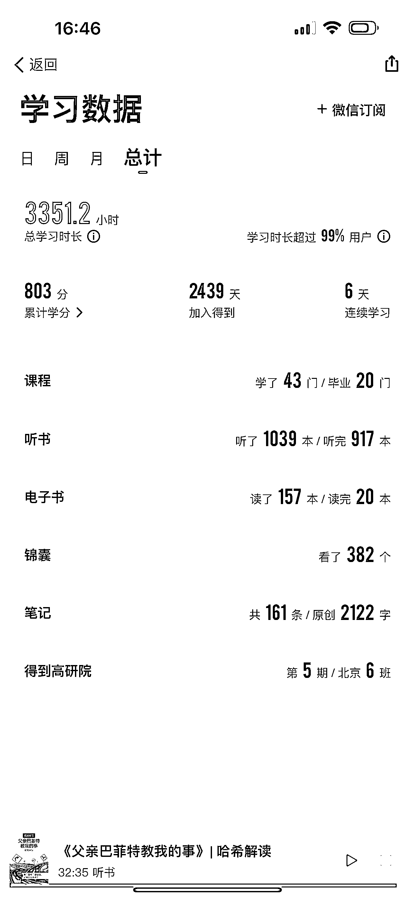

# 从零到一千万，我到底走对了哪几步？

很多人爱看逆袭故事，看得热血沸腾，总觉得故事主角就是明天的自己。但说句扎心的——真正的逆袭，不是靠一次好运砸中，而是把自己从头到尾换一套运行逻辑，甚至反复换好几次，才配得上“逆袭”这两个字。

我23岁那年赚到了人生第一个一千万。如今回头看，其中确实有运气的成分。但今天想认真做个自我剖白，聊聊我对认知、成长和财富的理解。

### 一、创业前，先学会敬畏

身边总有人把“创业”挂在嘴边：“上班太苦了，创业就是为了自由”“我不想被管，干脆开个公司让别人给我干活”。每次听到这种理由，我都觉得挺离谱的。

在起步阶段的创业者，凌晨三点还在回消息是家常便饭，一天飞四五个城市也不算特殊。外人觉得那是拼命，自己只觉得是日常。扛得住这份日常的人，心里多半是对创业这件事的敬畏。没有敬畏，努力就只是偶尔打一下鸡血，没法沉淀成理所当然的习惯。

我一直觉得，聪明人不稀缺，笨一点没关系，能把一件件事踏踏实实做完、有始有终，就足够让人敬佩了。

小时候长辈总说“勤俭能致富”。长大后才懂，勤俭能让你活下去，但离“致富”太远。勤奋只是最基础的操作系统，不是用来炫的资本；节俭该省的花该花的。当年我月薪2000，住城中村，一个月能存下1000块——存一千年也等不到一千万。但我敢在月薪2000的时候，一次性花3600块买课程，三年课程费说付就付了。吃住可以省，投资自己的那份钱，不能省。

开源要无限放大，节流真正的用处，是别把自己拖进恶性循环——脑子一热去梭哈、不留后路去杠杆，最后把自己困死在烂泥里。真正的高手，是先保证自己一直在牌桌上。

还有一件事要提醒：看看自己身边的能量圈。负能量圈子会在你没有防备的时候，一点点把你同化掉。你会在其中找到“归属感”，然后慢慢反感积极正向的圈子，越走越远，最终爬不出来。

好的圈子什么样？大家谈方向、谈业务、谈怎么把事做成，哪怕有人眼下很难，心态也是向上的。身处那样的能量场里，人很容易就能从低谷爬起来。

### 二、先把自己变成贵人，才有机会遇见贵人

别指望有仙女从天而降来报恩。现实一点：贵人提携你，一定是你身上有某种特质被看见了。

我是做自媒体的，写文章时经常会想——如果我是那个贵人，我愿意拉谁一把？把答案列出来：感恩、上进、有潜力、有态度。然后一条条照着去做，做到位了，再抬头看，贵人自然就在那里。

很多员工和老板天然对立，但老板其实离你最近的贵人。你想想，老板要是真想害你，花工资请你来干嘛？请谁来不行？

我自己带团队时，会先看谁愿意在杂活累活上较真。一群人里，资质好的两三个月自己就能冒出头来。对老板来说，最贵的是人才。这个世界的运行逻辑很清晰——别把精力浪费在敌视上，想想怎么让自己变成那个值得被培养的人，才是正事。

### 三、分享得越大方，路越走越宽

现在还有“闷声发大财”吗？我是不信的。闷声只会让你闭目塞听。

讲个当年的细节。我们一个直播间突然爆了，一夜冲上小类目第一。第二天来了几十个同行，对着我们疯狂对标抢量。当时我合伙人让我保密，我反着来——不仅不保密，还主动带着周边同行一起做。合伙人虽然不理解，但选择相信我。

结果呢？大批人跟着我们做，最后都来用我们的供应链。我们从一个20多亩的直播基地，马上要扩建到100亩。要是当初闷着头自己玩，能有今天的规模吗？

再说我自己的业务。做PPT拆项目跑通以后，我把整套流程毫无保留做成了系列教程。别人问授权，我说随便抄；问资料钩子，我全部送出。后期团队发布视频，统一不打水印，不挂联系方式，干干净净，就是为了让人方便搬运。

后来我收了两期门徒，别人说我在培养同行。我却觉得——他们会成为我庞大的资源网络，这就是未来最坚固的护城河。现在每天我的私域新增用户不低于1000人，渠道越来越离谱：YouTube、B站、各种盗版课、还有我听都没听过的平台。整个体系加起来，每天新进私域超过1万粉，还都是精准的创业粉丝。

做付出的先行者，就是这么个道理：别斤斤计较对方先给予多少。你就大胆掏心掏肺地付出，用这个动作做筛选。把真心给了懂得珍惜的人，好好维护，长久相处；遇上看不上你付出的，随他去，不纠缠。真诚而大方的分享，其实是建立连接最省力的方式。

### 四、没有欲望的人，反而没人能打败他

我常说，无欲无求则无敌。人性最容易被利益拿捏，当你真的没有任何功利心，反而没人能拿捏住你。

门徒木子田写分享时，初稿磨了好几遍。我跟他说：把你脑子里所有干货掏空，不带任何目的。他改到最后一版，几乎把自己底裤都掀了，我说味道对了。以后线上线下分享，都用这个标准。真正打动人的，从来不是炫——你开豪车戴名表，只能吸引没见过世面的小孩。最高级的吸引，其实是真诚。

真诚是什么？就是当面把自己的心掏出来，说“这就是我的全部了，你看着办”。没有保留、不加修饰。哪怕是杀十年鱼的老手，也会动容。

做成小事，只需要认真负责；做成大事，就是无数小事动作不走样。前提是拒绝诱惑。当年做抖音小店教程，我算是全网流量最猛的一波。有个深圳大哥提着一袋现金来公司，要合作割粉丝，三七分账，我拿七成。那时公司盈利还没起来，我说不心动是假的——但我拒绝了。

后来做抖音SEO，我也做到了很多大词前三。有人拉我入伙，联手赚培训的钱，我心动，仍然拒绝。私域做到10万粉时，有人出300万想买断我的私域，纠缠了整整一个月，我还是没答应。

一路上，财路不断闪现，迷人又危险。我脑子里只有一件事：我是要去西天取真经的，路上什么妖精仙女，都不能让我下马。无欲无求，别人是能感应到的——那就是松弛感。带攻击性的人让人防备，姿态平等的人让人亲近。看到富人不巴结，看到乞丐不嫌弃。平等心最容易生出善意，你不求回报地帮人一把，反而会收获意想不到的信任。

### 五、主动给自己洗脑

别把“洗脑”想得多可怕。人每时每刻都在被环境洗脑，关键是你选择被什么洗。

从小到处有人告诉你：赚钱太难了。于是大多数人的认知底层默认了这件事，行动上也开始迎合这个设定。你当然可以说，工厂里大热天劳作的人，赚钱就是难，那是事实。但你要明白，那只是事实的一种，不是唯一的真相。

换一套说法：赚钱，其实就是想清楚怎么有充足理由让对方把兜里的钱掏出来。你要是能给足价值，对方掏钱就是心甘情愿的。用户的画像是什么、走什么渠道、提供什么价值、怎么留住他——把这些环节想明白，赚钱的逻辑就清晰了。

所以我会反复给自己洗脑：赚钱不难。今天说想赚一千万一个亿，我都觉得可以实现。不是狂妄，是只要想清楚这笔钱由哪些部分构成，再给足时间，它就是能实现的。

真正的自我颠覆是矛盾的：要够自我，又要学会否定自我。写这篇的时候我很自信，但我清楚，昨天的自己可能不对。杯子一定要装水吗？杯子也可以种花。杯子一定要做成容器吗？杯子也可以变成一顶帽子。这就是神经病式的自我反驳。当初我做了PPT拆项目，别人以为我要做培训，但拆项目不一定要做成培训；之后开了社群，别人以为我要做圈子，但社群不一定要做成圈子。

总抱着“一定要怎样”的念头，路就走窄了。你的对手不是同行，是你自己的惯性思维。

### 六、选择从来不是赌，而是决策

“选择大于努力”这句话，被很多人误解成“随便押一个宝就行”。错了。大佬选A或选B都能拿到结果，区别在于决策能力。选哪个赛道更好，是评估资源、擅长和时机之后的最优解，不是掷骰子。

培养决策能力，就得大量吸收优质信息。很多人花了大价钱进社群，一年下来颗粒无收，就说社群不行。其实关键是有没有消化信息的能力。

比如你小舅子跑来让你投一个项目，说得天花乱坠。你只因为他是亲戚，就压上全部身家？赔了能怪小舅子吗？怪自己没判断力。可如果你早就从优质信息里看过这类项目的底层逻辑，知道风险点在哪里，别说小舅子劝了，亲爹妈拿刀逼你也不会投。

每一次决策都可能影响后半场人生。别轻易否定你暂时不认同的信息，一旦否决，那扇门就永远关了，认知黑洞会越来越大。所有亏掉的大钱，都是认知缺陷埋的雷。

所以，看任何内容都要丢掉评判心。你可以说我是割韭菜的，也可以拿我当参考模特——“从屎里找米粒”，从任何一篇分享里捞对你有用的部分就好。你要是带着否定心态，再好的信息也进不了你的脑子。

### 七、大钱都是小事的复利

云蔓的第一个一千万，用了三天半。我特意问她核心是什么，她的回答是：把一件小事做好，剩下的时间疯狂输入新知识。

她加入某个平台快7年，听了整整3351小时的课，这还只是学习渠道之一。

那些外人觉得了不起的成绩，本质上就是一件很小的事，被做成了日常。呼吸是日常，吃饭、刷牙是日常，但如果有人把一份事业也活成了呼吸一样的日常，这件事的回报注定惊人。

对我来说，一千万就是写下的一千万个字。这篇文章一万字写完，等于进账一万块，距离目标已经走完了千分之一。反馈不会立刻到账，可能一个月后、一年后，甚至更晚，但它总会在该来的时候到来。

人人都想天上掉钱，可钱不是这么来的。三和的大神要求日结，白领要求月结，创业者呢？创业者是种树人——一棵树十年后才成林，但种下去的那个下午，就是整个森林的开始。

十年久吗？用打工思维看，太久了；用投资思维看，十年的复利值得你慢慢等。机会从来都是留给那些愿意为长远结果埋单的人。钱不是大风刮来的，是被那些敬畏小事、不断自我迭代、永远坦诚分享的人，一点一点吸过来的。

很多人都在替我算账：会员费收了多少？2.5万付费会员，年费涨到921块，拿计算器一按，好像数字全清楚了。但说实话，这只是整个体系里的一块小蛋糕。

真正赚钱的逻辑，从来不是吭哧吭哧搬砖，而是用投资的眼光去布局。

在我们这个体系里，最值钱的东西其实是“项目打卡”。怎么玩？我们团队去市场上找真正拿到过结果的人，掏课时费，请他们出来讲课。注意，这个课不是传统意义上的卖课——每节课就三五分钟，讲完直接布置一个执行任务，做完就算打卡成功。报名要交几百块押金，21天里只要每天按要求完成，全勤的人押金全退。

为什么这么多课学了没用？不是课不行，是大多数人只学不练。哪怕就是让你连续21天爬楼梯，坚持下来，你也能感觉到气色好了、精力足了、连带着整个人的状态都上来了。这些反馈，全靠自己干出来。押金说白了就是个督促工具，跟过三期的人，基本就把自律刻进习惯了。

截至现在，打卡的全勤率也就50%。但这不亏——我们本来就是奔着交付做的，可因为有一半人坚持不下来，所以每期4000人报名，我们赚的其实是另外那2000人的钱。这事能跑通，靠的是顺势：用户乐意掏钱，自己能赚到钱，双方都舒服，自然没阻力。

为什么坚持给每个出课的老师付课时费？因为付了钱，我们就有底气提要求：别玩套路，别搞收割，老老实实给硬货。大家好，才是真的好。

但上面这些只是表面，真正的底层逻辑是投资思维。

一个项目跑成，靠的是正确方法+执行+一点概率。大多数人是做不起来的，可做不起来也不白干——在过程中练出来的能力，本身就是收益。我会去看一个项目的成功率，来判断它能不能复制。很多来找我投资的人把自己吹得天花乱坠，是骡子是马牵出来遛遛，一算成功率就现原形了。合理的可复制项目，成功率一般在20%到40%之间。

然后，从那些跑成功的人里选标的去投资。说实话，我们靠投资赚到的钱，已经远远超过会员费了。举一个例子：我在昆明投了一个多肉直播基地，投了不到50万，占25%的股。现在一个号一个月纯自然流GMV能稳定在200万，而且这只是其中一个号。类似的盘，我还投了好几个。

用投资的逻辑看机会，就是不轻易去做从0到1的事。从0到1，做比高这个IP这一件就够够的了，天天去开新从0到1的摊子，那是傻逼行为。要做的就是找到已经跑通的盘子，对方缺什么就给什么——缺钱给钱，缺资源给资源，直接入局。然后从1到10，把创始人的个人能力抽出来，梳理成SOP标准化流程。再从10到100，找到那个真正能复制的发力点，集中火力猛怼，复制放大。

拿我自己举例。做比高这个IP，我只看私域增长这一个指标。为了保住它，我铺了大量内容，全网撒网。光抖音就有几百个账号，也许你们看我大号不更新，可私域进量从来没掉过。封号、封私信？管他娘的，根本不在我考虑范围内，也完全不影响复制点的推进。

写这篇东西的时候，我没列大纲，读起来可能有点跳跃，但句句是掏心窝子的话。就像前面说的，自己先扎一刀，把心肝脾肺都亮出来，你感受一下真不真诚就完了。

现在这个时代，信息太多反而不是好事。我见过太多人，天天处在焦虑里，内耗严重；还有很多人执行到一半，开始怀疑自己、迷茫、灰心、受挫。作为过来人我想说，这些事等你走过去回头看，真的都是芝麻粒大的事，可能三五年后你连记都记不起来了。

什么是对？其实没有对错。先把今天一件小事做好，就够了。人生都是定数，上辈子投胎前，上帝把所有人的剧本摆在你面前，你自己挑了一个最好的——那剧本上面写着：这小子早几年有点不顺，但中年找到立足点，还遇到一个像比高这样的人，从此开始改变，中年之后事业一路起飞，要钱有钱，要啥来啥，终于找到自己的幸福和平静。

行，就它了。然后剩下的，就是把角色演好，别浪费这么好的本子。你不演，我可就抢过来了。

这篇文章首发赚钱有术知识星球，其他平台不发。想搬的不用问我要授权，随便搬，哪怕署你自己名字都行。别人问起来，我还会配合着说：“没错，是我抄你的。”

草，写到这里又快一万字了，今天白赚一万。标点符号也算字数！

很好！

就这样！

嗯！