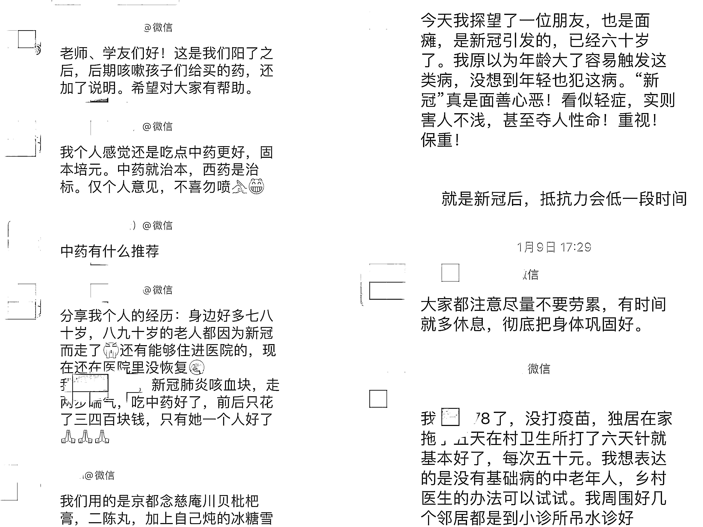
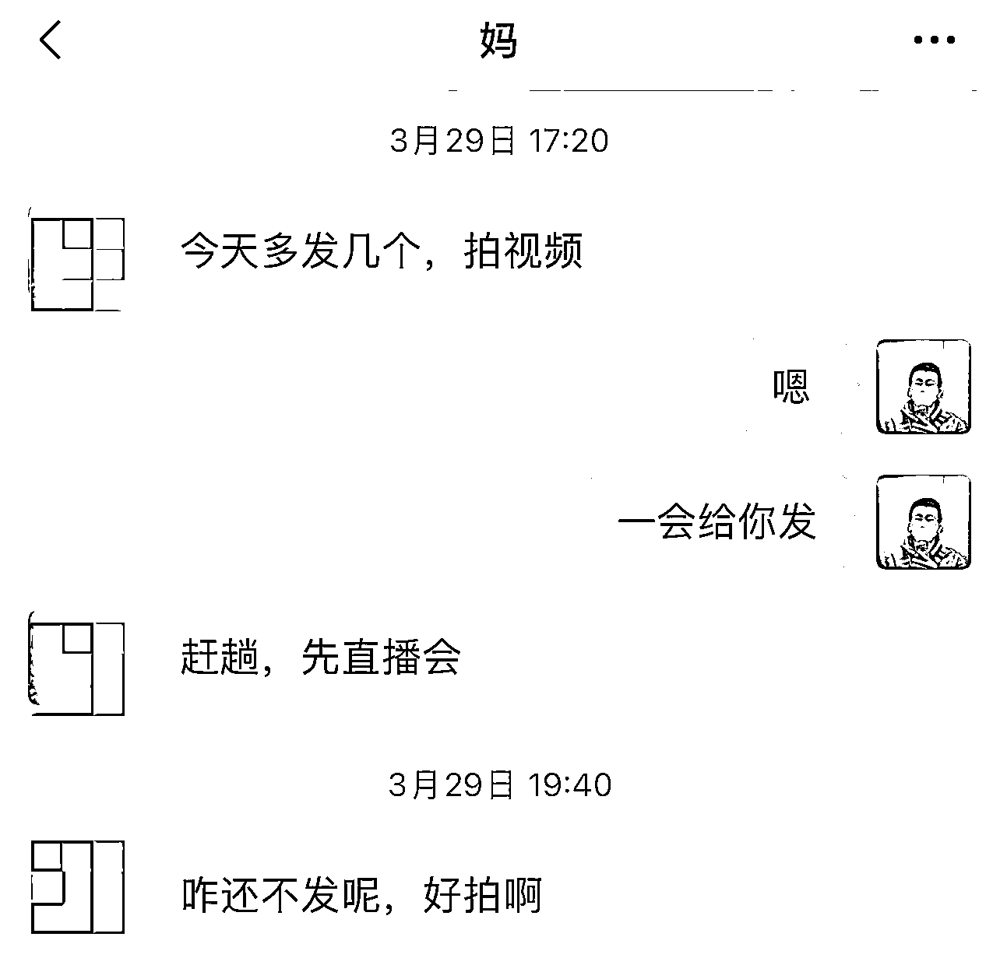
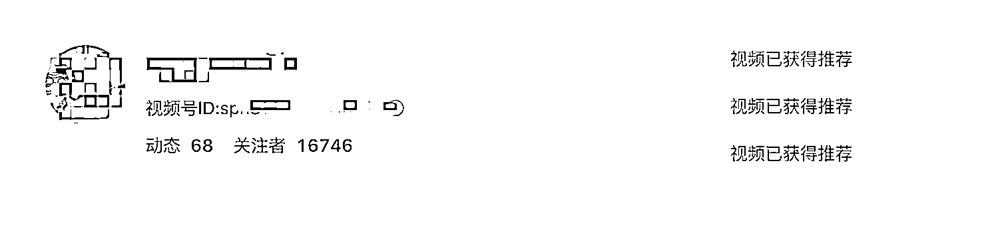
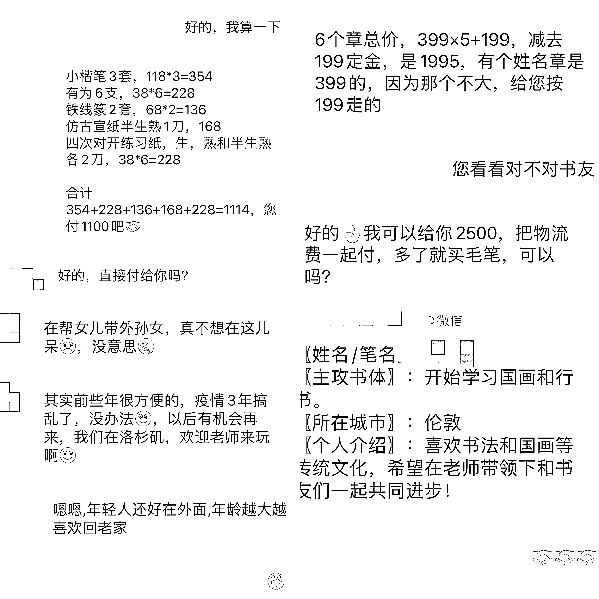
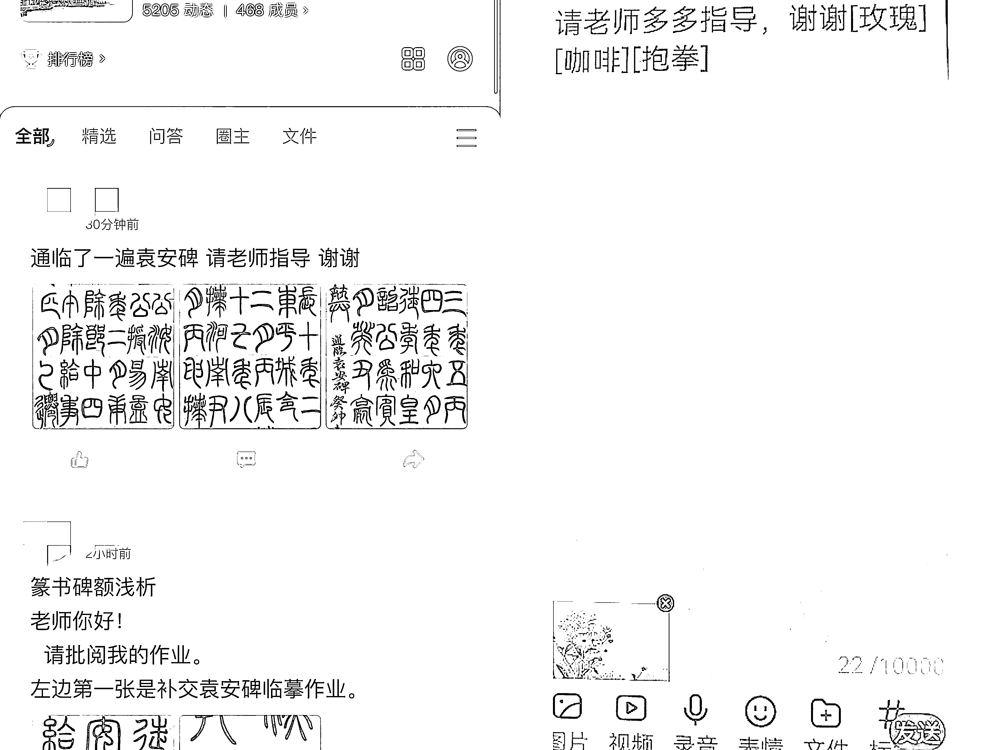
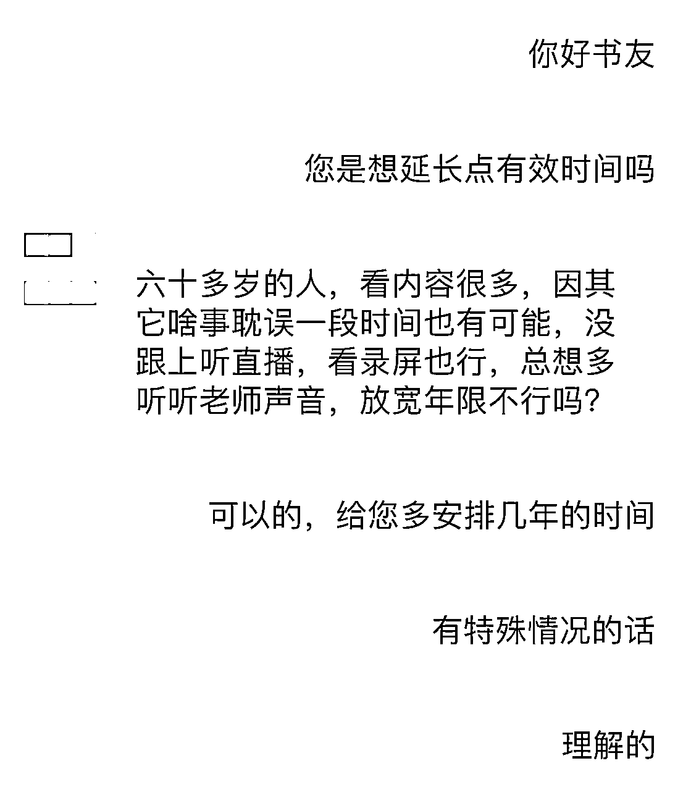
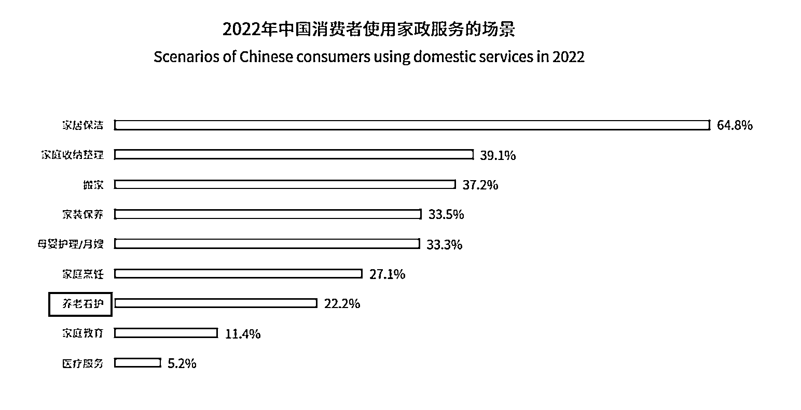
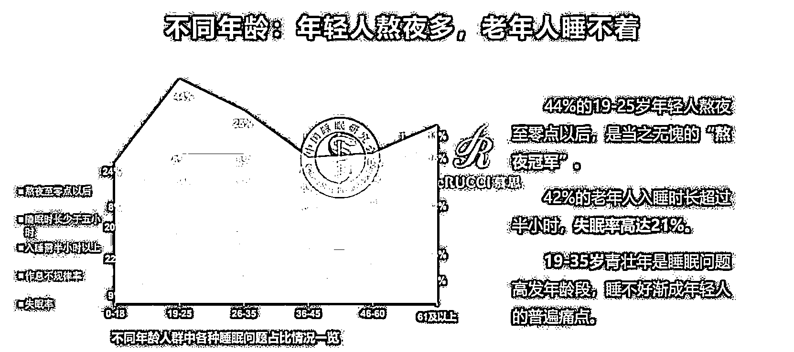

# 银发人群的付费内容，普通人怎么切入最有机会？

> 原文：[`www.yuque.com/for_lazy/thfiu8/hlu2kstgdwxsgf5e`](https://www.yuque.com/for_lazy/thfiu8/hlu2kstgdwxsgf5e)

## 《银发人群的付费内容，普通人怎么切入最有机会？》

作者：渔火
日期：2023-04-17

最近这段时间，围绕老年群体的垂直内容生意，机会正在肉眼可见地冒头。

比如圈友聊起过的老年唱谱课，主播在直播里带着大家认简谱、跟唱，钱自然就收进来了。没有音乐功底也无妨，书法、国画这些方向同样成立。

我是从2019年开始专注老年群体的知识型产品。这两年没有投入特别大的精力，数据与收入却持续往上走，还顺手铺开了好几条面向老年群体的内容带货线。接触得越深，越觉得这个赛道值得聊。

下面按四个板块来拆解：普通人如果想做高客单价的银发付费内容，还有哪些新的流量入口与增长机会。

一、为什么当初锁定银发人群？
二、这群人的消费习惯有哪些特征？
三、银发市场这两年发生了什么变化？
四、2023年，普通人在这个赛道还能分到多大一杯羹？

我是渔火，一个还在折腾的创业者。

隔了挺久没分享，先交代一下近况。2021年，我以联合创始人身份参与的项目，拿到了真格基金领投的千万融资。我自己当创始人的老年项目，则是从2019年就开始运转了。

最近有不少圈友跑来问银发方向的事。我和这群叔叔阿姨大爷大妈已经打了好几年交道，曾经让一位83岁的长辈为我的课程付费。这事不大，但它让我确信：他们真的很可爱，只要认真交付价值，回报往往来得很直接。

（口罩期间班级群里的暖心互动）

所以今天重点聊2023年银发赛道的机会，顺带说说我这两年的观察。先讲知识型付费产品，其他硬件、App、电商等以后有机会再展开。

时间拉回2019年，讲讲为什么我会选这条细分路线。当时选方向时，我习惯先把自己的底层逻辑理清楚——这可能是长期赚钱的关键。以内容付费为例，我把成年人知识产品这几年的演进路径大致捋了一遍。

从早期知乎时代，到罗辑思维付费会员、樊登读书、付费问答、订阅课程，再到各类课堂专区与圈层；教培行业也走过了线下课、网课、1对1、大班小班、社群、AI课、训练营、行动营的进化。

整个行业基本是伴着用户认知和习惯的成熟，一层一层长出来的。

那阵子K12打得正凶。我这种没背景没平台的小角色，当然要挑一个更好切入的赛道。再转头看银发市场，付费内容还处在非常原始的阶段。

可以合理预判：随着时间推移，产品形态和内容一定会越来越丰富，机会就摆在那里。毕竟人到这个年纪，钱和时间都更宽裕，也更愿意为自己喜欢的东西掏腰包。

光是兴趣向的细分：书法、绘画、棋艺、诗词、茶道、艾灸、摄影、朗诵、手机应用教学、花艺园艺……我调研了一圈，每条线上都有小团队在闷声挣钱。这也是我敢果断进场，并且一直留到现在的底气。

说个数据：统计局公布的2022年末口径显示，全国过了60岁的人口已接近3亿，占全国总量近两成。如果把45岁往上的人也算进去，盘子还要大得多。

今年最直观的感受是，关注银发赛道的人明显变多，进场的人也在变多，但真正了解这波用户的依然是少数。

我花了一段时间翻看各个平台上银发热门内容的评论区，高频词翻来覆去就是“老年人不网购”“老人玩不明白手机”“开养老院赔光了”……看完这些我才确认，很多人对这波真实用户的消费行为有着很深的误解。

按理说，都市银发是抖音划定的核心人群之一，我原以为大家会有所了解。小镇银发确实不容易做，但都市银发完全是有钱有闲的代名词。

我的项目里，有效用户被定义为40岁至75岁、生活在主要城市的人群，获客效果还不错。

总觉得长辈玩不转手机？移动互联网都普及多少年了，连偏远的乡村都拉上了Wi-Fi。我妈是1968年出生的，我只是帮她注册了一个视频号，一个月就积累了超过1.6万粉丝。

（我妈一天到晚催我更新脚本）

（我妈做了三十天的视频号记录）

每天开播挂上小黄车，能卖八九百到一千块的日用品。她的手机是很普通的安卓机，前两年连App都弄不明白。所以，真别低估长辈的学习能力，也别再说下沉市场没有消费力。

以为他们只会挑便宜的？我拿自己的成交数据回答：课程定价从500到2000元不等，平均一位用户会复购三门以上。这还只是课程；书画方向的用户，一年在笔墨纸砚和印章上也要花掉两千左右。

如果做艾灸这样与健康挂钩的方向，客单价还能再往上走。退休后，有人跟着子女去了国外，有人留在大城市帮带孙辈，也有人回老家舒舒服服过日子——无论人在哪，都不妨碍他们寻找乐趣并为之付费。

（私域里几位用户的购买截图）

一句话归纳：今天的都市银发，手机用得很熟，资金和时间相对自由，也愿意分享，更看重服务体验，对线上付费这件事正变得越来越习惯。

以我自己的项目经历来看，这几年可以粗分成三个阶段（只谈知识型付费，硬件、App、电商先放一边）。

2008到2015年，刚萌芽的时期。认真做银发生意的人少之又少，大多数团队只在平台上跑流量，后期变现效果平平。糖豆广场舞等App正是在那几年聚拢了大量老年用户。

2015到2019年，野蛮生长的时期。一批垂直产品和机构陆续出现：美篇这类内容社区，墨客、墨池、快乐50这些垂直机构，还有养老家政、睡眠健康等方向，线下老年大学的名额抢都抢不到，音乐相册、天气工具等产品也吃到了一波用户红利。

2020到2023年，高速增长的时期。资本和大厂开始下场，红松很短时间里就拿到蓝驰、经纬等机构数千万美元的投资；从知乎出来的合伙人做了老年项目；尚德、大鹏（虽然关停了）、高途等公司也开始布局银发内容。

我自己感触最深的是2015到2018年——那几年老年内容付费，几乎处于随便做都能赚钱的状态。

举个真实的例子：早期在公众号上投放，不需要任何文案技巧或投放技巧，书法课和国画课的ROI能做到20。换算一下，放5万元广告进去，能卷回100万销售额，客单价还能拉到2000。

那时获客很便宜，一个进群用户平均只花5元，而且全是精准的兴趣粉，不是泛流量。

同期幼教和K12正打得不可开交，母婴赛道的流量从几十元一路涨到一两百元。

我当初的启动资金只有三块：店铺工具的年费、请老师录体验课的费用，以及第一个月的广告支出，加起来不到5万元，结果第一年就滚出了200多万营收。

这很大程度上得益于我此前做幼儿赛道的经历——做课的方法、服务的手感、营销的思路，放进老年市场，几乎都是降维打击。

近几年，大厂把用户心智教育起来，更多垂直方向的内容产品也迎来了一波新机会。

一提起银发生意，别总把它和养老院、养生产品、送鸡蛋、广场舞画等号。

现在这批银发用户和从前完全不同。移动互联网发展到今天，几乎每一个领域都值得用银发视角重做一遍，社交、健康、日常消费、文娱、生活工具，很多维度都有空白。

随手就能举出一些新方向：老年版Keep、老年版小红书、老年家政、老年睡眠、银发文娱、慢病管理，还有“科学带娃”的课程……太多太多了。

从我的视角来看，背后主要有三股力量：

（1）流量侧：触及银发用户的渠道变得更多元。视频号这类中老年聚集的内容社区，加上美篇等垂直平台，给新玩家提供了更多冷启动的可能。

（2）用户侧：大公司进场后，用户认知和付费习惯逐渐被培养起来。而且银发用户对服务好坏的感知，远大于对品牌的信任。只要你的服务到位、课程贴合他们的问题，哪怕是无名小店也能卖得动；在这些长辈眼里，大厂和小团队没有本质区别。

（3）产品侧：这个市场优质的供给还太少。在别的赛道，或许要做到120分才有机会；但在这里，做到60分就可能被看见。想想当年音乐相册和天气软件几个月拿下几百万用户，就知道空白有多大。

不过，流量阵地和产品形态要选对。我测过不少主流渠道，最后跑下来，微信生态里的转化链路最短，视频号也相当顺。抖音和线下还能做，但今天先不谈银发电商零售。

（某个班级群的作品墙：哪怕用大字版手机，晒图也格外积极）

对普通人和轻个体来说，无论是做流量还是做课程，都有很阔的空间。如果你没有技术能力，我最推荐的路子就是做课，这个方向性价比最高。

我现在正同时在生活服务和兴趣培养两个大方向上，批量做短课时的小产品去测试。你可能会说，做课不是需要专业能力吗？

讲实话，我一开始对书法、国画一窍不通，真正懂的是用户与流量。课程找对应专业的老师来录，老师出大纲，我再结合人群需求去改去审。很多方向甚至请个大学生，用极低成本就能产出相当专业的课程。

举一个最近在做的电子琴课。

之前有人质疑：让老年人学电子琴，听起来太小众了，真会有人买单吗？

但实际上，音乐类内容在银发消费里早就是一块不小的蛋糕。快乐50和红松学堂等公司，已经在这个方向做出规模，客单价还不低。

关于怎么挖掘细分需求，我在赚钱分享过另一篇内容，想深入了解的可以去看：https://articles.zsxq.com/id_pt1urnv5g4ah.html

需求确定后，我先做小范围实验，核心要解决流量和产品两个问题。毕竟变现最终要靠卖课。

我先用视频号做测试，跑了一圈音乐向的几个分支，引流效果还算不错，前期流量基本可以按这个思路跑通。

产品是我最想强调的部分。做银发内容，最关键的还是懂用户，课程大纲差一点，卖出来的结果可能天差地别。

我前前后后和几千名用户深聊过。早期我也追求过页面精美、店铺装修精致、海报大气，后来发现他们根本不在意这些。

他们真正关心的是：试听内容扎不扎实、老师是不是自己认可的水平、服务能不能让人舒服，以及长期课能不能保存、能不能反复看。

有一回我还做了个对照测试：在电商平台花1000元做的精致落地页，竟然输给了一个在线工具10分钟做出来的绿底大字长图。

（比起花哨外观，他们更在意内容可不可以保留、信息是否持续更新）

所以说，产品不一定要多华丽。多跟用户沟通，搞清需求，确定课程形式是录播、直播还是混合，再定个合适的价格卖出去，方向不出大错，剩下的就是持续优化。

除了常规的知识型产品，我最近还看到一些团队在做的新方向，也一并列出来。

① 银发家政

家政市场本身够大，圈子里的朋友也有做得好的。眼下这个细分领域，大多数环节是子女为父母下单，比如保洁、营养餐、测血糖、涂湿疹药膏、陪散步聊天、陪同看病熬药等。

模式上与云家政的打法相似，只是获客方向不同。你去天鹅到家上翻老年服务，会发现订单量已经不少，但可选类别还比较单一。

② 银发睡眠

我看到一份关于国民睡眠健康的报告，里面提到40岁往上的人群睡不好的比例正在显著上升，问题也愈发严重。

顺着这个方向，我去了解了助眠科技赛道，市面上已经有不少公司在做，各种助眠App和带白噪音的音乐产品都有。

睡眠这件事本身就是个复杂问题，背后诱因很多。

如果想切入，普通人的机会可能有三个：一是做超低价教程，教大家把手边的助眠工具用起来；二是从心理和情绪疏导入手做课程；三是做健康管理方向的内容，比如请专业营养师规划晚餐、指导睡前运动等。

③ 银发旅游

从数据上看，老年旅游市场的增速相当可观。年轻人出门会做攻略，老年人却常常担心被坑，我妈一听到旅游就条件反射似的摆手。

那么，普通人是不是可以做面向银发族的定制旅行攻略，收一点咨询费？再顺势给靠谱的旅行社导流，赚一笔佣金？流量端就更不用说了，视频号里的旅游和风景内容有多受欢迎，点开刷一刷就有答案。

④ 银发零售

这块很多圈友已经做得很好，书单号卖书也跑得很成熟。我向几个团队打听过，目前卖得最好的品类是女装和鞋，尤其鞋子，利润率非常可观。手上有货源资源的话，值得留意。

⑤ 银发宠物

宠物赛道这两年增速也快。数据显示，全国每年新生儿大约1000万左右，而宠物猫超过5000万、宠物狗超过3000万。

我调研下来发现，养狗人群平均比养猫人群大十岁左右，狗主人的平均年龄在37岁上下——已经渐渐靠近退休一代了。这样推算，银发养宠人群想必不少，养狗的又尤其多。

那宠物赛道的玩法是不是可以搬过来？我给我妈做的就是宠物号，她是1968年生人，自己出镜讲养宠，亲和力更强。才做了一个月，粉丝数就冲到了1.7万。

她平时开播带点货，每天能出800到1000的宠物用品，佣金可以拿到三成。私信里天天有叔叔阿姨来问养宠问题，其实很多答案查一查就有，但他们没有搜索习惯。

这个方向的需求和想象空间都很大。我接下来的计划可能不会让我妈一直做直播——直播很考验临场能力，她上手偏慢；不如用视频号做引流，把信任沉淀到私域再卖货。以后还可以接入AI做个性化问答，变成一个“银发宠物顾问”，甚至开发一套面向老年人的养宠课程。篇幅所限，今天先聊到这。

以上是我个人的阶段性思考，未必全对，若有一两点能给你启发，就很值得了。

2023年，普通人在银发赛道的机会就先说这么多，有想法的朋友欢迎在留言区互动。

评论区：

Ray♻️💥 : 我女友是学音乐的，想带她做个人IP
渔火 : 有专业能力的人做银发赛道更吃香
控心 : 是不是必须有一技之长才能做？
渔火 : 不一定，懂用户就行，我自己也没什么技能
阿顾 : 干货很多，受益了
Jia : 很受启发，收藏了
Jia : 关键还是你有能持续制作内容的资源
渔火 : 你没细看，比如电子琴和宠物方向的课，都是找大学生录的