# 从0粉到300万粉、收入从三千涨到十万：我的八年踩坑实录

> 原文：[`www.yuque.com/for_lazy/thfiu8/mw575v2cbcrnvel8`](https://www.yuque.com/for_lazy/thfiu8/mw575v2cbcrnvel8)

## 252赞分享·从0粉做到300万粉，收入从月入三千到十万的心路历程

作者：猎音狮（豪叔）
日期：2023-05-04

各位圈友好，我是猎音狮。先前在星球发过一篇《图书类目短视频投流带货，我是如何月入10w+的？》，没想到收获了200多个赞，实属意外之喜。也因为那篇内容认识了不少新朋友，大家私信里问了不少实操细节，我回复得不够及时详尽，还请多多包涵！鞠躬

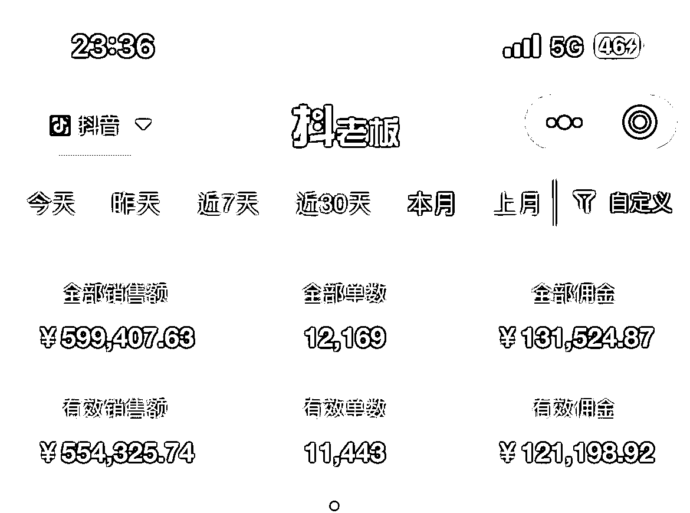

上面这张截图是4月份的抖音收益，视频号和快手两个平台的还没算进去，抖音依然是收入大头。顺便解释一句，55万GMV账面只体现12万，是因为有一部分商品的佣金是在线下单独结算的。

今天这篇不打算讲什么亮眼的数据，只想把我从零粉做到百万粉，以及从月薪三千到月入十万的真实经历，原原本本摊开来讲。这几年我始终一个人作战，没搭过工作室也没组过团队，文案、拍摄、剪辑、投放、运营全是自己扛，反而因此把整套链路跑了个遍。为了把这段历程呈现得更系统，这篇稿子前后打磨了差不多12天才完成，希望能对大家有所启发。抱拳

目录

第一章、冷启动的全套打法
    第一节、手写拍摄起号
    第二节、混剪二创起号
    第三节、校园实景起号
    第四节、真人口播出镜
    第五节、百万级播放量的爆款是怎么做的

第二章、一路试探的变现之路
    第一节、A4纸书单玩法（2019年）
    第二节、手账笔记书单玩法（2021年）
    第三节、名人讲座书单玩法（2022年）
    第四节、划线摘抄书单玩法（2023年）
    第五节、真人出镜带货（2023年）

第三章、流量与变现的进阶玩法
    第一节、选品
    第二节、用“顺滑”的随心推
    第三节、不可控的千川投放

———分割线———

下文是我混迹互联网8年沉淀下来的实践经验，全部来自亲身试错和复盘，希望能帮到正打算入局或在瓶颈期的你！

全文约10241字
读完预计：60分钟
写作时长：12天

## 第一章、冷启动的全套打法

## 第一节、手写拍摄起号

原理很简单：把内容手写到纸上，然后用手机或相机拍成短视频发到平台。视频长度建议控制在4到7秒，因为时长极短但文字密度大，用户刷到后往往来不及划走，完播率会非常漂亮。举一个直观的算法逻辑：一个7秒的视频，如果人均观看时长达14秒，系统记录的完播率就是200%。高完播率意味着内容具备强吸引力，系统自然愿意给你更多曝光，这就是流量密码的底层逻辑。

这个玩法适用的领域很多：职场号可以手写辞职信，情感号可以抄情书、情话、情诗，教育号可以手写学生作文、日记、试卷……换个角度思考，可以延伸出更多细分赛道。

案例1：情感类账号手写起号（本人实操）
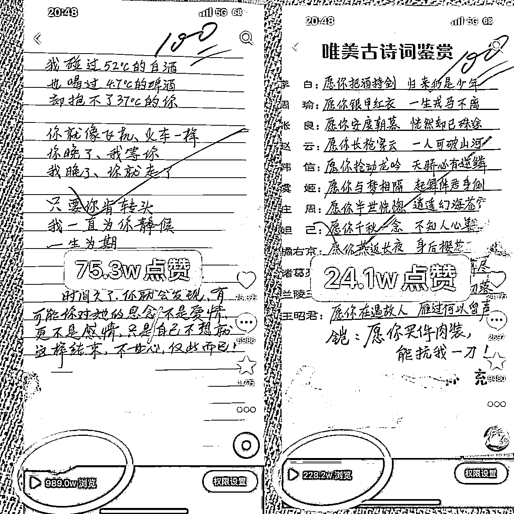

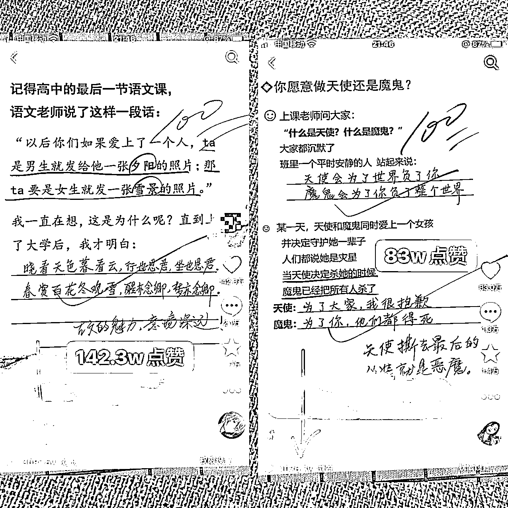

案例2：教育类账号手写起号（本人实操）
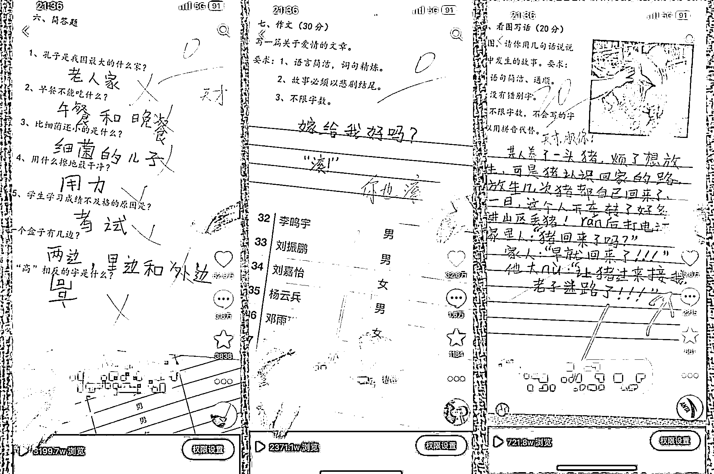

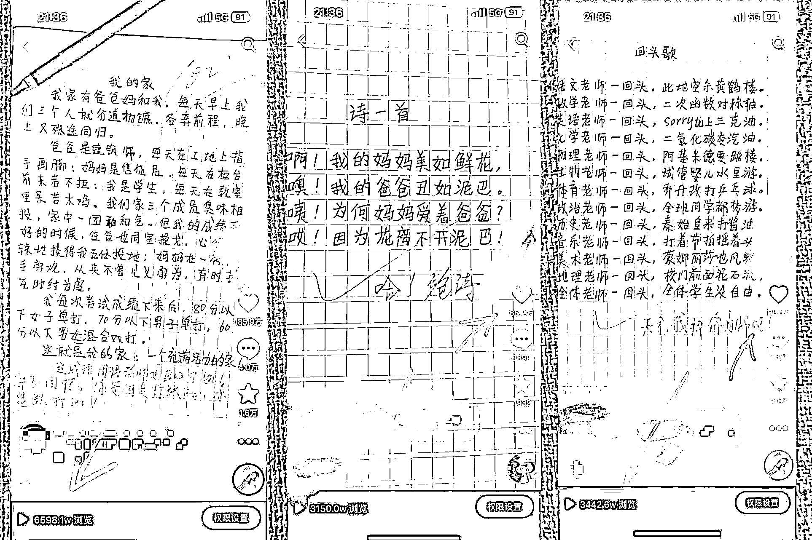

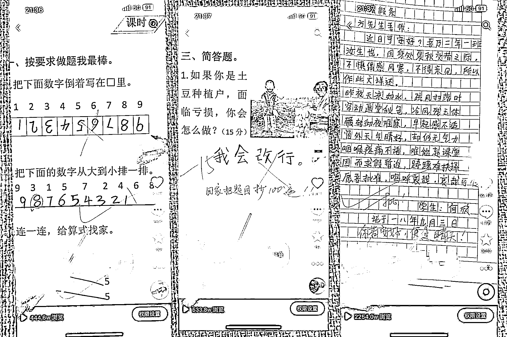

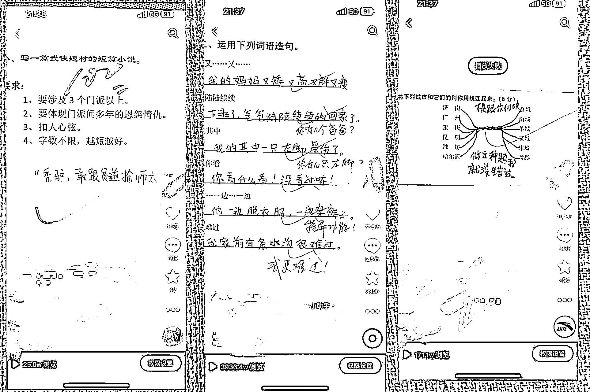

学习本身就是件枯燥的事，所以这些案例里特意加了些好笑的东西帮大家提提神。笑完之后别忘了，所有流量爆款的内核，都逃不脱“有趣”、“有料”、“有共鸣”、“有审美”这几个关键词。

看到这里，你是不是对流量密码又多了一分理解？有没有觉得思路一下打开了？

第二节、混剪二创起号

混剪这个玩法大家应该都很熟——把别人已经跑出过成绩的爆款视频拿过来，做二次创作和重组加工。爆款素材本身就经历过验证，重新混剪之后爆的概率依然不低。这也是公认效率较高的一种起号手段。

这个模式的优势是省时省力，但唯一的隐患在于去重。如果去重处理不到位，很容易被平台判定为搬运或违规。关于去重的重要性和具体方法，老玩家都心知肚明，新手可能还摸不着头脑。我先把一张思维导图放出来，方便大家理解：

1、抖音查重机制

做任何事都要知其然也知其所以然。先来看抖音的查重逻辑是怎么运转的。

2、去重实操策略

平台有检测机制，创作者自然也有应对方法。只要把素材改得足够“面目全非”，机器就很难识别出来。按照以下7个步骤走，哪怕算法再聪明也能绕过去。
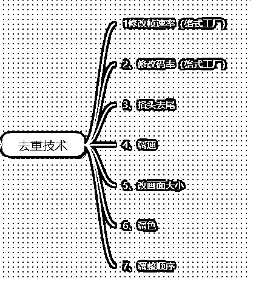

3、补充说明：螺旋算法、漏斗转化、叠加推荐

A. 非带货视频的考核维度：

B. 带购物车视频的考核维度：
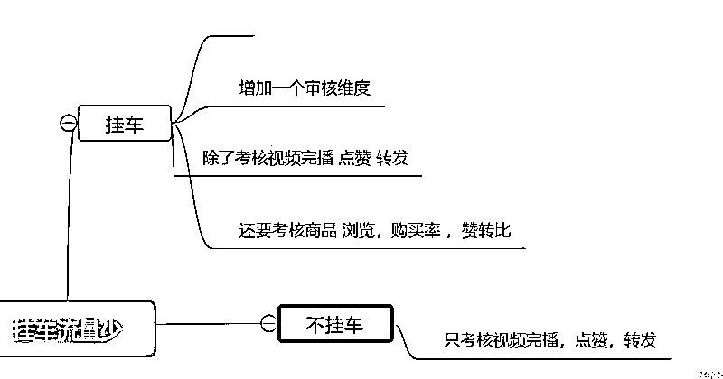

这其实也回答了大家一直困惑的问题：为什么挂购物车的视频流量总比普通视频低。那挂车视频想提高流量该怎么办？方法如下：
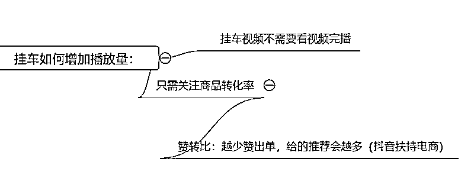

第三节、校园实景起号

这类内容成本也很低——跑到校门口或者校园内部，随手拍几段空镜头，回来配上几句自己写的文案，拼成一条7秒左右的短视频，再配上近期热门的BGM发出去即可。如果你恰好在北京，找清华北大当背景，流量想不高都难。不过这类玩法有个短板：原创度偏低，容易跟别人撞车。所以这里只做简单提醒，不再展开。重点还是看看下面的真人出镜和口播号怎么起。

第四节、真人口播出镜

所谓真人口播，就是先把台词写利索，再打开剪映的提词器，照着录完就能发。基本操作人人都会，不会的不如先去搜索学习。所以这一节我不打算讲那些烂大街的基础教程，只想聊一些你在网上很难搜到的实战经验，这才是真正有价值的部分。

1、口播文案从哪来

A、抖音站内经常有数据相当炸裂的高赞图文，这类内容你直接拿来改写成口播稿——注意，不要去抄别人的视频，那会被判定为非原创；但如果是图文转口播，最多算个“伪原创”，并不容易触发处罚。挑一篇跟你的账号定位相符的爆款图文，对着镜头朗读一遍，复制爆款的概率至少在七成以上。

B、小红书也是一个内容富矿。去搜索跟你账号类目相关的热门笔记，找到数据漂亮的直接拿来当口播稿，对着镜头从容地读一遍，起号成功率同样相当可观。

2、怎么追热点

A、每天养成刷热榜的习惯，除了社会新闻之外，凡是和你内容领域沾边的话题，都可以拿来结合。

B、还有平台官方发布的各类挑战赛和活动页也别遗漏。官方自己办的流量活动，通常会配备投流资源作为扶持，这波免费流量不薅白不薅。

3、真人出镜的几个硬性指标

A、基础画质层面：画面不能糊、曝光要自然、播放不能卡顿、配音别嘈杂，并且关键信息不能被遮挡。

B、时长和画幅：建议控制在30到90秒，节奏明快、不拖泥带水，开头5秒最好直接把核心重点抛出来。

C、内容层面：必须真实有料，且建议全程配字幕。

D、关于营销感：如果是带货视频，不要在内容里反复强调打折促销，优惠信息可以通过购物车旁路传达。
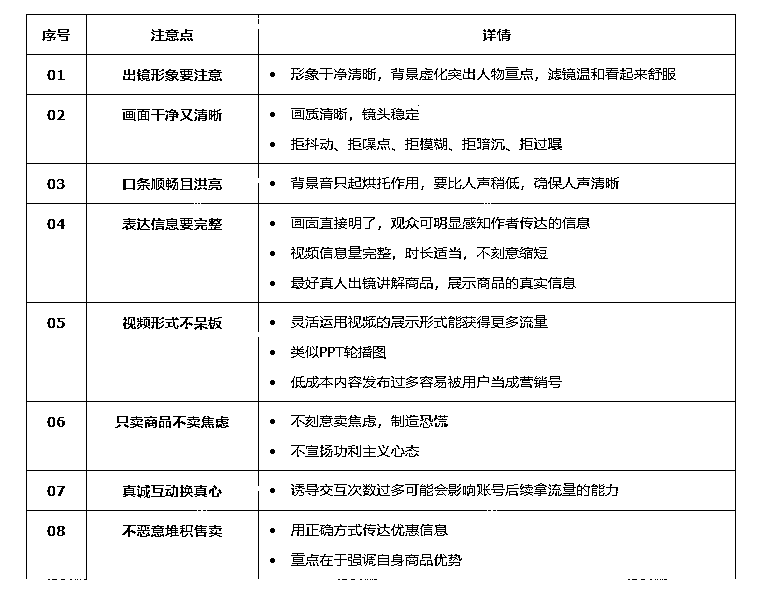

第五节、百万级播放量的爆款是怎么做的
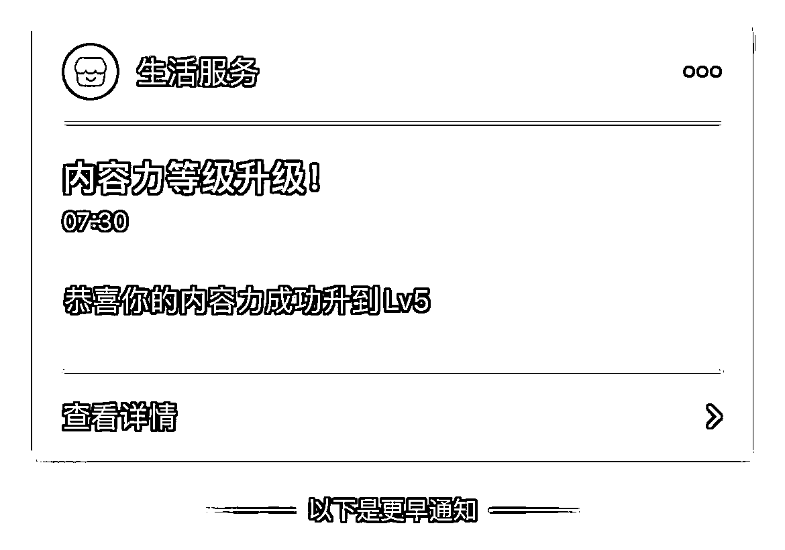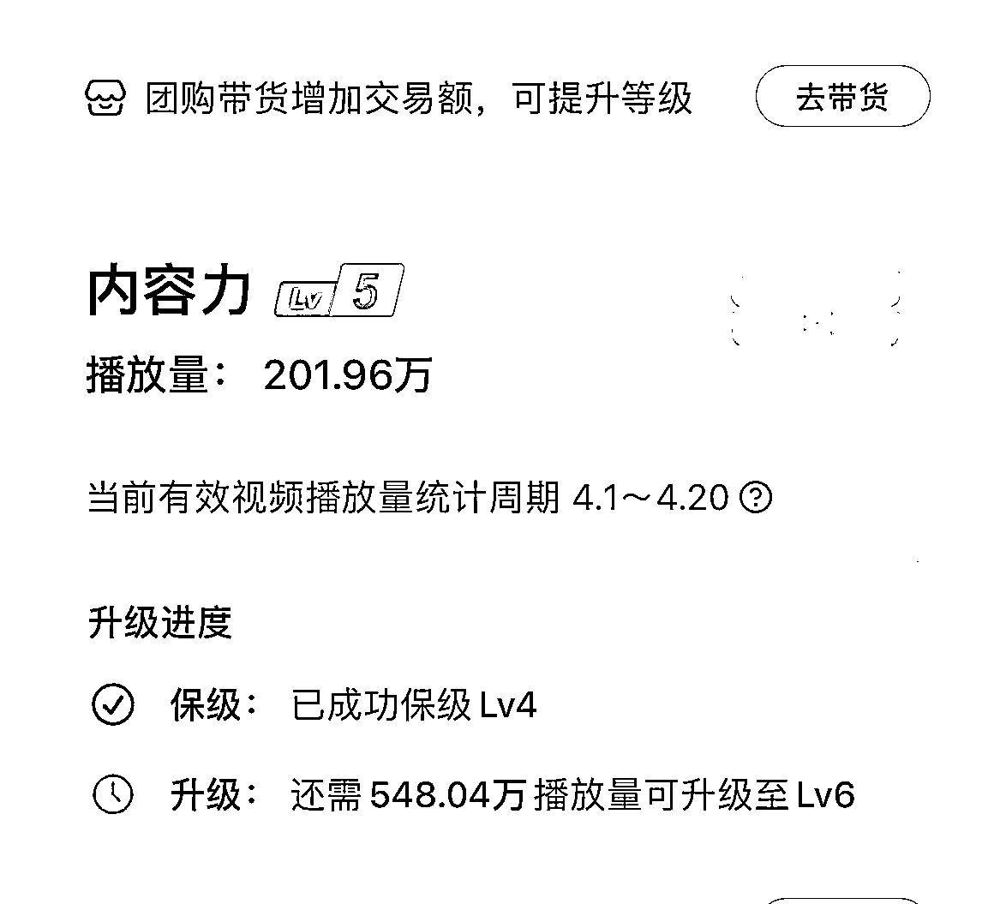

1、创作爆款内容所需的5套思维

A、热点借势思维

B、价值利他思维
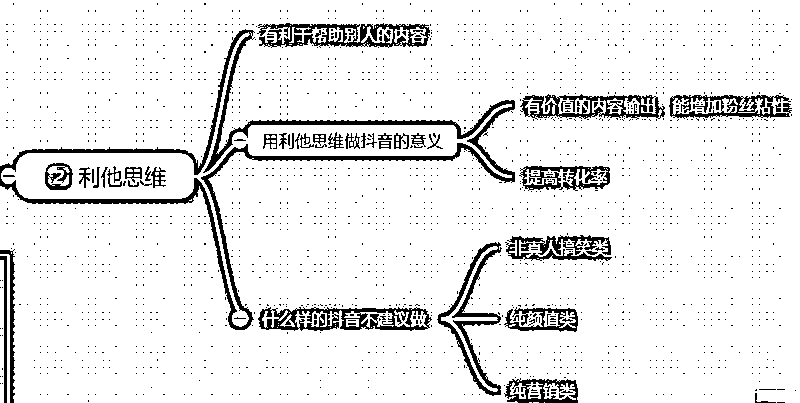

C、多向发散思维
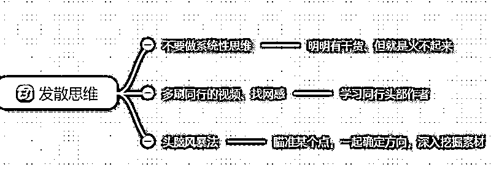

D、突破常规思维

E、持续复盘思维

2、能引发自发传播的带货短视频，底层普遍具备的六个特征
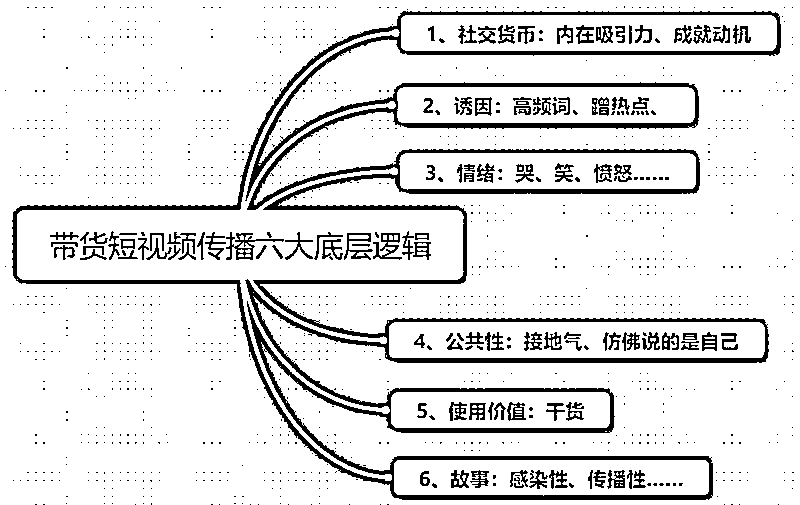

3、抖音官方“泄露”的流量秘诀

之所以用“泄露”这个词，并不是搞噱头博眼球，而是因为我确实与抖音官方团队一起打磨过爆款视频，在沟通中积累了不少大厂内部视角的策略。这里汇总成三条经验供参考：

A、破圈传播

B、抓住用户兴趣点
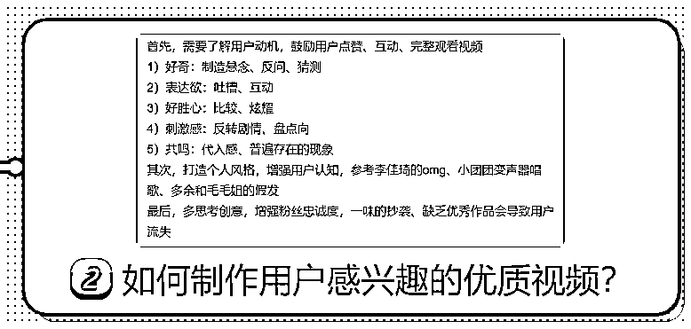

C、视频发布实操建议

## 第二章、一路试探的变现之路

### 第一节、A4纸书单玩法（2019年）

所谓A4纸书单，操作方式是拿一张A4纸打印上几句精心打磨的短文案，然后把书一本接一本地往外“扔”。对，你没看错，根本不用翻书，就靠扔书的动作就能把视频做火。

当时有同行靠一条这种视频赚了50万佣金，简直让人眼红。等我知道这个套路时，市面上已经挤满了跟风者，所以我最后只挣了几千块钱。但这件事让我深深记住了“信息差”的价值边界在哪里。

都说真传一句话，假传万卷书——真正能赚到钱的秘诀往往都藏得很浅，经常三言两语就能说清。有时大佬只肯透露一两个字，你悟透了，可能就能换来几万甚至几十万的回报。

案例：A4纸书单（素材取自同行）
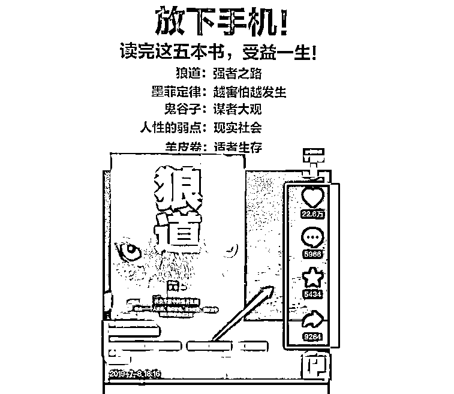

### 第二节、手账笔记书单玩法（2021年）

“笔记书单”和A4书单形式相近，区别在于把内容做成精美笔记的样子，再叠加创意剪辑的动作，从而激发用户的购买冲动。

直接看案例：
案例：笔记书单（素材为本人实操，自然流量）
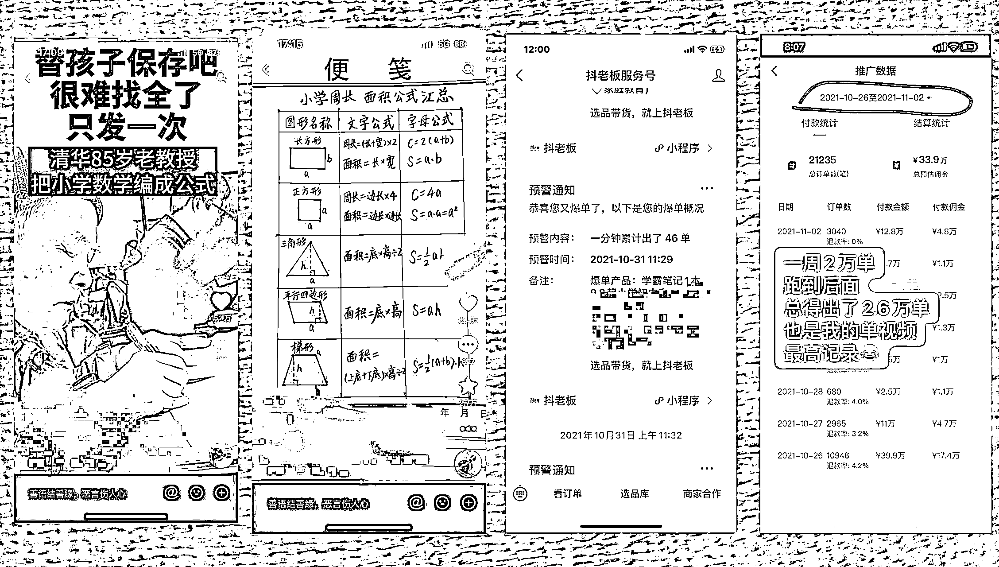

### 第三节、名人讲座书单玩法（2022年）

这种风格大家刷到过不少吧？继续往下细分，还能分为国内教授书单、外国专家书单、大学生讲座书单、家长会家长发言书单……玩法变化多端，而且有点魔性。

去年这类型内容相当火爆，不少玩家靠它赚得盆满钵满。主要是这波风口我当时没有亲自下场，所以不做具体拆解，有兴趣的可以在评论区友好交流。

接下来重点讲一下第四节划线书单——这个模式最近又火回来了，虽然跟风不一定能吃到肉，但跟着喝口汤还是没问题的。

### 第四节、划线摘抄书单玩法（2019年至今仍可操作）

划线书单大家应该都认识，很多圈友也在做，可为什么你做了不温不火，别人却能轻松起量？原因特别简单：别人投了流量，而你纯自然硬等。至于怎么投，我会在第三章一二节详细拆解。

直接看案例：
案例：划线书单（素材取自同行）
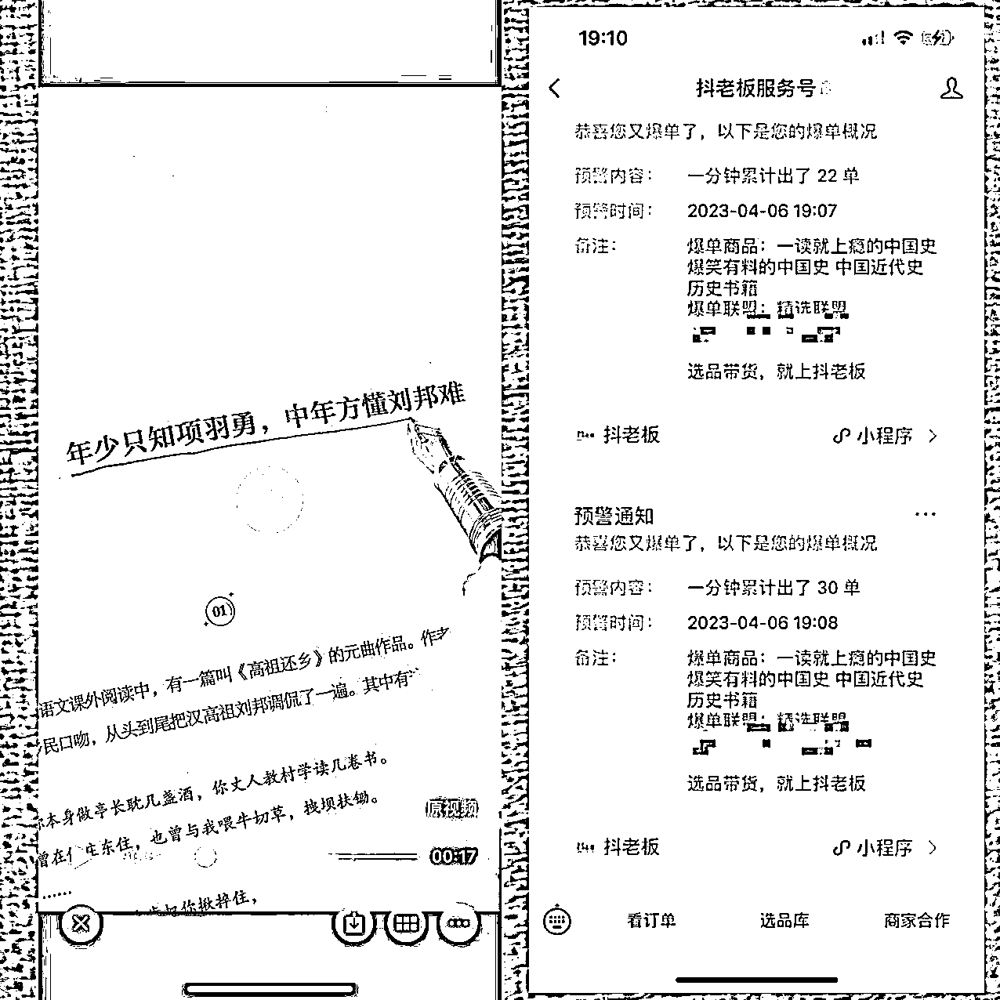

是不是觉得很简单，看一眼就能上手？还是那句话，真正赚钱的方法都不复杂，干就完了。

### 第五节、真人出镜带货（2023年）

### 1、语言表达

口播不能像背稿，表情和语气必须自然松弛，否则观众一眼就能看出来你在念字。语速要带有自然的节奏变化，脸上有表情，双手有动作，把状态调到跟朋友聊天时那样放松，录出来的效果才会让人愿意看完。

送你三个“角色扮演式”的小技巧：

A、如果录给家长看：
把镜头想象成你妈，你要用跟妈妈唠家常的口吻说出来。

B、如果录给学生看：
想象镜头是一个犯了错的学生，你正把人叫到办公室谈话。但不同年龄段的语气完全不一样：对小学生，每句话的尾音都要拖着，带着哄小孩的味道；对初中生、高中生可以稍微正经一些；对大学生的态度又得变，一旦用错了语气，人家会觉得浑身别扭。要是把哄小孩的语气用到家长身上，画面简直不能想。

C、如果录氛围紧绷的内容：
想象自己憋着尿急着去卫生间，恨不得一口气赶紧说完收工，语速和情绪自然就有了那种张力。

举一反三……剩下你们自己去头脑风暴。

真人出镜的本质，从来不只是对着镜头说话，而是把自己代入角色，当一个真正的演员。

### 2、场景布置

青铜审美：把书架当背景，人往书架前面一坐，构图毫无层次感，看久了会让人觉得又闷又压抑，人群根本停不下来。
案例：纯书架背景带来的压迫感

王者审美：选一个墙角作为主场景，再以几盆绿植、一盏暖光灯、几个小摆件作点缀，空间立刻就有了纵深感，人的轮廓也更立体。
案例：书架+墙角组合带来的立体效果

### 3、布光

在摄影这件事上，打光的原则是能少则少，能不打就不打。你可以留心观察一下那些直播间，户外场景的流量普遍都不小——白天户外根本不需要额外补光，自然光就是最好的灯光。但在室内录制或进摄影棚，就得认真对待布光这件事了。灯光学问很深，不过好在网络上一搜就有大量教程，这里点到为止。

### 4、工具：剪映“提词器”

提词器硬件我真的不建议买，几十块的、几百块的我都用过，体验都不咋样。直接用剪映里自带的提词器功能，足够解决所有需求。
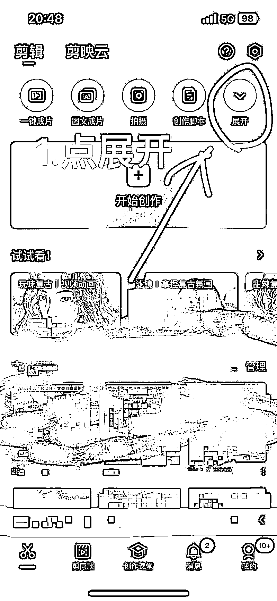

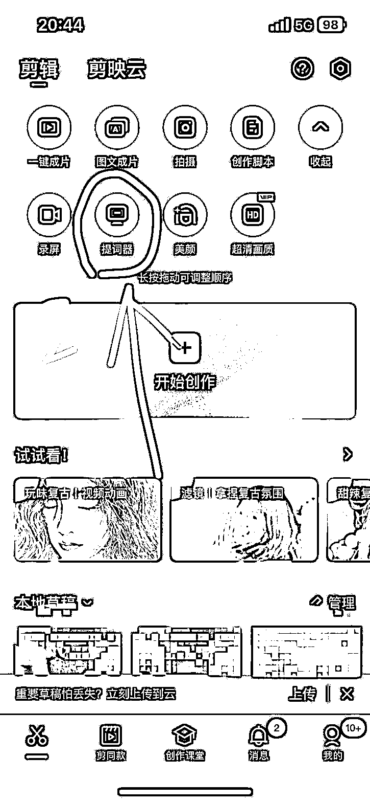

## 第三章、流量与变现的进阶玩法

## 第一节、选品

1、四个爆单经验，帮你快速锁定潜力品
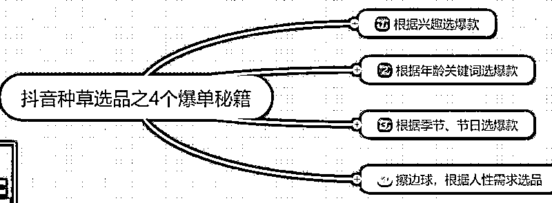

2、跟爆款视频选品

路径：抖音底部【橱窗】→ 往下滑找到【创意中心】→ 点击进入并选好自己的赛道 → 按爆款视频反向锁定商品
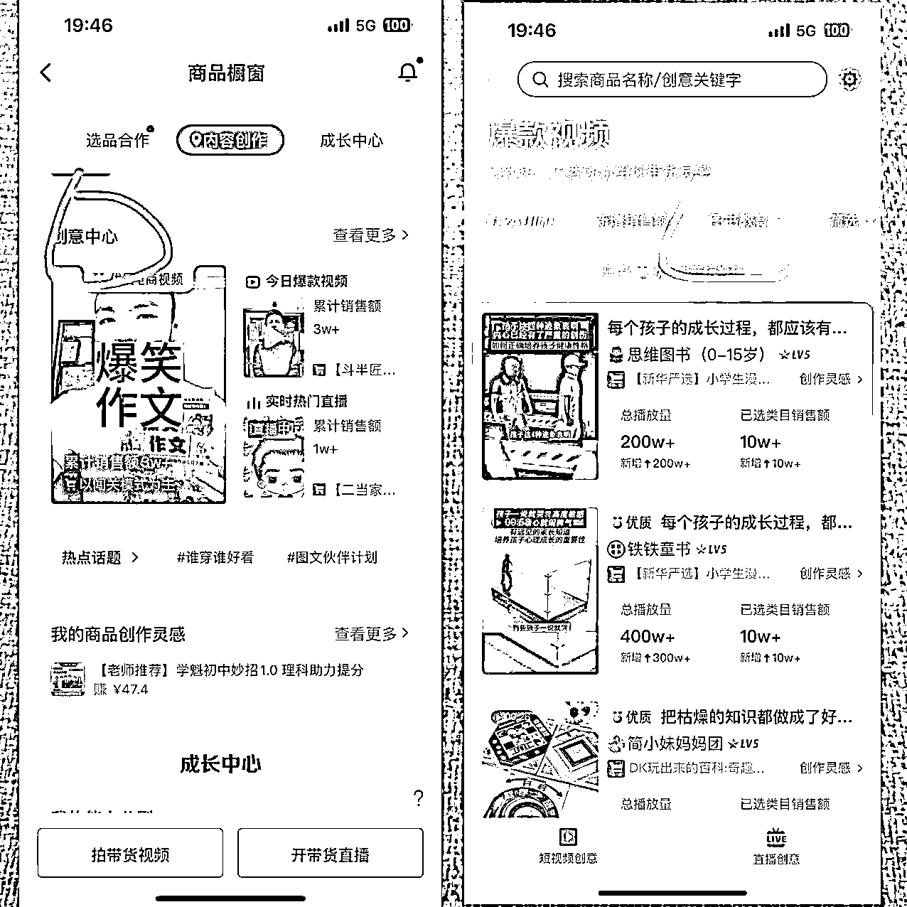

3、按热卖榜单选品

路径：抖音橱窗 → 选品广场 → 随便点一个有“榜单”标识的商品 → 右上角还能查看更多的分类榜单

4、小心这几个选品陷阱

爆品密密麻麻的货盘里，其实也藏着很多“隐形废品”——也就是那些投什么计划都很难跑出利润的品。怎么判断呢？

第一类：关联视频里已经刷出好几个几百万播放的品，尽量别碰。别人的素材已经验证了转化能力，持续投放的底气比足，你想去抢量根本抢不过人家。

第二类：差评与好评的比值超过了6%-8%的产品，别碰。用差评数除以好评数，比值越大说明产品口碑越差。不投流还好，一旦放量爆单，口碑分马上跌穿。

第三类：商家体验分不足4.8的，谨慎选！这种品很容易拖累你自己橱窗的口碑分。

## 第二节、气质温和的“随心推”

### 1、感受随心推的稳健

我管随心推叫“温柔派”，是因为它有足够的安全垫：每单投放一百块，哪怕效果不好，损失也封顶在这一百。可是千川走的是另一种路子，一旦开启放量，分分钟能烧掉好几千。我刚开始研究千川时，就睡了十分钟午觉，起来发现账户已经消耗了三千多，差不多抵我一个月的工资，哭都没地方哭。

2、随心推怎么建计划？

具体怎么搭计划，这里就不做表格罗列了。能在搜索框里解决的问题，我再花大篇幅讲，既是浪费你的时间，也是消耗我的耐心。还没养成“遇事不决先搜索”习惯的朋友，从今天开始试着改一下，直接在抖音里搜“随心推如何建计划”，各类教程应有尽有。

我更想讲的是那些容易被忽略的细节。新手不要勾选“自定义定向投放”——你要相信，抖音的算法比你更了解平台用户的喜好。同一个账号卖不同品类，有的品男性买得多，有的品女性买得多；你要是手动定错了向，结局只有两个：计划跑不出去，或者钱乱烧一通。

所以我说投流其实没那么复杂，前提是选品过关、素材不差，这种情况下哪怕拿脚去点投放，也不至于亏到哪里去。省心一点的做法就是选“系统智能投放”+“自动出价”，无脑操作完事。甚至出价方式选“按转化目标”还是“按播放量”，结果差别不大，我经常二选一全看心情。

放一张截图感受一下，是不是真的有手就行，哈哈。
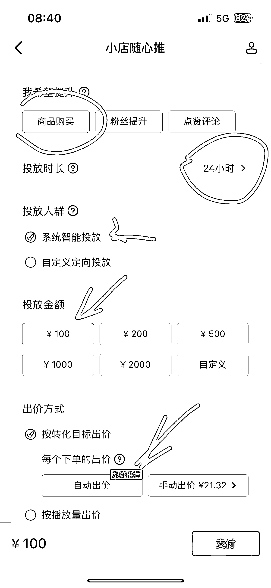

在投放时长上，能选多长就选多长。以前平台最长提供48小时，我一直直接把选项拉满；后来平台把上限改为24小时了，那我也就选24小时。

跟很多人一样，我也喜欢追问一句“为什么偏偏是24小时”？这个问题站在平台的立场上去想，答案会清楚很多。

打个比方：邻居家的小孩走丢了，家长拿一百块钱托你帮忙找。这跟拿一百块给抖音平台帮你找客户的逻辑，是不是一回事？

给你一整天的时间去找，你完全可以走路上街慢悠悠地打听，就算最后没找着，把钱交还回去，你也不算亏，顶多就当散步锻炼身体。

但要是只给你两个小时，你是不是会觉得时间特别紧、任务特别重？那肯定出门就打车，不管找不找得到，这一百块很难省下来。

给平台的跑量时间越短，它要临时调配更多服务器资源去赶工，投入的成本自然变高了。这也就解释了为什么有时候你只投两小时，预算花完了却一单不出。

反过来说，给足时间让它慢慢试探人群，它会在夜里用户少的时候放慢消耗速度，等白天活跃度上来了再加快抢人效率。如果24小时满了预算也没花完，又或者匹配了一堆不精准的对象，剩下的钱平台会原样退给你。

3、随心推新功能：直接投ROI

操作非常简单：在“我希望提升”选项栏里，把目标切换成“商品支付ROI”，其余设置不变。

那ROI的目标值填多少合适？答案取决于你的佣金比例，直接参考下面这张表。只要佣金是线上结算，目标至少不要低于保本ROI。
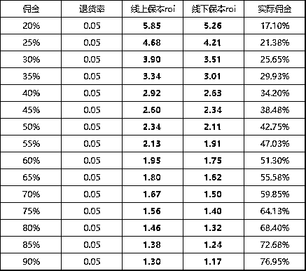

4、随心推如何在高峰期抢量？

流量高峰期建议手动出价、投放两小时、人群用智能推荐，起手出价按佣金的1.2倍来测试。如果存不住消耗，说明这个品的竞争力撑不起手动出价，那再换回自动出价试试。不过自动出价的最短周期是24小时，贸然只跑两小时极易亏损。

如果测试后发现计划消耗顺畅，约1.2小时能烧掉七成预算，那就把出价往下调5%，一条条试，直到找到既能出量又有利润的价位。找到之后，高峰期可以批量复制2小时计划抢量。

5、怎样用随心推来反推千川出价？

随心推跑出一定消耗量之后，目标人群模型基本就成型了，这时候就可以考虑切换到千川放大。同时还可以借助随心推跑出来的数据反推千川出价的合理区间，具体做法如下：

在抖老板App中打开对应产品的详情页，如下：

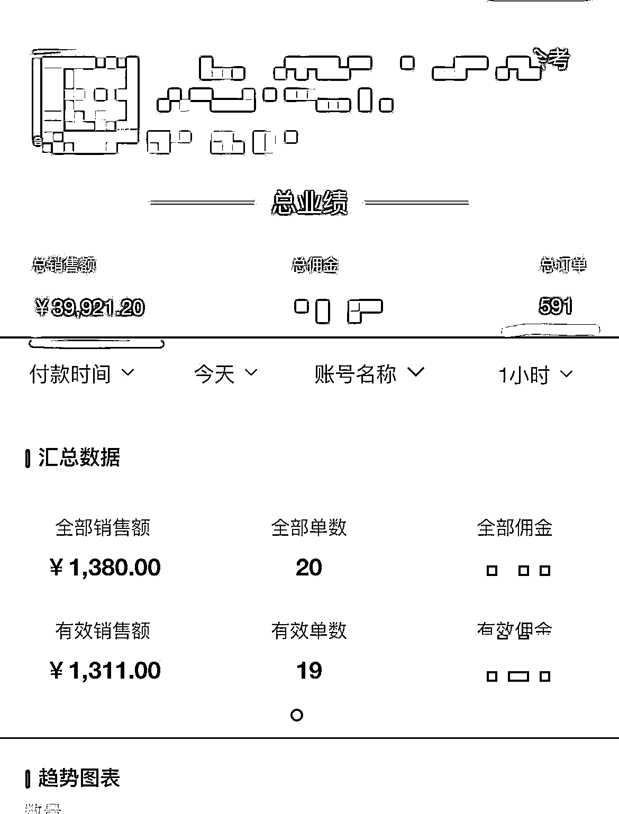 

在用随心推这类工具实操时，第一步要搞清楚的是这个商品到底一单能卖多少钱。原因很简单，一个链接下往往挂着多个SKU，有9.9的，39的，68的，价格参差不齐，必须先算出它的均价，才能谈后续出价。

均价的算式很直白：总销售额除以总订单量。

举个例子，这款商品累计销售额是39921.20，订单共591单，算下来就是39921.20 ÷ 591 = 67.55 元，这就是它的平均客单价。

有了均价，出价就有依据了。常规做法是按佣金比例直接给，比如佣金是50%，那初始出价就是67.55 x 50% = 33.78 元。

这个价位主要是冲着新人期去的，新人期一般出个20单左右就能过。过了这一关，就要立刻降价，公式是：现有出价 ÷ 1.2，也就是33.78 ÷ 1.2 = 28.15 元。之后就用这个价格去跑，后续根据消耗与数据表现灵活微调，升也好降也好，核心原则是只要计划能稳定消耗，就朝赚钱的方向去调。

6、随心推=随心亏

别把随心推想成躺赚工具，圈里人私下都戏称它为“随心亏”。心态不到位，玩着就容易崩。测品阶段，小亏几百是常态，大亏几千也有可能，这就是为什么大家都说投流是人民币玩家的游戏。

所以操作时别纠结一两单的盈亏，心态放平：它亏就让它亏，把数据跑足；它赚就让它赚，用定向再去放大。数据堆上去，机会自然就出来了。

### 7、问题解答

把大家反复问的问题汇总了一下：

#### ①为什么千川计划本来跑得好好的，突然就不消耗了？

是不是昨天还觉得要起飞了，今天一看计划完全不动了。这种情况多半有三种可能。

首先检查账户余额是不是见底了没充值，其次看商品是否触发了48小时发货率低于70%的限制。

排除这两点，最常见的原因是计划竞争力掉了，ECPM排名下滑，系统就不爱推了。系统给了一波曝光，测出来点击、转化都不行，ECPM算不上去，自然就把流量分给别人了。

解决思路有两条：用智能放量来试探，或者去优化素材和丰富样式。如果你的ECPM均值跟胜出ECPM差距拉得很大，就要回头审定向、创意、商品详情，把竞争力提上来。

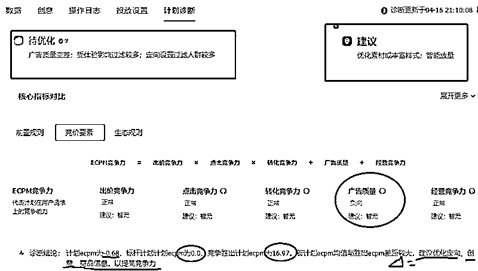 

#### ②带货一直没单，一投流就直接亏本？

最近很多人说，学了各种课，方法都懂了，就是凑不出能赚钱的素材，快没信心了。

在我看来，大多数人亏钱就俩字：心急。一条视频刚发就想着猛投，不跑就加价，最后直接跑偏了。

给一个相对稳妥的做法：可以投，但把价格卡在利润边缘去出价，能跑就继续跑，不能跑就停。每天正常产出几条素材发到抖音就够了，坚持一个月，效果往往会超出预期。

#### ③投随心推，点击很高就是不转化？

有没有遇到过这种素材，点击率爆炸，完播也漂亮，就是小黄车没人下单。

通常有两类原因。第一是视频对产品的价值传递没到位，用户看完觉得值十块钱，结果点进去标价二十块，兴趣就断了。第二是同款被推烂了，用户刷到太多同质内容，点进去发现自己已经买过或者没新鲜感，自然不买。

遇到这种高数据零转化的素材，别再犹豫要不要续投了，直接换。点击和完播再高，不转化的素材都是无效浪费。

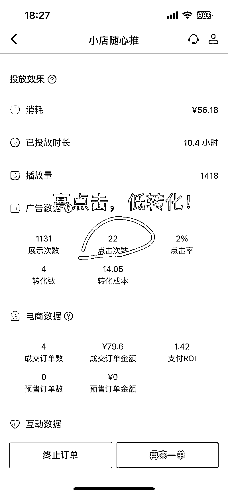 

## 第三节、放荡不羁的“千川”

### 1、感受千川的魅力

为什么要说千川“放荡不羁”？体验感你就懂了，用千川去抢流量的感觉是什么样的？

这里放一组我自己实操的案例截图：

eg：用千川抢流量是一种什么体验（案例节选本人实操）

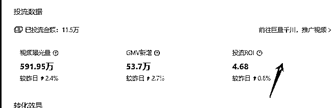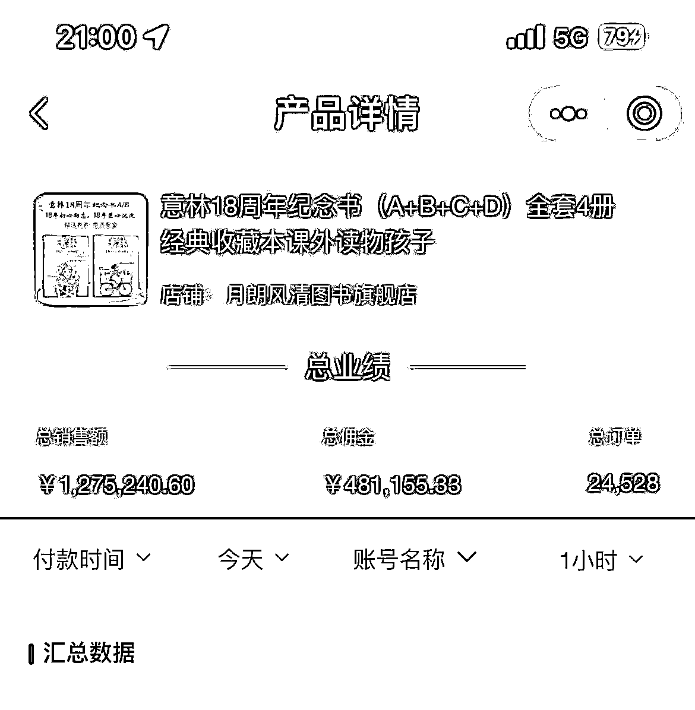 

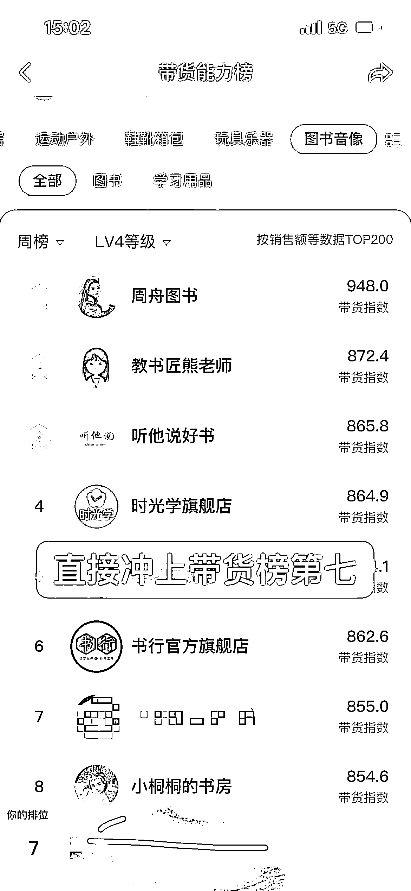 

具体的操作拆解后面章节会详细讲，我这边还在工作，每天更新一点，有兴趣的可以持续关注。

2、千川搭建基本知识

计划怎么新建，我就不展开了，能搜到的东西重复讲对大家都是浪费时间。建议养成先搜索的习惯，直接在抖音搜“千川搭建”，教学视频一大堆。

我想强调的是里面的关键细节，能自定义就别用托管。那些定向也就是大家说的莱卡，卡完要看覆盖人群，人口基数不能低于5亿。卡的过程中如果人群掉到5亿以下，能放开的就放开。

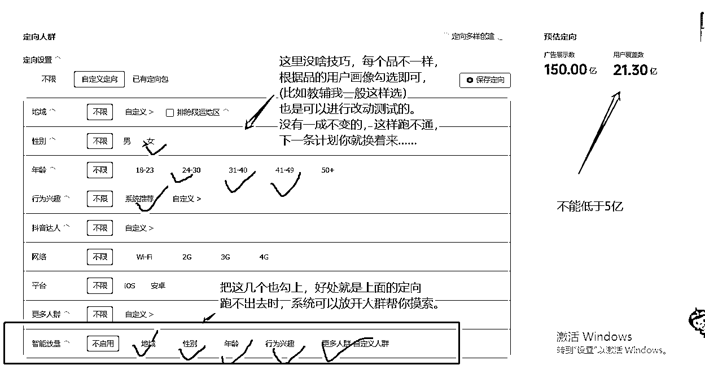 

3、如何出价不会跑飞？

如果你是偏保守的玩法，不想让计划失控，可以按出价 ≤ 佣金 ÷ 1.2 来设置。这个价位比较安全，放着也能跑，前提是你的计划处于成本保障投放的状态。

4、如何高峰期抢量？

靠工具“一键起量”。

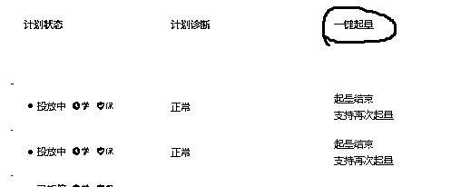 

起量时长建议控制在2到6小时之间！

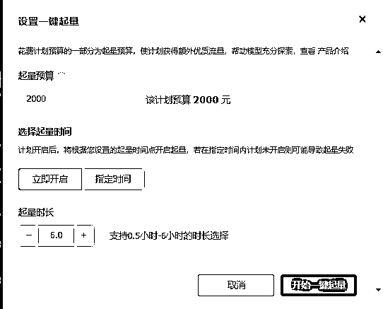 

5、计划如何快速通过学习期？

A、适当提高出价：前期其实就是要接受亏损，等学习期过了再降价，注意一次降幅别超过20%，否则计划容易凉。

B、结合A灵活使用“一键起量”：选在流量高峰期用，比如早上6-7点，中午11-12点，晚上8点之后，操作时间最好提前半小时，给系统留足冷启动时间。

 

起量时长选择2到6小时之间！

 

6、如何与算法“博弈”？

A、正反馈要大于负反馈。

站在平台角度想，平台也是要赚钱的。你的每一个操作，都要让平台觉得有利。比如你压价了，就要同步提高预算，告诉系统你还是想跑这个计划。一次负反馈，必须配一个正反馈，不能让系统觉得你是在放弃。

B、避免素材同质化。

当同一个脚本被大量模仿，创意挤压就会很严重，这时候就要想办法做出差异化。模仿爆款并不矛盾，脚本不行就换一个思路去模仿，内容为王始终不变。想要持续出单，就要多拍多测，找到符合市场审美的视频再放大投放。

分享就到这里，感谢看到最后！

也感谢龙哥老师提供的平台！

2023年加入赚钱是我今年做的最正确的决定，接下来的日子，希望能和各位大佬一起赚钱有术。

评论区：

牛顿 273 : 先赞后看，膜拜大佬[鼓掌][鼓掌][鼓掌] 猎音狮（豪叔） : 看完希望有帮助[抱拳][抱拳] 周彦充 : 厉害，值得收藏慢慢看 猎音狮（豪叔） : [社会社会][社会社会] 牛顿 273 : 知识点太多，太赞啦！被知识淹没了，准备慢慢消化~[爱心] 猎音狮（豪叔） : 感谢认可[呲牙] 肖江波 : 看到 10000 多字，需要 60 分钟，还是先点个赞再看[抱拳] 猎音狮（豪叔） : [偷笑][偷笑]