# ('普通人如何抓住机遇逆袭？赚钱小白从0开始借助chatGPT变现7k入赚钱经历分享！', (2, 43))

嘿，我是阿讯，一个00后“闲不住”的大学生。今年毕业后将去绍兴新昌一家全球顶尖外企工作，也期待能遇到更多浙江的圈友。

两年前，我刚接触知识星球时，就看到“赚钱有术”这个圈子，当时一看门票价格，心里大概觉得没什么机会。谁能想到，后来居然靠ChatGPT改变了局面，让我一个赚钱小白从0开始，一步步做到累计变现7000+，也算真的尝到了逆袭的滋味。

整个过程，其实就是一次次“先做了再说”的尝试。

先说第一次际遇：2月8日，有人在挽歌的自媒体俱乐部里发了个ChatGPT注册教程。我当时并不懂那是什么，直到逛了几篇ChatGPT风向标的内容，冥冥中觉得这东西不简单，可能会影响我。可当天我要返校，没法注册。第二天再准备弄，风向标里赫然写着暂停注册。说实话，想放弃的念头只闪过一瞬，但直觉告诉我这可能是个机会。于是我翻到一条卖账号的帖子，在淘宝花十几块买了个号。

之后的登录费不便宜，第一个月最少要140元。我选了另一条更省的路，首月花费约50元。心里算的是：如果它真有用，那这50元太值；如果没用，也不至于亏太多。

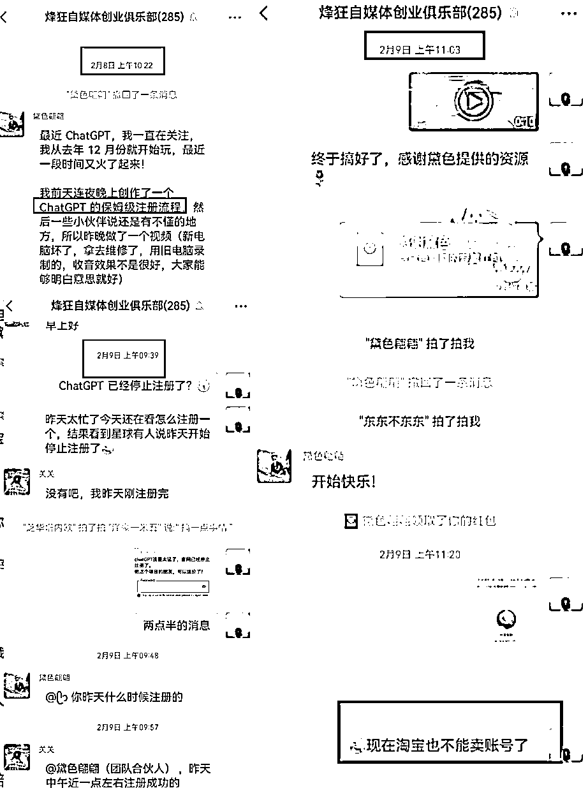

登录搞懂后，使用又是一头雾水。全是英文界面，我只能全部翻译，再靠猜。比如有一次我直接关掉，发现还能用，心里有点慌，百度也搜不到答案。问群里，黛色说“右键quit”，我一脸蒙，又不好意思追问，最后自己翻设置，才找到了那个quit。

群里有个反例特别典型。也是2月9日前后，有人一直问怎么注册，可答案明明就在大佬提供的教程里，翻译一下就能懂，她却非要一遍遍问。后来我实在怕打扰就开了免打扰。十几天后再看，她还没搞定上网，而那些没回复的问题，她自己已经想明白了，我帮她走了最后一步。但是进了官网后，连“next”这种翻译一下就懂的操作她也来问。前后花了我好几个小时，她连句谢谢也没主动提过。到最后，群主因为受不了她的提问方式，第一次踢了人。大家才发现，她加了群里好多人，追着问各种小白问题。

这件事给我的启发很深：

第一，不管怎样，先试试再说。

世界每天都在冒出新东西。想要不落后，就得有“绿灯思维”。这词儿是我学理财时接触的。与之相对的是红灯思维——遇到陌生或不认同的事，心里先拒绝，然后自动屏蔽。哪怕嘴上说要学，实际上也进不了脑子，行动更是无从谈起。

说实话，很多普通人在遇到跟自己既有认知不一样的观点时，都会不自觉陷入“习惯性防卫”，只想躲在舒适区。这也是人类的本能。但如果一直这样，学再多也没用，成长就堵死了。打破它，就要学会先接受、再内化、然后实践。成长型思维也类似，相信人可以通过努力改变，在变化面前更容易适应。想深入理解这两类思维，推荐《终身成长》和《刻意练习》。

第二，在承受范围内疯狂试错。

有了绿灯思维还不够，认知不变成行动，始终是纸上谈兵。曾经有个热榜问题：为什么道理都懂，却过不好这一生？答案很扎心：懂道理是认知层面，不行动一切等于零。

那阵子群里还有一位新朋友加我，聊下来发现她学的东西不少，但没一样做出结果。原因就是一直在学、一直只听别人讲，却不肯自己下场，总想着要全学会了再动手。这也是很多小白的通病。我当时就告诉她：先试试，行不行试了才知道，又花不了多少成本，怕什么呢？

每次谈行动，我都会强调“试错成本”。因为我也是农村出来的，特别清楚普通人手里的试错资源很有限。一旦选错，可能连累家庭，这也是很多人不敢动的原因。但你能保证每次判断都正确吗？不能。就算汽车安检再严，也还是可能出事故，你会因此不坐车吗？

追求稳定没错，稳定感是我们人性的一部分。但越追求稳定，往往风险越高。就像在无菌环境长大的婴儿，没法在正常环境里存活；我们从小接触病菌，反而有了免疫力。恋爱也是一样，总想等到理想对象才肯开始，其实理想伴侣不是找来的，是两个人一起磨合出来的。找项目也是一样，好项目不是选出来的，是打磨出来的。

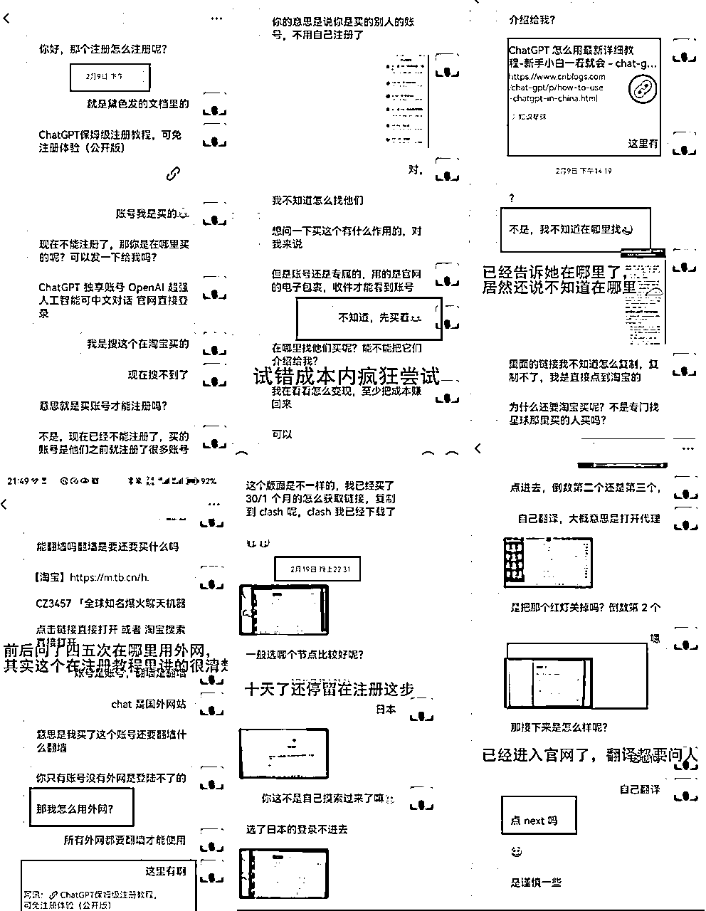

所以，试错可以，但一定要控制成本。如果一件事的尝试成本超出了承受力，那就换一条路。对二十出头的我们来说，试错成本其实很低。哪怕赔个几百几千，大不了多吃几天泡面，一两个月就缓过来了。

我加入赚钱有术、参加航海项目，都是试错的一部分。这几年在知识付费上扔了不少钱，很多社群进来看完发现没什么干货，偶尔也会感觉自己被割了韭菜。但如果没有这些经历，我可能根本遇不到赚钱有术这类优质星球；如果不报名航海去实操，也打磨不出适合自己的项目。目前我最贵的一笔知识付费，就是赚钱有术的2000块，肉疼，但不影响生活。

我有个朋友，前段时间为了报名一个3.8万的自媒体课程，到处借钱。我看了课程目录，觉得还不如赚钱有术的内容。当然，就算她真被割韭菜，一两年内也能缓过来。只是这个成本，真心不低。

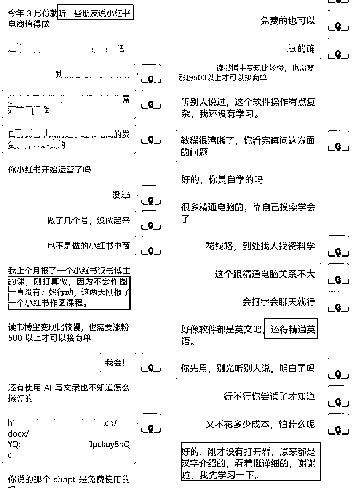

第三，提问前请先自己找答案。

关于有效提问，很多大佬都总结过，我只说两点最重要的。一是提问前先确认自己是否已经尽力搜索，别拿百度能解决、教程里有答案的问题去消耗别人。二是把背景和条件说明白，能一条消息讲清的就别分两条。这不是谈恋爱，没必要来回浪费彼此的时间。

第二段经历，是靠直觉抓机会。

当时同一个群里有人在推荐《玩赚ChatGPT》社群，第一期定价299元。我读完简介，几乎没有犹豫就加入了。那种直觉很强烈：越早学越好。

进了社群，像打开了新世界。作为最早的一批成员，我发现大部分群友都来自赚钱有术。他们聊的内容太深了，我一开始连话都不敢说，只敢悄悄问怎样开通分销权限。然后靠着分销这个社群，我第一次在线上赚到了钱。就在朋友圈发了个推广，就有人下单。第一天收入200多块，那一瞬间我想起父母在工地干一整天，也就挣这个数，心里特别不是滋味。后来连续一周每天两三单，前前后后变现了约1K。

这段经历让我明白了：很多时候赚钱本身不难，难的，是进入一个能赚钱的圈子，认识一群会赚钱的人，拉高自己的认知，缩小信息差。

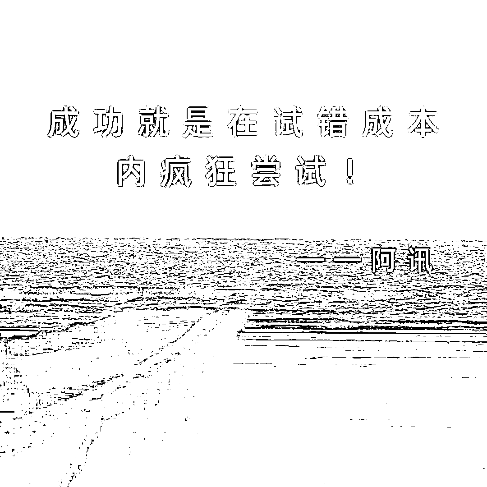

人生是漫长的成长过程，圈子是跳板。进对圈子，能少走好多弯路。如果不是在挽歌的俱乐部里看到那条消息，我很可能跟大多数人一样，在热搜上刷到ChatGPT，然后不以为然，也不知道怎么注册、去哪弄账号，最后只能站在岸上看别人吃螃蟹。圈子质量，真的会影响你能跳多高、成长多快。

关于破圈，本质上破的是认知圈。但别人凭什么让你进？靠你的输出和价值。社交的本质是价值互换，你的输出，是最好的名片。我也看过七小哥的破圈指南，以及一篇分析赚钱小白7个痛点的精华帖：内容太多看不完、实操不下去、对比焦虑、踩坑避坑、项目浮躁切换、无资源无产品无能力、链接不上圈友。每条都扎心，但也提醒我别困在里面。

作为受助者，怎么反馈？第一，了解对方的目标，主动靠近；第二，真诚领情，带着感恩往前走；第三，付出不亚于任何人的努力；第四，及时汇报进度，让对方看到你的改变；最后，你还可以努力完成他的目标。这些，都是我在和贵人链接时的体会。

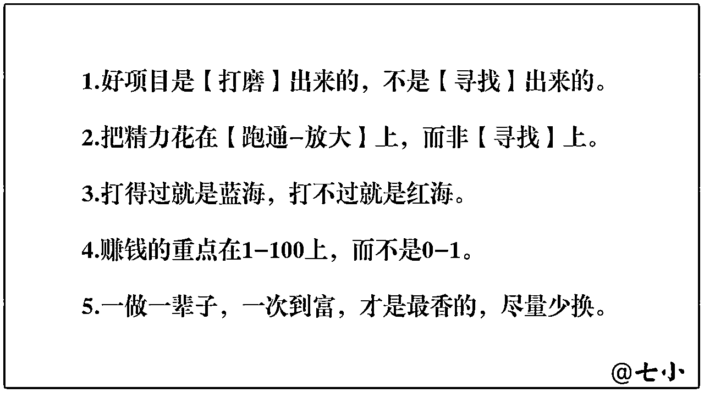

关于直觉，我后来读了周岭的《认知觉醒》，才算真正理解。潜意识处理信息的速度极快，很多念头其实都来自潜意识的灵感。所以，我们应该学会用感觉去捕捉机会，再用理性做决策。感觉能帮我们在关键时刻迅速抓住可能的机会，但它不绝对可靠，必须和理性搭配。靠感觉捕捉，靠理性分析，这大概是我能接住这波浪潮的秘密。

第三段，行动力才是信息差的放大器。

玩赚ChatGPT开营第二场直播讲“调教”专题。在那之前，我也只会用ChatGPT聊聊天，或者丢个标题让它写篇文章。听完直播，我才知道原来这才是它的正确打开方式，自己之前简直是小孩子过家家。后半程直播时，我开始试着调教它写小红书笔记。我翻出以前花爷小红书训练营的方法，教给ChatGPT。一开始它老理解不了指令，写得不满意。于是我反复看交付手册里的调教部分，一遍一遍测试身份、背景、指令这些要素。大概花了两个多小时，终于让它稳定输出小红书笔记，还能对笔记做拆解和优化。当时把过程分享到社群，收到不少人的肯定。

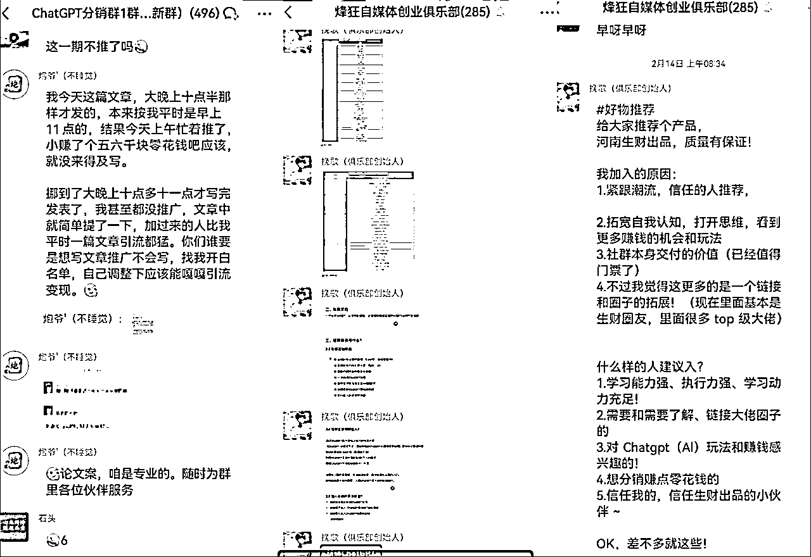

接着，我把自己的调教过程写成教程，还把大纲截图发到群里。那是当时全网第一份详细讲解如何调教ChatGPT写小红书笔记的教程。之后有近十位群友专门加我，说要付费买教程，其中还包括我过去不太敢搭话的黛色翩翩。

后来教程在四个大群里分享，一共1600多人看到。那是我第一次在这么多人面前做分享，也是第一次靠它实实在在地变现299元。也是从那时起，我算有了一点点影响力，很多朋友来链接我，积累下第一批信任用户。

这份教程的初衷，是用固定指令调教出一个能稳定写小红书笔记的ChatGPT。后来我又想：既然ChatGPT是海量语言训练的模型，能不能直接用中文而不是代码去训练？毕竟中文和代码都是符号，让它理解中文指令就行。于是，我又去研究训练过程，并尝试落到中文上。费了不少功夫，真让我写出了《ChatGPT中文训练教程》。写完发了个朋友圈，只发了一张打码目录和部分内容图。

没想到，当晚就有人拿着我的图去做引流，还有大佬在星球里到处找这个教程的作者。那一刻我真的意识到：信息差从来不缺，缺的是行动力。有了行动力，你才能把信息差真正变成钱。

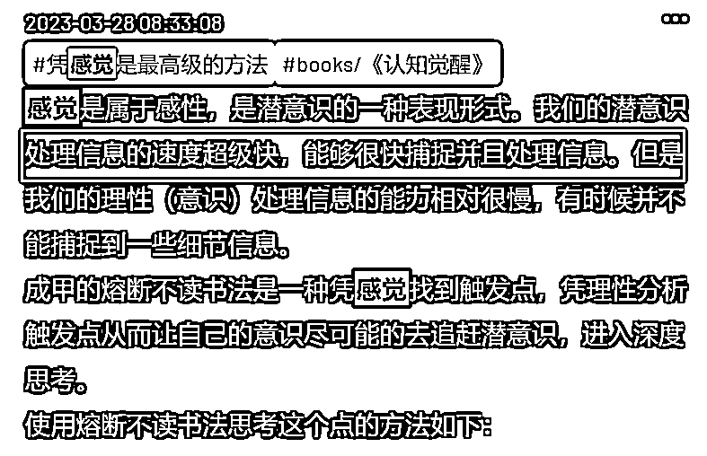

最后还想说一句：如果从头到尾一个人闷着头折腾，我大概也走不到这里。那次分享后，不少圈友给了我很多反馈和支持，让我更加确信：团队合作，永远胜过闭门造车。

这条路上，机会常常藏在尝试里。你不需要什么都准备好了才开始，只需要在可承受的范围内，勇敢迈出那一步。毕竟，我们普通人最怕的，不是试错，而是连试的机会都留给自己。

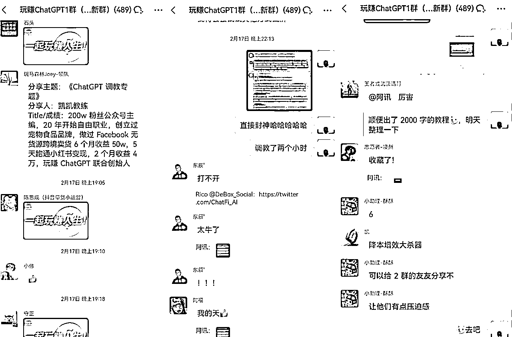

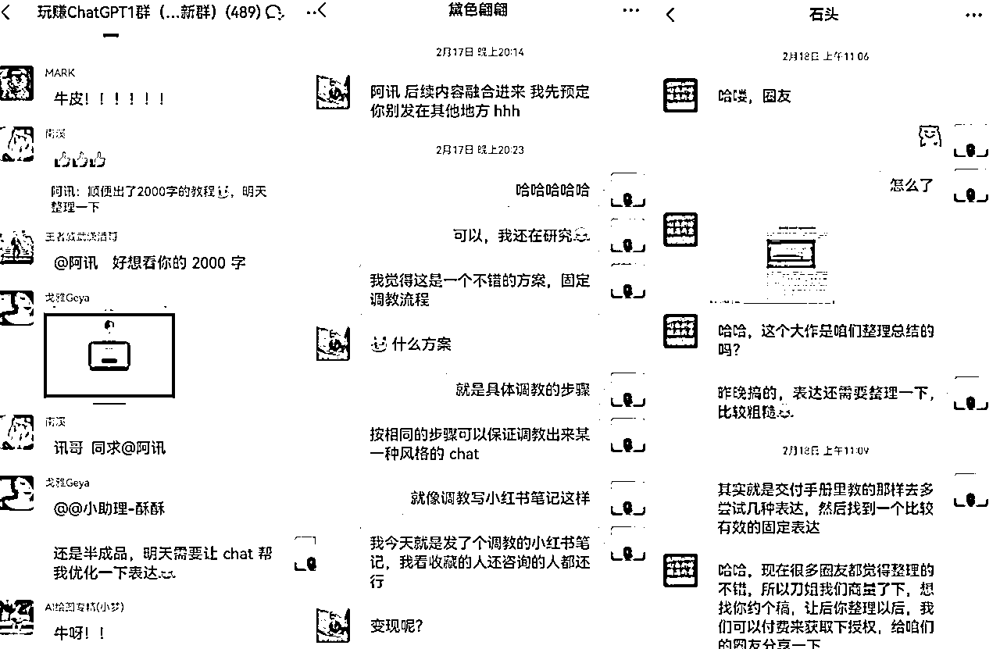

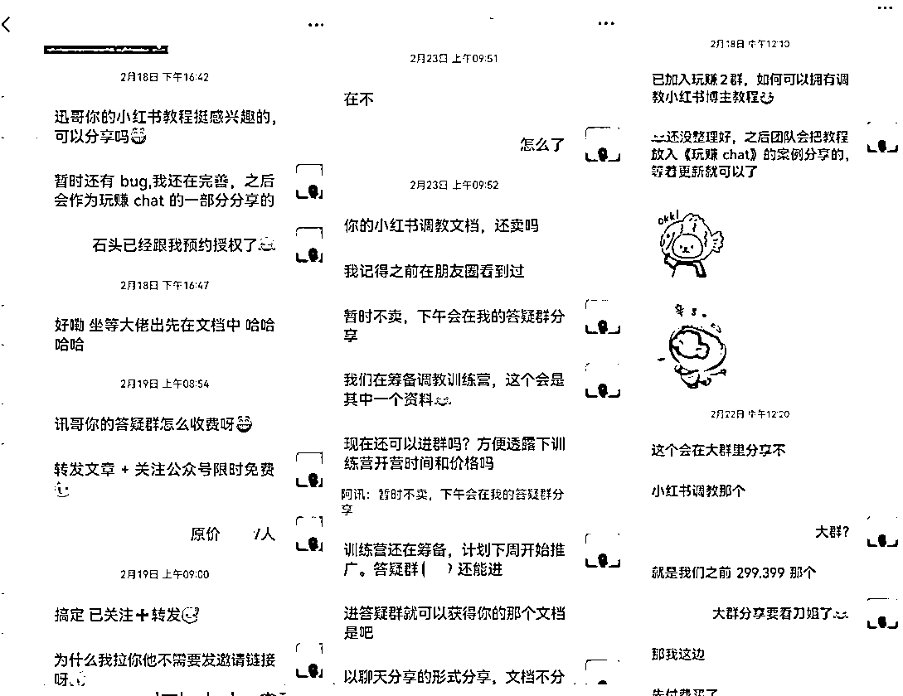

中文模型训练和英文模型差别很大，这是很多人容易忽略的地方。

先说字符层面。中文的编码体系里不止有汉字，还混杂着数字、英文字符以及各类符号标点。做中文模型时，字符表必须扩容，才能完整覆盖这些内容。处理语料还要额外注意繁简体统一，不然同一个词在库里出现两种写法，会影响模型学习效果。

再说语言结构。中文没有英语那种明显的单复数、时态变化，语法规则不一样，语义承载也更依赖上下文和整体句式。所以训练时不仅要处理字符，还得深入分析句法和语义逻辑，才能让模型真正读懂中文在说什么。

《chatGPT中文训练教程》详见

刀姐第一眼看到我做的那版教程截图，就直接问能不能拿去给出版社看看，想加进她的《人人都能玩赚chatGPT》实体书里。结果真的谈成了出版，那也是我第一次靠写文章拿到一笔高额稿费。这本书后来在京东互联网+图书榜冲到了第一名。

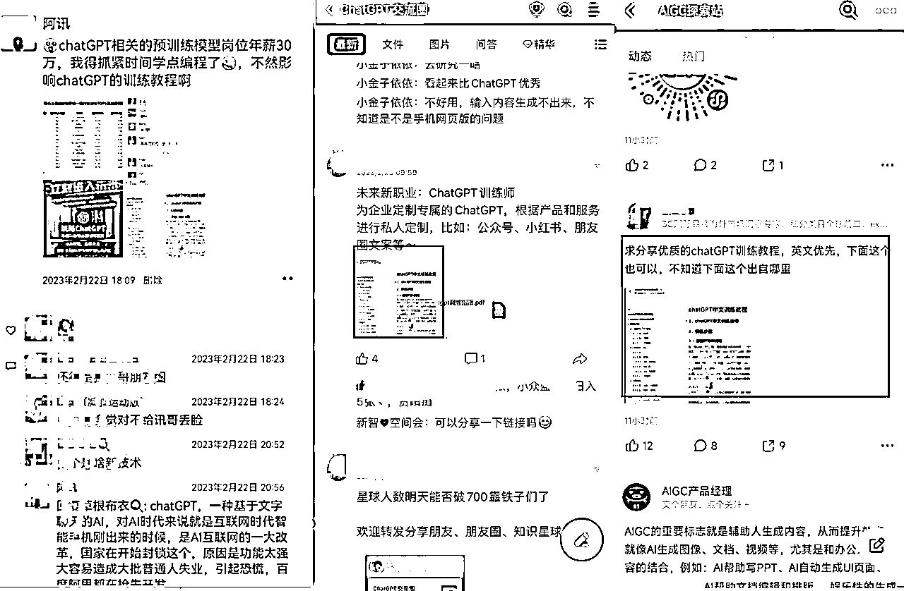

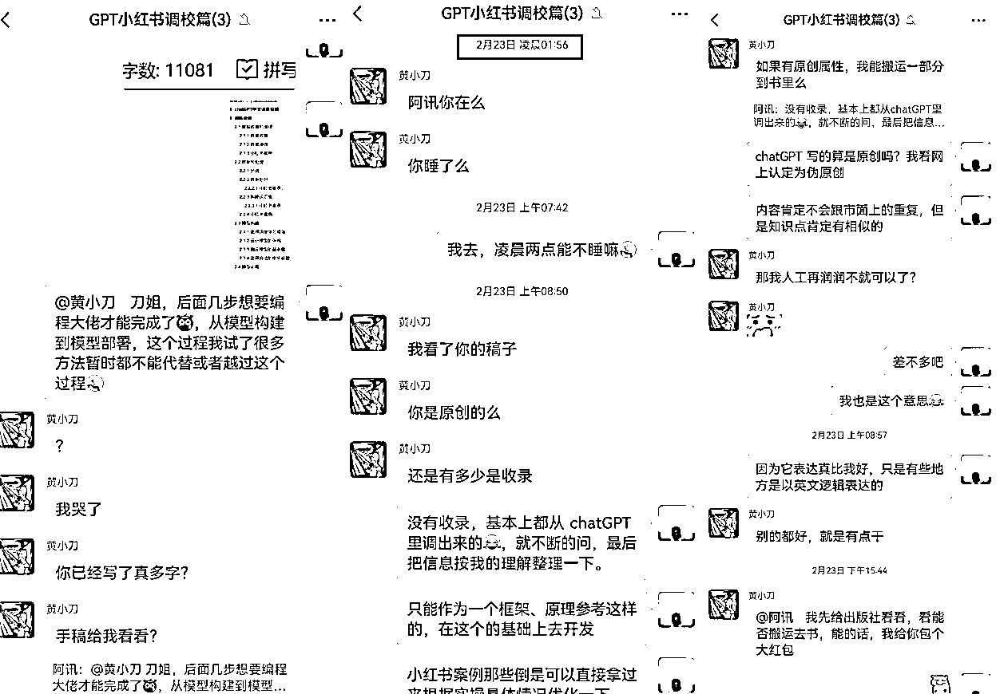

后来复盘，我才发现那份教程其实并不算特别出色。市场上很快就冒出了大量同类教程和课程，有的写得比我更好。那我为什么能那么快实现变现？

刀姐点醒了我一句话：玩赚社群能起来的核心不是别的，就是比别人快。

发现 ChatGPT 这个信息差后，刀姐 24 小时内就把交付手册写出来开始拉群收人。我是第一天进群就看到她这个节奏，遇到运营问题她的处理原则永远是先快后好。

信息差只有配上执行力，才能变成现金流。

第一，执行力决定起跑线。大多数人卡在犹豫和拖延里，愿意动手的人自然往前一大截。我就是靠不断试错、研究交付手册的打磨方式，才把两个核心教程写出来并完成变现。

“行动比说辞更有分量，执行力让你拉开差距。”

第二，信息差的本质是抢占时间差。谁先动，谁先吃到红利。无论是刀姐的玩赚社群、那本实体书，还是我自己的教程，本质都是发现了窗口期并立刻做了出来。刀姐自己也承认过：成功就四个字，我比你快。

团队合作胜于单打独斗

我把 ChatGPT 写小红书笔记的教程分享出去后，黛色来找我，说要不要一起做一个更落地的实战训练营。

我们很快凑齐了人手，我负责交付手册、小红书和论文写作相关的教程，另几位伙伴各自补上视频脚本和知乎好物教程。团队成型后三天内，四份实战教程就全部完成，我们拿着这四个场景做海报和推文，最终拉来了将近三十个人报名。虽然这次训练营的最终效果一般，但我也赚到了近 2000 元，更重要的是学到了不少实操经验。

一个人做内容天花板很低。团队能把各自擅长的东西拼起来，宣传、交付、转化都能做得更完整。很多报名的人其实都是从玩赚社群过来的，他们懂基础用法，却不会把技能迁移到真实场景里。

训练营结束后，我没有停下来。教程的价值还在，只是需要换个载体。我把内容更新到知识星球，用它做引流点重新推广，很快就吸引了几十位朋友进来。之前一年多，星球里基本只有我自己在发，空转了很久，这次才让它真正活起来。

“失败不是终点，能不能把沉没成本盘活才是关键。”

随后我又在玩赚社群里看到了另一个变现方式：账号交易。为了尝试新的收入线，我在分销群认识了一位号源稳定的朋友达成合作。我把自己已有的论文写作教程作为钩子，在小红书上做内容引流。这个组合拳打得还算顺手，带来几十个精准关注，最终成交了二三十单。