# 不露脸、不投流，我靠内容型IP跑通百万变现

> 来源：[https://jngw0yct19.feishu.cn/docx/GUHld91qQobms8x35tbcOUlSnZb](https://jngw0yct19.feishu.cn/docx/GUHld91qQobms8x35tbcOUlSnZb

在当下自媒体环境里，把“人设”做成资产，再让资产产生收益，是很多人真正赚到钱的路径。

这篇不是空谈。有真实数据、实战案例、完整操作流程，篇幅偏长，建议先收藏。

我是“不讲李”，现在做的号，专门拆解各类副业项目，你可以把它看作“视频版”的赚钱情报站。

在做这个账号之前，我在内容领域已经累计操盘过亿级流量。如果你对内容、转化、涨粉等环节有疑问，欢迎随时聊聊。交个朋友，你肯定不亏。

这一年多，我前前后后带过上千位伙伴，从零开始做出能够持续产生收益的账号。

“不讲李”这个标签，也帮我在10个月里拿下了七位数的累计收入。

没有哪个做内容的人不喜欢这个数字，但说实话，我的野心不止于此。

早期账号起量很快，单日被导到私域的新用户就能破千。如果当时选择做收割型生意，两个月冲到百万也不是没可能。但我想做可持续的事业，所以对待这个IP格外谨慎。

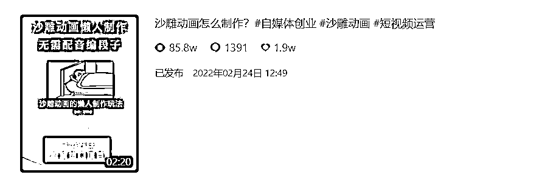

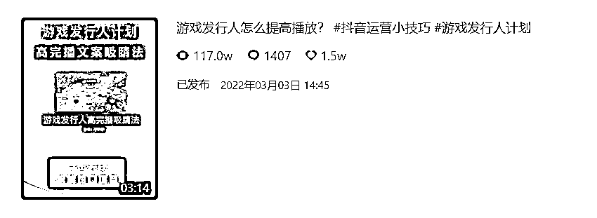

这些数据截图可以让你感受一下当初的流量水平。在我的细分行业里，一条内容能破百万播放，已经算少见。泛娱乐账号随便一条街拍或翻跳就能爆，可那种流量在商业价值上，跟我做的垂直内容完全是两码事。

晒收益就算了。会员活动刚结束，不想把新读者的心态带偏。还是希望各位能沉下心，把文章里对你有用的部分拿走，尽快动手试验，跑通自己的从内容到转化的路径。

抖音/公众号：不讲李的笔记

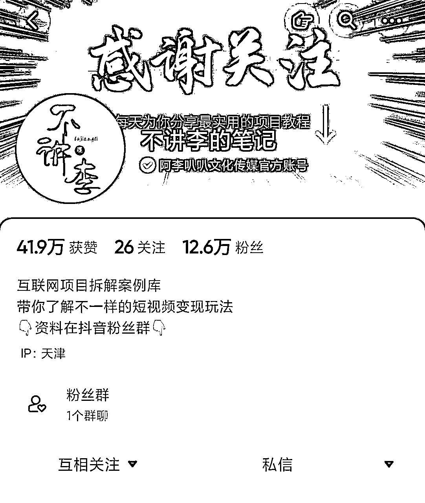

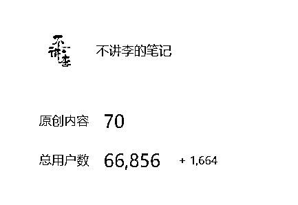

这个号从注册那天起，我没花过一分钱在Dou+上。所有流量全靠内容本身在算法手里抢出来的。也因此，留下来的关注者几乎是最真诚、最精准的那批，因为大家认识的是“不讲李”这个人，而不是因为某种诱导关注。

投放当然也是运营工具箱里常见的手段，这一点你完全不用学我。我不投放的真正理由，其实是想证明一件事：我能帮公司操盘出千万级变现账号，那自己做号凭什么不行？

就是这股不服输的劲头，支撑我在100多天里反复调内容、看数据、改方向，最终打磨出一套独属于我的流量打法。

“不讲李的笔记”后来被不少人当作参考样板。因为我的方式特别适合新人，省人力、省钱、启动快，一个人就能做完所有环节，复制门槛很低。

说回正题。想做个人品牌的人很多，但迟迟不敢动手的原因往往就那几个：不敢面对镜头，口头表达不顺畅，没有合适的拍摄环境，不知道发什么内容。

巧了，这些问题当年我一个都没躲过。

下面，我把“不露脸也能做变现型IP”这件事拆开讲透。

### 内容框架

一、怎么搭建一个不需要露面的个人IP
1. 个人IP的本质到底是什么
2. 普通人走哪条路更容易做成
3. 哪些不露脸的账号值得参考

二、抖音运营最关键的几件事
1. 怎么借“低粉爆款”快速起步
2. 如何抓住用户群体最大的真需求
3. 私域导流和规避限制的操作细节

三、PPT型视频是怎么做出来的
1. 选题、撰稿、配音的顺序
2. 一条短视频的通用骨架
3. 从PPT到成片的导出方法

四、知识付费常见的三种变现形态
1. 课程变现的得与失
2. 咨询变现的得与失
3. 社群变现的得与失

# 一、如何搭建一个不需要露面的个人IP

### 1. 个人IP的本质是什么

一句话，就是别人想到这里，立刻联想到你是什么人。说到某件事，大家第一个想起你，那么你就有了IP属性。

打个比方：
周星驰——喜剧的代名词
成龙——动作片的标杆
龙哥——赚钱有术的主理人
杨涛——赚钱里公认的“六边形战士”

一看到这些名字，对应的领域和身份会瞬间弹出。

这时候你可能会想：我就是个普通人，离“大佬”太远了，还是算了。

别急着给自己盖棺定论。

你不跳伞，就永远治不了恐高。路总是给那些相信自己可以的人准备的。你越是否定自己，就越难往前迈一步。

而且抖音的推荐机制本身就在向新内容倾斜，想一想，那些昔日的大网红，你多久没刷到过了？

只要保持学习和输出能力，任何一个你所在的细分行当，都可以靠个人IP重新做一遍。

我观察过上百名素人起家的博主，总结出两条最适合普通人的成长路线。不需要你精通运营，不需要你形象在线，甚至全程不露脸，也能建立一个让人喜欢并信任的IP。

### 2. 普通人可以做哪两类IP

第一类：靠技能立住的专业型IP

比如说，你当房产中介已经十年了，购房时那些隐形的坑，你了如指掌。这些实操经验就能变成内容：房子过户给子女什么方式最合适？物业到底靠不靠谱，看哪几个细节就能判断？这些全都是大家日常会碰到的真问题。

不用聊那些遥不可及的宏观趋势，只聊脚边的具体麻烦。这种内容人人有共鸣，你也有十足的把握输出。

因为你够专业，因为你有十年的经验做底，因为你提供的建议确实能解决问题，关注者没有理由不信任你。

等粉丝体量上来，线下付费咨询会自己找上门。开发商也会注意到你的影响力，想要借助你的口碑来做转化。

很多人总觉得这辈子缺少机会，但真正缺的不是机遇，是拿得出手的本事。在自媒体时代，一门过硬的手艺比几套房子还值钱，个人IP还能让你的专业价值被更多人看到。

第二类：靠信息整合盘活资源的梳理型IP

再比如，你是个爱打扮的女大学生，阅历和收入都有限，但这并不影响你做一个美妆号。

你可以把国产美妆品牌在小红书、抖音、百度上的口碑都翻出来，一条条整理进表格，再用口播或图文的方式把优缺点摆出来讲清楚，就是很好的内容。

等你慢慢有了粉丝，品牌方甚至会寄样品过来，视频的真实感也更强。抖音和小红书上有大量这样的博主做得风生水起。

如果你实在说不出自己有什么特长，那就从帮别人省时间、躲坑做起吧。做得久了，这个方向也会慢慢变成你的专长。偶尔一条内容爆了，就是对这个善意的回报。

这背后的逻辑说白了只有四个字：信息盘点。

互联网的精神在于开放和共享。很多人面对某个领域觉得无从下手，本质上不是信息不存在，而是不知道去哪儿找。你能把这些信息收集和梳理好，平台上的用户自然会向你聚拢。

这两个例子，就是想告诉你：做成IP的基本路径，普通人完全可以复制。

不管你现在有没有行业积累，都能通过后天学习补上，让自己成为这个领域的行家。

我自己也一样，擅长的本来是内容策划，并非互联网项目操盘手，但这并不妨碍我把项目拆解内容做得有模有样，因为我走的就是“整合型”这条路。

刘润有句话我很认同：真正的高手都是极致利他的人，他们总想着先给予，而不是先索取。

你持续为别人创造价值，别人就会用他们收获的价值来回馈你——一个关注，一个赞，一次分享。IP就这样慢慢立起来了。

IP最大的势能在于它能大幅降低交易的决策成本，而交易本身就离不开信任。

### 3. 哪些不露脸IP值得参考

抖音到现在依然是流量最集中的平台，认知门槛也最低，所以做个人IP的首选阵地，我建议放在抖音。

做抖音第一步永远是找参照对象。目的就一个：少交学费。别人已经蹚过的路，你照着走一遍，成功率会高出很多。

能做的方向其实很宽泛。就拿PPT拆解项目这件事来说，换个行业同样能跑通。

下面这9类账号形态，都可以不露脸，只要出声音就能做：

**1. 工具测评型IP**
定位方向：每天安利一个自媒体效率工具
内容形式：录屏配合混剪，讲解某个软件的功能和亮点
收益来源：社群、工具分销、品牌合作、知识付费

**2. 职场认知型IP**
定位方向：职场潜规则、商业思维
内容形式：素材混剪+解说职场和商场里那些台面下的规则
收益来源：社群、广告、咨询、播放分成、知识付费

**3. 虚拟人物型IP**
定位方向：适合快速起号的轻量级形式
内容形式：用工具生成虚拟形象，配合口播拆解玩法
收益来源：广告、社群、工具分销、知识付费

**4. 读书解读型IP**
定位方向：成长类内容，三分钟带你吃透一本书
内容形式：手绘或简笔画配合解说，提炼书里的核心要点
收益来源：广告、读书训练营、播放分成、知识付费

**5. 游戏解说型IP**
定位方向：技术流、趣味盘点、深度分析都可以
内容形式：录制游戏画面，后期写稿配音
收益来源：广告、带徒、陪玩、平台分成

**6. 半出镜记录型IP**
定位方向：记录真实的工作和生活场景
内容形式：多角度空镜+第一人称视角的混剪
收益来源：广告、带货、播放分成

**7. 项目拆解型IP**
定位方向：适合所有知识输出的内容赛道
内容形式：用PPT逐层拆解项目逻辑、流量来源、内容制作和变现闭环
收益来源：社群、广告、资源对接、知识付费

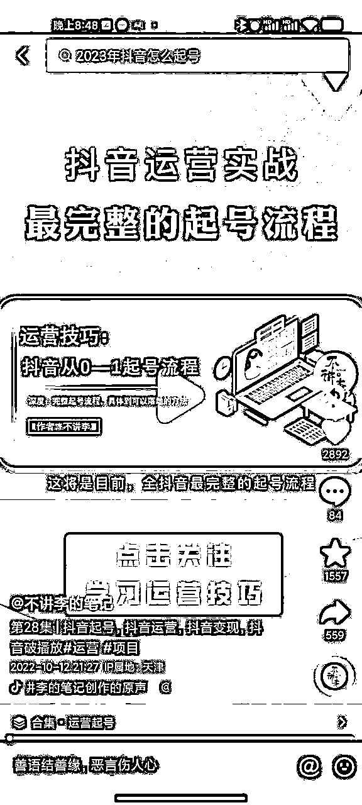

**8. 思维认知型IP**
定位方向：讲思维模型、心理效应和认知升级
内容形式：用PPT把抽象思考变成视觉化的模型框架
收益来源：广告、流量分成、知识付费、成长社群

**9. 恋爱技巧型IP**
定位方向：面向单身男性的社交能力提升
内容形式：同样以PPT为骨架，抛出问题、拆解原因、给出解法
收益来源：广告、咨询、线下活动、知识付费

这些方向总有一个适合你，但也并不代表只有这些赛道可以选。说句实话，除我自己之外，上面提到的这些账号，粉丝体量大多是几十万甚至百万级别。

# 二、抖音运营最关键的几件事

### 1. 借力“低粉爆款”账号，起号速度最快

抖音应该是目前最难从零做起来的平台，这点凡是实操过的人应该都有体感。

你可能花了不少钱上过课，也学了一堆运营术语，可内容发出去还是没什么水花。

这里送你一套我自己跑通过的打法，很早就在抖音公开分享过。认真执行的人，大多数一个月内粉丝都能破万。

找不到原图了，水印大家凑合看

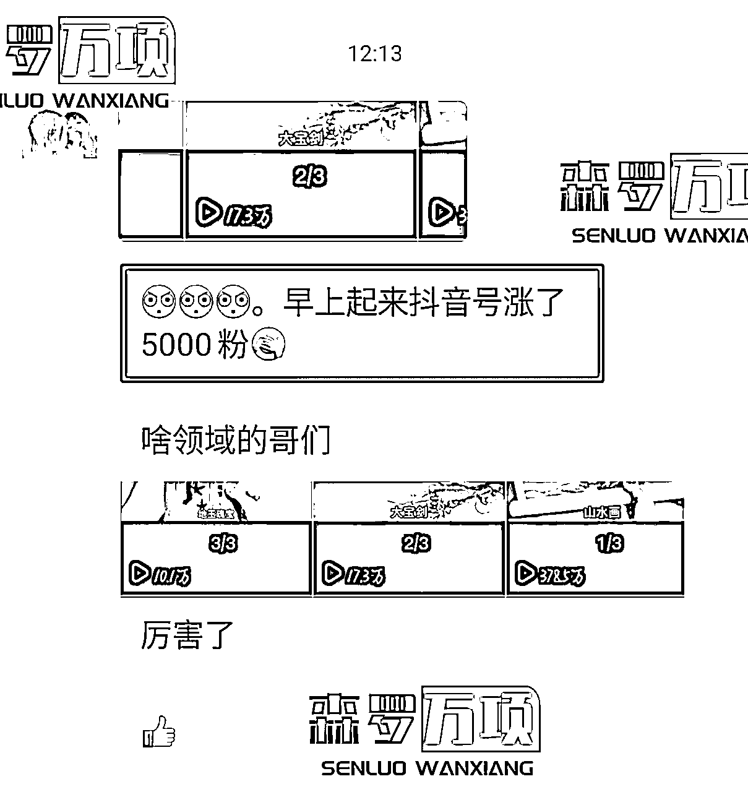

核心思路是：去寻找最近三个月内刚冒头的账号，尤其那种只有一两万粉的。

这些号粉丝并不多，主页看起来也不华丽，制作甚至有点粗糙，但偏偏靠着某一条或几条内容突然涨了几万粉。这就是最好用的风向标。你顺着他们验证过的话题去创作，大概率也能吃到一波推荐流量，顺势打上账号标签。

我们在带学员做不同领域账号时，用的都是这套“低粉爆款”逻辑，几乎屡试不爽。当然前提是你的作品基础质量得过关，不然再好的方法也接不住。

关于怎么找到这些账号，网上的方法其实都对，核心无非是持续搜集、归类、拆解这几步。

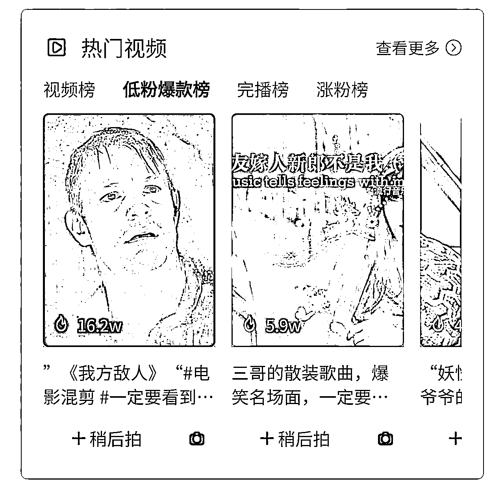

我自己有个习惯：用一台专门的小号手机，批量关注并完整看完已知的同类博主。这样抖音的推荐机制会自动持续给我推送相似账号，选题和对标两手都能满足。

到现在已经一年多了，项目拆解类的账号越来越多。有人纯复制，有人做微创新，基本都是从公域导流到私域做转化。用户也渐渐习惯了这种内容模式。

但模仿仅限于形式，如果连文案都要照搬，那这种IP很难走远，平台也不会给太多流量。而且粉丝并不傻，当用户同时刷到你和其他同质账号时，谁在真创造价值，他们一眼就能看出来。

内容上持续提供新东西，做出差异化，才是建立IP影响力的长久之计。

这是起号的第一个关键：找到行业里那些“低粉但突然爆发”的账号。在抖音这个生态里，小赢才是大赢的起点。

新手真没必要什么都从零开始自己硬想。

### 2. 找到覆盖面最广的核心需求

只有对标还不够，内容本身才是真正的护城河。我初期流量也卡了挺久，PPT确实不如真人出镜有表现力，完播率一直不太好看。

那时候我也怀疑过：难道这类账号只是偶然？根本不可复制？

我索性把大量对标账号的所有视频翻出来重新统计了一遍，最后竟然让我找到了关键的流量密码——影视解说。

影视内容天然拥有最广泛的受众群体，刷抖音的人大多是来找乐子的，很多人的午饭时间都习惯配一条影视解说。再加上，只要有新人想靠抖音变现，脑子里蹦出来的第一个方向多半就是影视解说。

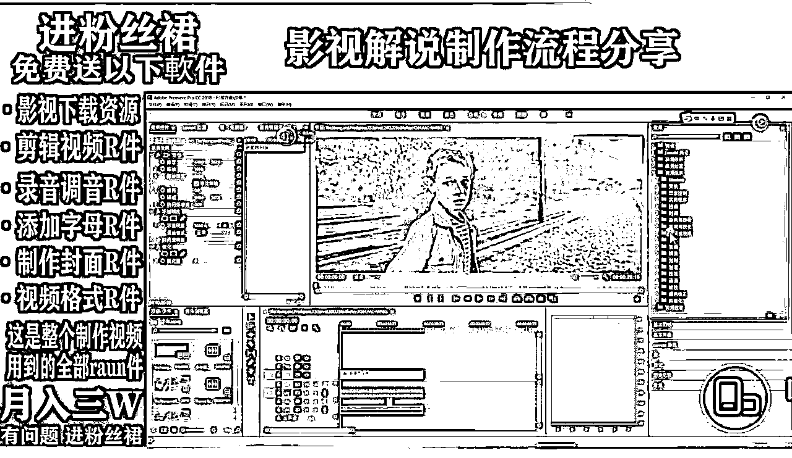

顺着这条线我继续往下挖，混进了不少影视解说的从业者交流群，观察他们每天都在纠结什么。

结果发现做影视号的人卷得厉害，很多人早就想换赛道了，但不知道该去哪个方向。还有一些人卡在中视频审核上过不去，或者收益不知道怎么提升。

我就围绕这些痛点，开始做中视频玩法拆解。结果第一条就爆了，涨粉8000多。我接着追了这个话题三天，账号标签直接就打上了，流量从此稳定下来。

第一条爆款

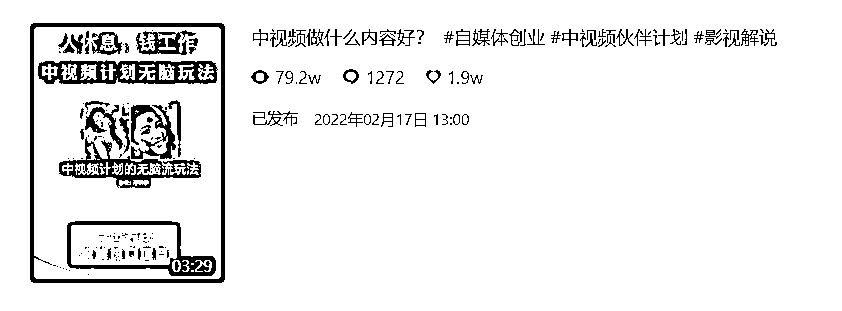

这是起号的第二个关键：去解决当下最普遍、最迫切的需求，帮目标人群搭一座从现状通往目标的桥。

因为当时有海量的人在做中视频，我的系列拆解刚好接住了他们的需求，于是顺理成章成了爆款。

### 3. 私域导流和规避封禁的操作细节

为什么我坚持把用户导到私域，而不是直接在抖音里卖课？

很多人迷恋粉丝数和播放量，我不太看重这个，我唯一盯的指标就是私域每天新增了多少人。

抖音上的粉丝，本质上并不完全属于你。平台一个不高兴就限流或封号，你什么也带不走。我自己就被封过两个号。

私域就不一样了，它是真正掌握在你自己手里的资产。你可以说更深度的话，可以随时触达用户。不管你是做销售还是做信任建设，操作空间都大得多。只要你持续输出靠谱的信息，用户就会一直跟随你。

现在我手里的大部分资料、文案、案例素材都是免费分享的。视频从不加水印，其他平台要搬就搬。

领资料也不需要加客服微信，直接在公众号回复关键词就能拿到，省去了很多不必要的来回。

免费资料已经29页了

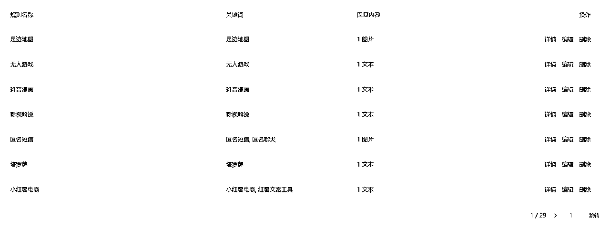

这样看是不是觉得我挺大方的？

原因很简单：一个赛道的生态，需要大家一起建。

一条商业街上，得有各种类型的店，需求才能被激发，市场才能活跃，每个人才能赚到钱。

再说这类内容你也根本堵不住，与其花精力去防范，不如把时间用来提升自己。免费分发资料，本身也是一种无形的背书。

私域每天进来的人来源非常杂：有看盗版课的，有各路“军师”推荐的，有从YouTube来的，也有知乎和B站来的。特别要说一下B站那位兄弟，到现在我也不知道是谁，直接拿着我的名字和视频帮我引流，堪称活雷锋。

不过，怎么把用户稳定导出来是个技术活。相信你也试过不少方法，不是被禁言就是被限流，心态经常处在崩溃边缘。

下面是我用了一年多的稳定导流方案，渠道的搭建逻辑也一并分享出来。

我的做法是：

内容侧：抓人的开场钩子+项目流程拆解+混剪素材或PPT画面。
导流侧：找到用户最强的痛点→在结尾埋一个关键词钩子→引导去公众号回复关键词领取一部分→再加客服号领完整版资料。

工具方面，我一直用的是商加加，大家直接去官网找客服咨询就行。他们会帮你配置好引流卡片，比很多方式都稳定。

商加加外链：https://www.shangjiajia.com/

举例来说：我拆了一篇中视频玩法，用户最想要的东西，无非是素材包和文案模板。那么钩子就可以设为“视频素材”或“文案模板”，用户到公众号回复关键词，第一步先拿到部分内容。

但只给其中一部分，在资料末尾再加一句话：“视频素材内容太多容易被和谐，需要完整版请添加不讲李的助理微信，扫码还可以再免费领取32个小项目玩法。”

就这样，用户顺理成章来到了微信。如果资料本身很简单，没办法拆分，那就再找一份资料作为下一层的钩子。

至于为什么先导到公众号再进微信，其实是我早期留下的习惯。刚开始一个人做号，只有一个微信号，频繁添加好友很容易触发限制，没想到号会起得这么快，就让公众号先充当中转站。用户已经被市场教育出了使用习惯，后来也就一直没改。

按现在的标准来看，直接加微信是更优解，这点倒不必参考我们。不过公众号也有两个好处。第一，用户获取资料的体验更简单；第二，图文内容比短视频更容易建立私域里的立体人设。

再聊防封的细节：

带蓝V的认证账号抗风险能力确实要强得多，但也不是什么都敢发。只要内容别太过分，基本问题不大。

抖音群我一般设置全员禁言，防止有人聊出敏感话题。我自己的导流动作仅限于转发卡片，不给任何引导性的话术。

卡片跳转这种方式，聪明人自己就会跟过来。不会操作的人，基本上连手机都没太摸明白，就算加过来，后面也是个麻烦。

# 三、PPT视频是怎么做的

总有人在后台问我：李哥，PPT是用什么软件做的？剪辑有没有什么窍门？

说实话，我是真觉得这块没什么技术含量。把PPT录下来，再加上解说录音，就完了。

如果你觉得难，大概率是办公软件用得不熟，不知道PPT该怎么排版。这个建议直接百度查，花不了多少时间。

下面按我的制作顺序来演示一遍。

### 1. 选题、撰稿、配音

平时可以去抖音多看看当下讨论度高的项目，点赞高的内容都先收藏起来。但说实话，赚钱里的风向标和精华文章才是最好的选题库，里面的高手对赚钱项目的敏感度远超大多数短视频博主。

拿当时很火的短剧推广来举例。不管在抖音还是其他平台，只要你看到这类项目信息，就可以顺手吸收消化，把它变成自己的选题。

内容可以直接对着PPT口播，也可以提前写好逐字稿再念。

想做不露脸IP的，多少都有点不好面对镜头的原因。我当时是给教育公司做全媒体运营出身，让我对着镜头自然表达，有点为难自己了。所以我的习惯是先把内容写出来，再录音，这样也方便随时调整结构。

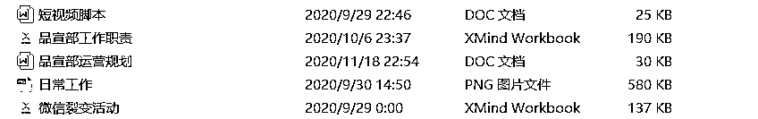

开头怎么讲才能抓人？哪个位置应该让用户停下来？哪个位置该引导点赞？哪句话能激发评论？这些我基本都会提前想清楚。剩下的，就是把接收到的信息转化成自己的语言，把这个项目机会清楚地讲给别人听。

录音方面，我自己念。你也可以用一些平台提供的AI配音工具。这里就不推荐了，收费高的一般效果也更好，但最重要的依然是内容本身。

### 2. 短视频通用的内容骨架

【爆点前置】+【项目概况与优势】+【流量来源和内容形式】+【变现方式和项目评价】+【钩子设置】

举几个标题例子：

“视频号带货新手，7天涨粉10W实操分享”
“3条视频播放破百万，变现5W的冷门玩法”
“不为播放量焦虑，分享一个只要付出就有回报的项目”

最快的标题写法，是去赚钱里搜那些高赞文章的标题，拆出他们的框架和句式规律，用到短视频标题上同样有效。标题党这种形式，不管在图文时代还是短视频时代，都不过时。

很多人做短视频，折腾半天没流量、没粉丝、更没收益，问题到底出在哪？其实逻辑很简单：那些想靠短视频赚钱的人，最关心的事情无非就那几样——投入别太多、流量别太少、变现要够快、涨粉要够猛。你把这几件事儿放到视频开头，自然能戳中他们的痛点。

但这里有个坑，你得注意：用这种套路吸引过来的，多半是急于求成的新手。偶尔用一次没问题，要是天天拿这个当开头，你的账号粉丝质量和后续的变现路子都会受影响。所以说，做个人IP，第一步其实是学会“劝退”。别怕拒绝一部分人，把不合适的人挡在门外，反而能让你找到更精准的受众，生意才能走得长远。

项目分享这块，最大的误区就是你觉得自己懂了，观众也懂了。其实很多人对项目的了解远比你想象的少。所以，该介绍的项目环节，一步都不能少。如果一个项目能用一句话讲清楚，那你就把它拆成几个点，有理有据地列出来，比如“上手简单、启动成本低、可规模化放量”等等，这种有条理的呈现方式本身就很有吸引力。

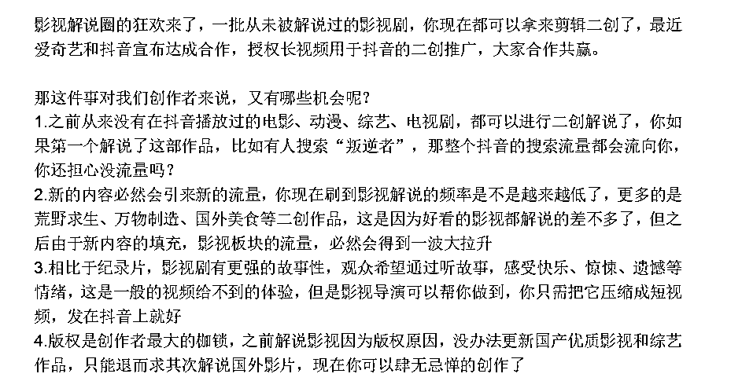

讲完项目本身，接下来就是两个核心中的核心：流量从哪儿来，钱从哪儿赚。一个项目或者账号，要是缺了这两块，就等于没形成闭环，也就失去了被关注、被认可的价值。

绝大多数项目的流量入口就是短视频。那具体怎么做？很简单，找一个这个领域的标杆账号，拿他做案例，手把手带着大家分析它到底火在哪儿。比如小说推文，你会发现做得好的账号，内容展现形式基本都是“解压视频+小说原文”。那解压视频为什么让人停不下来？小说为什么天然有吸引力？这俩加一起为什么能产生“1+1>2”的效果？把这些问题一个个拆开、讲透，观众自然就明白了：原来这样做内容，流量是这么来的。这种碎片化的获得感，会让人产生一种“我在学习”的快感，顺手点个赞、收藏一下，太正常了。

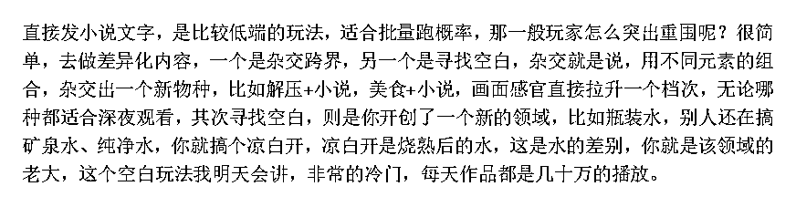

接下来聊变现。其实大多数项目的变现路径，都逃不出下面这几种，我直接给你总结一下：

1. 流量收益：最常见的就是中视频计划，很多平台都有类似的播放激励。
2. 私域成交：公域不方便说太多的时候，就把人引到微信上去转化，比如减肥、情感类目都是这么玩的。
3. 电商带货：短视频挂个链接，直播间上个小黄车，抖音的电商体系已经相当成熟了。
4. 广告合作：粉丝到1万就可以开通星图，如果你是垂直账号，品牌方自己就会找上门。
5. 卖经验/卖培训：当你跑通了某个项目的玩法，你的经验本身就是可以打包出售的产品。
6. CPA/CPS：前者是按下载量结算，后者是按用户质量或实际效果结算。

把这六个方向灵活套用，基本上没有你拆解不了的项目。到这儿，一个项目的拆解主线已经说完了。等你拆解的多了，对粉丝的需求也越来越有感觉，这时候你就可以在结尾加上你自己对项目的判断，或者给粉丝一些掏心窝子的建议。人是理性动物，更是感性动物，你是真心为他好，还是随便应付两句，大家都能感觉到。这种“为对方着想”的态度，恰恰是升华主题、强化你个人IP的最好方式。

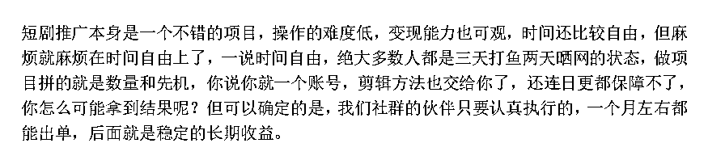

### 3.用PPT模板做混剪视频

PPT怎么做我不细说，你也不需要从零开始原创，找一个好看的模板直接用就行。我常用的免费模板站是这个：https://www.1ppt.com/tags/499/

如果精力够，每期都做一个贴合主题的PPT，效果肯定好。但问题是，找个合适的模板再改内容，太费时间了。所以我干脆固定一个模板，就图一个“快”字。后来做项目拆解的朋友也都学我，甚至连排版都跟着复制：左上角放标题，左边放文字，右边放案例，上下两条分界线，连PPT的底色都模仿得像素级一致。他们不可能不成，因为这就是最适合一个人单干的方式——像素级模仿“不讲李”，你也可以。

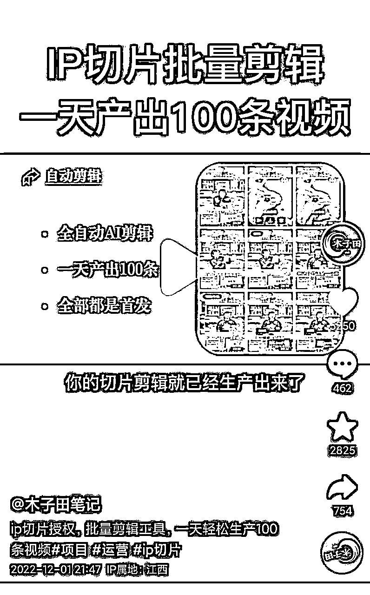

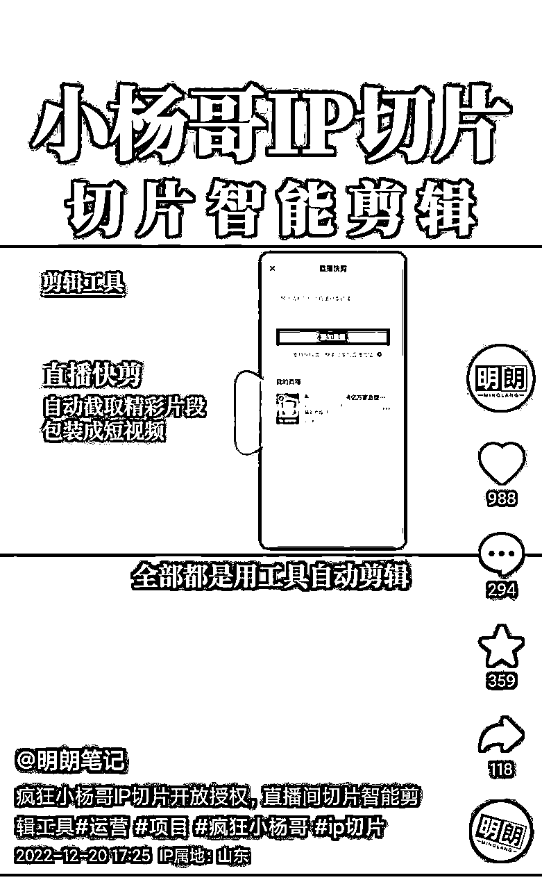

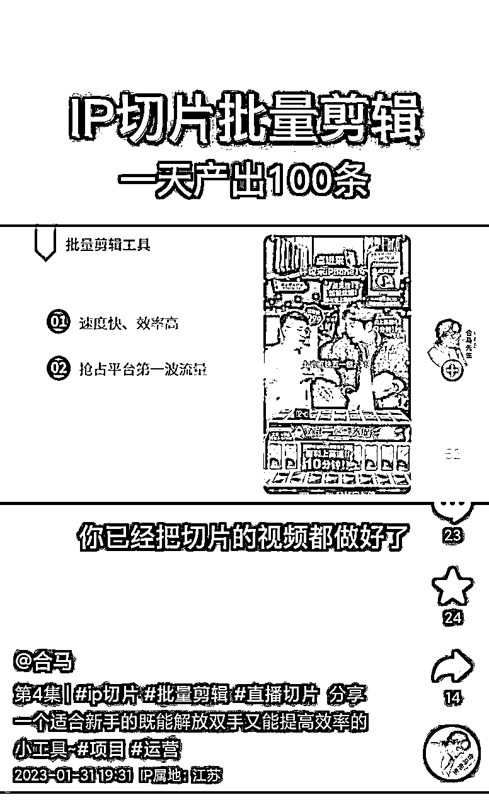

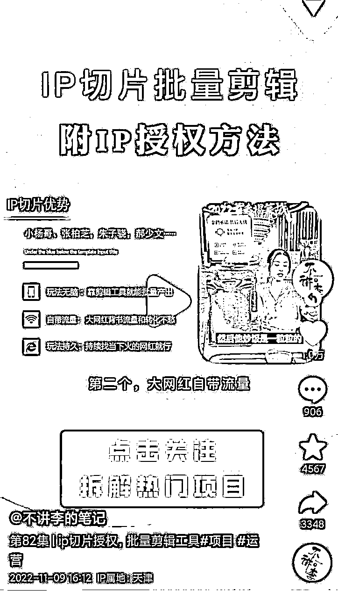

可能有人觉得这些人是在和我抢流量，但细心的人看发布时间就明白，他们都是在我之后发的。去年全网都在跟风做项目拆解，也算撑起了一个小生态。有粉丝劝我去举报，我都拦住了——人家也许能延伸出更好的思路，你能免费学，为什么要举报呢？我本来就是一个互联网上的普通人，因为写的内容有点价值，意外成了大家的标杆。能在无形中帮后来的人少走弯路，我其实特别欣慰。

剪辑就更简单了，把录好的PPT导入剪映，在页面切换的地方加上转场和音效，整个视频就会顺畅很多。其他素材，剪映的素材库里都有，省心得很。加混剪素材，归根到底是为了提升观感。拆案案例的时候，我也会把对标视频直接放出来——与其用嘴说，不如直接看，这比什么解释都管用。在抖音这个平台，不停切换画面，是除了文案之外，另一个能持续抓住用户注意力的关键技巧。到这儿，整个PPT视频的制作流程就跑通了。

### 三、知识博主怎么变现

有了流量，接下来自然是变现的事儿了。知识类博主的主流变现方式无非三种：卖课、卖咨询、卖圈子。咱一个一个说优缺点。

**卖课：** 就是把解决问题的过程录成课程，用户买来自己看。优点是边际成本极低，一份课录好，卖多少次都不需要额外投入。缺点也很明显：一锤子买卖，基本没有售后服务，万一用户的问题课程里没讲到，他很容易觉得踩坑了，甚至转头去买别人的课补上，口碑容易翻车。

**卖咨询：** 如果你在某个领域专业能力特别强，那服务本身的定价就可以高。比如心理咨询、法律顾问、出国留学规划，都属于这类。做咨询一定要做高客单价，不然来访的人多了，你的时间就24小时，根本不够分，最后只会把自己拖垮。

**卖圈子：** 比如项目交流群、自媒体讨论群。相比卖货和服务，卖圈子是更高级、更持久、变现方式更多元的玩法。一个好的圈子里有资源、有机会、有各种潜在的可能性，核心价值在人和商机。缺点呢，就是时间拉长了，交付感会被稀释，很容易变成冷群。这里面细节很多，但新手我不建议从社群起步，真的很难。

咱们可以简单算笔账：

假设私域每天新增200到500人，一个月下来就是6000到15000人。

卖社群，单价500，按5%的转化率算，一个月就是15万到37.5万。

卖课程，单价2000，按2%的转化率算，一个月就是24万到60万。

高客单的咨询我没做过，具体多少就不瞎说了。

注意，以上算法有个前提——你把公域的流量全部导到了微信，并且有足够的转化能力。如果你是从公众号再导到微信，中间至少会损失一半人。

不管你是卖课、做咨询还是搞社群，有一点必须牢记：不要过度承诺，但要超值交付。说到做到，甚至做得比说的好。一旦用户觉得你靠谱，给得比预期多，他就会越来越信任你。我们这儿用户续费很多次都是常态，不是靠套路留住的，是实打实的口碑攒出来的。

你想想，当一群人从心底认可你、愿意为你掏钱、愿意为你介绍新朋友，你还愁不知道怎么变现吗？

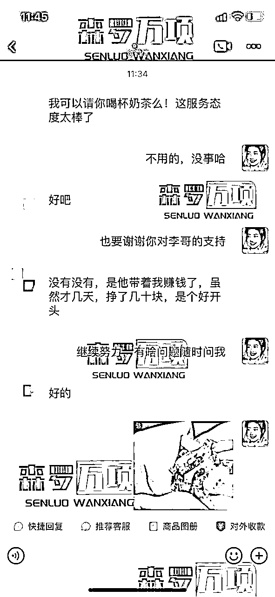

### 写在最后

打造一个不出镜的个人IP，没那么玄乎。不需要华丽的布景，不需要影帝级的表演，你只需要在某个领域真正热爱或者足够专注就行。可以是儿童教育、认知思维、心理效应，甚至就是你爱研究各种有趣的账号，做一个像我这样的号，完全没问题。

你只需要每天花个三到五个小时，套个PPT模板，剪片子发出去就行了。这压根不需要什么天赋——以大多数人的努力程度，根本轮不到拼天赋的时候。你看光是“PPT+某个赛道”这个组合，就没多少人认真去想、去做。

对普通人来说，做个人IP，核心就两件事，一个是热爱，一个是擅长。有热爱，你才有持续输出的动力；但光热爱不够，还得找到你擅长的事。做擅长的事，才能长久；做热爱的事，才会滋养自己，也照亮别人。如果你在做一件不擅长的事，那这就是纯消耗，做久了，人慢慢就蔫了。

很多人不适合出镜口播，偏要强迫自己天天对着镜头讲，还开直播，最终搞得身心俱疲。想要不卑不亢地把钱赚了，活得舒坦又真实，最好的方式就是找到那个你既热爱又擅长的方向，去照亮自己，也照亮别人。这样的IP状态，才是最舒服、最可信的。

所以，你热爱的事是什么？你最擅长的又是什么？如果你就是单纯对“赚钱”感兴趣，喜欢研究别人是怎么变现的，那做一个我这样的账号，也完全行。欢迎来聊聊，有问必回～

毕竟，教育行业出身的我，最擅长的事儿，就是挖掘“孩子们”的优势点。特别谢谢赚钱有术，也谢谢每一位圈友的耐心陪伴和阅读。我们下次见。