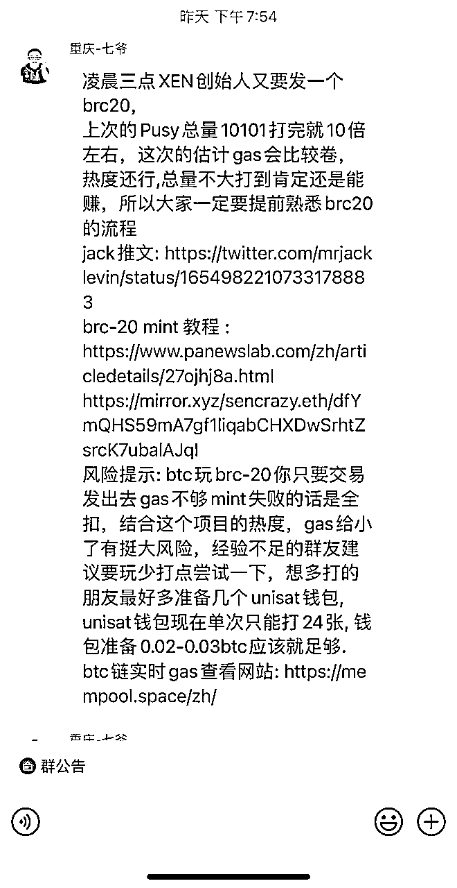
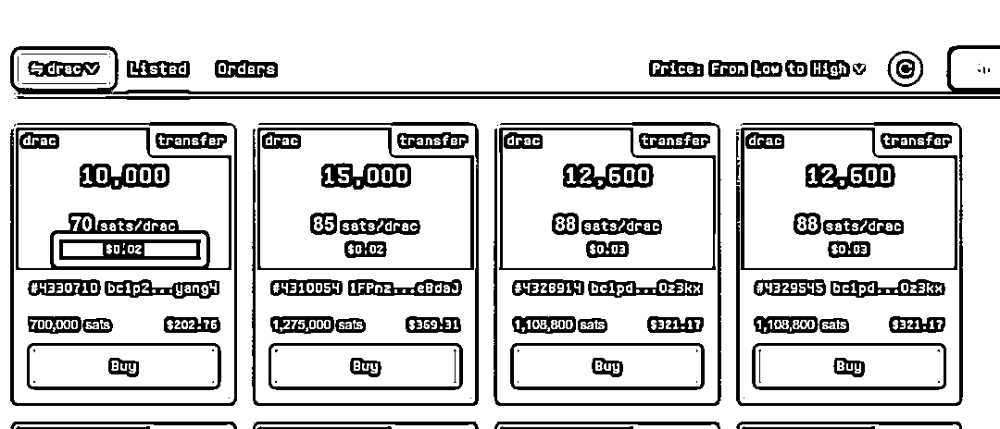
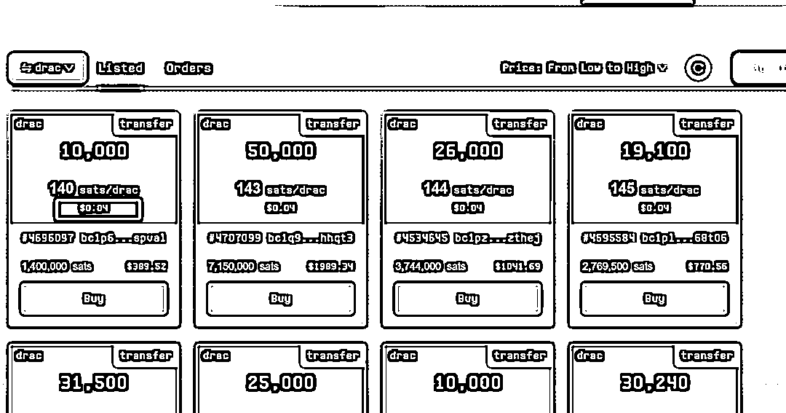
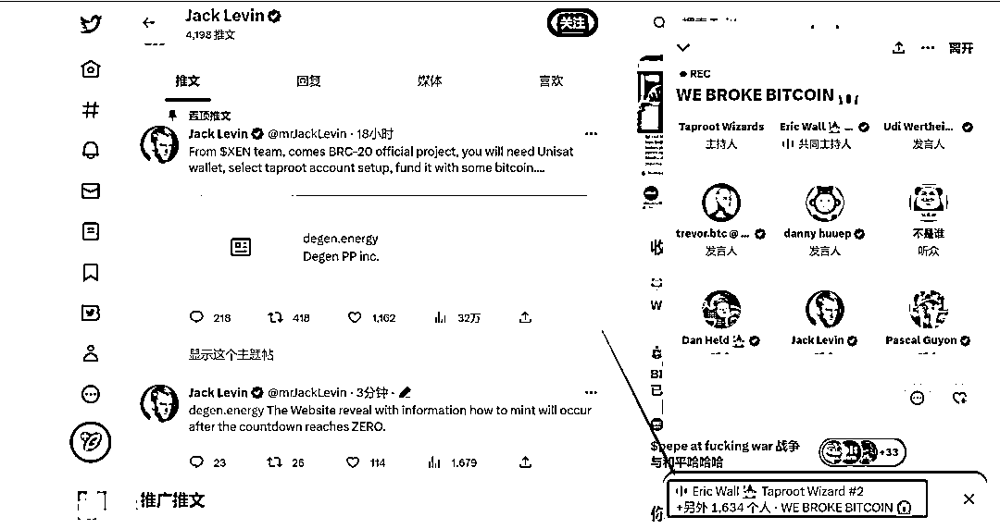
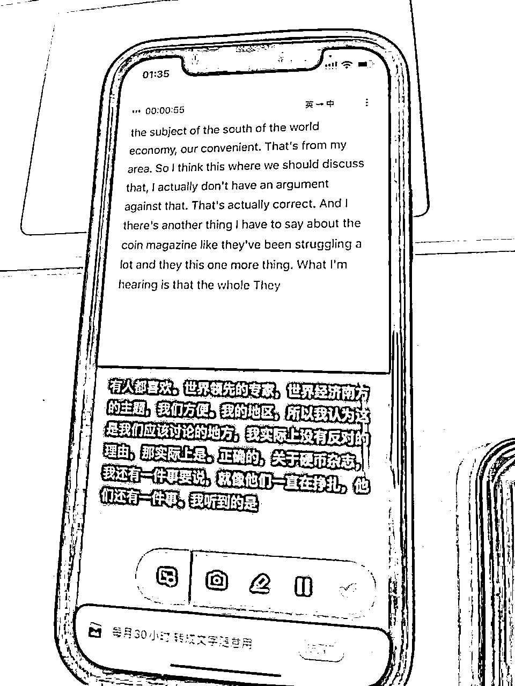
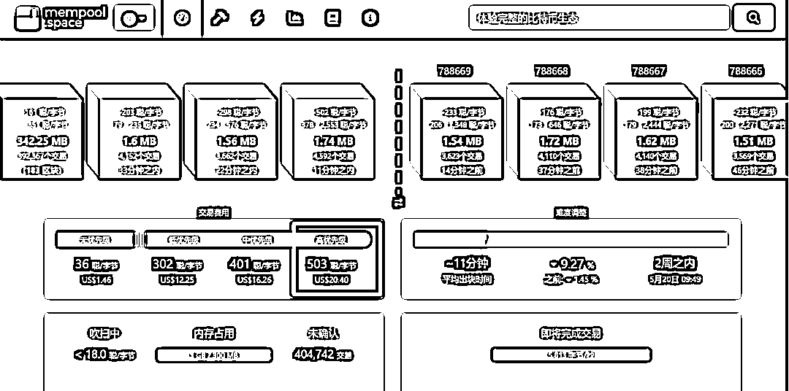
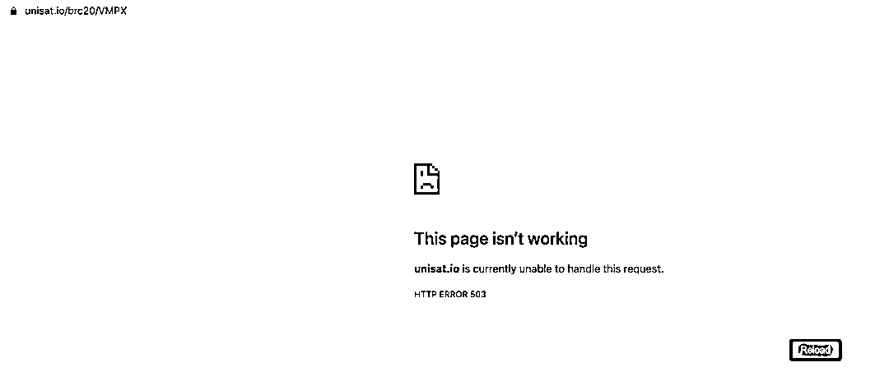
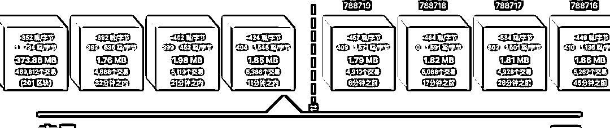
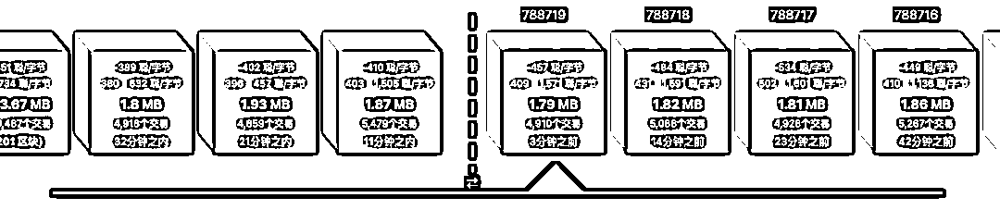
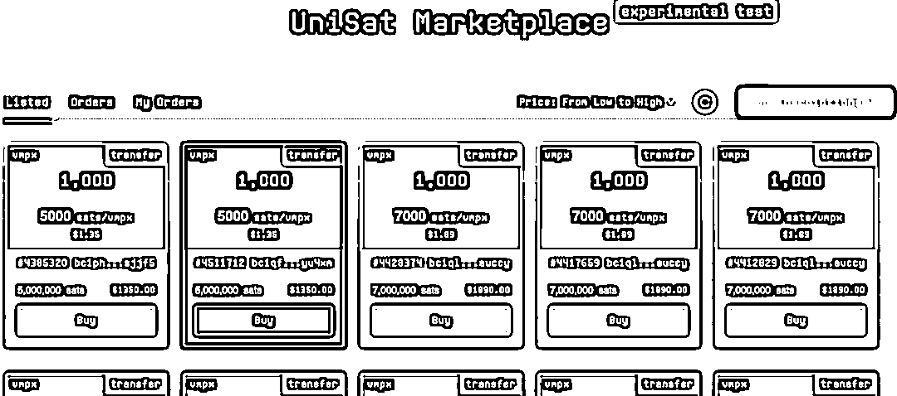

# Web3 新赛道：BRC20 标的 VMPX 抢购现场复盘（不构成投资建议）

> 来源：[https://ci3jlrgm02.feishu.cn/docx/Geucd6qWAoGztLx5EOkcKmjWnQg](https://ci3jlrgm02.feishu.cn/docx/Geucd6qWAoGztLx5EOkcKmjWnQg)

大家好，我是瓜藤，Web3 里摸爬滚打了两轮的老玩家。上一次有这种心跳加速的感觉，还是2020年那波大行情。5月8号凌晨的那场 VMPX 操作，是我近来摒弃成见后第一次真正上手实战，觉得对自己有启发，或许也能给你一点参考。内容比较长，留给愿意花时间的人看。

# 一、怎么捕获机会

这些年我一直在琢磨同一个命题：机会到底是怎么被抓住的。想了很久，一直不成体系。直到前不久看了老高小沫讲“只靠运气致富”的那期视频，才恍然大悟。视频借用的那个搞笑诺贝尔研究《天赋与运气：随机性在成败中的作用》，核心假设是剥离环境、才华、能力，纯看运气能不能赢。结论是能。

这里的赢不只是钱，还包括名声、幸福感、家庭状态。研究对象是智商正常、具备行动自由的普通人。

怎么做呢？本质很朴素：维持好奇、拓宽视野、保持心态开阔，习惯往好的方向预判。人生是场短跑，只有把单位时间内的运气值抬高，效率才会倍增。我们改不了运气本身，能改的是让自己更容易撞上运气的那种状态。

我做事有个习惯，必须自洽才上车，哪怕逻辑本身有错，也要自洽。第一部分讲的是我反复验证的机会捕捉心法：相信什么，你才能做到什么。唯物也好唯心也罢，先找到自己的执念闭环。

基于这个闭环，在创业翻车后我才能迅速爬起来。

再回到结论：放下先入为主的成见，去信息密度更高的人群里待着。

我当初进 Web3，目的就是快速回血。这一行造富的案例密度是其他赛道比不了的。当然坑也多，一线机会和九段风险并存，这里先不展开，后续再说。

# 二、如何搜寻机会

理论有了，行动才有支点。

搞到高质量信源、混进这些信源的圈子，用他们的筛选结果作为起点，小额试错、快速迭代，这是 Web3 里的 Alpha 逻辑。机会永远偏爱先动的人。

前一天晚上九点多，七爷的群里有人转发 VMPX 相关的动态。说是 XEN 的发案方推出的新玩意儿。之前我在 XEN 上喝到过汤，所以格外上心。

七爷社群截图

这段时间刚从七爷的线下交流会回来，外面玩了半个月，精力反而很足。恰逢 BRC20 热度空前，2021 年 NFT 爆的时候我因成见错过了大肉，这次看到 BRC20 我逼着自己去做功课。

提醒一句：Web3 里超过九成的项目带诈骗属性，真正考验的是进退的时机判断。

# 三、实操准备

临场之前先弄脏鞋子。岸上评论风浪很容易，真正下水才知道水有多急。风越大，浮起来的东西才越值钱。

前一晚是我首次动手做 BRC20。从晚上九点拿到风声开始，我就去各大社群搜集关于 BRC20 的资料，把底层原理、操盘平台、操作步骤梳理了一遍，钱包和比特币资金也提前安排好，随后进入模拟演练。

期间有个小波折：BRC20 太拥挤，比特币链上拥堵，某家交易所暂停了提现。立刻切换备选，改走 OK 走账。老玩家别笑，给新手看的就是这个：做事时总会遇到各种阻力，关键是立刻解决，而不是纠结。

模仿练习我反复做了五六轮，确认流程顺手后，才开始在 80%-90% 进度的标的上试水。当时手续费大概在 220 左右，成功失败都有。那一刻彻底理解了教程里说的：手续费给得太抠，最后很有可能白忙活。

基于这轮预演，我给后续抢 VMPX 定的原则是：抢购时手续费拉到上限。

# 四、谣言与真相并行

当流程和原则都定下来后，开始出现传言：有技术组的把币种名称破解了，提前 mint 完等项目方公布名字，好一波收割。随后项目方出面辟谣，表示只认官方倒计时页面公布的信息。

我去看了被抢跑的那个合约，应声跌到 0.02，听说他们的 mint 均价在 0.1。此时我也看到一个套利窗口，但因为前期准备不足，手上没有交易权限，unisat 的市场当时是测试版，仅对持有 20 积分或 OG PASS 的用户开放，所以没法抄底。

虽然没法操作，我还是想验证想法。结果是，那批抢跑的人和 VMPX 主力在社群里撕起来了，有热度加持，价格一路波动，最高冲到 0.08，写稿时回落到 0.04 附近。

后来我留在了项目方在推特的 Space 里听交流，不太会说英语，用讯飞的同传听个大概。虽然翻译有点贻笑，但主要还是感受热度。那时在线人数在 1600 左右，已是凌晨两点。

# 五、开抢

凌晨三点，倒计时页面跳转后直接进入到项目方推特，而推特置顶了一则吸血鬼特效的短视频。社群瞬间炸了，中文、英文、韩文、日文混杂，全部在骂，很多人以为要开始行为艺术了。

我一直在刷新群消息，也不断刷新项目方推特。凌晨三点十分左右，正式的推文出现了。

复盘来看，经验还是不足，低估了热度。抢购前我和朋友 panda 简单聊过，他觉得手续费至少要提到一千级别。当时我看链上数据只有二百多，就先上了十单，把手续费提到 550，觉得应该够了。结果订单一直卡在等待确认，迟迟不推进。再一看链上费率已经冲到六百多，感觉不妙。

之后进入了一轮恶性循环：刷新页面、进不去、503 错误、转圈、再刷新。好不容易进了 mint 界面，钱包响应又极慢。

只能干等，看着进度条从 20% 缓慢爬升，屏幕在 503 和加载动画之间切换，手续费持续走高。

到这个阶段，好身体和好心态就很重要了。今天白天我在群里看到有人拍大腿，说半夜进不去就睡了，醒来发现已经暴涨。

我当时打开了之前攒下的剧集《漫长的季节》，一边追剧一边刷新页面。

一直到进度来到 99.6%，时间已是清晨九点半左右，链上拥堵缓解，我把手续费调到 800，三分钟后，部分订单开始铭刻。我一边和女朋友视频，一边盯着打包状态，算是赶上了末班车。

前后大约半小时，两笔交易都成功打包，看着区块状态从待确认的红色变成已确认的蓝色，又兴奋又疲惫。十点多我躺在公司沙发上睡着了。

# 六、后续进展

下午两点醒来，发现价格已经到 0.8，后续最高到 1.3，约十倍空间。写稿时平台前端已崩，交易界面在维护。好消息是，次日也就是 9 号上午 11:00，芝麻开门要上线 VMPX，通常 CEX 上线意味着热度兑现的时间窗口。

由于稿子出炉较晚，发稿前发现交易界面已恢复，上午挂的单开始陆续显示。地板价在 0.39 左右，接近成本的三倍。圈内这种虚空报价很常见，坑也不少。所以落袋为安很重要，别上头。

最后用金马兄在七爷老酒馆线下分享时的一句话收尾：“你不知道自己有多幸运，能待在这个行业；你也不知道自己有多幸运，折腾这么久，你还在这个行业里。”

全文结束，希望对你有些帮助。

感谢路上帮助过我的人和给我带来好运的朋友：五哥、小斌、魔音、知美、李自然、成甲老师、小袁、七爷、金马、龙哥、米索、溪言、含笑、大刀、流年、老图、飘哥、威哥、小朝、小昕、螳螂、Allen张、耳机兄、红旭、芦荟、神无、四点、小元，还有并肩作战的团队伙伴，以及我最重要的女朋友。

正是你们的信任与支持，才造就了现在的运气。

老高小沫视频：https://www.bilibili.com/video/BV1Dh4y1p7jw/?spm_id_from=333.880.my_history.page.click