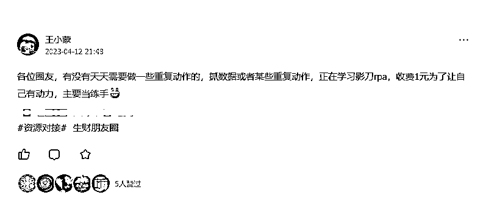
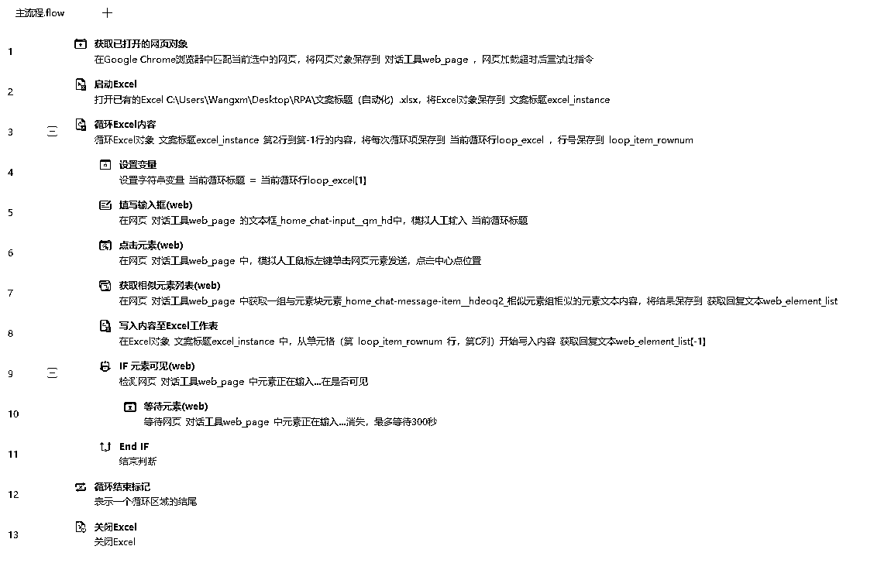

# 13次拖拽，ChatGPT+RPA把文案流水线跑通了

> 来源：[https://rztam6ckur.feishu.cn/docx/IZx7dx2CSo9x23xioUFcNaHcnRd](https://rztam6ckur.feishu.cn/docx/IZx7dx2CSo9x23xioUFcNaHcnRd)

4月12号我在赚钱有术丢了一条关于 RPA 资源对接的信息，本来就想验证两件事：

1、市场上到底有没有人真的需要这个；
2、用伙伴们的真实痛点来倒逼自己学 RPA，并给出解决方案。



很快就有一位圈友私信我了。他的场景非常典型：手头有一堆文案标题，得一个个复制到 ChatGPT 让人家扩写，写完后再手工把结果搬回表格，忙起来一天下来都在做搬运工。

效果演示我放前面了，建议电脑端打开看，手机上录屏细节容易糊。整体搭建并不复杂，就是把需求拆成步骤一步步落地。

开始干活前的准备很简单：
ChatGPT 网页已经打开，表格里已经把待处理的素材填好了。

### 1、表格这边怎么铺

需要批量处理的标题统一放在 A 列。

B 列负责承接最终结果，用公式把要自动生成的字段关联起来。

```
=CONCAT("写一篇","“",A2,"”的文章，标题+正文")
```

### 2、影刀端怎么实现自动化

逻辑很清晰：影刀先定位到网页和表格，然后进入循环。每次取出 A 列的一个标题，自动填进 ChatGPT 输入框，等待模型把内容生成完，再把最新一条回复截取下来写回表格对应的位置。



用下来感觉影刀做 RPA 确实门槛很低，官方 B 站上有从入门到进阶的完整课程，整个过程基本不需要写代码，像搭积木一样拖拖拽拽就能跑。日常工作中那些每天都要重复的日报汇总、数据搬运之类的机械操作，完全可以交给它来解放双手。