# 从负债十九万，到年净收益逼近百万的眼光是怎么练出来的

> 来源：[https://wiizueiq5ks.feishu.cn/docx/NsZwdMgSxovqfxxgJqFc5XtXntb](https://wiizueiq5ks.feishu.cn/docx/NsZwdMgSxovqfxxgJqFc5XtXntb)

大家好，我是老吴。金融圈的老兵，曾在股份制商业银行担任网点负责人，零售业务很熟。2017年起开始做副业，第一条副业线就是股票经纪人，到现在还在做。表面看是业内人，实际日子过得并不宽裕。买房、换车、结婚、生娃、装修，现金流被掏空，月月紧巴。银行的业绩指标又压得人喘不过气。我的转变过程就不展开细说了。

最近重读龙哥的一段话，被点醒：对大多数人而言，一生能抓住一个翻身机会已属不易，顶尖者或许能抓到两三个，并不是每个风口都值得上车，也不是每个被吹大的东西都是机会，焦虑感要学会调低。

赚钱的路子很多，财富的容量无限，我只取一瓢饮。

# 赚钱之前先把脑子装满

身边不缺抓到风口的人，也不少靠运气赚来靠本事亏回去的人。所以我一直提醒自己，投资要守住几个底线，赚钱要养成几项习惯。

## 1、记账

要感谢那位把我拉进记账习惯的朋友。他说，记账才能看清财务全貌，掌控人生。我从2019年开始记账，前一个月靠意志力，后面就变成日程。至今每天坚持，甚至把流水同步到星球里，督促更多人行动起来。

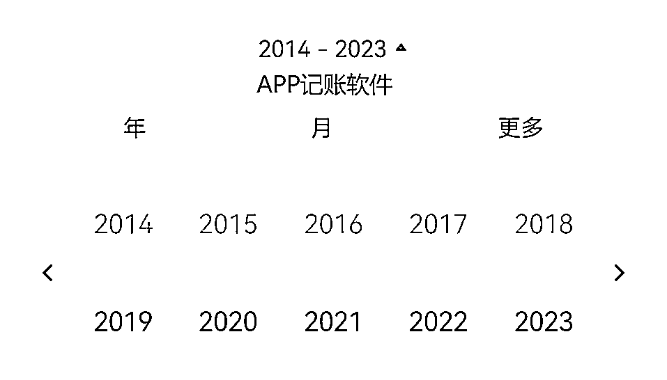

记账工具我用的是挖财记账APP。缺点就是每次登录要等几秒广告。

做法很简单：记流水就行，每笔进出记一笔，不用分多个账户，单一账户即可，特殊事项备注清楚。

我的收入类目：淘宝客、定期存款、利息、股票佣金、股票收益、会员费收入、其他收入。

支出类目：家庭开销、存款、淘宝客成本、小额人情、人工费用、工作室、日常宴请。

不必纠结借贷是否逻辑自洽，只要流水对得上，系统会自动生成报表。

要算某个项目赚了多少花了多少，直接对照该项目的收支前后变动就能测出来。

记账的最大用处是开源节流，清晰知道哪条线在赚钱，哪里在漏钱，技巧不用多。

## 2、投资前先做亏损承受与收益测算，并付诸实操

我个人的测算模型分三步走。

第一步：

算最大可承受风险系数：最大可能亏损 < 月均收入*12。

例如想投淘宝客，月入2-3万，一年能承受的投入上限在24-36万。这笔钱可以分12个月或6个月间歇投入，是风控手段之一。用复利滚：投30万，中间赚出20万利润，就用这20万继续加码。看清楚回报周期，每月产出减成本才是净利。

第二步：

收入稳定后进入下一层。最大可承受亏损 = 身家不含房产 *20%。比如身家200-300万，我愿意拿40-60万去博全亏。适当加杠杆，最多不超过2倍。若项目亏到预设的30-40万区间，立刻转卖止血，起码保住底盘。所以好项目要看流动性，能不能快速变现，即使折价也有人接手。

我做股票就用了杠杆，愿意承受20%的回撤，部分资金分散在别处，用银行资金撬动，100万本金承受15-20万亏损，触线即离场，不追加止损。

第三步：

今年刚起步。穷人拆台、富人补台、智者搭台，这句话我很认同。第三阶段我开始按标准普尔思路配置，并搭一个利他型的交流平台，让大家聊项目聊方法。好的投资能用人脉省钱，钱生钱。我们欢迎更多同行一起探讨方向和细节，把格局做大。

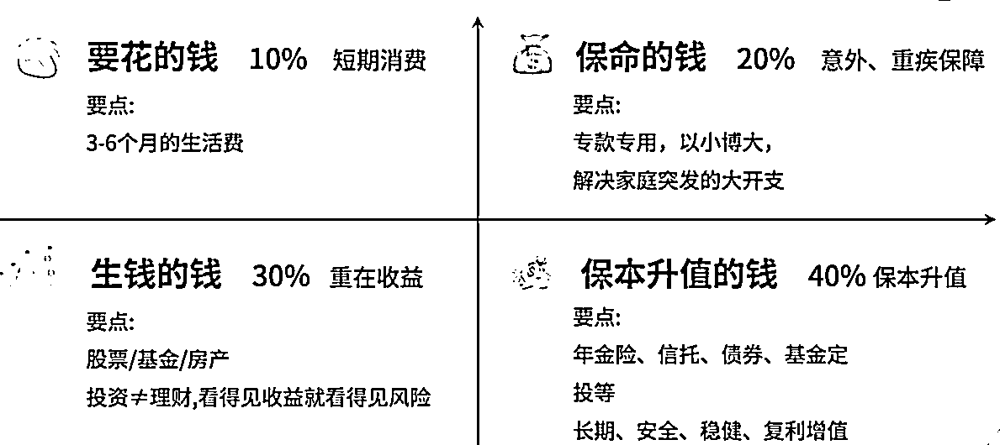

## 3、投资前的反思清单

流动性必须牢牢卡住。可以不投，但现金储备和经营资金要掌握在自己手里。我的逻辑是：

### 第一，项目财务要能掌控

投资别人十个七个亏，但只要财务能看得见摸得着，胜算会高很多。财务不一定经过你的银行卡，但要随时可查可控。比如记账APP可多端登录，银行APP也有授权功能。很多人心有私藏，能做到百分百透明的凤毛麟角，这类人往往能成事，可惜难遇，现实大多是半君子半小人。

### 第二，银行授信要提前备好

很多人只想着怎么赚，少有人琢磨怎么用银行的钱生钱。我做金融出身，对体系很熟。支付宝、微信、美团这类小贷利率10.95%，1万一天3块钱。银行最低能到3.5%，1万一天0.96元，差三倍。银行信用贷也在3.85%-6%，随借随还，很灵活。利息差就是机会。我自己常年备着几百万授信，用时即取。

实操小技巧：

1. 钱存银行再找银行借：大额存款利率3.1-3.5%，四大行房贷利率约3.6%，可先存后抵押贷款或存单质押。用随借随还额度，既不缺现金流，又减少口袋里的闲钱乱花。微负债是杠杆工具之一，赚到就还，用时即取，整体更赚。
2. 抵押贷款可找光大、建行、工行等。光大年化3.45%，10年循环。我的建行抵押贷10年授信116万，配合收款码又拿到54万信用额度。交通银行额度可直打卡里，适合不走他人名下收款的老板。
3. 有企业可配合少额纳税，流水贷、纳税贷机会就来了。个体工商户多办收款码走流水，信用额度会提升。
4. 贷款推进慢时可主动配合买点保险，5000元交3年后可取，或买2000元基金完成任务，本质是少点利息。银行有指标但不好明说。主动示好、及时跟进，送点茶点水果比吃饭更有效。客户经理不缺业绩，怕的是难搞的客户。真诚点事半功倍。
5. 信用贷公司注册地要与实际经营地一致，贷成一次后维护好关系，续贷更容易。有公职公积金的家庭，可撬出上百万额度。

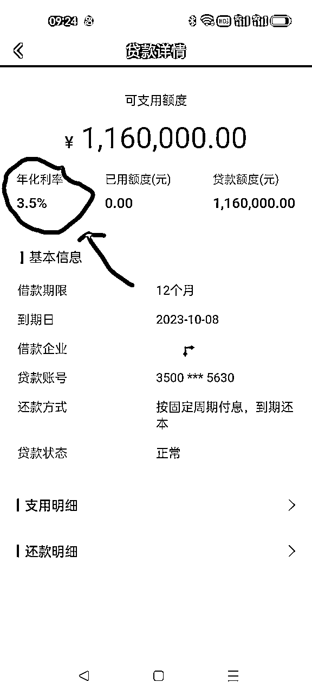

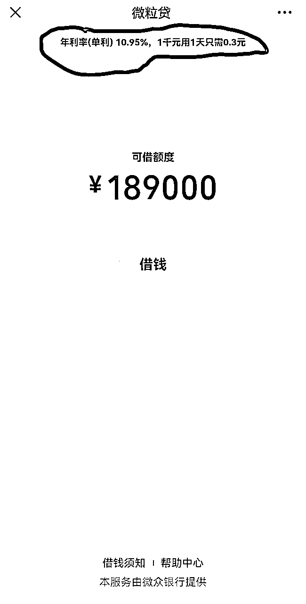

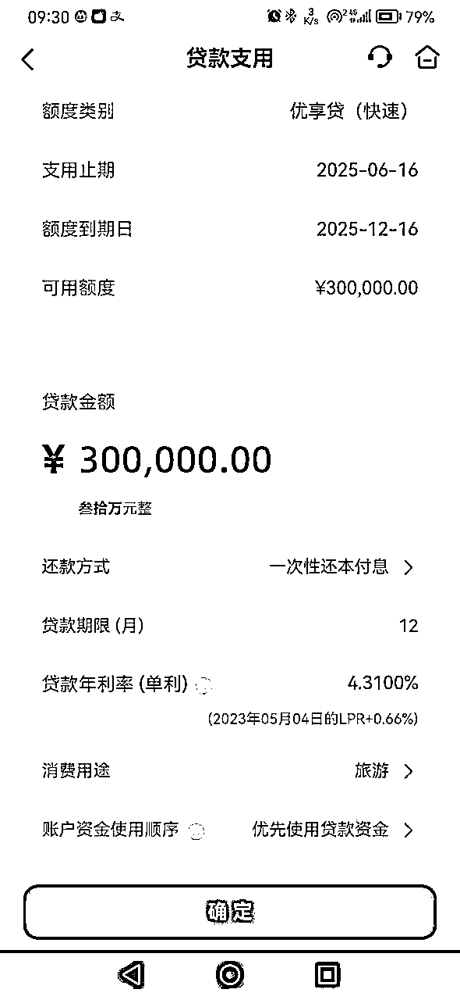

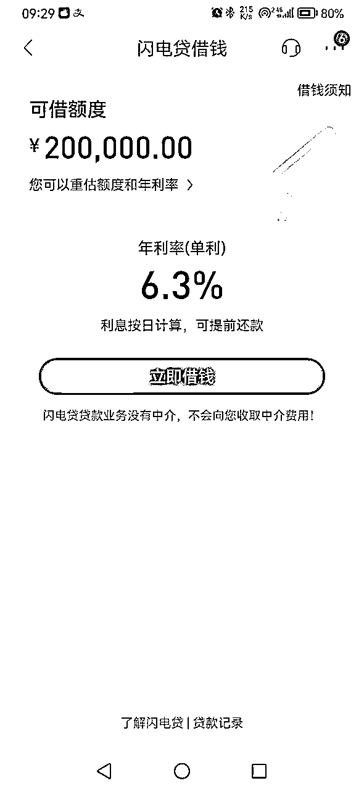

### 第三，后路要想清楚

想清楚最坏能承受什么。逍遥的大佬也会错过项目，但主业在手就不怕。想梭哈风口的人最后多是灰头土脸。投资忌all in。10次赢9次，一次亏就万劫不复，像贾跃亭。好的赛道是风口来时你有积累，风口走时你不摔死。最坏打算，投资失败不能殃及家人。

后路准备：

1、利润买保单，买时容易取时难，覆盖养老等全方位。有钱人可做信托。夫妻共担债务怕成失信，可用子女或父母为投保人，子女为受益人。
2、买房适度轻负债。进可配置，退可卖房回流储备。
3、有条件可配点黄金，保险柜要安全。乱世黄金，盛世古董，别碰钻石。

### 第四，投资是投人

行业里有人亏有人赚，关键看靠不靠谱。

判断标准：

1、夜场、饭局、喝酒懂得适可而止，消费观克制，没烂交情。这种人创业更靠谱。嗜赌等不良嗜好者别合伙。
2、有交代、有回音、有落地，执行力强。
3、不一定大方，甚至有点抠，但讲信誉。
4、看他朋友圈的人群，他大致就是哪类人。
5、对工作生活责任负责。
6、沟通顺畅，能清晰表达也善听。
7、持续学习，遇到新东西愿意虚心请教。

以上只是我的个人看法，有人喜欢富贵险中求，我更信奉稳字诀。

# 我的收入版图

## 1、实盘走过的数字

2019年启动投资，当年负债19万，那年收入二十多万，心里不慌，大不了白干一年。2020年开始正收益，年结余22万。2021年结余95万，2022年结余93万。2023年1月至今32万。期间21、22年各买了一个车位，24.5万和38万，还有保险支出。勉强算百万级收入，但净收益破百仍是我的坎。

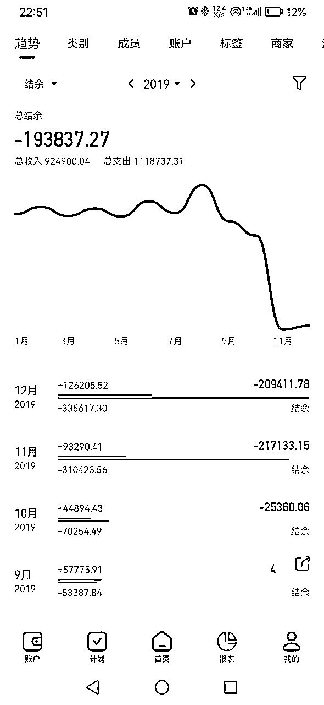

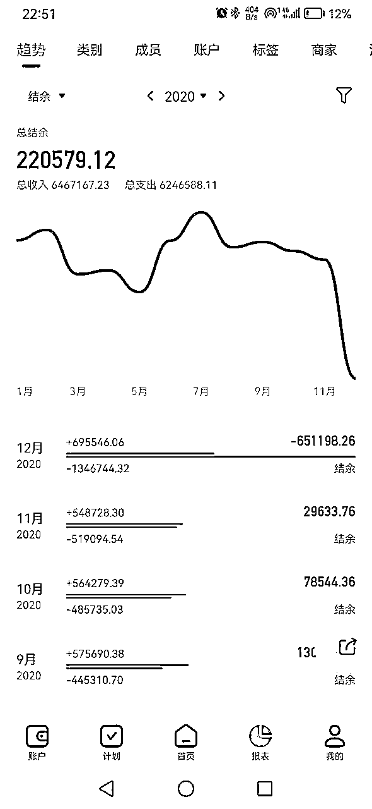

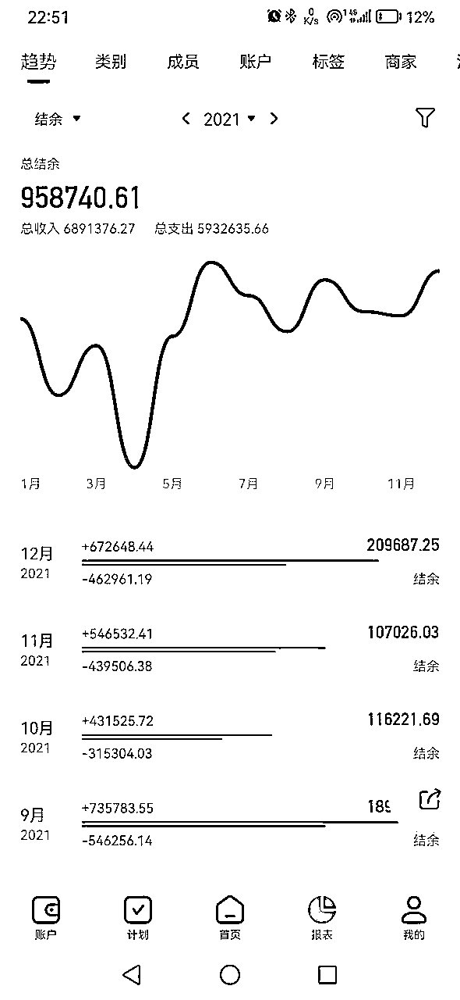

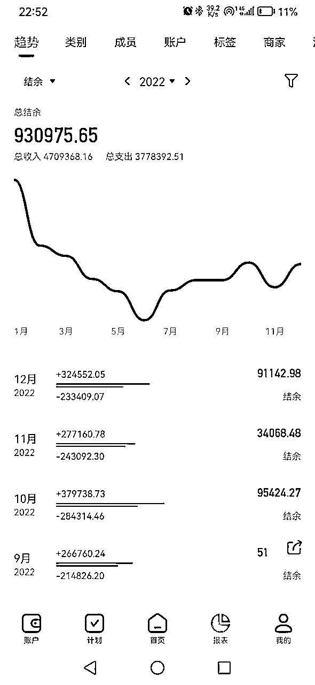

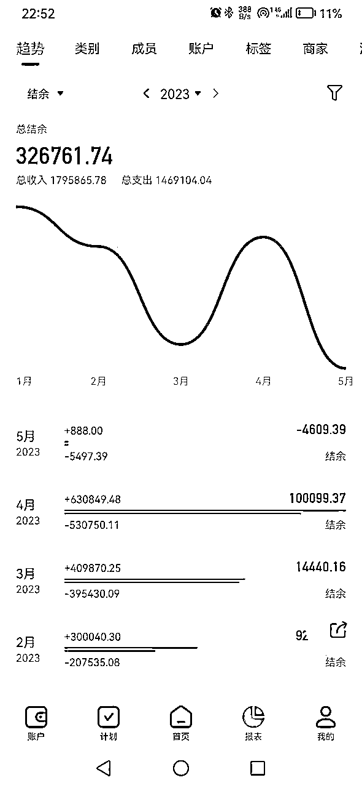

## 2、第一份副业，股票经纪人，年入12-20万

2017年开始。

入门路径：2023年5月8日证券从业考试开放，sac.net.cn可报考，61元一科，过法律法规和基础知识两科即可。刷题即可通关，帮考网APP或淘宝题库都行。

想入行最好提前去券商预约挂靠，只拿佣金无底薪，券商乐意。你挂靠后不能再开户办股票账户，需销户。选券商要了解佣金、开户流程、分成比例、解约条件等。

客源从哪来：初期迷茫也想过放弃。开局可去贴吧引流发截图、建群二维码，小号维护。建一个小仓位轮动的实盘做展示，公众号写文章互推。没文章可拆解电子书做直播，用同花顺K线训练营强化技术分享。客户量撑不住一年两三百万业绩可挂我这边，我给你80%。

可多找大户。我承接大户账户托管，采用28开，他拿80%佣金我20%，他不用操心运营。兴业证券超短成交快，适合高频。稳定客户一场下来一年5万左右。这些人钱多但也看重小钱，靠谱就长期跟随，人脉会成滚雪球。

算下来自有客户加大户，一年十几万，行情好二十万也有。这是我的被动现金流。税费问题后来又挂了两家券商，现在三家合作，自己人可控，利他合作。

体会：经纪人让我接触大佬，靠谱执行换来带飞。很多富人愿意带人，但你得跟得上。提点一句要主动跟，学底层逻辑，开窍即赚钱。被动收入给了投资底气，大不了亏掉副业收入。主业副业被动收入很关键，花了好几年磨，我的人生不急，闷头打磨本事。

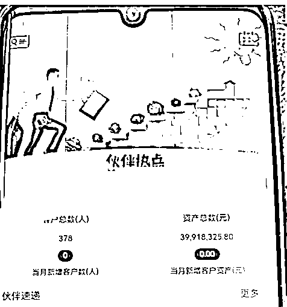

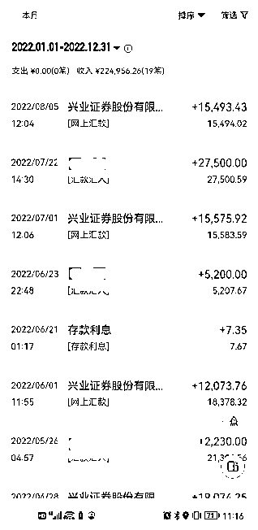

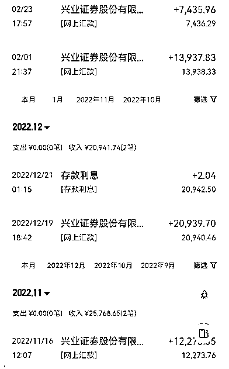

## 3、第二份投资，股市，本金百万在滚，年化分红20-50万

认识现在的操盘手股丰登，超短线高手，2018年起投。看他后台交易记录，学会底层逻辑。投资前反复测算风险，启动谨慎，用30万小资金试水，后拉朋友凑到100万，账户在我名下，持仓三成，余钱做T+0理财。慢慢赚到钱。

本金随利润增长。增资公式：赚的钱*0.5=可承受最大亏损，最大亏损额*5=可投本金。例如赚40万，可承亏损20万，可投100万，最大回撤20%，真亏撤出。朋友操作稳健，15%内回撤基本都回。股市没落袋不算收入，本金一直在滚，分红才算。

目前累计赚一百多万，分红到手年化20-50万，还有近百万本金在滚。

不建议新手照搬，因为操盘手的好坏完全看运气。

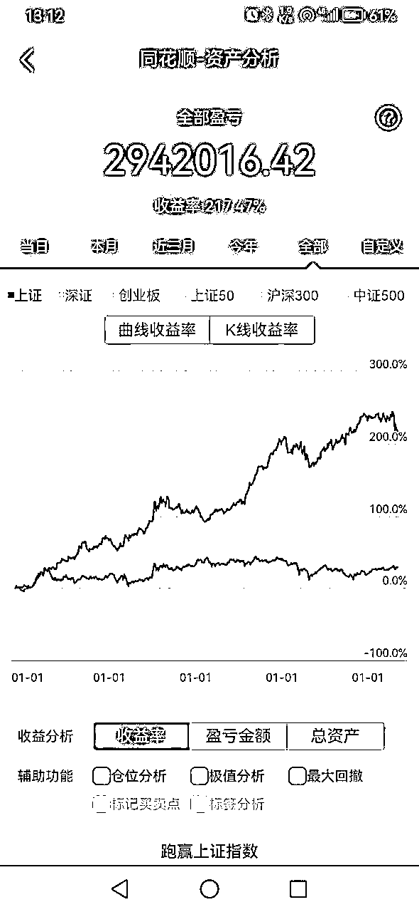

## 4、最成功的投资，淘宝客，总投50万，年入50-70万

2018-2019年切入。初中同学带我入场，直接成合伙人之一。当时风口不缺钱，缺返利号。返利号就是挂载阿里云/腾讯服务器的微信号，挂机器人，引流用户下单确认收货后3元提现，自动发红包。

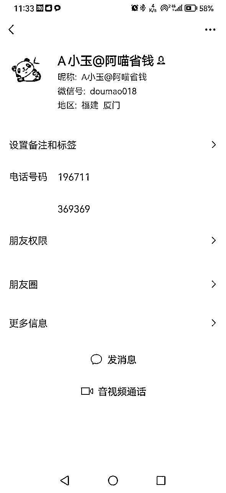

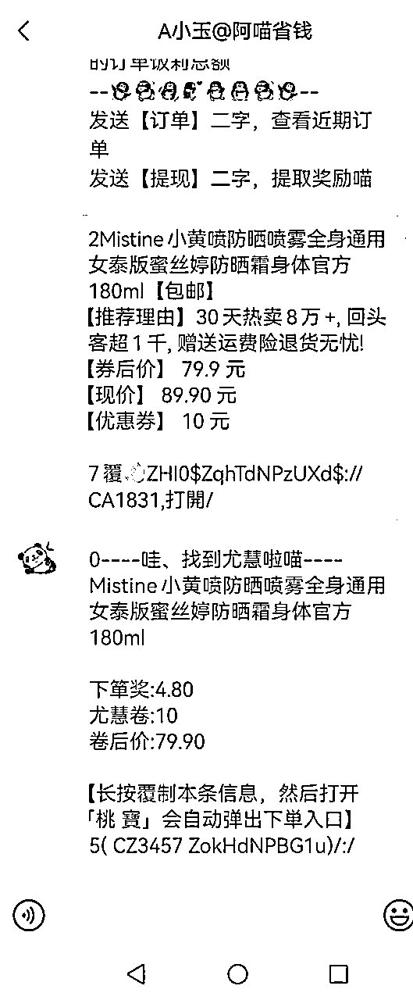

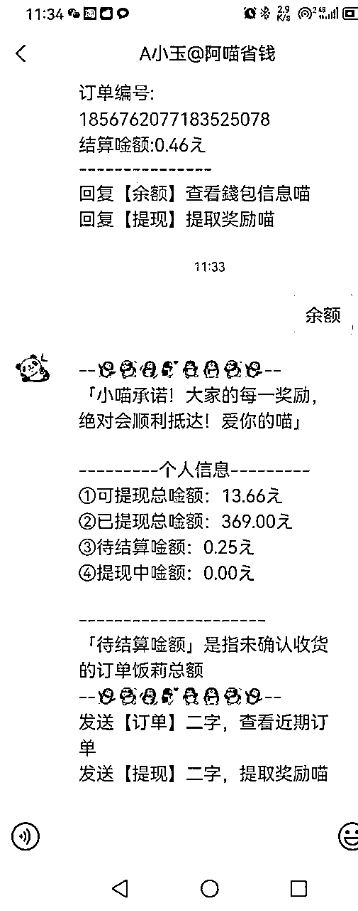

* 延续上一个话题，关于这个项目的投入，回报率这么惊人，为什么不买一堆微信号来承接粉丝呢？当时监管很严，把大量粉丝导到微信，权重不足的微信号很容易被封，实名号的资源也有限。于是就有了合伙人模式，合作的微信号必须是用作日常生活的个人号。

* 同学跟我聊这个项目时，我起初觉得简直是天方夜谭，别人凭什么把微信号交给你用。但转念一想，确实太香了，纯被动收益。关键在于它自带一套返利机器人系统，和市面上主流做法完全不同，这也是我们敢投的核心原因之一，防封能力非常强。

* 于是开始执行，找微信号这块我们也走合伙人分发。号在合伙人手里攥着，后台由我们统一运营，资金一起投。整整半年时间，招募了几十个微信号，累计沉淀了十几万私域粉丝。小号合伙人出号出钱，我们出钱出力操盘，双赢。19年底到20年初开始投，21年初就回本了，那一年净赚约70万。2022年净利润约50万。之后收益逐年下滑，今年到目前月均净利在4万左右。但这块被动现金流是我整体收益里占比最大的一块。

* 其实要感谢同学带我入门，更要感谢一起拼杀的合伙人，感谢他们的信任，我也尽力不辜负。也感谢自己靠谱的做事风格和强的执行力，才有了这段经历。回头看，当初为了找一个微信号有多拼才有今天的甜。比如有一次，为了一个微信号，我和搭档跑了一百多公里到他亲戚家里，聊了一个下午软磨硬泡。那段辛苦到现在都忘不了。

### 给小白的实操级参考，目前这套更适合自产粉，批量买粉性价比不高：

1、去网上搜悠哉官网http://www.uzaisoft.com/，购买返利机器人或买悠哉ECO手机，需保持不息屏。建议用腾讯云服务器挂载机器人。

2、用悠哉注册会员绑定个人微信，挂到服务器上。

3、开通淘宝联盟和京东联盟高佣金，高佣开通方式可去淘宝学习。

4、通过小红书、微博、知乎等平台引流，看个人能力。买粉渠道现在贵且回本慢，已被市场淘汰。自然引流虽慢，但进来的人都是真实收益。然后教会客户怎么用返利功能。

5、朋友圈适度选品，佣金加成15%-30%。

6、产出慢但精细化运营后，完全能实现被动收入。

7、测算过，一个微信号塞3000个精准粉，一年利润大概3-4万。因为存在裂变。而且返利号人工成本极低，号跑顺了每天只需看一眼是否掉线，晚上提现一次即可。

下图是我们部分战绩，后台很多就不全发了。

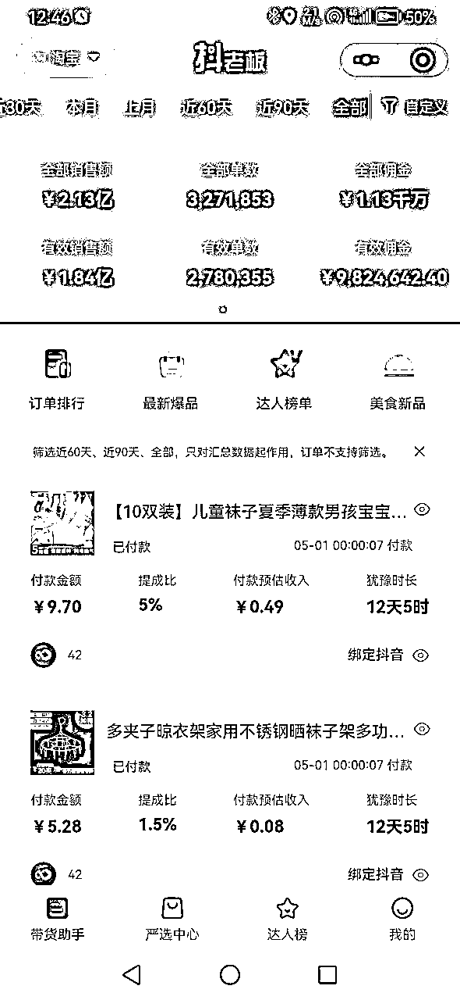

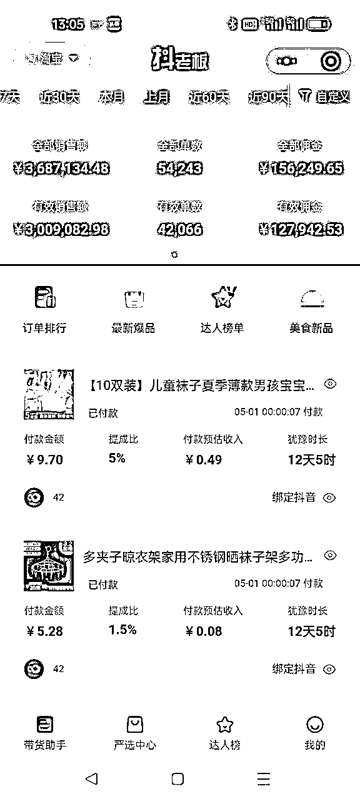

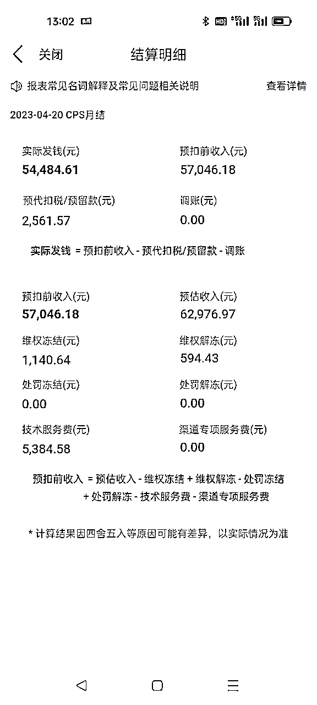

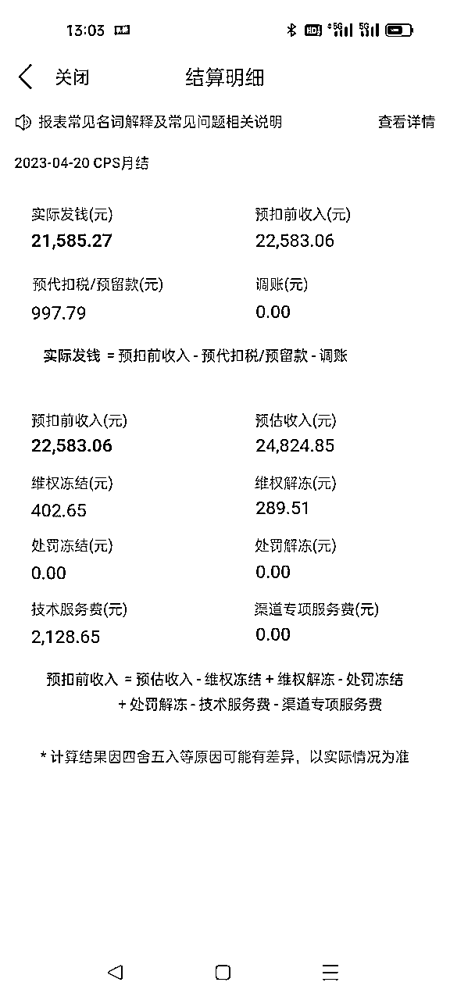

## 5、可转债打新，零成本撸钱，年入6-10万

可转债打新是极低风险的打新玩法，亲戚朋友都可以拉上，还包括企业可转债账户。目前代打100个户，收益五五分成，包含自家人账户，利润都算在我这边，单个账户年收益约1000-2000元。早期打新收益非常高，现在行情变差，收益降了不少。但每月波动不大，依旧在坚持，反正大小钱我都收。

我们还摸索出了企业可转债打新的新打法，不用两年交易经验和10万日均资产限制，就能扩充可转债项目。最近打算放大这块。对做无货源或企业店群的人来说是绝佳思路，店群既能开店又能省财务成本，一举两得。我们愿意透露玩法，因为利他的事往往带来额外收获。可转债盘子足够大，也不差你一个。作为交换，你可以分享一些行业经验或技巧给我，或小合作也行，那方案就给你。以下是之前我在赚钱写的文章，先做了解，具体开户资料和细节欢迎交流。

## 可转债的商机和技巧办法

https://articles.zsxq.com/id_wwzu6cn1ewb7.html

## 6、四大行无风险套利，年入30万起，无上限

这块投的是人脉，投入金额不好量化，最大成本是你的信用。行业非常小众，告诉你方法你也缺资源。我和合伙人老胡配合，门槛不低。我是前年入行的，和老胡一起做，他负责在他的人脉圈找匹配银行需求的资源，我负责高端客户资源。第一年赚十几万，去年20万，今年一季度就赚了20万，其中单季度最后一天赚了10万，我估计后续再赚20-30万没问题。这是一个完全利他的模式，客户钱一直在自己卡里享受收益。能赚多少，取决于想做存款的客户有多少。简单说几点：

1. 需求方是银H行长。比如任务完成2000万可得2万奖金，未完成扣1万，差额3万。某个行长拉存款差200万，却不能公开找客户开口，一旦开口第二次就要付费。所以他愿意花2000-3000成本找我们完成任务。对他而言任务完成还能拿奖金，划算。行长们也不会做赔本买卖，这就是考核信息差。

1. 市场需求很大。全国各地四大行、包括邮储，每到考核节点需求都很大。操作全在官方APP内完成。

1. 安全是关键。所有资金都在客户自己名下银行卡互转，不转给他人，不买理财，随时可快速赎回。操作都是客户独立在银行手机APP完成，上手快，10分钟内搞定。不需要给我们手机号和验证码，就是自己存。存好截图证明，到期当天转出即可。不碰小银行，如村镇、农商行。小银行可能玩幺蛾子。四大国有行不可能容忍系统漏洞存在。

## 给你的舒适级实操赚钱方式

（1）、有资金的可以先自己做，按教程开户一次后销户，流程就熟悉了。有钱转几万试，没钱转几块也行，先验证可操作性，不亏钱。

（2）、可用银行随借随还做套利。有公积金或房产抵押的都能入场。我一次可搞出500万额度，关键几天的净利也有3万起。

注意：适当和银行搞好关系，别违背规则，不然贷款会被收回。可提前问清楚放款方式，送点小礼品不花钱，就说亲戚要存款，支持一下，都能理解。

（3）、身边资源多资金足，自己没空的话我们可以一起协调，该留的部分会给你留下。我要在赚钱混，也要名声，所以会按约定分配利益。如果你担心联系客户有问题，你可以找我要需求资源，我只对接你一个人，你负责教客户操作即可。我会把实操方法毫无保留交给你，也把银行需求发给你，对应利润转给你，只要你靠谱就行。合作共赢完全可以。

（4）、价格阶梯制，财经博主、银行资源大户、银行授信大户都欢迎。一个资源型大户在我这一年套利几十万是完全可行的。

* 具体像素级实战手册我放在这里，有兴趣可看：

## 7、踩过的坑，不是总能赚钱

1. 股票踩坑。亲戚说认识一个厉害操盘手，有消息票让我一起做。我半信半疑投了10万到他账户，结果亲戚账户被当接盘侠，100多万血亏，还是180ETF绕标后的融资融券账户，撤不了，连续跌停卖不掉。没操作权，最后10万剩1万。从此再不碰融资融券。

1. 投资淘宝客时，一个合伙人做淘宝达人，我不懂。他信誓旦旦说能短期大赚。刚好一天赚了5万，我就想把钱转给他，最差亏一半。结果5万投进去几个月1万9回来，账务明细也给不出。所以之后他被我拉黑。悟出道理：别人说的靠不住，自己哪怕浅尝一口也不会被忽悠。

1. 又是股票亏了两万，心疼的不是钱，是兄弟。我兄弟听朋友消息说中天金融要和华夏人寿重组，自己借钱加杠杆投了300多万。我设了20%止损及时出来，一直劝他设止损，他不舍割肉一路跌，300多万剩60多万，中天金融现*ST中天，股价0.63元，即将退市预警，今天还跌停。再不卖可能退市后什么都没了。一起奋斗的兄弟，身家几百万，厦门一套房，现在负债累累几百万，下半辈子只能靠还债。以后再也不碰消息票。

1. 投资外卖CPS和影票CPS，前后投30万，目前回本80%，每月剩利润3000左右，预计还要20个月回本。平台太狠，饿了么、美团吃相难看。以后不碰这块。

# 我的感悟

## 1、我自己要靠谱，执行力到位，成功案例多了，能量圈自然变大

* 我是同学公司现全国前十淘客系的合伙人之一，量不是最大但单产最高。当年公司缺合伙人和返利号时，我帮他们找了一大堆合伙人，我一分钱没赚，但换来投桃报李。有需求第一时间找我，且我能把要求的投资执行到位。

* 可转债打新客户，最初不信任，后面陆续介绍客户给我，做的是细节。虽然钱小，但我守住本分。每次新股新债都坚持打，中签率比他们自己打还高，后续小合作也都很配合。

* 存款冲量对高净值客户是很好用的工具，客户圈子都是口碑相传。前期普通人难理解，熟悉后圈子会越来越大。信任度上来后，能学到颠覆三观的认知。有钱人为什么有钱，是有原因的。

## 2、在我的赛道里，小钱要看得上，大钱也要赚

* 找准赛道深耕，相信一切是积累。爆发是根扎得稳。

* 赚钱要做减法，以前很焦虑，风口很多，无人直播、快团团、抖音小店、小红书种草、金融贷款中介等，后面都放弃了。我优先选能增加被动收入的。吴军老师《见识》说把握一个方向走得更远。所以反复权衡后决定把精力集中。第三阶段确定的赛道就是做一件事：搭平台、利他的项目。

* 利他不是无偿白嫖，我也需要高客单人群和好圈子，可以鸡毛换糖。但我绝不占便宜。只要利他，我都会考虑尝试。

* 有钱人小钱赚大钱也赚。老板告诉我，小钱里能发现大商机。我悟了，诀窍是小钱复利放大！

* 赚钱看坚持。我能为一件事坚持两三年，为交个朋友或一个观点泡一下午茶，为几个百块的账户坚持打一年可转债，为扩大人脉不断奔波。小钱汇聚成江海。赚小钱不是抠门，是对人生负责。

## 3、做人要真诚

在赚钱，赚到钱的人往往有格局，做人真诚，不为蝇头小利遮掩。没有通往真诚的路，真诚就是路。多付出会有额外回报。对每个客户、每个伙伴，我们都认真兑现承诺。

比如合伙人分润，我一定按约定比例给，甚至多给。存款客户存好，有些小额我会先垫付。

要少想利己多想利他。我不做烂好人，但会做真诚的好人。

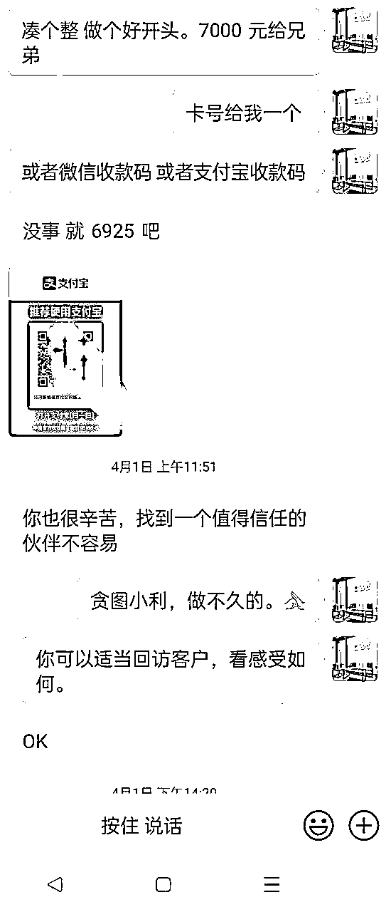

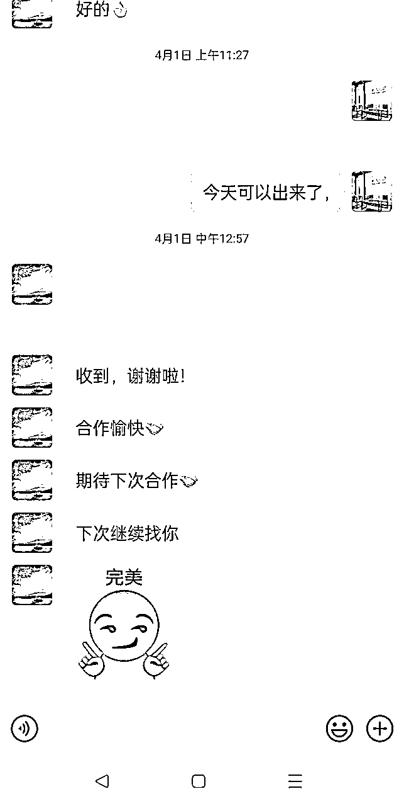

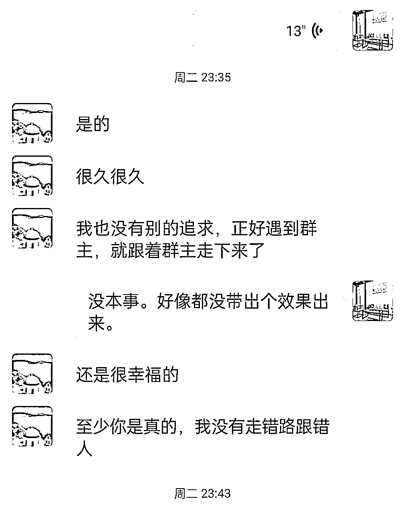

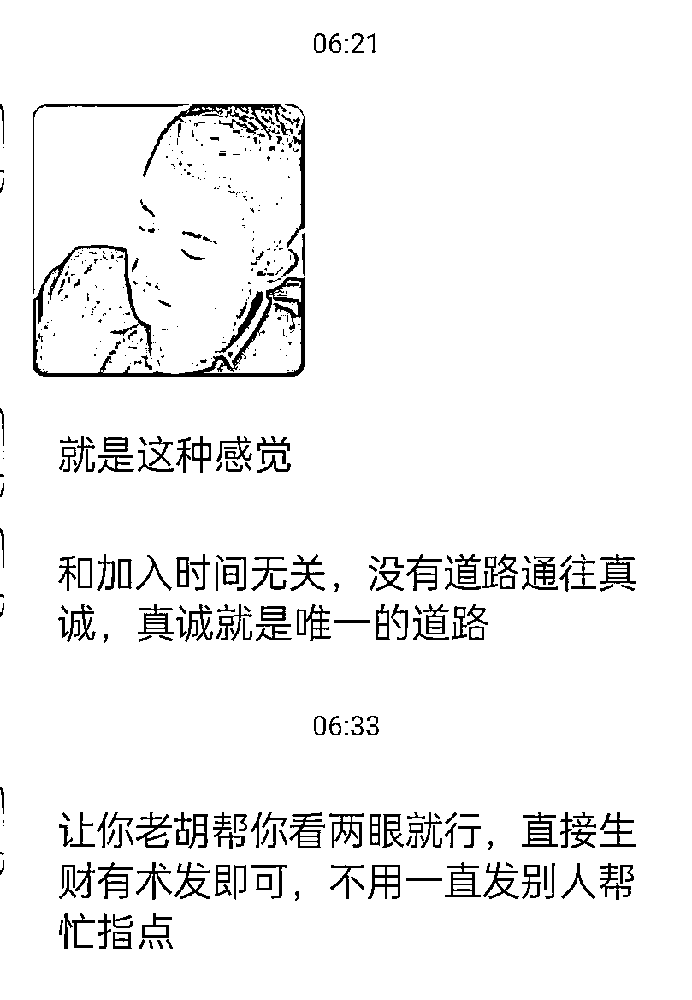

# 写在最后

赚钱的朋友们确实焦虑，觉得这个好那个好。但最终要沉下心找到内心深处的诉求，发挥优势并持续行动。

卢克文有句话我感同身受：“贫穷像附骨之蛆折磨我的家人，我父母一辈子给贫穷做牛做马，不是他们不勤劳，而是没找到战胜贫穷的方法。今天我还完所有债务，终于能轻装上阵，我清楚只有用知识才能战胜你，从现在开始，我一定会打败你，不会让悲剧在家人身上代代重演。”

如果对你有帮助，欢迎在赚钱评论区给个肯定，你的鼓励是我写作的动力。也希望大家都能找到战胜贫穷的方法，让身边人过上好日子。

