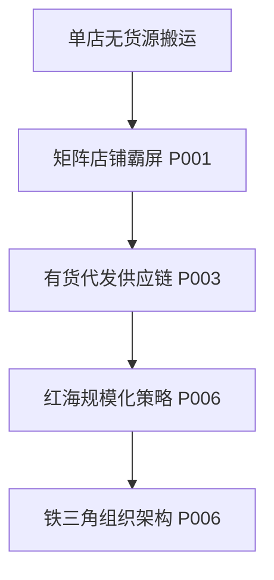
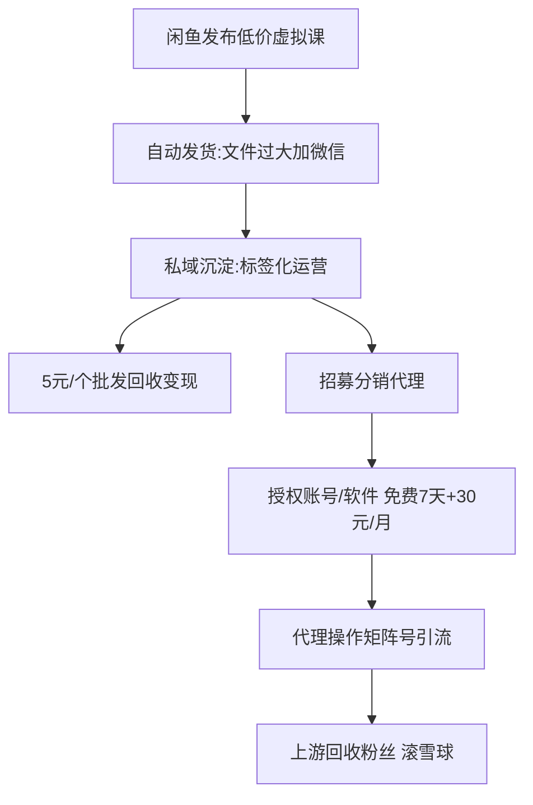

# 第 52 章 闲鱼无货源进阶体系 —— 用矩阵思维把概率变成确定性

## 学习目标

- 理解闲鱼矩阵化运营将概率问题转化为大数定律确定性收益的底层逻辑
- 掌握反养号论：卖家权重由转化率与售后率决定，非买家活跃度
- 掌握时间成本选品匹配模型：根据个人可支配时间碎片度匹配品类运营模式
- 掌握竞品销量反侧写三步法：总销量追踪+咨询转化估算+未屏蔽同行采样
- 掌握差评稀释与炼丹机制：利用评价上墙时间差与客服投诉双轨并行处理差评
- 理解闲鱼创业粉引流裂变闭环：前端低价筛选-私域沉淀-粉丝批发-代理授权裂变
- 理解快团团“卖铲子”模式：推广大团长赚佣金，边际成本趋零的被动收益逻辑
- 掌握出版物经营许可证合规生存法则：接受代办灰色常态，以小成本规避大风险
- 了解闲鱼副业天花板定律：个人全职年入15-20万，具备货源优势应切淘宝/拼多多

## 52.1 生活类比

想象闲鱼无货源是一个**大型跳蚤市场摊位群**：**矩阵霸屏** = 在市场主干道前10个黄金摊位全是你家的，卖同一款爆款钢化膜，客户绕不开；**反养号** = 不用天天去市场逛一圈假装买家（养号），直接把货摆好、价签写好、吆喝练好（转化率），生意自然好；**时间成本选品** = 上班族只能摆“自助售货机”式的标品（小百货/图书，重财务轻客服），全职宝妈才能摆“需现场讲解试骑”的山地车（重客服）；**竞品反侧写** = 不能直接看对面摊主卖了几个（隐藏销量），但能数他进货箱搬空了几箱（总销量增量），能听几个问价的最后买了几个（咨询转化率）；**差评炼丹** = 差评像摊位上的一块鸟粪，找20个老主顾每人给1块钱写张长长的好评贴在墙上（优质评价置顶），把鸟粪盖住挤下去；**创业粉滚雪球** = 几块钱卖张“摆摊秘籍”把想摆摊的人筛选出来（前端），加微信进群（私域），再把这些人5块钱一个批发给卖项目的（变现），再授权他们用你的摊位号去卖秘籍（裂变）；**快团团卖铲子** = 大家都去淘金（带货），你在路口卖铲子（推广大团长资质），淘金的人越多，铲子越好卖，还不用挖土（零售后）；**出版物许可证** = 摆书摊的“营业执照”，办真证太贵太慢（线下），花1000块找黄牛办张能查到编号的“过检证”（代办），城管（平台）只查编号不查地址，地址异常了花300块换张新的。

## 52.2 概念地图

闲鱼无货源进阶体系
├── 核心运营范式
│   ├── 矩阵店铺霸屏策略          —— P001
│   ├── 反养号论：权重只看转化    —— P002
│   ├── 有货代发供应链模式          —— P003
│   └── 时间成本选品匹配模型        —— P004
├── 数据驱动决策体系
│   ├── 竞品销量反侧写体系          —— P005
│   ├── 曝光浏览数据预判爆款        —— P001
│   └── 店铺权重双核心指标          —— P006
├── 流量变现与私域闭环
│   ├── 创业粉引流裂变闭环          —— P007
│   ├── 低价前端筛选高意向粉定律    —— P007
│   └── 滚雪球式账号矩阵裂变定理    —— P007
├── 风控与合规生存法则
│   ├── 一机一卡一号物理隔离        —— P001
│   ├── 差评稀释与炼丹机制          —— P006
│   ├── 出版物经营许可证合规法则      —— P009
│   └── 平台监管宽容度红利          —— P009
├── 组织与规模化进阶
│   ├── 红海规模化策略                —— P006
│   ├── 客服-运营-财务铁三角架构      —— P006
│   └── 规模化必然导向非核心城市    —— P006
└── 跨平台生态协同
    ├── 快团团卖铲子模式            —— P008
    ├── 无人直播泛娱乐化精准获客      —— P008
    └── 拼多多虚拟店自动发货蓝海      —— P008

## 52.3 闲鱼矩阵打法 —— 用多店霸屏把概率变成确定性

### 为什么需要这个概念？

单店运营极其不稳定：莫名其妙出单，莫名其妙没单。闲鱼搜索流量具有“赢家通吃”特性，前排垄断曝光。新手缺乏供应链议价权，单店抗风险能力极弱。

> "闲鱼无货源副业有很多人了解过，但是简单的东西真正玩明白的人很少"
> 
> ——《闲鱼矩阵一套打法如何当天出单七天爆单》[P001]

> "莫名其妙出单，莫名其妙没单"
> 
> ——《闲鱼矩阵一套打法如何当天出单七天爆单》[P001]

### 核心定义

**闲鱼矩阵打法**（来源：《闲鱼矩阵一套打法如何当天出单七天爆单》）

通过7-8个甚至更多账号，布局同一单品/同一品类；占据搜索结果前5/前10多个位置，实现物理霸屏；利用曝光/浏览数据预判具体哪个链接会爆单。

### 关键性质

**概率论本质**：单店方差极大，矩阵化将概率转为大数定律确定性收益。

**风险隔离**：单号违规/限流不影响整体盘面，账号资产可替换。

**数据前置**：上架即可通过曝光数据预判爆款，实现“必定有一个爆单”。

### 典型例子

蓝猩钢化膜案例：7-8店同发，前10名占2-4个席位，月销千单。

作者团队：从8店扩至420店，规模放大50倍，验证矩阵可复制性。

### 边界条件

必须严格执行“一机一卡一号”物理隔离，规避违规关联管控；依赖“有货代发”供应链模式，解决货源稳定与售后兜底；单品必须具备“买家多卖家少”或高频刚需属性，避免红海价格战。

### 方法演进图

## 52.4 反养号论 —— 卖家权重只看转化不看活跃

### 为什么需要这个概念？

传统养号（刷活跃、点赞、咨询）耗时极长，新手极易放弃。养号行为仅强化“买家标签”，让系统推荐商品给你买，不提升店铺/商品搜索权重。闲鱼权重核心公式：30天销量、点击率、收藏率、好评率、发布时间、售后、违规、二次访问。

> "我先说答案，养号就是浪费时间，十来个店铺从来没养过直接上架。"
> 
> ——《1.8万字保姆级闲鱼无货源》[P002]

> "由此得出结论，刷活跃对店铺的权重没有任何帮助。"
> 
> ——《1.8万字保姆级闲鱼无货源》[P002]

> "因为这样操作下来提升的是你的买家标签...是方便你买东西的，对你卖东西没有帮助"
> 
> ——《闲鱼无货源进阶实操》[P002]

> "产品权重是搜索单个产品关键词的排名，根据 30 天销量、点击率、收藏率、好评率、发布时间等综合评估计算出来的，店铺权重则是客户搜索商品时的排名依据，除了以上商品外还要考察售后、违规、二次访问"
> 
> ——《闲鱼无货源进阶实操》[P002]

### 核心定义

**反养号论**（来源：《闲鱼无货源进阶实操》）

新号注册完善资料后直接上架产品，节省时间，避免打错标签；权重正向由“咨询转单率”驱动，负向由“退款率/小二介入率”拖累；养号、擦亮、签到等边缘动作收益极低，核心在于运营动作对转化率的直接提升。

### 关键性质

**认知重构**：打破“养号=权重”的迷信，将精力聚焦于选品、文案、图片、话术等转化环节。

**执行加速**：新号当天可上架，大幅缩短冷启动周期。

**避坑指南**：避免因模拟买家行为导致账号打上错误标签，影响后续精准推荐。

### 典型例子

作者十来个店铺从未养号，直接上架，当天出单非偶然。

杨小六团队：420店规模化运营，核心指标仅盯转化率与售后率。

### 边界条件

基础资料（实名、芝麻信用、头像、简介）必须完善合规；仅适用于闲鱼“搜索电商”模式，不适用于抖音/快手“推荐电商”需养标签的场景；违规关联管控下，设备隔离（一机一卡一号）是前置生存底线。

## 52.5 有货代发模式 —— 用供应链确定性换取运营确定性

### 为什么需要这个概念？

传统无货源全网搬运：货源不稳定、发货慢、售后无门、违规风险高。闲鱼用户核心心理是“捡漏/占便宜”，对价格敏感但对“到货体验”更敏感。个人无囤货能力、无物流议价权、无售后处理能力，必须外包重资产环节。

> "远方 : 找有货的代发"
> 
> ——《闲鱼矩阵一套打法如何当天出单七天爆单》[P001]

> "闲鱼的用户大多喜欢捡漏...闲鱼上的买家就是喜欢捡漏占便宜"
> 
> ——《闲鱼无货源进阶实操》[P003]

> "新品的话，比同行第一些，流量稳定后涨价。因为一个新店没有销量和好评，只能拼价格。"
> 
> ——《闲鱼无货源进阶实操》[P003]

### 核心定义

**有货代发模式**（来源：《闲鱼矩阵一套打法如何当天出单七天爆单》）

寻找有实体库存、自主发货能力的厂商/品牌方/一级批发商合作；仅负责选品、铺货、客服、引流，发货/售后/退换货全权由供应链承担；核心利益绑定：供应链赚批发利润，运营方赚差价/佣金，双方零囤货风险。

### 关键性质

**供应链确定性**：解决“莫名其妙没单”中因缺货/延迟发货/售后差导致的权重崩塌。

**合规护城河**：有货源商家通常具备品牌授权/资质齐全，规避知识产权投诉与平台清退。

**议价杠杆**：矩阵化出单量大（日百单）可反向压榨供应链成本、争取定制链接/专属SKU。

### 典型例子

蓝猩钢化膜/山地车/马桶/小百货：均采用找有货源厂商代发模式。

作者团队：山东聊城/滨州组建团队，财务组专职“比价下单/拦截异常”，深度绑定1688/拼多多/品牌方供应链。

### 边界条件

必须建立“多店铺备选+即时催单+动态切换”的供应链熔断机制（茶壶案例因单一供应链失联损失数千佣金）；避开品牌鞋服/化妆品等高溢价高仿技术成熟雷区，无法辨伪者坚决不碰；虚拟类目/资料类需警惕类目审核违规，需配合“见面交易”规避发货校验。

## 52.6 时间成本选品匹配模型 —— 没有最好的品类，只有最适配的时间

### 为什么需要这个概念？

新手盲目跟风选品（如跟卖山地车/马桶），却不知自身时间碎片度完全不匹配。品类运营模式差异巨大：重客服/重运营/重财务/重转化，对时间/技能/团队要求截然不同。个人可支配时间是稀缺资源，选品本质是“时间资产配置”而非“利润率博弈”。

> "闲鱼选品，我们对学员说，是按你个人可支配时间选择！"
> 
> ——《杨小六闲鱼实战复盘》[P004]

> "不同的产品倾向的运营方式不同，有些产品倾向客服，有些产品倾向运营，有些产品还比较重财务。"
> 
> ——《杨小六闲鱼实战复盘》[P004]

> "你自己要根据自己的时间来订产品 考虑上班有没有时间回复，有没有时间进货。"
> 
> ——《杨小六闲鱼实战复盘》[P004]

### 核心定义

**时间成本选品匹配模型**（来源：《杨小六闲鱼实战复盘》）

重客服型（山地车/大百货）：需长碎片时间在线回复，客单价高、转化周期长；重运营型（马桶/3C）：需深度专注优化图文/评价/SEO，竞争激烈、技术门槛高；重财务型（小百货/图书）：需标准化流程极速比价/下单/回单，单量大、财务瓶颈明显；重客服转化型：高客单+长决策，需专业话术跟进，非全职不可为。

### 关键性质

**动态匹配**：上班族碎片时间适配“重财务/轻客服”标品；全职宝妈长在线适配“重客服/高客单”非标品。

**阶段进化**：小规模（<50号）走蓝海小众避战；大规模（>400号）主动入红海标品建壁垒。

**组织倒逼**：重客服模式人力成本高，倒逼运营中心下沉三四线城市（聊城/滨州）获取低成本劳动力。

### 典型例子

山地车案例：成本300利润70，但咨询多转化低，客服极其辛苦，后期淘汰。

小百货/图书：单人日均100单极限，财务比价成瓶颈，团队淘汰转型大百货。

马桶：利润大同行猛，必须优化图片文案评价，重运营，适合专职运营团队。

### 边界条件

无最优品类，只有最适配当下“时间/技能/资金/团队”四维禀赋的品类；具备核心货源优势者，应直接切入淘宝/拼多多天花板百万级平台，闲鱼仅作跳板；副业天花板定律：个人全职年入15-20万，副业中位数月入1-2k，头部20%达3-5k。

### 多源对照：选品维度的共识与分歧

**共识**：选品必须匹配操盘手的时间/技能/资金禀赋，盲目跟风大概率失败。

**分歧**：

- 《P003 远方》主张“榜单复制+蓝海挖掘”，认为小众品类（摩托配件/改装件）竞争少、利润高、适合新手切入；
- 《P006 杨小六》主张“按时间匹配”，认为蓝海品类容量有限，规模化（400+号）必然转向红海标品，用店群体量建立壁垒；
- 《P001 矩阵打法》强调“单品具备买家多卖家少或高频刚需属性”，规避红海价格战，侧重单品爆发概率。

## 52.7 竞品销量反侧写体系 —— 穿透平台隐匿数据看到真实需求

### 为什么需要这个概念？

闲鱼隐藏动态销量/“我想要”数，第三方工具（鱼爪/闲鱼助手）数据滞后失真。选品/定价/备货决策需要真实销量支撑，盲目跟风极易踩坑积压库存。头部玩家销量数据是市场需求最强验证信号，必须建立低成本获取渠道。

### 核心定义

**竞品销量反侧写体系**（来源：《杨小六闲鱼实战复盘》）

追踪竞品店铺“总销量”日增量，反推单品日出单量；截图“我想要”人数变化，结合行业平均咨询转化率（如10%-20%）反推销量；寻找未屏蔽动态的同类竞品作为基准样本，校准估算模型。

> "选择一个宝贝，后面有他店铺的总销量数据变化，自己跟踪下就行了"
> 
> ——《杨小六闲鱼实战复盘》[P005]

> "或者截图我想要数量变化，根据大致产品咨询转化率判断。"
> 
> ——《杨小六闲鱼实战复盘》[P005]

> "总有同行不屏蔽，慢慢找就行了。"
> 
> ——《杨小六闲鱼实战复盘》[P005]

### 关键性质

**官方数据源优于第三方**：店铺总销量为平台一手数据，实时性/准确性最高。

**组合拳验证**：单一指标易误导，需“总销量追踪+咨询转化估算+未屏蔽同行采样”三维交叉验证。

**选品决策依据**：销量增长率 > 绝对销量，增长趋势代表需求上升期，切入胜率最高。

### 典型例子

作者操作：锁定竞品单品，持续追踪店铺总销量增量，基本判断出前三名单品日销量。

同行未屏蔽数据采样：总有同行不屏蔽，慢慢找即可作为基准校准。

### 边界条件

仅适用于店铺总销量公开、且单品贡献度高的垂直店铺分析；咨询转化率需按品类经验值设定（标品高、非标低），不可生搬硬套；平台规则变更（如彻底隐藏总销量）将导致该方法失效，需持续迭代替代指标。

## 52.8 差评稀释与炼丹机制 —— 用好评时间差把差评挤出首屏

### 为什么需要这个概念？

闲鱼评价机制：双方评价后同步上墙，单方评价延迟3天上墙，存在时间差窗口。差评极大降低转化率（新客决策参考），且平台申诉删除成功率低、周期长。好评权重高：3天确认收货+长文好评会被判定为“优质评价”置顶展示。

### 核心定义

**差评稀释与炼丹机制**（来源：《杨小六闲鱼实战复盘》）

压制路径：利用上墙延迟，动员老顾客刷“3天确认收货+臭长好评”制造优质评价标杆，物理挤落差评视线；删除路径：召唤客服(输入12345)→举报评价内容(辱骂/宗教/站外引流/竞品广告)→提供订单号→等待删除；炼丹SOP：批量操作，1元红包激励20人，足够挤下单条差评。

> "第一步，打开下闲鱼，找到我的客服...现在也可以直接输入 12345 发送 会自动召唤客服。"
> 
> ——《杨小六闲鱼实战复盘》[P006]

> "第二步，发送评价的内容，告诉他要投诉评价，投诉的原因，基本上骂人的，宗教的，站外的都可以被屏蔽掉。"
> 
> ——《杨小六闲鱼实战复盘》[P006]

> "可以利用这个时间差，找老顾客进行评价，给 1 元红包，20 个人，足够挤下来差评了。"
> 
> ——《杨小六闲鱼实战复盘》[P006]

> "我们基本出现了之后会立马进行炼丹。3 天确认收货，发一些又臭又长的好评文案，就会被评为优质评价。"
> 
> ——《杨小六闲鱼实战复盘》[P006]

### 关键性质

**规则套利**：利用平台评价展示机制漏洞，而非对抗平台规则。

**成本极低**：1元红包/条 vs 差评导致的转化率损失/账号权重扣分。

**标准化动作**：出现差评→立即炼丹+召唤客服双线并行，纳入日常运营SOP。

### 典型例子

拼多多好评返现卡导致差评：用12345召唤客服投诉“站外引流”成功删除。

系统性操作：出现差评后立马炼丹，3天确认收货发长文好评，被评为优质评价。

### 边界条件

仅能处理“内容违规”类差评（辱骂/广告/隐私），真实体验差评（假货/坏货/发货慢）无法删除只能稀释；需维护老客群/种子用户池，确保炼丹人员随时可调用；过度营销痕迹（如大量相似好评）可能触发平台刷单判定，需控制频次与内容差异化。

## 52.9 闲鱼创业粉引流裂变闭环 —— 前端几元筛选，后端五元回收，代理裂变滚雪球

### 为什么需要这个概念？

公域流量获取成本升高、规则收紧，必须建立自有私域流量池实现复购/裂变。免费送资料精准度极低（羊毛党/僵尸粉），高价课程转化周期长、门槛高。需要一套“低成本筛选→高价值沉淀→规模化裂变”的标准化流量模型。

### 核心定义

**闲鱼创业粉引流裂变闭环**（来源：《闲鱼创业粉引流实操》）

前端：闲鱼发布几元虚拟资料课程（创业教程/项目拆解），自动发货话术“文件过大加微信领取”；中端：私域微信标签化运营，朋友圈展示项目收益/避坑指南，5元/个批发回收创业粉给下游项目方；后端：招募买家为分销代理，授权账号/软件（免费试用7天，后续30元/月），代理操作矩阵号引流，上游回收粉丝。

> "项目整体思路：就是去闲鱼卖虚拟资料的课程几块钱卖，然后自动发货说文件太大让他加微信领取，加了微信后然后这种来的就是创业粉了，然后我们朋友圈卖项目课程的玩法让他们把引流的粉卖给我们，五块钱一个我们回收，这样子我们后台就有更多的闲鱼号帮我去卖课程引流，这样子滚雪球就起来啦。"
> 
> ——《闲鱼创业粉引流实操》[P007]

> "见面交易这种 引导到 v 在送他其他项目 让他给好评 提高账号数据"
> 
> ——《闲鱼创业粉引流实操》[P007]

> "一个账号是免费一个号授权 7 天 后面 续费 30 天 30 块钱的"
> 
> ——《闲鱼创业粉引流实操》[P007]

### 关键性质

**付费筛选双重验证**：几元钱消除决策阻力，同时验证“付费意愿+创业需求+基础网络操作能力”。

**滚雪球裂变**：1号引流→产生N代理→每代理操作M号→指数级增长流量入口，边际成本趋零。

**账号资产化**：授权制替代买号，账号可控、可回收、可迁移，规避“买号即买风险”。

### 典型例子

作者单月跑通流程，日引1000+创业粉，私域回收变现+代理裂变双线并行。

代理授权模式：免费7天试用降低门槛，30元/月续费筛选长期执行者，保证矩阵活跃度。

### 边界条件

虚拟资料类目审核严格，必须配合“见面交易”规避发货校验违规；注册卡实名跳转、设备指纹关联等风控升级，需配合苹果设备/线下实名卡/非WiFi环境规避；私域运营需双号分流加好友（规避频率限制）、多渠道分离收款（规避风控冻结）。

### 数据流图

## 52.10 快团团“卖铲子”模式 —— 推广大团长赚佣金，边际成本趋零的被动收益

### 为什么需要这个概念？

自身带货（帮卖团长）需承担选品/引流/售后全链路，时间精力被主业挤压，边际收益递减。平台红利期（生财航海带动团长需求爆发）下，推广平台本身比在平台上卖货ROI更高。宝妈/上班族碎片化时间，无法支撑重运营带货，但可支撑“发圈/发群/发笔记”轻推广。

> "大家都去淘金子，我们站在路口送铲子，实现双赢。淘金子的人越多，铲子越容易送。"
> 
> ——《快团团推广大团长复盘》[P008]

> "快团团大团长推荐赚佣金就是我说的铲子"
> 
> ——《快团团推广大团长复盘》[P008]

> "推荐大团长赚佣金，每天躺赚 200+"
> 
> ——《快团团推广大团长复盘》[P008]

### 核心定义

**快团团卖铲子模式**（来源：《快团团推广大团长复盘》）

不卖货，推广“快团团大团长帮卖资质”，分享专属二维码邀请小团长申请帮卖；从小团长后续销售额中抽取0.5%-2%佣金，实现“一次推广、长尾收益”；利用官方“帮卖圈子/批量分享”功能：一次申请200个大团长，极大提升转化率。

### 关键性质

**轻资产/零成本**：无囤货/发货/售后，仅需分享二维码/资源包/教程。

**自动化流量手段**：无人直播(相声/脱口秀音频循环)+拼多多虚拟店自动发货(9.9元资源包)。

**派生变现矩阵**：代推广服务/大团长名录倒卖/对接源头升级源头大团长，推广过程聚合供需两侧。

### 典型例子

二胎宝妈：每天投入<半小时，日躺赚200+，月收益指数级增长至千元级。

无人直播：单场万人观看，三天互关达1000粉开播，流量精准度反超垂直内容。

拼多多虚拟店：切入时仅2-3竞品，9.9元自动发货迅速售出几百份，验证蓝海。

### 边界条件

依赖头部社群（生财有术）持续举办航海项目维持红利窗口，若航海停止需寻找新流量入口；官方“帮卖圈子”功能为邀请制，需先跑通基础推广量积累资源量级才能解锁；佣金结算周期/规则依赖平台政策，存在单方面调整风险，需分散平台依赖。

## 52.11 出版物经营许可证合规生存法则 —— 接受灰色代办常态，用小成本规避大风险

### 为什么需要这个概念？

闲鱼卖书强制要求《出版物经营许可证》，无证经营违规概率极高（扣20分下架/封号）。线下自办门槛极高（场地/人员/流程），个人/小团队几乎不可行。代办行业灰色常态化：地址异常、批量注销、跑路频发，但闲鱼审核仅验证编号真伪。

> "因为做闲鱼二手书项目有一个门槛，就是需要一个出版物许可证"
> 
> ——《闲鱼二手书办证避坑指南》[P009]

> "没有证违规的概率极高，很容易封号，扣 20 分就意味着商品全部下架，然后 7 天不得发布商品，多次违规就直接封号了"
> 
> ——《闲鱼二手书办证避坑指南》[P009]

> "首先要承认代办这个行业就是擦边球，然后你线下也办理不了，你又想赚钱，所以还是得找代办公司办理"
> 
> ——《闲鱼二手书办证避坑指南》[P009]

### 核心定义

**出版物经营许可证合规法则**（来源：《闲鱼二手书办证避坑指南》）

接受代办灰产现实：选择1000-1500元包售后代办个体户套餐（营业执照+出版物许可证）；证照视为“消耗品”：接受地址异常概率事件，异常后300元换证/注销重办，不影响店铺运营；个体户优于企业：成本低、无需报税、注销简便；不推荐个独（虽下证快但长期风险大）。

### 关键性质

**合规成本沉没论**：用确定性小成本（1000-1500元/年）规避不确定性大风险（封号清零），证照异常是概率事件而非必然死局，接受“证照消耗品”属性才能心无旁骛做业务。

**平台监管宽容度红利**：闲鱼审核仅“有证即过”，不穿透核查地址异常、法人不一致等实质合规性，为代办灰色证照提供生存空间。

**无证经营必死定律**：幸存者效应掩盖99%死亡率，无证模式不可复制、不可规模化。

### 典型例子

作者首张证2500元淘宝办理，地址异常代办跑路，但闲鱼店铺正常运营至今。

目前持有十几张证，经历多次异常/注销/重办，从未遇到征信问题。

速成证(1-2天出、未公示)需等1-2天系统同步；标准证(1-2周、已公示)拿到即审。

### 边界条件

代办市场价格锚定：1000-1500元合理区间，太高无意义，太低必是坑(跑路率高)；地址异常后1年左右需主动注销，避免工商预警上征信；年审费用200-300元/年，第二年起必须年审维持证照有效性。

### 设计中的取舍

**为什么不用线下自办正规证照？**

线下自办需实体场地、专职人员、走完整审批流程，时间成本以月计、资金成本以万计，对于闲鱼无货源这类“轻资产、快周转、低天花板”的副业项目，合规成本远超项目预期收益，ROI为负。

**这种设计的 trade-off 是什么？**

用“证照可能异常、需定期年审换证”的运维成本，换取“快速入场、低成本试错、聚焦核心运营”的商业确定性。核心赌注：平台审核宽容度持续、代办市场供给稳定。若平台收紧穿透核查地址/法人一致性，该模式将失效。

## 52.12 闲鱼保姆级教程体系 —— 12章64节将实战沉淀为可复制SOP

### 为什么需要这个概念？

闲鱼无货源领域“半吊子割韭菜特别多，真正理解玩透彻的人少之又少”。新手缺乏系统性认知框架，碎片化技巧无法拼凑成完整商业闭环。大规模实战经验（几百家店铺、6年深耕）是方法论有效性的唯一背书。

> "1.8 万字保姆级闲鱼无货源"
> 
> ——《1.8万字保姆级闲鱼无货源》[P010]

> "全文 18400 字，12 大章，64 小章；内容较长（无水文，全是干货）"
> 
> ——《1.8万字保姆级闲鱼无货源》[P010]

### 核心定义

**闲鱼保姆级教程体系**（来源：《1.8万字保姆级闲鱼无货源》）

覆盖账号注册养号、选品、文案、发布、客服、发货、售后等全流程；12大章、64小章、1.8万字，极低门槛、可直接照搬执行的标准化操作指南；核心价值：将非标准化的实战经验，总结为可复制、可落地、可考核的SOP体系。

### 关键性质

**系统化干货 > 碎片技巧**：完整认知闭环帮助新手从0到1跨越认知鸿沟。

**实战验证标准**：源自操盘几百家店铺真实复盘，经百万浏览市场检验。

**赋能自主决策**：希望读者“通过这篇文章总结出属于自己的运营方案”，而非盲目复制。

### 典型例子

早期文章（2021年）全网累计百万浏览，分布公众号/知乎/抖音/知识星球等多平台。

评论区用户追问具体细节：小宝卡办理限额、出单后上游拍单流程，反映落地执行层面需求。

### 边界条件

教程为静态文档，平台规则/工具/环境动态变化需结合社群实时信息迭代；核心供应链对接(一件代发/1688/拼多多)等资源类信息通常不在公开教程中；“保姆级”不等于“无脑抄”，仍需读者具备基本执行力与问题解决能力。

## 52.13 设计中的取舍

**为什么不用“精品单店深耕”而是“矩阵霸屏”？**

单店深耕依赖运气与爆款概率，方差极大，抗风险能力弱；矩阵霸屏用数量换确定性，用物理占位对冲算法不确定性，将“赌爆款”变为“博概率、赢大数”。

**为什么不建议“养号”而是“直接上架”？**

养号只能提升买家标签，对卖家权重零贡献，且耗费大量时间成本；直接上架配合选品/文案/图片优化，能在最短时间内跑通“曝光-点击-咨询-转化”闭环，用真实转化数据喂养权重模型。

**为什么“蓝海选品”在规模化阶段要转“红海标品”？**

蓝海品类容量有限，账号规模突破承载上限（如400+）时，单品无法支撑如此多链接去重；红海标品虽竞争激烈，但需求确定性高、容量大，配合店群规模优势（议价权、霸屏能力）可建立新的竞争壁垒。

**为什么“个体户代办证照”优于“企业正规办证”？**

个体户成本低（1000-1500元 vs 企业年报税1-2万）、注销简便、无需报税；闲鱼审核仅验编号，不穿透核查主体性质，个体户完全满足准入要求，边际合规成本最低。

## 52.14 动手练习

### 练习 1：矩阵霸屏与概率转确定性实操推演

假设你决定在闲鱼卖某款蓝海钢化膜，计划上架8个矩阵链接：

1. 根据“一机一卡一号”原则，你需要准备多少台手机、多少张SIM卡、多少个微信号？如何低成本解决设备问题？
2. 上架后第3天，后台数据显示：链接A曝光1200/浏览80，链接B曝光900/浏览150，链接C曝光500/浏览30，其余5个链接曝光均<200。根据“曝光浏览数据预判爆款”原则，你会判定哪个链接最有潜力爆单？理由是什么？
3. 若链接B在第5天爆单，日出单量达50单。根据“矩阵化必定有一个爆单”理论，你应如何操作其余7个链接？是下架、改价、还是保持？

回答问题：
- 为什么“莫名其妙出单、莫名其妙没单”是单店模式的常态，而矩阵能解决？
- 单店方差极大时，增加店铺数量N到何种程度，收益曲线才会显著平滑符合大数定律？

### 练习 2：时间成本选品匹配与反养号实战判断

案例：用户A，上班族，早9晚6，通勤2小时，仅碎片时间能回消息，周末可连续3小时操作；启动资金3000元，无团队。

1. 根据“时间成本选品匹配模型”，推荐用户A切入哪类品类？（重客服型/重运营型/重财务型/重客服转化型）请给出核心理由。
2. 用户A注册新号后，同事建议“先养号3天，每天逛闲鱼点赞咨询”。根据“反养号论”，你会如何劝阻？并说明新号当天上架的具体动作清单。
3. 用户A上架一款山地车（重客服型），发现咨询多但转化极低，客服极其辛苦。结合杨小六“山地车案例”，诊断核心问题并给出调整建议。

回答问题：
- 为什么“重财务型”品类（如小百货/图书）单人日均处理订单极限约100单？财务瓶颈具体在哪？
- 若用户A后期全职创业，账号规模扩至50个，是否应从蓝海品类转向红海品类？决策依据是什么？

### 练习 3：竞品反侧写与差评炼丹实操演练

场景：你盯上一竞品店铺“闲鱼达人王”，主打某款马桶（重运营型），该店铺已屏蔽“我想要”及动态销量。

1. 执行“竞品销量反侧写三步法”：
   步骤1：连续7天每日固定时间截图该店铺“总销量”，数据分别为：1250、1285、1320、1365、1410、1440、1480。请计算日均单量及增长趋势。
   步骤2：同期“我想要”人数变化：15、18、22、25、28、30、32。假设马桶类目咨询转单率约15%，估算日均真实出单量。
   步骤3：发现同赛道另一店铺“诚信家居”未屏蔽数据，近7天动态销量显示日均12单。校准你的估算模型，判定“闲鱼达人王”真实日单量区间。
2. 你的店铺出现一条恶意差评（内容含“骗子”“垃圾”等辱骂词），执行“差评处理SOP”：
   列出从“召唤客服”到“删除成功”的完整操作路径与话术。
   同步启动“炼丹”：需动员多少老顾客？红包金额设定多少？好评要求“3天确认收货+多少字以上”？

回答问题：
- 为什么“总销量”比“我想要”更可靠？平台为何不屏蔽总销量？
- “炼丹”若操作过频或内容雷同，会触发什么平台风控？如何规避？

### 练习 4：创业粉引流裂变与快团团卖铲子模式对比

任务：对比“闲鱼创业粉引流裂变”与“快团团推广大团长”两种“卖铲子/卖教程”模式的异同。

1. 画出两者的“前端引流钩子-私域承接-中端变现-后端裂变”完整链路图。
2. 核心差异对比表：
   | 维度 | 闲鱼创业粉模式 | 快团团推广大团长模式 |
   |------|------------------|------------------------|
   | 前端钩子 |  |  |
   | 平台规则风险 |  |  |
   | 单粉/单代理变现上限 |  |  |
   | 裂变核心驱动力 |  |  |
   | 适合人群画像 |  |  |
3. 结合“出版物许可证合规法则”，若在闲鱼卖“创业教程资料”（虚拟资料），是否需要办证？若卖“二手创业书籍”，办证成本如何计入单品ROI？

回答问题：
- 为什么闲鱼模式需“授权账号”而非直接“卖号/教开号”？快团团模式为何无此烦恼？
- 杨小六称“闲鱼天花板15-20万”，快团团推广大团长模式是否有天花板？上限在哪？

## 52.15 本章小结

这一章中我们学习了闲鱼无货源从单店概率博弈到矩阵化确定性收益的完整进阶体系。首先理解了矩阵店铺霸屏策略如何将单店高方差转化为大数定律确定性收益，其次掌握了反养号论揭示卖家权重核心只看转化率与售后率，接着掌握了有货代发模式用供应链确定性换运营确定性，然后学习了时间成本选品匹配模型根据个人禀赋动态选品，之后掌握了竞品销量反侧写体系穿透平台隐匿数据，接着掌握了差评稀释与炼丹机制利用规则漏洞低成本维护转化，然后理解了创业粉引流裂变闭环实现滚雪球式增长，接着理解了快团团卖铲子模式的被动收益逻辑，最后掌握了出版物许可证合规生存法则与副业天花板定律。

本章我们一起学习了以下概念：

| 概念 | 解释 |
|------|------|
| 矩阵店铺霸屏策略 | 多账号布局同一单品占据搜索前排，将单店高方差转化为大数定律确定性收益 |
| 反养号论 | 养号仅提升买家标签，卖家权重核心由转化率进攻与售后风险防御决定 |
| 有货代发模式 | 寻找有实体库存厂商代发，解决货源稳定/发货/售后，用供应链确定性换运营确定性 |
| 时间成本选品匹配模型 | 无最优品类，只有最适配当下时间/技能/资金/团队四维禀赋的品类 |
| 竞品销量反侧写体系 | 总销量追踪+咨询转化估算+未屏蔽同行采样三维交叉验证，穿透平台隐匿数据 |
| 差评稀释与炼丹机制 | 利用评价上墙时间差组织老顾客刷长文好评挤落差评，配合12345客服投诉删除违规差评 |
| 创业粉引流裂变闭环 | 低价虚拟课筛选意向→文件过大引导加微→5元/个批发变现→授权账号招代理裂变滚雪球 |
| 快团团卖铲子模式 | 推广大团长帮卖资质抽取0.5%-2%佣金，一次推广长尾收益，边际成本趋零 |
| 出版物许可证合规法则 | 接受代办灰色常态，1000-1500元包售后办个体户，地址异常300元换证，闲鱼仅验编号 |
| 副业天花板定律 | 闲鱼个人全职年入15-20万上限，具备核心货源优势者应直接切入淘宝/拼多多百万级平台 |
| 店铺权重双核心指标 | 转化率为进攻核心指标，退款率/小二介入率为防御核心指标，养号/擦亮/签到边缘收益极低 |
| 红海规模化策略 | 账号规模突破蓝海承载上限（400+）时，主动入红海标品用店群规模化运营建立壁垒 |
| 铁三角组织架构 | 客服组跟进高客单转化、运营组优化图文评价管绩效、财务组比价下单拦截异常，下沉三四线城市低成本用工 |

下一章中，我们将学习小红书无货源电商的“三缺”红利期低成本起量与SEO长尾复利体系。
