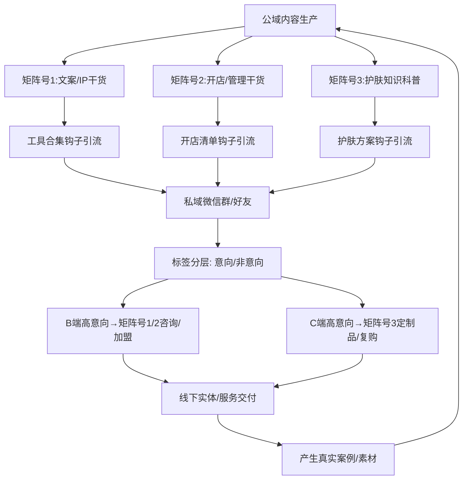

# 第 33 章 实体店老板IP化与三域联动 —— 私域内容公域化复用、271内容体系与矩阵号业务链条拆解
作者：龙哥

## 学习目标

- 理解实体老板IP化的核心逻辑：私域内容公域化复用是低成本起号最优解
- 掌握三域联动闭环的设计与运营：公域获客、私域转化、线下变现的飞轮模型
- 熟练运用高价值定位五要素与账号四件套确定性原则，建立专业信任与转化预期
- 精通271内容体系与三字内容生产法（一搜二调三发），实现非专业创作者的高频稳定产出
- 掌握选题决定论与对标复刻法，通过复刻爆款选题方向突破流量上限
- 能够构建长尾关键词SEO矩阵与零成本引流钩子模型，实现精准搜索流量获取与合规私域导流
- 理解矩阵号分层布局的本质：按业务链条拆解而非单纯账号复制，实现规模化变现

## 33.1 生活类比

想象实体老板IP化像**‘厨师把自家秘制酱料包装成超市畅销调味包’**：
- **私域内容（朋友圈文案/成交话术）** = 厨师多年调制、经食客验证的**秘制酱料配方**
- **公域平台（小红书）** = 拥有巨大流量的**连锁超市货架**
- **内容复用（一搜二调三发）** = 将大锅酱料**分装、贴标、调整规格**适配超市陈列
- **三域联动（公域→私域→线下）** = 顾客买调味包(公域) → 扫码进厨师粉丝群领食谱(私域) → 到厨师实体店吃饭/买预制菜(线下)
- **271内容体系** = 货架上**70%核心单品(干货酱料)** + **20%引流爆款(工具合集)** + **10%品牌故事(人设)**
- **零成本引流钩子** = 货架旁**‘免费领试吃装’的小纸杯(虚拟电子书)**，扫码进群领完整配方
- **矩阵号布局** = 厨师推出**家庭装/餐饮商用装/定制礼盒装(不同账号对应不同业务线)**，覆盖不同客群决策链路
就像调味包让厨师的手艺跨越时空服务更多人，内容复用让实体老板的经验跨越流域实现商业闭环。

## 33.2 概念地图

实体老板IP化与三域联动
├── 核心主张：私域内容公域化复用
│   ├── 朋友圈文案/案例 → 小红书笔记（低边际成本、高信任度）
│   └── 适用边界：有实体/私域沉淀、懂基础平台规则
├── 三域联动闭环
│   ├── 公域（小红书获客）
│   ├── 私域（微信群/好友转化）
│   └── 线下（实体店服务/变现）
├── 定位与账号搭建
│   ├── 高价值定位五要素：细分赛道/目标客群/解决方案/IP竞争力/变现路径
│   └── 账号四件套确定性原则：昵称/头像/简介/背景图 → 给用户下一步行动确定性
├── 内容生产体系
│   ├── 271内容体系：20%工具合集/70%深度干货/10%人设生活（专业信任先行）
│   ├── 选题决定论：对标点赞1000+爆款选题，结合自身经验重写
│   ├── 三字内容生产法：一搜(对标爆款)二调(季节/案例)三发(素材库/实拍) → 5分钟/条
│   └── 长尾关键词SEO矩阵：核心/需求/人群/场景词 → 标题/封面/正文/标签四大权重位布局
├── 引流与转化
│   └── 零成本引流钩子模型：虚拟电子书(近零成本) → 群聊中转 → 小号发号 → 私域精细运营
└── 矩阵化规模化
    ├── 本质：业务链条拆解（C端种草→B端咨询→B端加盟→C端定制品）
    ├── C端号：护肤知识课堂 → 定制护肤品
    ├── B端号1：文案/IP运营 → 咨询陪跑
    └── B端号2：开店/管理 → 店加盟

## 33.3 实体老板IP化 —— 私域内容公域化复用的低成本起号法

### 为什么需要这个概念？

实体店老板通常面临三大现实约束：时间碎片化、精力有限、缺乏专业内容创作能力。传统建议“另起炉灶”在公域平台原创内容，对这类人群不切实际。

素材作者指出：“我知道很多实体店创业老板，每天都好忙。在有限的内容，有限的时间里，怎么把一条内容，超简单地复用得N多次，是我觉得最值得借鉴抄钞的！”[P001, p.1]

线下沉淀的成交文案、专业知识、客户案例，已经过真实交易验证，具备天然信任属性。直接“搬运+微调”至公域，边际成本最低、转化路径最短、信任度最高。

> "结果把朋友圈的文案内容，用小红书的技巧，复用到公域上"
> "怎么把一条内容，超简单地复用得N多次，是我觉得最值得借鉴抄钞的！"
> "把她线下店的内容经验，复用搬到线上，就很适用和相互赋能了"
> 
> ——《docs/202305/WzBCdY4A8omv2cxsneMcn1lJnEb.md》

### 核心定义

**私域内容公域化复用**（来源：《docs/202305/WzBCdY4A8omv2cxsneMcn1lJnEb.md》）

将私域（朋友圈）沉淀的非标内容，经小红书平台规则（选题、排版、关键词、钩子）标准化改造发布，实现内容资产跨域价值最大化。

核心公式：
$$
\text{公域获客资产} = \text{线下/私域内容资产} \times \text{小红书运营技巧}
$$

这个公式展示了：源头素材必须来自真实业务场景，运营技巧只是放大器。没有线下沉淀的“纯线上白手起家者”无法使用此法，因为缺乏源头素材。

### 关键性质

- **复用而非创作**：源头是真实成交场景验证过的文案/案例，非凭空想象
- **低边际成本**：一条朋友圈文案经微调可生成多条小红书笔记，实现N次复用
- **信任传递**：真实实体店背景赋予内容天然可信度，降低公域用户决策门槛

### 典型例子

案例主体“镜子”为美业实体店创业10年老板，0基础起号，执行周期较短，结果：小红书涨粉近5000，月增收5位数（1万+），打通公私域线下三域闭环。

- 朋友圈‘某护肤品成交话术’ → 小红书笔记‘美业同行必看：这句文案让客单提升30%’
- 朋友圈‘开店避坑经验’ → 小红书笔记‘美业开店避坑指南：10年老板血泪总结’

### 边界条件

- 仅适用于已有线下实体/私域沉淀的老板，纯线上白手起家者无源头素材
- 内容必须为‘干货/方法论/案例’类，纯生活流/情感流内容难以复用变现
- 需懂基础小红书规则（封面、标题、关键词、钩子），完全不懂平台机制无法微调

## 33.4 三域联动闭环 —— 公域获客、私域转化、线下变现的飞轮模型

### 为什么需要这个概念？

单一流域（仅公域或仅私域）流量天花板低、抗风险弱。实体店需解决‘获客难、转化难、复购难’三大痛点。三域相互赋能：公域引流→私域信任→线下成交→产生案例→反哺公域内容，形成正向飞轮。

### 核心定义

**三域联动闭环**（来源：《docs/202305/WzBCdY4A8omv2cxsneMcn1lJnEb.md》）

公域（小红书获客）、私域（微信群/好友转化）、线下（实体店服务/变现）三个流域相互赋能、形成闭环的商业模式。

核心指标体系：
- 公域：涨粉量、笔记互动率、搜索曝光量
- 私域：日引流量、好友转化率、社群活跃度
- 线下：月增收、咨询成单数、复购率

> "帮助她走通了：小红书有粉丝，私域有新流量，线下美业店，三域相结合的大结果"
> "继续用小红书和私域跑通更多线上线下的闭环"
> "从0涨粉近5千，月增收5位数+"
> 
> ——《docs/202305/WzBCdY4A8omv2cxsneMcn1lJnEb.md》

### 关键性质

- **正向飞轮**：线下成交产生真实案例/素材 → 制成公域内容 → 获客精准粉丝 → 私域转化 → 线下成交
- **资产沉淀**：公域沉淀‘粉丝/权重’，私域沉淀‘信任/好友’，线下沉淀‘现金流/口碑’
- **抗风险**：单一平台算法变动/封号，不影响私域资产与线下基本盘

### 典型例子

镜子案例：小红书涨粉近5000 → 私域日引流几十人 → 线下美业店月增收5位数 → 咨询陪跑/店加盟/定制护肤品分级变现。

- 公域笔记‘美业开店避坑指南’ → 私域送‘开店清单电子书’ → 线下转化‘美业店加盟/咨询陪跑’

### 边界条件

- 必须有实体线下业务承接，纯虚拟产品无‘线下’域，退化为公私域双域
- 私域运营能力为瓶颈：若无法在私域建立信任/成交，公域流量将断流
- 线下服务标准化程度决定复购率，非标服务难规模化复制

## 33.5 高价值定位五要素 —— 让用户一眼读懂‘我是谁、为谁服务、凭什么信任’

### 为什么需要这个概念？

模糊定位导致粉丝画像混杂、商业变现路径断裂。实体老板易陷入‘我什么都会’的全能陷阱，需聚焦单一变现抓手。定位必须基于既有优势（线下经验），实现线上线下相互赋能而非对立。

### 核心定义

**高价值定位五要素**（来源：《docs/202305/WzBCdY4A8omv2cxsneMcn1lJnEb.md》）

包含五要素：细分赛道、目标客群、解决方案、个人IP核心竞争力、商业变现路径。

判断标准：能否给用户‘下一步行动的确定性预期’。

| 要素 | 镜子案例实操 | 通用判断标准 |
|------|-------------|-------------|
| 细分赛道 | 美业文案/IP自媒体技能培训 | 单一垂类，非泛‘美业知识’ |
| 目标客群 | 美业人及美业同行创业者（B端高客单） | 精准画像，非大众消费者（C端低客单） |
| 解决方案 | 朋友圈文案技巧、配图设计、开店避坑、IP打造 | 标准化可交付产品/服务 |
| IP核心竞争力 | 10年实体店盈利经验、徒弟实战结果 | 基于既有优势，非虚构人设 |
| 商业变现路径 | 咨询陪跑(近)→店加盟(中)→定制护肤品(远) | 按现金流远近排序，变现路径要‘近’ |

> "定位一定要找到适合你的值钱的细分赛道"
> "镜子的小红书定位是：为美业人及美业同行创业者，提供美业文案、美业IP自媒体等技能培训和支持服务"
> "在确定定位之后，也给镜子确定了她要吸引的客户群体、解决方案。以及镜子自己本人需要提升的IP核心竞争力"
> 
> ——《docs/202305/WzBCdY4A8omv2cxsneMcn1lJnEb.md》

### 关键性质

- **赛道聚焦**：如‘美业文案/IP自媒体技能培训’而非泛‘美业知识’
- **客群精准**：美业人及美业同行创业者（B端高客单），非大众消费者（C端低客单）
- **变现锚定**：咨询陪跑/店加盟/定制护肤品三条清晰业务线

### 边界条件

- 定位不可贪多：贪多导致内容杂、粉丝杂、产品杂，最终变现难
- 必须基于‘既有优势’：无10年实战经验的镜子，无资格教‘开店避坑’
- 变现路径要‘近’：咨询陪跑（近）→ 加盟（中）→ 定制品（远），按现金流远近排序

## 33.6 账号四件套确定性原则 —— 昵称/头像/简介/背景图的转化率杠杆

### 为什么需要这个概念？

用户进主页停留仅3秒，四件套是唯一‘免费广告位’。模糊的四件套让用户‘看不懂、信不信、不知怎么下一步’，直接流失。统一视觉/语言符号，降低用户认知成本，提升主页转粉率。

### 核心定义

**账号四件套确定性原则**（来源：《docs/202305/WzBCdY4A8omv2cxsneMcn1lJnEb.md》）

昵称、头像、简介、背景图四大要素必须统一传递：我是谁、为谁服务、提供什么价值、凭什么信任。

核心逻辑：给用户‘下一步行动的确定性预期’。

| 要素 | 设计标准 | 镜子案例实操 |
|------|---------|-------------|
| 昵称 | 赛道关键词+人设标签 | 镜子｜美业文案IP陪跑 |
| 头像 | 真人实景图＞Logo/风景图 | 真实店铺/工作场景照 |
| 简介 | 五段式：我是谁/为谁/给什么/凭什么/福利钩子 | 见下文 |
| 背景图 | 强化实体/专业信任感 | 实体店环境/团队合影/荣誉证书 |

> "用户点进来主页后，是带着期待和之前你一样好的笔记，期待的是确定性。所以你的四件套，都必须要给出下一步的确定性"
> "简介：我是谁？我为谁喊话？我提供什么价值？我有什么资格？"
> 
> ——《docs/202305/WzBCdY4A8omv2cxsneMcn1lJnEb.md》

### 镜子简介五段式拆解

1. **我是谁**：10年美业老板
2. **为谁喊话**：美业同行/创业者
3. **提供什么价值**：文案/IP/开店技巧
4. **有什么资格**：实体店盈利/徒弟结果
5. **福利钩子**：关键词‘文案’领资料包

### 边界条件

- 简介字数受限，需极度精简，每个字必有转化作用
- 头像/背景需真实，盗图/素材图一旦被识破，信任归零
- 四件套需随业务迭代更新，如新增‘加盟’业务需同步更新简介钩子

## 33.7 271内容体系 —— 起号期‘专业信任先行，人设弱化’的黄金比例

### 为什么需要这个概念？

新号无标签，内容比例决定算法打标方向（是‘娱乐号’还是‘专业号’）。早期过度输出人设/生活流，导致标签模糊、粉丝不精准、后期商业化困难。垂类B2B账号必须用硬核干货建立专业壁垒，人设仅作调味剂。

### 核心定义

**271内容体系**（来源：《docs/202305/WzBCdY4A8omv2cxsneMcn1lJnEb.md》）

起号期（1万粉前）内容比例模型：
- 20%工具合集/蹭热点（涨粉快）
- 70%干货知识/方法论/案例（建立专业信任）
- 10%个人IP/真实人设（提高客单/转化）

核心原则：专业信任先行，人设弱化。

> "镜子的第一版小红书的内容体系搭建，至少要包含这3个内容，而且比例是271"
> "a、工具合集丨蹭热门话题：20%... 作用：起号养号更快，数据更好"
> "b、干货知识丨方法论丨案例：70%... 作用：建立专业信任"
> "c、个人IP：10%。作用：为了更高收入更高客单的转化"
> 
> ——《docs/202305/WzBCdY4A8omv2cxsneMcn1lJnEb.md》

### 关键性质

- **20%工具合集**：如‘25位博主合集’、‘30句文案金句’，蹭热点/做合集，易爆款、涨粉快、完成冷启动
- **70%深度干货**：如‘朋友圈文案技巧’、‘配图设计’、‘开店避坑’，建立专业权威，吸引精准B端高客单粉丝
- **10%人设生活**：真实店铺场景+深度思考，增加温度/信任，为高客单转化铺垫

### 典型例子

镜子起号内容：
- 工具合集类（美业同行学习25位博主、美妆护肤文案30句）
- 干货类（朋友圈文案技巧、配图设计、开店团队管理）
- 人设类（美业创业日记笔记）

### 边界条件

- 仅适用于‘垂类B2B/专业服务/高客单’账号，泛娱乐/大众消费账号比例需反转
- 1万粉后比例可调整：干货降至50%，人设/案例/转化类内容提升
- 70%干货必须‘真有干货’，水文/伪干货会加速掉粉、毁标签

## 33.8 选题决定论与对标复刻法 —— 抄爆款选题，不抄平庸选题

### 为什么需要这个概念？

选题决定流量上限，平庸选题再好文案也爆不了。新手易犯‘自我感动式选题’：写自己想写的，非用户想看的。对标账号的数据即该赛道的流量天花板，照抄爆款选题方向最稳。

### 核心定义

**选题决定论与对标复刻法**（来源：《docs/202305/WzBCdY4A8omv2cxsneMcn1lJnEb.md》）

- 核心主张：选题决定了你的流量上限
- 执行标准：起号必须对标点赞1000+的爆款选题，而非模仿几十赞的平庸选题
- 方法：用采集工具导出500个优质对标账号 → 筛选点赞1000+爆款笔记 → 直接复刻选题方向 → 结合自身实战经验重写

> "首先必须认识到选题决定了你的流量上限"
> "如果你一开始找的对标选题，就是只有几十个赞，那大概率，你模仿写出的笔记，也肯定无法爆到哪里去"
> "用后羿采集器，给镜子提供了500个优质对标账号列表供参考"
> "先找到点赞1000+的对标选题（常规类目），这个超级重要！"
> 
> ——《docs/202305/WzBCdY4A8omv2cxsneMcn1lJnEb.md》

### 关键性质

- **复刻‘选题方向’而非‘文案内容’**：同选题不同表达，规避搬运判定
- **结合‘自身经验’重写**：这是核心壁垒，AI/他人无法复制的真实案例/数据/细节
- **选题库建设**：建立个人选题库，按‘工具合集/干货技能/案例复盘/人设故事’分类储备

### 典型例子

- 镜子用后羿采集器导出500个对标账号，筛选‘美业朋友圈文案’类爆款选题复刻
- 对标选题‘如何写朋友圈不被折叠’ → 镜子重写为‘美业老板实测：这3招让朋友圈曝光翻5倍’

### 边界条件

- 对标账号体量参考：粉丝1万-10万的腰部号最优，头部号选题常带强个人IP色彩难复刻
- 选题需匹配‘271体系’分类：工具合集/干货/人设三类选题轮动
- 切勿跨赛道对标：美业账号对标美妆/穿搭爆款选题，引来泛粉毁标签

## 33.9 三字内容生产法（一搜二调三发） —— 非专业创作者的5分钟日更SOP

### 为什么需要这个概念？

实体老板/兼职创作者核心痛点：没时间、不会写、不想拍。传统‘原创写作’门槛高、周期长、产出不稳定，无法支撑高频更新。标准化、模板化、工具化的生产流程，是维持账号活跃度与算法权重的执行层保障。

### 核心定义

**三字内容生产法（一搜二调三发）**（来源：《docs/202305/WzBCdY4A8omv2cxsneMcn1lJnEb.md》）

极低成本内容标准化生产SOP：
1. 搜对标爆款文案
2. 结合季节/节日/环境调整
3. 配图用素材库或实拍店铺实景

核心口诀：一搜二调三发，主打5分钟出一篇内容。

> "记住文静的三字口诀。一搜二调三发"
> "1.去小红书搜索最近的美业朋友圈文案... 2.点赞收藏最多的，打开里面总有你想要使用的，再结合当下的季节、环境、节日调整下 3.搜索美业模特素材...或者你拍照比较好看，直接拍店里的角角落落也可以"
> "快速5分钟做内容的技巧"
> 
> ——《docs/202305/WzBCdY4A8omv2cxsneMcn1lJnEb.md》

### 关键性质

- **去重逻辑**：搜对标（找结构）、二调（改细节/时效性）、三发（换图/换标题），实现‘伪原创’合规过审
- **素材库建设**：平时积累‘美业模特图’、‘店铺实景图’、‘客户反馈图’，三发时直接调用
- **结构化模仿**：保留爆款笔记的‘标题结构/段落逻辑/金句位置’，替换‘具体案例/数据/观点’

### 典型例子

- 搜‘美业朋友圈文案’爆款笔记 → 结合‘夏季防晒’季节调整文案 → 配店铺实拍‘防晒霜试色图’发布
- 素材来源：小红书搜索‘美业模特素材’、手机相册‘店铺角角落落实拍’

### 边界条件

- 仅适用于‘图文/笔记’形式，视频/直播形式生产链路完全不同
- 依赖‘对标爆款库’积累深度，新手前期需先花时间建库，而非直接上手
- 长期需向‘原创比例提升’迭代，纯搬运/伪原创随平台算法升级易限流

## 33.10 长尾关键词SEO矩阵 —— 让搜索流量精准上门的关键词资产

### 为什么需要这个概念？

推荐流量脉冲式衰减，搜索流量长尾复利增长（半年/一年源源不断）。小红书用户‘搜索意图＞推荐意图’，搜索流量转化率远高于推荐流量。关键词布局是SEO的核心可控变量，覆盖标题/封面/正文/标签四大权重位。

### 核心定义

**长尾关键词SEO矩阵**（来源：《docs/202305/WzBCdY4A8omv2cxsneMcn1lJnEb.md》）

构建由核心词（美业、护肤）、需求词（防晒、祛斑）、人群词（打工人、大嫂）、场景词（实体店、同城）组成的关键词库。

覆盖四大权重位：
1. 标题首位
2. 封面大字
3. 正文前200字
4. 结尾话题标签（≤5个精准标签）

> "小红书的笔记标题、封面图、正文内容，是由一个个美业店护肤店的关键词长尾词，组成的"
> "这里镜子直接整理了她常用的关键词长尾词：美业、肌肤、美丽、漂亮、实体、便宜、上当、爱情、紫外线、精彩、生活、打工人、大嫂、防晒、放松愉悦、空间"
> 
> ——《docs/202305/WzBCdY4A8omv2cxsneMcn1lJnEb.md》

### 镜子关键词库分层表

| 分层 | 关键词示例 | 含义 | 布局位置 |
|------|-----------|------|---------|
| 核心词 | 美业、护肤、肌肤 | 赛道大词，流量大竞争大 | 简介、标签、账号定位 |
| 需求词 | 防晒、祛斑、上当、便宜 | 用户显性/隐性痛点 | 标题核心、封面大字、正文首段 |
| 人群词 | 打工人、大嫂、同行 | 精准目标客群画像 | 标题钩子、正文案例、标签 |
| 场景词 | 实体店、空间、同城 | 使用/决策场景 | 正文细节、结尾标签、定位 |

### 关键性质

- **关键词分层**：核心词流量大竞争大（美业）、长尾词流量小精准度高（美业朋友圈文案怎么写不被折叠）
- **布局原则**：一个笔记只核心优化1个长尾词，贪多导致权重分散
- **词库迭代**：按‘搜索量/笔记量/竞争度’定期清洗词库，保留高ROI词

### 免费挖词 vs 付费工具对比

以下是免费挖词（下拉框/相关搜索）与付费工具（千瓜/灰豚）在词库覆盖面、竞争度分析、迭代效率上的差异：

| 维度 | 免费挖词（下拉框/相关搜索） | 付费工具（千瓜/灰豚） |
|------|---------------------------|---------------------|
| 词库覆盖面 | 窄，仅能获取平台主动推荐的热词 | 广，可批量导出赛道全量长尾词及数据 |
| 竞争度分析 | 无，仅凭直觉判断 | 有，提供搜索量/笔记量/比值等量化指标 |
| 迭代效率 | 低，人工逐个搜索记录 | 高，一键导出Excel，支持周/月/季度迭代 |

**词库迭代SOP**：
- 周频次：检查核心长尾词排名变化，补充新增热搜词
- 月频次：清洗搜索量<100或笔记量>1万的低ROI词
- 季度频次：重构词库架构，对齐业务新方向/新产品

### 边界条件

- 关键词堆砌/强行植入会被判营销号/违规，需自然融入语义
- 免费挖词（下拉框/相关搜索）效率低、覆盖面窄，规模化需付费工具（千瓜/灰豚）
- SEO见效慢（1-3个月），前期需配合推荐流量（投流/爆款）维持账号活跃

## 33.11 零成本引流钩子模型 —— 虚拟电子书+群聊中转的合规私域导流法

### 为什么需要这个概念？

小红书严打‘硬广/留联/引流’，直接留微信号/二维码必封号。实体商品/实物礼品引流成本高、发货慢、售后麻烦。虚拟电子书成本近零、交付即时、合规安全、感知价值高。

### 核心定义

**零成本引流钩子模型**（来源：《docs/202305/WzBCdY4A8omv2cxsneMcn1lJnEb.md》）

利用虚拟电子书（成本近零、合规安全）作为诱饵，置于笔记尾页/评论区。

路径：公域笔记钩子图 → 引导扫码进群/评论领取 → 群内微信小号发微信号 → 私域加好友 → 精细化运营转化。

> "引流钩子用了成本最低的X本电子书，这样成本可控且相对安全"
> "用粉丝感兴趣的文档，引导粉丝到群聊，然后微信小号在群里发微信号，想要的就直接加"
> 
> ——《docs/202305/WzBCdY4A8omv2cxsneMcn1lJnEb.md》

### 关键性质

- **诱饵设计**：高感知价值（如‘200句美业朋友圈文案合集’）、强相关性（粉丝刚需）、虚拟交付（网盘/群文件）
- **群聊中转**：群聊为‘缓冲带’，规避私信/评论区直接留联违规，小号在群内发号再踢人/解散群
- **分层承接**：进群用户→标签分层（意向/非意向）→ 不同话术/产品精准转化

### 典型例子

镜子钩子：
- X本电子书（朋友圈文案合集/开店清单/话术脚本）
- 笔记尾页：大字图‘需要完整版扣1’ → 评论区回复‘1’ → 进群 → 小号发微信号

### 边界条件

- 群聊频繁建群/解散/踢人易触发微信风控，需控制频率/养号/分批操作
- 电子书内容必须‘真有料’，水货钩子导致进群即退群、拉黑、投诉
- 仅解决‘公域→私域’引流环节，私域‘承接/转化/复购’需独立话术/产品体系支撑

## 33.12 矩阵号分层布局 —— 按业务链条拆解而非账号复制的规模化逻辑

### 为什么需要这个概念？

单号流量/变现天花板低，矩阵化是突破上限的必经之路。盲目复制账号（同内容/同定位）导致内耗竞争、权重分散、运营成本倍增。业务链条天然存在上下游决策路径，按链条拆解账号实现流量精准分流、产品分级变现。

### 核心定义

**矩阵号分层布局/业务链条拆解**（来源：《docs/202305/WzBCdY4A8omv2cxsneMcn1lJnEb.md》）

单号跑通后，按用户分层（C端消费者/B端同行）与业务链条拆解为多个垂类账号。每个账号对应明确变现产品：咨询陪跑/店加盟/定制护肤品，非单纯追求账号数量。

> "分C端和B端。整体IP线打通美业人的上下游：日常护肤技巧~美业运营技巧~个人品牌打造"
> "小红书矩阵号1：美业人同行的朋友圈文案...变现产品：私域/小红书咨询陪跑"
> "小红书矩阵号2：美业人同行开店...变现产品：美业店加盟"
> "小红书矩阵号3：美业人的护肤知识课堂...变现产品：私人定制护肤品"
> 
> ——《docs/202305/WzBCdY4A8omv2cxsneMcn1lJnEb.md》

### 镜子矩阵号规划表

| 账号 | 定位 | 核心人设 | 内容栏目(3-5个) | 主力变现产品 | 流量互导路径 |
|------|------|----------|------------------|-------------|-------------|
| 矩阵号1 (B端) | 美业朋友圈文案/IP运营 | 10年美业老板/文案专家 | 文案技巧/配图设计/避坑指南/工具合集 | 私域/小红书咨询陪跑(4999元) | 笔记尾页钩子→私域咨询转化 |
| 矩阵号2 (B端) | 美业开店/团队管理 | 连锁店主/导师 | 选址装修/招聘培训/财务管理/加盟案例 | 美业店加盟(高客单/重资产) | 咨询陪跑客户升单/引流 |
| 矩阵号3 (C端) | 护肤知识课堂 | 专业皮肤管理师 | 成分科普/防晒祛斑/护肤误区/产品测评 | 私人定制护肤品(高复购/标品) | 笔记挂链接/私域社群复购 |

### 关键性质

- **C端号**：美业护肤知识课堂 → 变现‘私人定制护肤品’（高复购、标品化）
- **B端号1**：美业朋友圈文案/IP运营 → 变现‘私域/小红书咨询陪跑’（高客单、服务型）
- **B端号2**：美业开店/团队管理 → 变现‘美业店加盟’（超高客单、重资产）
- **流量互导**：C端号粉丝有创业意向 → 引流至B端号 → 成交加盟/咨询

### 数据流图：矩阵号流量互导路径

### 边界条件

- 前提：单号模型已跑通（内容SOP/引流SOP/转化SOP/交付SOP标准化），未跑通盲目铺开必死
- 运营团队配套：单人难运营3号+，需至少‘主理人+编导+客服/销售’铁三角
- 内容差异化：三号内容风格/选题/人设必须差异化，避免平台判定‘矩阵营销号’限流

## 33.13 多源对照

本章核心方法论主要基于单一核心素材（镜子案例复盘），未见多篇素材对同一概念的不同阐述。故无显性共识与分歧对照。

[需要补充文献]：可对比其他实体老板IP化案例（如餐饮/健身/教育行业），验证“私域内容公域化复用”、“271内容体系”、“矩阵号业务链条拆解”的跨行业普适性。

## 33.14 设计中的取舍

### 为什么不用“原创内容从0到1创作”而用“私域内容复用”？

原创创作需要选题策划、文案撰写、配图拍摄、排版设计等完整链路，单条耗时1-3小时，实体老板无时间精力支撑。复用法仅需“搜对标→改细节→换图”，5分钟出一条，边际成本降低90%以上。

**Trade-off**：牺牲了内容的独家原创性（易被平台判定为伪原创/搬运），换取了高频稳定产出能力。长期需逐步提升原创比例，建立护城河。

### 为什么起号期“70%干货”不能替换为“70%生活流”？

生活流内容虽易产出、易获赞，但吸引的是泛娱乐粉丝，标签模糊、购买力弱、后期商业化极难。干货内容虽产出难、初期数据一般，但精准筛选B端高客单粉丝，建立专业信任壁垒。

**Trade-off**：牺牲短期涨粉速度（生活流涨粉快），换取长期变现效率（干货粉客单价高、复购强）。

### 矩阵号为何强调“业务链条拆解”而非“同内容多账号分发”？

同内容多号分发会导致：账号间内卷抢流量、粉丝画像重叠无增量、平台易判定营销号矩阵限流。业务链条拆解实现：用户分层精准（C端/B端）、产品分级变现（低/中/高客单）、流量单向互导无内耗。

**Trade-off**：牺牲运营简单度（需维护多套内容SOP/人设/选题库），换取商业天花板指数级提升（单号月入5万 → 矩阵月入50万+）。

## 33.15 动手练习

### 练习 1：实战推演：为你的实体业务设计『私域内容公域化复用』起号方案

假设你经营一家『社区生鲜店』3年，积累了大量朋友圈选品心得、保鲜技巧、社群运营话术。

1. 提炼你的『高价值定位五要素』：细分赛道、目标客群、解决方案、IP核心竞争力、商业变现路径。
2. 设计『账号四件套』：昵称、头像、简介(五段式)、背景图，要求给用户『下一步行动的确定性预期』。
3. 规划首月『271内容体系』选题清单（共12条）：列出2-3条工具合集类、7-8条深度干货类、1-2条人设类具体选题标题。
4. 选取1条干货类选题，演示『三字内容生产法』全过程：搜对标爆款标题/结构 → 二调(结合时令水果/店里实况) → 三发(配何种图/素材来源)。
5. 设计1个『零成本引流钩子』：虚拟电子书主题、笔记尾页钩子文案、进群后小号话术、私域分层标签。

**回答问题**：
- 为何起号期『70%干货』不能替换为『70%生活流』？核心风险是什么？
- 『选题决定论』中，为何要对标『点赞1000+』而非『粉丝10万+』的账号选题？
- 矩阵号规划中，为何强调『业务链条拆解』而非『同内容多账号分发』？

### 练习 2：案例复盘：拆解『镜子』案例中的『长尾关键词SEO矩阵』构建逻辑

基于素材中镜子的关键词库：美业、肌肤、美丽、漂亮、实体、便宜、上当、爱情、紫外线、精彩、生活、打工人、大嫂、防晒、放松愉悦、空间。

1. 将上述16个词按『核心词/需求词/人群词/场景词』四层分类，并解释分类依据。
2. 设计一条笔记的『四大权重位关键词布局』：标题(含核心词+长尾词+数字钩子)、封面大字(核心痛点词)、正文前200字(自然植入2-3长尾词)、结尾话题标签(≤5个精准标签)。
3. 对比『免费挖词(下拉框/相关搜索)』与『付费工具(千瓜/灰豚)』在词库覆盖面、竞争度分析、迭代效率上的差异，制定『词库迭代SOP』：周/月/季度频次与清洗指标。

**回答问题**：
- 为何『一个笔记只核心优化1个长尾词』？贪多嚼词会导致什么后果？
- SEO见效慢(1-3个月)，前期如何配合『推荐流量(投流/爆款)』维持账号活跃度与算法权重？

### 练习 3：决策模拟：从『单号跑通』到『矩阵号分层布局』的关键判断路径

假设你已复制镜子模式，单个美业账号在小红书跑通：日引私域30人、月成交咨询陪跑3单(客单4999元)、复购率20%。

1. 判断『单号模型已跑通』的硬性指标清单（内容SOP/引流SOP/转化SOP/交付SOP各至少1条量化标准）。
2. 绘制你的『美业人全生命周期业务链条图』：从『想开店』→『选址装修』→『开业引流』→『日常运营』→『扩店加盟』→『品牌升级』，标注每个阶段的核心需求与对应变现产品。
3. 规划3个矩阵号的『差异化人设/内容/变现』表格：账号定位、核心人设、内容栏目(3-5个)、主力变现产品、流量互导路径(如C端号如何导流至B端号)。
4. 列出『矩阵化运营』所需的最小团队配置(角色/人数/职责)与『内容差异化』操作红线(避免被判定营销号限流)。

**回答问题**：
- 为何『单号未跑通盲目铺开矩阵必死』？核心瓶颈在哪里？
- 矩阵号间『流量互导』的具体合规操作手法是什么(小红书规则下)？

## 33.16 本章小结

这一章中我们学习了如何帮助实体店老板以最低成本实现IP化，打通公私域线下三域联动闭环。首先，我们确立了**私域内容公域化复用**的核心逻辑：将线下沉淀的真实成交文案、案例经微调发布至小红书，边际成本最低、信任度最高。其次，我们掌握了**高价值定位五要素**与**账号四件套确定性原则**，让用户一眼读懂你是谁、为谁服务、凭什么信任。接着，我们深度拆解了**271内容体系**（20%工具合集/70%干货/10%人设）与**三字内容生产法**（一搜二调三发），解决非专业创作者的高频产出难题。然后，我们学习了**选题决定论与对标复刻法**，通过复刻点赞1000+爆款选题方向突破流量上限。随后，我们构建了**长尾关键词SEO矩阵**，覆盖标题/封面/正文/标签四大权重位，实现搜索流量长尾复利。再然后，我们设计了**零成本引流钩子模型**，用虚拟电子书+群聊中转实现合规私域导流。最后，我们理解了**矩阵号分层布局**的本质是业务链条拆解，按C端/B端用户分层与上下游决策路径规划账号，实现流量精准分流与产品分级变现。

本章我们一起学习了以下概念：

| 概念 | 解释 |
|------|------|
| 实体老板IP化/私域内容公域化复用 | 将线下/私域沉淀的成交文案、案例经标准化微调发布至公域，边际成本最低、信任度最高、转化路径最短 |
| 三域联动闭环 | 公域获客(小红书) → 私域转化(微信群/好友) → 线下变现(实体店) → 产生案例反哺公域，形成正向飞轮与抗风险护城河 |
| 高价值定位五要素 | 细分赛道、目标客群、解决方案、IP核心竞争力、商业变现路径；必须基于既有优势，给用户下一步行动的确定性预期 |
| 账号四件套确定性原则 | 昵称/头像/简介/背景图统一传递：我是谁、为谁服务、提供什么价值、凭什么信任，核心提升主页转粉率 |
| 271内容体系 | 起号期黄金比例：20%工具合集蹭热点(涨粉快) + 70%深度干货建立专业信任 + 10%人设生活提高客单转化，专业信任先行、人设弱化 |
| 选题决定论与对标复刻法 | 选题决定流量上限；起号必对标点赞1000+爆款选题，复刻方向结合自身经验重写，规避平庸选题与自我感动式创作 |
| 三字内容生产法（一搜二调三发） | 非专业创作者5分钟日更SOP：搜对标爆款文案 → 结合季节/环境调整 → 配素材库或实拍图发布，解决‘没时间/不会写/不想拍’痛点 |
| 长尾关键词SEO矩阵 | 构建核心/需求/人群/场景四层词库，覆盖标题首位、封面大字、正文前200字、结尾话题标签，实现搜索流量长尾复利(半年/年源源不断) |
| 零成本引流钩子模型 | 虚拟电子书(近零成本/合规/高感知值)作诱饵 → 笔记尾页/评论区钩子 → 引导进群 → 群内小号发微信号 → 私域精细化运营转化 |
| 矩阵号分层布局(业务链条拆解) | 单号跑通后按用户分层(C端/B端)与业务链条拆解：C端号卖定制品、B端号1卖咨询、B端号2卖加盟，实现流量精准分流与产品分级变现，非单纯账号复制 |

下一章中，我们将学习如何构建个人知识创作系统，从“囤资料”进化为“生产知识资产”，实现知识复利。

感谢你读到了这里，恭喜你完成了实体老板IP化与三域联动的完整学习！你现在已经掌握了从0到1帮助实体老板跨域起号、打通商业闭环、规模化矩阵变现的全套方法论。
