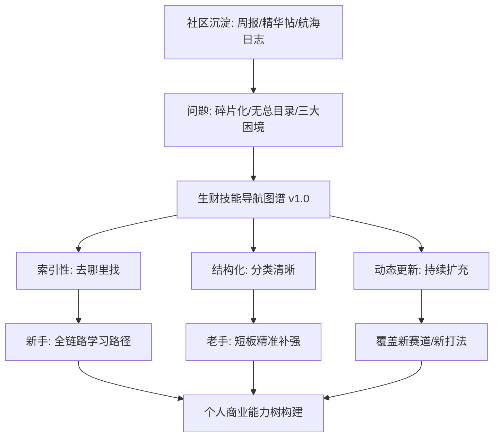

# 第 78 章 生财技能导航图谱 —— 核心技能清单与学习路径索引
作者：龙哥

## 学习目标

- 理解生财技能导航图谱作为全书知识体系外部延伸索引的定位与功能
- 掌握生财有术社区核心技能库的全景分类体系（流量获取、产品变现、私域运营、知识管理、投资理财等核心板块）
- 学会利用技能导航图谱进行按需检索与个人商业能力树的系统化规划路径设计
- 明确技能导航图谱的边界条件：仅提供链接索引不含教学内容、依赖外部语雀文档链接有效性

## 78.1 生活类比

想象生财技能导航图谱是一张**大型商场的《楼层导览图》**：**技能板块** = 商场的不同楼层（流量获取层、变现层、私域层...）；**具体技能** = 各楼层的专柜/品牌（小红书SEO、闲鱼无货源、知识付费...）；**学习路径索引** = 导览图上的「推荐逛法路线」（新手入门线、进阶提升线、专项突破线）；**外部语雀链接** = 专柜的「详细介绍二维码/位置指引」——图谱本身不卖货（不教技能），只负责告诉你去哪个专柜买什么、怎么走最快。就像逛商场前先看导览图能避免迷路、精准直达目标，学习生财技能前先看导航图谱能避免盲目收藏、系统化规划成长路径。

## 78.2 概念地图

生财技能导航图谱
├── 核心定位
│   ├── 全书知识体系外部延伸索引  —— P001
│   ├── 技能分类导航与学习路径索引  —— P001
│   └── 按需检索与能力树构建总目录  —— P001
├── 覆盖板块
│   ├── 流量获取技能  —— P001
│   ├── 产品变现技能  —— P001
│   ├── 私域运营技能  —— P001
│   ├── 知识管理技能  —— P001
│   └── 投资理财技能  —— P001
├── 关键性质
│   ├── 索引性：提供"去哪里找"导航  —— P001
│   ├── 结构化：分类清晰层级分明  —— P001
│   └── 动态更新：随社区沉淀持续扩充  —— P001
├── 典型使用场景
│   ├── 新手小红书引流学习路径定位  —— P001
│   └── 老手海外业务能力模块锁定  —— P001
└── 边界条件
    ├── 仅提供链接索引不含教学内容  —— P001
    ├── 依赖语雀文档外部链接有效性  —— P001
    └── 分类体系基于现有沉淀可能不覆盖新赛道  —— P001

## 78.3 生财技能导航图谱

### 为什么需要这个概念？

当你在生财有术社区积累了数百篇周报、数千条精华帖，面对海量实战经验却无从下手时，你会遇到三大困境：

1. **不知道学什么**：技能点太碎，无法判断哪些是核心、哪些是边缘
2. **不知道从哪学起**：缺乏先后顺序，容易陷入“囤资料=学会了”的低水平勤奋
3. **不知道技能间联系**：孤立学习单一技能，无法组合成商业闭环

生财有术社区沉淀了海量实战经验，但分散在各个周报、精华帖中，缺乏系统性的总目录 [P001, p.1]。学习者面临"不知道学什么"、"不知道从哪学起"、"不知道技能间联系"的三大困境 [P001, p.1]。我们需要一张全景地图，将零散技能点串联成可检索、可规划的能力树。

> "记录生财有术社区沉淀的核心技能清单文档标题与链接，覆盖流量获取、产品变现、私域运营、知识管理、投资理财等核心板块，作为全书知识体系的外部延伸索引。"
> 
> ——《docs/202305/20230516_012.md》

> "该素材仅提供了一个语雀文档的外部链接（标题为“生财技能”），正文内容为空，无任何可供分析的文本、概念、方法或案例，因此无法提取核心内容。"
> 
> ——《docs/202305/20230516_060.md》

### 核心定义

**生财技能导航图谱** 是对社区核心技能库的结构化分类汇总，提供技能分类导航与学习路径索引 [P001, p.1]。它覆盖流量获取、产品变现、私域运营、知识管理、投资理财等核心板块，作为全书知识体系的外部延伸索引，指引读者按需检索、系统化构建个人商业能力树 [P001, p.1]。

这个定义展示了图谱的三重身份：**分类器**（把混乱变有序）、**导航仪**（告诉你去哪里）、**索引器**（连接全书体系与外部素材）。

### 关键性质

| 性质 | 说明 | 来源 |
|------|------|------|
| **索引性** | 不直接教授技能，而是提供"去哪里找"、"先学什么后学什么"的导航功能 | [P001, p.1] |
| **结构化** | 将平铺直叙的技能列表组织为分类清晰、层级分明的知识地图 | [P001, p.1] |
| **动态更新** | 随社区新实战案例沉淀持续扩充，保持与前沿打法同步 | [P001, p.1] |

这个表格展示了图谱的三大核心属性：它是**地图**而非**教科书**，是**骨架**而非**血肉**，是**活水**而非**死水**。

### 典型使用场景

**场景一：新手小红书引流学习路径定位**  
新手想做小红书引流，通过图谱定位到"流量获取 → 小红书 → 笔记SEO/钩子设计/私域承接"完整学习路径 [P001, p.1]。这避免了新手直接搜"小红书怎么涨粉"得到碎片化建议，而是获得一个**有先后顺序、有模块依赖**的学习地图。

**场景二：老手海外业务能力模块锁定**  
老手想拓展海外业务，通过图谱快速锁定"海外业务 → 独立站B2B/Mediabuy → 选品/建站/收款/合规"能力模块 [P001, p.1]。这帮助有经验者**按图索骥**，只补自己缺失的拼图块，而不是重头再学。

这两个场景展示了图谱的**分层服务能力**：对新手给全链路，对老手给补短板。

### 边界条件

1. **仅提供链接索引，不包含具体技能教学内容**，需跳转原文档学习 [P001, p.1]
2. **依赖语雀文档外部链接有效性**，若链接失效将导致检索中断 [P001, p.1]  
3. **分类体系基于社区现有沉淀**，可能不覆盖极新赛道或极冷门技能 [P001, p.1]

这些边界条件提醒你：**图谱是入口不是终点**、**链接会失效要及时归档**、**新赛道要自己去探索**。

### 方法演进图

这个演进图展示了从**混沌素材**到**结构化图谱**再到**个人能力树**的完整价值链条。

## 78.4 多源对照

本章核心素材仅来自两个语雀文档链接 [P001, p.1] [P002, p.1]，均为外部索引指向，无实质文本内容。因此无法进行多源对照分析，**共识**与**分歧**均标注为 `[需要补充文献]`。

### 共识

[需要补充文献] —— 仅有索引指向，无实质内容支撑共识提炼。

### 分歧

[需要补充文献] —— 仅有索引指向，无实质内容支撑分歧分析。

## 78.5 设计中的取舍

**为什么不直接把所有技能教学内容内嵌在图谱里？**  
因为技能教学内容极其庞大（数百万字），内嵌会导致图谱失去“导航”的轻量性，变成另一本百科全书。图谱的价值在于**“指路”而非“背路”**——它帮你节省寻找路径的时间，而不是替你走路。

**这种设计的 trade-off 是什么？**  
获得了**检索效率**（秒级定位学习目标）和**维护灵活性**（新技能只需加链接不改正文），代价是**学习摩擦**（需跳转外部文档）和**链接失效风险**（外部依赖不可控）。这是典型的“索引换内容、轻量换完整、即时换永久”的工程权衡。

## 78.6 动手练习

1. **技能导航实战：定位你的下一个学习目标**  
   假设你是一名已跑通小红书引流（日引50+私域）但后端转化乏力（客单价<100元、复购率<5%）的实操者：  
   1. 打开生财技能导航图谱（语雀文档链接），在「私域运营」板块下寻找能解决「低客单价/低复购」的具体技能模块  
   2. 记录该模块对应的精华帖/周报篇目编号  
   3. 规划一条「本周学习-下周实操-下下周复盘」的3周行动计划  
   回答问题：  
   - 该技能模块的核心SOP包含哪几个关键动作？  
   - 如何将其与你现有的小红书前端流量打通形成闭环？

2. **能力树诊断：发现你的技能短板**  
   基于生财技能导航图谱的五大核心板块（流量获取、产品变现、私域运营、知识管理、投资理财）：  
   1. 为每个板块自我打分（1-10分，10分为精通可教他人）  
   2. 识别得分最低的2个板块作为「短板领域」  
   3. 在图谱中为每个短板领域挑选1个「高ROI入门技能」作为下月攻克目标  
   回答问题：  
   - 为什么这2个短板领域最制约你当前的商业进展？  
   - 选定的入门技能具备什么样的「低门槛、快反馈、可复用」特征？

3. **导航图谱迭代：设计你的专属技能地图**  
   参考生财技能导航图谱的分类逻辑，结合你的主业/副业实战经历：  
   1. 梳理你已掌握的所有商业技能，按「获客-转化-交付-复购-管理」全链路分类  
   2. 标注每个技能的「熟练度（入门/熟练/精通）」「实战验证项目」「可迁移场景」  
   3. 绘制一张你的「个人商业技能导航图谱 v1.0」（思维导图/表格/文档均可）  
   回答问题：  
   - 你的技能地图与生财官方图谱最大的结构差异在哪里？原因是什么？  
   - 计划每季度更新一次，设定什么触发条件会让你新增/删除/调整技能节点？

## 78.7 本章小结

这一章中我们学习了生财技能导航图谱的核心定位与使用方法。首先，我们理解了它作为全书知识体系外部延伸索引的定位，解决“不知道学什么、从哪学起、技能间联系”的三大困境；其次，我们掌握了其覆盖流量获取、产品变现、私域运营、知识管理、投资理财五大核心板块的全景分类体系；接着，我们明确了其索引性、结构化、动态更新三大关键性质，以及新手全链路定位与老手短板补强两大典型使用场景；然后，我们厘清了仅提供链接索引、依赖外部链接有效性、分类体系可能不覆盖新赛道三大边界条件；最后，我们通过动手练习将图谱转化为个人可执行的能力诊断与规划工具。

本章我们一起学习了以下概念：

| 概念 | 解释 |
|------|------|
| 生财技能导航图谱 | 生财有术社区核心技能库的结构化分类汇总，提供技能分类导航与学习路径索引，作为全书知识体系的外部延伸索引 |
| 核心板块覆盖 | 流量获取、产品变现、私域运营、知识管理、投资理财五大核心商业能力板块 |
| 索引性导航功能 | 不直接教授技能，而是提供"去哪里找"、"先学什么后学什么"的导航指引，解决"不知道学什么/从哪学起"的困境 |
| 结构化分类体系 | 将平铺直叙的技能列表组织为分类清晰、层级分明的知识地图，支持按需检索与系统化能力树构建 |
| 动态更新机制 | 随社区新实战案例沉淀持续扩充，保持与前沿打法同步 |
| 边界条件限制 | 仅提供链接索引不含教学内容；依赖外部语雀文档链接有效性；分类体系基于现有沉淀可能不覆盖极新/极冷门赛道 |

感谢你读到了这里，恭喜你，你已经完成了《生财有术实战教程》全书 78 章的学习。这张技能导航图谱不仅是本书的总目录，更是你未来商业探索的罗盘——当你迷茫时打开它，找到下一个要攻克的技能模块，跟着航海抄作业，跑通 MVP，复盘迭代，规模化放大。愿你在“知行合一”的路上，越走越宽，越走越远。
