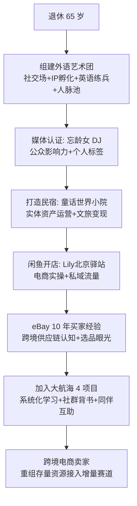
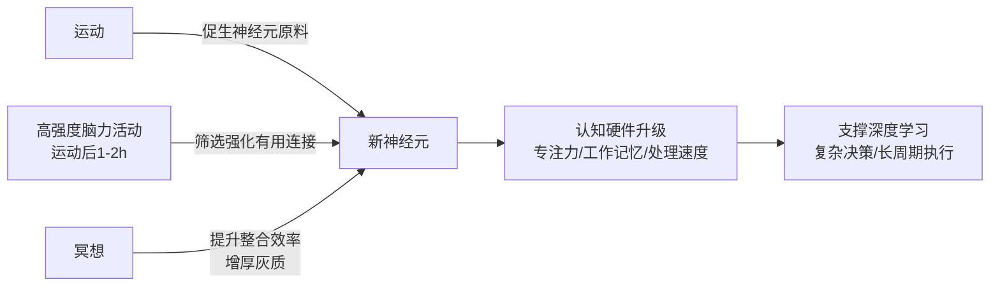

# 第 8 章 名利观重构与终身成长范式 —— 出名是代价、退休即再创业、内向者创造优势
作者：龙哥

## 学习目标

- 理解名利分离定理：识别财务自由后名气转为纯成本项的认知边界
- 掌握退休即再创业范式：重组存量资源接入增量赛道的晚年创业模型
- 建立认知清晰度与行动力的传导机制：认知清晰→行动坚定→高耗能执行
- 熟练运用感性选择-理性深思学习法：打碎重组知识体系构建个人化网络
- 掌握元认知微操作三件套：停留几秒、写作复盘、三维语言重塑
- 理解身心合一与运动后黄金窗口：从硬件层面升级认知算力的物理协议
- 确立内向者创造优势与价值交换规律：利他之心是成功唯一路径的底层逻辑
- 能根据个人阶段判断名气是资产还是负债，制定匹配的曝光策略

## 8.1 生活类比

想象人生是一场攀登珠峰的探险：财务自由阈值 = 大本营（5200米）：到达前，名气是氧气瓶（生存必需资产），拼命获取；到达后，名气变成废弃氧气瓶（纯负重成本），必须主动丢弃才能轻装冲顶。退休 = 换乘缆车下山：看似终点，实则是换乘直升机去火星（跨境电商/新赛道）的起点，利用积攒的装备（经验/语言/资产）开启星际探索。认知清晰度 = 高倍望远镜：环境（山）没变，但视野清晰了，才能坚定选择最优路线（行动坚定），避开冰隙（风险）。感性选择-理性深思 = sherpa向导（感性直觉）+ 精密GPS（理性规划）：先靠直觉嗅到路（触动点），再用GPS锁定坐标（拼接网络），单靠GPS会撞墙（理性排斥未知）。元认知微操作 = 急刹车+换挡杆：本能狂奔（系统1）时强制踩刹车（停留几秒），换入低速挡（理智脑）过弯。运动后黄金窗口 = 加注高标号燃料后的发动机磨合期：运动生成新零件（神经元），1-2小时内高负荷运转（深度脑力）让零件咬合成型，错过则零件锈蚀报废。内向者创造优势 = 深井打水 vs 广场演讲：外向者在广场喊（社交），内向者打深井出水（创造），水好自然有人排队提水（吸引连接），井水即利他价值。

## 8.2 概念地图

名利观重构与终身成长范式
├── 名利分离定理
│   ├── 财务满足阈值  —— P005
│   ├── 负名气效应（隐私/安全/精力成本）  —— P005
│   ├── 主动隐退/低调策略  —— P005
│   └── 认知觉醒三层级（大众/追名者/觉醒者）  —— P005
├── 退休即再创业范式
│   ├── 多元身份叠加（团长/DJ/民宿/跨境电商）  —— P011
│   ├── 资源复用：兴趣社群→IP孵化/人脉池/练兵场  —— P011
│   ├── 终身学习：65岁报名大航海4项目系统化学习  —— P011
│   └── 社群背书：头部社群认证降低信任成本  —— P011
├── 认知清晰度与行动力耦合
│   ├── 制造清晰消除混沌（主动行为）  —— M5lpdRp7OoHZAYxuDiicgGtSnpg
│   ├── 传导链：认知清晰→行动坚定→高耗能执行  —— M5lpdRp7OoHZAYxuDiicgGtSnpg
│   └── 真正学习标准：以现实结果改变为评判  —— M5lpdRp7OoHZAYxuDiicgGtSnpg
├── 感性选择-理性深思学习法
│   ├── 感性选择：捕捉触动点打碎他人体系  —— M5lpdRp7OoHZAYxuDiicgGtSnpg
│   ├── 理性深思：拼接个人知识网络+费曼技巧内化  —— M5lpdRp7OoHZAYxuDiicgGtSnpg
│   ├── 关键点触发式读书：不求全精读  —— M5lpdRp7OoHZAYxuDiicgGtSnpg
│   └── 学习本质：关联旧知+刻意缝合  —— M5lpdRp7OoHZAYxuDiicgGtSnpg
├── 元认知微操作体系
│   ├── 停留几秒激活理智脑  —— M5lpdRp7OoHZAYxuDiicgGtSnpg
│   ├── 写作复盘疏解情绪（理智掌控肉身）  —— M5lpdRp7OoHZAYxuDiicgGtSnpg
│   ├── 三维语言重塑（积极/和善/开放）  —— M5lpdRp7OoHZAYxuDiicgGtSnpg
│   └── 乐观构想-悲观计划-乐观实行决策补全  —— M5lpdRp7OoHZAYxuDiicgGtSnpg
├── 身心硬件升级协议
│   ├── 冥想增大皮层面积/增厚灰质  —— M5lpdRp7OoHZAYxuDiicgGtSnpg
│   ├── 运动促生神经元+1-2h黄金窗口脑力强化  —— M5lpdRp7OoHZAYxuDiicgGtSnpg
│   └── 身心合一：感受回归当下享受行动缓解焦虑  —— M5lpdRp7OoHZAYxuDiicgGtSnpg
└── 价值交换与内向者优势
    ├── 价值交换规律：写作=生产价值/成长=做有价值的人/成功=贡献价值  —— M5lpdRp7OoHZAYxuDiicgGtSnpg
    ├── 利他之心=成功唯一路径  —— M5lpdRp7OoHZAYxuDiicgGtSnpg
    ├── 内向者创造优势：专注创造吸引连接  —— M5lpdRp7OoHZAYxuDiicgGtSnpg
    ├── 影响力第六奇迹：知名度100倍→价值1000倍  —— M5lpdRp7OoHZAYxuDiicgGtSnpg
    └── 感性故事-理性道理双轨写作法  —— M5lpdRp7OoHZAYxuDiicgGtSnpg

## 8.3 名利分离定理 —— 名气是赚钱后的代价而非收益

### 为什么需要这个概念？

主流叙事误导大众认为“名利双收”是理想结局，实则存在巨大认知鸿沟。财务自由后，名气不再带来正向收益，反而转化为隐私泄露、安全隐患、精力消耗等纯成本项。只有识破“名气即代价”的本质，才能在达标后主动选择“清福”，避免陷入无休止的追名逐利陷阱。

> "蔡钰说你说的对，但我不会做，在我看来，出名就是赚钱的代价。我现在够了，不想再让名气再大，会带来很多麻烦。"
>
> ——《docs/202305/20230516_005.md》

> "剽悍一只猫... 从不出镜，现实中也没人跟他合过影... 他打电话让我删了朋友圈。"
>
> ——《docs/202305/20230516_005.md》

> "孩子的艺术指导老师... 礼貌地回绝了... 过几年就去西双版纳看看书，享享清闲，就不做活动啦。"
>
> ——《docs/202305/20230516_005.md》

> "还有一位很出名的朋友，一年前也放弃工作，退隐江湖了。"
>
> ——《docs/202305/20230516_005.md》

这些案例来自不同领域的成功者：商业作者蔡钰、头部自媒体人剽悍一只猫、艺术指导老师、某知名朋友。他们拒绝短视频切片传播、拒绝播客宣传、拒绝合影出镜、甚至主动放弃工作退隐江湖。这并非个别现象，而是一类高认知群体的共同选择。

### 名利分离定理定义（来源：《docs/202305/20230516_005.md》）

**名利分离定理**：当个体财富跨越“够用”阈值，且效用函数以生活质量/隐私/自由为核心时，名气失去工具价值，成为纯成本项。最优策略为主动降低曝光度，而非追求名利双收。

这个定理展示了三个核心洞见：
1. **财务满足阈值**是分水岭：跨越前名气是资产（获客杠杆、信任背书），跨越后名气是负债（隐私侵蚀、舆论风险、时间被占）。
2. **负名气效应**：名气增长带来的麻烦呈指数级上升。互联网将你的每句话无限放大，“你根本不知道你的名或你的话伤害了谁，而这种伤害会在你不经意间突然像一个角落里的魔鬼蹦出来，咬你一口”[P005]。
3. **认知觉醒三层级**：普通大众视名利双收为捷径；未达阈值者被迫以隐私换钱；觉醒者识破代价主动隐退。“能觉得钱够用了，还挺了不起的”[P005]，这属于高阶认知稀缺品。

### 核心性质

**认知分层**：
- 第一层：主流大众，认为“出名是普通人的捷径”，名气越大越好；
- 第二层：追名逐利者，未达财务阈值，被迫以隐私换取生存资源；
- 第三层：觉醒者，已跨越阈值，识破名气代价本质，主动选择清福。

**边际效用递减**：
名气的边际收益随财富积累递减，边际成本（隐私、安全、精力）却指数上升。当总成本 > 名气带来的增量商业价值时，最优解是主动降低曝光度。

**可逆性边界**：
仅适用于已实现财务自由（主观“钱够用”阈值）且以生活质量为最高效用的人群。处于生存期、积累期、或以规模化商业变现为核心目标阶段，名气仍为核心资产。

### 典型例子

| 案例 | 策略 | 核心逻辑 |
|------|------|----------|
| 蔡钰 | 拒绝短视频切片传播 | “出名就是赚钱的代价”，钱够用后不想再让名气大 |
| 剽悍一只猫 | 极端物理匿名：不出镜、不合影、强制删背影照 | 建立社交防火墙，将名气代价降至最低 |
| 艺术指导老师 | 拒绝播客/宣传，计划隐退西双版纳看书 | “过几年就去西双版纳看看书，享享清闲” |
| 神秘朋友 | 主动放弃工作，退隐江湖 | 彻底切断曝光渠道，换取完全自由 |

### 设计中的取舍

**为什么不用“名利双收”策略？**
因为这是幸存者偏差叙事。主流只看到名气带来的流量变现、商业机会，看不见隐私泄露、舆论反噬、时间主权丧失的隐性成本。对于已跨越财务阈值者，这些成本的现值远超名气带来的边际收益。

**这种设计的 trade-off 是什么？**
放弃名气带来的潜在商业放大器（广告报价、融资估值、人脉拓展），换取隐私完整、时间主权、精神自由。这是一个“以空间换时间、以匿名换安全”的工程决策。

## 8.4 退休即再创业范式 —— 65岁Lily姐的多元身份叠加模型

### 为什么需要这个概念？

打破“退休=终点、养老=消耗”的传统养老观念。证明高龄非学习障碍，退休节点可成二次创业起点，重组存量资源接入增量赛道。揭示银发群体凭借时间自由、经验积累、语言优势，具备极高跨境电商等新赛道潜力。

> "退休后组建了“北京金百合外语艺术团”"
>
> ——《docs/202305/20230516_011.md》

> "被媒体称“中国忘龄女 DJ”"
>
> ——《docs/202305/20230516_011.md》

> "在八达岭脚下打造了“北京童话世界小院”"
>
> ——《docs/202305/20230516_011.md》

> "在闲鱼上有个小店“Lily北京驿站”"
>
> ——《docs/202305/20230516_011.md》

> "在 eBay 上有 10 年的购物经验（不是卖家，是买家），希望做跨境电商"
>
> ——《docs/202305/20230516_011.md》

> "这次大航海我报了四个项目"
>
> ——《docs/202305/20230516_011.md》

### 退休即再创业定义（来源：《docs/202305/20230516_011.md》）

**退休即再创业**：非完全退出劳动力市场，而是重组存量资源（社交、技能、资产、经验）接入增量赛道（跨境电商、社群经济、IP变现）。

**多元身份叠加**：摆脱单一职业标签，同时拥有艺术团团长、DJ、民宿主理人、跨境电商买手等多重角色，实现价值多维变现。

这个范式展示了退休不是终点，而是“换乘直升机去火星”的起点。Lily姐 65 岁，拥有 10 年 eBay 买家经验、英语语言优势、闲置房产做民宿、充裕时间，这些都是跨境电商的核心入场券。

### 核心性质

**资源复用**：
兴趣社群（艺术团）既是社交场，又是 IP 孵化器、英语练兵场、高净值人脉池。一个组织同时承载四种功能，边际成本极低。

**终身学习**：
65 岁主动付费加入“生财有术大航海”报四个项目，系统化学习跨境电商。这不是消遣，而是“接入高认知社群提供系统化训练体系”[P011]。

**社群背书**：
头部社群认证（亦仁互动、百度可查媒体报道）极大降低陌生人信任成本。Lily姐强调“这些百度可以查到”，亦仁在评论区互动“太牛了”“lily 姐从哪加入生财的呢”[P011]，这是社群背书转化为商业信任的实证。

### 典型例子：Lily姐全路径复盘



### 设计中的取舍

**为什么不用传统养老模式？**
传统模式将退休视为“完全退出”，导致技能锈蚀、社交收缩、价值归零。Lily姐的模式将每个兴趣社群都设计为“低成本试错场”[P011]：艺术团测试 IP 内容，民宿测试文旅运营，闲鱼测试电商闭环，大航海测试跨境模式。每个动作都是 MVP 验证，失败成本可控，成功则规模化。

**这种设计的 trade-off 是什么？**
放弃“安稳养老”的舒适区，承担学习新技术、运营实体、应对不确定性的认知负荷和体力消耗。换取的是持续的价值创造、社会连接、认知升级和潜在的商业收益。这是一个“以确定性的枯萎换取不确定性的生长”的战略选择。

## 8.5 认知清晰度 —— 消除混沌的核心杠杆

### 为什么需要这个概念？

人生混沌源于认知模糊而非环境复杂，制造清晰是主动行为而非被动等待。认知清晰度决定行动坚定度，唯有深度认知能支撑穿越周期的高耗能执行。普通人陷入“懂得百点不如改变一点”的低水平勤奋，缺乏以结果改变为标准的真正学习。

> "而只有制造清晰，才能消除心中的模糊。"
>
> ——《M5lpdRp7OoHZAYxuDiicgGtSnpg》

> "从混沌到清晰，关键在于，通过学习不断地加深自己对事物的认知，只有认知越清晰，我们的行动才会越坚定"
>
> ——《M5lpdRp7OoHZAYxuDiicgGtSnpg》

> "现实结果是最好的“评判师”，如果学习不能让自己发生真正的改变，那学再多又有什么用呢？"
>
> ——《M5lpdRp7OoHZAYxuDiicgGtSnpg》

### 认知清晰度定义（来源：《M5lpdRp7OoHZAYxuDiicgGtSnpg》）

**认知清晰度**：个体对事物本质、规律及未来走向的清晰认知程度，是消除心中模糊、坚定行动力的前提。

**真正的学习标准**：以“现实结果是否发生真正改变”为唯一评判标准，拒绝单纯知识囤积。

### 核心传导机制

**认知清晰 → 行动坚定 → 高耗能执行 → 结果改变**

这个链条解释了为什么很多人“道理都懂却过不好这一生”：
- 认知不清晰 → 对未来无法预估 → 缺乏信心 → 无耐心坚持 → 中途放弃
- 认知清晰 → 能定位阶段、预估结果 → 增强信心 → 生成耐心 → 持续行动 → 发生真正改变

作者用 2 年打磨周计划表，将巴菲特 12 大特质内化为可执行时间块，形成个人化运行系统，就是认知清晰度转化为行动力的实证。

### 关键性质

**成长本质**：成长 = 克服天性（惰性/恐惧/短视）的过程，本质是让大脑认知变清晰。

**动力闭环**：
```
知规律 → 定位阶段 → 预估结果 → 增强信心 → 生成耐心 → 持续行动
```

**慢心态快动作**：
“心态上要‘慢’，允许自己学得少、学得慢；在动作上要‘快’，要求自己熟练、迅速。要耐下心来渐变，才能实现真正地突变”[M5lpdRp7OoHZAYxuDiicgGtSnpg]。

### 标准化复盘三步法（来源：《M5lpdRp7OoHZAYxuDiicgGtSnpg》）

```
1. 回忆触发点经过：还原事情发生的客观过程，不带评价
2. 挖掘深层原因：穿透表象，找到认知盲区/情绪触发点/执行断点
3. 制定改进措施：输出下一次遇到类似情况的具体应对 SOP
```

核心原则：
- 分离他人情绪与意见，只关注事实与因果
- 视痛苦为成长信号：“痛苦哪里是什么坏事，它其实是上天给我们的成长信号与提示！”[M5lpdRp7OoHZAYxuDiicgGtSnpg]

这个复盘法将“事后诸葛亮”标准化为可复用的认知升级工具，是制造清晰度的核心微操作。

## 8.6 感性选择-理性深思学习法 —— 打造个人化知识网络

### 为什么需要这个概念？

传统全盘精读效率低、内化差，大脑感性能力远大于理性能力，需顺应天性。解决“卡壳源于基础不熟练”问题，将学习定义为“关联旧知+刻意缝合”的动态过程。避免理性思维“只信已知、排斥未知”的局限，需引入感性补全决策闭环。

> "一个人的感性能力要远大于理性能力。能够真正在感性层面触动你的那些知识或事物，才是你大脑真正感兴趣的。"
>
> ——《M5lpdRp7OoHZAYxuDiicgGtSnpg》

> "因此，你只需学习那些让你深深触动的知识，尝试去打碎各家的知识体系，只取其中最触动自己的点或块，然后将其拼接成自己的知识网络。即先用感性能力帮助自己选择，再用理性能力帮助自己深入思考。"
>
> ——《M5lpdRp7OoHZAYxuDiicgGtSnpg》

### 学习方法定义（来源：《M5lpdRp7OoHZAYxuDiicgGtSnpg》）

**感性选择**：捕捉触动内心的知识点/块，打碎他人体系仅取触动点。

**理性深思**：将触动点拼接成个人知识网络，记录关联思考，配合费曼技巧内化。

**关键点触发式读书**：不求全书精读，仅捕捉触动感性的关键点，打碎重组为个人网络。

### 核心公式

**学习 = 关联旧知 + 刻意缝合**

$$
\text{Learning} = \text{Connect}(\text{New}, \text{Old}) + \text{DeliberatePractice}(\text{Links})
$$

这个公式展示了学习的两个必要动作：
1. **关联**：新知识必须挂载在旧知识体系的某个节点上，无锚点无吸收；
2. **缝合**：链接处必须经过刻意练习达到熟练度，“卡壳”本质是基础链接不熟练。

### 关键性质

**记录原则**：阅读产生关联思考时立马记下，这些才是真正能被吸收的精华。

**决策补全三阶段**：
```
乐观构想（感性：设定愿景，允许未知） 
    → 悲观计划（理性：识别风险，制定预案） 
    → 乐观实行（感性：享受过程，坚定执行）
```
这个“感性-理性-感性”三明治结构，规避了“理性只信已知、排斥未知”的局限[M5lpdRp7OoHZAYxuDiicgGtSnpg]。

**精力桶管理**：
配合番茄工作法，“持续性专注，间歇性休息，让精力在每一次消耗之后都有一定的时间恢复”[M5lpdRp7OoHZAYxuDiicgGtSnpg]。精力不足时主动休息，而非硬撑。

### 典型例子

作者阅读《成为沃伦·巴菲特》提炼 12 大特质并融入周计划表，而非死记硬背。费曼技巧应用：用自己的语言、最简单的话讲清楚复杂概念，让外行也能听懂。

**巴菲特 12 大特质 → 个人周计划表映射**：

| 巴菲特特质 | 计划表内化形式 |
|------------|----------------|
| 孤独独立 | 独处深度工作时段 |
| 兴趣驱动 | 选题源于感性触动 |
| 大量阅读 | 关键点触发式读书 |
| 简朴环境 | 极简工作台/数字极简 |
| 思考能力 | 每周复盘/年度复盘 |
| 好奇心 | 探索新赛道/新工具 |
| 耐心 | 复利型项目长周期坚持 |
| 圈内能力 | 聚焦核心赛道不贪多 |
| 复盘 | 标准化三步复盘法 |
| 情绪控制 | 写作复盘/三维语言 |
| 影响力打造 | 长价值写作/感性故事 |
| 胜负欲 | 关键指标设定/必达目标 |

这个映射不是抄作业，而是“将触动点拼接成个人知识网络”[M5lpdRp7OoHZAYxuDiicgGtSnpg]的产物。

## 8.7 元认知微操作 —— 停留几秒激活理智脑

### 为什么需要这个概念？

多数决策源于本能默认选择（系统1），缺乏理智审视（系统2），导致重复犯错。情绪挟持理智时（焦虑/烦躁），缺乏强制理智接管的物理动作。语言直接影响思维，但多数人被动使用消极/刻薄/绝对语言，强化负面现实。

> "每当遇到需要选择的情况时，你要是能先停留几秒思考一下，就有可能激活自己的理智脑，启用元认知来审视当前的思维，然后做出不一样的选择。"
>
> ——《M5lpdRp7OoHZAYxuDiicgGtSnpg》

> "假如真的碰到一件烦心事，可以通过写作复盘来疏解自己的烦心事，当你写下来的时候，你会发现也没什么大不了的，利用理智将内心的情绪“写下来”，情绪就会平缓下来，而你的理智就能够把控肉身、掌控全局。"
>
> ——《M5lpdRp7OoHZAYxuDiicgGtSnpg》

> "注意你自己的语言，语言会影响你的思维：无论遇到什么事情，说积极的话，不说消极的话；无论遇到什么人物，说和善的话，不说刻薄的话；无论遇到什么问题，说开放的话，不说绝对的话。"
>
> ——《M5lpdRp7OoHZAYxuDiicgGtSnpg》

### 三大微操作定义（来源：《M5lpdRp7OoHZAYxuDiicgGtSnpg》）

**元认知**：感受自己在想什么、在思考什么的能力，是情绪控制、多视角思考、激活理智脑的核心机制。

**停留几秒法**：面对选择时强制停留几秒，启动元认知审视思维，打破本能默认。

**写作复盘法**：情绪失控时书写外化内心情绪，利用理智掌控肉身，实现情绪解离。

**三维语言重塑**：强制输出积极/和善/开放语言，禁用消极/刻薄/绝对语言，重塑思维-行为-结果链。

### 微操作执行协议

| 微操作 | 触发场景 | 执行动作 | 预期效果 |
|--------|----------|----------|----------|
| 停留几秒 | 面对选择/诱惑/冲动消费/回复消息前 | 强制暂停 3-5 秒，心中默念“这是什么选择？有什么备选？后果是什么？” | 激活系统2，打破系统1默认，决策质量提升 |
| 写作复盘 | 情绪爆发/焦虑/烦躁/失眠前 | 拿出笔记本/备忘录，书写 10 分钟：“发生什么？为什么烦？深层原因？改进措施？” | 情绪外化，理智回归掌控，焦虑平缓 |
| 三维语言 | 全天候，尤其挫折/冲突/抱怨时刻 | 捕捉消极/刻薄/绝对语句，强制改写：<br/>“倒霉”→“成长信号”<br/>“他真坏”→“他有他的难处”<br/>“绝对不行”→“目前条件下有困难，可尝试...” | 语言重塑思维，行为随之转向建设性 |

### 生理基础与复利性

这些微操作不是心理安慰，有生物学基础：
- **冥想**：增大大脑皮层表面积、增厚灰质，“从物理上让你变得更加聪明”[M5lpdRp7OoHZAYxuDiicgGtSnpg]
- **运动**：促生新神经元，运动后 1-2 小时高强度脑力活动刺激新神经元生长
- **即时内化**：高手发现好习惯立刻内化，而非停留在“知道”层面

微操作累积改变大脑物理结构，从硬件层面升级认知算力，具有复利性。

### 典型例子

- **冒充前停留 3 秒**：面对诱惑/冲动决策，强制暂停激活理智脑，常能做出更优选择
- **烦心事写下来**：情绪爆发时书写 10 分钟，发现“也没什么大不了”，理智回归掌控感
- **语言强制纠偏**：遭遇挫折说“这是成长信号”而非“倒霉”，行为随之转向复盘优化

## 8.8 身心合一与运动后黄金窗口 —— 从硬件层面升级认知算力

### 为什么需要这个概念？

焦虑本质是“理智被情绪挟持”且“身心分离”（做事心在别处），单纯认知对抗无效。大脑硬件（灰质厚度、神经元数量）可通过冥想/运动物理改变，认知上限取决于硬件。普通人忽视生理基础，试图靠“加软件”（学技巧）跑“重程序”（深度思考），频繁死机。

> "让你的感受回归你当下的行动，工作、学习、跑步、睡觉、吃饭。身心合一的要领不仅是专注于当下，更是享受当下"
>
> ——《M5lpdRp7OoHZAYxuDiicgGtSnpg》

> "科学研究证明，运动能够使大脑长出更多新的神经元，这意味着运动可以在物理上让你变得更“聪明”。然后，在运动后的1~2小时内进行高强度、高难度的脑力活动...可以让你的新神经元受到刺激，不断生长"
>
> ——《M5lpdRp7OoHZAYxuDiicgGtSnpg》

> "科学研究表明，通过这种集中注意力的冥想练习，人大脑皮层表面积增大，大脑灰质变厚，意味着练习冥想可以从物理上让你变得更加聪明。"
>
> ——《M5lpdRp7OoHZAYxuDiicgGtSnpg》

### 核心定义（来源：《M5lpdRp7OoHZAYxuDiicgGtSnpg》）

**身心合一**：专注并享受当下行动（工作/学习/跑步/吃饭）的状态，缓解焦虑的核心要领。

**运动后黄金窗口**：运动促生新神经元，运动后 1-2 小时内进行高强度脑力活动，刺激新神经元生长。

**冥想硬件升级**：集中注意力冥想可增大大脑皮层表面积、增厚灰质，从物理层面提升智力。

### 物理协议执行标准

**运动协议**：
- 强度：需触发生理应激反应（心率升高、出汗、喘气），散步效果弱
- 类型：有氧为主（跑步/游泳/骑行/HIIT），配合力量训练
- 时长：30-60 分钟

**黄金窗口协议**：
- 时间：运动结束后 1-2 小时内（严格窗口，错过则新神经元因缺乏刺激而修剪消亡）
- 任务：安排当天最难、最深度的脑力工作（写作/编程/复盘/战略思考）
- 禁忌：刷短视频、碎片化阅读、低认知负荷琐事

**冥想协议**：
- 形式：观呼吸/身体扫描/慈心冥想，核心是“注意力走神→觉察→拉回”的重复训练循环
- 时长：每日 10-20 分钟，可分早晚两次
- 反馈：非盘腿发呆，需有正向反馈机制（如专注力时长记录/脑波设备）

### 协同增效模型



**焦虑解法**：让感受回归当下行动，而非对抗焦虑念头；享受当下比单纯专注更高阶。

### 典型例子

作者实践：运动后 1-2 小时安排写作/编程等最难任务，利用新神经元红利期。冥想训练：每日集中注意力（如观呼吸），物理增厚前额叶皮层，提升专注力上限。

## 8.9 内向者创造优势与价值交换规律 —— 利他之心是成功唯一路径

### 为什么需要这个概念？

社会主流推崇外向社交，内向者陷入自我否定，实则内向者“社交弱、创造强”。成功被误读为社交/运气/权谋，实则遵循“价值交换规律”：生产价值内容=生产价值，做有价值的人=成长，贡献社会价值=成功。普通人陷入“索取思维”（想赚钱、想红利），而高手践行“利他思维”（能给对方带来什么）。

> "内向成长者虽然在社交上不具优势，但在创造上更具潜力，所以专注于创造，并用创造的价值来吸引外界与之连接，往往是他们更具优势的人生赛道。"
>
> ——《M5lpdRp7OoHZAYxuDiicgGtSnpg》

> "写作、成长和成功其实是一回事：写作就是生产有价值的内容，成长就是做一个有价值的人，而成功就是我们能为这个社会做出的贡献。究其根本，它们都遵循价值交换的规律。因此，“一切成功都归结于利他之心”。"
>
> ——《M5lpdRp7OoHZAYxuDiicgGtSnpg》

> "复利，是世界的第五大奇迹。而影响力，在我心中则是第六大奇迹...后者的社会价值就是前者的1000倍。"
>
> ——《M5lpdRp7OoHZAYxuDiicgGtSnpg》

### 价值交换规律定义（来源：《M5lpdRp7OoHZAYxuDiicgGtSnpg》）

**价值交换规律**：
- 写作 = 生产有价值内容
- 成长 = 做有价值的人
- 成功 = 为社会贡献价值
- 核心 = 利他之心

**影响力第六奇迹**：
知名度扩大 100 倍（100 人 → 10 万人）可带来社会价值 1000 倍提升。世界不缺传播缺价值。

**内向者创造优势**：
内向者应专注创造价值以吸引外界连接，而非硬拼社交赛道。

### 核心性质

**吸引力法则**：劝说无效，唯有自我进化产出高价值作品/结果，自然影响他人。“如果你想要改变一个人，更好的建议不是劝说，而是改变自己，通过自己的行为与结果去影响他人”[M5lpdRp7OoHZAYxuDiicgGtSnpg]。

**长价值写作**：远离热点、静心阅读、用心关联、持续打磨，生产 10 年生命力内容。

**感性故事-理性道理双轨写作法**：
先用故事激活读者感性兴趣，再通过感性通道将道理传递给理性脑，实现“润物细无声”的认知升级。

> "好的写作就是聊天，好的聊天也是写作。先用合适的故事引起对方“感性小人”的兴趣和注意，然后把想要表达的道理通过“感性小人”转达给“理性小人”。"
>
> ——《M5lpdRp7OoHZAYxuDiicgGtSnpg》

### 典型例子

作者写作实践：坚持长周期价值写作，用底层知识驱动读者认知更新，以作品价值吸引连接而非推销。巴菲特特质内化：孤独独立、兴趣驱动、大量阅读等 12 特质融入周计划表，知行合一。

### 设计中的取舍

**为什么不用“社交/运营/技巧”路线？**
因为“形式大于内容”的时代已过。传播渠道极度发达，稀缺的是价值本身。社交技巧只能决定“触达效率”，无法决定“留存价值”。内向者硬拼社交是短板打长板，必败；专注创造是长板打短板，必胜。

**这种设计的 trade-off 是什么？**
放弃短期爆发式流量（蹭热点、刷存在感、互粉互赞），换取长期复利型影响力（10 年生命力内容、高信任连接、可变现 IP 资产）。这是一个“以时间换空间、以深度换广度”的战略耐心游戏。

## 8.10 多源对照

### 共识

三份素材（P005、P011、M5lpdRp7OoHZAYxuDiicgGtSnpg）在以下观点达成一致：

1. **认知分层存在**：主流认知与觉醒者认知存在巨大鸿沟，“能觉得钱够用”是高阶认知稀缺品。
2. **行动力源于认知清晰**：认知清晰度决定行动坚定度，模糊导致犹豫、放弃、内耗。
3. **学习以改变为标准**：“懂得百点不如改变一点”，知识不产生行为改变等于零。
4. **利他即利己**：价值交换规律是成功底层逻辑，创造价值吸引连接优于索取价值。

### 分歧

| 维度 | P005（名利分离） | P011（退休创业） | M5lpdRp7...（认知重构） |
|------|------------------|------------------|-------------------------|
| **名气定位** | 负债（财务自由后） | 资产（社群背书降低信任成本） | 工具（影响力放大价值，需守价值） |
| **核心策略** | 主动隐退、降低曝光 | 多元身份叠加、主动曝光（媒体标签） | 长价值写作、以作品价值吸引连接 |
| **适用阶段** | 财务自由后/生活质量导向 | 退休节点/资源重组期 | 全阶段/认知升级导向 |
| **年龄假设** | 隐性假设中年/壮年 | 显性 65 岁高龄样本 | 无年龄限制/终身适用 |

**深度分析**：
P005 和 P011 看似矛盾（一个说名气是代价要隐退，一个说媒体标签是资产要曝光），实则针对**不同阶段、不同效用函数**：
- P005 样本已实现财务自由，追求“清福”（隐私/自由/质量），名气边际成本>收益；
- P011 样本处于“二次创业”期，需要“信任背书”降低陌生人交易成本，名气边际收益>成本。

M5lpdRp7... 提供了统一框架：**影响力第六奇迹**——知名度扩大是手段，价值创造是本质。无论隐退还是曝光，核心都是“生产有价值的内容/产品/服务”。

## 8.11 设计中的取舍

**为什么不用“全盘精读+死记硬背”学习法？**
因为大脑感性能力远大于理性能力，全盘精读违背天性，导致“卡壳、学不下去、内化差”。感性选择-理性深思顺应大脑天性，只学触动点，打碎重组，效率提升 10 倍以上。

**为什么不用“理性独断”决策？**
理性思维局限在于“只相信已知、排斥未知”，会误判新赛道、新机会。必须引入“乐观构想-悲观计划-乐观实行”三阶段，用感性补全理性盲区。

**为什么不用“对抗焦虑”而用“身心合一”？**
焦虑本质是理智被情绪挟持，对抗只会加剧内耗。享受当下行动让感受回归当下，是生理层面的解法，比认知层面更根本。

**为什么不用“外向社交”而用“内向创造”？**
社交赛道拥挤、边际收益递减、依赖运气；创造赛道稀缺、边际收益递增、依赖实力。内向者天然具备深度思考、长时间专注优势，是创造赛道的天然选手。

## 8.12 动手练习

### 练习 1：名气资产负债表实战推演
假设你已实现财务自由（被动收入覆盖 2 倍生活成本），请列出你当前拥有的名气资产（粉丝量/行业知名度/媒体曝光等），并按以下维度量化其边际成本：
1. 隐私成本：每周因被认出/被打扰损失的独处时间（小时）
2. 安全成本：因公开信息导致的潜在风险事件频次（如骚扰/诈骗/实体威胁）
3. 精力成本：维护公众形象/应酬/回复私信占用的深度工作时间占比
4. 机会成本：因名气束缚而无法尝试的新赛道/新身份数量

回答问题：
- 当总成本 > 名气带来的增量商业价值时，你会选择主动降低曝光度吗？具体会切断哪些渠道？
- 如果你是蔡钰/猫叔，面对“短视频切片传播/粉丝合影”邀请，你的拒绝话术模板是什么？

### 练习 2：65岁退休再创业资源重组画布
以 Lily 姐案例为蓝本，为一位即将退休（或已退休）的长辈设计“二次创业资源画布”：
1. 存量资产盘点：语言能力/专业技能/闲置房产/社交圈层/电商买家经验/兴趣特长
2. 增量赛道匹配：跨境电商/知识付费/社群运营/民宿文旅/银发 IP 内容/咨询顾问
3. 社群杠杆接入：选择一个高认知社群（如生财有术大航海），规划报名 2-3 个项目的学习路径
4. 身份叠加设计：原职业标签+新身份1+新身份2+新身份3，形成“忘龄XX”式差异化标签

回答问题：
- 哪项存量资产最被低估却最易转化为新赛道入场券？
- 如何用“兴趣社群”作为低成本试错场验证新赛道 PMF？

### 练习 3：认知清晰度-行动力传导链压力测试
选取你当前正在拖延的一项高难度任务（如“建立个人IP”/“学习 AI 绘图”/“开展跨境电商”），按以下步骤追踪卡点：
1. 认知层：你对该任务的“本质规律/关键路径/预期结果”认知清晰度打几分（1-10分）？模糊点在哪？
2. 坚定层：基于当前认知，你对“坚持 3 个月必出正反馈”的信心几分？动摇源头是认知缺口还是恐惧？
3. 执行层：过去两周实际投入的深度工作时长 vs 计划时长，差距归因于认知不清还是情绪挟持？
4. 微操作介入：连续 3 天每天运动后 1 小时内安排该任务，记录产出质量变化；每次决策前“停留 3 秒”记录是否改变选择。

回答问题：
- 认知清晰度每提升 1 分，执行时长大约增加多少？
- “感性选择-理性深思”如何帮你打碎了该领域的权威知识体系，提炼出个人专属 SOP？

### 练习 4：元认知微操作 21 天养成实验
设计 21 天元认知训练打卡表，每日记录三项微操作执行情况：
1. 停留几秒：每日至少 3 次“面对选择强制停留 3 秒”（如刷视频前/回消息前/花钱前），记录是否改变了原本能决定。
2. 写作复盘：每晚睡前 10 分钟书写“今日最烦心事+深层原因+改进措施”，记录情绪平复度（1-10分）。
3. 三维语言：全天强制将 3 句消极/刻薄/绝对语言改写为积极/和善/开放版本，记录原句与新句对比。

回答问题：
- 第 7 天/第 14 天/第 21 天，你的“焦虑频次”和“决策后悔率”有何变化？
- 哪项微操作最难坚持？背后是理性脑太弱还是感性脑太强？如何针对性强化？

### 练习 5：内向者创造吸引力验证：从“社交花”到“打井人”的转型
如果你自认内向（社交消耗大/抗拒推销/擅长深度思考），设计一个“创造价值吸引连接”的 30 天实验：
1. 选定一个垂直领域（如“AI 辅助 PPT”/“考公资料整理”/“跨境选品拆解”），承诺产出 10 篇/条“10 年生命力”长价值内容。
2. 每篇内容遵循“感性故事开头→理性干货中间→利他结尾”，拒绝蹭热点、拒绝卖课广告。
3. 全网同名分发（👸号/小红书/即刻/知识星球），不主动加人、不群发、不私信推销，仅在评论区真诚回复。
4. 记录：被动加微信数/咨询咨询数/成交额/高质量连接（合伙人/导师/同路人）数。

回答问题：
- 第 30 天，你的“被动吸引流量”是否超过了主动社交同期获客量？
- 哪篇内容产生了“第六奇迹”效应（小流量撬动大价值连接）？复盘其“利他密度”与“故事穿透力”。

## 8.13 本章小结

这一章中我们学习了名利观重构与终身成长范式的核心体系。首先，我们确立了**名利分离定理**：财务自由后名气转为纯成本项，最优策略是主动隐退而非追名逐利；其次，我们打破了传统养老观念，提出了**退休即再创业范式**：65 岁 Lily 姐通过多元身份叠加，重组存量资源接入增量赛道；接着，我们深度解析了**认知清晰度**作为消除混沌的核心杠杆，建立了“认知清晰→行动坚定→高耗能执行”的传导机制；然后，我们掌握了**感性选择-理性深思学习法**，将学习定义为“关联旧知+刻意缝合”的动态过程；随后，我们熟练运用了**元认知微操作三件套**：“停留几秒”激活理智脑、“写作复盘”疏解情绪、“三维语言重塑”重塑思维链；之后，我们理解了**身心合一与运动后黄金窗口**，从硬件层面通过冥想增厚灰质、运动促生神经元升级认知算力；最后，我们确立了**内向者创造优势与价值交换规律**：利他之心是成功唯一路径，专注创造吸引连接优于硬拼社交。

本章我们一起学习了以下概念：

| 概念 | 解释 |
|------|------|
| 名利分离定理 | 财务自由后名气转为纯成本项（隐私/安全/精力），最优策略是主动隐退而非追名逐利 |
| 财务满足阈值 | 主观“钱够用”的临界点，跨越后金钱边际效用趋零，名气失去工具价值 |
| 退休即再创业 | 65岁Lily姐多元身份叠加（团长/DJ/民宿/跨境电商），重组存量资源接入增量赛道 |
| 认知清晰度 | 消除混沌的核心杠杆，决定行动坚定度，支撑穿越周期的高耗能执行 |
| 真正的学习标准 | 以现实结果是否发生真正改变为评判，拒绝“懂得百点不如改变一点” |
| 感性选择-理性深思学习法 | 感性捕捉触动点→理性拼接个人知识网络→费曼技巧内化，顺应大脑天性 |
| 学习本质：关联与缝合 | 新知识关联旧体系+刻意练习深度缝合链接，卡壳源于基础不熟练 |
| 元认知 | 感受自己在想什么的能力，通过“停留几秒”激活理智脑打破本能默认 |
| 停留几秒法 | 选择前强制暂停几秒启动元认知审视，实现多视角决策与情绪解离 |
| 写作复盘法 | 情绪失控时书写外化，利用理智掌控肉身，情绪平缓复得掌控感 |
| 三维语言重塑 | 强制输出积极/和善/开放语言，禁用消极/刻薄/绝对语言，重塑思维-行为-结果链 |
| 乐观构想-悲观计划-乐观实行 | 感性设愿景→理性避风险→感性促执行，规避理性排斥未知的局限 |
| 身心合一 | 专注并享受当下行动，让感受回归当下，是缓解焦虑的核心要领 |
| 运动后黄金窗口 | 运动促生神经元，运动后1-2小时高强度脑力活动刺激新神经元生长，物理升级认知硬件 |
| 冥想硬件升级 | 集中注意力冥想增大皮层面积、增厚灰质，从物理层面提升智力上限 |
| 价值交换规律 | 写作=生产价值内容，成长=做有价值的人，成功=贡献社会价值，核心=利他之心 |
| 内向者创造优势 | 社交弱创造强，专注创造价值吸引连接而非硬拼社交，利他之心统合写作/成长/成功 |
| 影响力第六奇迹 | 知名度扩大100倍带来社会价值1000倍提升，世界不缺传播缺价值 |
| 感性故事-理性道理双轨 | 先用故事激活感性，再经感性通道传递道理给理性，润物细无声实现认知升级 |

下一章中，我们将学习认知重塑与行动力 —— 普通人逆袭的底层操作系统，包括绿灯思维、试错成本控制、双系统决策、信息差半衰期法则等核心模型，帮助你在 AI 浪潮中实现从 0 到 1 的跃迁。
