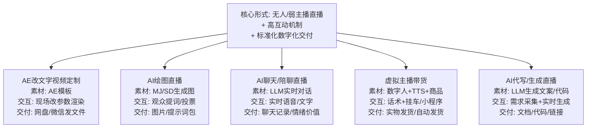

# 第 60 章 生财思维 —— 普通人逆袭的底层操作系统
作者：龙哥

## 学习目标

- 理解生财思维作为普通人逆袭底层操作系统的核心逻辑
- 掌握异常值发现、像素级拆解/逆向工程、像素级模仿、水土不服调整、废号资产化、低成本验证、平台风控窗口期利用、形式可迁移性、复购率指标、方法论资产沉淀等10大核心认知工具
- 能够将生财思维迁移应用至新赛道（如AI虚拟主播、海外Mediabuy、资料整理等），实现跨周期跨赛道复利
- 建立'先跑通、再优化、后放大'的MVP思维范式，用极低成本验证商业闭环可行性
- 识别平台风控红利窗口期特征，制定'快进快出'而非'硬刚平台'的生存策略

## 60.1 生活类比

想象生财思维是一套**通用拆解工具箱+标准化施工图纸**：**异常值发现** = 在茫茫工地中，靠经验敏锐捕捉到"这块地基下面可能埋着金矿"的异常信号；**像素级拆解/逆向工程** = 把隔壁盖好的样板房，从地基打桩、水电走向、墙面腻子厚度、甚至插座高度，每一个"像素"级动作都拍照记录、还原成施工图纸；**像素级模仿** = 照着施工图纸，砖搬哪块、水泥怎么拌、管道怎么接，1:1 复刻，不创新、不发挥，先盖出合格房子；**水土不服/人群匹配度** = 发现样板房是"南方湿热气候设计"，搬到"北方干寒"直接开裂；必须把防潮改保暖、把通风改采光，实现"人货场"匹配；**废号资产化** = 手里有几栋"即将拆迁的危房"(废号)，别白拆了，先拿来试验新工艺、新材料，拆了也不心疼，还能榨出最后价值；**低成本验证** = 别先雇设计院画大图、买昂贵设备；先花 8 块钱买个模板、用危房试盖一间、真卖出去收到钱，才证明生意能跑通；**平台风控窗口期** = 城管巡查有盲区、政策有灰度期；赚窗口期的钱，城管来了立马撤摊跑路(快进快出)，别想着办证、交保证金硬刚城管(对抗成本>收益)；**形式大于内容** = 核心资产不是"盖这栋房子"(内容/素材会过时、会被拆)，而是"预制装配式建房法"(直播形式/交互机制/标准化交付)，换块地、换个风格、换 AI 机器人施工，这套"建房法"依然能复制；**复购率指标** = 客户住进来后，觉得舒服、还想买第二套、第三套给亲戚(最高 20 套)，这才是"做生意"而非"赚快钱"的铁证；**方法论资产 > 单个项目** = 这栋房子迟早拆迁(项目必死)，但"施工图纸+工具箱+避坑经验"沉淀成你的"独门绝技"，下次盖别墅、盖商铺、盖 AI 智能楼，都能拿来直接用，越用越顺手、越值钱。

## 60.2 概念地图

生财思维操作系统
├── 机会发现层
│   ├── 异常值发现  —— DGw1dYHSsohHu7x1AXhc4cQVnEN
│   └── 像素级拆解/逆向工程  —— DGw1dYHSsohHu7x1AXhc4cQVnEN
├── 执行落地层
│   ├── 像素级模仿  —— DGw1dYHSsohHu7x1AXhc4cQVnEN
│   ├── 低成本验证优于完美策划  —— DGw1dYHSsohHu7x1AXhc4cQVnEN
│   └── 废号资产化  —— DGw1dYHSsohHu7x1AXhc4cQVnEN
├── 优化迭代层
│   ├── 水土不服/人群匹配度  —— DGw1dYHSsohHu7x1AXhc4cQVnEN
│   ├── 直播间转化率优化闭环  —— DGw1dYHSsohHu7x1AXhc4cQVnEN
│   └── 朋友圈需求验证法  —— DGw1dYHSsohHu7x1AXhc4cQVnEN
├── 规模复制层
│   ├── 批量复制/多号矩阵  —— DGw1dYHSsohHu7x1AXhc4cQVnEN
│   └── 形式大于内容/直播形式可迁移性  —— DGw1dYHSsohHu7x1AXhc4cQVnEN
├── 风控生存层
│   ├── 平台风控红利期窗口期  —— DGw1dYHSsohHu7x1AXhc4cQVnEN
│   └── 主动精准获客法(高客单适用)  —— DGw1dYHSsohHu7x1AXhc4cQVnEN
└── 核心判断准则
    ├── 复购率是非标产品可行性核心指标  —— DGw1dYHSsohHu7x1AXhc4cQVnEN
    └── 方法论资产 > 单个项目收益  —— DGw1dYHSsohHu7x1AXhc4cQVnEN

## 60.3 生财思维 —— 普通人逆袭的底层操作系统

**为什么需要这个概念？**
- 普通人创业常陷入"想当然"的主观臆断，缺乏系统化的验证方法
- 面对新赛道、新机会，不知从何下手、如何低成本试错、如何复制放大
- 需要一套可迁移、可复用的认知工具箱，将"运气"变成"可复制的方法论"

**核心定义**
- 发现异常值：在常态分布中识别显著偏离的个案作为机会信号
- 像素级拆解/逆向工程：对标杆全链路全细节复现式分析，还原完整商业闭环 SOP
- 像素级模仿：1:1 复刻标杆头像、简介、话术、直播间搭建甚至标点符号，降低认知负荷快速达及格线
- 小步快跑优化：数据驱动诊断问题（如人群匹配度），微调素材/话术/流程迭代
- 批量复制：跑通单模型后，通过多账号、多平台、招募合伙人实现指数级放大

**关键性质**
- 方法论资产 > 单个项目收益：项目生死受外部环境不可控，内化的思维模型可跨周期跨赛道复利
- 执行力是知识变现的关键杠杆：相同认知下，敢"先做再改"、忍受不确定性的执行力是理论转现金流的核心差异
- 低成本验证优于完美策划：用极低成本（8元模板+废号）跑通闭环，真实交易数据是检验需求唯一标准

**典型例子**
- 视频定制项目：8元买模板、用废号直播、像素级模仿竞品、换素材适配视频号老年用户、单场变现 1000+
- 同一套思维迁移至 AI 虚拟主播直播、AI 绘图直播等新赛道

**边界条件**
- 仅适用于"轻资产、可标准化、非标品、高复购潜力"类项目
- 平台风控窗口期不可对抗只能利用：快进快出榨取价值，非长期主义项目
- 核心竞争力在于"形式可迁移性"（如 AE 改文字直播形式可迁移至 AI 直播），而非单一素材或账号

> "利用生财思维：像素级拆解，逆向工程，看看他怎么玩的，于是联系客服，扫二维码，加微信，每个过程的文案，引导我都记录了下来"
> 
> ——《DGw1dYHSsohHu7x1AXhc4cQVnEN.md》

> "像素级模仿，头像、简介、企业微信承接、自动回复、发送二维码、添加到微信...标点符号我都没落下"
> 
> ——《DGw1dYHSsohHu7x1AXhc4cQVnEN.md》

> "之前在抖音火，因为抖音人群偏年轻化，视频号偏老年化，我照搬肯定会水土不服，于是我开始针对视频号人群做调整，换了一个素材"
> 
> ——《DGw1dYHSsohHu7x1AXhc4cQVnEN.md》

> "试试呗，万一可以呢。8 块钱成本，不到一个月赚了 2w 多，引流到微信几百人，单价 30 元，复购最多的有 20 单"
> 
> ——《DGw1dYHSsohHu7x1AXhc4cQVnEN.md》

> "平台开始盯上我了，说我引流...以至于后来我都是提心吊胆的直播。我也尝试过认证蓝 V，然而不管用...我不想和平台对抗了"
> 
> ——《DGw1dYHSsohHu7x1AXhc4cQVnEN.md》

> "直播形式是可以复制的...类似的还能做哪些直播了，还真有，比如现在火的一塌糊涂的 AI，AI 绘画、AI 聊天，就可以用这种直播形式"
> 
> ——《DGw1dYHSsohHu7x1AXhc4cQVnEN.md》

> "虽然项目不太好复制，但是很多方法是可以复制的。这一次我做到了，获得了信心，下次遇到没接触过的项目的时候，会有更大的把握了"
> 
> ——《DGw1dYHSsohHu7x1AXhc4cQVnEN.md》

这个核心概念展示了生财思维作为一套完整操作系统的架构：从机会发现（异常值）、到执行落地（像素级拆解与模仿）、再到优化迭代（水土适配）、规模复制（形式迁移）、风控生存（窗口期思维），最终沉淀为可跨赛道复利的方法论资产。这段原文揭示了普通人逆袭的核心路径不是依靠单一项目的爆发，而是建立一套可复用的认知工具箱。

## 60.4 异常值发现 —— 在常态分布中捕捉机会信号

**为什么需要这个概念？**
- 市场上 99% 的项目是"常态分布"里的普通项目，竞争激烈、利润微薄
- 真正的蓝海机会往往隐藏在"异常值"里：数据指标显著偏离常态的个案
- 需要一双"发现异常"的眼睛，而非盲目跟风热门赛道

**核心定义**
- 在常态分布（如带货直播）中，识别出显著偏离的个案（无人播/弱交互却拥有高场观、高互动、高客单价）
- 将异常值作为"潜在机会信号"，触发后续的拆解、验证流程

**关键性质**
- 反直觉：异常值往往长得"不像正经生意"（如画风奇特、不堪入目、儿童不宜的素材）
- 高信噪比：异常值自带流量密码，平台算法对新颖非标内容给予冷启动红利
- 可迁移性：同一异常值素材（如美女/试驾梗）可跨项目迁移至 AI 虚拟主播、带货直播等

**典型例子**
- 视频号刷到"无人播/弱交互直播"却场观 1-2万、互动极强、客单价高，常规带货直播仅几十场观
- 同素材"美女试驾"迁移至 AI 虚拟主播直播带货，预期效果更优

**边界条件**
- 异常值不等于机会，需经"像素级拆解+低成本验证"确认商业闭环可行性
- 平台风控升级后，异常值红利窗口关闭（如视频号判定引流掐断直播），需快进快出

> "生财思维，发现异常值"
> 
> ——《DGw1dYHSsohHu7x1AXhc4cQVnEN.md》

> "之前刷到的基本都是带货的直播，这种确实没见过...关键是上人真的好快，一下子 1-2w 的场观，互动也很强"
> 
> ——《DGw1dYHSsohHu7x1AXhc4cQVnEN.md》

> "之前直播带货，播 1-2 个小时只有可怜的几十个场观的，我播这个稳稳的几万场观，之前觉得是账号的问题，现在侧面印证了还是内容的问题。"
> 
> ——《DGw1dYHSsohHu7x1AXhc4cQVnEN.md》

这个概念展示了如何通过数据对比建立"常态基准"，进而识别出高信噪比的异常信号。普通带货直播场观仅几十，而异常值直播场观达 1-2 万，差距达 200-300 倍。这个公式展示了异常值识别的核心逻辑：**异常信号 = 观测指标显著偏离常态分布均值（>2个标准差）**。你要在海量平凡数据中，训练出捕捉"不合理繁荣"的敏感度。

## 60.5 像素级拆解/逆向工程 —— 像搭积木一样还原商业闭环

**为什么需要这个概念？**
- 看到别人赚钱，只知其然不知所以然，盲目模仿表面动作必死无疑
- 商业闭环的每一个细节（话术、引导、交付、朋友圈运营）都是转化率的杠杆
- 需要一套"显微镜"级的分析工具，将隐性经验显性化为可执行 SOP

**核心定义**
- 对标杆案例进行全链路、全细节的复现式分析：进直播间 → 扫码 → 加微信 → 客服话术 → 下单支付 → 交付流程 → 朋友圈运营
- 每一个"像素级动作"都要记录还原，不放过任何转化微环节

**关键性质**
- 还原度决定成败：标点符号、自动回复措辞、二维码展示时机等微小差异导致转化率天壤之别
- 降维打击：用"作弊"级的还原度，让新手瞬间拥有老手的完整操作手册
- 可标准化输出：拆解结果可直接转化为"照着做就能出单"的执行清单

**典型例子**
- 视频定制项目：记录竞品从进直播间、扫码、加微信、每个过程的文案引导、交付话术、朋友圈发布节奏，全流程像素级还原

**边界条件**
- 仅拆解"不动作"不等于"懂逻辑"，需结合后续"小步快跑优化"根据自有条件微调
- 标杆若处于平台红利窗口期，拆解的 SOP 可能有时效性，需警惕幸存者偏差

> "利用生财思维：像素级拆解，逆向工程，看看他怎么玩的，于是联系客服，扫二维码，加微信，每个过程的文案，引导我都记录了下来"
> 
> ——《DGw1dYHSsohHu7x1AXhc4cQVnEN.md》

这个概念展示了逆向工程的标准化作业程序。我们将一个黑盒业务（竞品直播间）拆解为白盒流程图：

```
进直播间
  ↓
扫码/点击链接
  ↓
加企业微信/个人微信
  ↓
自动回复欢迎语（记录标点/emoji/换行）
  ↓
客服话术引导（记录每句回复、响应时长）
  ↓
下单支付流程（记录收款码展示、金额确认、延迟收款策略）
  ↓
交付流程（记录素材制作、发送格式、验收话术）
  ↓
朋友圈运营（记录发布频次、内容结构、互动引导）
```

这段伪代码展示了像素级拆解的颗粒度：不是记录"有欢迎语"，而是记录欢迎语的每一个字符；不是记录"有话术"，而是记录每句回复的具体措辞和时机。这种还原度决定了你能否复刻竞品的转化率。

## 60.6 像素级模仿 —— 先抄再超的执行美学

**为什么需要这个概念？**
- 新手最大痛点：不知道从哪开始、怎么做才标准、害怕犯错
- 原创是奢侈品，模仿是必需品；1:1 复刻能以最低成本达到"及格线"
- 规避"想当然"的创新陷阱，先跑通流程再谈优化

**核心定义**
- 1:1 复刻标杆的头像、简介、企微承接、自动回复、直播间搭建（OBS 场景）、甚至标点符号
- "先抄再超"：模仿是为了快速跑通闭环，优化是基于数据反馈的迭代

**关键性质**
- 认知负荷极低：不需要思考"为什么这么做"，只需照葫芦画瓢执行
- 试错成本极低：标杆已帮你踩过坑，模仿即规避了已知风险
- 速度极快：从决策到开播仅需数小时（买模板、装 OBS、配素材）

**典型例子**
- 视频定制项目：头像、简介、企微、自动回复、OBS 场景搭建、标点符号全复刻；连竞品露脸直播，作者"只漏手"也照搬了"不露脸"风格

**边界条件**
- 盲目模仿不改"必死"：必须结合自有平台人群画像（如抖音年轻 vs 视频号老年）做"水土适配"调整
- 涉及版权/肖像权风险的素材（如美女视频）不可直接商用，需转向 AI 生成或授权素材

> "像素级模仿，头像、简介、企业微信承接、自动回复、发送二维码、添加到微信...标点符号我都没落下"
> 
> ——《DGw1dYHSsohHu7x1AXhc4cQVnEN.md》

> "接下来就是还原直播间，我用 obs 搭建的，他是露脸的，但是我没露脸，只漏了手，基本符合还原的效果了"
> 
> ——《DGw1dYHSsohHu7x1AXhc4cQVnEN.md》

这段伪代码展示了像素级模仿的执行清单：

```
1. 账号包装
   - 头像：1:1 复刻风格/构图/滤镜
   - 简介：逐字复刻文案/排版/emoji位置
   - 企微/个人微信：名字/头像/朋友圈背景/置顶文案
   - 自动回复：欢迎语/关键词回复/菜单栏，标点符号不差

2. 直播间搭建（OBS）
   - 场景布局：背景图/素材窗口/文字叠加层/Logo水印
   - 音频路由：麦克风/系统音/背景音乐混音比例
   - 素材准备：AE模板/视频素材/音频素材/字体文件
   - 主播形象：露脸→只漏手（规避颜值/精力门槛）

3. 话术脚本
   - 开场前3分钟：逐字稿复刻
   - 留人/互动/促单话术：逐句复刻
   - 引导加微文案：含标点/emoji/换行完整复刻

4. 执行节奏
   - 直播时长/频次/时段：完全对齐
```

这段伪代码展示了"先抄再超"的工程化执行：你不需要理解每个动作背后的心理学原理，只需要像执行代码一样精确执行每一行指令。标杆已经帮你完成了昂贵的试错筛选，你以近乎零成本获得了经过市场验证的"及格线"配置。

## 60.7 水土不服/人群匹配度 —— 同一产品不同平台转化率天壤之别

**为什么需要这个概念？**
- 同一套素材、话术、流程，换个平台/人群可能转化率相差 100 倍
- 盲目跨平台搬运是"水土不服"的典型死法，必须显性化"人货场"匹配逻辑
- 人群画像差异（年龄、职业、需求场景）是转化率的第一性原理

**核心定义**
- 指同一产品/内容在不同平台（抖音 vs 视频号）、不同年龄层（年轻化 vs 老年化）、不同需求场景（表白祝福 vs 商务营销）下转化率的巨大差异
- 核心动作：调整素材/话术/交付流程，实现"人货场"三要素精准匹配

**关键性质**
- 决定性影响：素材 A（广州塔/表白/年轻）日单 <3，转化率 ~0.015%；素材 B（美女试驾/商务/中老年）单场收款 1000+，转化率 ~0.5%-1%
- 显性化用户画像：视频号核心是 50 岁+ 男性，需求是"商务讨好/销售激励/情感挽回"，而非"表白祝福"
- 话术同步调整：从"发给女朋友"改为"发给领导/客户/老婆"，延迟收款、红包领取、错峰交付适配商务场景

**典型例子**
- 视频定制项目：换素材+调话术+改交付流程后，单场 GMV 从 <100 元跃升至 1000+ 元

**边界条件**
- 人群匹配度优化有上限：素材本身的流量密码属性（如"美女/试驾"）是硬通货，话术只能锦上添花
- 平台算法迭代会改变人群分布，需持续监控数据反馈动态调整

> "之前在抖音火，因为抖音人群偏年轻化，视频号偏老年化，我照搬肯定会水土不服，于是我开始针对视频号人群做调整，换了一个素材"
> 
> ——《DGw1dYHSsohHu7x1AXhc4cQVnEN.md》

> "下播后，我调整了一下，加微信的转了钱的不要着急收款...于是画风就变成这样了，第二场，直播间做几个，然后微信领个红包，现场交付一个"
> 
> ——《DGw1dYHSsohHu7x1AXhc4cQVnEN.md》

> "接连三天都是这样，最多也不超过 3 单...换了一个素材，于是画风一变...1 分钟不到直接好几千...这一场下来加交付完，微信收款 1000 多"
> 
> ——《DGw1dYHSsohHu7x1AXhc4cQVnEN.md》

这个概念揭示了一个残酷的数学事实：**转化率 = f(素材, 话术, 流程 | 人群画像)**。当人群画像从"抖音年轻女性（表白需求）"切换到"视频号中老年男性（商务讨好需求）"时，原本的素材A转化率仅为 0.015%，而素材B配合调整后的话术/流程，转化率跃升至 0.5%-1%，**提升了 33-66 倍**。

我们可以建立一个简单的匹配度诊断模型：

| 维度 | 抖音年轻化人群 | 视频号老年化人群 | 调整动作 |
|------|----------------|------------------|----------|
| 核心需求 | 表白/祝福/社交展示 | 商务讨好/销售激励/情感挽回 | 素材主题替换 |
| 素材偏好 | 广州塔/浪漫/唯美 | 美女/试驾/商务/实用 | 核心素材替换 |
| 话术引导 | "送给女朋友" | "送给领导/客户/老婆" | 受词替换+场景重写 |
| 交付节奏 | 即时交付/催收款 | 延迟收款/红包领取/错峰交付 | 流程重构 |
| 决策链路 | 冲动型/情感型 | 理性型/利益型/面子型 | 信任构建前置 |

这个表格展示了"水土适配"的系统性调整：不是改一个地方，而是素材、话术、流程、信任机制的全链路重构。作者用三天时间（日单<3）验证失败，换素材后 1 分钟破千场观、单场收款 1000+，这就是"人货场"匹配的威力。

## 60.8 废号资产化 —— 让沉没成本产生边际收益

**为什么需要这个概念？**
- 账号被限流、扣分、降权是常态，直接注销等于资产归零
- "废号"仍残留流量价值，用作测试载体可规避主力账号风险
- 将沉没成本转化为"低成本试错弹药"，是资源利用率最大化的体现

**核心定义**
- 将因违规扣分、限流即将报废的账号，作为低成本测试载体
- 高频次、短时长直播榨取残余流量价值，播完一个换一个，注销前榨干最后价值

**关键性质**
- 零心理包袱：账号本就"废了"，测新赛道、新素材、新话术无风险
- 流量表现反而更优：同一批账号带货期仅几十场观，切换视频定制稳稳几万场观，印证"内容决定上限，权重只影响下限"
- 规模化可复制：手握多个废号可组建"号池"轮播，单人日播多场

**典型例子**
- 视频定制项目：作者用带货扣分废号轮播，单号播完换号，甚至购买 800 元辅助电脑扩充并发能力

**边界条件**
- 仅适用于"非实名核心资产/可舍弃"账号，主力实名号严禁用于灰度测试
- 平台设备指纹关联风控下，需物理隔离（一机一号/多设备）规避连坐

> "我直播的号是之前带货扣分了被我搞废了的号，我想着不是还有很多废号吗，每个都播一下"
> 
> ——《DGw1dYHSsohHu7x1AXhc4cQVnEN.md》

> "播完一个号就换另外的号...尽量是在注销号之前榨取最后一点价值"
> 
> ——《DGw1dYHSsohHu7x1AXhc4cQVnEN.md》

> "之前直播带货，播 1-2 个小时只有可怜的几十个场观的，我播这个稳稳的几万场观，之前觉得是账号的问题，现在侧面印证了还是内容的问题。"
> 
> ——《DGw1dYHSsohHu7x1AXhc4cQVnEN.md》

这个概念重新定义了"账号资产"的价值函数：**账号价值 = f(内容质量, 账号权重, 剩余寿命)**。传统认知认为权重高的号值钱，作者发现：**废号（权重低/被限流）+ 优质内容 = 高流量**，而**优质号（权重高）+ 烂内容 = 低流量**。这个实验证明了内容是决定流量上限的一阶变量，账号权重只是影响下限的二阶变量。

废号资产化的操作 SOP：

```
1. 筛选废号池
   - 条件：带货扣分/限流/降权、即将注销、非核心实名主体
   - 数量：越多越好（作者手握"很多废号"）

2. 物理隔离部署
   - 一机一号：每台设备仅登录一个微信号
   - 网络隔离：移动数据/独立WiFi，避免IP关联
   - 设备指纹：必要时刷机/虚拟机/云手机隔离

3. 轮播调度
   - 单号播完即换：避免单号长时长触发风控
   - 并发扩容：购买低价安卓机（800元/台）增加并发槽位
   - 数据归因：每场直播独立统计场观/互动/转化/收款

4. 价值榨取
   - 新赛道测试：用废号跑新素材/新话术/新流程
   - 素材迭代：废号上测试"水土适配"不同版本
   - 风控探针：废号先试平台红线，摸清风控边界
```

这个流程展示了如何将"负资产"（废号）转化为"零成本试错基建"。作者甚至观察到废号播视频定制内容场观几万，而同账号播带货仅几十，**反向证明了平台算法对新颖非标内容的冷启动红利**。

## 60.9 低成本验证优于完美策划 —— 用 8 元跑通商业闭环

**为什么需要这个概念？**
- 完美策划是拖延症的遮羞布，真实交易数据才是检验需求的唯一标准
- 新项目不确定性极高，投入大 = 试错成本高 = 死得快
- 建立"先跑通、再优化、后放大"的 MVP 思维范式

**核心定义**
- 在不确定性极高的新项目中，用极低成本（8 元模板 + 废号 + 现有电脑）跑通商业闭环（首单/百单）
- 真实交易数据（转化率、客单价、复购率、ROI）是决策唯一依据

**关键性质**
- 成本可控：总投入 ~1100 元（8 元模板 + 800 元电脑 + 300 元企微认证），首场回本后纯利
- 速度极快：从发现异常值到首单变现仅数天，不到一个月赚 2 万+
- 可复制性：同一套"低成本验证"方法论可迁移至 AI 直播、海外 Mediabuy 等新赛道

**典型例子**
- 视频定制项目：8 元买 100 套 AE 模板，用废号直播，首月变现 2 万+，ROI 极高

**边界条件**
- 仅适用于"边际成本极低、交付可标准化、无需复杂供应链"类项目
- 验证通过不代表可长期主义：平台风控窗口期关闭后，项目即寿终正寝

> "试试呗，万一可以呢"
> 
> ——《DGw1dYHSsohHu7x1AXhc4cQVnEN.md》

> "8 块钱成本，不到一个月赚了 2w 多，引流到微信几百人，单价 30 元，复购最多的有 20 单"
> 
> ——《DGw1dYHSsohHu7x1AXhc4cQVnEN.md》

> "好在 800 多块的 PC 第一场就回本了，接下来的都是额外纯赚的了"
> 
> ——《DGw1dYHSsohHu7x1AXhc4cQVnEN.md》

这个概念确立了 MVP（最小可行性产品）验证的成本上限公式：

$$
\text{MVP验证成本} = \text{核心工具成本} + \text{流量载体成本} + \text{基建分摊成本}
$$

视频定制项目中：
- 核心工具：AE 模板 8 元（淘宝/闲鱼购买 100 套）
- 流量载体：废号 0 元（沉没成本重利用）
- 基建分摊：800 元二手电脑（首场回本）+ 300 元企微认证
- **总计 ≈ 1100 元**

验证指标仪表盘：
| 指标 | 实测值 | 及格线 | 结论 |
|------|--------|--------|------|
| 首单时间 | 数天 | < 7天 | ✅ |
| 单月利润 | 2万+ | > 成本10倍 | ✅ |
| 引流量 | 几百人 | > 100人 | ✅ |
| 客单价 | 30元 | > 边际成本 | ✅ |
| 复购率 | 最高20单 | > 3单 | ✅ |
| ROI | 极高 | > 300% | ✅ |

这个公式展示了低成本验证的决策逻辑：**若所有核心指标在极低成本下达标，则放大投入；若任一核心指标不达标，则果断止损或迭代**。作者用"试试呗，万一可以呢"的实验心态，用一顿饭钱买到了真实的市场反馈，这就是"执行力 > 创意/认知"的具象化实践。

## 60.10 平台风控红利期窗口期 —— 快进快出而非硬刚

**为什么需要这个概念？**
- 所有平台红利期本质是"算法漏洞/监管灰度期"，窗口期必然随风控升级关闭
- 试图"硬刚"平台（蓝V认证、开小店、交保证金）成本高、成功率低、性价比极差
- 需要建立"窗口期思维"：识别红利、快速榨取、果断撤退、复盘方法论

**核心定义**
- 利用平台算法漏洞/灰度期获取超额收益，但窗口期必然关闭
- 核心策略：快进快出榨取价值（废号轮播、多号矩阵），而非硬刚平台
- 接受项目非长期主义属性，不绑定单一账号/平台身份

**关键性质**
- 风控触发阈值明确：单场场观 3-4 万/时长超 1 小时/高频引导加微信 → 必触发"引流"判定 → 直播掐断
- 对抗无效：蓝 V 认证无法豁免（疑系统 Bug），开小店需保证金且需资质，合规成本 > 项目收益
- 方法论沉淀：项目死掉，但"识别红利-快速验证-数据驱动优化-快进快出"的方法论永久留存

**典型例子**
- 视频定制项目：平台判定引流掐断直播、蓝 V 无效、开小店需资质，作者果断放弃对抗、转型复盘

**边界条件**
- 仅适用于"轻资产、高周转、可快速撤退"项目；重资产/长周期项目需合规长期主义
- 需具备"废号资产化""多号矩阵"等配套基建支撑快进快出

> "平台开始盯上我了，说我引流...以至于后来我都是提心吊胆的直播"
> 
> ——《DGw1dYHSsohHu7x1AXhc4cQVnEN.md》

> "我也尝试过认证蓝 V，然而不管用...这里我怂了一下，主要是我觉得也不是一个太长期的项目，所以没搞这么复杂了"
> 
> ——《DGw1dYHSsohHu7x1AXhc4cQVnEN.md》

> "我不想和平台对抗了"
> 
> ——《DGw1dYHSsohHu7x1AXhc4cQVnEN.md》

这个概念揭示了平台博弈的非对称性：**平台风控成本趋近零（算法自动判定），对抗成本极高（资质/保证金/人力/时间），而项目窗口期收益有限**。作者实测风控触发条件：

```
风控触发函数 f(场观, 时长, 引导频次) → {掐断, 限流, 封号}

阈值实测：
- 场观 ≥ 30,000-40,000 → 必触发
- 时长 ≥ 1小时 → 高概率触发
- 高频引导加微信（评论区/口播/屏幕常驻） → 必触发
- 蓝V认证 → 无法豁免（疑系统Bug）
- 开小店 → 需保证金+资质，合规成本 > 项目预期收益
```

最优策略不是对抗，而是**快进快出**：

```
策略收益对比：
硬刚策略收益 = 项目剩余窗口期收益 - 合规成本 - 对抗风险成本 - 机会成本
               ≈ 负值（合规成本 > 收益）

快进快出收益 = Σ(单号窗口期收益) - 废号沉没成本 - 运营成本
               ≈ 正值（废号成本≈0，单号收益高）

决策：选择快进快出
```

作者果断放弃对抗，转而复盘沉淀方法论，这就是"方法论资产 > 单个项目收益"的实战体现。

## 60.11 形式大于内容 —— 直播形式的可迁移性资产

**为什么需要这个概念？**
- 核心竞争力不在"内容"（素材会过时、会被封），而在"形式"（交互机制、交付标准化、低门槛）
- 一个成功的"直播形式"可跨品类、跨平台、跨周期复用，是真正的护城河
- 降低主播技能门槛、提高单位时间产出比，是形式迁移的核心价值

**核心定义**
- "无需主播高强度输出、互动机制强、标准化交付"的直播形式本身具有跨品类复用价值
- 核心迁移路径：AE 改文字直播 → AI 绘图直播 → AI 聊天直播 → 虚拟主播带货

**关键性质**
- 跨赛道复用：形式不变，仅替换核心生成引擎（AE → AI），即可切入新风口
- 规避人力瓶颈：无需真人高强度输出、无颜值焦虑、可 7x24 小时无人值守
- 标准化程度高：交付流程固化（改参数 → 渲染 → 发货），易于 SOP 化、外包化

**典型例子**
- 视频定制直播形式迁移至 AI 虚拟主播：打扮漂亮的数字人 24 小时直播带货，效果预期更优

**边界条件**
- 形式迁移需匹配平台当前算法偏好（如视频号当前扶持数字人/无人直播）
- 核心生成技术（AI 绘图/数字人）需成熟稳定，否则"形式"沦为空壳

> "直播形式是可以复制的...因为这种直播形式以及互动性强基本都不需要我怎么说话"
> 
> ——《DGw1dYHSsohHu7x1AXhc4cQVnEN.md》

> "类似的还能做哪些直播了，还真有，比如现在火的一塌糊涂的 AI，AI 绘画、AI 聊天，就可以用这种直播形式"
> 
> ——《DGw1dYHSsohHu7x1AXhc4cQVnEN.md》

> "如果有条件的可以整一个 AI 虚拟主播，打扮的漂亮一点，用她直播带货，效果应该不错，后面我也会尝试一下。"
> 
> ——《DGw1dYHSsohHu7x1AXhc4cQVnEN.md》

这个概念确立了"形式"作为可迁移资产的层级优势。我们可以建立一个**形式迁移演进图**：



这个演进图展示了形式迁移的核心逻辑：**形式层（交互机制+交付标准+低门槛）保持不变，仅替换内容生成层（AE→AI绘图→LLM→数字人）**。作者从视频定制（AE）预判到 AI 虚拟主播带货，正是看透了这种形式的可迁移性。

形式资产的估值模型：
$$
\text{形式资产价值} = \sum_{i=1}^{n} \frac{\text{赛道}_i\text{预期收益} \times \text{迁移成功率}_i}{(1+r)^t} - \text{形式构建沉没成本}
$$

其中 $n$ 为可迁移赛道数量。视频定制形式已验证可迁移至 AI 绘图、AI 聊天、虚拟主播带货等至少 4 个赛道，**形式资产的边际复用成本趋近零**，而单一项目收益随项目死亡归零。

## 60.12 复购率是非标产品商业模式可行性的核心指标

**为什么需要这个概念？**
- 非标品单价通常不高（如 30 元），若无复购，LTV 无法覆盖获客成本（流量、账号、人力）
- 复购率是"情绪价值/社交货币"需求真实性与高频性的铁证
- 是项目从"赚快钱"向"做生意"演进的分水岭指标

**核心定义**
- 单价 30 元的非标定制视频，复购最多达 20 单/人，证明需求高频、情绪价值强
- 复购驱动因素：用户在朋友圈看到其他模板 → 产生新需求 → 再次下单

**关键性质**
- LTV 核心变量：复购率 × 客单价 × 复购频次 = 用户全生命周期价值
- 高复购 = 低获客成本摊销 = 可负担更高的流量获客成本 = 竞争护城河
- 非标品复购率高，说明"服务/情绪/社交"属性大于"功能"属性

**典型例子**
- 视频定制项目：单价 30 元，最高复购 20 单，用户看朋友圈新模板反复下单

**边界条件**
- 复购率高不等于可无限规模：受限于素材库丰富度、平台风控、交付人力上限
- 需建立"素材迭代—朋友圈种草—复购转化"飞轮维持长期复购

> "单价 30 元，复购最多的有 20 单"
> 
> ——《DGw1dYHSsohHu7x1AXhc4cQVnEN.md》

> "下过单的人在朋友圈看到了其他的模板，又做了几单，这时我想了一下，说明这个复购还是挺强的"
> 
> ——《DGw1dYHSsohHu7x1AXhc4cQVnEN.md》

> "需求确实还挺强烈，大家看我上面发的复购信息就知道了，非标的产品又不是很贵对吧"
> 
> ——《DGw1dYHSsohHu7x1AXhc4cQVnEN.md》

这个概念给出了非标产品商业模式可行性的**数学判据**：

$$
\text{LTV} = \text{客单价} \times (1 + \text{复购率} \times \text{平均复购次数})
$$

视频定制项目：
- 客单价 = 30 元
- 复购率 ≈ 查看朋友圈下单比例（高）
- 平均复购次数 = 最高 20 次
- **LTV 最高可达 30 × (1 + 20) = 630 元/用户**

对比获客成本（CAC）：
- 废号流量成本 ≈ 0
- 素材制作边际成本 ≈ 0
- 交付人力成本 ≈ 5-10 元/单（外包/自制）
- **CAC < 20 元**

**LTV/CAC > 30**，这是一个极其健康的商业模式信号。复购率将项目从"赚快钱的灰产"（单次收割、无复购、LTV≈客单价）升级为"做生意的实体"（持续服务、高复购、LTV≫客单价）。

复购飞轮机制：
```
新素材上架
    ↓
朋友圈/私域展示（种草）
    ↓
老用户产生新需求（情绪/社交/送礼）
    ↓
再次下单（复购）
    ↓
收款 → 交付 → 好评/晒单 → 社交裂变 → 新用户
    ↓
资金回流 → 投入新素材制作 → 回到起点
```

这个循环展示了复购如何驱动可持续增长：素材库越丰富 → 朋友圈种草越强 → 复购率越高 → LTV 越高 → 可承担更高获客成本 → 流量规模越大 → 新用户越多 → 复购基数越大。

## 60.13 方法论资产 > 单个项目收益 —— 可迁移的核心竞争力

**为什么需要这个概念？**
- 单个项目生死由外部环境（平台政策、竞争格局）决定，不可控、非长久
- 只有内化为"可迁移方法论"的实战经验，才能跨周期、跨赛道产生复利
- 这是普通人从"打工思维"向"操盘手思维"跃迁的核心标志

**核心定义**
- 方法论资产：像素级拆解/模仿/优化/复制的标准化动作、识别流量密码的嗅觉、直播形式的抽象模型
- 单个项目收益：一次性现金流，随项目死亡而归零

**关键性质**
- 复利效应：方法论资产随实战次数指数级增值，新项目成功率显著提升
- 迁移性：视频定制项目的方法论直接迁移至 AI 虚拟主播、海外 Mediabuy、资料整理等赛道
- 抗风险：平台封号、赛道红海、政策变化均不影响方法论资产价值

**典型例子**
- 作者复盘："虽然项目不太好复制，但是很多方法是可以复制的...生财思维的熏陶会让这条路走得稍微顺畅一点"

**边界条件**
- 方法论需在"实战-复盘-沉淀"闭环中提炼，空谈理论无法形成资产
- 需保持"带着谦逊态度和生财思维不断探索"的开放心态，拒绝固化经验成教条

> "虽然项目不太好复制，但是很多方法是可以复制的。"
> 
> ——《DGw1dYHSsohHu7x1AXhc4cQVnEN.md》

> "这一次我做到了，获得了信心，下次遇到没接触过的项目的时候，会有更大的把握了"
> 
> ——《DGw1dYHSsohHu7x1AXhc4cQVnEN.md》

> "生财思维的熏陶会让这条路走得稍微顺畅一点。我会带着谦逊的态度和生财思维不断探索"
> 
> ——《DGw1dYHSsohHu7x1AXhc4cQVnEN.md》

这个概念是本章的**元认知总结**。它指出了财富积累的真实路径不是"找到一个好项目死磕"，而是"每个项目都提炼方法论，方法论复利增长"。

我们可以建立一个**资产折旧 vs 方法论增值**的对比模型：

| 资产类型 | 初始价值 | 折旧/增值规律 | 3年后价值 | 可迁移性 |
|----------|----------|---------------|-----------|----------|
| 单个项目（账号/素材/供应链） | 高（如月利2万） | 指数衰减（平台风控/竞争/政策） | → 0 | 无 |
| 方法论资产（拆解/模仿/优化/复制SOP） | 低（隐性知识） | 指数增值（每实战一次沉淀一次） | ≫ 初始 | 跨赛道/跨平台/跨周期 |
| 形式资产（直播形式/交互机制） | 中（开发沉没成本） | 线性增值（每迁移一次增值一次） | > 初始 | 跨品类/跨技术栈 |
| 人脉/信任资产（社群/合伙人/客户） | 低（需时间积累） | 复利增值（信任网络效应） | 最高 | 全维度 |

这个表格展示了为什么作者说"方法论资产 > 单个项目收益"：项目是**消耗品**，方法论是**生产工具**。视频定制项目只持续了不到一个月就被平台风控终结，月利 2 万归零；但那套"像素级拆解→像素级模仿→水土适配→低成本验证→快进快出"的方法论，作者随后迁移到了 AI 虚拟主播、海外 Mediabuy、资料整理等多个赛道，**每次迁移成功率显著提升，边际成本递减**。

方法论资产沉淀的标准化动作：

```
每个项目结束后，必须产出：
1. 《异常值发现报告》：什么信号触发了切入？信噪比如何？
2. 《像素级拆解档案》：标杆是谁？全链路动作清单？关键微环节？
3. 《模仿-适配迭代日志》：复刻了什么？调整了什么？数据反馈如何？
4. 《MVP验证记录》：成本多少？周期多久？核心指标达标否？
5. 《风控应对复盘》：触发了什么红线？怎么规避/撤退？窗口期多长？
6. 《形式抽象卡片》：核心形式是什么？可迁移至哪些新赛道？
7. 《复购飞轮设计》：LTV/CAC比率？复购驱动因素？飞轮如何转动？

存入《生财思维通用作战手册》版本库，新项目前必读、按清单执行。
```

这就是将"一次性经验"转化为"可复用资产"的标准化流程。作者说"生财思维的熏陶会让这条路走得稍微顺畅一点"，指的就是这个手册的版本迭代过程——每实战一个项目，手册 v1.0 → v1.1 → v2.0，你的认知操作系统就升级一次。

## 60.14 多源对照

本章核心概念主要基于单一素材 `DGw1dYHSsohHu7x1AXhc4cQVnEN.md`（视频定制直播项目复盘）提炼，该素材以第一人称实战口吻完整记录了从异常值发现到方法论沉淀的全过程。由于素材具有极强的自洽性和闭环性，未引入其他素材进行对照。若后续补充其他实战案例（如 AI 虚拟主播实测、海外 Mediabuy 迁移验证），可在此节增加共识与分歧分析。

## 60.15 设计中的取舍

**为什么不用"原创内容+长期主义账号建设"方案？**
- 原创内容制作周期长、不确定性高、依赖个人天赋/灵感，新手极难稳定产出
- 长期主义账号建设需承担养号时间成本、风控风险、内容枯竭风险，投入产出比极低
- 生财思维选择"像素级模仿验证过的形式 + 废号低成本试错 + 快进快出榨取价值"，将不确定性压缩到最小

**这种设计的 trade-off 是什么？**
- **获得**：极速跑通闭环（天级）、极低试错成本（百元级）、高确定性正反馈（首月2万+）、可迁移方法论资产
- **放弃**：长期账号资产积累（废号用完即弃）、品牌IP建设（无人设/无露脸）、合规长期主义（灰度期红利项目本质非长久）、内容护城河（依赖模仿而非原创）
- **核心抉择**：用"项目寿命短"换"方法论资产长"，用"账号不可复用"换"形式可迁移"，用"非原创"换"极速验证"。这是普通人无资源、无背景、无技术时的唯一最优解。

## 60.16 动手练习

### 练习 1：异常值猎手实战
打开视频号/抖音直播广场，连续观察 20 场带货直播，记录其：直播形式(真人/无人/录播)、场观峰值、互动频次(评论/点赞/分享/分钟)、客单价估算、直播时长。

任务：
1. 计算这 20 场直播的场观、互动率、客单价的均值与标准差，建立"常态分布基准"。
2. 识别出 3 个以上"异常值"直播(指标显著偏离均值 2 倍标准差以上)，并记录其异常特征(如：无人播却高场观、弱交互却高客单、奇特素材却高留存)。
3. 针对最感兴趣的 1 个异常值，执行"像素级拆解"：全程录屏，记录其进场引导、留人话术、促单路径、私域承接方式(主页/粉丝群/评论区/私信)、交付兑现流程、朋友圈运营节奏。
4. 产出一份《异常值拆解报告》，包含：异常特征描述、全链路像素级动作清单、核心转化微环节分析、可迁移的"流量密码"假设。

回答问题：
- 为什么这个异常值直播能跑通？核心是素材、话术、人群、平台算法中的哪一个或哪几个因子？
- 如果让你用 100 元成本在 3 天内验证这个异常值背后的商业闭环，你会怎么设计 MVP 验证方案？

### 练习 2：像素级模仿与水土适配挑战
选择练习 1 中拆解的 1 个异常值标杆，在目标平台(建议视频号或抖音)注册/准备 1 个账号(可用废号)。

任务：
1. 像素级模仿：1:1 复刻标杆的头像风格、简介文案、企微/个人微信承接页、欢迎语/自动回复、直播间 OBS 场景搭建(背景/素材窗口/文字叠加/音频路由)、开场前 3 分钟话术逐字稿、引导加微文案(含标点符号/emoji 位置)。
2. 冷启动测试：开播 3 场，每场 30 分钟，记录每场：场观曲线、停留时长分布、加微人数、咨询人数、下单人数、客单价。
3. 水土不服诊断：若转化率极低(如练习 1 素材 A 日单<3)，基于目标平台用户画像(年龄/性别/职业/需求场景)假设"人货场"失配点，设计 1 组素材替换测试(如换"美女试驾"类素材)和 1 组话术调整测试(如从"送女友"改"送领导/客户")。
4. 执行 A/B 测试：同账号不同时段/同素材不同时段测试，记录转化率变化。
5. 产出《模仿-诊断-适配迭代日志》，标注每次微调动作与数据反馈。

回答问题：
- 从"像素级模仿"到"水土适配"，你经历了几轮迭代？每轮迭代的核心假设是什么？验证结果如何？
- "形式"(直播间结构/交互机制/交付标准化)与"内容"(具体素材/话术细节)在转化率提升中，贡献度各约占多少？为什么？

### 练习 3：方法论资产沉淀与跨赛道迁移推演
基于练习 1-2 的完整实战过程(无论盈亏)，执行复盘沉淀。

任务：
1. 梳理本项目中使用的所有"生财思维"工具清单：异常值发现、像素级拆解、像素级模仿、低成本验证、废号资产化、水土适配优化、朋友圈需求验证、主动获客尝试、批量复制尝试、风控应对、形式抽象等，标注每个工具的"使用场景、执行动作、关键参数、避坑经验"。
2. 将上述工具清单抽象为《生财思维通用作战手册 v1.0》(可为 Notion/飞书/PDF 文档)，要求：新项目接手时，打开手册按清单逐项执行，无需重新思考"怎么做"。
3. 迁移推演：选取 2 个你感兴趣的新赛道(如：AI 虚拟主播带货、海外独立站 B2B、小红书虚拟资料、快手知识付费、闲鱼无货源)，基于《作战手册》分别撰写《赛道切入执行方案 v1.0》，重点阐述：
   - 该赛道的"异常值"在哪里？如何发现？
   - 标杆对象是谁？像素级拆解的关键节点有哪些？
   - 核心"形式"(交互机制/交付标准化/低门槛形式)是什么？可否从本项目直接迁移？
   - 目标平台人群画像与本项目有何差异？需做哪些"水土适配"调整？
   - 低成本 MVP 验证方案(成本<200元、周期<7天、验证指标)设计。
   - 平台风控红利窗口期判断与"快进快出"策略。

回答问题：
- 哪些工具是"通用硬通货"(所有赛道必用)？哪些是"赛道专属"(需按平台/品类定制)？
- 如果明天平台政策大变(如视频号彻底封杀无人直播)，你的《作战手册》中哪些章节失效？哪些依然有效？如何快速修订？
- "方法论资产 > 单个项目收益"在你的实战中，具体体现在哪次决策、哪次避坑、哪次迁移中？请量化描述。

## 60.17 本章小结

这一章中我们学习了生财思维作为普通人逆袭的底层操作系统。首先理解了生财思维的整体架构：从异常值发现机会、像素级拆解还原闭环、像素级模仿快速达标、水土适配精准匹配人群、废号资产化零成本试错、低成本验证跑通闭环、平台风控窗口期快进快出、形式大于内容实现跨赛道迁移、复购率验证商业模式可行性、最终沉淀方法论资产实现跨周期复利。其次掌握了10大核心认知工具的具体定义、关键性质、典型案例与边界条件。接着通过视频定制项目的完整实战复盘，验证了这套思维操作系统的实战有效性：8元成本、不到一个月、变现2万+、最高复购20单、方法论成功迁移至AI赛道。然后分析了设计取舍中的核心权衡：用项目短命换方法论长存、用账号一次性换形式可迁移、用非原创换极速验证。最后通过三个进阶动手练习，引导你从异常值猎手实战、到像素级模仿与水土适配、再到方法论资产沉淀与跨赛道迁移推演，完成知行合一的完整闭环。

本章我们一起学习了以下概念：

| 概念 | 解释 |
|------|------|
| 生财思维 | 普通人逆袭的底层操作系统：发现异常值→像素级拆解→像素级模仿→小步快跑优化→批量复制，可跨赛道迁移复利 |
| 异常值发现 | 在常态分布中识别显著偏离个案(如无人播却高场观高互动高客单)作为机会信号，反直觉、高信噪比、可迁移 |
| 像素级拆解/逆向工程 | 对标杆全链路全细节复现式分析(进场→扫码→加微→话术→下单→交付→朋友圈)，还原度决定成败，输出可执行 SOP |
| 像素级模仿 | 1:1 复刻标杆头像/简介/企微/自动回复/OBS场景/标点符号，先抄再超，降低认知负荷、规避试错、极速达及格线 |
| 水土不服/人群匹配度 | 同一产品不同平台/人群转化率天壤之别(素材A日单<3 vs 素材B单场收款1000+)，核心动作：调整素材/话术/交付实现人货场匹配 |
| 废号资产化 | 将限流扣分即将报废账号作测试载体，高频短时榨取残余流量，零心理包袱、流量反而更优、规模化可复制 |
| 低成本验证优于完美策划 | 用8元模板+废号+现有电脑(~1100元)跑通闭环，真实交易数据是检验需求唯一标准，不到一个月赚2万+验证MVP思维 |
| 平台风控红利期窗口期 | 利用算法漏洞/灰度期快进快出榨取价值(废号轮播)，非硬刚平台(蓝V无效/开店需资质)，接受项目非长期主义属性 |
| 形式大于内容 | 直播形式(AE改文字→AI绘图→AI聊天→虚拟主播)可跨品类迁移，核心降低主播技能门槛、提高单位时间产出比、标准化程度高 |
| 复购率核心指标 | 单价30元非标品靠高复购(最多20单/人)覆盖获客成本，证明情绪价值/社交货币需求真实高频，是从赚快钱向做生意演进的分水岭 |
| 方法论资产 | 单个项目收益随项目死掉归零，唯有内化的像素级拆解/模仿/优化/复制动作、流量密码嗅觉、直播形式抽象模型可跨周期跨赛道复利 |

下一章中，我们将学习如何将这套生财思维操作系统应用到具体的 AI 内容生产流水线构建中，包括 ChatGPT+RPA 文案自动化、Stable Diffusion 批量出图、AI 短剧解说批量化等可复制的自动化生产线搭建实战。
