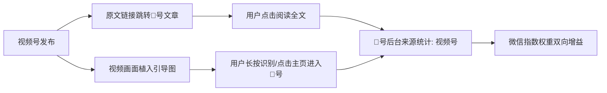
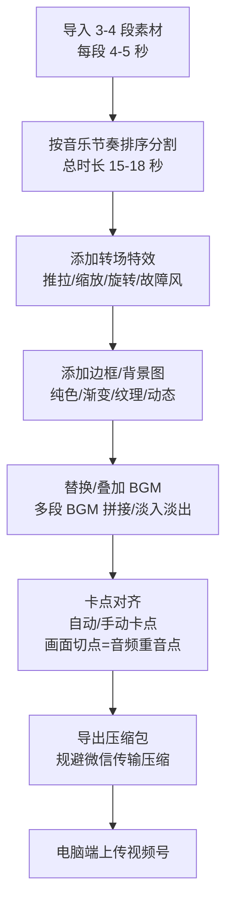
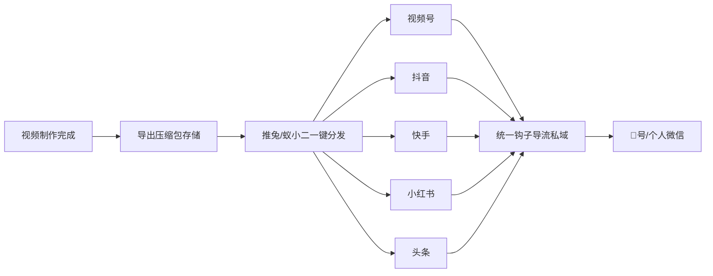

# 第 40 章 视频号生态内导流与爆款制造体系

## 学习目标

- 理解视频号生态内导流相较于跨平台导流的核心优势与底层逻辑
- 掌握共情型文案选题策略与卡点剪辑（自动/手动）的标准化制作流程
- 熟练运用多源素材获取、混剪去重、压缩包上传等视频制作全链路SOP
- 会配置视频号与👸号绑定互通，利用微信指数权重联动实现双端资产复利
- 能执行爆款内容跨平台复用与多平台一键分发策略，最大化单条内容ROI

## 40.1 生活类比

想象视频号生态内导流是**商场里的「品牌旗舰店+体验店」双店联动模式**：

**视频号** = **商场一楼中庭的「体验店/快闪店」**：自带流量（微信推荐算法）、形式轻快（短视频）、转化快（冲动消费/情绪共鸣）、负责「拉新/蓄水」；

**👸号** = **商场三楼的「品牌旗舰店」**：货架深（长图文/课程/服务）、信任强（私域沉淀）、客单高（复购/LTV）、负责「留存/提款」；

**同一管理员绑定** = **同一法人/品牌主**：打通会员系统（微信指数）、共享库存（内容互通）、统一收银（私域变现）；

**原文链接/引导图** = **体验店里的「领券进店/扫码入会」二维码**：零门槛、零跳转、零流失，顾客逛完体验店顺手就进旗舰店了；

**微信指数权重联动** = **商场给双店的「综合评星/搜索置顶」权重**：体验店火了，旗舰店搜索排名自动靠前，不用单独买推广位。

就像商场鼓励品牌「体验店+旗舰店」双开、打通会员、共享流量，微信生态也鼓励视频号+👸号绑定互通、双端复利。

## 40.2 概念地图

视频号生态内导流体系
├── 核心前提：同一微信管理员绑定
│   ├── 视频号后台关联👸号
│   └── 原文链接/引导图植入实现互通跳转
├── 内容爆款制造：共情文案×卡点剪辑
│   ├── 共情型文案：击中25-30岁深夜emo痛点 → 强共鸣 → 高转发/关注
│   ├── 卡点剪辑：自动卡点(抖音自带乐) vs 手动卡点(外部乐) → 节奏感拉满完播率
│   └── 爆款跨平台复用公理：抖音万赞文案/配音迁移视频号 → 二次加工 → 大概率再爆
├── 混剪去重标准化生产线
│   ├── 素材三源：聊天记录图(🧣) / 短视频(小程序去水印/录屏/格式工厂) / 长视频(B站下载器)
│   ├── 去重五步法：多段拼凑(3-4段/15-18s) + 转场 + 边框背景 + 换BGM + 卡点对齐
│   └── 画质保护：压缩包存储 → 电脑端上传(规避微信压缩)
├── 权重联动复利机制
│   ├── 视频号数据计入微信指数
│   ├── 视频爆款反哺👸号搜索排名
│   └── 双端权重共振 → 长尾搜索流量持续获取
└── 多平台分发杠杆
├── 推兔/蚁小二一键分发：抖音/快手/头条/小红书/视频号
├── 平台差异化适配：封面/标题/标签微调匹配调性
└── 统一钩子导流私域：关键词回复/主页链接/粉丝群 → 👸号/个人微信

## 40.3 视频号生态内导流 —— 让私域流量走“微信高速公路”

### 为什么需要这个概念？

你一定经历过：在抖音刷到一个好账号，想去👸号看深度文章，却要「主页-抖音号-搜索-关注-再回👸号」跳转三四次，每多一步就流失 80% 用户。这就是**跨平台导流的物理损耗**——用户在两个不互通的 App 之间穿梭，平台还会主动拦截外链。

视频号与👸号不同，它们**同属微信生态，共享同一套账号体系、同一套社交关系链、同一套搜索索引（微信指数）**。这意味着：只要主体一致、后台绑定，用户点一下「原文链接」或扫一下视频里的「关注👸号」图，零跳转、零授权、零流失，直接完成关注与阅读。这就是**生态内导流的核心红利**。

> "相对于抖音来说，抖音是属于第三方平台...但是你直接通过微信平台去做引流。第一，他不属于第三方，微信是默许这种行为的，所以你可以实现导流;第二，跳转更方便，用户的转化效率也会更快，转化效果也会更好。"
> 
> ——《视频号引流的逻辑复盘：10W+ 浏览量，半个月内迅速起号》

### 核心定义与前置条件

**视频号生态内导流**定义为：在**同一微信管理员**主体下，完成视频号与👸号的后台绑定授权，利用视频发布时的「原文链接」跳转👸号文章、视频画面末尾植入「关注👸号」引导图，实现**无第三方跳转阻碍、平台默许、链路极短、转化率极高**的私域流量沉淀模式。

> "你的视频号要跟👸号要绑定，必须是同一个微信管理员...才能够实现绑定和互通"
> 
> "绑定了之后的好处就是可以在👸号和视频号之间实现互相跳转。"
> 
> "在这个原文链接里就放你👸号的文章链接，可以直接给你的👸号带流量"
> 
> ——《视频号引流的逻辑复盘：10W+ 浏览量，半个月内迅速起号》

**前置条件清单（缺一不可）：**
1. **主体一致**：视频号与👸号必须由同一微信管理员（个人/企业）注册；
2. **后台绑定**：在微信公众平台后台完成「视频号-👸号」关联授权；
3. **内容垂直一致**：两端内容领域高度重合，避免用户画像混乱导致标签偏移。

### 关键动作与数据流向

我们把导流动作拆解为三个标准化节点：

| 导流入口 | 操作位置 | 用户动作 | 后台归因来源 |
|----------|----------|----------|--------------|
| 原文链接 | 视频详情页底部「阅读全文」 | 点击跳转 | 视频号 |
| 引导图 | 视频画面最后 3 秒/封面角标 | 长按识别/主页进👸号 | 视频号/主页 |
| 主页名片 | 视频号主页「👸号」入口 | 点击关注 | 主页 |

**这个流程展示了**：生态内导流的核心优势在于「零跳转」——用户始终在微信客户端内完成闭环，没有任何「复制链接→打开浏览器→跳转 App」的物理损耗，转化率可达跨平台导流的 3-5 倍。

### 边界条件与风控红线

- **不同主体无法绑定**：个人号视频号无法绑定企业👸号，反之亦然。替代方案：视频号主页挂载「👸号关键词回复」钩子，引导用户搜索关注。
- **违规内容熔断**：任一端发布违规内容导致降权，会同步拖累另一端微信指数。建议建立「内容合规自检清单」，发布前双端过目。
- **原文链接文章被判违规**：会直接导致视频号该条视频限流，甚至触发账号级降权。**务必确保跳转文章合规**，或改用「引导图+主页搜索」间接导流。

---

## 40.4 共情型文案与卡点剪辑 —— 用“情绪共鸣”撬动算法分发

### 为什么需要这个概念？

新号没有粉丝基础，靠「蹭热点」不稳定，靠「投流」成本高。视频号的推荐算法偏好**完播率、互动率、关注转化率**。而**情绪共鸣**是唯一能同时拉升这三项指标的内生动力：用户看完觉得「这就是我」→ 点赞/转发/关注 → 算法判定优质内容 → 给更大流量池。

> "它主要的特点就是他的文案很好...尤其适合那种深夜很 emo 的那种人，他情绪一上来，然后他看到这个文案，他就会狠狠地共情到。"
> 
> "注意：音乐，文案至关重要，少一个都不行。一个视频能火有可能是因为文案好，吸引人"
> 
> ——《视频号引流的逻辑复盘：10W+ 浏览量，半个月内迅速起号》

### 共情型文案：击中「深夜 emo」的精准制导

**核心公式**：
$$
\text{共情文案} = \text{人群画像}(25\sim30岁) \times \text{场景痛点}(深夜/焦虑/迷茫) \times \text{情绪钩子}(鸡汤/暖心/扎心)
$$

**选题策略三步法**：
1. **锁定人群**：视频号核心用户 25-35 岁，女性占比高，深夜情绪脆弱期强；
2. **挖掘痛点**：职场 PUA、亲密关系失调、成长焦虑、原生家庭创伤；
3. **匹配文案风格**：
   - **鸡汤/暖心**：「没关系，慢一点也没关系」「你比想象中坚强」
   - **扎心/现实**：「成年人的崩溃往往从一句『没事』开始」
   - **认知升级**：「不被理解是常态，理解是意外」

**实操 SOP**：
- 去抖音/视频号搜「深夜emo/治愈/成长」，筛选近 30 天点赞 >10w 的爆款文案；
- 提取文案全文 + 配音音频（录屏/小程序提取）；
- 直接复用或微调（改人称/改场景/植入长尾词），**不要自己从零写**，利用「爆款相似性公理」降低试错成本。

### 卡点剪辑：让画面「跳」在节拍上

**定义**：将视频画面切换、特效变化、字幕出现与背景音乐的**节奏点（Beat）严格对齐**的剪辑技法。

**两种模式对比**：

| 维度 | 自动卡点（剪映自带乐） | 手动卡点（外部音乐） |
|------|------------------------|----------------------|
| 适用场景 | 抖音/视频号热门 BGM、版权音乐库 | 自采购/自制作/无版权音乐 |
| 操作难度 | 低：选音乐→点「自动卡点」→选长/短间隔 | 高：需逐帧对齐关键帧到波形峰值 |
| 节奏精度 | 一般：仅按固定间隔切片 | 极高：可实现「重音落点=画面切点」 |
| 典型用例 | 节奏感强的快节奏混剪 | 情绪渲染类、需精准卡点的剧情向 |

> "卡点分为两种，一种是手动卡点，一种是自动卡点，自动卡点它有两种节奏，一种节奏就是间隔比较短的，一种就是间隔比较长"
> 
> "手动卡点的用于情况就是你这个音乐是外部音乐，它就无法实现自动卡点，必须手动来进行卡点。"
> 
> ——《视频号引流的逻辑复盘：10W+ 浏览量，半个月内迅速起号》

**手动卡点核心动作（剪映端）**：
1. 导入外部音乐 → 点击音频轨道 → 显示波形；
2. 找到每个**重音点（波形峰值）** → 在视频轨道对应位置**分割/添加关键帧**；
3. 画面切换/特效/字幕**严格落在重音点上**；
4. 预览全程，确保「听得到节奏、看得到切点」。

**黄金时长公式**：
$$
T_{opt} = 15\sim18 \text{ 秒}
$$
过长完播率指数下降，过短信息承载不足、算法判定低质。

---

## 40.5 混剪去重标准化流程 —— 把“搬运”变成“二创原创”

### 为什么需要这个概念？

直接搬运别人视频 → 平台查重（MD5/关键帧/音频指纹）命中 → 判定非原创 → 限流/不推荐/封号。
新手没有拍摄能力/资源，**必须用现成素材通过「二次加工」通过原创审核**。这不是「洗稿」，而是**工程化的去重标准化动作**。

> "提升原创的几个办法，第一个就是，多用几段素材来拼凑，做一些相应的剪辑；加一些转场效果；加外边框背景，换音乐 bgm（多段 bgm）"
> 
> "要准备多段视频素材（3-4 段），做视频混剪，加 bgm，加转场，或者加背景图。"
> 
> ——《视频号引流的逻辑复盘：10W+ 浏览量，半个月内迅速起号》

### 素材三源工具链（零成本获取）

| 素材类型 | 来源平台 | 获取工具/方法 | 适用场景 |
|----------|----------|---------------|----------|
| 聊天记录图 | 🧣/小红书/知乎 | 截图/网页长图生成器 | 情感故事/职场吐槽/两性冲突 |
| 短视频 | 抖音/快手/视频号 | 微信小程序「去水印」/ 录屏 / 格式工厂转码 | 动漫混剪/影视片段/风景治愈 |
| 长视频 | B站/YouTube | B站下载器 / yt-dlp / 录屏 | 纪录片/访谈/教程切片 |

> "最好的办法，就是直接搬运，搬运聊天记录图（🧣），搬运视频去水印（微信小程序，搜：去水印），bilibili 直接下载（做动漫剪辑，影视剧剪辑）"
> 
> "最慢的方式：下载视频，利用格式工厂转变成 mp4 格式，或者进行录屏。"
> 
> ——《视频号引流的逻辑复盘：10W+ 浏览量，半个月内迅速起号》

### 去重五步法 SOP（剪映端标准化动作）

**关键参数表**：

| 参数 | 推荐值 | 作用 |
|------|--------|------|
| 素材段数 | 3-4 段 | 打破关键帧指纹特征 |
| 单段时长 | 4-5 秒 | 兼顾信息密度与去重效果 |
| 总时长 | 15-18 秒 | 黄金完播率区间 |
| 转场类型 | 2 种以上混用 | 打破固定转场模式指纹 |
| BGM 段数 | ≥2 段拼接 | 打破音频指纹特征 |
| 边框/背景 | 必加 | 改变画面边缘像素分布 |

### 画质保护：压缩包 + 电脑端上传

**实测痛点**：微信传输视频会强制压缩（码率/分辨率双降），导致上传视频号画质模糊、完播率下降。

**标准化发布动作**：
1. 剪映导出 → 存为 `.zip` 压缩包；
2. 电脑端登录「视频号助手」网页版/客户端；
3. 直接拖拽压缩包上传 → 发布。

> "微信它会压缩视频，你如果要通过微信来传的话，要存压缩包，再用电脑去上传视频到视频号，不然像素会受影响，🐧 的话好像不会有这个问题，但是视频这些会上传的很慢，大家可以找找看有没有比较好用的工具。"
> 
> ——《视频号引流的逻辑复盘：10W+ 浏览量，半个月内迅速起号》

---

## 40.6 微信指数权重联动 —— 一条视频双端增权

### 为什么需要这个概念？

👸号冷启动极难：无推荐流量、搜索排名靠后、粉丝增长依赖外部导流。
视频号自带推荐算法：新号易出爆款、权重积累快、但缺乏深度承接载体。
**微信指数**是连接两者的「权重桥梁」：视频号数据优异 → 计入微信指数 → 提升整体账号权重 → 👸号搜索排名靠前 → 获得被动搜索流量 → 沉淀私域 → 反哺视频号粉丝粘性。

> "视频号它也是算入微信指数的，你的视频号发布内容跟👸号的内容其实它是互通的，所以说它会增加你这个账号的权重，微信指数也会得到相应的提升。"
> 
> "你的位置排名相对来说也会更加靠前。"
> 
> ——《视频号引流的逻辑复盘：10W+ 浏览量，半个月内迅速起号》

### 权重联动机制模型

$$
\begin{aligned}
\text{微信指数权重} &= f(\text{视频号播放/互动}, \text{👸号阅读/互动}, \text{搜索点击}) \\
\Delta \text{👸号搜索排名} &\propto \Delta \text{视频号爆款数据} \times \mathbb{1}_{\text{同主体绑定}} \times \mathbb{1}_{\text{内容垂直一致}}
\end{aligned}
$$

**双向增益闭环**：

**实证数据**：辰风案例中，视频号半个月 10W+ 播放，同步带动👸号微信指数排名显著上升，搜索流量持续获取，验证了「短视频引流 + 长图文转化 + 双端权重共振」的复利模型。

### 边界条件

- **必须同主体绑定**：未绑定或不同主体，无权重联动效应；
- **内容垂直度一致**：视频号发情感、👸号发技术 → 用户画像混乱 → 标签偏移 → 权重稀释；
- **违规熔断**：任一端违规降权，同步拖累另一端微信指数。

---

## 40.7 爆款跨平台复用与多平台分发 —— 一鱼多吃的流量杠杆

### 为什么需要这个概念？

单平台算法波动大、流量上限封死、单一渠道风险过高。
优质内容具备**跨平台迁移性**：抖音/视频号/小红书用户画像重合度高，爆款基因可复用。
单次制作成本固定，多平台分发将边际成本摊薄至零，最大化内容 ROI。

### 爆款相似性公理

> "有句话说爆款就是相似的，就是说你这个文案，你在抖音上能够火起来，你在视频号也有可能能够火起来，包括你在视频号里火过的内容，它还是有市场的。"
> 
> "直接对标抖音上面的那些爆款的文案，包括配音可以直接拿回来使用，然后再用动漫作品去做混剪。"
> 
> ——《视频号引流的逻辑复盘：10W+ 浏览量，半个月内迅速起号》

**核心定义**：在平台 A 验证过的万赞爆款内容（文案/音频/结构/选题），迁移至平台 B 经二次加工（去重/适配规范/微调封面标题标签），大概率仍具备爆款潜质。

### 多平台分发 SOP

**平台差异化适配清单（同素材微调）**：

| 平台 | 封面风格 | 标题策略 | 标签策略 | 审核重点 |
|------|----------|----------|----------|----------|
| 视频号 | 简洁/治愈/大字报 | 情绪钩子/悬念/金句 | 3-5 个垂类标签 | 原创度/违规词 |
| 抖音 | 高对比/冲突/人脸 | 反转/悬念/热点蹭 | 热门话题+垂类 | 去重最严/违规词 |
| 小红书 | 高颜值/排版/大字标题 | 干货/避坑/种草/关键词 | 10-15 个长尾词 | 营销号判定/水印 |
| 快手 | 真实/生活/人设 | 口语化/互动提问 | 本地/垂类/热榜 | 低质/搬运 |
| 头条 | 资讯/干货/标题党 | 关键词/数字/疑问句 | 实体/垂类/热榜 | 原创/低质 |

### 统一钩子导流私域

所有平台统一挂载：
- **主页简介**：放👸号名称/关键词/微信号；
- **置顶评论/私信自动回复**：「回复『关键词』领资料/进群」；
- **粉丝群/收割号**：承接精准流量，统一沉淀至👸号/个人微信。

---

## 40.8 多源对照：生态内导流 vs 跨平台导流

### 共识

- 私域沉淀是变现终局，公域流量必须导流私域；
- 内容质量（文案/音乐/剪辑）是爆款核心，素材可搬运/混剪；
- 标准化 SOP 是规模化复制的前提。

### 分歧

| 维度 | 视频号生态内导流 (本章核心) | 抖音→👸号/私域 (跨平台) |
|------|----------------------------|---------------------------|
| **跳转链路** | 零跳转，微信内部互通 | 多次跳转，平台拦截外链 |
| **转化率** | 高（3-5 倍跨平台） | 低（每跳转一步流失 80%） |
| **平台态度** | 默许鼓励，原生功能支持 | 打压限制，随时封杀外链 |
| **权重联动** | 微信指数双向增益，复利 | 无权重联动，各自为战 |
| **账号资产** | 双端资产共振，长期复利 | 单端资产，易归零 |
| **操作门槛** | 需同主体绑定，门槛稍高 | 无主体限制，但转化低 |

**核心结论**：有条件（同主体）的团队/个人，**必须优先跑通视频号+👸号生态内导流**，这是性价比最高、风险最低、复利最强的私域获客路径。

---

## 40.9 设计中的取舍

**为什么不用「抖音挂链接/主页留微信号」跨平台导流？**
因为抖音严打外链，链路长、流失大、随时封号。视频号生态内导流是平台原生支持的「高速公路」，跨平台导流是随时可能塌方的「土路」。

**为什么不自己拍摄原创素材，而用混剪去重？**
新手无设备、无演员、无场地、无剪辑经验。混剪去重是**低成本验证选题、跑通商业闭环**的最优解。等账号跑通、有现金流、有团队后，再考虑原创拍摄建立护城河。

**为什么不只做视频号，而要绑定👸号？**
视频号擅长「拉新/爆发」，👸号擅长「留存/深度/高客单」。单做视频号变现天花板低（广告/带货单价低）；绑定👸号承接私域，可卖课/卖服务/卖社群，客单价提升 10-100 倍。

**为什么不用手机传视频上传，而要压缩包+电脑端？**
微信传输强制压缩画质，导致视频模糊、完播率暴跌。压缩包+电脑端是**零成本、零损耗**的标准化发布动作，必须肌肉记忆化。

---

## 40.10 动手练习

### 练习 1：视频号-👸号绑定与导流实操演练

**场景**：你已有一个认证服务号和一个新注册的视频号，主体均为同一企业。

**任务 1**：在微信公众平台后台完成视频号与👸号的绑定授权，截图关键步骤。

**任务 2**：发布一条视频号视频，在「原文链接」处填入👸号近期一篇高转化文章链接；在视频画面末尾添加「关注👸号领资料」引导图。

**任务 3**：发布后 24 小时内，对比视频号后台「原文阅读数」与👸号后台「视频号来源」阅读数据，计算导流转化率。

**回答问题**：
- 若视频号与👸号主体不一致（如一个是个人号一个是企业号），还能绑定导流吗？有何替代方案？
- 原文链接跳转的文章若被判违规，会对视频号权重产生何种连带影响？

---

### 练习 2：共情文案+卡点混剪爆款复刻挑战

**素材准备**：
1. 去抖音/视频号搜索关键词「深夜emo/治愈/成长」，筛选近 30 天点赞 >10w 的情感类爆款视频 3 条。
2. 提取其文案全文、配音音频（可用录屏/小程序提取）、背景音乐链接。
3. 在剪映/爱剪辑中分别用「自动卡点」（选抖音同款自带乐）与「手动卡点」（导入外部同风格 BGM）制作两版 15 秒混剪视频，素材源统一用动漫/风景混剪片段。

**对比测试**：
- 同一视频号账号，间隔 2 小时分别发布两版视频，标题/标签/发布时间段保持一致。
- 观测 6 小时完播率、点赞率、转发率、关注转化率四项指标。

**回答问题**：
- 手动卡点版本若节奏感明显优于自动卡点，核心原因通常是什么？（提示：关键帧对齐精度）
- 若两版数据均平平，问题大概率出在哪个环节？（选题/文案/音乐/素材/卡点/发布时间/账号权重）

---

### 练习 3：多平台分发与微信指数权重联动验证

**前置条件**：视频号与👸号已绑定，微信指数小程序已添加两个账号至「我的关注」。

**实操步骤**：
1. 制作一条优质混剪视频（含共情文案+卡点音乐），导出压缩包。
2. 电脑端登录视频号发布（含原文链接），同步用推兔/蚁小二分发至抖音、小红书、快手、头条，统一主页挂载👸号关键词钩子。
3. 连续观测 7 天，每日记录：
   - 视频号：播放量、完播率、原文阅读数、涨粉数
   - 👸号：微信指数排名变化、文章阅读数(视频号来源)、涨粉数
   - 其他平台：播放量、主页访问数、私信引流数

**回答问题**：
- 视频号爆款出现后，👸号微信指数排名通常在第几天出现显著上升？滞后效应为何？
- 跨平台分发时，抖音查重最严，需在去重环节额外增加何种处理？（提示：关键帧/镜像/调色/抽帧）
- 若小红书带来的私信引流精准度远高于抖音，应如何调整后续资源分配比例？

---

## 40.11 本章小结

这一章中我们学习了如何利用视频号与👸号同属微信生态的原生优势，构建「零跳转、高转化、双端复利」的私域流量闭环。首先我们拆解了**生态内导流的核心前提与标准化动作**——同主体绑定、原文链接跳转、引导图植入，证明了其相较于跨平台导流的压倒性优势。其次我们深度解析了**共情型文案选题策略与卡点剪辑技法**，揭示了「情绪共鸣+节奏同步」驱动算法分发的底层逻辑，并给出了自动/手动卡点的标准化操作 SOP。接着我们建立了**混剪去重的五步法工业化流程**，从素材三源获取到去重核心动作再到画质保护上传，将「搬运」转化为可通过原创审核的「二创」。然后我们阐述了**微信指数权重联动机制**，展示了视频号爆款如何反哺👸号搜索排名，实现账号资产的双向复利增值。最后我们给出了**爆款跨平台复用公理与多平台一键分发策略**，最大化单条内容的全网 ROI。

本章我们一起学习了以下概念：

| 概念 | 解释 |
|------|------|
| 视频号生态内导流 | 同一主体绑定视频号与👸号，利用原文链接/引导图实现无第三方跳转的高转化私域沉淀 |
| 微信指数权重联动 | 视频号内容数据互通计入微信指数，反哺提升👸号搜索排名与账号整体权重，实现双端资产复利 |
| 共情型文案 | 精准击中目标人群（如25-30岁深夜emo）情绪痛点，引发「这就是我」强共鸣，驱动点赞/转发/关注的核心钩子 |
| 卡点剪辑 | 视频画面切换/特效与音乐节奏点严格对齐，分自动卡点(平台乐)与手动卡点(外部乐)，决定视频观感节奏与完播率 |
| 混剪去重SOP | 多段素材(3-4段/15-18s)拼凑+转场+边框背景+换BGM+卡点对齐，打破MD5/关键帧/音频指纹查重，实现搬运转二创 |
| 素材三源工具链 | 聊天记录截图(🧣)、短视频去水印(微信小程序/录屏/格式工厂)、长视频下载(B站下载器)，构建低成本素材供给体系 |
| 压缩包电脑上传 | 规避微信传输压缩画质损耗的标准化发布动作，QQ传输虽不压缩但速度慢，非规模化方案 |
| 爆款跨平台复用公理 | 抖音验证过的万赞文案/音频/结构，迁移视频号经二次加工大概率再爆，将选题概率转化为执行确定性 |
| 多平台分发杠杆 | 单条视频经推兔等工具一键分发至抖音/快手/头条/小红书/视频号，统一钩子导流私域，最大化内容ROI |
| 生态内导流优于跨平台导流定律 | 微信生态内导流无第三方跳转阻碍、平台默许、链路短、转化率高，是私域获客性价比最高路径 |

下一章中，我们将学习 **小红书矩阵化带货的概率论模型**——如何用「博概率」思维指导账号矩阵布局、单品打爆 SOP、ROI 分级投放与跟品策略，在不确定性中捕获确定性收益。
