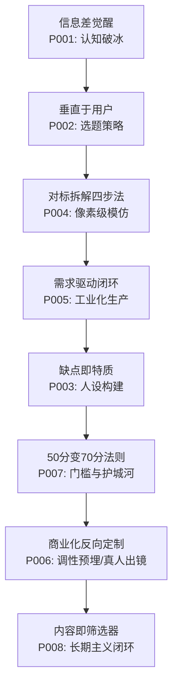

# 第 29 章 小红书知识付费IP打造 —— 从"信息差觉醒"到"50分变70分服务50-60分"的长期主义
作者：龙哥

## 学习目标

- 理解普通人如何通过"信息差"认知打破"大博主=天选之子"的心理壁垒，建立"随时入场"的平台机制信心
- 掌握"垂直于用户而非垂直于内容"的动态选题策略，学会从评论区/私信挖掘用户全生命周期痛点
- 熟练运用"对标账号四步拆解法"与"爆款选题三要素"，实现像素级模仿与系统化超越
- 建立"需求驱动闭环"：外部反馈→内部代入→内容生产→再获反馈，配合思维导图实现素材库工业化管理
- 领会"缺点即特质"与"50分变70分服务50-60分"的IP人设构建逻辑，通过暴露弱点建立高信任人设
- 掌握商业化反向定制策略：调性预埋、关键词布局、真人出镜，主动构建品牌方偏好的商业化人设
- 理解"内容即筛选器"的长期主义商业逻辑：真实成长吸引真实伙伴，形成信任-付费-共同成长-合伙人的高阶闭环

## 29.1 生活类比

想象小红书IP打造是一场"普通人进阶训练营"的直播秀。观众手里拿着"求助卡"（Query），上面写着考研焦虑、英语哑巴、人际内耗、原生家庭创伤；选手桌上放着"通关档案"（Key），记录着二本逆袭、雅思8分、考研上岸、焦虑自愈；选手现场演示"避坑指南/作弊码"（Value），给出具体方法论、思维模型、工具清单、情绪共鸣。当观众发现"这选手跟我经历一模一样/比我强一点点（50→70分）"时，相似度匹配发生，Softmax（关注决策）启动：观众投票——"我要跟他学/买他的课/进他的群/做他的合伙人"。就像选秀节目不需要选手是"完美天才（100分专家）"，观众更爱"比我强一档、还承认自己笨/焦虑/功利、愿意手把手教我的真实学长（70分进阶者）"。平台算法是导演：不看资历（账号权重/入场时间），只看当期表现（内容质量/垂直度/冲突感），谁能让观众（用户）留下来、互动、付费，谁就拿流量（推流）。

## 29.2 概念地图

- 小红书知识付费IP打造
  - 认知底座
    - 信息差觉醒：普通人也能做大博主、随时入场论  —— P001
    - 50分变70分法则：进阶者优势替代专家壁垒  —— P007
    - IP核心公式：共性(普通人)+特性(弱点)=信任  —— P003
  - 选题策略
    - 垂直于用户：全生命周期需求动态调整  —— P002
    - 对标拆解四步法：搜词-析结构-联经历-精准对标  —— P004
    - 爆款选题三要素：成就+心理落差/反差感  —— P004
    - 需求驱动闭环：评论/私信→用户视角→思维导图素材库  —— P005
  - 人设构建
    - 缺点即特质：暴露功利/自卑/焦虑引发共情  —— P003
    - 真人出镜增强信任：上半干货下半广告位  —— P006
    - 广告调性预埋：内容风格统一+关键词预埋  —— P006
  - 生产体系
    - 爆款选题库：对标/热点/反馈/碎片四源  —— P005
    - 写作SOP标准化：将灵感转化为工业化流水线  —— P005
    - 网感本质：大量刻意练习后的快速直觉  —— P005
  - 商业闭环
    - 变现路径迭代：广告→知识付费→矩阵/卖号/引流  —— P008
    - 忠于自我长期主义：慢即是快、真实成长换真实信任  —— P008
    - 内容即筛选器：人才是目的、数据非目的  —— P008

## 29.3 信息差觉醒 —— 普通人也能做大博主的认知破冰

### 为什么需要这个概念？

很多人觉得百万大博主是天选之子，自己做不到，产生认知壁垒不敢入场。实际上大众眼中的"稀缺知识"往往是创作者的"平常认知"，信息差天然存在。小红书去中心化推荐机制基于内容质量而非账号权重/时间，任何时间入场都能分到流量。

### 核心定义

> "原来百万博主就在我身边，现实生活中看起来也很普通。原来普通人也能做大博主。"
> 
> "很多我以前看到过的文章、句子、方法、知识，被某个自媒体拿出来讲一遍就能火。"
> 
> "事实证明，直到现在我明白了小红书的流量机制，才意识到，小红书的流量机制，什么时候入场都可以！"
> 
> ——《漫漫小红书半年复盘》

打破"大博主=天选之子"的认知壁垒：普通人身边即有百万博主，且大众眼中的"稀缺知识"往往是创作者的"平常认知"，信息差天然存在，入场从不晚。小红书流量机制的"随时入场论"：去中心化推荐基于内容质量，只要内容符合机制偏好（垂直、有价值、有冲突），什么时候入场都可以。

这个定理展示了两个核心认知：**认知门槛极低**（不需要专业背景，只需发现身边触动点并内化输出）和**平台机制友好**（新号与老号同台竞技，内容质量是核心变量）。

### 关键性质

- **认知门槛极低**：不需要专业背景，只需发现身边触动点并内化输出
- **平台机制友好**：新号与老号同台竞技，内容质量是核心变量
- **复利效应显著**：统一ID、头像、简介降低认知成本，积累品牌复利

### 典型例子

- 作者身边的百万博主"现实生活中看起来也很普通"
- 很多以前见过的文章、句子、方法、知识，被自媒体拿出来讲一遍就能火
- 作者首篇笔记《雅思居然考了8分，但是依然出不了国》即爆款，验证入场即有机会

### 边界条件

- 需具备基本的内容生产能力（文字/图片/视频）
- 必须接受"普通人"人设，拒绝完美人设包装
- 仅适用于去中心化推荐机制平台（如小红书），不适用于强关系链/权重制平台

## 29.4 垂直于用户 —— 而非垂直于内容的选题策略

### 为什么需要这个概念？

传统认知认为账号必须垂直于单一学科（如只讲雅思），导致选题枯竭、粉丝需求未被满足。用户需求是动态的、全生命周期的（学习、考研、人际、心理、赚钱），固定内容方向无法覆盖。只有围绕用户痛点动态调整内容，才能实现"篇篇爆款、选题停不下来"。

### 核心定义

> "垂直于用户，而不是垂直于内容。解决用户需求。"
> 
> "其实我内容的变化，是围绕着用户的需求。我对用户的需求观察，来自于评论区和私信。"
> 
> ——《漫漫小红书半年复盘》

内容方向不固定于单一学科，而是围绕目标用户群体的全生命周期需求动态调整，解决用户实际痛点。观察来源为评论区和私信，而非自我臆造。

这个策略展示了**动态适应性**（内容随用户成长阶段迁移：雅思→考研→工作→人际→心理→赚钱）、**高粘性**（解决真问题比单纯输出知识更能留住人）、**反脆弱**（单一赛道枯竭时可无缝切换至用户关联的新赛道）。

### 关键性质

- **动态适应性**：内容随用户成长阶段迁移（雅思→考研→工作→人际→心理→赚钱）
- **高粘性**：解决真问题比单纯输出知识更能留住人
- **反脆弱**：单一赛道枯竭时可无缝切换至用户关联的新赛道

### 典型例子

- 作者从雅思起家，后延展至考研、英语学习、人际关系、原生家庭、焦虑缓解、赚钱认知等全维度
- 对标账号"软柠柠"（二本考研985）、"niki1998"（二本努力学英语）、"未央erin"（学习感悟）均为"经历相似、起号快、粘性高"的用户视角账号

### 边界条件

- 必须深度定义目标用户画像（如：二本/非名校、想上进、有焦虑、普通家庭女生）
- 创作者需具备跨领域的学习/整合能力，或建立素材库/对标库支撑
- 切忌无边界发散，所有内容必须服务于核心用户群的某个具体痛点

## 29.5 缺点即特质 —— 暴露人性弱点建立真实人设的共情机制

### 为什么需要这个概念？

传统IP建设追求"正能量、完美、专家"人设，导致与普通用户产生距离感，信任度低、转化难。完美人设不可信，完整人设最动人；暴露弱点反而能引发大众共情，成为最高阶流量密码。普通人无法成为顶尖专家，但可以做"有棱角的真实普通人"，建立"共性+特性"的信任锚点。

### 核心定义

> "所以，你不被人看好的'缺点'，可能是你的特质。比如'功利性''目的性''算计''爱占便宜''孤僻''高敏感''笨'，其实都能引起大部分人的共情！"
> 
> "得是真人，更是普通人，你的经历才能有参考价值，（共性+特性）"
> 
> "一个完整的、有棱角的人，比一个完美的、圆滑的人，更能引起情绪共鸣。"
> 
> "一篇1万赞的笔记，涨了2万粉....我惊呆了。"
> 
> ——《漫漫小红书半年复盘》

主动暴露"功利、自卑、焦虑、孤僻、高敏感、笨"等被视为缺点的人性弱点，引发大众共情，建立"真实、有棱角、可信任"的IP人设。IP核心公式：共性（普通人）+ 特性（个性/弱点）= 信任与参考价值。

这个机制展示了三个关键性质：**涨粉效率极高**（暴露弱点笔记单篇1万赞涨粉2万，远超单纯分享学习/逆袭内容）、**筛选同频人**（吸引认同自己不完美、愿意陪伴成长的高质量粉丝）、**商业转化强**（真实信任是高客单价、高复购的前置条件）。

### 典型例子

- 对标"不合群女生"爆款后，作者发布"被讨厌、功利、自卑、焦虑、原生家庭"笔记，单篇涨粉2万
- 作者自述：功利性、目的性、算计、爱占便宜、孤僻、高敏感、笨，都能引起大部分人的共情
- "得是真人，更是普通人，你的经历才能有参考价值，（共性+特性）"

### 边界条件

- 必须建立在"普通人"基础上，而非专家/权威视角暴露弱点（后者会崩塌人设）
- 暴露的弱点需具备普遍性（大多数人都有但不敢说），而非极端病理化
- 需配合"成长视角"输出：承认弱点的同时展示如何对抗/共处，而非沉浸抱怨

## 29.6 对标拆解法 —— 从像素级模仿到系统化超越的起号捷径

### 为什么需要这个概念？

新手缺乏经验，盲目原创极易试错，对标成熟账号能复用已验证的爆款基因。单一维度模仿（如只抄标题）无法复现系统性成功，需全维度拆解（选题、封面、人设、结构、变现）。精准对标"经历相似、起号快、粘性高"的账号，复制概率远高于对标头部大V。

### 核心定义

> "第一步：搜索关键词...第二步：点进主页分析...第三步：跟自己产生联系...第四部：对标"
> 
> "⚠️选题远远比内容更重要...她们发过什么火了，我也发。"
> 
> "封面...传递一种：专业性、权威性、反差感、普通人也能做大事、有多努力、值得学习"
> 
> ——《漫漫小红书半年复盘》

系统化寻找并拆解最优榜样的四步法：1.搜索核心关键词；2.分析内容结构；3.跟自己经历联系确认IP路径；4.精准对标3个经历相似、起号快、粘性高的账号，全维度拆解。爆款选题三要素：选题>内容，核心抓手"成就+心理落差/反差感"标题，封面传递"专业性/权威性/反差感/普通人逆袭"四大价值预期。

这个方法展示了**低成本验证**（用别人验证过的模型跑通0-1，而非自费试错）、**可迁移性强**（对标逻辑可跨平台复用，不限于小红书，可对标抖音/B站/👸号）、**进阶路径清晰**（从"照搬"→"微创新"→"建立自有选题库/SOP"→"反向定制商业价值"）。

### 关键性质

- **低成本验证**：用别人验证过的模型跑通0-1，而非自费试错
- **可迁移性强**：对标逻辑可跨平台复用（不限于小红书，可对标抖音/B站/👸号）
- **进阶路径清晰**：从"照搬"→"微创新"→"建立自有选题库/SOP"→"反向定制商业价值"

### 典型例子

- 对标"软柠柠"（二本考研985）、"niki1998"（二本学英语）、"未央erin"（学习感悟）三个经历相似账号
- 首篇笔记《雅思居然考了8分，但是依然出不了国》直接复用"成就+心理落差"标题公式即爆款
- 封面设计参考对标账号"专业性、权威性、反差感、普通人也能做大事"的视觉语言

### 边界条件

- 对标对象必须"经历相似"，否则人设不成立，用户不买单
- 只对标"起号快、粘性高"的账号，避免对标"靠运气/营销号/已衰退"账号
- 拆解深度需达"像素级"：标题结构、封面排版、文案节奏、引流钩子、变现路径全链路复盘

## 29.7 爆款选题三要素拆解法

### 核心方法

> "⚠️选题远远比内容更重要...她们发过什么火了，我也发。"
> 
> "封面...传递一种：专业性、权威性、反差感、普通人也能做大事、有多努力、值得学习"
> 
> ——《漫漫小红书半年复盘》

对标账号爆款选题的标准化复用框架：**选题>内容**。核心抓手为"成就+心理落差/反差感"标题，封面传递"专业性、权威性、反差感、普通人逆袭"四大价值预期（情绪/认知/时间价值）。

这个方法的操作步骤如下：

1. **提取标题结构**：将对标账号爆款标题拆解为"成就标签 + 心理落差/反差冲突"，如"雅思8分+出不了国"、"二本+考研985"、"英语哑巴+口语满分"
2. **套用自身经历**：将自己的真实经历代入该结构，生成备选标题库
3. **设计封面语言**：封面必须在3秒内传递四大价值预期之一：专业性（干货密度）、权威性（证书/成绩单）、反差感（预期违背）、普通人逆袭（共情投射）
4. **验证与迭代**：发布后观察点击率（CTR）与完读率，CTR<3%换封面，完读率<30%换结构

这个公式展示了如何将主观创作转化为可复制的工程标准：标题负责"被点击"，封面负责"被期待"，内容负责"被信任"。

## 29.8 需求驱动闭环 —— 用评论区和私信喂养选题库的自动化生产线

### 为什么需要这个概念？

创作者主观臆造选题极易偏离用户需求，导致数据差、选题枯竭。评论区/私信是用户真实需求的"自动采集器"，基于此创作必然精准命中。建立"外部反馈→内部代入→内容生产→再获反馈"闭环，可实现素材源源不断、篇篇爆款。

### 核心定义

> "开始通过私信、评论等等来决定内容的产出。而且效果巨好！！！"
> 
> "没有私信和评论作为灵感时，我也开始站在用户视角，想，他们可能会需要什么样的内容。"
> 
> "我还将自己过去的经历做成了思维导图，以此来看看有什么内容可以进行创作。"
> 
> "内容一直都可以有输出，每天都能发1-2篇。几乎篇篇都爆。"
> 
> "但其实网感就是，因为我大量地刻意练习，我思考的速度太快过程太短暂以至于我都没意识到我有过思考。"
> 
> ——《漫漫小红书半年复盘》

建立"外部反馈（评论/私信）→ 内部代入（对着过去的自己输出）→ 内容生产 → 再获反馈"的闭环。无外部反馈时，站在用户视角推演痛点（学习、人际、钱、原生家庭、心理健康）。将过往经历结构化为思维导图，系统性盘点可内容化素材库，解决"没内容可发"瓶颈。

这个闭环展示了三个关键性质：**选题产出极快**（完全依据评论/私信选题，"写起来刷刷快、一篇接一篇爆、选题停不下来、根本没法不涨粉"）、**素材资产化**（思维导图将碎片经历转化为可视化、可检索、可复用的选题数据库）、**自我进化**（每轮反馈都在修正认知边界，持续提升"网感"——大量刻意练习后的快速直觉）。

### 关键方法：个人经历思维导图复盘法

> "我还将自己过去的经历做成了思维导图，以此来看看有什么内容可以进行创作。"
> 
> "内容一直都可以有输出，每天都能发1-2篇。几乎篇篇都爆。"
> 
> ——《漫漫小红书半年复盘》

将过往人生经历结构化为思维导图，系统性盘点可内容化的素材库（考研、英语、人际、焦虑、原生家庭等），解决"没内容可发"的瓶颈，实现素材的可视化管理与高频调用。

**操作步骤**：

1. **建立八大模块**：学习/考证/工作/副业/人际/心理/原生家庭/赚钱认知
2. **挖掘关键节点**：每模块下列出3-5个"痛苦节点/突破时刻/避坑经验/工具方法论"
3. **标注潜力等级**：按"对标爆款潜力（高/中/低）"与"适配用户痛点"双维打标
4. **生成选题库**：筛选高潜力素材，按"成就+心理落差"公式写出标题，排入内容日历
5. **动态维护**：每周复盘数据，将新反馈/新感悟补充进思维导图，淘汰陈旧素材

### 典型例子

- 作者将考研、英语、人际、焦虑、原生家庭等经历做成思维导图，日更1-2篇、篇篇爆款
- 评论区提问"什么是网感"直接催生出《网感的本质》概念笔记
- 无外部反馈时，推演用户"学习、考研、人际、心理、赚钱"五大核心需求维度输出内容

### 边界条件

- 需要账号已有一定粉丝基础产生评论/私信，冷启动期需依赖对标/搬运/热点启动
- 必须具备"内部代入"能力：能站在过去自己的视角，用当下认知解决过去的问题
- 思维导图需定期维护迭代，避免素材库陈旧化、同质化

## 29.9 50分变70分服务50-60分法则 —— 个人IP的核心门槛与护城河

### 为什么需要这个概念？

普通人误以为做IP要成为顶尖专家（90-100分），导致不敢开始或陷入完美主义瘫痪。实际商业逻辑：只需在细分领域比目标用户强20分（50→70），即可建立说服力并提供价值。该法则大幅降低IP门槛，将"专家壁垒"转化为"进阶者优势"，是普通人逆袭的核心认知杠杆。

### 核心定义

> "我先把自己从50分变成70分的人，有了说服力，然后再想尽办法给50-60分的人提供价值。"
> 
> "如果你觉得自己只是60分的人，依然可以去给50分的人提供价值。你可以选一个细分领域，在这个领域做成70分的人，再去给50分的人提供价值！！"
> 
> "得是真人，更是普通人，你的经历才能有参考价值，（共性+特性）"
> 
> ——《漫漫小红书半年复盘》

个人IP的核心门槛与护城河：创作者需先在细分领域将自己能力从50分提升至70分（建立说服力），再向50-60分人群提供价值，而非要求自己是顶尖专家。

这个法则揭示了三个关键性质：**可复制性极强**（人人可选一细分领域速成70分，如：考研英语、PPT技巧、副业避坑）、**信任建立快**（70分进阶者比90分专家更懂50分小白的痛点、坑点、心理落差，共情更强）、**长期主义护城河**（持续"把自己从50分变成70分，再服务50-60分人群"形成个人成长飞轮）。

### 典型例子

- 作者从雅思8分（专业硬技能）切入，但核心IP价值在于"二本逆袭、考研上岸、焦虑自卑、功利算计"等软性经历（70分进阶者视角）
- 木子田（PPT IP）：0基础47天变现16.7万，通过1对1陪跑打磨SOP，从"学员视角"服务"小白视角"
- 不讲李（项目拆解IP）：10个月7位数变现，核心是"替用户踩坑、省决策时间"，而非技术大牛

### 边界条件

- 细分领域必须足够具体（如"二本女生考研英语"而非泛泛"英语学习"）
- 70分需有实证支撑（成绩单、作品集、案例、学员反馈），不可口头自夸
- 服务对象（50-60分）需具备付费意愿与能力，避免切入纯白嫖/无购买力人群

## 29.10 商业化反向定制 —— 以调性预埋锁定高价值广告与知识付费

### 为什么需要这个概念？

被动等广告上门定价权低、品类杂、伤粉丝信任；主动构建商业化人设才能反向筛选优质品牌。广告主偏好"真人出镜+垂直调性+精准人群"的账号，需提前按广告需求布局内容资产。知识付费/矩阵/卖号等高阶变现需以"专业信任"为基石，内容调性决定变现上限。

### 核心定义

> "比如我想接平板广告，那我就多发自己使用平板的攻略。如果我想接笔记软件广告，那我先自己发一个自己是如何写笔记的。"
> 
> "上半部分真人出镜，下半部分留广告位。这样和粉丝粘性会更高，品牌也会更喜欢。"
> 
> "目前粉丝数为32万，一年广告变现40万。今年2月开始做知识付费，两个月变现10万。"
> 
> ——《漫漫小红书半年复盘》

通过内容调性统一（封面风格）、关键词预埋（发布相关产品攻略引导品牌搜索）、真人出镜增强信任，主动构建品牌方偏好的商业化人设，反向定制广告价值。实操策略：上半部分真人出镜干货，下半部分留广告位；想接平板广告就发平板攻略，想接笔记软件广告就发笔记法。

这个策略展示了：**定价权回归创作者**（品牌方为"精准人群+高信任背书"支付溢价）、**广告即内容**（广告内容与常规内容风格一致，用户接受度高、不掉粉）、**变现路径清晰**（广告40万/年 → 知识付费10万/2月 → 矩阵/卖号/引流高阶玩法）。

### 关键性质

- **定价权回归创作者**：品牌方为"精准人群+高信任背书"支付溢价
- **广告即内容**：广告内容与常规内容风格一致，用户接受度高、不掉粉
- **变现路径清晰**：广告（40万/年）→ 知识付费（10万/2月）→ 矩阵/卖号/引流高阶玩法

### 典型例子

- 作者想接平板广告，先发"自己如何用平板"的攻略笔记，引导品牌搜索关联
- 真人出镜视频上半部分干货，下半部分留广告位，品牌更喜欢、粉丝粘性更高
- 一年广告变现40万，两个月知识付费10万，后拓展卖号、引流、矩阵等高阶模式

### 边界条件

- 必须已建立垂直领域专业权威感（70分人设），否则品牌不认可
- 广告植入比例需克制，核心内容价值>商业植入，否则破坏长期信任
- 真人出镜非必选，但能显著提升信任度与广告溢价；不出镜需通过资料/工具/笔记等非标形式建立专业感

## 29.11 网感本质 —— 大量刻意练习后的快速直觉反应

### 核心定义

> "但其实网感就是，因为我大量地刻意练习，我思考的速度太快过程太短暂以至于我都没意识到我有过思考。"
> 
> "所以现在在总结我自己做小红书的经验时，我一点一点去挖我是'为什么'这么做，比我做了什么更重要。"
> 
> ——《漫漫小红书半年复盘》

网感非天赋，而是大量刻意练习形成的快速直觉，核心是复盘"为什么这么做"并保持敏感度持续输出爆款。

这个定义揭示了**网感的可习得性**：它不是先天天赋，而是"大量刻意练习 → 内化为隐性知识 → 形成快速直觉"的后天产物。复盘"为什么这么做"是将隐性知识显性化、可迁移化的关键动作。

## 29.12 内容即筛选器 —— 人才是目的数据非目的的长期主义商业逻辑

### 为什么需要这个概念？

绝大多数创作者陷入"流量焦虑-数据绑架-内容异化"死循环，最终账号废弃或人设崩塌。真实商业价值不在广告分成/带货佣金，而在"通过真实内容筛选同频人群"形成的高阶信任网络。只有"忠于自我、真实成长"才能吸引"主动链接、无条件信任、付费跟随、甚至成为合伙人"的核心资产。

### 核心定义

> "内容的数据不是目的，内容也不是目的，人才是目的。真正的自己吸引的才是同频的人。"
> 
> "他们当中...目前他们中的一部分已经成为了我自己的团队成员，我想他们未来会成为我人生中任何项目的合伙人！！！"
> 
> "从数据焦虑到忠于自己...做内心想做的内容...记录我当下每一天的学习、工作、思想、认知"
> 
> ——《漫漫小红书半年复盘》

创作终局非流量变现，而是通过"真实内容"筛选"同频人群"。真实成长吸引真实伙伴，形成"信任-付费-共同成长-合伙人"的高阶商业闭环，此价值远超广告收益。

这个定理展示了三个关键性质：**粉丝质量>粉丝量**（30万粉阶段涨粉放缓，但吸引数千高价值粉丝——主动链接/付费/成团队核心/未来合伙人）、**变现单价指数级跃升**（从广告几百元/条 → 知识付费几千元/单 → 合伙人/股权/终身复利）、**抗周期性强**（平台算法变、流量红利退、赛道轮转，但"真实成长换真实信任"的核心资产永不贬值）。

### 典型例子

- 作者20万→30万粉阶段：虽涨粉慢，但吸引数千"无条件相信我、为知识付费、跟随成长"的粉丝，部分成团队核心/未来合伙人
- 漫漫32万粉复盘帖获得老船长、李阳、梁靠谱等生财核心成员高度认可，形成"先评后看、向优秀学习"的圈层协同氛围
- "他们当中...目前他们中的一部分已经成为了我自己的团队成员，我想他们未来会成为我人生中任何项目的合伙人！！！"

### 边界条件

- 需经历前期"爆款验证/垂直建立/商业化跑通"阶段积累基础信任资产，冷启动期不可直接套用
- 必须具备持续"自我进化"能力：输出真实认知迭代，而非重复贩卖焦虑/鸡汤
- 仅适用于知识付费/个人IP/高客单价服务等强信任业务模式，不适用于纯流量变现/低客单价电商模式

## 29.13 方法演进图

## 29.14 多源对照

本章核心概念主要基于素材 P001（漫漫小红书半年复盘）构建，该素材提供了从0到1的完整实证链路。其他章节（如第13章PPT知识付费IP、第14章不出镜个人IP、第15章👸号运营）在方法论层面形成互补与印证：

### 共识

- **对标复制是起号最优解**：第13章木子田"对标账号拆解建库"、第14章不讲李"低粉爆款对标起号法"、第15章王大牙"征稿函/兼职函双钩子设计"均验证了"像素级模仿→微创新→建立自有SOP"的进阶路径
- **真实人设胜过完美人设**：第13章"真人出镜增强信任"、第14章"暴露弱点筛选高质量受众"、第15章"个人IP强标签打造"均指向"共性+特性=信任"的核心公式
- **私域是变现放大器**：第13章"私域是放大器公域是放大镜"、第14章"私域为王引流防封"、第15章"引流沉淀双轮驱动"均确立了公私域协同的底层架构

### 分歧

- **商业化节奏差异**：漫漫主张"先内容后商业，广告调性预埋反向定制"（内容驱动商业），第13章木子田主张"MVP思维先卖再做"（商业驱动内容），第14章不讲李主张"私域高客单咨询式成交"（服务驱动产品）
- **人设暴露边界不同**：漫漫主张"主动暴露功利/自卑/焦虑等弱点"，第13章木子田主张"专业展示/生活真实/营销转化5:3:2"的可控人设，第14章不讲李主张"劝退话术筛选高质量受众"的理性人设
- **长期主义定义不同**：漫漫定义为"忠于自我、真实成长换真实信任"的认知升级路径，第13章定义为"执行力>完美主义、赛道选择决定上限"的工程化路径，第14章定义为"IP本质即利他降低交易成本"的价值交换路径

## 29.15 设计中的取舍

### 为什么不建议冷启动期就做"真实成长"内容？

冷启动期账号无标签、无粉丝、无信任背书，"真实成长"内容缺乏传播杠杆（无冲突感、无反差感、无权威性），极易沉底。漫漫案例证明：首篇必须用"成就+心理落差"制造冲突，搬运/对标验证赛道可行性，建立垂直标签后，再逐步过渡到"真实成长"赛道。这是"先活下来（获取流量），再活得好（建立信任）"的生存法则。

### 为什么不建议追求"专家/权威"人设？

专家人设门槛极高（需顶尖硬技能/证书/头衔），且一旦暴露弱点人设崩塌风险大。进阶者人设（70分）门槛低、共情强、容错率高、商业转化更优。漫漫雅思8分是硬技能支撑，但IP核心价值在"二本逆袭/焦虑自卑/功利算计"等软性经历。木子田PPT IP、不讲李项目拆解IP均为"替用户踩坑"的进阶者视角，而非技术大牛视角。

### 这种设计的 trade-off 是什么？

- **短期流量 vs 长期信任**：蹭热点/正能量/鸡汤内容涨粉快但粉丝泛、低客单、易掉粉；暴露弱点/真实成长内容涨粉慢但粉丝精准、高客单、高复购、易出合伙人
- **标准化复制 vs 个性化表达**：像素级对标/SOP化生产可规模化但易同质化、丧失辨识度；坚持原创/真实表达辨识度高但产能低、难复制。漫漫方案是"前期像素级对标跑通0-1，后期需求驱动闭环实现个性化工业化生产"
- **广告变现 vs 知识付费变现**：广告变现上限低、依赖平台分发、易被品牌方割韭菜；知识付费变现上限高、掌握定价权、积累私域资产。漫漫路径是"广告验证商业价值→知识付费建立自有产品→矩阵/卖号/引流高阶放大"

## 29.16 动手练习

### 练习 1：对标账号像素级拆解实战

任务：在小红书搜索你的目标赛道核心关键词(如"二本考研")，找到3个"经历相似、近期起号快、粉丝粘性高"的账号。

拆解维度：
1. 选题：它们最近10篇爆款笔记的标题结构是什么？是否符合"成就+心理落差"公式？
2. 封面：统一风格吗？传递了专业性/权威性/反差感/普通人逆袭中的哪几种价值预期？
3. 人设：简介/头像/前3篇笔记如何建立"普通人+进阶者+有棱角"的信任锚点？是否暴露了具体弱点？
4. 变现：主页/置顶/私信/群聊引流钩子是什么？后端产品(课程/咨询/社群/资料)客单价区间？

输出：完成一份《对标账号拆解表》，并基于此草拟你的前5篇笔记选题与封面草稿。

### 练习 2：个人经历思维导图与素材库搭建

任务：用XMind/幕布等工具，将你过往经历按"学习/考证/工作/副业/人际/心理/原生家庭/赚钱认知"八大模块结构化梳理。

步骤：
1. 每个模块下列出3-5个具体"痛苦节点/突破时刻/避坑经验/工具方法论"。
2. 标注每个素材的"对标爆款潜力"(高/中/低)与"适配用户痛点"(对应哪类用户)。
3. 筛选出10个高潜力素材，按"成就+心理落差"公式写出10个备选标题。
4. 挑选3个标题，按对标账号的封面风格制作封面草图(可用Canva/稿定设计)。

反思：哪些经历最容易引发"缺点即特质"式共情？如何用"50分变70分"视角重述？

### 练习 3：需求驱动闭环冷启动模拟

场景：假设你是新号(0粉)，无评论区/私信反馈。

动作：
1. 定义目标用户画像(如：二本女生、想考研英语、焦虑自卑、预算有限)。
2. 基于"用户视角推演"法，列出该画像当下最急的5个问题(如：单词背不下/真题不会做/心态崩了/信息差大/怕被骗)。
3. 针对每个问题，用"对着过去的自己输出"原则，写一条笔记大纲：开头共情痛点→中间给具体方法/工具/心法→结尾暴露一个自己的弱点/反思→引导评论区互动/领资料。
4. 模拟发布后：如果某条笔记评论区出现"怎么规划/求资料/我也是"等高意向互动，你会如何在24小时内完成"私信回复→引流钩子→朋友圈承接"的首轮转化动作？

产出：一份《新号前5篇笔记大纲+私域承接话术草稿》

### 练习 4：商业化反向定制预演

目标：想在3个月内接到单价5000+的品牌广告/知识付费订单。

推演：
1. 列出5个你想合作的品牌/产品类型(如：平板/笔记软件/考研网课/英语APP/时间管理工具)。
2. 针对每个品牌，设计3篇"预埋调性"笔记选题(如想接平板广告→发'我如何用平板做笔记/复习/看视频'系列)。
3. 设计真人出镜视频脚本模板：前3秒钩子(痛点/反差)→中间干货演示(真人手持产品/屏录操作)→后半段留广告位/引导关键词领资料。
4. 计算：若单条视频播放5000、完播率30%、主页转化率5%、私信咨询率10%、成交率20%，需要多少条视频/多少天跑通商业化闭环？

输出：一份《商业化预埋内容日历(30天)》与《变现测算表》

### 练习 5：长期主义压力测试：忠于自我 vs 追逐流量

思维实验：你的一篇"暴露弱点"笔记(如承认功利/焦虑)获得1万赞、涨粉2万；同期一篇"蹭热点/正能量鸡汤"笔记获得5万赞、涨粉5000。

提问：
1. 你会选择继续输出"暴露弱点/真实成长"内容(涨粉慢、粉丝精准、高客单、高复购、易出合伙人)，还是"蹭热点/讨好算法"内容(涨粉快、粉丝泛、低客单、易掉粉、仅靠广告)？为什么？
2. 如果平台算法调整导致"真实成长"类内容推流下降50%，你会妥协改风格，还是坚持"内容即筛选器"逻辑深耕私域转化？如何用私域数据(复购率/LTV/合伙人转化)证明长期主义ROI更高？
3. 写一段给3个月后的自己看的"坚持长期主义的信"，核心论据来自漫漫案例：20万→30万粉虽慢，但吸引数千高价值粉丝、团队核心、未来合伙人，变现单价指数级跃升。

## 29.17 本章小结

这一章中我们学习了如何从零开始打造小红书知识付费个人IP。首先，我们打破了"大博主=天选之子"的认知壁垒，确立了"信息差觉醒"与"随时入场"的平台机制信心；其次，我们掌握了"垂直于用户而非垂直于内容"的动态选题策略，学会从评论区私信挖掘用户全生命周期痛点；接着，我们熟练运用了"对标账号四步拆解法"与"爆款选题三要素"，实现从像素级模仿到系统化超越；然后，我们建立了"需求驱动闭环"，将外部反馈、内部代入、内容生产、再获反馈形成自动化生产线，配合思维导图实现素材库工业化管理；接着，我们领会了"缺点即特质"与"50分变70分服务50-60分"的IP人设构建逻辑，通过暴露弱点建立高信任人设；随后，我们掌握了商业化反向定制策略，通过调性预埋、关键词布局、真人出镜主动构建品牌方偏好的商业化人设；最后，我们理解了"内容即筛选器"的长期主义商业逻辑：真实成长吸引真实伙伴，形成信任-付费-共同成长-合伙人的高阶闭环。

本章我们一起学习了以下概念：

| 概念 | 解释 |
|------|------|
| 信息差觉醒/随时入场论 | 打破大博主神圣化，普通人平常认知即大众稀缺知识，小红书去中心化机制只要内容过硬随时可入场 |
| 垂直于用户 | 内容不固定单一学科，围绕目标用户全生命周期需求(学习/考研/人际/心理/赚钱)动态调整，评论区私信是选题雷达 |
| 对标拆解四步法 | 搜关键词→析结构→联经历→精准对标3个经历相似/起号快/粘性高账号，全维度像素级复刻爆款基因 |
| 爆款选题三要素 | 选题>内容，核心公式'成就+心理落差/反差感'做标题，封面传递专业性/权威性/反差感/普通人逆袭四大价值预期 |
| 需求驱动闭环 | 外部反馈(评论/私信)→内部代入(对着过去的自己输出)→内容生产→再获反馈，配合思维导图盘点经历实现日更篇篇爆 |
| 缺点即特质/IP核心公式 | 主动暴露功利/自卑/焦虑/孤僻等弱点引发共情，共性(普通人)+特性(个性/弱点)=信任与参考价值，涨粉效率远超正能量 |
| 50分变70分服务50-60分 | IP门槛非顶尖专家，只需细分领域比目标用户强20分建立说服力，进阶者比专家更懂小白痛点，共情更强转化更高 |
| 广告调性预埋/商业化反向定制 | 统一封面风格+关键词预埋(发攻略引品牌搜)+真人出镜，主动构建品牌偏好的商业化人设，上半干货下半留广告位 |
| 网感本质 | 非天赋，而是大量刻意练习形成的快速直觉，核心是复盘'为什么这么做'并保持敏感度持续输出爆款 |
| 内容即筛选器/长期主义 | 创作终局非流量变现，而是通过真实内容筛选同频人群：真实成长吸引真实伙伴→信任-付费-共同成长-合伙人高阶闭环，价值远超广告 |

下一章中，我们将学习 PPT 知识付费 IP 变现 —— 47天16.7万的"对标拆解+私域精细化"可复制范式，看看如何将"做课"这一具体技能标准化、产品化、规模化。

