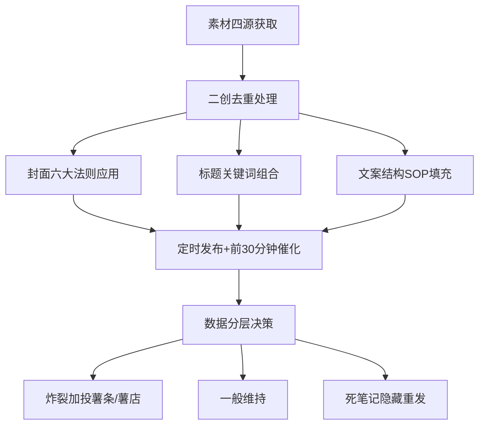
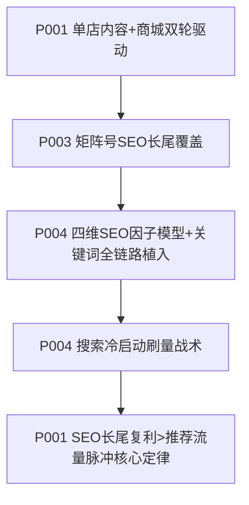
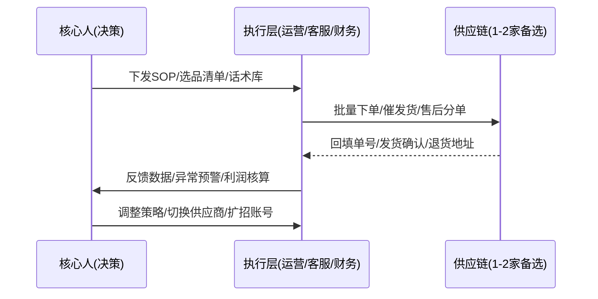

# 第 53 章 小红书无货源电商实战体系 —— 从“三缺”红利到矩阵化规模化
作者：龙哥

## 学习目标

- 理解小红书电商处于“三缺”红利期的市场窗口逻辑与入场时机判断
- 掌握单店3000-4000元启动资金的量化测算模型与资金流规划
- 熟练运用“定位-选品-定品-测品-优品”五步选品法与三维交叉验证策略
- 建立供应商四维资质审核标准（销量/好评/利润/SKU）与多备选熔断机制
- 掌握内容生产工业化SOP：封面六大视觉法则、标题关键词组合公式、素材四源二创去重流程
- 理解双引擎流量运营策略：商城货架搜推+笔记种草SEO长尾复利的抗风险体系
- 设计私域沉淀高复购漏斗：资料钩子、人设朋友圈、分层变现（资料→咨询→高客单）的LTV最大化路径
- 内化全周期避坑红线：笔记/客服/开店/发货/数据五大维度的合规生存底线与应对策略
- 具备矩阵化复制放大能力：3-5店并行、标准化SOP组织分工、账号物理隔离的规模化路径
- 通过实战数据复盘（营收/利润界定、平台扣点、蓝V规则、换赛道策略）校准认知与决策

## 53.1 生活类比

想象经营小红书无货源店铺像是在**高端商场开了一家“零库存精品买手店”**：三缺红利期 = 商场刚开业，大量有钱女顾客逛街（流量），但柜台空荡荡（缺商家/产品），你只需把别处批发市场的货（1688）挂上去就能卖；五步选品法 = 不是凭喜好进货，而是先去隔壁火爆店看什么卖得好（同行选品）、上网查大数据榜单（电商爆款）、听顾客在嚷嚷要买什么（热度词/评论区），三方印证才敢下单；内容工业化SOP = 不用亲手缝衣服（原创），而是把供应商寄来的样品照片（素材），按统一模板（封面六大法则/标题公式）快速修图挂网，一天上架50+新款；双引擎流量 = 既要在商场显眼位置堆头陈列（商城推荐/搜索），又要发传单引导顾客搜关键词找到你（笔记SEO），传单（笔记）一旦发出去，半年内顾客搜关键词都能看到（长尾复利）；私域漏斗 = 送顾客小礼品/优惠券（钩子）加微信，朋友圈发真实试穿照/好评（人设），先卖9.9元配饰（资料筛选），再卖200元造型咨询（咨询建信），最后卖2999元衣橱改造（高客单），复购率极高；矩阵化放大 = 一家店赚钱了，马上用家人身份证在商场隔壁再开3-5家分店（矩阵），统一装修/选品/话术（SOP），爆款全店同款铺货垄断流量。就像开连锁买手店：选品靠数据不靠感觉，运营靠标准化SOP不靠拍脑袋，核心资产是私域客户名单和可复制的开店手册，而非某个单品。

## 53.2 概念地图

小红书无货源电商实战体系
├── 红利窗口与入场决策
│   ├── 三缺红利期定论（缺商家/产品/服务）   —— P001
│   ├── 资金门槛测算模型（3-4千元启动）       —— P002
│   └── 平台红利期窗口论（类比10年淘宝）      —— P001, P003
├── 选品验证体系
│   ├── 五步选品法（定位/选品/定品/测品/优品）  —— P003
│   ├── 三维交叉验证（同行/电商爆款/热度词）   —— P001, P003
│   ├── 蓝海赛道比值模型（笔记数/互动量）       —— P001
│   └── 评论区需求导向（问价/求链为核心指标）  —— P001
├── 货源筛选与供应链管理
│   ├── 供应商四维资质标准（销量/好评/利润/SKU） —— P004
│   ├── SKU数反向识别同行中间商指标            —— P001
│   ├── 退货地址海外隔离策略（多供应链售后分单）  —— P004
│   └── 私单模式规避平台风控与利润压缩           —— P001
├── 内容生产工业化SOP
│   ├── 封面六大视觉法则（放大/冲击/对比/饱和度/色块/重复） —— P005
│   ├── 标题关键词组合公式（核心/属性/长尾/情绪≤20字）   —— P005
│   ├── 文案结构SOP（钩子/痛点/方案/引导）                —— P005
│   ├── 素材四源二创去重（电商/短视频/站内/自拍）         —— P005
│   ├── 视频混剪SOP（分割/打乱/转场/画中画1%/遮水印）      —— P003
│   ├── 图片伪原创SOP（滤镜/消除笔/贴纸/统一3:4规格）     —— P003
│   └── 视频优先分发策略（官方扶持视频流量）               —— P001
├── 双引擎流量运营策略
│   ├── 商城端：SKU/主图/标题/评价权重+活动营销工具    —— P006
│   ├── 内容端：矩阵号长尾词SEO+爆款投流（薯条/薯店）   —— P006
│   ├── 四维SEO排名因子（账号/笔记/用户/内容）           —— P001
│   ├── 关键词全链路植入（标题/封面/正文/标签）          —— P001
│   ├── 搜索冷启动刷量战术（小号模拟真实信号）           —— P001
│   └── SEO长尾复利>推荐流量脉冲核心定律                —— P001
├── 私域沉淀与高复购漏斗
│   ├── 合规引流路径（主页/私信/朋友圈/社群）             —— P007
│   ├── 高诱惑钩子设计（退现/优惠券/低价试用装）         —— P007
│   ├── 分层变现漏斗（资料→咨询→高客单）                  —— P007
│   ├── 咨询式成交话术（低价咨询/红包复投/画像推荐）      —— P007
│   └── 私域双号风控（分流加好友/多渠道收款隔离）         —— P007
├── 全周期避坑与合规底线
│   ├── 笔记层面（违禁词/硬广/搬运过度/频次）           —— P008
│   ├── 客服层面（禁他平台名/禁描述不符/禁好评返现/称呼规范/响应率） —— P008
│   ├── 开店层面（资质/类目/品牌/蓝V实名占用）           —— P008
│   ├── 发货层面（虚假/缺货/物流异常/罚款红线/多备供应商） —— P008
│   ├── 数据层面（第三方工具滞后/仅参考官方后台）         —— P008
│   ├── 违规删重发>申诉修改原则                            —— P001
│   └── 换赛道>注销重开策略（避免30天冷冻期）             —— P001
└── 矩阵化复制放大模型
    ├── 3-5店并行矩阵（个人/个体店低成本起步）      —— P009
    ├── 爆款全矩阵跟投垄断搜索前排                   —— P009
    ├── 标准化SOP是必要充分条件（可量化/考核/替换）  —— P009
    ├── 组织分工（核心人决策/执行层代运营）           —— P009
    └── 家庭支持解锁实名红利（一证五号→家庭矩阵）    —— P009

## 53.3 小红书电商“三缺”红利期 —— 缺商家、缺产品、缺深度服务的市场窗口

### 53.3.1 为什么需要这个概念？

普通人创业常因资金少、无供应链、不懂运营而在成熟平台（淘宝/抖音）被卷死，需要一个用户质量高、商家少、规则不完善、免费流量多的“低门槛高确定性”切入点。小红书2.6亿月活、70%女性、一二线城市用户，购买力强、决策链路短（种草即拔草）。

### 53.3.2 核心定义

> "小红书是公认用户质量最高地平台，且电商体系目前还处于三缺状态：缺商家！ 缺产品！ 缺深度服务！"
> 
> ——《P001: 小红书无货源电商实操复盘》

**三缺红利期定义**：平台电商生态早期，供给端（商家/产品/服务）远弱于需求端，先入场者可获超额红利。类比：今年做小红书电商 ≈ 10年做淘宝 / 16年做抖音，大部分人都能赚钱，基本上都是赚风口的钱。

> "现在入场小红书就犹如 10 年做淘宝电商一样，大部分的人能赚钱，基本上都是赚风口的钱"
> 
> ——《P001: 小红书无货源电商实操复盘》

### 53.3.3 关键性质

- **窗口期有限**：平台规则完善、商家涌入后红利必然收缩，越晚入场竞争越烈
- **合规性基础**：基于1688正规批发渠道一件代发，属合法合规经营，非灰产投机
- **资产累积性**：店铺权重随时间增高，关键词排名稳定，停更仍有搜索/推荐/复购自然单，长期可积累

> "前期平台规则还不完善，根据没有打击无货源这一种说法，我们从 1688 批发进货，完全合法合规，不需要有任何的顾虑"
> 
> ——《P003: 小红书店铺无货源全流程实操》

> "店铺会随着时间的推移，权重会越来越高，并且我们布局种草的关键词也会慢慢被系统收录，稳定排名，后续即使我们暂停去铺笔记，店铺还是会出单"
> 
> ——《P003: 小红书店铺无货源全流程实操》

### 53.3.4 典型例子

- 作者卧龙先生三个月营收50万+，单店稳态日销5000-8000元
- 头部单店累计GMV近100万、纯利近40万（含平台扣佣5%+渠道费0.7%）

### 53.3.5 边界条件

- 仅适用于红利期（2023年及规则收紧前），后期需转型精品/品牌化运营
- 依赖女性高客单类目（内衣/美妆/防晒/家居），男性/低龄粉丝类目转化率极低
- 必须接受“批量量产优于精品深耕”的概率博弈逻辑，拒绝原创完美主义

> "目前，我们测试有效果的店铺，大多数都是跟女性用品或者女性时尚用品相关的...大多数的购买人群，基本都是女性，几乎无一例外"
> 
> ——《P003: 小红书店铺无货源全流程实操》

这个概念展示了：在平台生态早期，供需错配创造了普通人低成本切入的结构性机会，核心是利用“种草即拔草”的用户心智特征，用批发市场的货填补平台货架空白。

## 53.4 资金门槛测算模型 —— 单店3000-4000元启动的量化决策工具

### 53.4.1 为什么需要这个概念？

普通人创业最怕“隐形成本”导致资金链断裂，需要开店前即可精准测算启动资金。无货源模式虽无囤货压力，但垫付货款、保证金、工具费是真实现金流支出。

### 53.4.2 核心定义

> "单个店铺除此之外没有其他费用，总计：保证金（1000 元）+垫付资金（2000 元 -3000 元）+软件费用（60 元 -200 元）=总计约 3000-4000 元即可操作此项目。"
> 
> ——《P001: 小红书无货源电商实操复盘》

**启动资金公式**：

$$
\text{启动资金} = \text{保证金} + \text{垫付资金} + \text{工具费}
$$

其中：
- **保证金**：个人店通常1000元（部分类目2000-5000），支持延缓缴纳
- **垫付资金**：预估单量 × 客单价 × 14天回款周期，约2000-3000元
- **工具费**：选品/去水印/制图会员，60-200元/月

这个公式展示了：无货源模式的真实启动成本由三部分构成，其中垫付资金随出单量动态变化，非固定沉没成本。

### 53.4.3 关键性质

- 个人店/个体店保证金最低，企业店/旗舰店高达2万，新手严禁上来就开企业店
- 回款周期若超14天（如物流/售后纠纷），垫付资金需缓冲翻倍
- 个体执照开第2/3店需蓝V认证（600元/年），矩阵扩张有隐性合规成本

> "一个个体营业执照可以注册 3 个小红书店铺...在注册第二和第三个店铺的时候，我们要先把这两个小红书账号升级成蓝 V，缴纳 600 元的认证费用才可以继续开店，这样才不会显示实名被占用"
> 
> ——《P003: 小红书店铺无货源全流程实操》

### 53.4.4 典型例子

个人店保证金1000元，垫资按单品成本20元×100单测算=2000元，工具费月100元，合计3100元启动。作者实操15店矩阵，前期建议3-5店并行，总启动资金约1-2万。

### 53.4.5 多源对照

不同素材对资金门槛的测算一致，形成共识：

**共识**：单店启动资金约3000-4000元，个人店保证金1000元为基准，垫付资金按14天回款周期测算。

**分歧**：P001提到保证金“1000-20000视类目/店型”，P003明确“个人店通常1000元（部分类目2000-5000）”，P004给出“总计约3000-4000元”定论。差异在于类目细分上的保证金差异，但核心结论一致。

## 53.5 五步选品法 —— 定位、选品、定品、测品、优品的标准化漏斗

### 53.5.1 为什么需要这个概念？

选品是无货源模式的“1”，内容流量是“0”，选错品后续动作全归零。主观臆断选品（自嗨式）死亡率极高，必须建立“市场验证优于主观判断”的标准化流程。

### 53.5.2 核心定义

> "首先第一步是选品上架测试，测试的阶段，我们又可以分为 5 个步骤。定位...选品...定品...测品...优品"
> 
> ——《P003: 小红书店铺无货源全流程实操》

**五步选品法流程**：

1. **定位**：匹配个人资源/兴趣/长期规划，锁定垂类赛道（如女性内衣/美妆/家居）
2. **选品**：跨平台三维交叉验证——
   - 同行选品（站内销量高个人店）
   - 电商爆款洗品（淘宝/拼多多/抖店榜单→站内验证销量>500）
   - 热度词选品（千瓜/禅小红/巨量算数查热词→站内搜验证）
3. **定品**：小红书内搜索同款，确认个人店销量≥500单、评价干净、素材可二创
4. **测品**：上架铺笔记（日更2-20条），观测曝光/点击/转化/出单数据
5. **优品**：按数据迭代详情页主图/视频/文案/标签/SKU/价格，放大爆款、砍掉死款

### 53.5.3 关键性质

**交叉验证原则**：单一渠道选品不可信，三渠道重合度最高的品成功率最大。

**蓝海赛道比值模型**：

$$
\text{蓝海指数} = \frac{\text{笔记总数}}{\text{互动总量}}
$$

比值越小越蓝海（供给稀缺需求旺盛）。

> "我们要做的就是把每一个赛道的数据收集下来，然后算出笔记数和互动总量的比例...比例值越小，就是我们要找的蓝海赛道。"
> 
> ——《P004: 小红书无货源电商全流程指南》

**评论区需求导向**：以“问价/求链/怎么买”为核心指标，而非点赞阅读虚荣指标。

> "多收集这类的文案...不看阅读与点赞，只要评论区有很多用户想买，都在问：“怎么买”、“什么价”、“求链接""
> 
> ——《P004: 小红书无货源电商全流程指南》

### 53.5.4 典型例子

- 内衣类目：对标月销1万+普通店铺爆款→拼多多/淘宝以图搜图找源头→提取站内爆款笔记标题/文案/标签杂糅重组
- 手机壳类目：爆款标题关键词“宝藏/高级/小众”排列组合生成新标题，复用爆款基因

### 53.5.5 边界条件

- 避开品牌溢价高、仿品技术成熟、非专业无法辨伪的雷区（品牌鞋服/化妆品）
- 供应商SKU>100个大概率为同行无货源中间商，需反向排雷
- 红利期以“批量铺品测款”为主，成熟期转“精品深耕”，策略随平台阶段切换

### 53.5.6 多源对照

**共识**：五步法流程一致，三维交叉验证为核心，拒绝主观臆断。

**分歧**：P001提出“同行销量有个500以上证明品可以做”作为验证阈值；P003强调“定品阶段确认个人店销量≥500单”；P004补充“电商爆款选品法尽可能符合：符合小红书人群、素材干净、高颜值、高复购、高利润”。三者在验证标准细节上互补，共同构成了完整的选品验证体系。

## 53.6 供应商四维资质审核标准 —— 销量、好评、利润、SKU的生存筛选器

### 53.6.1 为什么需要这个概念？

无货源模式下，供应商稳定性直接决定店铺生死（发货延迟/缺货/质量差→体验分暴跌→封店）。1688/拼多多商家良莠不齐，必须建立可执行的“避坑清单”而非凭感觉选款。

### 53.6.2 核心定义

> "判断这个商家的选品是否可以作为我们货源的标准：销量：1000 以上就可以...好评：近期动态查看，10 个里面 7 个以上好评...利润：前期保证有利润...商家产品数：少于 100 个产品"
> 
> ——《P003: 小红书店铺无货源全流程实操》

**供应商四维资质标准**：

| 维度 | 指标 | 判定标准 | 含义 |
|------|------|----------|------|
| 销量 | 近期销量 | >1000单（新店放宽至几百） | 证明供货稳定性 |
| 好评 | 近期10条动态评价 | ≥7条好评 | 规避质量坑 |
| 利润 | 前期保底利润 | 建议3-5倍毛利 | 覆盖流量成本 |
| SKU | 商家产品数 | <100个产品 | 避免同行中间商 |

这个标准展示了：四维缺一不可，销量高但好评低=质量雷；利润高但SKU巨大=中间商二道贩子。

### 53.6.3 关键性质

- 货源筛选是“选品”环节的下半场，选好品找不好货源=零
- 多备1-2家备选供应商，建立“熔断机制”应对爆单期主力供应商失联/缺货

> "茶壶爆款期因店铺失联导致实发率仅1/3，紧急切换5-6家备选仍因发货延迟损失数千佣金"
> 
> ——《P027: 视频号短视频带货矩阵化实操》

- **退货地址隔离策略**：后台退货地址设海外(如美国)，详细地址引导联系客服，实现多供应链售后分单与恶意退货筛选，规避资损

> "小红书店铺发货地址设置成自己的真实地址，退货地址可以设置成国外的地址，例如设置成美国纽约州...针对不同的上家，把对应的上家地址发给他们就可以了"
> 
> ——《P003: 小红书店铺无货源全流程实操》

- **私单模式**：加商家微信走微信下单，规避平台面单隐私/短信骚扰/利润压缩，但需自担资金风险

> "直接加商家微信，走私单，不走平台即可，正常情况下商家都会同意，毕竟多一个销售渠道就多赚一份钱"
> 
> ——《P004: 小红书无货源电商全流程指南》

### 53.6.4 典型例子

- 茶壶爆款期因店铺失联导致实发率仅1/3，紧急切换5-6家备选仍因发货延迟损失数千佣金
- 正规源头商家：几个核心款、几十个SKU、自主工厂发货、支持退货宝

### 53.6.5 多源对照

**共识**：四维标准（销量/好评/利润/SKU）一致，多备选供应商为必须。

**分歧**：P003给出具体数值阈值（销量>1000、好评≥7/10、SKU<100）；P001强调“SKU过万必为同行中间商”作为排雷指标；P004补充“退货地址港澳台隔离策略”和“私单模式”两种进阶规避方案。三者在供应链风控层面形成了从基础筛选到进阶规避的完整防御体系。

## 53.7 内容生产工业化SOP —— 封面六大法则、标题关键词公式、素材四源二创

### 53.7.1 为什么需要这个概念？

红利期核心是“时间成本与概率博弈”：单店50+款、日更2条/款、爆款日更20+、矩阵3-5店并行。纯原创产能极低，必须“去文艺化、向标准化靠拢”，以数量换概率覆盖长尾流量。

### 53.7.2 核心定义

**封面六大视觉法则**（决定CTR）：

> "3.4 封面：3.4.1 第一招：放大 ... 3.4.6 第六招：重复排列"
> 
> ——《P001: 小红书无货源电商实操复盘》

1. **放大主体**：占比70%+，降低认知成本
2. **制造视觉冲击**：对比/互补色背景
3. **色彩对比**：高对比色块承载核心卖点
4. **高饱和度**：滤镜增强质感
5. **增加色块**：重复排列形成视觉节奏
6. **统一模板**：批量产出保持调性

**标题关键词组合公式**（决定搜索流量）：

> "3.3 标题：核心词+属性词+长尾词+情绪词/数字/符号，字数控制在20字以内"
> 
> ——《P001: 小红书无货源电商实操复盘》

$$
\text{标题} = \text{核心词(大类)} + \text{属性词(功能/材质/场景)} + \text{长尾词(人群/痛点/季节)} + \text{情绪词/数字/符号} \quad (\le 20字)
$$

**文案结构**（决定转化率）：

$$
\text{文案} = \text{钩子(痛点/反差)} \rightarrow \text{痛点放大} \rightarrow \text{方案(产品价值)} \rightarrow \text{引导(求链/进群/看主页)}
$$

真情实感 > 营销话术。

**素材四源二创去重**：

> "素材的来源有四个渠道：电商平台、短视频平台、站内搬运、自己拍摄。抖音/快手的行业素材。（此类素材一定要进行二创去重）"
> 
> ——《P004: 小红书无货源电商全流程指南》

| 素材源 | 处理工具 | 核心动作 |
|--------|----------|----------|
| 电商平台主图/详情/评价图 | 美图秀秀/醒图/黄油相机 | 裁剪、加水印、滤镜、特效、变清晰 |
| 短视频平台同款视频 | 剪映/剪辑软件 | 分割、打乱、转场、画中画(1%)、遮水印 |
| 站内对标搬运 | 蚂蚁搬家+人工复查 | 一键搬运、敏感图/上家信息/违规词清洗 |
| 自拍样品 | 原创拍摄 | 真实场景、提升信任度 |

**视频混剪SOP**：

> "正确的步骤是：首先进行分割，然后打乱顺序，打乱顺序之后，再进行转场特效处理，处理完转场之后，再加画中画，透明度可以设置为 1 左右"
> 
> ——《P003: 小红书店铺无货源全流程实操》

**图片伪原创SOP**：筛选无水印高清图→加滤镜调明艳度→消除笔/贴纸遮挡多余文字→统一3:4规格输出。

### 53.7.3 关键性质

- 封面决定生死（点击率）、标题决定流量（搜索权重）、文案决定转化（承接力）、素材决定过审（合规性）
- 蚂蚁搬家一键搬运+人工复查（敏感图/上家信息/违规词）实现批量上架
- 发布节奏：新号养期3-5天→定时发布（早9/中12/晚19-21）→前30分钟人工互动催化→数据分层决策（炸裂加投/一般维持/死笔记隐藏重发）

> "不会的 前提是你的笔记一定要伪原创或原创 而且小红书平台也比较扶持商家 如果一天发 1 到 3 条太慢了 时间成本太高了 红利项目 就要抓紧去做"
> 
> ——《P003: 小红书店铺无货源全流程实操》

- **违规笔记删除重发优于申诉修改**：黑箱不可测，盲目修改易二次违规永久损权重，删重发边际成本最低

> "如果笔记违规了都会提示你应该修改笔记，但是卧龙不建议修改。因为你不知道哪里出了问题，盲目修改只会导致第二次违规。连续违规会对账号的权重造成影响。我的建议是直接删除。"
> 
> ——《P004: 小红书无货源电商全流程指南》

- **视频优先于图文**：平台图文过剩视频稀缺，官方扶持视频流量，图文混剪视频兼顾转化与获取效率

> "笔记有图文以及视频两种...卧龙都建议用视频，目前小红书的图文占比太高了，官方需要综合图文与视频的占比，所以目前发视频是有一定扶持的。"
> 
> ——《P004: 小红书无货源电商全流程指南》

### 53.7.4 典型例子

- 内衣类目：对标爆款笔记标题/正文/标签三维度杂糅重组，视频分割打乱+转场+画中画过原创审核
- 手机壳类目：提炼“宝藏/高级/小众”高频词排列组合标题，封面放大主体+高饱和度色块叠加卖点文案

### 53.7.5 数据流图

这个图展示了：素材经过标准化二创处理，分别应用封面、标题、文案三大SOP，发布后按数据分层决策，形成工业化内容生产闭环。

## 53.8 双引擎流量运营策略 —— 商城货架搜推+笔记种草搜推的SEO长尾复利

### 53.8.1 为什么需要这个概念？

单一流量渠道极其脆弱（算法调整/限流/成本暴涨），必须构建“公域双引擎+私域蓄水池”的抗风险流量体系。推荐流量脉冲式衰减（周期短、不可控），搜索流量长尾复利增长（周期长、精准、可积累），长期主义必须以SEO为核心。

### 53.8.2 核心定义

**商城端（货架流量）**：优化SKU/主图/标题/评价权重承接搜索流量，报名平台活动/设置营销工具（满减/优惠券/首单礼金）争取推荐流量。

**内容端（种草流量）**：矩阵号布局长尾词SEO截流 + 爆款笔记投流放大（薯条/薯店推广）获取推荐流量，形成“种草-拔草”闭环。

**四维SEO排名因子**：账号权重、笔记数据、用户行为、内容质量；核心可控变量=内容原创度+垂直度+关键词自然植入。

> "笔记的排名先后取决于：账号权重、笔记数据、用户行为、内容，这四点决定的。"
> 
> ——《P004: 小红书无货源电商全流程指南》

**关键词全链路植入**：标题(必带)→封面/视频水印文字→文案开头及正文自然分布→话题标签(≤5个精准标签)。

**搜索冷启动刷量战术**：小号/亲友搜关键词→筛“最新”→定位笔记→全套互动行为（停留/点赞/收藏/评论）模拟真实信号加速权重。

> "笔记发布之后，我们可以用小号或者亲朋好友的账号，搜索笔记植入的关键词，然后筛选选择 “最新”，找到自己发布的笔记后可以对笔记进行点赞收藏停留等动作。"
> 
> ——《P004: 小红书无货源电商全流程指南》

### 53.8.3 关键性质

**SEO长尾复利>推荐流量脉冲**：

> "搜索流量也就是 seo，流量极其精准的转化率非常高，而且搜索流量是非常持久的...它可能三个月，半年，甚至一年给你源源不断的带来精准客户。正常一篇笔记爆了之后过了一定周期就不会给你推流了，但是搜索流量不一样..."
> 
> ——《P004: 小红书无货源电商全流程指南》

这个定律展示了：搜索流量可持续半年以上源源不断带来精准客户，推荐流量爆完即止，长期主义必须以SEO布局为核心。

**精准流量>爆款流量**：阅读量与GMV无正相关，评论区高购买意图互动才是精准流量代理指标。

> "我们做内容带货，终极目标不是为了出爆款，而是为了精准客户，不要把两者划等号，那些爆款如果带来不了精准流量，是完全没有任何意义的数字"
> 
> ——《P004: 小红书无货源电商全流程指南》

**矩阵号放大**：3-5店并行覆盖不同长尾词，单店日更2-20条笔记，以数量博取搜索覆盖面。

### 53.8.4 典型例子

- 关键词来源：站内搜索下拉词、搜索结果页分词、禅小红热搜词、百度指数需求图谱
- 投流工具：薯条（博主投放）、薯店推广（店铺商品投放），ROI>1.2即可放量

### 53.8.5 边界条件

- 新店新手任务有7天曝光扶持，每日上新垂类集中可获额外推荐流量，需抓住冷启动窗口
- 账号养号2-3天模拟真人行为，发布争议性垂类笔记引导互动可快速提权，老号权重>新号
- 违规笔记直接删除重发，切勿申诉修改（易二次违规永久损权重）

### 53.8.6 方法演进图

## 53.9 私域沉淀与高复购漏斗 —— 资料钩子、人设朋友圈、分层变现的LTV最大化

### 53.9.1 为什么需要这个概念？

公域流量成本持续上升、规则高频变动，平台规则变化太快，唯有私域构建可控抗风险资产。无货源模式利润率受限于供应链议价权与流量成本，私域复购是突破利润天花板的唯一路径。

### 53.9.2 核心定义

**引流合规路径**：主页简介挂号/粉丝群/集福利 → 私信自动回复/人工话术引导加微信 → 朋友圈人设建设（真实/专业/福利） → 社群/私聊精细运营促复购裂变。

**高复购钩子设计**：退现/优惠券/低价试用装等高诱惑力钩子，针对高客单/高人群质量产品。

**分层变现漏斗**：

$$
\text{低价资料(筛选付费意向/建立信任)} \rightarrow \text{低价咨询(深度连接/挖掘需求/互惠红包)} \rightarrow \text{高客单产品/训练营/资源对接(核心利润/复利上限)}
$$

**私域双号风控**：至少两个微信号分流加好友，支付宝/多渠道分离收款，规避高频加好友限流及收款风控冻结。

> "你一定要提前准备好，至少两个微信号，原因呢有两个，第1个是避免被加好友频繁导致用户加不进来，第2个呢就是避免收款频繁导致钱到不了账"
> 
> ——《P006: 资料整理私域变现全流程》

### 53.9.3 关键性质

- 私域是基本盘，可以“一直吃复购”，LTV最大化是核心指标而非单次ROI
- 资料是零边际成本的杠杆钩子，核心利润来自后端自有高附加值产品/服务体系
- **咨询式成交话术**：收低价咨询费(200元)→专业解决问题→引导用户自发发红包(88-120元)→基于消费能力推荐高客单产品，实测99%发红包、30%转高客单

> "基本上呢对一个咨询客户也会有两个收入，一个是你的前期咨询费用，一个就是在你解决完他的问题之后，99%的人都会再给你发一个小红包表示感谢！"
> 
> ——《P006: 资料整理私域变现全流程》

### 53.9.4 典型例子

- 高中资料→高考志愿填报咨询；英语资料→英语训练营；阅读资料→读书营/社群；商业资料→商业咨询/高客单课程/资源对接
- 作者实测：日均引流180+，资料付费转化60%，咨询二次转化30%，单用户ARPU超200元

### 53.9.5 多源对照

**共识**：私域为核心护城河，资料作钩子，分层变现（资料→咨询→高客单）为标准路径。

**分歧**：P001侧重“私域引流与转化话术”通用框架；P006深度拆解“头条号自动回复引流法”“咨询式成交话术与红包复投模型”“私域双号风控体系”三套具体可执行工具；P007补充“付费即筛选，信任源于交换”心理学机制。三者从战略到战术再到心理学层面形成完整支撑。

## 53.10 全周期避坑与合规生存底线 —— 笔记/客服/开店/发货/数据平台五大红线

### 53.10.1 为什么需要这个概念？

无货源模式本质在平台规则边缘试探，长期主义必须以“不触碰红线”为前提。一次违规可能导致店铺永久封禁、资金冻结、身份实名污染，风险不可逆。

### 53.10.2 核心定义

**五大红线清单**：

| 维度 | 核心红线 | 处罚/后果 | 应对策略 |
|------|----------|-----------|----------|
| 笔记层面 | 违禁词/硬广/搬运过度/频次过高/极限词/他平台水印/联系方式 | 限流/违规/封号 | 二创去重/伪原创/发布节奏控制/违规删重发 |
| 客服层面 | 1)禁提他平台名 2)禁“描述不符”承诺 3)禁明示“好评返现” | 罚2000/罚10万/违规 | 必用“小红薯/薯宝宝”称呼，人工回复率≥80% |
| 开店层面 | 资质过期/类目错选/品牌侵权/个体执照未蓝V开第2/3店 | 无法开店/违规/实名占用 | 个人店起步，扩张前升级蓝V |
| 发货层面 | 虚假发货/缺货/物流异常/单号复用 | 罚3-30元/单，缺货罚5-100元/单 | 多备1-2家备选供应商，同步上游发货时效 |
| 数据层面 | 第三方工具数据滞后/选品参考误差 | 决策失误 | 仅作参考，决策依据为官方后台数据 |

**客服三大绝对红线**：

> "回复用户时如果出现与商品描述不符的情况，会违反广告法，也会罚款，最高 10 万。不能使用其他电商平台的“亲”要以“小红薯”、“薯宝宝”等词语代替。一周内必须回复率满百分之 80，未达标会对店铺以及账号进行限流三天"
> 
> ——《P004: 小红书无货源电商全流程指南》

### 53.10.3 关键性质

- **合规生存底线论**：避坑指南即生存指南，虚假发货、侵权售假、诱导好评、违规引流、知识产权投诉是五大死穴
- **违规笔记删除重发优于申诉修改**：黑箱不可测，盲目修改易二次违规永久损权重
- **无流量店铺换赛道优于注销重开**：注销需冷冻30天时间成本极高，直接换类目/养号/上架铺笔记可快速冷启动

> "不建议轻易注销了小红书店铺...注销了，需要 30 天才能够重新开店，时间成本太高了...建议直接换品类去重新测试，选定一个要做的类目，重新养号，重新上架铺笔记就可以了"
> 
> ——《P003: 小红书店铺无货源全流程实操》

### 53.10.4 典型例子

- 客服回复出现“淘宝/拼多多/拼夕夕”等词直接罚款2000元，必须替换为“小红薯/薯宝宝”
- 承诺“描述不符包退”触犯广告法最高罚10万，只能表述“质量问题无理由退换”
- 发货时间设置要看好上家发货时间与库存，选货源最好多留1-2家备用

### 53.10.5 边界条件

- 1688作为专业批发渠道，下单量越大权重越高，不存在限制封号风险，支撑爆单期批量发货安全
- 逸淘/蚂蚁搬家等工具仅作效率放大器，核心合规动作（人工复查敏感图/上家信息/违规词）不可省略
- 数据工具会员利用策略：禅小红等注册送7天专业会员，集中周期内完成高频选品/对标收集任务降低固定成本

## 53.11 矩阵化复制放大模型 —— 3-5店并行、批量铺品、标准化SOP的规模化路径

### 53.11.1 为什么需要这个概念？

单店上限受限于账号权重、类目流量天花板、单人精力，必须矩阵化突破单店上限。红利期核心是“抓紧时间做”：通过标准化SOP极压单条产出时间，以数量换概率覆盖长尾搜索流量，快于同行即赢窗口。

### 53.11.2 核心定义

**店铺矩阵**：前期个人店/个体店3-5店并行（低成本、低合规风险），每店上满50+款，每款日更2+条笔记。

**爆款加码**：测出单品日更20+条笔记，全矩阵同款跟投，占据搜索前排垄断流量。

> "前期一个人操作，建议至少都 3-5 个店铺，并且每个店铺上满 50 款以上的商品，每个品，一天起码 2 个以上的笔记去铺，对于测试出单的商品，更要花时间去重点铺，一天至少铺 20 条以上的笔记"
> 
> ——《P003: 小红书店铺无货源全流程实操》

**账号隔离**：一机一卡一号，同设备勿频繁切号，避免关联判定导致全军覆没。

**组织分工**：核心人负责定位把控/方向决策，执行层助理代运营作者负责内容生产/日常运维，前提单店模型跑通再复制。

### 53.11.3 关键性质

- **标准化SOP是矩阵扩张的必要充分条件**：只有全流程固化为可量化/可考核/可替换的SOP，才能将个人经验转化为组织资产

> "论证只有全流程固化为可量化、可考核、可替换的SOP，才能实现矩阵横向复制，将个人经验转化为组织资产。"
> 
> ——《P014: 不出镜个人IP通用方法论》

- **矩阵核心价值非账号数量**：而是流量内部循环最大化、大带小、单广位多账号售卖提高广告单价、分散封号风险保障资产安全

> "矩阵核心价值非账号数量而是流量内部循环最大化大带小单广位多账号售卖提高广告单价运营SOP标准化复制降低边际成本分散封号风险保障资产安全"
> 
> ——《P024: 👸号矩阵引流与IP化放大》

- **职称/地域等强属性赛道天然形成区域护城河**：不同城市运营者学习同套方法论不构成竞争，适合标准化教学与加盟

> "职称赛道有意思的地方是，除了个别资源丰富的，大部分公司只能做当地的职称申报服务，比如广东省的职称公司，一般只能做省内人群的生意，所以成都圈友跟我学习了，跟我也不是竞争关系"
> 
> ——《P014: 不出镜个人IP通用方法论》

### 53.11.4 典型例子

- 作者实操15店矩阵，头部单店GMV近100万纯利近40万，前三名店铺稳定输出
- 闲鱼矩阵霸屏：7-8个店铺布局同一单品，占据搜索前5/前10多个位置，通过曝光数据预判哪个链接会爆单
- 小红书探店：达人联盟+商家联盟双边网络飞轮，达人聚拢增强议价权获高佣，吸引优质商家入驻投放反哺达人收益

### 53.11.5 边界条件

- 盲目铺开矩阵未跑通单店模型=内耗，前提已跑通单账号模型再复制放大
- 号多了蓝海也变红海：400+店铺规模下蓝海容量不足，需转战红海类目通过店群规模化建立壁垒
- **家庭支持是放大规模关键杠杆**：账号矩阵受限实名主体(一证五号)，家人配合办卡可突破单人上限(5号)达家庭矩阵(20+号)

> "家庭支持是放大规模的关键杠杆...账号矩阵扩张受限于实名主体(身份证/银行卡)，家人的理解与配合(如母亲克服晕车去县城办卡)能解锁‘身份证红利’，将单人上限(5号)突破为家庭矩阵(20+号)，是收益从万级向十万级跃迁的物理前提。"
> 
> ——《P027: 视频号短视频带货矩阵化实操》

### 53.11.6 时序图

## 53.12 实战数据复盘与避坑指南 —— 从营收利润界定到换赛道策略的硬核实证

### 53.12.1 为什么需要这个概念？

实战教材必须用真实数据验证方法论有效性，而非靠理论自圆其说。区分营收(GMV)与纯利利润，揭示无货源模式真实利润率受供应链议价权与流量成本制约。总结可复用的避坑经验，降低后续实操者试错成本。

### 53.12.2 核心定义

**营收≠利润**：作者三个月“营收50万”非“利润50万”，评论区澄清修正读者误解。

> "Yoga : 三个月利润 50 万？卧龙先生 : 营业额"
> 
> ——《P001: 小红书无货源电商实操复盘》

**单店实证**：头部店累计GMV近100万、纯利近40万(利润率约40%)，平台扣佣5%+渠道费0.7%。

> "其中一个店铺，单店做了近 100 万的业绩...冲了 100W 的业绩，这个业绩的利润接近 40W"
> 
> ——《P003: 小红书店铺无货源全流程实操》

> "小红书销售额过万以上，平台会扣除 5%的佣金+0.7%的渠道费用"
> 
> ——《P003: 小红书店铺无货源全流程实操》

**个体执照开店**：一照开三店，第2/3店需蓝V认证(600元/年)规避实名占用。

> "一个个体营业执照可以注册 3 个小红书店铺...在注册第二和第三个店铺的时候，我们要先把这两个小红书账号升级成蓝 V，缴纳 600 元的认证费用才可以继续开店，这样才不会显示实名被占用"
> 
> ——《P003: 小红书店铺无货源全流程实操》

**运费宝/7天无理由**：开通可提升转化率(降低决策顾虑)，尺寸敏感类目建议强开。

**换赛道>注销重开**：注销冷冻30天时间成本极高，直接换类目/养号/铺笔记快速冷启动。

**发文频次**：单日20条伪原创/原创不限流(前提去重合规)，平台扶持商家发文。

> "不会的 前提是你的笔记一定要伪原创或原创 而且小红书平台也比较扶持商家 如果一天发 1 到 3 条太慢了 时间成本太高了"
> 
> ——《P003: 小红书店铺无货源全流程实操》

### 53.12.3 关键性质

- **数据诚实性**：敢公开“营收而非利润”、“平台扣点结构”、“蓝V认证费”等真实成本细节，极大提升方法论可信度
- **策略可逆性**：强调“无流量换赛道”、“违规删重发”、“多备供应商熔断”等可逆决策，而非一条道走到黑
- **规模边际收益**：400+店铺规模下蓝海变红海，需转战红海标品靠规模建壁垒，单店模型边际递减

### 53.12.4 典型例子

- Yoga问“三个月利润50万？”卧龙回复“营业额”，修正核心财务指标认知
- 个体执照注册第2/3店必须先升级蓝V缴纳600元/年，实测验证开店规则细节
- 注销店铺需30天冷冻期，实测换赛道可避免时间沉没，验证策略优劣

### 53.12.5 边界条件

- 利润率随规模扩大而下降(供应链议价权不足、流量成本上升)，头部单店40%利润率为最优区间
- 矩阵化后期管理复杂度指数级上升，需非核心城市低成本组建铁三角团队(客服/运营/财务)，大城市人力成本结构不支撑
- 方法论具有时效性：平台规则收紧/红利期结束后，批量铺品/伪原创/无货源模式均需迭代升级

## 53.13 设计中的取舍

- **为什么不用“原创内容”而是“伪原创/二创”？**  
  红利期核心是时间成本与概率博弈：单店50+款、日更2条/款、爆款日更20+、矩阵3-5店并行。纯原创产能极低（猴年马月才能铺完），必须“去文艺化、向标准化靠拢”，以数量换概率覆盖长尾流量。这是概率论层面的最优解，而非偷懒。

- **为什么“SEO长尾复利”优于“追求爆款推荐流量”？**  
  推荐流量脉冲式衰减（周期短、不可控），搜索流量长尾复利增长（周期长、精准、可积累）。长期主义必须以SEO布局为核心。这是资产属性的选择：爆款是消耗品，SEO是资产。

- **为什么“换赛道”优于“注销重开”？**  
  注销需冷冻30天时间成本极高，直接换类目/养号/上架铺笔记可快速冷启动。这是沉没成本视角的理性决策：账号权重可保留，时间不可逆。

- **为什么“矩阵化”核心价值非账号数量？**  
  矩阵核心价值在于流量内部循环最大化、大带小、单广位多账号售卖提高广告单价、运营SOP标准化复制降低边际成本、分散封号风险保障资产安全。账号数量只是手段，流量资产化与风险分散才是目的。

- **为什么“私域”而非“公域”作为核心护城河？**  
  平台规则高频变动、流量成本上升是常态，唯有将高LTV用户沉淀至私域（微信），通过人设信任体系实现复购与裂变，才能构建可控的抗风险资产。公域流量归平台，私域流量归自己。

## 53.14 动手练习

### 练习 1：启动资金与选品验证实战推演

假设你决定入局小红书无货源，选择“女性防晒衣”类目（个人店保证金1000元，客单价120元，成本35元，预估日出单20单，回款周期14天）：

1. 计算启动所需总垫付资金（含保证金、垫付货款、工具费预留200元）
2. 运用三维交叉验证法，列出你会在哪三个渠道寻找该类目爆款，以及各渠道的具体验证指标（如销量阈值、素材干净度等）
3. 在1688找到某款防晒衣，近期销量800单、好评率92%、SKU 15个、利润空间30%，根据四维标准判断是否合格，若不合格主要缺口在哪？

回答问题：
- 如果该类目保证金为5000元，启动资金会增加多少？是否建议改开个体店？
- 为什么要求SKU<100个？SKU过万意味着什么？

### 练习 2：内容工业化SOP标准化输出演练

针对上述防晒衣爆款，完成一次标准化内容生产流程：

1. **封面设计**：根据六大法则，描述你会如何用美图秀秀/醒图在10分钟内产出3张高CTR封面（主体占比、背景色、色块文案、排版模板）
2. **标题生成**：提炼该类目Top 10爆款笔记的高频核心词（如：防晒/显白/不闷汗/宝藏/高级/小众），按“核心词+属性词+长尾词+情绪词”公式组合生成5个≤20字标题
3. **文案结构**：按“钩子(痛点反差)→痛点放大→方案(产品价值)→引导(求链/进群)”框架，写一段200字左右伪原创文案，植入2个长尾关键词
4. **视频去重**：列出从下载竞品视频到发布合规视频的完整操作步骤（工具/参数/合规自检点）

回答问题：
- 为什么视频优于图文获取流量扶持？平台供需结构如何决定的？
- 单日发20条伪原创笔记会被判限流吗？前提条件是什么？

### 练习 3：双引擎流量与私域漏斗ROI测算

某店铺运行1个月后数据：商城搜索日均UV 80、转化率3%、客单价120元；笔记搜索日均曝光5000、点击率2%、转化率5%、客单价120元；投流薯条日耗200元、ROI 2.5；私域日引流30人、资料付费转化60%、咨询二次转化30%、高客单转化10%（客单价999元）。

1. 计算各渠道日均GMV与毛利（假设毛利率40%）
2. 计算私域单用户LTV（首单资料19.9元→咨询199元→高客单999元，按转化率加权）
3. 判断：若平台扣点5%+渠道费0.7%，投流ROI 2.5是否覆盖成本？私域LTV是否覆盖引流成本（假设引流成本15元/人）？

回答问题：
- 为什么说“SEO长尾复利>推荐流量脉冲”？若算法调整导致推荐流量归零，该店铺能否存活？
- 评论区“问价/求链”指标为何比点赞阅读更能预测GMV？

### 练习 4：合规避坑与矩阵扩张决策模拟

场景：你的矩阵第3号店（个体店）因客服回复“淘宝同款只要XX元”被罚2000元、限流3天；主力供应商因疫情停工3天，导致该店50单超期发货；同时你的第1号店测出爆款日销200单。

1. 列出针对客服违规、发货危机、爆款放大的即时应对动作清单（按优先级排序）
2. 根据“换赛道>注销重开”原则，如果第3号店所在类目长期无流量，制定换赛道操作SOP（保留账号权重、最小化时间成本）
3. 规划矩阵扩张：从3店增至10店，设计账号物理隔离方案（设备/网络/实名）、组织分工表（核心人/运营/客服/财务）、SOP文档化清单

回答问题：
- 个体执照开第2/3店为何必须升级蓝V？不升级会触发什么风控？
- 家庭支持如何解锁“身份证红利”？单人上限5号，家庭矩阵如何突破至20+号？
- 矩阵核心价值为何非账号数量，而是“流量内部循环最大化+分散封号风险”？

## 53.15 本章小结

这一章中我们系统学习了小红书无货源电商的全周期实战体系。首先，我们理解了“三缺”红利期的市场窗口逻辑，确立了低门槛切入的时机判断；其次，掌握了单店3000-4000元启动资金的量化测算模型，让创业前的资金规划可测算、可决策；接着，熟练运用“定位-选品-定品-测品-优品”五步选品法与三维交叉验证策略，将选品从主观臆断转化为市场验证的标准化流程；然后，建立了供应商四维资质审核标准与多备选熔断机制，筑牢供应链生存防线；随后，掌握了内容生产工业化SOP——封面六大视觉法则、标题关键词组合公式、素材四源二创去重流程，实现了内容产能的工业化跃迁；再然后，理解了双引擎流量运营策略——商城货架搜推+笔记种草SEO长尾复利的抗风险体系，构建了公域流量的双重保障；接着，设计了私域沉淀高复购漏斗——资料钩子、人设朋友圈、分层变现的LTV最大化路径，突破了平台流量的天花板；随后，内化了全周期避坑红线——笔记/客服/开店/发货/数据五大维度的合规生存底线，确立了长期主义的生存法则；最后，具备了矩阵化复制放大能力——3-5店并行、标准化SOP组织分工、账号物理隔离的规模化路径，实现了从单店到组织的跨越。通过实战数据复盘，我们校准了认知与决策，明确了营收与利润的界定、平台扣点结构、蓝V规则、换赛道策略等硬核实证。

本章我们一起学习了以下概念：

| 概念 | 解释 |
|------|------|
| 三缺红利期 | 小红书电商早期供给端（商家/产品/服务）严重不足，用户质量高（70%女性/一二线），先入场享受免费精准流量红利，类比10年淘宝/16年抖音 |
| 资金门槛测算模型 | 单店启动约3000-4000元：保证金1000元+垫付资金2000-3000元(14天回款周期)+工具费60-200元/月，个人店门槛最低 |
| 五步选品法 | 定位(资源匹配)→选品(三维交叉验证)→定品(站内销量>500验证)→测品(上架铺笔记观测)→优品(数据迭代详情页/笔记)，拒绝主观臆断 |
| 供应商四维标准 | 销量>1000单/好评率≥70%/前期保底利润/SKU<100个（避坑同行中间商），多备1-2家备选建立熔断机制 |
| 退货地址隔离策略 | 后台退货地址设海外(如美国)，详细地址引导联系客服，实现多供应链售后分单与恶意退货筛选，规避资损 |
| 封面六大视觉法则 | 放大主体/制造冲击/色彩对比/高饱和度/色块强化卖点/重复排列视觉节奏，决定点击率生死，统一模板批量产出 |
| 标题关键词组合公式 | 核心词+属性词+长尾词+情绪词/数字/符号(≤20字)，兼顾搜索覆盖与推荐点击，爆款关键词排列组合复用 |
| 素材四源二创去重 | 电商平台/短视频/站内搬运/自拍四源→裁剪/水印/滤镜/特效/变清晰/画中画1%/遮挡水印，规避Logo/人脸/极限词 |
| 双引擎流量策略 | 商城端优化货架承接搜推+活动争推荐；内容端矩阵号长尾词SEO截流+爆款投流放大，形成种草-拔草闭环 |
| SEO长尾复利定律 | 搜索流量精准/持久(半年+)可积累，推荐流量脉冲式衰减不可控，长期主义必须以SEO布局为核心 |
| 私域分层变现漏斗 | 资料钩子引流→人设朋友圈建信→低价资料筛选付费意向→低价咨询建信任/红包复投→高客单产品/训练营核心利润，LTV最大化 |
| 咨询式成交话术 | 收200元咨询费→专业解决问题→引导自发发红包88-120元(互惠心理)→基于消费能力推荐高客单，实测99%发红包/30%转高客单 |
| 五大合规红线 | 笔记(违禁/硬广/搬运)/客服(禁他平台名罚2000/禁描述不符罚10万/称呼小红薯/响应率≥80%)/开店(资质/类目/品牌/蓝V)/发货(超期3-30元/缺货5-100元/多备供应商)/数据(仅信官方后台) |
| 违规删重发原则 | 平台违规判定黑箱不可测，盲目修改易二次违规永久损权重，删除重发边际成本最低、风险可控 |
| 矩阵化复制放大 | 3-5个人/个体店并行，单店50+款日更2+条，爆款日更20+全矩阵跟投，SOP标准化使个人经验转为组织资产，家庭身份证突破单人5号上限 |

下一章中，我们将学习快团团帮卖/推广模式，拆解私域社群电商的“卖铲子”与“信用背书”博弈，理解私域信任迁移定律、供应链数据不可信公理、五维选品法、社群冷启动解散重建法、社群价值锚定理论、积分商城裂变激活法、极致售后护信法、假货危机三步走公关法、高客单价品类雷区规避、爱惜羽毛法则等核心规律，为你打开私域社交电商的另一扇大门。
