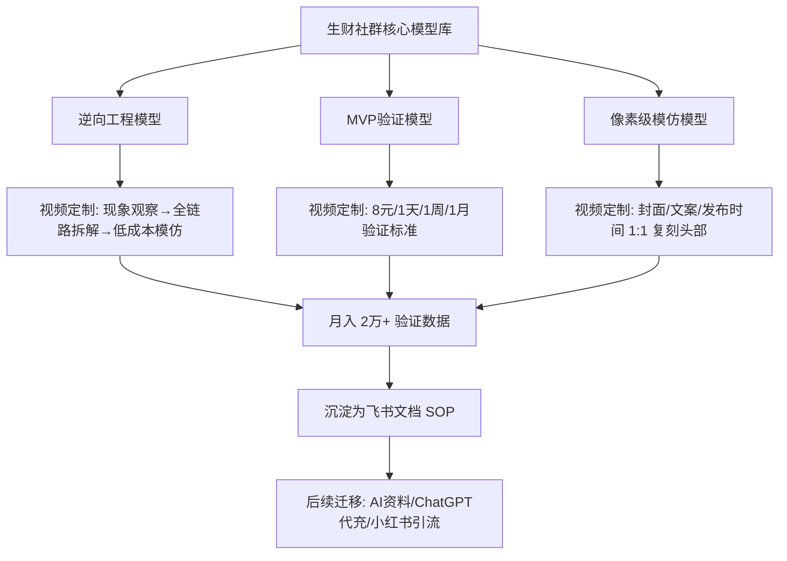

# 第 71 章 商业逆向工程与最小验证闭环
作者：龙哥

## 学习目标

- 理解商业逆向工程的核心逻辑：现象观察 → 全链路拆解 → 低成本模仿 → 数据迭代
- 掌握最小可行性验证（MVP）在陌生赛道中的具体执行标准与成本控制红线
- 学会利用“场观数据雷达”识别平台算法推荐下的隐性需求蓝海信号
- 建立生财思维迁移能力：将社群抽象方法论转化为个人专属的可执行 SOP
- 认清执行力杠杆在相同认知下的决定性作用，掌握“先发布再修正”的行动范式
- 学会将一次性跑通经验资产化为飞书文档等知识产品，构建信任前置与筛选漏斗

## 71.1 生活类比

想象商业逆向工程像**去陌生城市找一家隐藏的爆款小吃店**：  
- **现象观察** = 看到路边排长队（场观数据异常），闻到香味（隐性需求信号）  
- **全链路拆解** = 偷偷看厨房怎么切菜/调料/摆盘/收钱/打包（竞品选题/文案/挂载/引流/交付）  
- **低成本模仿** = 买同款调料包（8元AE模板），用自家锅碗瓢盆（现有电脑/账号）在自家厨房试做一份  
- **MVP验证** = 先请邻居尝（发作品测流量），有人愿付钱买（微信收款）才算跑通，不用先开店办证装修  
- **思维迁移** = 学会了“找排队店→偷流程→家里试→卖邻居”这套逻辑，下次去卖奶茶、卖烧烤全都能用  
- **执行力杠杆** = 别人还在研究“选址风水/装修风格/招聘店员”，你已经卖出第一百份外卖了  
- **文档资产化** = 把配方、进货渠道、外卖话术、避坑指南写成《傻瓜开店手册》，既能自己开分店，也能卖给想创业的人

## 71.2 概念地图

第71章：商业逆向工程与最小验证闭环
├── 核心方法论
│   ├── 商业逆向工程              —— 概念1
│   │   ├── 现象观察发现异常值
│   │   ├── 竞品全链路拆解（选题/文案/挂载/引流/交付）
│   │   ├── 极低成本模仿搭建（8元/AE模板/现有设备）
│   │   └── 数据反馈迭代规模化
│   ├── 最小可行性验证 (MVP)       —— 概念2
│   │   ├── 目标：验证“愿不愿意买单”而非“做得好不好”
│   │   ├── 标准：8元/1天搭建/1周出单/1月复盘
│   │   ├── 约束：无官网/无客服/无自动化/无公司主体
│   │   └── 后续：必须SOP化迭代，避免自我打工陷阱
│   ├── 场观数据雷达               —— 概念3
│   │   ├── 定义：实时在线人数/播放增速/评论高频追问
│   │   ├── 优势：先行性/真实性/零成本可得
│   │   └── 辨析：区分泛娱乐流量与垂直需求流量
│   ├── 生财思维迁移论             —— 概念4
│   │   ├── 公式：社群认知资产 × 个人执行力迁移能力 = 变现结果
│   │   ├── 路径：带着问题去偷模块 → 组装落地 → 复盘固化
│   │   └── 标志：能用自己话复述、写出专属SOP、教会他人
│   ├── 执行力杠杆                 —— 概念5
│   │   ├── 定义：(启动速度 × 产出量 × 迭代次数) / 完美主义系数
│   │   ├── 战术：外部约束(航海/公开承诺)对抗人性惰性
│   │   └── 前提：方向大致正确 + 复盘机制 + 抗挫折资本
│   └── 飞书文档资产化             —— 概念6
│       ├── 内容：保姆级教程(账号/素材/话术/引流/交付/避坑)
│       ├── 作用：信任前置/筛选漏斗/复利复用/版本迭代护城河
│       └── 红线：仅基于亲自跑通正向数据项目沉淀，核心留白
├── 典型实战载体
│   └── 视频定制项目              —— 概念1/2/3/6
│       ├── 赛道特征：非标虚拟服务/边际成本近零/情绪价值
│       ├── 验证数据：8元成本/月入2万+/飞书文档沉淀
│       └── 迁移应用：后续复用于AI资料/ChatGPT代充/小红书引流
└── 底层理论支撑
    ├── 生财思维可迁移性定理     —— 理论1
    ├── 陌生赛道优于红海竞争      —— 理论2
    └── 执行力是变现关键杠杆      —— 理论3

## 71.3 商业逆向工程 —— 用最小成本拆解陌生赛道的赚钱逻辑

> "碰到陌生的项目我应当如何去尝试，当然在我心里我给了它一个高大上的名字来安慰自己，那就是商业的逆向工程。"
> 
> ——《docs/202305/20230516_064.md》

你是不是也有过这种经历：刷到一个从没见过的项目，直觉告诉你"这东西能火"，但完全不知道从何下手？要么不敢动，要么盲目全投入，最后血本无归。

商业逆向工程就是为你准备的"照葫芦画瓢"标准动作库。它的核心逻辑只有一条：**不搞原创发明，只做"抄作业+微创新"**。

### 71.3.1 为什么需要这个概念？

- 面对从未接触过的陌生项目，普通人往往陷入"要么不敢动、要么盲目全投入"的两难
- 传统"原创发明"成本高、周期长、失败率极高，不适合资源匮乏的新手
- 需要一套标准化的"照葫芦画瓢"方法论，将不确定性压缩在可承受范围内

### 71.3.2 核心定义

> **商业逆向工程**（来源：《docs/202305/20230516_064.md》）

$$
\text{商业逆向工程} = \text{现象观察发现异常值} \rightarrow \text{竞品全链路拆解} \rightarrow \text{极低成本模仿搭建} \rightarrow \text{数据反馈迭代}
$$

这个公式展示了四个标准动作：(1) 在平台上刷到"异常场观"时敏锐捕捉；(2) 像拆手表一样把竞品从选题到交付全拆开看透；(3) 用"喝杯奶茶钱"买同款工具、用现有设备在家里试做；(4) 盯着真实数据（哪怕只有1单）决定下一步动作。

### 71.3.3 关键性质

- **低门槛**：启动成本压缩到极致（域名/工具费约8元），将试错成本控制在"吃顿饭"的水平
- **全链路**：覆盖从选题、素材、文案、引流、交付到售后的完整商业闭环拆解
- **可迁移**：该思维模型经生财有术社群抽象提炼，可跨赛道复用至任意陌生项目

### 71.3.4 典型例子：视频定制项目实战拆解

作者曹超峰在刷视频时，发现某"视频定制"直播间场观持续数千人，评论区刷屏"怎么做/多少钱/发链接"。同类账号常态场观仅几十人，这个**异常值**就是入场信号。

随后他深度拆解头部竞品全链路：

| 拆解维度 | 竞品实操细节 | 你的模仿动作 |
|----------|--------------|--------------|
| **选题方向** | 生日/纪念日/表白/婚礼等高情绪节点 | 直接照搬高频选题库 |
| **文案钩子** | "还在送实物？定制视频才走心" + 成品展示 | 套用情绪价值话术模版 |
| **挂载方式** | 小风车挂链接/主页留微信/评论区引导 | 无小风车权限则用主页+评论区 |
| **引流话术** | 私信回复"想做"发作品集/报价单 | 复制话术脚本进微信自动回复 |
| **交付形式** | 网盘发成品/微信直接发视频文件 | 用剪映改名字换照片→网盘分享链接 |

**低成本模仿搭建清单**：
1. 8元购买同款 AE 模板（淘宝/闲鱼搜"视频定制模板"）
2. 现有电脑安装剪映/Pr，1小时速成基础操作
3. 注册抖音/视频号账号，完善主页简介挂微信
4. 发布 3-5 条测试作品，盯着场观数据和私信咨询

> **这个拆解表展示了**：商业逆向工程不是"抄表面"，而是把竞品的每个赚钱动作拆成可执行的标准模块，再用最低成本把模块组装起来跑通。

### 71.3.5 边界条件

- 仅适用于"可标准化、边际成本低、交付路径清晰"的轻资产项目（虚拟服务/数字产品/代理分销）
- 重供应链、重合规、重技术壁垒的项目（如实体制造、医疗、金融牌照）不适用
- 依赖"执行力"落地，认知到位但不行动者无法受益

---

## 71.4 最小可行性验证（MVP） —— 用"喝杯奶茶钱"跑通商业闭环

> "8 块钱成本一个月小赚 2w 多"
> "主要想验证一遍：碰到陌生的项目我应当如何去尝试"
> 
> ——《docs/202305/20230516_064.md》

你是不是也想把官网做得像大厂一样专业、把客服系统配齐、把自动化交付流程跑通、甚至想先注册个公司再开张？**停下来。** 这些都是完美主义拖延症的伪装。

### 71.4.1 为什么需要这个概念？

- 新手常犯"完美主义拖延症"：备料三个月、搭建完美官网、招齐团队再开张，结果需求不存在血本无归
- 传统创业教科书强调"商业计划书、融资、组建团队"，与普通人"零资源、零背景、零容错"现实严重脱节
- 必须建立"先跑通、再完美、后放大"的反直觉行动范式

### 71.4.2 核心定义

> **最小可行性验证 MVP**（来源：《docs/202305/20230516_064.md》）

$$
\text{MVP验证} = \frac{\text{流量获取} \rightarrow \text{用户转化} \rightarrow \text{产品交付} \rightarrow \text{收款到账}}{\text{最低成本(金钱/时间/精力)}}
$$

**判断标准**：能否用 8 元成本、1 天搭建、1 周出单、1 月复盘。

这个公式展示了：分子是必须跑通的最小闭环四步，分母是极限压缩的资源投入。**目标极简：不验证"能不能做好"，只验证"有人愿不愿意买单"。**

### 71.4.3 关键性质

- **目标极简**：不验证"能不能做好"，只验证"有人愿不愿意买单"
- **资源约束下的聚焦**：黑客松两天、副业碎片时间、单人单机均可执行
- **数据信仰**：以真实交易数据（哪怕只有1单）作为唯一决策依据，替代主观臆断

### 71.4.4 典型例子：视频定制项目的 MVP 执行日志

| 天数 | 动作 | 成本 | 产出 | 关键数据 |
|------|------|------|------|----------|
| Day 1 | 买 AE 模板、装剪映、注册号、发 3 条测试作 | 8 元 | 3 个作品 | 场观 50+，私信 3 条 |
| Day 2-3 | 接单改模板、微信收款、网盘发货 | 0 元 | 3 单 | 客单价 30-50 元 |
| Day 7 | 复盘：转化率、交付耗时、素材去重 | 0 元 | SOP v0.1 | 单日利润 > 成本 |
| Day 30 | 矩阵号放大、外包剪辑、话术迭代 | 500 元 | 标准化流程 | 月入 2 万+ |

**全程无官网、无客服系统、无自动化交付、无公司主体，纯人工跑通闭环。**

> **这个执行日志展示了**：MVP 的本质是"用最笨的办法跑通最核心的路"。哪怕只有 1 单真实成交，也比 100 份完美商业计划书更有说服力。

### 71.4.5 边界条件

- 验证通过后**必须**迭代标准化（SOP 化），否则陷入"自己打工给自己干"的高强度低杠杆陷阱
- 仅作为"0→1"起跑工具，不可作为长期运营模式（合规、体验、规模均不达标）
- 核心风险：沉迷"低成本试错"快感，拒绝进入"标准化放大"的艰难期

---

## 71.5 场观数据雷达 —— 用"在线人数"嗅探隐形需求蓝海

> "主要被他的场观吓到了，所以尝试了一下"
> "我先前也刷到了，没你执行力哈哈"
> 
> ——《docs/202305/20230516_064.md》

传统选品依赖"第三方工具估算销量/关键词指数"，数据滞后且同质化严重，挖不到真蓝海。平台算法推荐机制下，爆款往往始于"异常的实时互动数据"，而非静态历史数据。

### 71.5.1 核心定义

> **场观数据雷达**（来源：《docs/202305/20230516_064.md》）

$$
\text{场观数据} = \{\text{直播间实时在线人数},\ \text{短视频实时播放/点赞/评论增速},\ \text{评论区高频追问关键词}\}
$$

**核心逻辑**：场观异常高企 = 平台算法判定内容优质 + 用户真实需求强烈 = 隐性蓝海信号。

### 71.5.2 关键性质

- **先行性**：比工具后台数据早 3-7 天捕捉趋势（工具需等数据沉淀）
- **真实性**：难以大规模造假（刷场观成本高、易封号），相对可信
- **可操作**：打开 APP 刷同行直播间/视频即可得，无需付费工具会员

### 71.5.3 典型例子：如何用场观数据雷达发现"视频定制"蓝海

| 观测对象 | 常态数据 | 异常数据 | 判读结论 |
|----------|----------|----------|----------|
| 头部竞品直播间 | 场观 50 人 | 场观 3000+ 人，持续 2 小时 | 算法强推+真实需求爆发 |
| 评论区高频词 | "好看/点赞" | "怎么做/多少钱/发链接/想做同款" | 高付费意向垂直需求 |
| 同类账号对比 | 日涨粉 100 | 单条视频涨粉 5000+ | 内容形态跑通、可复制 |

**实操 SOP**：
1. 每天固定 30 分钟刷目标赛道 Top20 账号的直播间/新发视频
2. 记录：实时在线峰值、评论区"求链接/多少钱/怎么弄"频次、点赞评论增速
3. 触发阈值：场观 > 同类均值 10倍 + 付费意向评论 > 20 条/小时 → 立即启动拆解

> **这个对比表展示了**：场观数据雷达不是看热闹，而是用"异常值统计学"把隐性需求变成显性入场信号。作者正是被"场观吓到"才果断入场，而同期同学"也刷到了"却止步于围观。

### 71.5.4 边界条件

- 易受"付费投流/刷单/薅羊毛活动"干扰，需结合"用户画像/互动质量/持续时长"综合研判
- 仅作为"切入信号"，不能替代后续的"产品打磨/供应链搭建/私域转化"硬仗
- 对新手识别能力有要求：需区分"泛娱乐流量（看热闹）"与"垂直需求流量（想买单）"

---

## 71.6 生财思维迁移论 —— 把社群里的"抽象方法论"变成自己口袋里的"具体现金流"

> "利用生财思维，我跑通了一个没见过的小项目"
> "利用在生财有术学到的知识，跑通了一个没见过的小项目"
> 
> ——《docs/202305/20230516_064.md》

### 71.6.1 核心定义

> **生财思维迁移论**（来源：《docs/202305/20230516_064.md》）

$$
\text{个人商业变现结果} = \text{社群认知资产} \times \text{个人执行力迁移能力}
$$

**思维迁移** = 识别社群核心模型 → 匹配当下具体业务场景 → 转化为可执行的标准动作清单 → 执行并复盘固化为个人资产。

### 71.6.2 关键性质

- **非自动发生**：必须主动建立"问题→社群精华帖/导师/同伴→模块化方案→组装落地"的检索路径
- **依赖"带着问题去偷模块"**而非"盲目刷课存笔记"
- **迁移成功的标志**：能用自己的话复述原理、能写出该项目的专属 SOP、能教会别人做

### 71.6.3 典型例子：三大抽象模型在"视频定制"上的直接落地

| 社群抽象模型 | 视频定制项目的专属落地动作 |
|--------------|----------------------------|
| **商业逆向工程** | 发现异常场观 → 拆解选题/文案/挂载/引流/交付 → 8元买模板跑通 |
| **MVP 低成本验证** | 无官网/无客服/无自动化/无公司，纯人工跑通首单 → 再迭代 |
| **像素级模仿** | 竞品封面怎么设计我就怎么设计、话术怎么讲我就怎么讲、发布时间点对齐 |

**迁移路径可视化**：

> **这张迁移路径图展示了**：思维迁移不是"学以致用"这么简单，而是把抽象模型当积木块，对着具体业务场景一块块拼装、打磨、固化。

### 71.6.4 边界条件

- 前提是深度参与过高质量社群系统性学习（非碎片化刷短视频）
- 迁移能力需通过"实战项目反复练习"训练而来，非天生自带
- 仅解决"方法论层面"的迁移，不包含"资源/人脉/资金/技术"层面的直接获取

---

## 71.7 执行力杠杆 —— 相同认知下"敢干"的赢"会想"的

> "我先前也刷到了，没你执行力哈哈"
> "主要被他的场观吓到了，所以尝试了一下"
> "虽然变现不多，但说实话我还是很高兴的"
> 
> ——《docs/202305/20230516_064.md》

认知商品化时代，"知道怎么做"已不稀缺（课程/书/社群随处可见），"敢做、能干、干成"才是稀缺资产。同一社群、同一认知、同一赛道下，最终赚到钱的永远是"执行力最强"那批人。

### 71.7.1 核心定义

> **执行力杠杆**（来源：《docs/202305/20230516_064.md》）

$$
\text{执行力杠杆} = \frac{\text{行动启动速度} \times \text{单位时间产出量} \times \text{容错迭代次数}}{\text{完美主义拖延系数}}
$$

**核心口诀**：解决真正的问题，赚钱的事多做十遍；先发布再修正，用市场反馈倒逼升级。

### 71.7.2 关键性质

- **启动阈值极低**：只要"看懂大概怎么做"立即动手，拒绝"再研究一下/再准备一下"
- **高频节奏**：视频定制项目日更多条、多账号矩阵测款、数据不行立马换素材/换赛道
- **公开承诺/外部约束**：参与"小航海"训练营、发布公开复盘帖、找教练陪跑，用社会压力对抗人性惰性

### 71.7.3 典型例子：同期同学的"执行力分水岭"

| 维度 | 作者（高执行力） | 同期同学（低执行力） |
|------|------------------|----------------------|
| **发现信号** | 被场观吓到 → 立即拆解 → 当晚买模板 | "我也刷到了" → 点赞收藏 → 无后续 |
| **MVP 跑通** | 3 天出首单、7 天复盘 SOP、30 天月入 2万+ | 停留在"索要工具码/飞书链接"层面 |
| **后续迁移** | 复用方法论跑通 AI资料/代充/引流等多项目 | 仍在寻找"下一个好项目" |
| **资产沉淀** | 飞书文档保姆级教程、可对外分享变现 | 无标准化输出、经验随时间流失 |

> **这个对比表展示了**：执行力差异不是"快一点慢一点"，而是"0到1能不能跑通"、"1到N能不能放大"、"经验能不能资产化"的本质分水岭。

### 71.7.4 边界条件

- 执行力需建立在"方向大致正确"基础上，盲目蛮干（错误方向高强度执行）加速死亡
- 需配合"复盘迭代"机制，单纯重复无效动作属于"低水平勤奋"
- 依赖一定的"抗挫折心理资本"：首周零收入、账号被限流、素材被举报等负面反馈下仍能持续行动

---

## 71.8 飞书文档资产化 —— 把"一次性跑通经验"变成"可复制、可交付、可定价"的知识产品

> "因为文章图片较多，放在飞书文档了"
> "公开分享，禁止复制，可以这么设置"
> "详细 SOP 沉淀于飞书：账号搭建、素材来源、话术脚本、引流私域、交付流程、避坑指南"
> 
> ——《docs/202305/20230516_064.md》

实战经验极易随时间遗忘、随团队流失、随项目迭代失真，必须显性化、结构化、标准化沉淀。个人 IP 变现的核心杠杆之一：将"隐性经验"转化为"显性知识产品"（文档/课程/工具/社群）。

### 71.8.1 核心定义

> **飞书文档资产化**（来源：《docs/202305/20230516_064.md》）

**文档资产化** = 将项目全链路实操细节（账号搭建、选品逻辑、素材来源、文案模版、话术脚本、引流路径、交付流程、避坑红线）按"保姆级教程"标准写入飞书文档。

**交付形态**：图文并茂、分步骤、可直接上手操作、含避坑指南、设置禁止复制保护知识产权。

### 71.8.2 关键性质

- **信任前置**：公开分享详细复盘（如作者发帖公开飞书链接），建立"专业、真实、不藏私"人设，反向引流高意向付费用户
- **筛选器**：免费文档筛选"自学能力强/执行力强"用户；付费课程/陪跑服务筛选"想偷懒/要手把手/有钱买时间"用户
- **复利效应**：一次沉淀，长期售卖/引流；随项目迭代持续更新版本号（v1.0/v2.0...），形成护城河

### 71.8.3 典型例子：视频定制项目飞书文档目录结构

| 章节 | 核心内容 | 留白策略 |
|------|----------|----------|
| 1. 赛道认知 | 选题库/用户画像/竞品地图/变现模型 | 公开 |
| 2. 账号搭建 | 注册养号/主页装修/微信配置/防封设置 | 公开 |
| 3. 素材生产 | AE模板购买渠道/剪映操作演示/去重参数 | 核心渠道留白/付费可见 |
| 4. 文案话术 | 封面标题模版/私域回复脚本/异议处理话术 | 核心话术留白/付费可见 |
| 5. 引流转化 | 评论区钩子/私信自动回复/朋友圈布局 | 公开框架/细节付费 |
| 6. 交付流程 | 网盘结构/改模板标准化步骤/售后模版 | 公开 |
| 7. 避坑指南 | 违规申诉/版权风险/账号降权恢复 | 核心申诉模版留白 |
| 8. 迭代日志 | v1.0-v3.0 更新记录/数据复盘/决策复盘 | 仅付费可见 |

**后续复用验证**：作者将此文档作为"引流钩子"发布在生财有术社群，获得大量点赞/精华/私信咨询，直接转化为后续付费航海学员/咨询客户。

> **这个目录结构展示了**：文档资产化不是"把知道的都写进去"，而是设计"免费建信任、留白保核心、付费给细节、迭代筑护城河"的分层交付体系。

### 71.8.4 边界条件

- 必须基于"亲自跑通且有正向数据"的真实项目沉淀，理论推演/未验证/失败项目文档无价值甚至有害
- 需持续维护更新：平台规则变、工具迭代、玩法更迭，文档不更新即失效
- 核心风险：文档过于详细导致"白嫖党照抄也能跑通"稀释付费价值，需核心话术/核心渠道/核心工具留白或仅付费可见

---

## 71.9 多源对照

### 共识

- **低成本验证优于完美策划**：无论是《20230516_064.md》的 8 元 MVP，还是《DGw1dYHSsohHu7x1AXhc4cQVnEN.md》的 1100 元冷启动，核心都是"先跑通闭环，再考虑体系化"
- **执行力是稀缺杠杆**：同一认知下，启动速度 × 产出量 × 迭代次数决定变现上限
- **思维模型可迁移**：社群抽象方法论经实战练习后，可跨赛道复用指导新项目

### 分歧

- **《20230516_064.md》主张"像素级模仿"起号**：封面/文案/发布时间 1:1 复刻头部，降低认知负荷规避试错
- **《DGw1dYHSsohHu7x1AXhc4cQVnEN.md》主张"素材/人群匹配度"决定成败**：同账号同流量下，素材 A（广州塔/年轻人）转化 0.015% vs 素材 B（美女试驾/中老年）转化 0.5-1%，证明"人货场"匹配度是第一性原理，单纯像素级模仿可能搬运错人群
- **《SUMMARY.md》提出"小航海"外部约束机制**：通过截止节点/公开承诺/同伴监督/导师点评强制执行，而《20230516_064.md》更强调个人内驱力与复盘机制

---

## 71.10 设计中的取舍

**为什么不用"完美官网+自动化交付+公司主体"起步？**
因为这会把"验证需求"的成本从 8 元推高到 8 万元，把周期从 1 天拉长到 3 个月。一旦发现赛道是伪需求，沉没成本足以劝退 99% 的普通人。MVP 的本质是**用最低成本买"确定性"**，而不是买"体面"。

**这种设计的 trade-off 是什么？**
- **得**：极低试错成本、极快反馈速度、保留随时止损/转向的灵活性
- **失**：用户体验粗糙（人工交付易出错）、合规风险高（无主体/无资质）、无法规模化（受限于人工瓶颈）、品牌资产难沉淀（易被平台判定营销号）
- **破局点**：跑通 MVP 后**立即**启动 SOP 化迭代——外包重复劳动、上自动化工具、补合规资质、建品牌护城河。不迭代就永远是"给自己打工"。

---

## 71.11 动手练习

### 练习1：手动拆解一个陌生赛道的竞品全链路

**任务**：打开抖音/视频号/小红书，搜索一个你从未接触过的冷门关键词（如"宠物通灵/老照片修复/定制睡前故事"等），找到近期场观/互动异常高的 3 个竞品账号/直播间/笔记。

1. 记录其选题方向、封面/标题钩子、内容结构、挂载方式（小风车/主页/评论区）、引流话术（私信/评论区/粉丝群）、交付形式（网盘/微信/小程序/私域）
2. 绘制该赛道的"商业全链路拆解图"：流量端 → 转化端 → 交付端 → 复购端
3. 估算其启动成本下限：工具/素材/账号/时间各需多少？能否压缩到 50 元以内？

**回答问题**：
- 该赛道的"隐性需求信号"最强的是哪个环节？（场观/评论追问/私信转化/复购反馈）
- 如果让你明天用 8 元成本跑通 MVP，你会砍掉哪些"完美主义"环节？（官网/客服/自动化/公司/完美包装）
- 该赛道的核心壁垒是"技术/供应链/合规"还是"执行力/选品/文案/去重"？

### 练习2：设计你的"8元 MVP"跑通方案

基于练习 1 拆解的赛道，制定一份"最小可行性验证执行清单"：

1. 明确验证目标：仅验证"有人愿意为核心价值付费"，不验证其他
2. 列出必须保留的 3 个核心动作（如：做 1 个样品/发 1 条测试内容/收 1 笔微信转账）
3. 列出必须砍掉的 5 个完美主义动作（如：注册公司/搭建官网/开发小程序/招客服/设计 VI）
4. 设定止损红线：投入不超过 50 元、时间不超过 3 天、测试内容不超过 5 条，无正反馈即复盘或放弃
5. 定义"跑通"的量化标准：如"1 条内容带来 3 个精准咨询/1 单成交/利润>成本"

**回答问题**：
- 你的"核心价值"到底是什么？是成品视频、还是节省时间的模板、还是情绪慰藉？
- 交付环节能否"人工服务"代替"系统开发"？边界在哪里？
- 如何用"场观数据雷达"在测试期每天监控判断是否继续投入？

### 练习3：将一篇生财精华帖的抽象方法论迁移为你的专属 SOP

1. 用自己的话复述该帖核心模型的 3 个关键步骤（如：找榜单 → 验销量 → 测转化）
2. 对照你当前/计划做的项目（或练习 1 的赛道），将这 3 步转化为你的"专属执行清单"（注明具体工具/渠道/话术/时间节点）
3. 标注出"原帖通用模型"与"你的专属 SOP"的差异点：哪些是直接照搬？哪些需微调？哪些完全不适用？
4. 执行你的专属 SOP 第 1 步，记录实际耗时、遇到的卡点、修正后的动作

**回答问题**：
- 迁移过程中，你最大的"知行分离"在哪里？（懂了但没做/做了但没标准化/标准化但没复盘）
- 如果让你把这份专属 SOP 写成飞书文档对外分享，你会在哪里"留白"核心话术/渠道/工具以保护变现价值？
- 这份 SOP 的"版本号"你打算怎么定义？v1.0 的验收标准是什么？

---

## 71.12 本章小结

这一章中我们学习了如何用商业逆向工程这把"万能钥匙"，打开任意陌生赛道的变现大门。首先我们拆解了**商业逆向工程**的四步标准动作：捕捉异常场观 → 全链路拆解竞品 → 8元成本模仿搭建 → 数据驱动迭代；其次掌握了**MVP 最小验证**的反直觉范式：只验证"愿不愿意买单"，砍掉所有完美主义环节，用喝杯奶茶钱跑通闭环；接着学会了**场观数据雷达**的实战用法：用实时在线人数、评论高频追问等零成本信号，比工具早 3-7 天嗅探蓝海；然后建立了**生财思维迁移**的翻译能力：把社群的抽象模型拆成积木块，对着具体业务场景一块块组装成专属 SOP；之后认清了**执行力杠杆**的决定性作用：相同认知下，启动速度 × 产出量 × 迭代次数 ÷ 完美主义系数，才是赚钱的真正变量；最后掌握了**飞书文档资产化**的分层交付体系：免费建信任、留白保核心、付费给细节、迭代筑护城河，把一次性经验变成可复利的知识产品。

本章我们一起学习了以下概念：

| 概念 | 解释 |
|------|------|
| 商业逆向工程 | 面对陌生项目的通用验证范式：发现异常值 → 拆解全链路 → 低成本模仿 → 数据迭代，不搞原创发明 |
| 最小可行性验证 (MVP) | 用"喝杯奶茶钱"(8元)跑通"流量-转化-交付-收款"最小闭环，验证需求真实性而非追求系统完美 |
| 场观数据雷达 | 利用直播间在线人数、视频实时互动增速、评论区高频追问等零成本实时信号，嗅探平台算法推荐下的隐性蓝海 |
| 生财思维迁移论 | 社群抽象模型(逆向工程/MVP/像素级模仿) × 个人执行力迁移能力 = 个人商业变现结果，核心是"带着问题去偷模块" |
| 执行力杠杆 | 相同认知下，启动速度×产出量×迭代次数 ÷ 完美主义拖延系数，决定谁能把理论变成现金流 |
| 飞书文档资产化 | 将一次性跑通经验标准化为"保姆级教程"文档，实现信任前置引流、用户分层筛选、知识产品复利复用 |
| 视频定制项目 | 非标虚拟服务赛道验证案例：8元AE模板+现有设备，月入2万+，后续作为方法论迁移的标准载体 |
| 生财思维可迁移性定理 | 社群系统性学习的抽象商业模型可跨赛道迁移指导实战，前提是深度参与与反复实战练习 |
| 陌生赛道优于红海竞争 | 主动寻找竞争不激烈的冷门赛道验证，比在成熟红海拼存量更易获得正反馈与生存空间 |
| 执行力是知识变现关键杠杆 | 认知商品化时代，"敢干、能干、干成"比"会想、懂理、知道"稀缺百倍，执行力差异即收益差异 |

下一章中，我们将学习**《资料整理商业模型 —— 从"卖资料赚小钱"到"筛选用户造大钱"》**，揭示如何把零边际成本的资料变成筛选精准用户的杠杆钩子，构建"资料引流 → 咨询建立信任 → 高客单产品变现"的分层漏斗体系。
