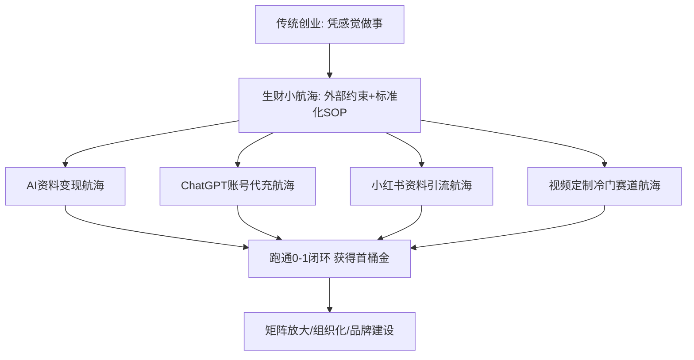
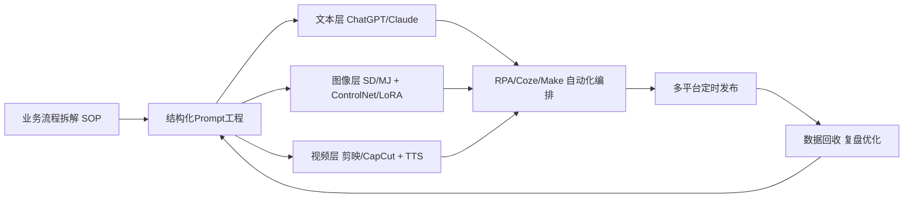
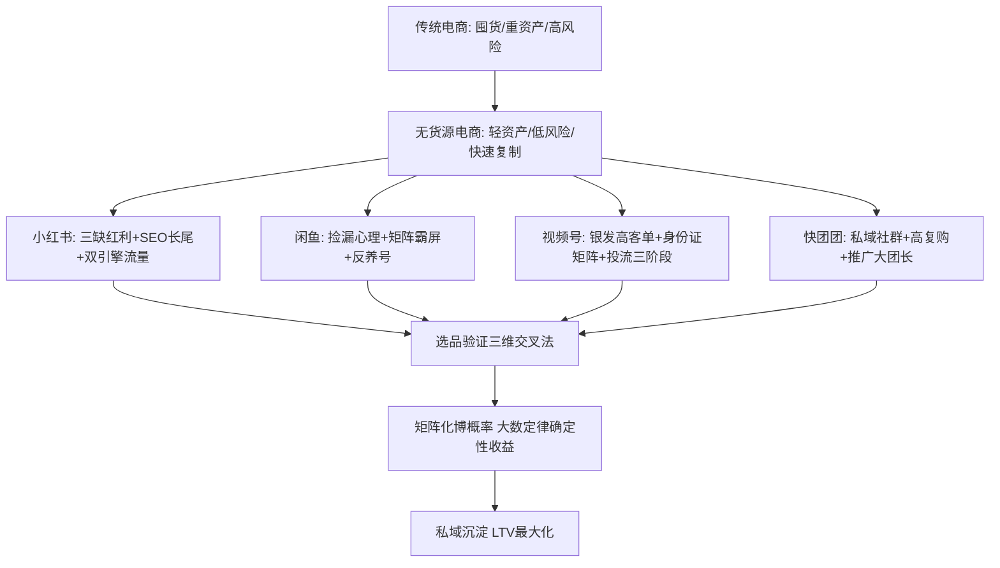

# 第 83 章 生财实战体系总论 —— 从认知重构到项目落地的完整操作手册

## 学习目标

- 理解资料整理商业模型：从"卖资料赚小钱"到"筛选用户造大钱"的范式跃迁
- 掌握知识创作系统：从"囤资料"到"生产知识资产"的DIKW与P.A.R.A组织法
- 理解付费即筛选：私域成交的心理学与话术标准化
- 掌握垂直赛道产品化案例库与选品决策框架
- 建立生财技能导航图谱：核心技能清单与学习路径索引
- 理解认知底座：从"想赚钱"到"会赚钱"的思维重构
- 掌握训练体系：生财"小航海"项目制训练营模型
- 理解流量底层架构：公域蓄水池与私域提款机的底层通道
- 掌握AI生产力革命：从"会用工具"到"建流水线"的自动化范式
- 理解实战项目库：轻资产电商与内容变现标准化打法

## 83.1 生活类比

想象生财实战体系是一场**从徒步到造火箭的进化游戏**：**生财小航海** = **新手训练营**：教练(导师)制定路线图(SOP)、设关卡(节点)、组队友(同伴监督)、你必须在规定时间跑完第一圈(0-1闭环)，否则淘汰。**利他思维** = **经营一家老字号饭馆**：不想着宰客一次(单向索取)，而是研制招牌菜(创造价值)、记住老主顾口味(深度运营)、出事了主动赔偿极致售后(亏佣金保客户)，最终街坊邻里口口相传排队买单(信任复利)。**执行力优先** = **学游泳不能光看书**：认知是旱地上练的动作，执行力是下水喝呛水的过程，只有在水里(市场反馈)挣扎、调整姿势，才能真正会游泳。**个人IP** = **种一棵树**：百年不改名是树种固定，全域用同名是根系深扎，统一视觉锤是树干粗壮，一致人设是树冠辨识度，时间复利让大树遮天蔽日，路人乘凉(流量)自然来。**公私域协同** = **开水果店**：公域平台是路边摆摊吆喝(蓄水池获客)，私域微信是把常客拉进VIP群发新鲜水果短信(提款机变现)，钩子设计是免费试吃的切块，诱饵是会员卡积分，承接路径是收银台扫码，转化话术是老板娘记得你爱吃甜的推荐新上市蜜瓜。**AI流水线** = **盖房子用预制板+起重机**：会用ChatGPT只会砌一块砖(单点技能)，建流水线是设计图纸(业务拆解SOP)、定制预制板(结构化Prompt)、起重机吊装(RPA/自动化串联)，一天盖一栋楼(批量产出)。**无货源电商** = **开便利店不囤货**：小红书是精品店(选品验证+SEO长尾)，闲鱼是跳蚤市场(矩阵霸屏+捡漏心理)，视频号是社区团购(银发高客单+投流放大)，供应链是一件代发商家，你只赚信息差和运营差。**知识付费** = **开私塾收学费**：个人IP是先生的金字招牌(信任背书)，标准化交付是统一教材教案(SOP/模板)，持续内容输出是每日讲课打卡，选客户比服务客户重要=只收想读书觉醒的学生。**海外出海** = **去隔壁富人区收废品卖高价**：Mediabuy品牌词套利=帮大品牌挂广告赚佣金(CPC近零EPC为正)，独立站B2B=专业博客展示实力(内容为王)接大单，跨境私域=微信换WhatsApp、朋友圈换INS，汇率杠杆让同样努力赚7倍。**长尾非标赛道** = **开专科诊所而非综合医院**：二奢是鉴定奢侈品真假(资金周转杠杆)，手机壳是定制个性化保护壳，写作店铺是代写演讲稿回忆录，快手知识付费是卖缓解焦虑的安慰剂，解决具体小问题=精准切除病灶，不治大病也能活得滋润。**资料整理** = **卖铲子不淘金**：资料是免费的地图(钩子)，产品是带路的向导(解决方案)，不卖地图卖向导服务，才能持续赚大钱。**知识创作** = **建炼油厂不开加油站**：资料是原油(PIM)，知识是汽油(PKM)，创作是塑料制品厂(输出)，只有造出塑料制品才能卖高价。**付费即筛选** = **收门票的游乐场**：9.9元门票挡住白嫖党，200元咨询费建立信任，红包复投锁定高客单，最终在过山车(核心产品)上赚大钱。**垂直赛道** = **开专科诊所而非综合医院**：兴趣匹配是选科室，商业价值是看病种利润，渠道匹配是看医保报销比例。

## 83.2 概念地图

生财实战体系
├── 认知底座
│   ├── 生财小航海  —— SUMMARY.md/20230516_014.md/Gn5NdifvBorUbdxvGl6ceQgXnpg.md/CBJhdD0dTokH8tx8HKYc1nJSnnc.md/DGw1dYHSsohHu7x1AXhc4cQVnEN.md
│   ├── 利他思维  —— SUMMARY.md/20230516_094.md/BzIfdvAQloqLImxjEhKcERAXn5f.md/20230516_041.md/20230516_046.md
│   ├── 执行力优先论  —— SUMMARY.md/20230516_024.md/20230516_085.md/GUHld91qQobms8x35tbcOUlSnZb.md/20230516_079.md/CBJhdD0dTokH8tx8HKYc1nJSnnc.md
│   ├── 承认无能与无知  —— SUMMARY.md/20230516_041.md/20230516_042.md/20230516_058.md
│   └── 个人IP复利策略  —— SUMMARY.md/20230516_057.md/WX87d3F4SoVZLHxDNGzcDDVRn6R.md/20230516_085.md/GUHld91qQobms8x35tbcOUlSnZb.md/20230516_005.md
├── 流量架构
│   ├── 公私域协同模型  —— SUMMARY.md/20230516_029.md/RhRywNqifi3wjGkc4MacUiwXnxc.md/VjTFdmoIhoOIuhx4wYUcc1XGn8g.md/Nt9IdI0b0okp1MxGKBacQtxSn3e.md/20230516_078.md
│   ├── 资料整理引流法  —— SUMMARY.md/20230516_029.md/20230516_046.md/BzIfdvAQloqLImxjEhKcERAXn5f.md
│   ├── 小红书探照灯计划SOP  —— SUMMARY.md/20230516_035.md/RhRywNqifi3wjGkc4MacUiwXnxc.md
│   ├── 多平台矩阵分发  —— SUMMARY.md/20230516_078.md/20230516_080.md
│   └── 视频号生态内导流  —— SUMMARY.md/20230516_078.md
├── AI生产力革命
│   ├── AI内容自动化流水线  —— SUMMARY.md/20230516_081.md/20230516_084.md/20230516_020.md/HYrZdLBMRorB0qxKqFFcQ075nWf.md/ZXvbdq7RGoKEeLxryxAckCtSnPf.md/20230516_076.md
│   ├── ChatGPT+RPA文案自动化13步法  —— SUMMARY.md/20230516_081.md
│   ├── 结构化Prompt工程  —— HYrZdLBMRorB0qxKqFFcQ075nWf.md
│   ├── ControlNet多模态控制  —— HYrZdLBMRorB0qxKqFFcQ075nWf.md
│   ├── LoRA训练标准化五步工作流  —— ZXvbdq7RGoKEeLxryxAckCtSnPf.md
│   └── 工程化量产体系  —— HYrZdLBMRorB0qxKqFFcQ075nWf.md/20230516_076.md
├── 实战项目库
│   ├── 平民无货源电商模型  —— SUMMARY.md/20230516_030.md/20230516_097.md/20230516_024.md/20230516_094.md/AVx7dEXmpoRJazx3nH8cceBOnhd.md
│   │   ├── 小红书无货源/虚拟资料  —— 20230516_030.md/20230516_033.md/20230516_034.md/20230516_035.md
│   │   ├── 闲鱼矩阵霸屏/无货源SOP  —— 20230516_097.md/20230516_105.md/20230516_039.md/20230516_037.md
│   │   └── 视频号短视频挂车投流  —— 20230516_024.md/20230516_082.md/20230516_086.md
│   ├── 知识付费/写作变现  —— SUMMARY.md/WX87d3F4SoVZLHxDNGzcDDVRn6R.md/20230516_085.md/G2Zwdm2H7ol8FYxHEn7c0H2dn3c.md/20230516_041.md/20230516_049.md
│   ├── 海外Mediabuy/独立站B2B  —— SUMMARY.md/M0hMdjWj3o8WtNxZdv4cLnfenIh.md/VILid7sleoZ6puxkchxcRM9vn6g.md/Nt9IdI0b0okp1MxGKBacQtxSn3e.md/20230516_050.md
│   └── 长尾非标赛道拆解  —— SUMMARY.md/20230516_104.md/20230516_103.md/20230516_049.md/Dy8mdu2JUoyQYRx2UnocHwOinaf.md/BzIfdvAQloqLImxjEhKcERAXn5f.md/20230516_073.md
├── 商业模型方法论
│   ├── 资料整理商业模型  —— 20230516_046.md/BzIfdvAQloqLImxjEhKcERAXn5f.md
│   ├── 知识创作系统  —— 20230516_061.md
│   ├── 付费即筛选  —— BzIfdvAQloqLImxjEhKcERAXn5f.md
│   └── 垂直赛道产品化  —— 20230516_046.md/BzIfdvAQloqLImxjEhKcERAXn5f.md
├── 导航与元认知
│   ├── 生财技能导航  —— 20230516_012.md/20230516_060.md
│   └── 元数据与导航  —— 20230516_000.md/20230516_001.md/20230516_051.md/README.md

## 83.3 生财小航海 —— 用外部约束容器强制跑通0-1闭环

### 为什么需要这个概念？

普通人普遍面临"知道很多道理却过不好这一生"的执行鸿沟，拖延、完美主义、缺乏反馈导致长期不行动。自我驱动力不稳定，需要外部强制机制（截止节点、公开承诺、同伴监督、导师点评）将模糊意愿转化为确定性行动。新手缺乏完整商业闭环经验，需要标准化的训练场在低风险下完成首次变现。

### 核心定义

> **生财小航海定义**（来源：《SUMMARY.md》、《20230516_014.md》）
>
> 生财有术社群发起的项目制训练营模式：设定明确目标、时间节点、导师陪跑、标准化SOP。核心机制：截止节点倒逼执行 + 公开承诺增加沉没成本 + 同伴监督提供社会压力 + 导师点评修正认知偏差。产出标准：在规定周期内（通常21-28天）跑通一个最小商业闭环（0-1），赚到第一桶金。

这个定义展示了小航海的四大核心机制如何协同工作：时间压力迫使行动，公开承诺增加退出成本，同伴监督提供外部约束，导师点评纠正认知偏差。

### 关键性质

- **强制执行性**：将"想做"转化为"必须做"，解决拖延症核心痛点
- **低门槛筛选**：项目需满足正向现金流快、无复杂供应链、可SOP化、可借力AI、有公域获客路径、后端有高客单/高复购六大黄金标准
- **认知对齐功能**：导师陪跑帮助新手建立正确商业认知（如利他思维、执行力优先、承认无知），避免低水平勤奋
- **复利起点**：成功跑通一次航海后，获得的SOP、人脉、信心、现金流成为后续规模化放大的种子资产

### 典型例子

> **应届生两周变现7000元全流程复盘**（来源：《CBJhdD0dTokH8tx8HKYc1nJSnnc.md》）
>
> 圈友 CBJhdD0dTokH8tx8HKYc1nJSnnc：应届生跟航海两周变现7000元，完成加群、买号、调教、分销、写教程、办训练营、建星球全流程。

> **从"小透明"到启动行动的关键跃迁**（来源：《Gn5NdifvBorUbdxvGl6ceQgXnpg.md》）
>
> 圈友 Gn5NdifvBorUbdxvGl6ceQgXnpg：从入群"小透明"到启动行动耗时近一年，真正突破发生在"开始行动"那一刻，航海仅是催化剂。

> **8元成本跑通陌生赛道月入2万+**（来源：《DGw1dYHSsohHu7x1AXhc4cQVnEN.md》）
>
> 圈友 DGw1dYHSsohHu7x1AXhc4cQVnEN：8元成本跑通陌生赛道（视频定制）月入2万+，验证"低成本MVP验证+逆向工程"方法论迁移性。

> **多位圈友低门槛航海实测数据**（来源：《SUMMARY.md》）
>
> 多位圈友：参与"AI资料变现"、"ChatGPT账号注册/Plus代充"、"小红书资料引流"等低门槛航海，1-3个月实现月入3k-2w+突破。

这些案例展示了小航海模式在不同赛道、不同起点人群中的可复制性：核心不在于项目本身，而在于"外部约束+标准化SOP+低成本MVP验证"这一套方法论的迁移应用。

### 边界条件

- 航海只能解决"执行力不足"和"缺乏标准化SOP"问题，无法解决"赛道本身伪需求"或"核心能力绝对缺失"问题
- 依赖导师质量：若导师缺乏实战经验或SOP不成熟，易变为"收割韭菜"的付费群
- 仅适用于0-1阶段：已跑通闭环的老手需转向"矩阵放大"、"组织化"、"品牌建设"等更高阶玩法
- 存在幸存者偏差：公开复盘多为成功案例，失败者往往沉默退群，需警惕"必赚"心态

### 方法演进图

## 83.4 利他思维 —— 商业协作的底层操作系统

### 为什么需要这个概念？

普通人天然带有"索取思维"（想赚快钱、想白嫖资源、想走捷径），导致无法建立长期商业信任、无法留住高价值客户、无法吸引优质合伙人。所有高客单价、高复购、高LTV的业务模型，本质都是"先给价值、后收对价"的利他循环。生财圈核心文化基因："真诚是永远必杀技"、"吃水不忘挖井人"，只有利他才能构建抗风险的商业护城河。

### 核心定义

> **利他思维定义**（来源：《SUMMARY.md》、《20230516_094.md》）
>
> 在商业协作中，优先考虑为对方/用户创造价值、解决问题，而非单向索取利益。核心公式：商业价值 = 为他人解决问题的深度 × 受益人群规模 × 信任转化效率。执行准则：内容即诱饵/课程即解药（筛选有焦虑人群→缓解焦虑）、资料是踏脚石/产品必须是自己的（引流载体与变现主体分离）、极致售后护信法（亏佣金保客户、售后即营销）。

这个定义揭示了利他思维的三个操作层面：价值创造层（解决问题）、信任构建层（交易循环建立信任）、风险控制层（极致售后护信）。

### 关键性质

- **信任前置**：信任不是聊天聊出来的，而是通过"交付价值-收取对价"的交易循环建立（低价咨询费200元建立信任→引导用户自发发红包88-120元强化互惠）
- **长期主义**：拒绝"打一枪换地方"流量生意，私域经营是"细水长流"小店，视个人信誉如羽毛（爱惜羽毛法则）
- **正和博弈**：贵人链接价值交换模型——向上社交非单向索取，而是提供专业/情绪/渠道价值，使贵人投资获得正反馈，形成势力复利
- **反脆弱性**：假货危机三步走公关法（即时止损→实锤取证→高标准赔付谈判公开态度），危机转化为"重信誉"信任强化信号

### 典型例子

> **资料整理引流的利他闭环**（来源：《BzIfdvAQloqLImxjEhKcERAXn5f.md》）
>
> 资料整理引流：日均引私域180+用户，核心在于"资料是别人的（钩子），产品必须是自己的（本体）"，通过低价资料筛选付费意向→低价咨询深度连接→高客单产品/训练营核心利润。

> **快团团团长极致售后护信**（来源：《20230516_094.md》）
>
> 快团团团长极致售后：亏20元佣金挽回LTV1200元客户，设"不卖不支持无理由退换"红线，评论区赞"真诚是永远必杀技"。

> **写作BOSS模式的高复购护城河**（来源：《G2Zwdm2H7ol8FYxHEn7c0H2dn3c.md》）
>
> 写作BOSS模式：服务质量超预期是高复购(70%+)唯一护城河，单客下单10次以上为常态，定金验收机制建立安全感。

> **社群冷启动解散重建法**（来源：《20230516_094.md》）
>
> 社群冷启动解散重建：放弃激活僵尸群幻觉，一键解散400人僵尸群迁移<200高意向用户，链接浏览量显著提升、互动从零变有。

### 边界条件

- 利他不等于无原则付出：必须建立"事事有回应"高标准响应机制，拒绝无效沟通，筛选"正在觉醒/已觉醒"客户（选客户比服务客户重要）
- 利他需要能力支撑：无法解决用户核心问题时，利他只是空谈；需先打磨"暴力交付"能力（交付本质是筛选优质用户，而非无限陪伴）
- 警惕伪利他：打着利他旗号实则收割韭菜（如包装安慰剂课程、虚假销量评论），长期必被市场惩罚

### 多源对照

#### 共识

所有素材一致认为：利他思维是商业长期主义的基石，信任源于价值交换而非空谈，极致售后能将危机转化为信任资产。

#### 分歧

- 《20230516_094.md》强调"私域信任迁移定律"：信任源于人设与真实消费记录，极易因单次供应链失信归零，侧重供应链风控对信任的破坏性
- 《BzIfdvAQloqLImxjEhKcERAXn5f.md》强调"付费即筛选"：付费验证双重意向（兴趣强度+付费意识），免费用户无法判断付费潜力，侧重付费行为本身的筛选功能
- 《20230516_041.md》强调"选客户比服务客户重要"：99%成功源于客户自我觉醒，拒绝"需监督执行"的低质客户，侧重客户筛选的主动权

## 83.5 执行力优先论 —— 认知在行动中迭代，而非空想中升级

### 为什么需要这个概念？

普通人陷入"学习陷阱"：买课囤资料、听懂很多道理、却从不行动，误以为认知升级后自然能赚钱。真实商业环境不确定性极高，只有在行动中获得市场反馈（数据、用户投诉、竞品动态），才能修正认知盲区。素材中反复验证："好主意很多，做下去的很少"，"解决真正的问题，而不是试图解决所有问题"，"赚钱的事多做十遍"。

### 核心定义

> **执行力优先论定义**（来源：《SUMMARY.md》、《20230516_024.md》）
>
> 认知突破的本质是在行动中获得反馈修正认知，而非空想；执行力是连接认知与结果的唯一桥梁。核心口诀：解决真正的问题，赚钱的事多做十遍。运作机制：认知对齐 → 赛道筛选 → 标准化SOP执行 → 低成本MVP验证 → 复盘优化 → 规模化放大（全程以执行力贯穿）。

这个定义将执行力从"单纯勤奋"升维为"标准化执行+快速反馈+持续迭代"的系统工程。

### 关键性质

- **反脆弱行动**：承认无能与无知是成长起点，从最微小、最具体、最确定的正反馈动作做起（抄作业、跟航海、卖资料）
- **试错成本控制**：在承受范围内疯狂尝试（几十元买号、2K入群），将风险锁定在"多吃几天泡面可恢复"区间
- **双系统决策**：系统1（直觉）高速捕捉机会信号，系统2（逻辑）分析可行性与ROI，克服犹豫与盲目
- **信息差半衰期法则**：信息差商业价值随时间指数衰减，唯有极致执行力（发现速度×产出速度×分发速度）能在红利窗口完成变现
- **手动跑通是自动化前提**：任何RPA/AI自动化项目成功前提是手动标准化流程（SOP）已跑通验证可行；自动化解决规模化（1到100）而非验证可行性（0到1）

### 典型例子

> **东哥视频号带货：流程化标准化是收益复利唯一路径**（来源：《20230516_024.md》）
>
> 东哥参与4次航海仅12月完整跑完并爆发，将带货拆解为"发视频、上架、看数据、管店铺、催发货"五大标准动作，通过账号编号、硬件标配、SOP文档化实现收益复利。

> **木子田PPT IP：执行力>完美主义**（来源：《20230516_085.md》）
>
> 木子田0基础47天变现16.7万，执行力>完美主义，先发布再修正用市场反馈倒逼升级，1对1陪跑被逼打磨SOP再降维规模化。

> **不讲李不出镜IP：像素级模仿SOP流水线**（来源：《GUHld91qQobms8x35tbcOUlSnZb.md》）
>
> 不讲李10个月7位数变现，PPT排版/剪辑节奏/选题框架/引流话术固化为像素级标准，单人日产3-5小时高产出。

> **橘子海视频号轻量化：个人创业做减法**（来源：《20230516_079.md》）
>
> 橘子海三个月变现20万，放弃高成本直播带货(加法)，转用无直播/无小店的私域模式(减法)，验证"个人创业做减法"生存法则。

### 边界条件

- 执行力不能替代方向选择：在错误赛道上勤奋执行只会更快失败（需先通过赛道筛选模型验证）
- 需区分"战术勤奋"与"战略懒惰"：盲目堆工时、不复盘不优化SOP是低水平勤奋，真正执行力体现在"赚钱的事多做十遍"的标准化复制上
- 执行力有物理上限：单人时间精力有限，需通过矩阵号、团队协作、工具自动化突破天花板

## 83.6 个人IP复利策略 —— 百年不改名，全域用同名

### 为什么需要这个概念？

普通人缺乏品牌资产，频繁改名、换头像、分散运营导致用户认知成本极高、信任资产归零。个人IP是普通人最高杠杆的资产：边际成本趋近零、可跨平台复用、可睡后收入、估值远超单一项目收益。出名是赚钱的代价（隐私/安全/精力/舆论风险），但也是获取信任、降低获客成本、实现被动收入的核心护城河。

### 核心定义

> **个人IP复利策略定义**（来源：《SUMMARY.md》、《20230516_057.md》）
>
> 在所有公域平台（抖音、小红书、微信、B站、视频号等）使用统一ID、头像、简介，降低用户认知成本，积累品牌复利。三大核心资产：唯一名字资产（能用一辈子就是好名字）、统一视觉锤（头像/封面风格/配色）、一致人设标签（核心关键词如"自律搞钱狂魔"）。两条成长路径：一技之长IP（深耕行业经验输出避坑指南）、资源整合IP（盘点公开信息节省决策时间），均可不出镜实现。

这个定义确立了个人IP建设的三个硬性资产指标和两条差异化成长路径，打破了"IP必须出镜/露脸"的认知误区。

### 关键性质

- **指数级网络效应**：唯一名字×时间跨度=指数级影响力网络（粥左罗12年3000+篇内容织就），反对频繁改名导致资产归零
- **信任降维打击**：真实人设（暴露弱点/缺点/人性弱点）引发大众共情，建立"真实/有棱角/可信任"IP，IP核心公式=共性(普通人)+特性(个性/弱点)=信任与参考价值
- **商业化倒推**：广告调性预埋（内容调性统一+关键词预埋+真人出镜增强信任），主动构建品牌方偏好的商业化人设反向定制广告价值
- **矩阵放大器**：公域是放大镜（筛选精准意向用户），私域是放大器（高频触达深度信任最大化单客价值），无私域公域流量归零，无公域私域无水源

### 典型例子

> **漫漫小红书IP：暴露弱点建立真实人设**（来源：《WX87d3F4SoVZLHxDNGzcDDVRn6R.md》）
>
> 漫漫半年涨粉20万年变现40万，首篇《雅思考8分却出不了国》爆款验证"成就+心理落差"标题公式，暴露弱点内容涨粉效率远超正能量内容。

> **木子田PPT IP：统一视觉锤提升转粉率**（来源：《20230516_085.md》）
>
> 木子田统一封面大字报风格固定配色作者头像后主页转粉率从个位数提升至10%+，验证"视觉一致性=专业信任感"转化逻辑。

> **不讲李不出镜IP：标准化SOP被行业像素级模仿**（来源：《GUHld91qQobms8x35tbcOUlSnZb.md》）
>
> 不讲李10个月7位数变现，9类不出镜形式（PPT混剪/虚拟头像/录屏解说等）均为几十百万粉丝体量验证可行性，标准化SOP被大量后来者像素级模仿成行业事实标准。

> **粥左罗全域同名：12年3000+篇内容织就影响力网络**（来源：《20230516_057.md》）
>
> 粥左罗确立"能用一辈子就是好名字"判断准则，证明唯一名字×时间跨度的指数级网络效应。

### 边界条件

- IP建设前期慢：忠于自我内容阶段涨粉放缓但粉丝质量与变现单价显著提升（20万→30万粉吸引数千主动链接无条件信任付费的高价值粉丝）
- 必须配合后端产品：无高客单价产品/服务支撑的IP只是"网红"而非"商业IP"，核心在于"内容即筛选器：人才是目的数据非目的"
- 认知觉醒三层级：主流追名逐利→被迫以隐私换钱→觉醒者识破代价主动选择清福（蔡钰/猫叔/艺术老师/隐退朋友案例），"能觉得钱够用"属于高阶认知稀缺品

## 83.7 公私域协同模型 —— 公域蓄水池与私域提款机的底层通道

### 为什么需要这个概念？

公域流量归平台、不确定、易受算法波动影响，私域流量归自己、可反复触达、可深度运营。单纯做公域不沉淀私域=为平台打工（流量归零即资产归零）；单纯做私域无公域引流=无水之源（存量枯竭）。所有平台玩法最终归宿：公域引流 → 私域沉淀 → 朋友圈/社群运营 → 高客单/高复购转化。

### 核心定义

> **公私域协同模型定义**（来源：《SUMMARY.md》、《20230516_029.md》）
>
> 公域（小红书/抖音/视频号/👸号/闲鱼/海外社媒）作为蓄水池获客，私域（微信/社群）作为提款机变现。核心四大动作：钩子设计（诱饵）、诱饵制作（资料/群/号）、承接路径（主页/私信/群聊/企微）、转化话术（朋友圈运营/1v1成交/分层漏斗）。验证标准：公域内容KPI="精准获客"而非"出爆款"（评论区高购买意图互动量=精准流量代理指标）。

这个定义将公私域关系从"流量搬运"重构为"蓄水池-提款机"的工程化模型，并给出了可量化的KPI标准。

### 关键性质

- **引流即销售**：将引流环节标准化为销售流程（开场建立信任→需求确认/痛点挖掘→方案展示→处理顾虑→明确行动号召→成交后服务），7天实测咨询300+→加微81人(27%)→成交41人(50.6%)，平均成交耗时2.6小时
- **资料整理引流法**：整理高价值垂直领域资料作为钩子，公域发布引流至私域，后端匹配高客单价自有服务变现，实测日均引私域180+用户
- **小红书探照灯计划SOP**：养号(设备/环境)→垂直选题(关键词挖掘)→封面/标题/正文/标签/评论区五要素优化→诱饵设计→私域承接→朋友圈运营/转化话术
- **多平台矩阵分发**：一份内容同步分发小红书/抖音/视频号/👸号/闲鱼/快团团/海外社媒，实现一鱼多吃，降低单平台算法风险
- **视频号生态内导流**：视频号到👸号导流因无第三方跳转阻碍、平台默许链路短、转化率高，微信指数互通提升账号整体权重

### 典型例子

> **小红书资料引流月入5万+复盘**（来源：《20230516_029.md》）
>
> 通过优化后端朋友圈和话术，实现小红书资料引流月入5万+（朋友圈IP人设信任构建法+分层异议处理话术流程+营销节奏发布策略3:3:2:2）。

> **视频号带货私域：橘子海三个月变现20万**（来源：《20230516_079.md》）
>
> 橘子海三个月变现20万，放弃直播/小店，仅通过视频号内容引流至私域，朋友圈运营+1v1私聊建立深度信任实现高复购。

> **👸号矩阵引流：辰风一年运营5.6万/2.6万粉账号**（来源：《VjTFdmoIhoOIuhx4wYUcc1XGn8g.md》）
>
> 辰风一年运营5.6万/2.6万粉账号，站内征稿函/人设互推/抽奖联动/多平台投放四大玩法，站外全平台同名分发导流。

> **海外私域变现：Albert 7天首单$2000+**（来源：《Nt9IdI0b0okp1MxGKBacQtxSn3e.md》）
>
> Albert 7天首单$2000+，INS专业号预填40+篇内容建立信任→FB广告$20/天引流WhatsApp→代购人设SPIN简化版四步聊单→B端批发跃迁。

### 边界条件

- 私域运营风控红线：双号分流加好友（规避频率限制）、支付宝/多渠道分离收款（规避风控冻结）、助理接待标准化SOP
- 平台规则收紧期：小红书征稿函引流近期存在违规风险建议暂停；视频号私信前几条长按无"引用/回复"选项即隐形限流需停止发送
- 内容与引流分离：前5篇非营销内容保护期红线（过早植入营销笔记导致标签偏离权重受损），小号隔离引流大号收割账号分工模型

## 83.8 AI内容自动化流水线 —— 从"会用工具"到"建流水线"的范式跃迁

### 为什么需要这个概念？

单纯会用ChatGPT/MJ/SD不赚钱，工具普及后"会用"不再是稀缺能力，"建流水线"才是核心竞争力。AI降低了"从0到1"的技能门槛，但提高了"从1到N"的标准化要求：必须将业务拆解为SOP，注入Prompt工程，用RPA/代码串联成自动化流水线。素材验证：ChatGPT+RPA 13步文案自动化、SD云端零成本批量出图、AI短剧批量剪辑，单人日产50-100条视频、新手首月变现1.4万+。

### 核心定义

> **AI内容自动化流水线定义**（来源：《SUMMARY.md》、《20230516_081.md》）
>
> 结合ChatGPT（文本生成）、Midjourney/SD（图像生成）、RPA/自动化工具（剪映/Coze/Make/Zapier），构建从选题、生产、发布到数据反馈的全自动化内容生产系统。三位一体架构：文本层（ChatGPT标题预生成法+法律文章四段式模板+双账号矩阵并行）、图像层（SD结构化提示词模板+ControlNet多模态控制+LoRA训练五步工作流）、视频层（ChatGPT改写剧本+剪映智能剪辑+批量发布工具）。

这个定义确立了AI流水线的三层架构：每一层都有标准化的输入、处理、输出规范，而非零散的工具调用。

### 关键性质

- **标题即产品/AI仅为流水线工人**：标题质量决定文章上限，人工筛选高点击率标题库作为Prompt指令输入AI批量生成全文，实现标题决定内容/AI执行填充的反向生产流程
- **结构化Prompt工程**：五段式模板（质量词+主体+细节+服饰+环境）+权重语法(词:权重) + 万金油正反向词预设，覆盖90%生成场景
- **参数差异化策略**：带货文案Temperature 0.3-0.7（保守连贯），创意文案0.9（发散），批量设定不同值生成多版本供筛选
- **ControlNet多模态控制**：OpenPose姿势迁移、Canny线稿上色、M-LSD室内结构保持、Depth/Normal空间控制，实现像素级可控
- **LoRA训练标准化五步工作流**：数据准备(筛选/裁剪/打标/减标)→模型训练→XYZ Grid测试复盘→Metadata参数反推→业务落地，核心创新：减标签将权重迁移至触发词
- **工程化量产体系**：Generate Forever无人值守生成→多浏览器/指纹浏览器多账号并行突破算力上限→账号池轮换实现"无限出图"→代码块打包下载解决文件获取痛点

### 典型例子

> **月林AI👸号写作：标题即产品法**（来源：《20230516_081.md》）
>
> 月林AI标题预生成法配合法律领域选题，30分钟批量产出8篇爆款文章实现日均300元收益，双GPT-4.0并行配合模板化流程物理疲劳度极低。

> **惟乔短剧CPS：AI批量化流水线**（来源：《20230516_084.md》）
>
> 惟乔短剧CPS：ChatGPT写文案+剪映TTS配音+剪映模板智能剪辑，单人日更10条+批量化流水线，首月1.4万收益验证新手解说模式AI工具蓝海期组合拳可行性。

> **表情包批量生成变现模型**（来源：《20230516_020.md》）
>
> MJ/SD批量生产→抠图/配字/格式转换工具链→微信表情平台认证上架→教程文档钩子引流小红书群聊→小号留微信入私域→售课/定制/分销变现，验证"平台分发收益极低，私域转化是核心利润来源"。

> **SD云端零成本部署方案**（来源：《HYrZdLBMRorB0qxKqFFcQ075nWf.md》）
>
> Google Colab免费GPU部署SD WebUI (A1111/ComfyUI)，配合模型下载脚本、API调用、定时任务，无需本地显卡、无限时长、可编程批量出图。

### 边界条件

- AI无法替代业务理解：Prompt工程必须建立在对业务流程深度拆解基础上，不懂业务只会写Prompt=不会开车只会加油
- 合规与版权风险：虚拟产品版权风险集中于公域电商平台，迁移至微信私域(网盘/群)交付可大幅规避；SD生成内容商用需确认模型授权
- 平台风控红利期有窗口期：快进快出榨取价值(废号轮播)而非硬刚平台(蓝V认证/开小店交保证金)，接受项目非长期主义属性
- 硬件/成本门槛：本地部署需N卡/足够显存，云端方案存在排队/断连/数据隐私风险，需根据业务规模动态选择部署路径

### 数据流图

## 83.9 平民无货源电商模型 —— 供应链轻量化的底层逻辑

### 为什么需要这个概念？

传统电商需囤货、压资金、承担库存风险，普通人资金/精力/供应链能力均不足，准入门槛极高。平台流量红利期（小红书店铺、闲鱼、快团团、抖音小店）允许无货源/一件代发模式，试错成本低、可快速复制。核心逻辑：利用平台流量红利+供应链轻量化+选品判力+私域转化，实现低风险电商变现。

### 核心定义

> **无货源电商模型定义**（来源：《SUMMARY.md》、《20230516_030.md》）
>
> 无货源电商模型：无需囤货、供应链轻量化（一件代发/1688/拼多多），利用平台流量红利通过选品、铺货、客服外包实现低风险电商变现。三大核心平台差异化打法：
> 1) 小红书：三缺红利期(缺商家/缺产品/缺深度服务) + 双引擎流量(商城搜推+笔记种草) + SEO长尾复利 > 推荐流量脉冲
> 2) 闲鱼：捡漏心理+矩阵霸屏(7-400+店铺占据搜索前排) + 反养号论(权重核心=30天销量/点击率/收藏率/好评率) + 见面交易转好评规避虚拟商品违规
> 3) 视频号：银发女性高客单画像 + 身份证矩阵合规模型(一证五号) + 安卓双开物理隔离 + 短视频挂车投流(测品-爆款-放大三阶段) + 供应链熔断机制

这个定义揭示了三大平台虽然都是"无货源"，但底层流量逻辑、用户心理、运营打法完全不同，必须分平台建立差异化SOP。

### 关键性质

- **选品决定上限，执行决定下限**：三维交叉验证选品法(同行+电商爆款+热度词)、蓝海赛道比值模型(笔记数/互动量比值越小越蓝海)、跟品双轨验证法(多刷感知痛点+工具核验数据)
- **内容生产工业化**：去"文艺化"向"标准化"靠拢，封面六大视觉法则(放大/冲击/对比/饱和度/色块/重复)决定CTR，标题关键词杂交组合公式决定搜索流量
- **矩阵化博概率**：单账号方差极大，唯有矩阵化(N账号×M内容)将概率问题转化为大数定律确定性收益，单号30条笔记止损线是理性决策边界
- **私域是护城河**：高复购私域漏斗(退现/优惠券/低价试用装钩子→人设朋友圈运营→LTV最大化)，私单模式(加商家微信走私单绕过平台订单系统)解决面单隐私/平台短信骚扰/利润压缩

### 典型例子

> **小红书无货源：卧龙先生单店稳态日销5000-8000元**（来源：《20230516_030.md》、《AVx7dEXmpoRJazx3nH8cceBOnhd.md》）
>
> 卧龙先生单店稳态日销5000-8000元、三个月营收50万(营业额)，虚拟资料单账号日引100-180+精准粉、后端转化客单价99-2999元、月纯利30万-50万可复现。

> **闲鱼矩阵：远方当天出单七天爆单**（来源：《20230516_097.md》、《20230516_037.md》）
>
> 远方3年实操沉淀，7-10店铺矩阵当天出单七天爆单；公子唯心4年400+店铺深度总结六问六答，单店日出单5-20单月销千单可达成。

> **视频号带货：东哥从兼职到全职20+账号矩阵**（来源：《20230516_024.md》）
>
> 东哥从兼职到全职、单号到20+账号矩阵累计收益4万+，单账号爆发案例：羽绒服/湿巾单账号400单佣金3000+、茶壶持续1.5月单账号6800元、养生茶70+单佣金2300+。

> **快团团团长：二胎宝妈首月GMV 7万+**（来源：《20230516_094.md》、《HUSAdLZRCoBXiMxK0kFc99Qkndg.md》）
>
> 二胎宝妈零资源首月GMV 7万+、北京前1000，推广大团长模式月收益指数级增长至日均200+、累计1800+大团长资源。

### 边界条件

- 平台规则收紧风险：小红书发货罚款红线(超期3-30元/单、缺货5-100元/单)、客服话术三大红线(禁提他平台名/禁"描述不符"承诺/禁明示"好评返现")
- 供应链不稳定性：茶壶爆款期因店铺失联导致实发率仅1/3、损失数千佣金；必须建立"多店铺备选+即时催单+动态切换"熔断机制
- 店铺体验分生存阈值：视频号新店初始4.5分，低于4分触发隐藏下架，合作门槛建议≥4.2分，物流分易因偏远地区发货纠纷拉低
- 副业天花板：闲鱼仅作创业跳板，个人全职年入15-20万，有货源优势者应切淘宝/拼多多；具备核心货源优势者直接切入天花板百万级平台
- 虚拟资料赛道生命周期：任何单一虚拟赛道必从蓝海变红海至枯竭，长久生存唯一路径是建立持续挖掘新赛道系统能力而非依赖单一爆款

### 方法演进图

## 83.10 知识付费/写作变现 —— 个人IP信任背书下的高客单复利路径

### 为什么需要这个概念？

知识付费边际成本趋近零，无库存/物流/售后重资产压力，是普通人跨越阶层的优质赛道。核心壁垒在于"信任"：个人IP信任背书 + 标准化交付产品(SOP/模板/社群) + 持续内容输出 = 高客单复利路径。素材验证：多位圈友通过👸号/小红书/快手引流，售卖99-9999元产品实现年入百万/月入5万+。

### 核心定义

> **知识付费变现模型定义**（来源：《SUMMARY.md》、《WX87d3F4SoVZLHxDNGzcDDVRn6R.md》）
>
> 知识付费变现模型：公域内容建立IP信任 → 私域沉淀精准用户 → 标准化交付高客单产品(训练营/咨询/社群/模板) → 复购/裂变放大。三大核心要素：1) 个人IP信任背书（真实人设/暴露弱点/专业展示）；2) 标准化交付产品（SOP/模板/社群/陪跑）；3) 持续内容输出（选题>内容，爆款选题库+写作SOP工业化生产）。

这个定义将知识付费从"卖课"重构为"信任建设+标准化交付+持续内容"的系统工程。

### 关键性质

- **选客户比服务客户重要**：筛选"正在觉醒/已觉醒"客户，稍加助力即成，积累成功案例构建势能吸引同类人；拒绝"需监督执行"的低质客户
- **暴力交付**：交付本质是筛选优质用户，而非无限陪伴；优质用户需求简单直接(结果/资源/流量)，服务越重往往产品越弱、用户越差
- **认知接口**：旧瓶装新酒降低用户理解门槛（ChatGPT课不讲原理，只讲"原流程不变，效率提升10倍"）
- **动态定位**：定位服务于变现而非长期主义信仰（判断项目赚钱→定位服务项目→赚钱后升级定位）
- **组织进化三阶段**：零件(0-1勤奋)→设计者(1-N懒惰/买时间)→带将者(规模化搞定合伙人/合伙人制)
- **MVP思维先卖再做**：课程未完善前先以低价内测版/1对1陪跑售卖，用市场验证打磨再规模化交付

### 典型例子

> **漫漫小红书知识IP：用户需求驱动创作实现篇篇爆款**（来源：《WX87d3F4SoVZLHxDNGzcDDVRn6R.md》）
>
> 漫漫半年涨粉20万年变现40万，垂直于用户而非内容选题，暴露弱点建立真实人设，用户需求驱动创作实现篇篇爆款，变现路径：广告40万/年→知识付费10万/2月→矩阵/卖号/引流高阶玩法。

> **木子田PPT IP：1对1陪跑验证课程大纲**（来源：《20230516_085.md》）
>
> 木子田47天变现16.7万，对标拆解建库→爆款四要素制作法→私域钩子(源文件/模板/素材包/配色表)→朋友圈三段式(专业/生活/营销5:3:2)→咨询式成交五步法(诊断/痛点/方案/案例/促单)→1对1陪跑验证大纲打磨SOP。

> **老金写作BOSS：多平台矩阵+私域分层定价**（来源：《G2Zwdm2H7ol8FYxHEn7c0H2dn3c.md》）
>
> 老金写作BOSS：多平台矩阵开店避坑；私域物理隔离微信账号分层定价(微信A接高客单/微信B接拼多多)，同质服务利润差40%+；ChatGPT辅助SOP(角色设定→大纲→分段写作→口语化润色→搜爆文要素反哺指令)；写手团队四阶段进化。

> **回忆录代写赛道：高客单蓝海**（来源：《20230516_049.md》）
>
> 回忆录代写赛道：高客单(1-2万+)、复购低推荐高、年增长10%蓝海，核心难点在于获客而非写作难度。

> **芷蓝知识付费：借势造势单渠道预售60万+**（来源：《20230516_041.md》）
>
> 芷蓝ChatGPT大师课借势单渠道预售60万+、全年预计300万；朋友圈训练营停止→标准化课件+星球答疑，精力释放且营收不降。

### 边界条件

- 315等节点主动下架商品链接避险：平台集中打击虚拟类目生存策略实测有效（保全大店存活，风波过后再上架）
- 服务质量超预期是高复购(70%+)唯一护城河：拒绝一次性生意，定金验收机制建立安全感，单客下单10次以上为常态
- 执行力与隐性资本(作息/习惯/读书)决定上限：项目技术含量低，核心竞争力在于长期主义执行力，早睡早起/运动/读书等"内功心法"支撑身心状态是持续盈利真正护城河
- 必须具备标准化交付能力：高客单课程现金流更优但需超值交付能力，社群不建议新手首选（运营难易变冷群）

## 83.11 海外Mediabuy/独立站B2B —— 单人出海的汇率杠杆与合规收款闭环

### 为什么需要这个概念？

国内流量红利见顶、竞争白热化（存量博弈），海外市场汇率杠杆显著（1美元≈7人民币）、竞争强度较低、用户付费意愿强。单人/小团队可跨越供应链/资金/人力门槛：无需囤货、无需复杂物流、无需公司主体，仅需工具/英语/合规收款渠道。素材验证：Mediabuy品牌词套利ROI 359%-496%、独立站B2B 25天成交$4551.7、IG+FB广告7天变现$2000+。

### 核心定义

> **海外Mediabuy品牌词套利定义**（来源：《M0hMdjWj3o8WtNxZdv4cLnfenIh.md》）
>
> 利用Google Ads竞价商家品牌词(CPC近0.01当地货币)直链联盟追踪链接(Awin双周支付)，CPC<EPC即稳定盈利，三组实盘ROI 359%-496%，港币账户成本再降7倍，单人年净利破百万"非常轻松"。

> **独立站B2B冷启动定义**（来源：《VILid7sleoZ6puxkchxcRM9vn6g.md》）
>
> 细分Niche选品(工具/数据)→独立站搭建(Shopify/WP)→内容SEO/社媒矩阵(Ins/FB/LinkedIn/TikTok)获客→询盘跟进/报价/成交→收款(Wise/Payoneer)→复购/转介绍。

> **跨境私域最小闭环定义**（来源：《Nt9IdI0b0okp1MxGKBacQtxSn3e.md》）
>
> IG内容信任前置(40+篇专业贴)→FB企业户授权个人户抗封体系→$20/天低预算广告冷启动→代购/中间商人设降低防备→SPIN简化版四步聊单→B端客户挖掘复购实现客单价指数级跃升。

这三个定义分别对应了海外变现的三种主流模式：流量套利、内容获客、私域成交，共同构成了单人出海的完整能力图谱。

### 关键性质

- **品牌词近零成本定理**：极高相关性质量得分满分+缺乏竞争→实际CPC无限接近0(稳定0.01当地货币)，商家授权光谱(显性允许/默许/仅禁止自有品牌词允许竞品词)保障合规，非全违规
- **内容为王/技术为辅**：Google算法已足够智能，唯有持续输出高质量专业博客文章是核心；外链建设/过度技术优化属于低ROI行为，2个月拿到精选摘要第0名验证有效性
- **账号资产与广告资产分离**：核心资产沉淀在个人号(可生成N个主页)和WhatsApp/INS私域好友；广告账户与主页视为可消耗耗材，企业户授权机制实现资产与风险隔离
- **留钩子成交法**：报价后主动承担风险咨询角色(如"万一买回去不合适？主动提供测试文件建议模拟")，诱导客户回复建立深度连接，将被动报价转为主动技术咨询，锁定高利润成交
- **Wise推荐计划同构套利**：Google/Bing品牌词竞价(CPC £0.01-0.02)→每笔$50佣金，单日佣金破万英镑，即时结算、无扣量风险，优于广告联盟长账期

### 典型例子

> **Mediabuy三组实盘账户ROI验证**（来源：《M0hMdjWj3o8WtNxZdv4cLnfenIh.md》）
>
> M0hMdjWj3o8WtNxZdv4cLnfenIh：三组真实账户数据验证ROI 359%-496%，佣金$5715/$7218/$3988对应花费$1220/$1210/$867，模式运行十余年非短期漏洞。

> **独立站B2B 25天成交$4551.7全过程**（来源：《VILid7sleoZ6puxkchxcRM9vn6g.md》）
>
> 25天成交法国B端订单$4551.7，唯一靠Google SEO博客文章获精准流量，极简表单降低门槛，留钩子预判需求主动提供测试文件锁单，100%毛利。

> **跨境私域7天首单$2000+**（来源：《Nt9IdI0b0okp1MxGKBacQtxSn3e.md》）
>
> 7天首单$2000+，有效对话≤$5，物流费$100-300为定价提供成本参数；INS专业号预填40+篇内容建立信任背书再开广告。

> **Wise推荐计划日佣金破万英镑**（来源：《20230516_050.md》）
>
> 静水流深Wise套利：搜索广告竞价品牌词单次点击成本0.01-0.02英镑→每笔50英镑佣金，单日佣金超万英镑，利用认知差距与执行力。

### 边界条件

- 合规收款渠道是生命线：Wise/Payoneer/华美银行Velo真实金融身份>虚拟卡/临时接码，虚拟卡共享BIN必然连坐风控
- 英语/工具/合规三重门槛：不懂英语无法沟通询盘/写文案；不懂工具无法搭建站/跑广告/做SEO；不懂合规/收款极易账号被封/资金冻结
- 平台政策窗口期：品牌词竞价受合规收紧影响但平衡点存续；FB广告账户易封需企业户授权体系抗封；Google SEO算法更新可能导致流量波动
- 非长期主义项目：Mediabuy属"灰产/擦边"生命周期短，对抗成本>收益；需快进快出榨取价值而非硬刚平台，接受项目非长期主义属性

## 83.12 长尾非标赛道拆解 —— 解决具体小问题即生意的威力

### 为什么需要这个概念？

主流赛道（带货、知识付费、短视频）竞争极度内卷，普通人缺乏核心竞争力难以突围。长尾非标赛道（二奢、手机壳、写作店铺、快手知识付费、陪诊、鉴渣、相亲盲盒等）门槛低、需求具体、竞争较小、复利强。核心洞察："解决具体小问题"即生意，不需要宏大叙事，只需精准匹配细分需求并标准化交付。

### 核心定义

> **长尾非标赛道定义**（来源：《SUMMARY.md》、《20230516_104.md》）
>
> 长尾非标赛道：聚焦细分垂直需求（如奢侈品鉴定/转卖、手机壳定制、代写/改简历/文案、快手知识付费、陪诊服务等），以轻资产/服务/虚拟产品形式交付，单客价值高、复购强、抗风险。共性特征：非标准化产品/服务 + 高客单价/高复购 + 个人IP信任背书 + 标准化交付SOP + 私域深度运营。

这个定义提炼了长尾赛道的五大共性特征，为普通人寻找差异化切入点提供了标准化评估框架。

### 关键性质

- **二奢赛道**：资金门槛即唯一硬门槛(无技术/品牌/渠道绝对壁垒)；三分货盘分层(全新爆款高周转薄利+中古深库存非标高毛利+二奢利润品现代款标准化中)；资金周转杠杆模型(月利润=自有资金×周转次数/月×单次毛利率)；轻重资产协同生存法则(重资产供应链与轻资产直播间剥离深度绑定)；崩盘重组后轻量化直播单月GMV 700万→1500万峰值、月利稳定30万+
- **手机壳赛道**：被低估的月入1万+项目，定制/无货源模式，解决"个性化表达+保护手机"具体小需求
- **写作店铺**：代写/改简历/文案年入50万+，轻资产仅靠键盘和脑子，普通人易复制、门槛低、抗风险强；蓝海细分策略避开红海竞争，聚焦"写回忆录"、"写演讲稿"等具体垂直需求
- **快手知识付费**：平台认知套利定理(主流偏见集体忽视形成结构性红利)；短链路正反馈生存法则(闭环最短+正反馈最快1-3天出单)；易知课堂零资质入驻(199押金/万粉免)；双维度蓝红海判定法(需求缺口法/ROI法)；课程焦虑贩卖论(卖非知识内容而是缓解焦虑情绪价值)；冲动消费变现模型(擦边诱饵+低价工具课转化即时购买)
- **多项目组合反脆弱性**：连续操盘四维预测/碳中和/点歌/陪诊/数藏/鉴渣/相亲盲盒等无关项目均盈利；单项目因天花板停更但整体收益持续，积累"只要出手，必有回响"底气

### 典型例子

> **凡响二奢：崩盘重组后轻量化直播GMV峰值1500万**（来源：《20230516_104.md》）
>
> 凡响二奢：新人小白入局一年，月稳定利润30万+，崩盘重组后轻量化直播单月GMV峰值1500万，前员工拆分4小团队人均效能利润率更高。

> **手机壳定制：被低估的赚钱项目**（来源：《20230516_103.md》）
>
> 手机壳定制：被低估的赚钱项目，月入1万+，非标定制+无货源模式验证长尾需求威力。

> **写作店铺：蓝海细分赛道年入50w**（来源：《20230516_049.md》）
>
> 通过开写作店铺年入50w，蓝海细分赛道策略聚焦回忆录/演讲稿等具体垂直需求。

> **杨小六快手知识付费：大厂研发转创业**（来源：《Dy8mdu2JUoyQYRx2UnocHwOinaf.md》）
>
> 杨小六快手知识付费：大厂研发转创业，易知课堂零资质入驻，视频混剪去重技术栈+无人直播自动化体系，新手出单周期最快当天最长6天。

> **三恒资料整理：资料作钩子筛选高意向用户**（来源：《BzIfdvAQloqLImxjEhKcERAXn5f.md》）
>
> 三恒资料整理：资料作为钩子筛选高意向用户沉淀私域，再通过咨询/训练营/高客单课程实现高客单价转化，日均引流180+精准用户。

### 边界条件

- 赛道生命周期必然枯竭：任何单一长尾赛道必从蓝海变红海至枯竭，长久生存唯一路径是建立持续挖掘新赛道系统能力而非依赖单一爆款
- 幼师/公开课等大热门赛道避坑：因培训机构批量入场同质化严重，新入局者见效显著变差，不建议新手切入
- 二奢鉴定师证书准入资产：7天脱产2万学费考证，建立"小绿牌"标准化信任体系，新人必须考证不仅为了技能更为信任背书
- 平台风控红线：快手知识付费需规避违规类目；二奢闲鱼验货宝/本地鉴定师/深度绑定鉴定师三重防线控制假货风险

## 83.13 资料整理商业模型 —— 从"卖资料"到"筛选用户造大钱"

### 为什么需要这个概念？

资料整理的商业本质常被误解为"贩卖资料赚小钱"，实则资料是零边际成本的杠杆钩子，核心利润来自后端自有高附加值产品/服务体系。通过MVP思维跑通"选品-引流-私域-分层变现"最小闭环。

### 核心定义

> **资料整理商业模型定义**（来源：《20230516_046.md》、《BzIfdvAQloqLImxjEhKcERAXn5f.md》）
>
> 基于纳瓦尔杠杆理论，界定资料整理为"复制边际成本近零"的媒介产品，其核心价值不在于贩卖资料本身，而在于筛选精准付费用户、沉淀私域资产。确立"资料是别人的（钩子），产品必须是自己的（本体）"的底层逻辑。设计三层递进变现路径：低价资料（筛选付费意向/建立信任）→ 低价咨询（深度连接/挖掘需求/互惠红包）→ 高客单产品/训练营/资源对接（核心利润/复利上限）。

这个定义完成了从"资料即产品"到"资料即钩子"的范式跃迁，并给出了标准化的三层漏斗设计。

### 关键性质

- **引流载体与变现主体分离原则**：混淆二者会陷入低利润红海；分离二者才能构建高客单价、复利增长的商业模型
- **变现分层漏斗设计**：资料→咨询→高客单体系，三层递进，每层转化率可量化优化
- **最小可行性商业闭环（MVP）**：以最快速度验证"选品定位→渠道操作→私域承接→变现分层"全链路，通过数据复盘（引流量、转化率、客单价、LTV）决定是否加大投入
- **输入-重构-输出能力建设循环**：资料整理非单纯搬运，而是"整理输入（学习/筛选）→ 重构输出（沉淀方法论/开发课程/服务）→ 打磨能力/产品体系"的正向飞轮

### 典型例子

> **4天实测：日均引流180+、单用户ARPU超200元**（来源：《20230516_046.md》、《BzIfdvAQloqLImxjEhKcERAXn5f.md》）
>
> 4天实测：日均投入2小时，日均引流180+，资料付费转化60%，咨询二次转化30%，单用户ARPU超200元。总结头条号自动回复引流机制、私域双号风控、免费引流低质等关键经验。

### 边界条件

- 版权风险：虚拟产品版权风险集中于公域电商平台，迁移至微信私域(网盘/群)交付可大幅规避巡查下架风险
- 免费用户分层运营：对拒绝付费白嫖党免费给少量资料建立好感信任纳入私域池长期培育，边际成本为零未来转化概率大于直接拉黑
- 赛道选择：避开幼师/公开课等大热门赛道（培训机构批量入场同质化严重），聚焦反霸凌启蒙绘本、英语启蒙动画、大白菜U盘装系统等非典型蓝海细分

## 83.14 知识创作系统 —— 从"囤资料"到"生产知识资产"

### 为什么需要这个概念？

大多数人陷入"收藏夹吃灰"与"搬运工"困境：囤积海量资料却无法转化为自身能力，输出内容仅停留在搬运层面。需要建立以创作输出为导向的系统，实现知识复利。

### 核心定义

> **知识创作系统定义**（来源：《20230516_061.md》）
>
> 基于DIKW模型与P.A.R.A组织法，构建"收集筛选→萃取内化→动态组织→创作输出"的个人知识生产线。澄清资料整理（PIM，整理他人信息）、知识管理（PKM，加工自有信息）、知识创作（输出原创成果）的三层级跃迁。只有建立以创作输出为导向的系统，才能避免低水平勤奋。

这个定义确立了从数据到智慧的四层转化链路，以及服务于行动而非分类的动态组织原则。

### 关键性质

- **克制收集四准则**：有用、启发、新颖、私人。基于香农信息论（新颖性=惊讶度）与个人经验独特性，建立信息入库"漏斗"：仅保留服务于当前/未来项目、能激发灵感、具有惊讶度、属于私人独特思考的素材，拒绝无差别囤积
- **渐进式总结五层法**：L1高亮标记 → L2自语复述（内化） → L3段落合并（结构化） → L4核心观点压缩 → L5转化为提问（迁移/智慧）。按素材价值密度决定执行层级，兼顾深度与效率
- **动态P.A.R.A组织系统**：摒弃静态分类，采用"项目→领域→资源→档案"四象限动态流转。决策树：服务当前截止日期项目→Project；服务长期责任领域→Area；其余→Resource；完成/废弃→Archive。组织服务于行动而非分类

### 典型例子

> **作者实测验证：产出14篇精华帖、统筹2.4万订阅专栏**（来源：《20230516_061.md》）
>
> 作者实测：基于该系统产出14篇精华帖、统筹2.4万订阅专栏。读者对比反馈：渐进式总结较卢曼卡片笔记法门槛更低、操作指引更强、更难陷入"通篇搬运"陷阱。

### 边界条件

- 系统搭建初期投入大：需要刻意练习建立肌肉记忆，前期产出可能下降
- 非万能药：无法解决"没有项目/目标"的根本问题，P.A.R.A要求Project区必须有截止日期的具体项目驱动
- 工具不等于系统：Obsidian/Notion/飞书文档只是载体，核心在于"收集→萃取→组织→创作"四个动作的执行纪律

## 83.15 付费即筛选 —— 私域成交的心理学与话术标准化

### 为什么需要这个概念？

免费用户质量参差不齐，缺乏付费意向验证，私域运营陷入"加好友多、转化率低"的无效循环。付费行为本身是最高效的意向筛选器，也是建立商业信任的起点。

### 核心定义

> **付费即筛选定义**（来源：《BzIfdvAQloqLImxjEhKcERAXn5f.md》）
>
> 用户哪怕支付9.9元，即完成两重筛选：验证对该垂直领域的强兴趣、验证具备知识付费意识。免费用户无法判断付费潜力，且易低估资料商业价值。商业信任仅通过价值交换建立：信任不是聊天聊出来的，而是通过"交付价值-收取对价"的交易循环建立。低价咨询（如200元）是低风险的信任启动器，而非单纯赚取咨询费。

这个定义将"付费"从单纯的营收动作重构为"筛选+信任建立"的双重功能动作。

### 关键性质

- **付费筛选双重验证**：兴趣强度+付费意识，免费用户无法判断付费潜力
- **信任源于交换**：低价咨询费（200元）建立信任→引导用户自发发红包（88-120元，互惠心理/沉没成本）→基于消费能力画像推荐高客单产品
- **咨询式成交标准化话术**：收取低价咨询费→专业解决问题→引导用户自发发红包→基于消费能力推荐高客单产品。实测99%用户发红包，30%转化高客单
- **私域运营风控基建**：双号分流加好友（规避频率限制）、支付宝/多渠道分离收款（规避风控冻结）、助理接待标准化SOP

### 典型例子

> **咨询式成交实测：99%发红包、30%转化高客单**（来源：《BzIfdvAQloqLImxjEhKcERAXn5f.md》）
>
> 实测99%用户发红包，30%转化高客单，单用户即时ARPU提升超100%，为后续推销高客单产品铺平道路。

### 边界条件

- 咨询费定价需匹配用户支付心理门槛：过高阻碍筛选，过低吸引低质客户
- 红包复投依赖"互惠心理"：仅适用于已建立基础信任、问题真正得到解决的场景
- 需配合高客单产品体系：无后端产品的咨询只是单次变现，无法形成复利

## 83.16 垂直赛道产品化案例库与选品决策框架

### 为什么需要这个概念？

面对海量细分赛道，新手缺乏判断标准，易陷入"追热点、跟风选品、缺乏后端"的误区。需要沉淀典型组合模式，提供标准化决策框架。

### 核心定义

> **垂直赛道产品化组合模式库**（来源：《20230516_046.md》、《BzIfdvAQloqLImxjEhKcERAXn5f.md》）
>
> 典型组合模式：高中资料→高考志愿填报咨询；英语资料→英语训练营；阅读资料→读书营/社群；商业资料/天涯神贴→商业咨询/高客单课程/资源对接。展示"踏脚石理论"的多元落地范式。

> **选品三要素决策法**（来源：《BzIfdvAQloqLImxjEhKcERAXn5f.md》）
>
> 决策框架：1）是否符合个人喜好、擅长及长期规划；2）资料背后用户群体的商业价值可延展性（能否开发高客单后端）；3）目标用户活跃度与渠道流量分发机制的匹配度。

这两个工具共同构成了"赛道选择-产品设计"的完整决策链路。

### 典型例子

> **典型垂直场景产品化组合模式库**（来源：《20230516_046.md》、《BzIfdvAQloqLImxjEhKcERAXn5f.md》）
>
> - 高中资料 → 高考志愿填报咨询
> - 英语资料 → 英语训练营
> - 阅读资料 → 读书营/社群
> - 商业资料/天涯神贴 → 商业咨询/高客单课程/资源对接

### 边界条件

- 模式库仅供参考：不可直接照搬，需结合个人禀赋、资源禀赋、认知边界进行二次开发
- 选品三要素存在权重冲突：如个人兴趣赛道商业价值低、高商业价值赛道渠道匹配度差，需动态权衡
- 输入-重构-输出能力建设循环：资料整理不应止步于搬运，而应形成"整理输入（学习/筛选）→ 重构输出（沉淀方法论/开发课程/服务）→ 打磨能力/产品体系"的正向飞轮

## 83.17 生财技能导航图谱 —— 核心技能清单与学习路径索引

### 为什么需要这个概念？

生财有术社区沉淀了海量实战技能，但缺乏系统性导航，新手易迷失在碎片化内容中。需要一张全景技能图谱，作为按需检索、系统化构建个人商业能力树的总目录。

### 核心定义

> **生财技能库全景分类与检索入口**（来源：《20230516_012.md》、《20230516_060.md》）
>
> 记录生财有术社区沉淀的核心技能清单文档标题与链接，覆盖流量获取、产品变现、私域运营、知识管理、投资理财等核心板块，作为全书知识体系的外部延伸索引。

### 关键性质

- **分类导航**：按业务流程（流量→产品→变现→运营→投资）而非工具属性分类
- **检索入口**：提供文档标题+链接直达，支持按需学习
- **外部延伸**：作为教材内部知识体系的补充与拓展

## 83.18 认知底座 —— 从"想赚钱"到"会赚钱"的思维重构

### 为什么需要这个概念？

普通人跨越"认知鸿沟"，从打工思维转为商业思维，需要一套底层操作系统升级。生财圈核心心法：利他思维、执行力优先、承认无知、个人IP复利，是所有上层打法的基石。

### 核心定义

> **认知底座四大支柱**（来源：《SUMMARY.md》）
>
> 1. 利他思维：商业协作的底层逻辑，优先为用户/合作伙伴创造价值、解决问题，而非单向索取。这是高客单价、高复购业务的基石，也是生财圈文化的核心基因。
> 2. 执行力 > 创意/认知：在行动中修正认知。好主意很多，做下去的很少。认知突破的本质是在行动中获得反馈修正认知，而非空想。核心口诀：解决真正的问题，赚钱的事多做十遍。
> 3. 承认无能与无知：成长的起点。普通人逆袭第一步是接纳自己"无能、无知、无资源"的现实，放下体面，从最微小、最具体、最确定的正反馈动作做起（如抄作业、跟航海、卖资料）。
> 4. 个人IP复利策略：百年不改名，全域用同名。个人IP是普通人最高杠杆的资产。统一ID、头像、简介降低用户认知成本，积累品牌复利。出名是赚钱的代价，也是获取信任、降低获客成本的护城河。不出镜也能打造IP（资料号、工具号、笔记号）。

这个定义将零散的认知原则系统化为四大支柱，每个支柱都有对应的可执行动作指南。

## 83.19 训练体系 —— 生财"小航海"项目制训练营模型

### 为什么需要这个概念？

新手0-1跨越最大的障碍是"知道却做不到"。需要一个标准化的训练场，提供外部约束、标准化SOP、导师陪跑、同伴监督，强制跑通商业闭环。

### 核心定义

> **小航海模式定义**（来源：《SUMMARY.md》）
>
> 社群发起的项目制训练营模式，设定明确目标、时间节点与导师陪跑，强制成员在规定周期内跑通0-1商业闭环，解决"知道却做不到"的执行鸿沟。

> **小航海项目筛选模型：新手避坑的六大黄金标准**（来源：《SUMMARY.md》）
>
> 筛选适合新手的项目标准：
> 1. 正向现金流快
> 2. 无需复杂供应链/囤货
> 3. 可标准化/SOP化
> 4. 可借力AI工具提效
> 5. 有明确的公域获客路径
> 6. 后端有高复购/高客单产品

> **标准化SOP执行闭环**（来源：《SUMMARY.md》）
>
> 整体方法论闭环：认知对齐 -> 赛道筛选 -> 标准化SOP执行 -> 低成本MVP验证 -> 复盘优化 -> 规模化放大。核心战术：公域内容获客 -> 私域信任转化 -> 后端高客单产品变现。

### 典型例子

> **新手0-1变现典型路径与实证数据**（来源：《SUMMARY.md》）
>
> 多位圈友通过参与"AI资料变现"、"ChatGPT账号注册/Plus代充"、"小红书资料引流"等低门槛航海，在1-3个月内实现月入3k-2w+突破，验证了"跟着航海抄作业"的有效性。

## 83.20 流量底层架构 —— 公域蓄水池与私域提款机的底层通道

### 为什么需要这个概念？

所有平台玩法最终归宿相同，但新手易被平台差异迷惑，忽视底层通用的"公域引流→私域沉淀→高客单转化"架构。需要建立跨平台通用的流量变现底层模型。

### 核心定义

> **公私域协同模型**（来源：《SUMMARY.md》）
>
> 所有平台玩法最终归宿：公域引流 -> 私域沉淀 -> 朋友圈/社群运营 -> 高客单/高复购转化。资料整理、钩子设计、后端话术、附加产品/服务是私域转化率的核心决定因素。

> **资料整理引流法**（来源：《SUMMARY.md》）
>
> 通过整理高价值垂直领域资料（考证、教程、资源包）作为钩子，在公域平台引流至私域，再通过后端产品/服务变现的标准化流程。实测日均引私域180+用户。

> **小红书探照灯计划SOP**（来源：《SUMMARY.md》）
>
> 针对小红书平台机制的标准化操作：账号养号(设备/环境) -> 垂直领域选题(关键词挖掘) -> 封面/标题/正文/标签/评论区五要素优化 -> 诱饵设计(资料/群/号) -> 私域承接(主页/私信/群聊) -> 朋友圈运营/转化话术。

> **多平台矩阵运营**（来源：《SUMMARY.md》）
>
> 覆盖小红书、抖音、视频号、👸号、闲鱼、快团团、海外社媒（Ins/FB/LinkedIn/TikTok）的矩阵号操作策略，实现一鱼多吃，降低单平台算法风险。

## 83.21 AI生产力革命 —— 从"会用工具"到"建流水线"的自动化范式

### 为什么需要这个概念？

AI工具普及后，单点技能贬值，系统化集成能力升值。必须将业务拆解为SOP，注入Prompt工程，用自动化工具串联成流水线，才能建立可复制、可放大的生产力护城河。

### 核心定义

> **AI赚钱第一性原理**（来源：《SUMMARY.md》）
>
> 单纯会用ChatGPT/MJ不赚钱，必须将业务拆解为标准化SOP，注入Prompt工程，再用RPA/代码/低代码平台串联成自动化流水线。AI降低了"从0到1"的技能门槛，但提高了"从1到N"的标准化要求。

> **ChatGPT+RPA文案自动化13步法**（来源：《SUMMARY.md》）
>
> 将文案创作拆解为13个结构化提示词节点（选题、大纲、钩子、正文、标题、标签等），配合RPA工具（按键精灵、Auto.js、Coze工作流）实现批量生成、定时发布、数据回收的无人值守流程。

> **Stable Diffusion云端零成本批量出图方案**（来源：《SUMMARY.md》）
>
> 利用Google Colab免费GPU资源，部署SD WebUI (A1111/ComfyUI)，配合模型下载脚本、API调用、定时任务，实现无需本地显卡、无限时长、可编程的批量AI绘图生产线。

> **AI内容自动化流水线全景图**（来源：《SUMMARY.md》）
>
> 结合ChatGPT（文本生成）、Midjourney/SD（图像生成）、RPA/自动化工具（剪映、Coze、Make/Zapier），构建从选题、生产、发布到数据反馈的全自动化内容生产系统。覆盖短剧解说、表情包、数字人、SEO文章等场景。

> **AI短剧解说/CPS批量化实证**（来源：《SUMMARY.md》）
>
> 利用ChatGPT改写剧本+剪映/CapCut自动剪辑+批量发布工具，单人日产50-100条视频，抖音/快手/视频号多平台分发，新手首月变现1.4万+，验证了"内容标准化+工具杠杆"的可行性。

## 83.22 实战项目库（上） —— 轻资产电商与内容变现标准化打法

### 为什么需要这个概念？

普通人需要经过实战验证、门槛可控、可标准化复制的项目模型作为起步标的。本节收录三大核心轻资产电商模型，均附带完整SOP与实证数据。

### 核心定义

> **平民开店/无货源电商模型**（来源：《SUMMARY.md》）
>
> 无需囤货、供应链轻量化，利用平台流量红利（小红书店铺、闲鱼、快团团、抖音小店）通过选品、铺货、客服外包实现低风险电商变现。核心优势：试错成本低、可快速复制。

> **小红书无货源/虚拟资料**（来源：《SUMMARY.md》）
>
> 单账号日引100-180+精准粉，后端转化客单价99-2999元，月纯利30万-50万可复现。关键在于选品(考公/考证/职称/育儿/创业)、封面标题点击率、私域话术转化率。虚拟资料边际成本为零，利润率极高。

> **视频号短视频挂车投流标准化打法**（来源：《SUMMARY.md》）
>
> 选品(选品广场/榜单) -> 爆款视频二创/混剪(去重) -> 挂车 -> 千川/投流工具测款(ROI>1.2) -> 放量 -> 矩阵号复制。新号冷启动3-7天，单日投放百元级测款，单账号月佣金10万-20万可稳定复现。核心壁垒：去重剪辑能力与选品判力。

> **闲鱼矩阵霸屏/无货源SOP**（来源：《SUMMARY.md》）
>
> 多店铺(7-10个)+ 选品(季节/蓝海/高客单) + 养号(实名/芝麻信用/发帖频次) + 批量发品(工具/手工) + 话术转化(自动回复/引导加微) + 供应链对接(一件代发/1688/拼多多)。单店日出单5-20单，月销千单/店可达成。核心解决：设备环境、供应链稳定性、账号权重三大工程问题。

## 83.23 实战项目库（下） —— 知识付费、海外业务与长尾赛道拆解

### 为什么需要这个概念？

覆盖高客单价知识付费、海外汇率杠杆项目、非标长尾赛道，展示"解决具体小问题"即生意的长尾需求威力，以及个人IP与标准化交付结合的高利润模式。

### 核心定义

> **知识付费/写作变现**（来源：《SUMMARY.md》）
>
> 通过👸号/小红书/快手引流，售卖99-9999元写作训练营/社群/咨询/模板，实现年入百万/月入5万+。核心三要素：个人IP信任背书 + 标准化交付产品(SOP/模板/社群) + 持续内容输出。边际成本趋近零，复利效应强。

> **海外独立站B2B冷启动流程**（来源：《SUMMARY.md》）
>
> 细分Niche选品(工具/数据) -> 独立站搭建(Shopify/WP) -> 内容SEO/社媒矩阵(Ins/FB/LinkedIn/TikTok)获客 -> 询盘跟进/报价/成交 -> 收款(Wise/Payoneer) -> 复购/转介绍。验证单人/小团队月入$2000-$10000+，汇率杠杆显著。门槛在于英语/工具/合规/收款渠道。

> **海外Mediabuy/Brand Bid**（来源：《SUMMARY.md》）
>
> 利用SEO/社媒/广告投放，跑通海外联盟营销、Brand Bid竞价，月入$2000+。适合单人操作，核心在于流量购买ROI把控与合规收款渠道搭建。

> **长尾非标赛道拆解**（来源：《SUMMARY.md》）
>
> 记录多个非主流赛道实操：二奢奢侈品鉴定/转卖年入300万+；手机壳定制/无货源月入1万+；写作店铺(代写/改简历/文案)年入50万+；快手知识付费保姆级教程。证明"解决具体小问题"即可生意，长尾需求巨大，竞争较小。

> **快团团团长模式**（来源：《SUMMARY.md》）
>
> 一个热衷搞钱的二胎全职妈妈，如何在一个月成为快团团GMV 7W的团长。依托微信群/朋友圈强关系链，选品+预热+开团+复购的高频次运营节奏，客单价低但复购率极高，适合宝妈/社群运营者。

## 83.24 设计中的取舍

- **为什么不用"全能型人才"模式而是"专项突破+组合拳"？**
  普通人精力有限，试图全能只会导致样样稀松。生财体系主张：先跑通单一项目（0-1），建立核心现金流，再通过矩阵化、组织化、工具化逐步拓展边界。这种"单点突破→面状扩张"的路径，风险可控、反馈明确、复利确定。

- **为什么不追求"原创内容"而是"像素级模仿+微创新"？**
  原创成本高、不确定性大、易陷入自我感动。像素级模仿标杆（头像/简介/直播间搭建/OBS场景/标点符号1:1复刻）能以最低认知负荷快速达及格线，再在数据反馈基础上微创新，是"先抄再超"的执行美学。

- **为什么不建站/囤货/招团队，而是"超轻量化启动"？**
  固定成本（房租/人工/库存/建站）会压垮现金流，让项目失去试错空间。生财体系主张：一个人即公司（1部手机+1张卡+1台电脑+1套账号体系），减法思维刻意减少前置条件，先跑通闭环，再按需增加资源投入。

- **为什么不做"大而全"的平台运营，而做"垂直深耕+多平台分发"？**
  单平台算法风险不可控，全平台深耕精力分散。核心策略：选1-2个主阵地深耕（建立标签/权重/私域），其余平台同步分发同款内容（一鱼多吃），用矩阵化对冲单平台风险。

- **为什么不卖"低价引流款"作为主力，而是"资料钩子+高客单后端"？**
  低价引流款边际利润薄、客户质量低、售后成本高。资料钩子边际成本零、筛选精准、信任建立快，配合咨询/训练营/陪跑等高附加值后端，才能实现LTV最大化和商业模型的正向飞轮。

## 83.25 动手练习

- 设计你的第一个生财小航海项目
  - 根据六大黄金标准筛选一个适合你的新手项目：
    1. 正向现金流快（首单周期≤14天）
    2. 无需复杂供应链/囤货
    3. 可标准化/SOP化（能写成操作手册）
    4. 可借力AI工具提效（文案/图片/视频/代码）
    5. 有明确的公域获客路径（搜索/推荐/广告）
    6. 后端有高复购/高客单产品（LTV≥300元）
  - 回答问题：
    - 你选择的项目是什么？为什么符合这六条标准？
    - 设定21天航海目标：第一周完成什么？第二周完成什么？第三周完成什么？
    - 你的导师/同伴监督机制如何建立？（如：加入什么社群、找谁做问责伙伴）
    - 预估启动成本上限（锁定在"多吃几天泡面可恢复"区间）

- 搭建个人IP最小可行性系统
  - 在3个主流平台（如小红书/抖音/视频号/👸号/微信）同步注册/修改账号：
    1. 统一ID：取一个能用一辈子的名字（拼音/英文/中文均可，建议全网唯一）
    2. 统一头像：真人照/卡通形象/Logo三选一，尺寸适配所有平台
    3. 统一简介：一句话标签(如'专注XX领域避坑指南')+核心价值+联系方式/钩子
    4. 统一视觉锤：封面配色/字体/排版风格固定模板
  - 回答问题：
    - 你的个人IP走哪条路径？一技之长IP（深耕行业经验）还是资源整合IP（盘点公开信息）？
    - 你的核心人设关键词是什么？（如：自律搞钱狂魔/考证避坑指南/副业实测官）
    - 计划首周输出3条内容，每条内容的选题基于什么用户痛点？
    - 如何建立"内容即筛选器"机制：用什么内容筛选什么样的精准用户？

- 跑通AI内容自动化最小闭环
  - 选择一个你熟悉的内容赛道（如：法律科普/考证干货/AI工具测评/副业拆解），完成：
    1. 标题库建设：人工收集该赛道近30天爆款标题50个，提炼共性结构(如'数字+痛点+结果'/'反直觉认知+实操步骤')
    2. 结构化Prompt设计：基于五段式模板写一条通用Prompt，包含角色设定、输出格式、风格要求、禁词、变量槽位
    3. 批量生成测试：用ChatGPT/Claude输入10个不同变量跑10篇内容，记录生成耗时、需人工修改比例、发布后数据
    4. 自动化串联尝试：用Coze/扣子/Dify/剪映/按键精灵任一工具，实现'关键词→生成内容→定时发布'单链路打通
  - 回答问题：
    - 你的Prompt版本迭代了几次？核心改进点是什么？
    - 单条内容从选题到发布的人工耗时压缩了多少？（对比全人工 vs AI+半自动 vs 全自动）
    - 遇到的最大技术瓶颈是什么？（API限流/格式混乱/内容幻觉/平台风控）
    - 这个流水线月产能估算多少条？边际成本多少？

- 设计公私域协同引流转化路径
  - 针对你的项目/产品，设计完整的公私域协同SOP：
    1. 公域平台选择：用户画像匹配度最高的1-2个平台是哪些？为什么？
    2. 钩子设计：制作一个高感知价值、低获取成本的诱饵（资料包/工具/模板/体验券/社群邀请）
    3. 承接路径：主页简介/置顶笔记/私信自动回复/评论区引导/群聊入口，设计无缝跳转微信链路
    4. 私域转化话术：编写首条欢迎语+分层异议处理(贵/免费/怕骗/试用)+成交引导(收款码/链接/二维码)
    5. 朋友圈运营节奏：专业展示/生活真实/营销转化/互动维护 四类内容的周发布计划表
  - 回答问题：
    - 你的钩子成本多少？预估引流转化率（加微率）多少？
    - 如何规避平台风控？（小号隔离/表情包话术/关键词触发/企微卡片等具体技术手段）
    - 私域单客LTV预估多少？需要多少私域用户支撑月入1万/5万/10万目标？
    - 如果公域流量突然断流，私域存量能维持变现多久？应急方案是什么？

- 长尾非标赛道机会评估与MVP验证
  - 从以下长尾赛道中选择1个，或自主发现1个细分需求，完成最小可行性验证：
    赛道备选：二奢鉴定转卖/手机壳定制/写回忆录演讲稿/快手知识付费/陪诊服务/鉴渣避坑/相亲盲盒/宠物殡葬/老年助餐/定制旅行规划
  - 验证步骤：
    1. 需求验证：在目标平台搜索核心词，分析前20条内容的评论区高频提问(怎么做/多少钱/求推荐)与购买意向信号
    2. 竞品逆向：找3个同赛道头部账号，像素级拆解其选品/文案/引流/交付/变现全链路，记录关键动作与数据
    3. MVP搭建：8元成本(域名/服务器/工具)或0成本(现有账号/免费工具)在7天内跑通'流量-转化-交付'首单
    4. 复盘决策：首单利润/耗时/复购潜力/扩展性评分，决定是否All in、迭代优化、或止损切换
  - 回答问题：
    - 你的MVP成本实际多少？耗时几天出首单？首单利润多少？
    - 这个赛道的'水土不服/人群匹配度'风险在哪里？如何通过素材调整解决？
    - 核心交付流程能否标准化为SOP？哪些环节必须人工？哪些可外包/AI替代？
    - 如果这个赛道6个月后红海化，你的迁移能力体现在哪里？（方法论/人脉/工具/认知/资金）

- 资料整理商业模型MVP跑通
  - 选择一个垂直领域（如：考公/考证/职称/育儿/创业/外语/编程），完成：
    1. 资料选品：利用淘宝/拼多多销量数据+小红书搜索下拉词三维交叉验证，确定1个蓝海虚拟产品
    2. 整理加工：去重/分类/重命名/制作目录/封面图，制作成高感知价值资料包
    3. 公域分发：小红书/抖音/头条号发布3-5篇引流笔记，植入钩子引导加微信
    4. 私域承接：设置自动回复/人工话术，建立'资料→咨询→高客单'三层漏斗
    5. 数据复盘：记录引流量/转化率/客单价/LTV，决定是否加大投入
  - 回答问题：
    - 你的资料包制作成本多少？耗时多久？
    - 4天内实测日均引流多少？资料付费转化率多少？咨询二次转化率多少？
    - 单用户ARPU能否突破200元？如何通过'补差价升单'提升LTV？
    - 版权风险如何规避？（私域交付/自有产品/合规授权）

- 知识创作系统搭建与验证
  - 基于DIKW模型与P.A.R.A组织法，搭建个人知识创作系统：
    1. 收集筛选：应用四准则(有用/启发/新颖/私人)，清理收藏夹，仅保留服务当前项目的高价值素材
    2. 萃取内化：对核心素材执行渐进式总结五层法(L1高亮→L2复述→L3段落→L4核心观点→L5提问)，产出结构化笔记
    3. 动态组织：按'项目→领域→资源→档案'四象限流转笔记，确保笔记放在最快用到之处
    4. 创作输出：以笔记为素材产出1篇原创文章/教程/复盘，发布至公域平台
  - 回答问题：
    - 你的收藏夹清理前后对比：保留率多少？清理出多少垃圾信息？
    - 渐进式总结执行到第几层？耗时多久？内化效果如何验证？
    - P.A.R.A系统运行一周后：Project区笔记数/Archive区归档量，是否解决'只有体系无目标'问题？
    - 创作输出后获得的反馈数据：阅读/转发/咨询/变现，是否验证'创作导向优于搬运'？

## 83.26 本章小结

这一章中我们系统梳理了生财实战体系的完整知识地图。首先从认知底座出发，确立了利他思维、执行力优先、承认无能与无知、个人IP复利策略四大思维支柱，这是普通人从打工思维转为商业思维的必修课。其次深度解析了训练体系——生财"小航海"项目制训练营模型，揭示了外部约束容器如何强制跑通0-1闭环的底层机制。接着构建了流量底层架构，确立了公域蓄水池与私域提款机的协同模型，拆解了资料整理引流法、小红书探照灯计划SOP、多平台矩阵分发、视频号生态内导流四大标准化打法。然后详细拆解了AI生产力革命，从结构化Prompt工程、ControlNet多模态控制、LoRA训练五步工作流，到工程化量产体系，展示了从"会用工具"到"建流水线"的范式跃迁路径。随后系统覆盖了实战项目库：平民无货源电商模型（小红书/闲鱼/视频号/快团团四大平台差异化打法）、知识付费高客单复利路径（个人IP信任背书+标准化交付+持续内容输出）、海外Mediabuy/独立站B2B汇率杠杆模型（品牌词近零成本定理+内容为王+账号资产分离）、长尾非标赛道拆解（二奢/手机壳/写作店铺/快手知识付费等解决具体小问题的威力）。最后沉淀了商业模型方法论：资料整理商业模型（资料是钩子、产品是本体）、知识创作系统（DIKW+P.A.R.A）、付费即筛选（私域成交心理学）、垂直赛道产品化决策框架，以及生财技能导航图谱作为外部延伸索引。

本章我们一起学习了以下概念：

| 概念 | 解释 |
|------|------|
| 生财小航海 | 外部约束容器强制跑通0-1闭环的训练营模式：截止节点+公开承诺+同伴监督+导师点评 |
| 利他思维 | 商业协作底层操作系统：先给价值后收对价，信任源于交易循环，极致售后护信，视个人信誉如羽毛 |
| 执行力优先论 | 认知在行动中迭代：解决真正的问题，赚钱的事多做十遍，双系统决策，信息差半衰期法则 |
| 承认无能与无知 | 成长起点：接纳无能无知现实，放下体面，从最微小确定的正反馈动作做起(抄作业/跟航海/卖资料) |
| 个人IP复利策略 | 百年不改名、全域用同名、统一视觉锤、一致人设标签，指数级网络效应，真实人设暴露弱点建立信任 |
| 公私域协同模型 | 公域蓄水池获客、私域提款机变现，核心四大动作：钩子设计、诱饵制作、承接路径、转化话术，引流即销售 |
| AI内容自动化流水线 | 从会用工具到建流水线：文本层(ChatGPT)、图像层(SD/MJ)、视频层(剪映)三位一体，标题即产品AI为流水线工人 |
| 结构化Prompt工程 | 五段式模板(质量词+主体+细节+服饰+环境)+权重语法+万金油正反向词预设，覆盖90%生成场景 |
| ControlNet多模态控制 | OpenPose姿势迁移、Canny线稿上色、M-LSD室内结构保持、Depth/Normal空间控制，实现像素级可控 |
| LoRA训练标准化五步工作流 | 数据准备(筛选/裁剪/打标/减标)→模型训练→XYZ Grid测试复盘→Metadata参数反推→业务落地，减标签将权重迁移至触发词 |
| 工程化量产体系 | Generate Forever无人值守→多账号并行突破算力上限→账号池轮换无限出图→代码块打包下载解决文件获取 |
| 平民无货源电商模型 | 供应链轻量化底层逻辑：小红书三缺红利+双引擎流量+SEO长尾，闲鱼捡漏心理+矩阵霸屏+反养号，视频号银发高客单+身份证矩阵+投流三阶段 |
| 知识付费高客单复利路径 | 个人IP信任背书+标准化交付产品(SOP/模板/社群)+持续内容输出，选客户比服务客户重要，暴力交付筛选优质用户 |
| 海外Mediabuy品牌词套利 | 品牌词近零成本定理(CPC→0.01)+CPC<EPC套利模型+商家授权光谱保障合规+港币账户再降7倍成本+单人年入百万 |
| 独立站B2B冷启动 | 内容为王技术为辅(Google SEO博客文章获精准流量)、留钩子成交法(预判需求主动提供测试文件)、账号资产与广告资产分离 |
| 长尾非标赛道 | 解决具体小问题即生意：二奢三分货盘+资金周转杠杆+轻重协同，手机壳定制，写作店铺蓝海细分，快手知识付费认知套利+短链路正反馈，多项目组合反脆弱 |
| 资料整理商业模型 | 资料是零边际成本的杠杆钩子，核心利润来自后端自有高附加值产品/服务体系，MVP思维跑通选品-引流-私域-分层变现最小闭环 |
| 知识创作系统 | DIKW模型与P.A.R.A组织法，收集筛选→萃取内化→动态组织→创作输出，解决收藏夹吃灰与搬运工困境 |
| 付费即筛选 | 付费验证意向→低价咨询建立信任→互惠红包强化连接→高客单转化，私域运营从加好友升级为设计交易路径 |
| 垂直赛道产品化 | 典型组合模式：高中资料→高考咨询、英语资料→训练营、阅读资料→读书营、商业资料→高客单课程，选品三要素：兴趣/商业价值/渠道匹配 |
| 生财技能导航 | 生财有术社区核心技能库全景，覆盖流量获取、产品变现、私域运营、知识管理、投资理财等核心板块，作为知识体系外部延伸索引 |

下一章中，我们将学习元数据与导航 —— 周报索引、版权声明与社群入口，帮助你理解素材的组织结构、溯源路径及社群生态入口，完成整个教材体系的闭环。
