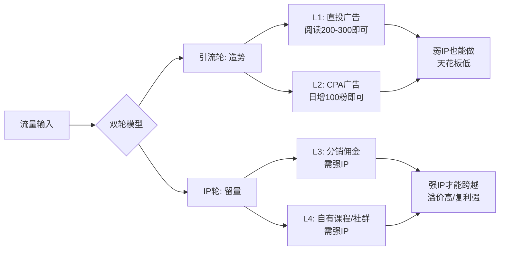
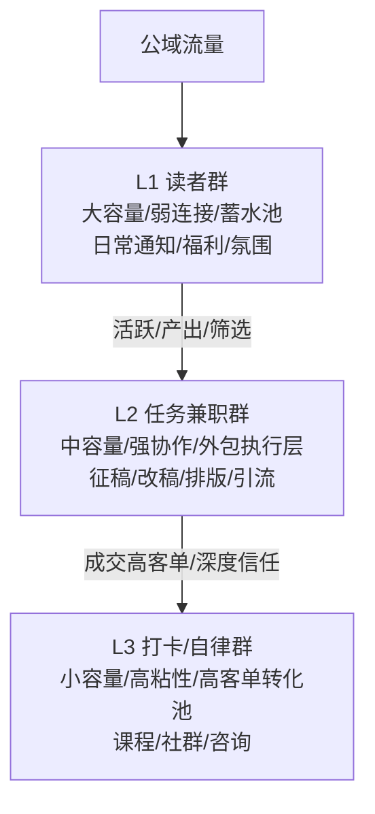

# 第 32 章 👸号运营体系与变现阶梯 —— 情感IP起号、引流造势IP强信任、四阶梯进阶

## 学习目标

- 理解👸号冷启动的核心逻辑：情感IP号为何是新手最优赛道
- 掌握变现倒推定位法：从变现方式反向定制内容方向
- 建立引流-变现双轮模型：流量造势与信任留量的分工协作机制
- 熟练设计钩子理论：用利益交换构建精准获客漏斗（兼职函+征稿函双钩子）
- 执行账号注册与后台核心配置清单：规避不可逆决策陷阱，标准化基建
- 应用排版黄金参数标准：以工业化规格书保障阅读体验与品牌视觉统一
- 实施外部引流找车/上车成本控制法：建立记账复盘体系，筛选高ROI投放渠道
- 搭建社群分层运营体系：读者群/任务群/打卡群三层架构实现分级转化
- 打造个人IP强标签：总分结构输出人设文，建立认知护城河提升溢价能力
- 遵循变现四阶梯进阶定律：技能点依次点满，不可跨级（L1/L2靠引流，L3/L4靠IP）
- 执行内容生产黄金节奏：1原创+1征稿+1转载，冷启动期低成本高频次供给模型
- 判断留言功能迁移ROI：满足三条件（粉丝基数+优质内容+互动规则）后再投入

## 32.1 生活类比

想象经营👸号像**开一家「内容超市」**：**情感IP号** = 开在女性消费力最强的商业街核心铺面（天然大客流）；**变现倒推定位** = 先定卖什么货（广告/课程/带货），再决定装修风格和进货渠道；**引流轮** = 雇人发传单、搞促销造声势（拉人进店）；**IP轮** = 店员专业推荐、会员制服务、口碑裂变（留人复购）；**钩子** = 门口的「扫码送鸡蛋/体验课」（低成本筛选高意向客户）；**白名单互推** = 邻店联合发优惠券，互导客流零成本；**排版参数** = 统一货架高度/价签字体/灯光色温（标准化体验建信任）；**找车/上车** = 自己谈代言 vs 参加商圈联合大促（成本账要算清）；**社群分层** = 散客大厅/团购微信群/VIP休息室（分级服务精准收割）；**强标签** = 「全城最懂女性心的情感专家」（一提到类想到人，一提到人想到类）；**四阶梯** = 先卖平价日用品(L1/L2) → 再做自有品牌高端系列(L3/L4)（能力不够别碰高端）；**内容节奏** = 自产爆款(原创)+ 代销畅销书(征稿)+ 调拨邻店货(转载) 三管齐下；**留言迁移** = 装修加装「顾客留言墙」：投入大、需排队、仅成熟店才划算。

## 32.2 概念地图

👸号运营体系
├── 核心认知
│   ├── 情感IP号最优赛道公理          —— P01
│   ├── 变现倒推定位法                  —— P02
│   ├── 引流-变现双轮模型               —— P03
│   ├── 钩子理论                        —— P04
│   ├── 白名单互推机制                  —— P05
│   ├── 个人IP强标签                    —— P10
│   └── 变现四阶梯进阶定律              —— P11
├── 基建标准化
│   ├── 账号注册与后台核心配置清单      —— P06
│   ├── 排版黄金参数标准                —— P07
│   └── 内容生产黄金节奏(1原创+1征稿+1转载)  —— P12
├── 流量获取体系
│   ├── 外部引流找车/上车成本控制法     —— P08
│   ├── 内部引流渠道效能排序            —— Finding
│   └── 广告避坑红线清单                —— Finding
├── 私域运营体系
│   ├── 社群分层运营体系                —— P09
│   ├── 社群规则前置原则                —— Theorem
│   └── 引流钩子定价阈值效应(≥30元)     —— Finding
└── 进阶决策
    ├── 留言功能迁移获取决策树        —— P13
    ├── 广告报价双决定因子定律        —— Theorem
    └── 案例验证：失重限期/某可复制情感号  —— Finding

## 32.3 情感IP号 —— 新手👸号变现的“黄金赛道”

> "根据长期发展和变现能力来看，情感IP号是比较适合新手小白做的类型。"
> 
> ——《👸号运营实战指南 VjTFdmoIhoOIuhx4wYUcc1XGn8g.md》

这段话直接点出了新手入局👸号的最优解：**情感IP号**。你可能会问，为什么是情感？因为它同时击中了商业变现的三个核心要素——**受众购买力强**、**内容生产成本低**、**粉丝粘性高**。

作者从三个维度论证了这个结论：受众上，成年女性比例高，女性在家庭消费决策中占主导，购买力强；价值上，情感内容题材极广（亲密关系、原生家庭、职场情感、自我成长），且极易产生共鸣，完读率、转发率天然高；成本上，素材源自自身经历、读者投稿、社会热点，不需要专业知识储备，「围绕自己的经历、真实感受是比较容易进行创作的」。

**情感IP号定义**（来源：《👸号运营实战指南》）

- **核心内容**：以真实情感经历、读者故事、社会情感热点为核心
- **目标人群**：以成年女性为主，兼具高购买力、强决策权、高粘性
- **变现路径**：广告变现(L1/L2) → 分销佣金(L3) → 自有课程/社群(L4)
- **三大商业属性**：引流易（情感共鸣易传播）、留存强（情感连接深）、报价高（女性粉丝溢价高）

这个定义展示了情感IP号为何能成为新手「平滑跨越」广告变现到IP变现的唯一赛道：它天然自带流量属性，不需要你懂技术、懂金融、懂硬核专业知识，只需要你「真诚」「细腻」「会讲故事」。

### 典型案例对比

| 账号案例 | 粉丝量 | 均阅 | 广告单价 | 变现模式 | 核心差异 |
|----------|--------|------|----------|----------|----------|
| 作者早期情感号 | 不多 | 1000+ | 250-450元/条 | 纯广告 | 无IP，靠引流造数据 |
| 失重限期(彩卉) | 7w+ | 1300+ | 0.5-0.7元/阅 | 广告+课程社群 | **强IP，解锁高客单** |
| 某可复制情感号 | 8w | 千阅级 | 0.4-0.8元/阅 | 纯广告/CPA | 无IP，天花板封死 |

这个表格揭示了核心规律：**同量级粉丝，强IP账号的变现效率是弱IP账号的6-10倍**（3000粉产30单 vs 1万粉产5单）。这就是为什么我们要从第一天起就要想着「打标签、建人设、做IP」。

---

## 32.4 变现倒推定位法 —— 让变现方式反向定制内容方向

> "要确定👸号写什么内容，主要看两点：定位、受众人群。要确定我们的定位和受众人群，我们就要明确变现方式。所以我们的思考顺序应该是：怎么变现，依靠什么变现——定位、受众人群——写什么内容。"
> 
> ——《👸号运营实战指南 VjTFdmoIhoOIuhx4wYUcc1XGn8g.md》

这是全章最反直觉、但最关键的认知重构：**别先想「我要写什么」，要先想「我靠什么赚钱」**。绝大多数新手倒着来：先拼命写文章，写着写着发现变现不了，最后放弃。

**变现倒推定位法定义**（来源：《👸号运营实战指南》）

```
输入：目标变现方式（广告 / 分销 / 自有产品 / 引流池）
中间层：推导账号定位 + 目标受众画像
输出：内容方向、选题库、人设标签
```

这个方法论展示了三个层级的递进关系：

1. **L1 广告变现** → 定位「泛女性情感痛点」 → 内容产出「情感故事、避坑指南、共鸣金句」
2. **L2 CPA广告/分销** → 定位「考公/考证/职场技能人群」 → 内容产出「干货笔记、上岸经验、资料包」
3. **L3/L4 自有产品** → 定位「高客单价付费用户」 → 内容产出「深度方法论、案例复盘、认知升级」

作者强调：**动态定位：定位服务于变现，而非长期主义信仰。判断项目赚钱 → 定位服务项目 → 赚钱后升级定位。** 马云、雷军、腾讯皆通过变更定位实现跃迁。你的定位不是「人设」，是「商业策略」。

---

## 32.5 引流-变现双轮模型 —— 流量造势与信任留量的分工协作

> "👸号变现最重要在于两点：引流、IP。有一个先后关系，先要有流量，IP才能让流量变成留量。有了流量，我们的IP才能实现变现。"
> 
> ——《👸号运营实战指南 VjTFdmoIhoOIuhx4wYUcc1XGn8g.md》

👸号是高度封闭的生态，**没有搜索推荐，没有算法分发，单靠内容被动涨粉几乎等于零**。你必须主动去「抓流量」（引流轮），同时建立「信任资产」（IP轮），两轮驱动才能跑通商业闭环。

**引流-变现双轮模型定义**（来源：《👸号运营实战指南》）

| 维度 | **引流轮（造势）** | **IP轮（留量）** |
|------|-------------------|------------------|
| 核心任务 | 数据好看、冲阅读量、提高广告报价、接CPA广告 | 筛选高信任粉丝、提高转化率、承接高客单价产品(L3/L4) |
| 关键指标 | 阅读量、涨粉数、单粉成本、阅读带动比 | 粉丝购买概率、复购率、客单价、LTV |
| 典型动作 | 找车/上车、互推、投放、征稿函/兼职函 | 原创人设文、朋友圈运营、私域深度服务、标准化交付 |
| 变现阶段 | L1/L2（广告分成） | L3/L4（高客单产品/服务） |

这个模型展示了**先后依赖关系**：引流是前置条件（无米下不了锅），IP是放大器（同样的流量，信任度高变现效率指数级提升）。

作者用一句极其扎心的话总结了广告主的心理：**「广告主表面看的是数据，但根本上关注的是粉丝购买的概率。数据好，拼的是人多...IP强，拼的就是购买概率高」**。

### 数据验证：两种模式的天地之别



**案例「失重限期」**：7w粉、均阅1300+、广告0.5-0.7元/阅，**3000粉产出30单高客单课程**  
**案例「某可复制情感号」**：8w粉、千阅、广告0.4-0.8元/阅，**1万粉仅产5单**，纯靠广告/CPA，无法进阶

这个对比证明：**流量决定生存下限，信任决定变现上限**。

---

## 32.6 钩子理论 —— 用利益交换设计精准获客漏斗

> "那么我们怎么「勾引」呢？需要一个钩子。征稿函、兼职函就是钩子，当然什么样的钩子，勾到什么样的粉丝。"
> 
> ——《👸号运营实战指南 VjTFdmoIhoOIuhx4wYUcc1XGn8g.md》

公域流量不会自动上钩，你必须设计**「钩子」**，用利益交换吸引目标用户主动添加/关注。**钩子的性质决定引来粉丝的质量与画像**——这是筛选机制的核心。

**钩子理论定义**（来源：《👸号运营实战指南》）

- **钩子本质**：征稿函、兼职函、资料包、电子书等「利益诱饵」的统称
- **双钩子设计**：
  - **兼职函（广撒网）**：对外投放，含征稿/找错别字/点在看/转发等**低门槛任务**，广撒网吸引泛流量
  - **征稿函（精筛选）**：账号内部放置，详细规定投稿规范/选题方向/稿费标准/排版要求，**稿费≥30元**打底，精筛选留存高意向写手/粉丝
- **漏斗分层**：外部投放兼职函 → 内部沉淀征稿函 → 留存高意向写手/粉丝

这个理论展示了**筛选门槛机制**的威力：稿费>25元显著提升粉丝质量，设置30元打底为经验阈值。为什么？因为**肯为30元稿费产出优质内容的人，本身就具备「执行力」「文字功底」「时间管理」三重优质特质**，这正是你后续需要的协作伙伴或高客单用户。

### 边界条件与避坑

- **无钩子引流 = 无效动作**，纯靠内容被动涨粉极慢
- **钩子设计过于功利**（如直接发广告链接）易触发平台风控封号
- **稿费定价过低(<25元)**引来低质粉丝，反增加后续运营成本（清洗成本>获取成本）

---

## 32.7 白名单互推机制 —— 公域内容免费互换的“隐形流量池”

> "我们平时的内容，除了征稿以及自己原创之外，还可以转载。我们找到其他号主给我们开白名单，这样就可以免费转载其他号主的文章了。号主都是非常愿意互开白名单的...开白名单就不会在转载的时候显示原来的账号来源。"
> 
> ——《👸号运营实战指南 VjTFdmoIhoOIuhx4wYUcc1XGn8g.md》

新号原创产能极低（作者仅能周更1篇），无法满足算法对活跃度的要求。付费投放成本高、风险大。此时，**白名单互推**成为零成本、高信任、强合规的「隐形流量池」。

**白名单互推机制定义**（来源：《👸号运营实战指南》）

- **前置条件**：双方均已开通原创保护（原创白名单权限）
- **核心规则**：开通白名单后，可免费转载对方文章，**不显示原来源**，视同原创
- **三大收益**：内容互补(补频次/蹭热度) + 粉丝跨账号流动 + 零成本
- **号主心理**：普遍愿意互开（互利互惠，扩大分发）

这个机制完美解决了冷启动期「1原创+1征稿+1转载」中的「转载」环节：**转载不显示来源，保护账号垂直度与权重，不稀释标签**。

### 典型执行流程

```
1. 搜索同赛道垂直账号（阅读500-5000，垂直度高）
2. 私信/邮件联系号主：「互开白名单，互相转载，双赢」
3. 后台「原创白名单」添加对方👸号ID
4. 对方文章发布后，一键转载，不显示来源
5. 定期复盘：转载文章阅读/涨粉/完读率，清洗低效合作
```

---

## 32.8 账号注册与后台核心配置清单 —— 避坑指南与基建标准化

> "我们一般选择的是个人为主体的订阅号...订阅号每天能够群发一次，适用于个人"
> 
> ——《👸号运营实战指南 VjTFdmoIhoOIuhx4wYUcc1XGn8g.md》

注册环节的决策失误**不可逆或修改成本极高**。作者亲身踩坑：不知「微信号一年仅能设置一次」导致账号ID非品牌词，长期影响搜索引流。这份清单是**防坑指南**，照着执行即可。

**账号注册铁律**（来源：《👸号运营实战指南》）

| 维度 | 必选项 | 限制/策略 |
|------|--------|-----------|
| **主体类型** | 个人主体 | 企业主体需营业执照，审核周期长，非新手首选 |
| **账号类型** | 订阅号 | 日更1次适配个人IP；服务号月更4次不适合内容型 |
| **邮箱** | 未注册过👸号的唯一邮箱 | 一个邮箱只能注册一个👸号 |
| **管理员** | 实名绑定银行卡+人脸识别 | 必须是运营者本人，后续迁移/认证核心人 |
| **名称** | 品牌词+赛道词 | 年改2次，注册前完成商标查重 |
| **微信号** | 品牌全拼/简写 | **年改1次**，极其慎重，注册前锁定 |
| **头像** | 统一IP视觉形象 | 月改5次 |
| **简介** | 一句话价值主张+钩子引导 | 随时可改 |

**后台必开清单**（来源：《👸号运营实战指南》）

```
☑ 原创白名单          → 核心：白名单互推、保护原创、申诉凭证
☑ 自动回复三件套      → 关键词回复/被关注回复/收到消息回复 = 无人值守前台
☑ 自定义菜单          → 底部导航栏：资料领取/社群入口/付费产品/关于我
☑ 合集标签            → 专题聚合，提升历史内容复读率，利于SEO
☑ 用户画像分析        → 地区/性别/年龄/阅读时间 = 内容投放决策依据
☑ 流量主开通          → 阅读500+即可开通，被动广告收入
☑ 隐私设置-可搜索     → 微信搜索/搜狗搜索入口，免费流量源
☑ 图片水印-不添加     → 提升阅读体验与转发率，作者踩坑：带水印严重降低转发
```

这个清单是**基建标准化**的起点，照着勾选，避开90%新手坑。

---

## 32.9 排版黄金参数标准 —— 阅读体验的“工业化规格书”

> "正文字号15 两端缩进8 字间距1 行间距1.75"
> 
> "推文中的图片分为这几个部分：1、封面图 2、头图 3、标题、分割标识 4、插图 5、底图...图片和颜色和风格最好能够统一，有一个账号主题色"
> 
> ——《👸号运营实战指南 VjTFdmoIhoOIuhx4wYUcc1XGn8g.md》

排版不是「审美」，是**工业化规格书**。混乱排版直接导致完读率暴跌、转发率归零、粉丝流失。木子田PPT IP实测：统一封面大字报风格后，**主页转粉率从个位数提升至10%+**。

**排版黄金参数标准定义**（来源：《👸号运营实战指南》）

### 硬性参数（照抄即可）

| 参数 | 数值 | 作用 |
|------|------|------|
| 正文字号 | 15号 | 兼顾阅读舒适度与单屏信息密度的黄金平衡点 |
| 两端缩进 | 8 | 形成视觉「块」，减少眼动跳跃疲劳 |
| 字间距 | 1 | 避免字符粘连，提升辨识度 |
| 行间距 | 1.75 | **核心**：消除移动端拥挤感，显著提升完读率 |

### 五段式图文结构

```
┌─────────────────────────────┐
│  ① 封面图：统一风格/大字报/主题色    │  ← 决定打开率
├─────────────────────────────┤
│  ② 头图：强IP/人设照/核心金句       │  ← 建立信任/代入感
├─────────────────────────────┤
│  ③ 标题/分割标识：结构化/视觉锚点     │  ← 控制阅读节奏
├─────────────────────────────┤
│  ④ 插图：配合文案/控节奏/破密集恐惧   │  ← 提升完读率
├─────────────────────────────┤
│  ⑤ 底图：引互动/放钩子/版权声明      │  ← 承接转化动作
└─────────────────────────────┘
```

### 视觉统一性原则

- **色系统一**：全文建立账号主题色，图片风格/配色/字体高度统一
- **品牌资产化**：粉丝形成「看到这色系就知道是你」的品牌认知
- **边界条件**：过度设计(花哨动效/多字体/乱配色)反而破坏阅读沉浸感

---

## 32.10 外部引流「找车/上车」成本控制法 —— 付费投放的「记账复盘」铁律

> "引流记录是用来干嘛的？第一，我们找车、上车会产生一定费用，需要表格记录来控制我们的上车成本；第二，我们需要根据表格记录上车的效果，来根据数据分析上哪些类型的账号效果更好。"
> 
> ——《👸号运营实战指南 VjTFdmoIhoOIuhx4wYUcc1XGn8g.md》

公域付费投放（小红书/抖音/知乎等）成本不透明、效果波动大、易被坑。**无记录无复盘 = 盲目烧钱**。必须建立「找车 > 上车」的优先级执行原则和数据化复盘体系。

**外部引流成本控制法定义**（来源：《👸号运营实战指南》）

### 核心概念：找车 vs 上车

| 维度 | **找车（自找博主）** | **上车（拼车）** |
|------|---------------------|------------------|
| 定义 | 自己直接联系博主投放 | 参加号主组织的联合投放 |
| 位置 | 免费占据首位宣传位 | 按位置分价，尾部性价比低 |
| 成本 | 可控、可谈、数据真实 | 固定价位、易遇「刷量车」 |
| 优先级 | **第一优先级** | 次之 |

### 引流记录表（必须建表）

| 字段 | 说明 | 核心KPI |
|------|------|---------|
| 渠道名称 | 博主账号/平台 | - |
| 投放形式 | 单推/互推/拼车/红包 | - |
| 花费(元) | 实际支付金额 | 成本控制 |
| 新增粉丝 | 后台数据 | 效果量化 |
| **单粉成本** | 花费/新增粉丝 | **核心KPI** |
| 阅读带动比 | 引流带来自然阅读增量/投放成本 | 流量质量 |
| ROI | 变现收入/花费 | 商业闭环 |
| 备注 | 博主类型/合作细节 | 经验沉淀 |

### 执行纪律

- **每车必记**：投放当天录入，杜绝事后补录失真
- **周复盘**：筛选高ROI博主类型，建立「白名单投放库」
- **月清洗**：剔除单粉成本>阈值、阅读带动比<基准的渠道

**实测结论**：按百阅5-8元计价的征稿号性价比 > 一口价大号；同量级互推免费且精准，但前提是自身已有基础数据。

---

## 32.11 社群分层运营体系 —— 私域流量的「蓄水池/执行层/转化池」三层架构

> "1、读者群 2、任务兼职群 3、打卡群...我们做社群的目的就是为了拉近和粉丝的距离，提高粉丝粘性，或者让粉丝参与到👸号的运营中来。"
> 
> ——《👸号运营实战指南 VjTFdmoIhoOIuhx4wYUcc1XGn8g.md`

将所有用户扔进一个大群 = 广告刷屏、有效信息沉底、信任崩塌、转化为零。**不同深度用户需求完全不同，必须按参与深度分层**。

**社群分层运营体系定义**（来源：《👸号运营实战指南》）



| 层级 | 定位 | 容量 | 连接强度 | 核心功能 | 对应变现产品 |
|------|------|------|----------|----------|-------------|
| **L1 读者群** | 蓄水池 | 大 | 弱连接 | 日常通知、福利分发、氛围维护、筛选种子用户 | 广告/CPA/低价资料 |
| **L2 任务群** | 执行层 | 中 | 强协作 | 外包执行：征稿/改稿/排版/引流/客服 | 低价工具/模板/训练营 |
| **L3 打卡群** | 转化池 | 小 | 高粘性 | 高频服务、深度陪伴、标准化交付 | 高价课程/1v1咨询/年费社群 |

### 关键性质

- **用户可跨层流动**：读者群活跃/产出 → 邀入任务群 → 成交高客单 → 升级打卡群
- **群规模与运营成本反比**：大群靠规则自治，小群靠高频服务
- **规则先行原则**：入群前必须设定准入门槛/发言规范/违规处罚/活动节奏，**规则越细致，运营介入成本越低，混乱概率越小，信任感越强**

### 典型执行

- 作者建立「任务兼职群」外包征稿/排版/引流，实现「用钱买时间换体量」
- 「打卡群」成员高频互动、高信任度，直接转化「失重限期」式高客单课程
- **严禁**：读者群硬广推销、任务群无关闲聊、打卡群灌水

---

## 32.12 个人IP强标签 —— 让用户「一提到X就想到你，一提到你就想到X」

> "只要一提起你，就会让人想到这个强标签...你一提到这个人，就能想起他的特质，或者一提到这个特质，就能想到这个人，这就是我们打强标签的意义。"
> 
> "我们打造人设的一个思路：从总到分。首先有一篇对你个人特点进行概括的文章...再去抓取我们想要展示的鲜明特点，对应写针对特点的详细文章。"
> 
> ——《👸号运营实战指南 VjTFdmoIhoOIuhx4wYUcc1XGn8g.md》

无标签 = 无记忆点 = 无溢价 = 无复购 = 纯流量贩子。**强标签是突破广告报价天花板、解锁高客单价变现的核心杠杆**。

**个人IP强标签定义**（来源：《👸号运营实战指南》）

- **核心人设词**：基于账号定位提炼的、可被瞬间联想的关键词（如「自律、搞钱狂魔」）
- **输出结构**：总分结构人设文
  - **总述版画像**：一篇全景式个人特点概括文（200-500字）
  - **分项深度展开**：3-5篇针对单一特质的深度长文（如「我的自律养成史」「我如何从月入3k到月入50k」）
- **验收标准**：一提到人想到特质，一提到特质想到人

### 关键性质

| 性质 | 说明 | 商业价值 |
|------|------|----------|
| **认知护城河** | 降低用户决策成本，建立「专家/权威」心智占位 | 直接提升广告溢价与产品转化率 |
| **内容指南针** | 所有内容围绕强标签展开，拒绝偏离定位的「流量贪婪」 | 避免账号标签模糊，算法推荐精准度下降 |
| **商业资产化** | 强标签账号可估值、可转让、可授权、可矩阵化复制 | 从「打工者」跃迁为「资产持有者」 |

### 案例验证

- **失重限期(彩卉)**：强标签「女性成长/自律/搞钱」，7w粉实现广告+课程双变现，**3000粉产30单**
- **某可复制情感号**：无强标签、纯引流、8w粉仅靠广告/CPA，**1万粉产5单**，变现上限封死

### 边界条件

- **标签必须真实源于创作者经历/优势**，虚构人设必翻车（如「假大款/假专家」）
- **早期内容垂直度要求极高**：发非垂直内容（日常/染发/闲聊）数据极差、算法打标偏移
- **强标签建立需长周期**：系统性输出「总分结构」人设文，而非零碎碎片

---

## 32.13 变现四阶梯进阶定律 —— 👸号商业化的「技能点依次点满」铁律

> "👸号的变现进阶之路：（1）阅读达到200-300可接直投广告（IP锦上添花，引流可达到）（2）日增100粉可接cpa（IP锦上添花，引流可达到）（3）个人IP强，分销别人的产品赚取佣金（需要强个人IP）（4）个人IP强，自己有课程产品，可销售自己的产品（需要强个人IP）从1到4技能点依次点满。"
> 
> ——《👸号运营实战指南 VjTFdmoIhoOIuhx4wYUcc1XGn8g.md》

这是**不可跨级的铁律**。新手妄想跨级变现（如刚起号就想卖课），必死无疑。不同阶段核心能力、资源需求、风险容错完全不同。

**变现四阶梯定义**（来源：《👸号运营实战指南》）

| 阶梯 | 门槛指标 | 核心变现方式 | 关键能力 | IP要求 |
|------|----------|-------------|----------|--------|
| **L1** | 阅读 200-300 | 直投广告 | 引流造数 | 锦上添花 |
| **L2** | 日增 100粉 | CPA广告 | 引流造数 | 锦上添花 |
| **L3** | **强IP** | 分销他人产品赚佣金 | **信任转化** | **必须强** |
| **L4** | **强IP** | 售卖自有课程/社群 | **标准化交付+售后** | **必须强** |

### 关键性质

- **阶梯锁死顺序**：技能点必须依次点满，**不可跳级**（L1直接上L3必翻车）
- **前两阶段(L1/L2)**：核心能力是「引流」，IP仅为锦上添花
- **后两阶段(L3/L4)**：核心能力是「IP/信任」，引流仅为前置条件
- **IP强弱不影响L1/L2广告收入上限，但决定能否跨越至L3/L4**

### 判断「强IP」的量化标准

> "数据好，拼的是人多，1万个粉丝里可能会有5个购买；IP强，拼的就是购买概率高，3000粉丝可能就有30个成交。"
> 
> ——《👸号运营实战指南 VjTFdmoIhoOIuhx4wYUcc1XGn8g.md》

**强IP = 粉丝购买概率显著高于行业均值**。具体指标：
- 转化率：同流量下，成交量 ≥ 5倍行业均值
- 复购率：≥ 30%（素材验证：私发毕业证将复购从5%提至30%）
- 客单价：≥ 500元（知识付费门槛）
- LTV：≥ 3000元（可支撑获客成本回本并盈利）

---

## 32.14 内容生产「1原创+1征稿+1转载」黄金节奏 —— 冷启动期的「低成本高频次」供给模型

> "账号刚刚起步可以一周2-3更，可以以1原创+1征稿+1转载的形式，仅供大家参考，按照自己节奏调配就好啦。"
> 
> ——《👸号运营实战指南 VjTFdmoIhoOIuhx4wYUcc1XGn8g.md》

新号原创产能极低（作者仅能周更1篇），无法满足算法活跃度要求。全原创成本太高、周期太长、抗风险弱。**需要一套「可控成本、可控频次、可控质量」的内容供给组合拳**。

**黄金节奏定义**（来源：《👸号运营实战指南》）

| 组件 | 角色 | 核心价值 | 执行标准 |
|------|------|----------|----------|
| **1原创** | 建IP/建信任/跑调性/打标签 | 核心资产 | 周更1篇，深度≥2000字，贴合人设 |
| **1征稿** | 降成本/存量内容/筛选写手/建素材库 | 现金流 | 稿费≥30元，三审制（价值观/专业度/排版） |
| **1转载(白名单)** | 补频次/蹭热度/维持活跃/零成本 | 流量兜底 | 高度垂直匹配，不显示来源，视同原创 |

**合成频次**：周更 2-3 篇，平衡质量/成本/算法活跃度

### 三者缺一不可的边界条件

- **无原创 = 无IP** = 无信任资产 = 无法跨越L3/L4
- **无征稿 = 累死** = 单人产能上限 = 无法维持高频 = 算法判定低活跃
- **无转载 = 断更** = 算法权重衰减 = 流量枯竭 = 冷启动失败

### 动态调整机制

随账号成长需动态调整：
- **冷启动期(0-3个月)**：1:1:1 三管齐下
- **成长期(3-12个月)**：原创占比提升至 50%+，征稿 30%，转载 20%
- **成熟期(12个月+)**：原创占比 **80%+**，征稿 15%（优质筛选），转载 5%（仅蹭大热点）

---

## 32.15 留言功能迁移获取决策树 —— 个人号开通留言的「唯一合规路径与ROI判断」

> "2018年3月之后我们注册的👸号都不再具备留言功能，所以我们想要开设留言功能，就需要找到一个具有留言功能的账号进行迁移。迁移的逻辑是：企业号可以和个人号相互迁移，但是个人号不能和个人号相互迁移。"
> 
> "我个人建议现在的小白宝子，如果资金不是很支持，或者刚刚起步，开了留言功能也用不上，那可以先不考虑开留言。"
> 
> ——《👸号运营实战指南 VjTFdmoIhoOIuhx4wYUcc1XGn8g.md》

2018年后注册个人订阅号**永久失去留言功能**，严重限制互动与转化。留言区是「高信任/高转化/高复购」评论生态的核心阵地。但迁移成本高、流程复杂、风险大，**必须计算ROI再决策**。

**留言功能迁移获取决策树定义**（来源：《👸号运营实战指南》）

### 唯一合规路径

```
个人订阅号(无留言)
       ↓ 迁移（需专业机构/费用/耗时/有风险）
企业号(桥梁)
       ↓ 迁移
具留言权限的老订阅号(2018前注册/未迁移过)
       ↓ 迁移完成
目标账号(获得留言功能 + 原粉丝/文章/数据全量继承)
```

### 决策树：是否值得投入？

```
开始
  ↓
变现是否稳定？（月收入≥5位数，持续3个月+）
  ├─ 否 → **暂不开通**，专注内容与引流
  └─ 是
      ↓
      满足三大前置条件？
      1. 有粉丝基数（≥1万精准粉）
      2. 有优质内容（原创占比≥70%，完读率≥30%）
      3. 有互动规则设计（置顶精选/关键词回复/定期活动）
      ├─ 否 → **补齐条件后再投入**
      └─ 是
          ↓
          计算ROI：迁移成本(数千-万元) ÷ 预期留言带来的增量变现
          ├─ ROI<1 → **暂缓**
          └─ ROI≥1 → **执行迁移**
```

### 关键性质

- **企业号可与个人号互迁，个人号不可互迁**（政策红线，绕不开）
- **留言功能 = 互动率提升3-5倍 + 转化率提升2-3倍 + 用户画像精准度质变**
- **迁移期间账号不可操作(1-3天)**，需提前预告粉丝
- **迁移后需重新绑定**开发者工具/商户号/自动回复/菜单等配置

---

## 32.16 多源对照：不同实战派对「👸号变现」的共识与分歧

本章核心方法论主要基于王大牙（VjTFdmoIhoOIuhx4wYUcc1XGn8g.md）一篇约1.3万字的系统性实战指南。结合生财有术社群内其他实战派（如龙哥SUMMARY.md、根源041.md、芷蓝等）的观点，形成以下多源对照：

### 共识

| 核心观点 | 王大牙 | 龙哥(SUMMARY) | 芷蓝/根源 | 共识强度 |
|----------|--------|---------------|-----------|----------|
| **新手赛道首选情感IP** | ✅ 详细论证三大维度 | ✅ 推荐为唯一最优解 | ✅ 隐含认可 | ⭐⭐⭐⭐⭐ |
| **变现倒推定位** | ✅ 核心策略框架 | ✅ 先定变现再定内容 | ✅ 动态定位服务变现 | ⭐⭐⭐⭐⭐ |
| **引流+IP双轮驱动** | ✅ 系统性定义双轮分工 | ✅ 引流造势+IP留量 | ✅ 暴力交付/选客户即IP建设 | ⭐⭐⭐⭐ |
| **钩子设计利益交换** | ✅ 双钩子漏斗模型 | ✅ 征稿函/兼职函/资料包 | ✅ 付费即筛选/信任源于交换 | ⭐⭐⭐⭐ |
| **四阶梯不可跨级** | ✅ 严格L1→L2→L3→L4 | ✅ 技能点依次点满 | ✅ 认知接口/暴力交付对应L3/L4 | ⭐⭐⭐⭐ |
| **标准化SOP执行** | ✅ 全流程表格化/清单化 | ✅ 执行力>创意/认知 | ✅ 核心三件事/外包杠杆 | ⭐⭐⭐⭐ |

### 分歧

| 议题 | 王大牙 | 其他派系 | 分歧本质 |
|------|--------|----------|----------|
| **征稿稿费阈值** | ≥30元为经验阈值 | 部分派系主张50-100元起步 | 筛选门槛vs获取成本的权衡 |
| **白名单互推依赖度** | 冷启动核心手段(1/3内容) | 部分派系主张全原创、拒绝转载 | 内容产能vs账号权重的博弈 |
| **留言功能必要性** | 建议变现稳定后再迁移，ROI导向 | 部分派系视为标配、早期必争 | 基建投入时机的阶段性判断 |
| **社群分层颗粒度** | 三层（读者/任务/打卡） | 部分派系细分至5-7层 | 管理成本vs精准转化的边际收益 |
| **广告避坑红线** | 列举7类高风险类别 | 部分派系接「擦边广告」赚快钱 | 长期主义vs短期现金流的价值观差异 |

---

## 32.17 设计中的取舍

### 为什么不用「全原创」而是「1原创+1征稿+1转载」？

**全原创**看似高大上，实则是新手的「自杀式冲锋」：
- 单人产能上限：周更1篇已是极限，算法判定低活跃 → 权重衰减 → 流量枯竭
- 成本不可控：一篇深度原创需4-8小时，机会成本极高（这8小时可做3次引流、谈2个广告主）
- 抗风险为零：一篇爆款撑不起账号，一篇违规毁掉账号

**组合拳**的工程化逻辑：
- 原创打标签（质量）、征稿补数量（成本）、转载蹭热度（流量）→ **三角稳固结构**
- 征稿稿费≥30元 = 用钱买时间买质量买写手资产
- 白名单转载 = 零成本获取已验证爆款内容 + 算法友好

### 为什么「L1/L2靠引流，L3/L4靠IP」不能颠倒？

- **广告主买的是「曝光量」**，只要阅读/粉丝达标，IP强弱只影响溢价10-30%，不影响能否接单
- **用户买课程/咨询买的是「确定性结果」**，无信任背书 = 购买概率趋近于0
- **跨级的代价**：L1直接上L3，无信任积累 → 转化率极低 → 退款投诉 → 账号信誉破产 → 连L1也做不了

### 为什么「找车 > 上车」且必须建表复盘？

- **信息不对称是最大成本**：博主报价通常含50-200%溢价，自己找车可谈至成本价
- **数据资产化**：每一次投放都在积累「渠道-人群-转化」的私有数据模型，这是核心护城河
- **不建表 = 赌博**，建表 = 投资。作者通过表格复盘发现征稿号按百阅5-8元性价比最高，这类洞察只能来自数据沉淀。

---

## 32.18 动手练习

### 练习 1：👸号定位与变现路径倒推演练

假设你是一名考公上岸的应届生，想做👸号副业：

2. 对每种方式，倒推所需的账号定位、目标受众画像、核心内容方向
3. 根据你的时间/精力/资源现状，判断哪种方式最适合作为 L1/L2 起步目标？为什么？

**回答问题**：
- 为什么说「变现方式决定内容方向」而非「内容方向决定变现方式」？

### 练习 2：引流钩子设计与成本核算实战

为上述考公账号设计双钩子体系：

1. 设计一份「兼职函」：包含 3-5 个低门槛任务（如纠错、转发、在看、投稿、找资料），定价策略如何平衡「广撒网」与「筛选质量」？
2. 设计一份「征稿函」：规定投稿选题方向、字数要求、排版标准、稿费标准（≥30元）、审核流程
3. 制作引流记录表模板：字段含渠道名称/投放形式/花费/新增粉丝/单粉成本/阅读带动比/ROI/备注

**回答问题**：
- 为什么说「稿费 < 25 元引来的粉丝质量参差不齐」？这背后的筛选心理机制是什么？
- 若某渠道单粉成本 8 元但阅读带动比极低，另一渠道单粉成本 12 元但阅读带动比高，你会如何决策？依据是什么？

### 练习 3：内容生产节奏与社群分层模拟

模拟账号冷启动前 4 周运营计划：

1. 制定 4 周内容排期表：每周安排 1 篇原创（定选题/大纲/初稿/定稿/排版/发布节点）、1 篇征稿（发函/收稿/审核/排版/发布节点）、1 篇白名单转载（对接号主/获文/排版/发布节点）
2. 规划社群分层启动时间表：第几周建读者群？第几周招募任务群写手？第几周筛选打卡群种子用户？各层群规则核心条款各 3 条
3. 设计「个人IP强标签」提炼练习：写出你的「总述版人设画像」(200字) 与 3 个「分项深度展开」标题

**回答问题**：
- 冷启动期为何必须「1原创+1征稿+1转载」三管齐下？缺一不可的边界条件是什么？
- 社群规则「越细致，运营介入成本越低」的底层逻辑是什么？请举一反面例子说明规则缺失的后果。

### 练习 4：变现阶梯自测与广告避坑演练

假设你的账号运营 3 个月，现状：粉丝 5000，均阅 800，日增粉 50，已接 3 条直投广告(单价 300 元)，无 CPA 经验，无自有产品：

1. 根据「变现四阶梯」判断你当前处于 L1 还是 L2？跨越到下一阶梯的关键指标缺口在哪里？
2. 列举素材中「7 类高风险广告红线」，结合考公赛道特性，分析哪 2 类最容易误触？如何识别规避？
3. 计算：若你想在 6 个月内跨越至 L3(分销他人课程)，需要达成的「强IP」量化标准是什么？(参考：3000粉产30单 vs 1万粉产5单)

**回答问题**：
- 为什么「IP强弱不影响 L1/L2 广告收入上限，但决定能否跨越至 L3/L4」？
- 如果某广告主出价 0.8 元/阅读，但要求「后台回复引流 🐧 群」，你会接吗？依据素材中的哪条红线拒绝？

---

## 32.19 本章小结

这一章中我们系统学习了👸号从0到1的完整运营体系与变现进阶路径。首先我们确立了**情感IP号是新手最优赛道**的公理，从受众购买力、内容成本、粉丝粘性三维度论证了其不可替代性。其次我们掌握了**变现倒推定位法**——先定怎么赚钱，再定写什么、写给谁，避免「为内容而内容」的无效产出。接着我们建立了**引流-变现双轮模型**：引流轮负责造势冲数据（支撑L1/L2广告变现），IP轮负责留量筛选高信任粉丝（解锁L3/L4高客单变现），两轮分工明确、先后依赖。然后我们深度拆解了**钩子理论**（双钩子漏斗）、**白名单互推机制**（零成本内容分发）、**账号注册与后台配置清单**（防坑基建）、**排版黄金参数**（工业化规格书）、**找车/上车成本控制法**（数据化投放）、**社群分层运营体系**（三层架构分级转化）、**个人IP强标签**（认知护城河）、**变现四阶梯进阶定律**（技能点依次点满不可跨级）、**内容生产黄金节奏**（1原创+1征稿+1转载）、**留言功能迁移决策树**（ROI导向的基建投入）。最后通过多源对照、设计取舍分析、动手练习，将理论内化为可执行的标准化操作流程（SOP）。

本章我们一起学习了以下概念：

| 概念 | 解释 |
|------|------|
| 情感IP号 | 新手👸号变现最优赛道：女性受众高购买力、内容成本低、粘性强、广告报价高 |
| 变现倒推定位法 | 先定变现方式(广告/分销/自有产品/引流)→推导定位受众→决定内容方向，避免为内容而内容 |
| 引流-变现双轮模型 | 引流造势(数据好看冲阅读提报价)，IP留量(筛选高信任粉丝承接高客单)，先有流量IP才能变现 |
| 钩子理论 | 用征稿函/兼职函/资料包等利益诱饵交换用户关注；钩子性质决定粉丝画像(兼职钩子吸兼职粉) |
| 白名单互推机制 | 双方开原创白名单免费转载不显来源，零成本实现内容互补与粉丝跨账号流动 |
| 账号注册核心配置 | 个人主体+订阅号+唯一邮箱+实名绑定；后台必开白名单/自动回复/菜单/合集/用户画像/流量主/隐私可搜/水印不加 |
| 排版黄金参数 | 正文15号字/两端缩进8/字间距1/行间距1.75；五段式结构(封面/头图/标题/插图/底图)+色系统一 |
| 找车/上车成本控制 | 建引流记录表(单车成本/涨粉/单粉成本/阅读带动比)；找车(自找博主)优于上车(拼车)；数据复盘筛高ROI渠道 |
| 社群分层运营 | L1读者群(大容量弱连接蓄水池) L2任务群(中容量强协作外包层) L3打卡群(小容量高粘性高客单转化池) |
| 个人IP强标签 | 提炼核心人设词(如自律搞钱狂魔)，总分结构输出人设文，建立认知护城河直接提升广告溢价与转化率 |
| 变现四阶梯 | L1阅读200-300接直投广告→L2日增100粉接CPA→L3强IP分销赚佣金→L4强IP卖自有课程/社群；技能点依次点满不可跨级 |
| 内容生产黄金节奏 | 冷启动期周更2-3：1原创建IP+1征稿降成本存量+1白名单转载补频次蹭热度 |
| 留言功能迁移决策树 | 个人号→企业号→有留言权限老号(需专业机构/有费用)；建议变现稳定后再开通，需满足粉丝基数+优质内容+互动规则三条件 |

下一章中，我们将学习 **闲鱼无货源电商体系** —— 从「捡漏心理」到「矩阵霸屏」的全周期实战SOP，揭示二手平台独特的「捡漏/占便宜」用户心理如何重塑选品、定价、文案、图片的全链路标准化打法，以及「反养号论」「一机一卡一号」「垂直店铺专业度信任模型」「三维选品法」「爆款上架八要素」「矩阵霸屏策略」等颠覆认知的核心方法论。
