# 第 51 章 知识付费创业底层认知体系

## 学习目标

- 理解知识付费创业‘失败是常态、成功是偶然’的概率本质与低成本试错策略
- 掌握‘核心三件事+外包杠杆’的组织架构设计，实现创始人精力向业务体量的杠杆转化
- 洞悉‘暴力交付’本质是筛选优质用户而非无限服务，建立以用户质量为核心的交付标准
- 建立‘边界感与劝退营销’的双向筛选机制，用‘不做什么’定义商业模式护城河
- 掌握‘选客户比服务客户重要’的99/1觉醒者法则，构建高净值客户筛选漏斗
- 熟练运用‘认知接口（旧瓶装新酒）’降低用户理解门槛，实现降维打击式转化
- 内化‘动态定位’思维：定位服务于变现，随项目跃迁而调整，拒绝固守初心
- 理解组织进化三阶段论（零件→设计者→带将者），主动完成角色跃迁突破天花板
- 建立‘营销即耕耘、销售即收获’的内容信任飞轮，摒弃强行成交的忽悠式营销
- 执行‘正反馈路径深挖’原则：在确定性路径上疯狂重复标准化，拒绝为新鲜感探索新井
- 掌握新手‘模仿先行+微小颗粒度产品’反卷生存切入范式
- 构建‘公私域分工+静默成交’的全域流量变现体系：引流做加法、交付做减法
- 掌握‘复制自己与合伙人生态’的终极杠杆：模块化交付团队+关系财富网络
- 辨析‘咨询优于代运营’的风控与规模化优势，确立轻资产变现模式
- 训练‘二维思考法’破除路径依赖：发散可能性空间→成本原则锁定最优解
- 落地‘内容拆解聚合+创业日记内容化’零产品起步现金流跑通术
- 标准化‘个人IP即产品’全触点营销SOP：礼包爽点→诊断卡点→路径蓝图→产品填补→社群深度
- 运用‘借势造势+产品见证群SOP’实现无流量无势能时的平地抠饼式冷启动

## 51.1 生活类比

想象知识付费创业是一场‘开荒种地’的游戏：你不买昂贵农机，而是用几十块钱买种子（微小产品），在自家后院（私域）小块地里试种。死了一茬再种下一茬，成本可控，直到选出适合土壤的‘爆款作物’（规模化模式）。农场主（创始人）只管‘研究农学（阅读）、规划种植体系（构建知识体系）、挑选最好种子亲自播种（生产内容）’，除草施肥收割（运营/交付/社群）全包给佃农（外包/合伙人）干。卖给食客的是‘洗好切好的菜（标准化成果）’，而不是‘教食客怎么种菜、陪食客除草（无限答疑陪伴）’。挑食的食客（低质用户）直接劝退，不进厨房。门口立块牌：‘本店只卖熟食不卖种子，不接待想学种地的人’。想学种地的走了（省成本），想买熟食的更信任（专业专注）。只招‘自己饿了会找饭吃’的食客（自我驱动），不招‘要你喂到嘴里才肯咽’的食客（需监督执行）。不跟食客讲‘光合作用原理’（Transformer/神经网络），只说‘这菜比你自己做快10倍、味道还稳（原流程不变、效率提升10倍）’。春天种菜、夏天卖瓜、秋天卖粮、冬天卖腊肉。不固守‘我是种菜的’（初心定位），跟着季节（项目/风口）换品类。刚开荒时自己下地干（零件/勤奋）；地多了雇人按SOP种（设计者/懒惰/买时间）；成农场主了搞定几个合伙人分管千亩地（带将者/合伙人制）。认真种地（生产优质内容/课程），秋天自然有收成（成交）。不用站在田埂上吆喝‘我这地种得好快来买’（强行成交/忽悠销售）。发现‘这块地长西瓜特别甜’（踩中痛点成交），第二年就把这块地全种西瓜、标准化种植、扩大规模，而不是琢磨‘今年试试种榴莲吧’（探索新玩法）。邻村老王种西瓜赚大钱，你第一年就照抄老王的种子、行距、施肥节奏（像素级模仿），第二年再根据自家土质微调（微创新）。在集市吆喝、发传单、摆样品（公域引流加法）；请食客回家厨房品尝、按口味定制菜单（私域交付减法/静默成交）。教会徒弟（核心学员/合伙人）你的‘独门秘方’（SOP/模板/方法论），让他们在自家地里也能种出同样甜的瓜，你分成、他干活、双赢。想扩大规模时，先忘掉‘我只会种地’的固有经验，发散：能不能养鸡、办采摘、做农家乐、搞直播带货（维度一：可能性）；再引入成本核算：哪个投入产出比最高、风险最低（维度二：最优解）。还没自家西瓜时，先帮邻村卖西瓜赚佣金（内容拆解聚合/CPS），顺便记录‘怎么挑西瓜、怎么卖西瓜’的日记（创业日记内容化），攒够钱、积够经验、攒够客户，再种自己西瓜。食客进门→送试吃（礼包爽点）→问‘爱吃甜还是咸’（诊断卡点）→给‘今晚食谱’（路径蓝图）→推‘配这食谱的专用酱料’（产品填补）→办会员卡送厨艺课（社群深度）。还没西瓜卖时，借‘西瓜节’热度（风口势）、拉上餐饮大厨背书（人脉势），拉群直播‘从选种到收获’全过程（见证群），食客看着就下单预订了（平地抠饼）。

## 51.2 概念地图

知识付费创业底层认知体系
├── 概率论基石
│   ├── 创业失败必然论与低成本试错定律  —— D041_P001
│   └── 正反馈路径深挖原则（拒绝新鲜感探索）  —— D041_P010
├── 组织架构设计
│   ├── 核心三件事与外包杠杆（阅读/体系/内容）  —— D041_P002
│   ├── 阶段性懒人思维（0-1勤奋 vs 1-N懒惰/设计者）  —— D041_P008
│   ├── 组织进化三阶段：零件→设计者→带将者  —— D041_P008
│   ├── 模块化交付团队（核心学员U盘化）  —— D041_P013
│   ├── 合伙人生态与关系财富（互补/互荐/共担）  —— D041_P013
│   └── 咨询优于代运营（责任边界清/可标准化/现金流优）  —— D041_P014
├── 产品与交付策略
│   ├── 暴力交付（交付即筛选/服务越重用户越差）  —— D041_P003
│   ├── 边界感与劝退营销（双向筛选/人设锚定）  —— D041_P004
│   ├── 选客户比服务客户重要（99/1觉醒者法则）  —— D041_P005
│   ├── 有价值的垃圾识别与果断砍掉（机会成本陷阱）  —— D041_P009
│   └── 微小颗粒度产品切入（新手反卷/工具属性强）  —— D041_P011
├── 营销与转化体系
│   ├── 营销即耕耘/销售即收获（内容信任飞轮/静默成交）  —— D041_P009
│   ├── 公私域分工体系（公域加法引流/👸号静默/私域减法）  —— D041_P012
│   ├── 认知接口/旧瓶装新酒（接入既有认知/仅售确定性收益）  —— D041_P006
│   ├── 动态定位（定位服务变现/跟着项目走/马云雷军案例）  —— D041_P007
│   ├── 借势造势三层（风口/行业/人脉）  —— D041_P018
│   ├── 产品见证群SOP（过程透明化/用户共创/素材复用）  —— D041_P018
│   ├── 关键词定位与内容部署（热点/身份/痛点词矩阵）  —— D041_P015
│   ├── 内容带人再立人设（冷启动0-1万粉策略）  —— D041_P016
│   ├── 个人IP即产品/全触点营销SOP（礼包→诊断→路径→产品→社群）  —— D041_P017
│   ├── 引流加法与交付减法（覆盖关键词vs做决策给方案）  —— D041_P012
│   ├── 关键裂变人双重激励（精神爽点+物质激励）  —— D041_P019
│   └── 流量价值交换变现（精准+流动=CPS分佣/互推）  —— D041_P020
├── 战略思维工具
│   ├── 二维思考法（破路径依赖：发散可能性→成本原则筛选）  —— D041_P015
│   ├── 模仿先行策略（找标杆验证可行性/成功者起步知模仿谁）  —— D041_P011
│   ├── 内容拆解聚合变现（零产品起步/案例库→后端课程/CPS）  —— D041_P016
│   ├── 创业日记内容化（真实+坚持=流量/跑通→变现闭环）  —— D041_P016
│   ├── 先赚客户钱再赚同行钱（人设护城河/实战自证）  —— D041_P013
│   └── 私域付费流量回本逻辑（前端回本/后端复购零成本纯利）  —— D041_P013
└── 实证验证库
    ├── ChatGPT大师课借势发售（单渠道预售60万/全年300万）  —— Finding01
    ├── 朋友圈训练营停止改造（月入10万→标准课件999元/精力释放）  —— Finding02
    ├── 小红书云创作失败复盘（会员群协作成本高→合伙人群成功）  —— Finding03
    ├── 合伙人小沫封面美化微产品验证（颗粒度极细/工具属性强）  —— Finding04
    ├── 舞蹈室付费流量回本复购模型（前端回本/后端零成本复购）  —— Finding05
    ├── 超级个体低成本运营（2.5人编制/5000人社群/500人合伙人）  —— Finding06
    ├── 起号‘内容带人’策略对比（模仿标杆vs臆想原创）  —— Finding07
    ├── 劝退营销正向筛选效应宣称  —— Finding08
    └── 关键裂变人双重激励机制宣称  —— Finding09

## 51.3 创业失败必然论与低成本试错定律 —— 成功是偶然，失败是常态

### 51.3.1 为什么需要这个概念？

创业本质是概率游戏，大多数人因试错成本过高而不敢尝试或尝试不起。知识付费模式边际成本趋近零，提供了可控风险的试错环境。接受“失败是必然”心态，才能在低成本下大量尝试，筛选出可规模化的业务。

### 51.3.2 原文摘录

> "我认为创业失败是必然的，成功才是偶然的，而知识付费创业的好处就是帮你把成本降到了最低，而很多人不明白这个逻辑，既然成本最低了，就算失败你也不会付出太惨痛的代价，那为什么不多去尝试一下呢？"
> 
> "学会低成本试错，是每个知识付费创业者要有的基础认知。你看我跑通的各种玩法，你看我在赚钱的那几个业务，那只是结果，是我在试错之后确定下来的。在这个过程中，其实我放弃了很多玩法...但是好在这个试错成本我是可控的"
> 
> ——《docs/202305/20230516_041.md》 [D041_P001]

### 51.3.3 核心定义

**创业失败必然论与低成本试错定律**（来源：《docs/202305/20230516_041.md》 [D041_P001]）

创业本质是概率游戏，失败是必然事件，成功是偶然事件。知识付费创业的核心优势在于将试错成本降至最低（可控区间）。策略：多尝试、快失败、低成本、留存活下来的模式。

这个定律揭示了：试错不是生死赌局，而是可承受的学费。试错成本可控 → 敢于尝试 → 筛选存活模式 → 赚钱 → 再投入试错，形成正向飞轮。反面教材是守旧者错失风口红利，因不敢试错而无法实现短期利润最大化。

### 51.3.4 关键性质

试错成本可控性是该定律的核心特征。知识付费业务边际成本趋近零，每次试错仅消耗时间而非大量资金，这使得创业者可以像在后院试种子一样，以极低代价验证无数个商业假设。正向飞轮机制则是这种可控性带来的复利效应：试错成本可控 → 敢于尝试 → 筛选存活模式 → 赚钱 → 再投入试错，形成自我强化的增长循环。反面教材警示我们，守旧者因不敢试错，错失风口红利，无法实现短期利润最大化，最终在时代更迭中被边缘化。

### 51.3.5 典型例子

ChatGPT大师课借势发售是典型的正向飞轮实证 [Finding01]。芷蓝团队发售《ChatGPT大师课》借风口势，小鹅通单渠道预售60万+，全年预计300万，但此前放弃了大量未成功的玩法。小红书云创作失败复盘则展示了“快速止损”的纪律 [Finding03]。“小红书云创作”会员协作模式失败（关系弱、分成复杂、版权不清），但迁移至高门槛合伙人群体后成功，验证模式需匹配组织关系密度。

### 51.3.6 边界条件

该定律仅适用于边际成本极低（知识付费、数字化产品）的业务模式。重资产、重供应链、高固定成本业务不适用，试错成本不可控。同时需具备“快速止损”纪律，避免沉没成本陷阱拖垮现金流。

### 51.3.7 方法演进图

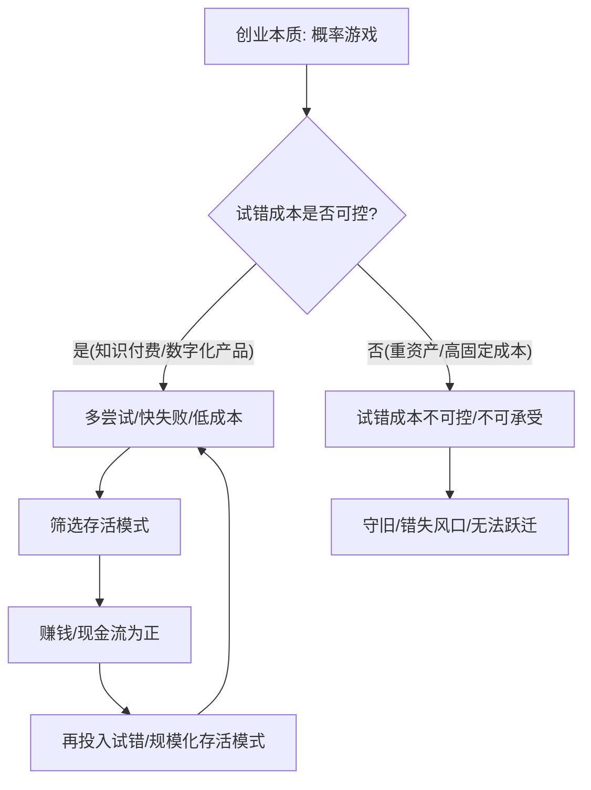

## 51.4 核心三件事与外包杠杆 —— 只做零件，不做系统

### 51.4.1 为什么需要这个概念？

创业者精力有限，试图包揽所有事务会成为系统瓶颈（零件而非设计者）。运营、交付、社群维护等重复性工作边际产出递减，不应由创始人亲自操作。必须用钱买时间，换取业务体量放大，形成正向飞轮。

### 51.4.2 原文摘录

> "永远记住一件事：除了阅读、构建知识体系和生产内容这 3 件事自己做，其他的一定要尽可能外包出去。"
> 
> "能分钱给别人做的事情就要舍得分钱，你要花钱买别人的时间，买的越多，你的业务体量就会越大。业务体量上来了，你就会赚到更多的钱，从而有了更多购买别人时间的资本。"
> 
> ——《docs/202305/20230516_041.md》 [D041_P002]

### 51.4.3 核心定义

**核心三件事与外包杠杆**（来源：《docs/202305/20230516_041.md》 [D041_P002]）

创业者仅亲自做三件事：阅读、构建知识体系、生产内容。其余所有事务（运营、交付、社群维护、技术开发等）必须外包/外购。核心逻辑：花钱买别人的时间 → 业务体量变大 → 赚更多钱 → 再买更多时间。

### 51.4.4 关键性质

杠杆率是外包杠杆的核心量化指标。外包将固定人力成本转为变动销售成本，极大降低经营杠杆风险，使业务体量不再受限于创始人24小时的物理上限。组织形态演进则揭示了外包的深层逻辑：从“雇佣制”向“模块化/合伙人制”演进，边际管理成本递减，协作效率指数级提升。正向飞轮机制将外包闭环：外包释放创始人精力 → 产出更多核心内容 → 引流更多用户 → 收入增加 → 再外包，形成自我强化的规模化引擎。

### 51.4.5 典型例子

超级个体低成本运营实证了这一杠杆的极致效果 [Finding06]。芷蓝团队仅2个全职+1个兼职编制，却运营5000人付费社群+500人合伙人团队。核心杠杆在于：模块化学员交付团队（像U盘插拔）+ 关系财富合伙人网络（互补资源/互荐流量/共担交付）。

### 51.4.6 边界条件

核心内容生产（阅读/体系构建/内容输出）不可外包，这是护城河。外包对象需标准化（SOP）、利益绑定深（合伙人/核心学员），否则沟通成本反超收益。早期现金流为负时，外包需极度谨慎，优先外包非核心标准化环节。

### 51.4.7 方法演进图

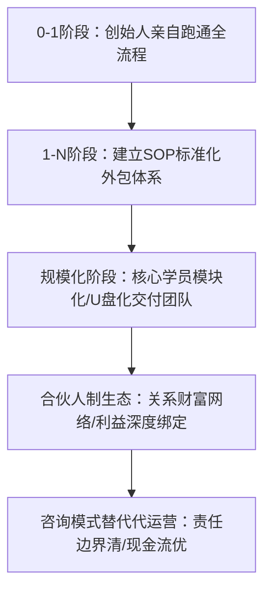

## 51.5 暴力交付 —— 交付即筛选，服务越重用户越差

### 51.5.1 为什么需要这个概念？

传统认知认为“服务越周到越好”，导致创始人陷入无限答疑、陪伴的低价值劳动。优质用户真正需求是“节省时间、拿结果、拿资源、拿流量”，而非情感陪伴。必须重新定义交付本质：交付完成于内容产出瞬间，而非服务过程中。

### 51.5.2 原文摘录

> "越是好的交付就越暴力...永远没有最好的交付，只有更好的用户。"
> 
> "你的精力应该是放在如何生产优质内容这件事上，用户在看完你的内容时，其实已经完成了交付的过程，他来向你付钱，只是为自己的时间价值买单。"
> 
> "越优质的用户，他想要的东西一定是简单和暴力的...如果需要你一直陪着回答各种基础问题的用户，那一定是你的问题，你收错人了。"
> 
> ——《docs/202305/20230516_041.md》 [D041_P003]

### 51.5.3 核心定义

**暴力交付**（来源：《docs/202305/20230516_041.md》 [D041_P003]）

暴力交付：交付本质是“筛选优质用户”而非“无限陪伴”。优质用户需求简单直接（结果/资源/流量），付费为自己的时间价值买单。交付标准：用户看完内容即完成交付，后续服务仅为辅助。

### 51.5.4 关键性质

用户质量决定交付形态是暴力交付的底层逻辑。好用户要“暴力”交付（给结果、给资源、给路径），差用户要“温和”交付（陪聊、答疑、安抚）。服务越重、越个性化，往往产品越弱、用户质量越低、边际成本越高。核心矛盾在于：精力应放在“生产优质内容”而非“服务低质用户”，这是资源配置的根本性错位。

### 51.5.5 典型例子

芷蓝观察到：需监督执行、问基础问题的用户，一定是“收错人了” [D041_P003]。朋友圈训练营停止改造是暴力交付落地的经典案例 [Finding02]。月入10万的“朋友圈训练营”因高精力消耗（每日答疑）被判定为“有价值的垃圾”，改造为999元标准课件+星球答疑后精力释放、营收不降。

### 51.5.6 边界条件

高客单价（如万级以上）咨询/陪跑业务仍需深度服务，但前提是严格筛选“觉醒者”。标准化产品（课程/模板/工具）必须暴力交付，拒绝无限答疑。新手期可适度服务积累案例，但必须设定明确停止界限（如停止朋友圈训练营）。

### 51.5.7 交付本质定理

**交付本质定理：交付即筛选，暴力源于用户质量**

交付质量不取决于服务投入强度，取决于用户筛选标准。优质用户需求简单直接（结果/资源/流量），低质用户需求无限陪伴答疑。“暴力交付”= 筛选高认知/高执行力用户 + 交付标准化成果。服务越重，往往产品越弱、用户越差。

**逐步推导与解释**：

1.  **前提一（用户付费动机）**：用户付费本质是为“节省时间、获取确定性结果”买单，而非购买陪伴服务（《docs/202305/20230516_041.md》：「用户在看完你的内容时，其实已经完成了交付的过程，他来向你付钱，只是为自己的时间价值买单」 [D041_P003]）。
2.  **前提二（用户质量分层）**：高认知/高执行力用户（觉醒者）具备自主消化内容、独立执行能力，只需标准化成果（模板/路径/工具）；低认知/低执行力用户（非觉醒者）缺乏自驱力，需无限陪伴、答疑、监督（《docs/202305/20230516_041.md》：「越优质的用户，他想要的东西一定是简单和暴力的...如果需要你一直陪着回答各种基础问题的用户，那一定是你的问题，你收错人了」 [D041_P003]）。
3.  **推论（交付形态由用户质量决定）**：若筛选来的用户以觉醒者为主，交付天然呈现“暴力”特征（给结果/资源/路径即可）；若用户以非觉醒者为主，交付被迫陷入“温和”泥潭（陪聊/答疑/安抚），且边际成本随用户量线性上升，产品标准化程度被稀释。
4.  **结论**：交付的核心杠杆不在“服务更好”，而在“筛选更准”。暴力交付 = 筛选高质量用户 + 交付标准化成果。

**作用**：该定理指导创业者将精力从“优化服务体验”转移至“设计筛选机制（付费门槛/诊断问卷/边界感劝退）”，并将交付产品标准化为“结果/资源/路径”三类确定性交付物，实现边际成本递减、规模化复制。

### 51.5.8 数据流图

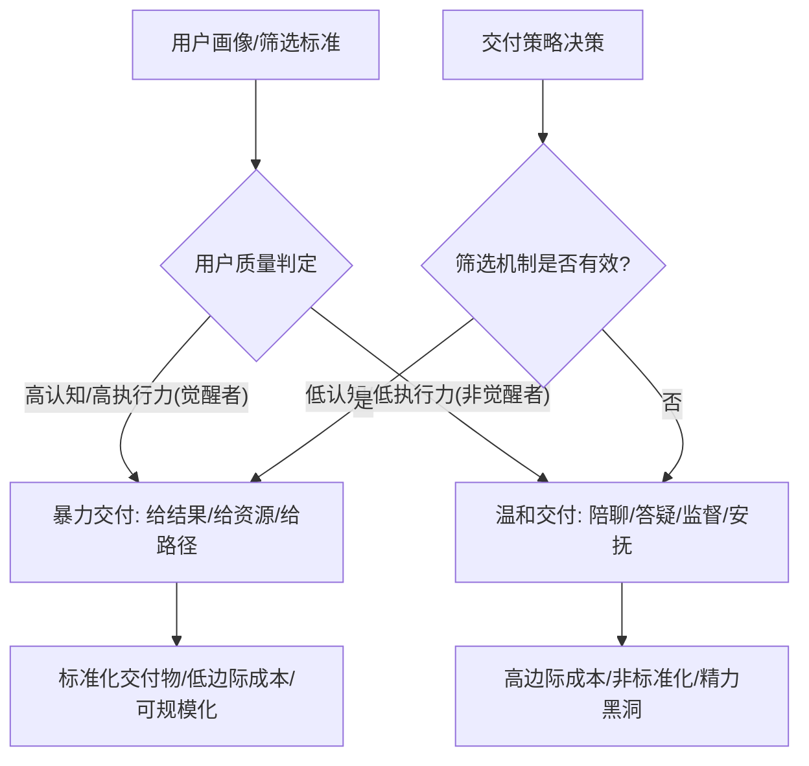

## 51.6 边界感与劝退营销 —— 敢于说“不”，才能筛选对的人

### 51.6.1 为什么需要这个概念？

无边界的服务导致精力透支、人设模糊、低质用户占用高质资源。主动劝退非目标用户，能同时实现：节省成本、强化人设、提升目标用户信任。“不做什么”比“做什么”更能定义商业模式边界。

### 51.6.2 原文摘录

> "做知识付费创业，一定要保留边界感，其中最重要的边界就是：这事我不做，这个用户我不收。"
> 
> "劝退其实是一种营销方式，劝退用户，然后广而告之，让大家看到你做什么生意，不做什么生意，你服务什么客户，不服务什么客户，这样喜欢你的人一定会越来越喜欢，继而找你来付费，不喜欢你的人，就会更加远离你，也省了你的时间精力。"
> 
> ——《docs/202305/20230516_041.md》 [D041_P004]

### 51.6.3 核心定义

**边界感与劝退营销**（来源：《docs/202305/20230516_041.md》 [D041_P004]）

边界感：明确界定“这事我不做”、“这个用户我不收”。劝退营销：公开宣告业务边界与拒收标签，作为一种筛选与品牌建设手段。核心逻辑：喜欢你的人更喜欢（信任专业度），不喜欢的更远离（省去沟通成本）。

### 51.6.4 关键性质

双向筛选机制是边界感的核心价值。劝退非目标用户 = 降低服务成本 + 提升目标用户转化率，这是一种看似减少流量实则提升流量质量的反直觉操作。人设锚定效应则通过边界感建立“专业、有原则、不卑不亢”的专家形象，这种形象本身就是最高级的营销。反直觉收益在于：拒绝赚快钱（不合适的单），反而能赚长久钱（精准用户复购），因为信任一旦建立，其生命周期价值远超单次交易利润。

### 51.6.5 典型例子

芷蓝实践：公开声明不做代运营、不收需监督执行的用户、不教基础常识 [D041_P004]。朋友圈公开劝退“想躺赚、想速成、不愿学提示词”的人，反而吸引真正想学、愿执行的高质量付费用户。劝退营销正向筛选效应宣称进一步佐证了这一机制 [Finding08]。

### 51.6.6 边界条件

前提是已有稳定流量来源，冷启动期（0-1）不宜过度劝退，需先跑通闭环。劝退标准必须客观、可量化（如：不服务月入3万以下企主），避免主观情绪化拒客。需配合“付费筛选”（如低价咨询费）双重过滤，防止恶意占用。

### 51.6.7 多源对照

共识：边界感能筛选高质量用户，降低服务成本，强化专业人设。分歧：芷蓝主张**公开劝退**作为营销手段，主动宣告“不做什么/不收谁”；部分实战者主张**隐性筛选**，通过高价格/高门槛/复杂流程自然过滤，避免公开劝退引发负面舆情。两者核心逻辑一致（筛选优质用户），执行层面差异在于“显性vs隐性”及“品牌调性”取舍。

### 51.6.8 方法演进图

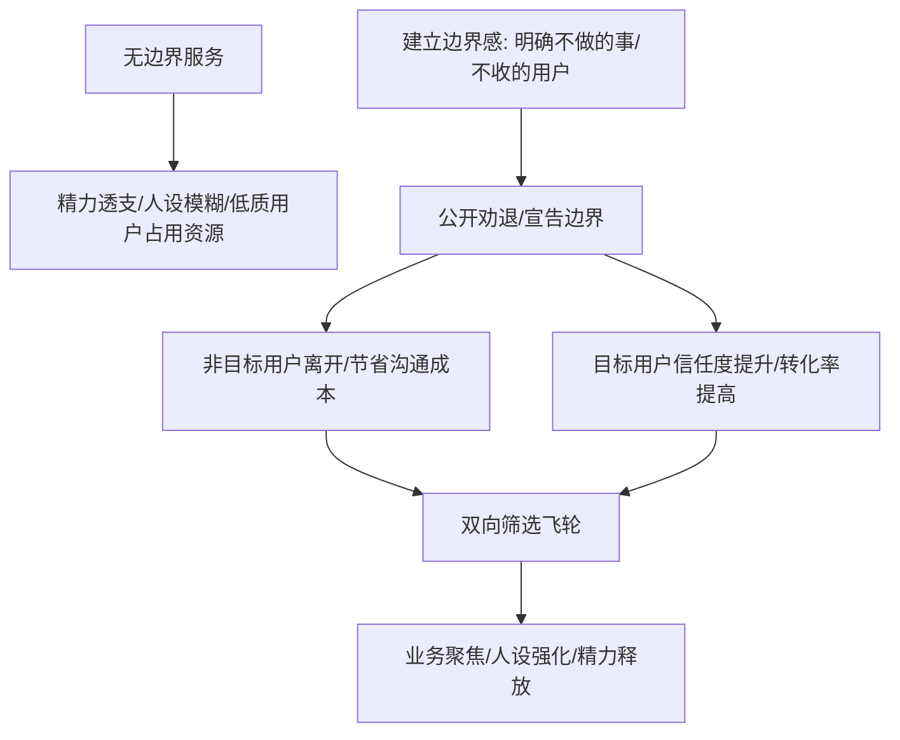

## 51.7 选客户比服务客户重要（99/1觉醒者法则）

### 51.7.1 为什么需要这个概念？

绝大多数创业者错误地将精力花在“如何服务好每个客户”，导致资源被低质客户稀释。客户成功99%取决于自我觉醒与内驱力，外部服务贡献不超过1%。服务非觉醒者：边际成本无限大、边际收益为零、稀释成功案例率、破坏个人势能。

### 51.7.2 原文摘录

> "想赚到更多的钱，你必须得明白一个道理，就是选客户比服务客户更重要。99%成功的创业者，都是靠自己觉醒的，而不是别人通过教育他帮助他觉醒的。"
> 
> "所以，找到一个自我觉醒的人...你去稍微帮助他一下，他就成功了...只有这样才能够积累更多的成功案例，有了成功案例，你自己的势能就会慢慢崛起..."
> 
> ——《docs/202305/20230516_041.md》 [D041_P005]

### 51.7.3 核心定义

**选客户比服务客户重要（99/1觉醒者法则）**（来源：《docs/202305/20230516_041.md》 [D041_P005]）

觉醒者法则：只筛选“正在觉醒/已觉醒”的客户，稍加助力即成。关键动作：拒绝“需监督执行、需情绪安抚、需手把手教基础”的低质客户。积累成功案例 → 构建势能 → 吸引更多同类觉醒者 → 滚雪球效应。

### 51.7.4 关键性质

筛选机制是落地觉醒者法则的操作化工具：付费门槛（哪怕9.9元）+ 咨询诊断（判断觉醒度）+ 边界感劝退，构成三道防线。资源配置遵循二八原则的极致应用：80%精力服务头部20%觉醒者，而非平均分配给所有人。反面教材揭示了“救世主情结”的商业毒性：试图“教育”用户觉醒，成本极高且成功率极低，本质是对自我能力边界的认知失焦。

### 51.7.5 典型例子

芷蓝团队设置咨询费门槛（200元），解决问题后引导用户自发发红包（88-120元），99%用户发红包，30%转化高客单产品 [D041_P005]。观察：每天需监督打卡、推进的用户，“可能会有一点点效果，但一定成不了大器” [D041_P005]。

### 51.7.6 边界条件

仅适用于知识付费、咨询、高客单价服务等强依赖用户主观能动性的业务。标准化SaaS、工具类、低客单价电商等弱依赖用户执行力的业务不适用。必须建立“静默成交”路径（👸号/自动化交付），避免因拒绝服务导致流量浪费。

### 51.7.7 客户觉醒度决定论 (99/1法则)

**客户觉醒度决定论 (99/1法则)**

客户成功99%取决于其自我觉醒度与内驱力，外部服务贡献不超过1%。因此商业核心不是“服务好每个客户”，而是“筛选觉醒者”。服务非觉醒者边际成本无限大、边际收益为零，且稀释成功案例率、破坏势能。

**逐步推导与解释**：

1.  **观察事实**：在知识付费/咨询/高客单服务中，同等服务投入下，客户结果呈现极端分化：极少数客户（觉醒者）快速出成果、复购、传播；大多数客户（非觉醒者）无反馈、退款、差评（《docs/202305/20230516_041.md》：「99%成功的创业者，都是靠自己觉醒的，而不是别人通过教育他帮助他觉醒的」 [D041_P005]）。
2.  **归因分析**：觉醒者具备“目标清晰、自主执行、遇阻自解、复盘迭代”的内驱力闭环，外部服务仅提供“关键节点的杠杆”（如模板/人脉/避坑指南），贡献边际收益约1%；非觉醒者缺乏内驱闭环，外部服务需补全“目标设定、执行监督、情绪安抚、基础教学”等全链路，边际成本趋近无限大，且一旦服务停止即回零。
3.  **资源配置推论**：将80%精力投入服务头部20%觉醒者，可获得99%的成功案例与口碑势能；将精力平均分配，则被非觉醒者稀释，成功案例率趋近零，个人势能崩塌（《docs/202305/20230516_041.md》：「你去看那些每天需要别人看着监督，去做事情的，可能会有一点点效果，但一定成不了大器」 [D041_P005]）。
4.  **商业策略**：核心动作从“优化服务流程”转为“设计筛选漏斗”（付费门槛/诊断问卷/边界感劝退），只让觉醒者进入核心交付体系。

**作用**：该法则重塑了知识付费创业的资源分配逻辑——不再追求“全员满意度”，转而追求“觉醒者通过率”与“成功案例密度”，通过筛选而非服务构建护城河。

### 51.7.8 方法演进图

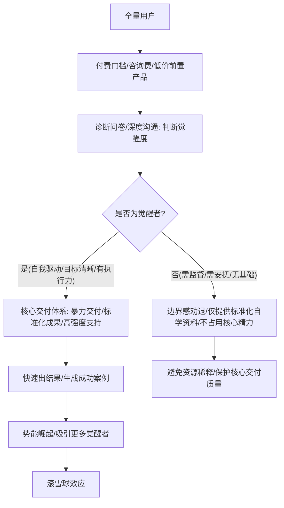

## 51.8 认知接口（旧瓶装新酒） —— 降低用户理解门槛的降维打击

### 51.8.1 为什么需要这个概念？

教育用户新概念成本极高（教育市场成本），用户认知带宽有限。直接讲原理（如神经网络、Transformer）用户听不懂、不信任、不买单。必须在用户既有认知框架内植入新工具/新场景，仅售“确定性效率提升”。

### 51.8.2 原文摘录

> "做知识付费产品，千万别去给用户科普一个新的概念...我之前给大家分享过一个词叫做“认知接口”，就是你要在用户已有的认知世界里面给他输送新场景，卖它搭建这个新场景的工具。"
> 
> "比如说我们这次做的【chatgpt】大师课...说白了，就是告诉用户，以前你自己通过写小红书来引流变现，现在这个模式不变，只不过我帮你用 chatgpt➕提示词提升内容输出效率和数量 10 倍以上。"
> 
> ——《docs/202305/20230516_041.md》 [D041_P006]

### 51.8.3 核心定义

**认知接口（旧瓶装新酒）**（来源：《docs/202305/20230516_041.md》 [D041_P006]）

认知接口：在用户已有认知世界里输送新场景，卖搭建新场景的工具。核心话术：原流程不变，效率提升10倍（如：原小红书写文案流程不变，用ChatGPT+提示词提效10倍）。禁忌：千万别给用户科普新概念（如什么是大模型、什么是向量数据库）。

### 51.8.4 关键性质

降维打击是认知接口的竞争优势本质。竞争对手在讲技术原理（高认知负荷），你在讲确定性收益（低认知负荷），这本质上是认知负荷的不对称竞争。转化率杠杆则量化了这种优势：用户购买决策路径从“理解原理→信任技术→尝试应用”缩短为“看到痛点→认同收益→直接购买”，极大降低了决策摩擦。复用性揭示了认知接口的规模化潜力：同一认知接口可植入多个赛道（健身/医美/写作/小红书/抖音），实现“一次认知建模，多赛道收割”。

### 51.8.5 典型例子

ChatGPT大师课借势发售是认知接口的商业化标杆 [Finding01]。不讲原理，只讲“原小红书引流模式不变，内容输出效率提升10倍以上”，结合健身/医美/写作行业势能，帮用户节省营销成本，单渠道预售60万+。

### 51.8.6 边界条件

仅适用于“工具赋能型”产品，不适用于“认知重塑型”产品（如哲学、心理学课程）。用户必须已有成熟业务流程（旧瓶），无流程用户需先建立基础认知（造瓶）。过度简化可能导致用户预期过高，交付时需配合“边界感”管理预期。

### 51.8.7 认知接口降维打击原理

**认知接口降维打击原理**

用户认知带宽有限，接受新概念成本极高（教育市场成本）。高转化销售必须接入用户既有认知模型（旧瓶），植入新工具/新场景（新酒），仅售“确定性效率提升”而非“不确定性技术原理”。

**作用**：该原理揭示了知识付费产品设计的底层认知心理学机制——用户不为“技术先进性”买单，只为“确定性收益”买单。它指导产品经理在设计课程大纲、销售文案、交付标准时，始终以“用户既有认知模型”为锚点，拒绝任何增加认知负荷的“科普式”表达，从而在源头上解决转化难、交付难、退款多的顽疾。

### 51.8.8 方法演进图

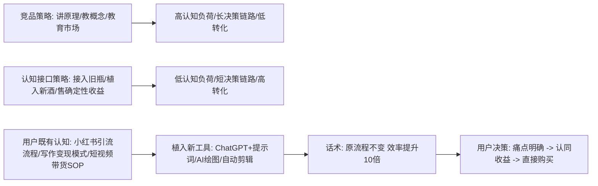

## 51.9 动态定位 —— 定位服务于变现，而非长期主义信仰

### 51.9.1 为什么需要这个概念？

固守“初心定位”导致错失风口、无法跨越财富阶层（如坚持只做小红书培训，错过ChatGPT、视频号、AI应用等红利）。商业史证明：马云、雷军、腾讯均通过不断变更定位实现跃迁。定位是战术工具，随项目/市场变化而动态调整。

### 51.9.2 原文摘录

> "不要被自己的定位锁死，定位是帮助你赚钱的，不是让你拿来信奉长期价值的...想实现财富的跃迁，你的定位就要一直在变。所以我才说，我的定位是跟着项目走的，先判断这个项目是否赚钱，然后我的定位就是在这个阶段服务我做这个项目的。"
> 
> ——《docs/202305/20230516_041.md》 [D041_P007]

### 51.9.3 核心定义

**动态定位**（来源：《docs/202305/20230516_041.md》 [D041_P007]）

动态定位：先判断项目是否赚钱，再让定位服务该项目，赚钱后再升级定位。判断逻辑：项目赚钱性验证 → 定位配合项目 → 收入跃迁 → 定位升级/重塑。反模式：先设定高大上定位 → 强行找项目匹配 → 赚不到钱 → 固守定位沉没。

### 51.9.4 关键性质

实用主义是动态定位的核心哲学。定位无对错，只有“当下是否服务于变现”，这彻底解构了“品牌定位论”在中小创业者身上的误用。阶段性特征揭示了定位的演进规律：0-1阶段定位极具体（如小红书封面美化），规模化阶段定位抽象（如知识付费生态构建者）。风险控制提醒：频繁变更定位会混淆老用户，需配合“个人IP统一ID”维持信任连续性。

### 51.9.5 典型例子

芷蓝：从小红书运营培训 → ChatGPT大师课 → 知识付费创业导师 → 合伙人生态构建者，定位随项目跃迁 [D041_P007]。马云：英语教师 → 翻译社 → 黄页 → 阿里巴巴 → 蚂蚁金服，每阶段定位服务当下最大机会 [D041_P007]。

### 51.9.6 边界条件

核心价值观（如利他、诚信、长期主义）不可动态调整，仅业务定位可变。变更频率不宜过高（建议半年/年评估一次），避免团队与用户认知断层。必须有“赚钱验证”作为变更前提，不可因焦虑而盲目追风口。

### 51.9.7 定位服务于变现而非信仰定律

**定位服务于变现而非信仰定律**

定位是战术工具而非战略信仰。商业史证明巨头均通过不断变更定位实现跃迁（马云、雷军、腾讯）。正确逻辑：判断项目赚钱性 -> 定位服务项目 -> 赚钱后升级定位。固守初心定位等于放弃财富跃迁。

**作用**：该定律彻底纠正了创业者“先有使命再有生意”的浪漫主义谬误。它将定位从“身份声明”还原为“变现工具”，强制创业者在每个阶段问自己：当下这个定位，是否正在帮我把当前最赚钱的项目卖出去？如果不是，立即调整。这避免了大量创业者因“定位不符”而拒绝高利润机会、因“品牌调性”而放弃暴利赛道的战略性错误。

### 51.9.8 方法演进图

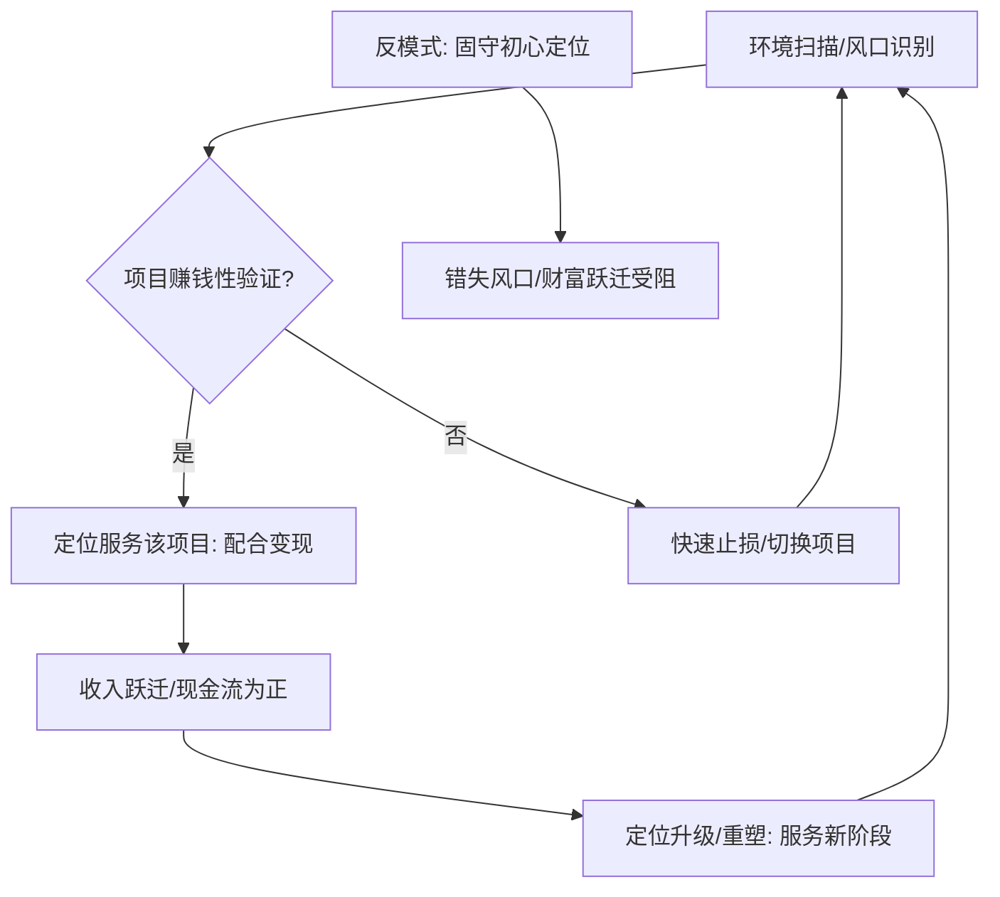

## 51.10 组织进化三阶段论：零件 → 设计者 → 带将者

### 51.10.1 为什么需要这个概念？

创业者角色固化是成长天花板：一直亲自干活（零件）→ 精力上限锁死业务上限。阶段跃迁滞后会导致：1-N阶段仍在“带兵”微操，无法复制放大；规模化阶段不会“带将”，合伙人制建立失败。必须主动“变懒”，从执行者转型为系统设计者、再转型为合伙人搞定者。

### 51.10.2 原文摘录

> "从 0~1 你要勤奋...从 1~10，你就要懒人思维...永远记住：一个创业者不能把自己当成系统中的一个零件，而是要当系统的设计者。"
> 
> "真正的牛人，永远不是搞定事情，而是搞定人...初期的目标可能是带更多的兵...但是后期...你要做的就是学会带将。这个也是为什么大公司都是合伙人制..."
> 
> ——《docs/202305/20230516_041.md》 [D041_P008]

### 51.10.3 核心定义

**组织进化三阶段论**（来源：《docs/202305/20230516_041.md》 [D041_P008]）

- **0-1阶段：关键零件**（亲自跑通闭环，极度勤奋，验证体力心智）
- **1-N阶段：系统设计者**（懒惰思维，买时间，建SOP/机制/外包体系，复制放大）
- **规模化阶段：带将者**（搞定牛人/合伙人，合伙人办事，合伙人制，突破精力上限）

### 51.10.4 关键性质

角色互斥是组织进化的硬性约束。不能同时做零件和设计者，微操细节必然忽略系统架构，这是大量创业者卡在“超级个体”阶段无法跨越的根本原因。杠杆跃迁揭示了三阶段的本质差异：零件靠时间（线性），设计者靠机制/资本（指数），带将者靠人/信任（几何级）。核心矛盾指出：大公司皆为合伙人制，因创始人精力有限，唯有利益深度绑定顶尖人才才能做大，这是组织规模化的物理法则。

### 51.10.5 典型例子

芷蓝：0-1亲自写文案/做课/答疑 → 1-N建立SOP/外包交付/产品见证群标准化 → 规模化培养合伙人小沫/核心学员成“第二个自己”共担交付/生产/分成 [D041_P008]。刘邦/韩信：韩信点兵（零件/将才），刘邦带将（搞定韩信/萧何/张良，合伙人制）[D041_P008]。

### 51.10.6 边界条件

0-1阶段若过早“带将”（招合伙人），因无成果无话语权导致合伙人制虚化。1-N阶段若不“变懒”（拒绝外包/建SOP），必陷入“超级个体陷阱”（高薪打工者）。合伙人制核心：利益分配谈判能力 > 业务执行能力，需学会“情绪利益分离”。

### 51.10.7 组织进化三阶段论

**组织进化三阶段论：零件→设计者→带将者**

创业者角色必须随阶段跃迁：0-1阶段做‘关键零件’（亲自干，勤奋）；1-N阶段做‘系统设计者’（懒惰，买时间，建机制）；规模化阶段做‘带将者’（搞定合伙人，合伙人办事，合伙人制）。拒绝角色固化。

**作用**：该论断为创业者提供了清晰的“角色地图”与“跃迁信号灯”。它告诉创始人：当你发现自己在重复性操作上花费超过50%精力时，必须强制进入“设计者模式”建SOP、招外包；当你发现业务增长受限于“找不到靠谱人”时，必须强制进入“带将者模式”设计合伙人机制。拒绝角色固化，就是拒绝平庸。

### 51.10.8 方法演进图

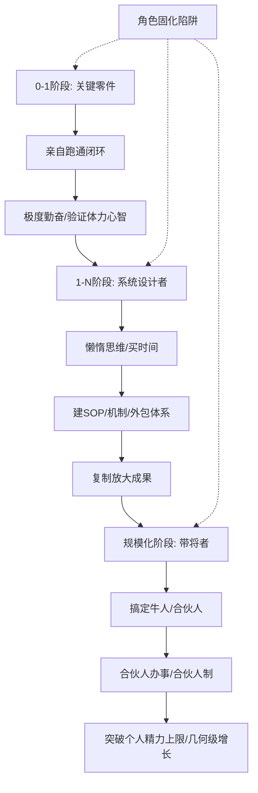

## 51.11 营销即耕耘，销售即收获 —— 内容到位，成交自来

### 51.11.1 为什么需要这个概念？

创业者常陷入“强行成交”焦虑：学话术、练销售、忽悠下单，导致信任破裂、复购率低。忽视内容生产（营），却想要成交结果（销），违背商业因果律。必须建立“内容生产→信任积累→自然成交”的确定性路径。

### 51.11.2 原文摘录

> "营销 2 个字，重点在于营，而销售只是一个最终必然的结果。所以之前我的很多合伙人咨询我如何成交某个用户的时候，我说顺其自然就行了，你没成交，说明你输出的内容不多也不好。输出到位了，和用户随便聊两句，一定成交。"
> 
> ——《docs/202305/20230516_041.md》 [D041_P009]

### 51.11.3 核心定义

**营销即耕耘，销售即收获**（来源：《docs/202305/20230516_041.md》 [D041_P009]）

营销重“营”（内容生产、价值积累、信任建立、标准答案制造）。销售是“营”到位后的必然结果，无需强行推销。核心口诀：没成交，说明内容输出不多也不好；输出到位了，随便聊两句必成交。

### 51.11.4 关键性质

因果倒置风险揭示了“忽悠式营销”的本质：把销售当手段、内容当附属，导致信任透支、复购率低、不可持续。静默成交则是“营销即耕耘”在知识付费场景的终极形态：👸号深度内容+产品链接+引导转发，实现无1对1沟通的自动成交。复利效应量化了内容资产的长期价值：内容资产沉淀（👸号/星球/博客）持续产生被动流量与成交，边际成本趋零，边际收益递增。

### 51.11.5 典型例子

芷蓝合伙人咨询“如何成交某用户”，回复：“顺其自然，你输出内容不多不好，输出到位随便聊两句必成交” [D041_P009]。静默成交工具：👸号将碎片化公域内容逻辑整理为深度长文，植入产品链接，引导转发传播，自动化成交 [D041_P009]。

### 51.11.6 边界条件

仅适用于高信任度、高决策周期、高客单价知识付费/咨询业务。低客单价、高频次、冲动消费型业务（如直播带货、便利店）仍需主动促单技巧。内容生产需持续6-12个月才能见效，前期需配合主动引流/付费流量跑通现金流。

### 51.11.7 营销即耕耘，销售即收获定律

**营销即耕耘，销售即收获定律**

营销核心是‘营’（内容生产、价值积累、信任建立），‘销’（成交）是内容产出到位后的必然结果。强行成交（忽悠）不可持续，内容不到位则无成交。

**作用**：该定律将销售焦虑转化为内容生产确定性。它告诉创业者：不要研究“怎么逼单”，要研究“怎么把这件事的来龙去脉、避坑指南、标准答案写透、讲透”。当内容厚度达到临界点，成交就从“主动狩猎”变成了“被动收割”，这是商业文明程度的质变。

### 51.11.8 方法演进图

```mermaid
graph TD
    A[内容生产(营)] --> A1[价值积累/信任建立/制造标准答案]
    A1 --> B[用户沉浸式阅读/深度链接]
    B --> C[静默成交: 👸号深度文+产品链接+转发传播]
    C --> D[销售(收获): 自动化成交/无需1对1强推]
    D --> E[复利效应: 内容资产持续产生被动流量]
    E --> A
    F[反模式: 强行成交/忽悠式营销] --> G[信任破裂/复购率低/不可持续]
```

## 51.12 正反馈路径深挖原则 —— 在确定性路上疯狂重复

### 51.12.1 为什么需要这个概念？

偶然成交常被误认为“实力”，实则多为“运气踩中痛点”。创业者获正反馈后，易因“自以为实力”而炫技创新、探索新玩法，导致资源分散、确定性丢失。必须抑制创新冲动，在正反馈路径上极致重复、标准化、放大（深挖井）。

### 51.12.2 原文摘录

> "不要为了新鲜感去不停地探索新玩法，你要在正反馈的路径上找爆点，找用户为你付费的理由，然后不停地去重复这个过程。"
> 
> "比如说，你某天发的朋友圈成交了好几个用户...他哪里知道，那天的朋友圈可能就是无意踩中了用户的痛点，真不是他的实力，而是他的运气。"
> 
> ——《docs/202305/20230516_041.md》 [D041_P010]

### 51.12.3 核心定义

**正反馈路径深挖原则**（来源：《docs/202305/20230516_041.md》 [D041_P010]）

正反馈归因：成交多源于运气踩中痛点，而非实力觉醒。深挖策略：找到用户付费理由 → 标准化动作 → 疯狂重复 → 放大规模。禁忌：不要为了新鲜感去不停探索新玩法、新赛道、新形式。

### 51.12.4 关键性质

复利逻辑是深挖原则的数学基础：确定性动作重复N次 → 经验曲线效应 → 单位成本下降 → 利润率上升。反面教材警示：某合伙人朋友圈成交几单后，自以为实力强去尝试新形式，结果流量断崖、转化归零。标准化产出则是深挖的工程化手段：将正反馈路径沉淀为SOP/模板/工具，降低执行门槛、提高复制保真度。

### 51.12.5 典型例子

芷蓝观察：某天朋友圈成交几单，实为无意踩中痛点（运气），而非实力；应在该朋友圈成交路径上标准化、重复、放大 [D041_P010]。产品见证群SOP：从0-1跑通一次预售 → 沉淀SOP → 后续每款新产品复用SOP → 成功率大幅提升 [D041_P018]。

### 51.12.6 边界条件

需定期（季度/半年）复盘验证路径有效性，防止环境变化导致路径失效（如平台算法变更、用户审美迁移）。保留10-20%精力用于“探索新井”（小成本试错），避免单一路径依赖风险。团队执行层严守SOP，决策层负责路径有效性监控与迭代，分工明确。

### 51.12.7 正反馈路径依赖与深挖原则

**正反馈路径依赖与深挖原则**

偶然触发的正反馈（成交）多源于运气踩中痛点而非实力。此时应抑制创新冲动，在该路径上极致重复、标准化、放大（深挖井），而非四处探索新玩法（挖新井）。持续重复确定性动作复利最大。

**作用**：该原则是防止创业者“成功后作死”的核心护栏。它强制创业者将“运气成交”归因为“痛点踩中”，进而将该痛点标准化、流程化、工具化，形成可复制的确定性资产。这不仅保护了现有现金流，更通过“深挖”构护城河——竞争对手能复制你的产品，但无法复制你“千锤百炼后的标准化交付体系”。

### 51.12.8 方法演进图

```mermaid
graph TD
    A[偶然触发正反馈(成交)] --> B{归因分析}
    B -- 实力觉醒(误判) --> C[炫技创新/探索新玩法/新赛道]
    C --> D[资源分散/确定性丢失/转化归零]
    B -- 运气踩中痛点(真相) --> E[在该路径极致重复/标准化/放大]
    E --> F[经验曲线效应/单位成本下降/利润率上升]
    E --> G[沉淀SOP/模板/工具]
    G --> H[降低执行门槛/提高复制保真度]
    H --> E
    I[保留10-20%精力探索新井] --> J[小成本试错/定期复盘]
    J --> A
```

## 51.13 模仿先行策略与微小产品切入 —— 新手反卷生存指南

### 51.13.1 为什么需要这个概念？

新手无资源、无经验、无案例，凭臆想原创大概率失败（无反馈、坚持不下去）。红海赛道卷“全流程大课”，新手应卷“单一痛点微工具”（颗粒度极细、工具属性强）。成功者起步即知“模仿谁”，失败者陷入“闷头做产品”。

### 51.13.2 原文摘录

> "不要先把时间花在闷头做产品和流量这件事上，而是要花在研究自己如何模仿这件事上...我观察过很多自媒体创业者，真正成功赚到钱的那些人，他们在开始做的时候，就知道自己要模仿谁了。"
> 
> "如果你刚开始入场知识付费，我建议你做一个特别特别小的产品，颗粒度做到最细...比如我的合伙人小沫同学，擅长视觉美化，所以她就教别人做小红书的封面美化，服务分为 2 个部分，一个是爆款小红书封面的拆解，一个是给你模板。"
> 
> ——《docs/202305/20230516_041.md》 [D041_P011]

### 51.13.3 核心定义

**模仿先行策略与微小产品切入**（来源：《docs/202305/20230516_041.md》 [D041_P011]）

- **模仿先行**：系统寻找可模仿标杆（产品/内容/平台/节奏），验证“我能做吗/门槛高吗/可持续吗”
- **微小产品**：拆解大赛道全流程 → 定位单一高频痛点节点 → 产品化为“拆解案例库+标准化模板/工具”
- **零案例切入**：制作“对标账号分类库+模板”工具产品，帮用户省时间，低门槛高性价比切入

### 51.13.4 关键性质

降维打击是微小产品的竞争策略本质。大课卷内容深度/广度，微产品卷“帮用户省时间/给确定性模板”，这是价值交付维度的降维。现金流优先则是生存逻辑：微产品制作周期短（1-2周）、定价低（99-299元）、转化快、现金流为正，解决了新手“养不活自己、熬不出成果”的死循环。迁移性揭示了微产品的资产属性：微产品可作为大课模块、社群增值服务、引流钩子，边际复用成本为零，是产品矩阵的“最小功能单元”。

### 51.13.5 典型例子

合伙人小沫微产品验证：切入“小红书封面美化”单一微小痛点，产品设计为“爆款拆解+模板交付”，无需全流程大课即可变现 [Finding04]。无案例新手：帮用户找对标账号、分类整理、找闲鱼外包做PPT模板，按定位类别卖工具包 [D041_P011]。

### 51.13.6 边界条件

微产品天花板低（客单价上限），需作为切入口，后续必须开发高客单价后端（咨询/陪跑/社群/大课）。赛道需有“高频痛点+标准化解法”特征，非标/重服务/重定制赛道不适用。模仿对象必须是“已跑通商业闭环”的标杆，不可模仿“只出内容不变现”的大V。

### 51.13.7 微小产品设计范式

```
微小产品设计范式（来源：《docs/202305/20230516_041.md》 [D041_P011]）

步骤1：拆解大赛道全流程（如短视频带货：选品/找素材/写脚本/拍摄/剪辑/发布/挂车/投流/客服/复盘）
步骤2：定位单一高频痛点节点（如：仅做‘爆款脚本拆解+填空模板’，或仅做‘去重剪辑SOP+参数预设包’）
步骤3：设计交付物：对标案例库（≥20个）+ 标准化模板/工具（即拿即用）+ 避坑清单，定价 99-299 元
步骤4：无自有案例时‘借力制作法’：去对标平台找案例 → 用工具/平台制作模板 → 找闲鱼/Upwork外包制作 → 成本预算
步骤5：零成本冷启动获客：在目标平台发拆解案例/避坑指南/对标账号库目录 → 钩子：免费送3个脚本模板/剪辑参数表
```

### 51.13.8 方法演进图

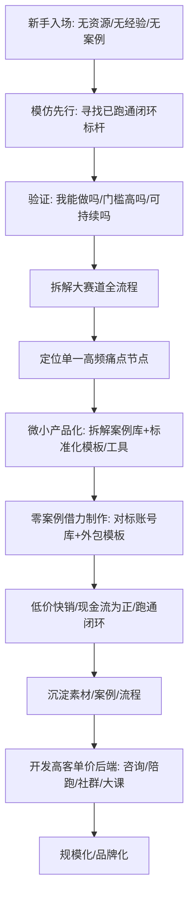

## 51.14 公私域分工体系与静默成交 —— 公域引流加法，私域交付减法

### 51.14.1 为什么需要这个概念？

单一平台无法同时解决“获客广度”和“转化深度”矛盾。公域算法推荐机制适合碎片化内容，私域信任关系适合深度成交。必须建立分层流转体系：公域加法引流 → 👸号沉淀静默成交 → 私域高客单复购。

### 51.14.2 原文摘录

> "引流要做加法，服务交付要做减法...👸号是一个非常好的静默成交工具，把你在小红书、知乎、抖音等平台上的碎片化内容在👸号上按照一定的逻辑整理一遍就是一篇深度好文。在文章中插入你的课程产品购买链接，未来去不断的引导用户帮你去转发👸号文章..."
> 
> "收费的理由是什么呢？我来帮助你做减法，给你更加垂直和更加有深度的具体场景的回答，而且还可以根据和你的对话，实现为你快速反馈的服务目的。"
> 
> ——《docs/202305/20230516_041.md》 [D041_P012]

### 51.14.3 核心定义

**公私域分工体系**（来源：《docs/202305/20230516_041.md》 [D041_P012]）

- **公域（小红书/抖音/知乎）**：做加法，大量内容覆盖关键词、制造标准答案吸引搜索流量加微
- **👸号**：静默成交工具，碎片内容整理为深度长文+植入产品链接+引导转发传播
- **私域（微信/星球/社群）**：做减法，收费即帮用户做决策、节省时间、给具体场景方案、快速反馈

### 51.14.4 关键性质

分层漏斗是公私域分工的结构本质：公域流量池（广） → 👸号信任池（深） → 私域成交池（高客单/高复购）。内容复用机制实现了内容资产的最大化杠杆：一份核心内容 → 公域拆解为碎片笔记/视频 → 👸号聚合为深度文 → 私域精华为付费资料。转化分工明确了各场域的功能定位：公域不直接卖高客单，只卖低价/免费钩子；私域不谈基础常识，只谈决策/方案/资源。

### 51.14.5 典型例子

芷蓝：“100个朋友圈营销技巧/个人IP营销技巧”覆盖长尾词引流加微 → 收费做减法给具体场景决策/快速反馈 [D041_P012]。👸号作用：让用户沉浸式阅读、深度链接，是高客单价成交必备场域（小红书/抖音无法承载） [D041_P012]。

### 51.14.6 数据流图

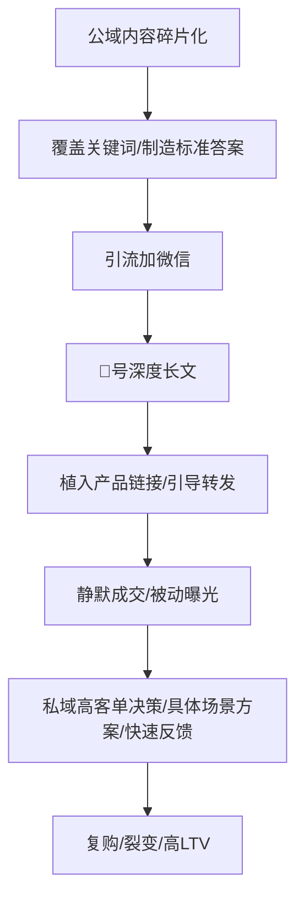

### 51.14.7 静默成交👸号运营法

```
静默成交👸号运营法（来源：《docs/202305/20230516_041.md》 [D041_P012]）

碎片化公域内容 → 逻辑整理沉淀为👸号深度长文 → 植入产品购买链接 → 引导用户转发传播 → 获取被动曝光 → 自动化成交。无需1对1销售介入。
```

### 51.14.8 引流加法·交付减法操作模型

```
引流加法·交付减法操作模型（来源：《docs/202305/20230516_041.md》 [D041_P012]）

引流端：生产‘100个技巧’类标准化内容矩阵，覆盖长尾关键词，制造‘标准答案’吸引搜索流量加微。
交付端：收费即‘做减法’——基于对话给具体场景决策、节省时间、快速反馈，而非堆砌内容。
```

### 51.14.9 方法演进图

```mermaid
graph TD
    A[公域平台(小红书/抖音/知乎)] --> A1[碎片化内容/覆盖长尾词/制造标准答案]
    A1 --> A2[引流加微/建立连接]
    A2 --> B[👸号(静默成交核心场域)]
    B --> B1[深度长文/逻辑整理/植入产品链接]
    B1 --> B2[引导转发/被动曝光/自动化成交]
    B2 --> C[私域(微信/星球/社群)]
    C --> C1[高客单决策/具体场景方案/快速反馈]
    C1 --> C2[做减法交付/非堆砌内容]
    C2 --> D[复购/裂变/高LTV]
    D --> A
```

## 51.15 复制自己与合伙人生态 —— 终极杠杆是教会他人复制你的成功

### 51.15.1 为什么需要这个概念？

个人时间/精力是硬性上限，单靠外包/雇佣无法突破（员工无主人翁意识、流动性高、管理成本高）。必须将核心学员培养为“第二个自己”，共担交付、生产内容、分享收益。合伙人制是大公司做大的根本原因：搞定牛人，牛人办牛事。

### 51.15.2 原文摘录

> "复制自己，永远是知识付费创业者最后的大招...那么，如果你想做更高客单价的产品，赚更多的钱，一定是做一个业务，就是教别人来复制自己，再做出一个芷蓝...这些人就可以和你一起构建你的知识付费体系生态，和你一起交付，一起赚钱，一起生产内容。"
> 
> "真正的好方法是把自己的核心学员培养成自己的【模块化】交付团队，随用随取，可以外包，就像 u 盘插拔一样方便，而且这些核心用户和你之间的沟通成本还很低。"
> 
> ——《docs/202305/20230516_041.md》 [D041_P013]

### 51.15.3 核心定义

**复制自己与合伙人生态**（来源：《docs/202305/20230516_041.md》 [D041_P013]）

- **复制自己**：教会核心学员/合伙人复制成功模式，构建交付体系、生产内容、分享收益
- **模块化交付团队**：核心学员标准化为可插拔交付单元（像U盘），随用随取，沟通成本低、利益绑定深
- **关系财富**：社群内深度合作关系随时间沉淀降低协作成本，效率超雇佣制员工

### 51.15.4 关键性质

杠杆跃迁是复制自己的本质：从“买时间（外包）”跃迁为“买结果（合伙人）”，边际成本趋零、边际收益递增。筛选机制保证了生态纯度：高门槛社群（合伙人群）筛选关系密切、利益深度绑定者，而非普通会员群。文化同构则是执行保真度的基因锁：合伙人共享创始人核心心法（利他/边界感/暴力交付/选客户），执行保真度高。

### 51.15.5 典型例子

芷蓝：核心学员小沫复制“封面美化”微产品模式；合伙人团队共担交付/内容/分成，作者仅2.5人编制运营5000人社群+500人合伙人团队 [Finding06]。云创作项目：普通会员群失败（关系弱/分成复杂/版权不清），迁移至合伙人群（关系紧密/利益绑定深）成功 [Finding03]。

### 51.15.6 边界条件

前提：已有成熟可复制的商业模式（SOP化程度高）、已有个人IP影响力（吸引力源）。合伙人利益分配：需明确“先赚客户钱再分合伙人钱”，避免未赚钱先分利益导致动力扭曲。法律/合规风险：合伙人制非股权制，需通过协议约定收益分成/退出机制/竞业限制，避免纠纷。

### 51.15.7 方法演进图

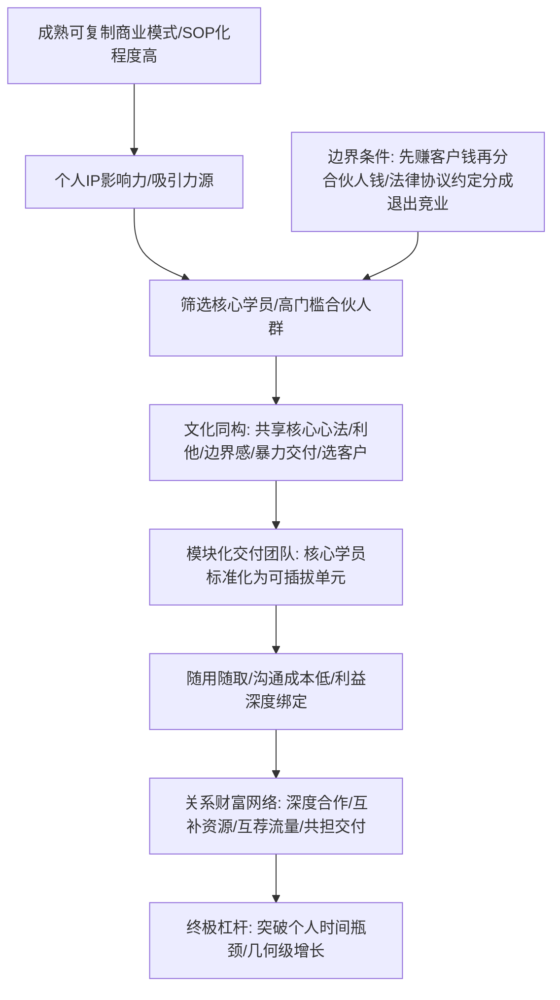

## 51.16 咨询优于代运营 —— 责任边界清晰的低风险变现模式

### 51.16.1 为什么需要这个概念？

代运营：成本高、责任重、易因客户执行力差导致纠纷/退费/骂声。咨询：提供方法论、低成本、责任边界清（对方法负责、对结果不负责）。觉醒者自获结果，咨询者仅助力，双赢模式。

### 51.16.2 原文摘录

> "能做咨询，就不做代运营...你收个几万块钱的咨询费用，对方只要觉得你这套方法论有用，那么他无论最后有没有做成功，他都不会说什么。但如果你收他一个几十万的代运营，最后因为他自己的原因没做出来结果，他一定会骂死你，然后找你退费。"
> 
> ——《docs/202305/20230516_041.md》 [D041_P014]

### 51.16.3 核心定义

**咨询优于代运营**（来源：《docs/202305/20230516_041.md》 [D041_P014]）

- **咨询模式**：收几万咨询费，提供方法论/策略/避坑指南，不承诺业绩结果
- **代运营模式**：收几十万服务费，包执行/包运营/包结果，风险全在服务方
- **核心差异**：咨询筛选“觉醒者”（自带执行力），代运营面对“非觉醒者”（需托管）

### 51.16.4 关键性质

风控优势是咨询模式的核心护城河：咨询客户觉醒者自驱成功，非觉醒者认认栽栽，服务方无退费风险。规模优势源于标准化复制能力：咨询可标准化（诊断模板/方案库/话术库）批量复制，代运营强依赖人难复制。现金流优势体现为：咨询款到即服务，代运营常垫资/长账期/尾款难收。

### 51.16.5 典型例子

芷蓝亲身经历：收几十万代运营，客户自己原因没做成结果 → 骂死服务方、找退费；改咨询后，客户觉醒自成，不成也认栽，无纠纷 [D041_P014]。咨询产品化：将咨询标准化为“诊断清单+标准方案库+FAQ文档”，单次咨询耗时从2小时降至30分钟 [D041_P014]。

### 51.16.6 边界条件

仅适用于“方法论可标准化、结果强依赖客户执行力”的知识服务业务。重执行/重交付/强交付标准化的业务（如设计/开发/视频剪辑）仍需代运营/外包模式。咨询定价锚定：必须有高客单价后端产品（课程/社群/陪跑）作为咨询的自然转化路径。

### 51.16.7 方法演进图

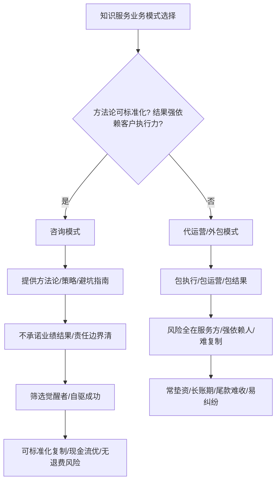

## 51.17 二维思考法 —— 破除路径依赖的决策模型

### 51.17.1 为什么需要这个概念？

“成功于何处，失败于何处”：路径依赖让创业者用旧地图找新大陆，错失最优解。固有经验既是资产也是牢笼，需建立系统性破除机制。单维度思考（仅发散或仅收敛）均不可取，需双维度结合。

### 51.17.2 原文摘录

> "路径依赖对于知识付费创业者太可怕了...所以，我后来用 1 年的时间去练习一种思维方式，那就是“二维思考法”。先把自己的固有思考路径清空去看问题，这时候就会发现很多种可能；然后再用自己之前的路径去思考，去和刚才更多的可能做对比，用成本原则去看哪种解决方案是最优的。"
> 
> ——《docs/202305/20230516_041.md》 [D041_P015]

### 51.17.3 核心定义

**二维思考法**（来源：《docs/202305/20230516_041.md》 [D041_P015]）

- **维度一（可能性空间）**：清空固有经验/路径依赖，发散思考所有可能性
- **维度二（最优解锁定）**：引入经验路径，对比筛选，应用成本原则（机会成本/时间成本/资源成本）选取最优解
- **核心工具**：成本原则作为决策仲裁者，而非偏好/直觉/习惯

### 51.17.4 关键性质

认知解耦是二维思考的操作化前提：强制分离“发散期”与“收敛期”，避免思维混淆导致过早收敛。迭代性要求：每次重大决策/季度复盘均需运行一次二维思考，保持认知更新。团队化机制将二维思考组织化：决策会议显性化两维度流程（如：前30分钟禁评价只发散，后30分钟引入经验只筛选）。

### 51.17.5 典型例子

芷蓝练习1年：面对“云创作失败/合伙人模式选择/新赛道切入”等决策，均运用二维思考避开路径依赖陷阱 [D041_P015]。合伙人制决策：发散“雇佣/外包/合伙人/众包/自动化”所有组织形式可能 → 收敛对比成本/风险/收益 → 选“模块化合伙人制”最优 [D041_P015]。

### 51.17.6 边界条件

仅适用于战略/战术级决策，战术执行层（如文案标题/发布时间）无需运行完整流程。团队需建立“心理安全感”，发散期鼓励异想天开，收敛期基于数据/成本而非权威/资历。创始人需亲自主持关键决策的二维思考会议，不可完全授权（决策权即杠杆权）。

### 51.17.7 二维思考决策法

```
二维思考决策法（来源：《docs/202305/20230516_041.md》 [D041_P015]）

步骤1：清空固有经验/路径依赖，发散思考所有可能性（维度一：可能性空间）。
步骤2：引入经验路径，对比筛选，应用成本原则（机会成本、时间成本、资源成本）选取最优解（维度二：最优解锁定）。
```

### 51.17.8 方法演进图

```mermaid
graph TD
    A[关键战略/战术决策] --> B[维度一: 可能性空间]
    B --> B1[清空固有经验/路径依赖]
    B1 --> B2[发散思考所有可能性(含反直觉路径)]
    B2 --> B3[列出≥8种完全不同可行路径]
    B3 --> C[维度二: 最优解锁定]
    C --> C1[引入经验路径/对比筛选]
    C1 --> C2[建立决策评分表: 机会成本/时间成本/资源成本/风险概率/杠杆率/核心能力匹配度]
    C2 --> C3[加权打分/选取最高分路径]
    C3 --> D[执行前3步具体动作/设定止损触发条件]
    D --> E[季度复盘/迭代决策]
    E --> A
```

## 51.18 内容拆解聚合变现与创业日记内容化 —— 零产品起步的现金流跑通术

### 51.18.1 为什么需要这个概念？

新手常卡在“不会做产品/没产品卖”死循环，导致现金流断裂、信心崩塌。不必执着自有产品，先跑通项目现金流，再反向开发产品体系。记录创业全过程即优质内容：真实+坚持=流量，跑通后自然转化变现。

### 51.18.2 原文摘录

> "自己会不会做知识付费产品，真的一点不重要，如果你不会做，最快速的变现方法就是找准一个赛道去做内容的拆解或者聚合...初期真的不必在意是不是自己的产品，先把项目跑通才是重要的。"
> 
> "记录自己做知识付费的过程，这本身就是一个很好的内容输出方式...只要真实，只要你能坚持，用户就愿意关注。一旦你在分享的副业跑通了，就会有用户过来咨询你..."
> 
> ——《docs/202305/20230516_041.md》 [D041_P016]

### 51.18.3 核心定义

**内容拆解聚合变现与创业日记内容化**（来源：《docs/202305/20230516_041.md》 [D041_P016]）

- **内容拆解聚合**：选垂直赛道 → 持续拆解/聚合100个案例/流程 → 后端卖相关课程/项目/CPS
- **创业日记内容化**：记录（发现机会→决策→行动→反馈→复盘）全过程，真实坚持即流量
- **零产品起步**：初期不在意是不是自己的产品，先把项目跑通才重要

### 51.18.4 关键性质

降维打击是零产品起步的竞争逻辑：竞争对手在“造产品”，你在“卖流量/卖筛选/卖工具”，现金流更快为正。资产沉淀揭示了复利价值：拆解案例库 → 自有课程素材；创业日记 → 个人IP信任资产/教学案例库。飞轮效应闭环：内容引流 → 成交反馈 → 新案例 → 更强内容 → 更多引流。

### 51.18.5 典型例子

芷蓝合伙人：不会做课程时，先做“对标账号库+模板”工具包卖99元，跑通现金流再开发大课 [D041_P016]。创业日记实践：记录“如何从0建立知识付费业务”全过程，跑通后自然有人咨询/报名/带私教/买CPS [D041_P016]。

### 51.18.6 边界条件

仅适用于“信息差/经验差”可变现的知识服务赛道，重技术/重资质/重供应链赛道不适用。拆解内容必须“可执行/有模板/有案例”，纯理论/纯观点/纯心态类内容难变现。需设定“内容产出节奏”（如日更/周更）与“后端转化路径”，避免沦为纯内容创作者。

### 51.18.7 方法演进图

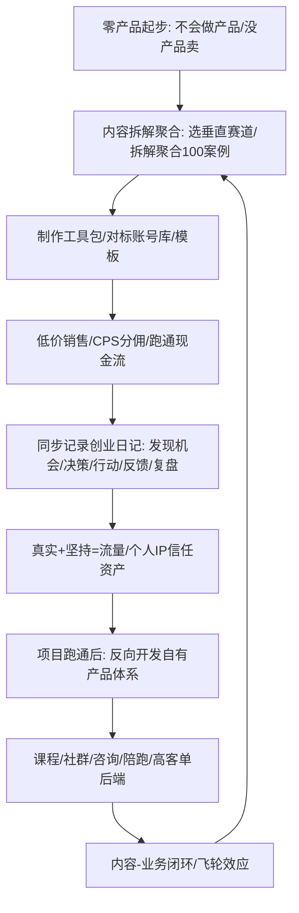

## 51.19 个人IP即产品（全触点营销SOP）

### 51.19.1 为什么需要这个概念？

传统认知将“营销”视为发广告/写软文，忽视每一次微信互动、朋友圈展示、社群发言都是营销触点。缺乏标准化触点设计，导致流量进来了、信任建立不了、转化路径断裂。必须将个人IP运营产品化：每个触点有设计、每句话有目的、每步骤有SOP。

### 51.19.2 原文摘录

> "我现在才明白，做个人 IP 其实就是做产品，人就是产品，尤其是营销人。别人接触你后，你能否给别人爽点？你跟用户说的每一句话，都是一次用户互动，用户在每一个能看见你的地方，都是一个用户触点。"
> 
> "举个例子，所有新加我的好友，我都会马上送他一份 10 万字大礼包...然后我会问他的卡点是什么...然后我会根据他的卡点，给他一个路径...接下来我就会推荐我的星球...好啦，基本就是这样"
> 
> ——《docs/202305/20230516_041.md》 [D041_P017]

### 51.19.3 核心定义

**个人IP即产品/全触点营销SOP**（来源：《docs/202305/20230516_041.md》 [D041_P017]）

- **人即产品**：营销人尤甚，每次互动（送礼包/问卡点/给路径/推产品）都是触点设计
- **标准化SOP**：送礼包(爽点/互惠) → 问行业/卡点(诊断/目标) → 给路径蓝图(专业度/确定性) → 推产品填补细节(自然成交) → 引入社群/行动营(深度交付)
- **核心逻辑**：互惠心理启动 → 专业诊断建立权威 → 路径设计降低决策成本 → 产品作为路径自然组件成交

### 51.19.4 关键性质

自动化程度高是全触点SOP的工程化特征：新好友欢迎语/礼包/诊断问卷/路径模板/产品推荐话术全预设，单次互动耗时<3分钟。信任递进机制设计了信任建立的阶梯：免费价值（礼包）→ 免费诊断（卡点）→ 免费路径（蓝图）→ 付费产品（细节）→ 付费服务（陪伴），每步降低信任门槛。规模化能力依托助理/自动化工具：单人日均处理100+新好友触点不降质。

### 51.19.5 典型例子

芷蓝实操：新加好友即送10万字大礼包 → 问卡点/行业 → 给标准化路径 → 推星球/行动营/咨询/陪跑，基本固定成交路径 [D041_P017]。触点资产化：将高频问答/标准路径/拒绝话术/成交案例沉淀为“个人IP销售手册”，助理可直接执行 [D041_P017]。

### 51.19.6 边界条件

前提：有真实可交付的产品/服务体系，空手套白狼必露馅、毁信任。礼包/路径/诊断必须真材实料（干货密度高），廉价诱饵反而降低专业度。规模化后需引入“分层触点设计”：高意向走深度SOP，低意向走自动化/社群运营。

### 51.19.7 个人IP销售SOP (触点设计法)

```
个人IP销售SOP (触点设计法)（来源：《docs/202305/20230516_041.md》 [D041_P017]）

新好友欢迎标准动作：
1. 即时送大礼包（爽点/互惠）：10万字资料包/工具清单/违禁词表
2. 询问行业/卡点（诊断/目标）：分类用户（0基础/有基础无流量/有流量不转化/想带货不会选品）
3. 给出标准化路径蓝图（专业度/确定性）：针对各类用户给3-5步路径图，节点对应自有产品
4. 路径节点对应推荐自有产品/服务（自然成交）：产品作为路径细节填补，非推销
5. 引入社群/行动营实现深度交付：付费门槛/核心价值/二次销售设计
```

### 51.19.8 方法演进图

```mermaid
graph TD
    A[新用户触达(加微/关注/进群)] --> B[触点1: 送欢迎礼包(爽点/互惠/干货密度高)]
    B --> C[触点2: 诊断提问/分类用户(卡点/行业/阶段/目标)]
    C --> D[触点3: 给标准化路径蓝图(专业度/确定性/节点对应产品)]
    D --> E[触点4: 自然推荐产品(路径细节填补/非推销/话术预设)]
    E --> F[触点5: 引入社群/行动营(深度交付/付费门槛/二次销售)]
    F --> G[成交/复购/裂变]
    H[标准化资产库] --> B
    H --> C
    H --> D
    H --> E
    H --> F
    I[助理/自动化工具执行] --> B
    I --> C
    I --> D
    I --> E
    I --> F
```

## 51.20 借势造势与产品见证群SOP —— 无流量无势能时的平地抠饼术

### 51.20.1 为什么需要这个概念？

普通人无流量、无势能、无成功案例，新品预售无底气、无转化。必须主动借用：风口势能（ChatGPT/AI）、行业势能（跨界结合）、人脉势能（合伙人/KOL）。同时自造势能：产品见证群让用户参与共创，制造销售素材，实现“平地抠饼”。

### 51.20.2 原文摘录

> "每一个产品的发售结果都要把它变成下一个产品的营销素材...从底层逻辑去思考，产品见证群到底是什么？其实我们是在为自己的产品发售制作销售素材而已。"
> 
> "你想，你不是一个大 v，没有势能，没有流量，这种情况下你去做新产品的预售，有底气吗？有成功案例吗？有势能吗？作为一个普通人，答案是没有。我们拉一个群，在群里分享我们制作产品的细节，让用户参与进来，然后把这些全部分享出去，这不是就有了营销素材吗？"
> 
> ——《docs/202305/20230516_041.md》 [D041_P018]

### 51.20.3 核心定义

**借势造势与产品见证群SOP**（来源：《docs/202305/20230516_041.md》 [D041_P018]）

- **借势三层**：风口势（技术/政策红利）+ 行业势（跨界结合健身/医美/写作）+ 人脉势（合伙人/KOL背书）
- **产品见证群SOP**：建群 → 分享制作细节/决策过程 → 用户参与共创/反馈 → 产出聊天记录/海报/案例等营销素材 → 公私域分发 → 预售转化 → 沉淀SOP供下款复用
- **核心逻辑**：用“过程透明化”替代“结果承诺”，用“用户参与感”替代“专家权威感”

### 51.20.4 关键性质

零成本造势是见证群的商业模式创新：无需投广告、找KOL，仅需拉群、记录过程、截图分发。素材复用率量化了资产价值：一次见证群产出素材可支撑3-5轮预售/发售，边际成本趋零。信任前置机制重构了转化信任链：用户见证制作过程 → 信任专业度/真实度 → 预售转化率显著高于冷启动直卖。

### 51.20.5 典型例子

ChatGPT大师课借势发售：借风口势+借行业势（健身/医美/写作结合）+ 借渠道势（小鹅通），单渠道预售60万+ [Finding01]。见证群实操：分享课程大纲设计、录制花絮、内测反馈修改，用户提建议、催更、抢名额，截图发朋友圈/社群/公域引流 [D041_P018]。

### 51.20.6 边界条件

产品必须有“制作过程可视化”特征（课程/软件/实物/社群），纯咨询/纯服务类难以见证。群运营需投入精力（每日汇报/答疑/催进度），不可建群即弃，否则反噬信任。素材分发需合规：隐去用户隐私、避免平台判定引流违规、控制分发节奏防疲劳。

### 51.20.7 产品见证群SOP

```
产品见证群SOP（来源：《docs/202305/20230516_041.md》 [D041_P018]）

新品预售标准化流程：
1. 建群
2. 分享制作细节/决策过程
3. 用户参与共创/反馈
4. 产出聊天记录/海报/案例等营销素材
5. 公域/私域分发素材
6. 预售转化
7. 沉淀SOP供下一款产品复用
```

### 51.20.8 方法演进图

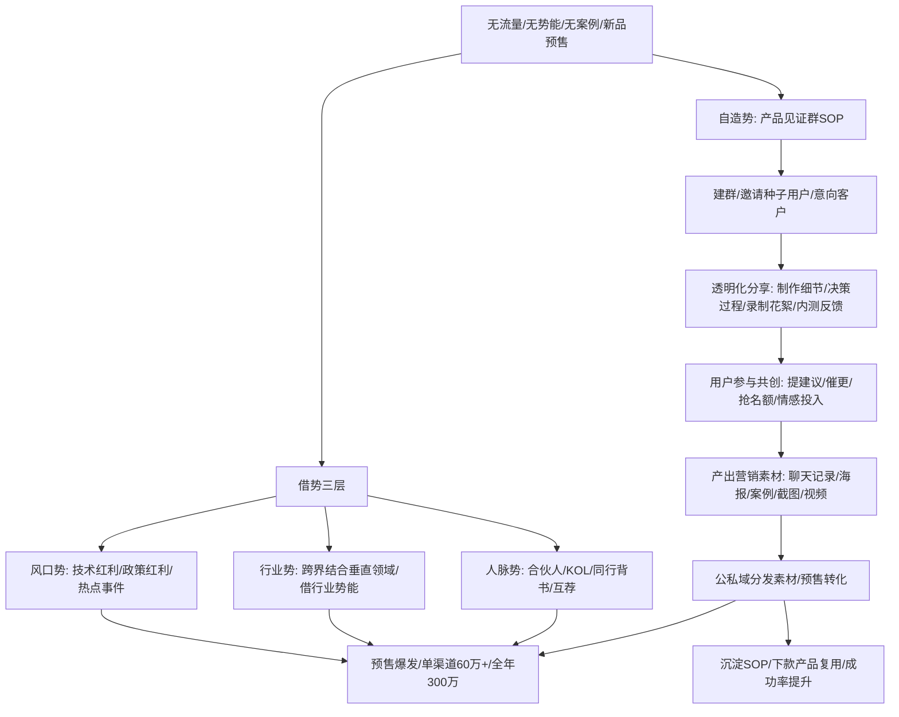

## 51.21 设计中的取舍

为什么不用“全员雇佣制”而用“合伙人制/模块化外包”？雇佣制将固定成本锁死，员工缺乏主人翁意识、流动性高、管理成本随规模线性上升。合伙人制将固定成本转为变动分成，利益深度绑定，沟通成本随信任沉淀指数下降，边际产出递增。这是从“买时间”跃迁为“买结果”的杠杆升级。这种设计的 trade-off 是什么？收益在于突破个人精力天花板，实现几何级规模化；边际管理成本递减；合伙人自带资源/流量/执行力。代价在于利益分配谈判复杂（需情绪利益分离能力）；法律/合规风险（非股权约定需专业协议）；文化同构要求高（核心心法不一致易内耗）；早期无业绩无法吸引顶尖合伙人（需先跑通0-1）。

为什么不用“全流程大课”而用“微小颗粒度产品”切入？全流程大课制作周期长（1-3个月）、客单价高决策周期长、新手无案例无信任难转化。微产品制作快（1-2周）、定价低（99-299元）、工具属性强即拿即用、转化快现金流正。这是新手“反卷生存”的唯一可行路径。这种设计的 trade-off 是什么？收益在于极低门槛快速跑通现金流；可作为后端大课模块/引流钩子/社群增值服务复用；边际复用成本为零。代价在于客单价天花板低（单靠微产品难做高利润）；必须快速开发高客单价后端（咨询/陪跑/社群）；赛道需有“高频痛点+标准化解法”特征，非标赛道不适用。

为什么不用“教育用户新概念”而用“认知接口（旧瓶装新酒）”？教育新概念（如神经网络/Transformer原理）用户认知成本极高、决策链路长（理解→信任→尝试→购买）、转化率低。认知接口接入用户既有认知模型，仅售“确定性效率提升”（原流程不变、效率10倍），决策链路缩短为“痛点→收益→购买”，实现降维打击式转化。这种设计的 trade-off 是什么？收益在于转化率大幅提升；复用性强（同一接口植入多赛道）；规避技术原理争议与过期风险。代价在于过度简化可能导致用户预期过高（以为买了就能躺赚），交付时需强边界感管理预期；不适用于“认知重塑型”产品（哲学/心理学）；用户无基础流程（无旧瓶）时需先“造瓶”成本高。

## 51.22 动手练习

### 练习1：设计你的‘核心三件事’与外包清单

假设你要启动一个‘AI辅助小红书爆款笔记生产’的知识付费项目：

1. 列出你作为创始人必须亲自做的‘核心三件事’的具体动作（参考：阅读、构建知识体系、生产内容）。
2. 列出项目运营中除核心三件事外的所有事务（如：选品、封面设计、文案改写、发布排期、客服答疑、社群运营、技术开发、财务对账等）。
3. 对每一项非核心事务，判断：是‘立即外包’、‘建立SOP后外包’、‘暂时自己做但设定外包触发条件’？
4. 计算：若全外包，预估月度外包成本；若全自己做，预估你每周需投入工时。对比两者的‘创始人精力释放价值’与‘现金流压力’。

回答问题：
- 为什么‘构建知识体系’不能外包？如果外包了，你的护城河在哪里？
- 什么样的外包对象适合‘模块化/U盘化’管理？什么样的不适合？

### 练习2：重构你的‘暴力交付’标准与客户筛选漏斗

针对你现有或计划中的一个知识付费产品（如：999元‘小红书起号训练营’）：

1. 定义‘交付完成’的标志性动作：是‘用户看完课程’、‘用户发布第一篇笔记’、‘用户出第一单’，还是‘用户掌握方法论可独立操作’？
2. 列出当前交付包含的所有服务动作（如：课程视频、作业批改、每日打卡监督、1对1答疑、社群氛围维护、资源对接等）。
3. 对每个服务动作打标签：【暴力/核心】（直接给结果/模板/路径，标准化、可规模化）或 【温和/服务】（陪伴/答疑/安抚/个性化、高边际成本）。
4. 设计‘觉醒者筛选漏斗’三道关卡：
   - 关卡1（付费门槛）：设定多少价格/形式（如：9.9元前置资料包/200元咨询诊断费）？
   - 关卡2（诊断问卷/沟通）：问哪3-5个问题能判断用户‘自我驱动力/执行力/认知水平’？
   - 关卡3（边界感劝退）：明确拒绝服务的用户画像特征（如：要求全程监督、不愿动手操作、只想听不想干）。

回答问题：
- 如果取消所有‘温和/服务’类动作，你的退款率会升还是降？复购率会如何变化？为什么？
- 如何向已付费但被‘劝退’的用户解释，既保护人设又不引发纠纷？

### 练习3：实战‘二维思考法’破解你的路径依赖

选取你当前面临的一个关键战略决策（如：是否要从‘做小红书培训’转型‘做AI应用培训’？是否要招第一个全职员工？是否要开发自有SaaS工具？）：

第一阶段（维度一：可能性空间——清空固有经验发散）：
1. 强制禁止使用‘我擅长/我习惯/我以前怎么做/同行都怎么做’作为理由。
2. 列出至少 8 种完全不同的可行路径（含反直觉路径）。例如：转型做AI培训 vs 继续深耕小红书做头部 vs 停止培训转做咨询 vs 做CPS分销 vs 做社群联盟 vs 卖项目给同行 vs 合伙人制裂变 vs 彻底停业去打工。
3. 对每条路径，不做评价，仅描述‘如果选这条，画面是什么样的’。

第二阶段（维度二：最优解锁定——引入经验对比筛选）：
4. 建立决策评分表，维度：机会成本（放弃什么）、时间成本（多久见效）、资源成本（需投入多少钱/人/技术）、风险概率（翻车可能性）、杠杆率（成功后可复制放大倍数）、核心能力匹配度（用上你最强的那根棍子吗）。
5. 为每条路径在上述 6 个维度打分（1-10 分），计算加权总分（权重自定，建议杠杆率与核心能力匹配度权重最高）。
6. 选出得分最高的路径，写出‘执行前 3 步具体动作’与‘止损触发条件’。

回答问题：
- 在发散阶段，你最难放下的‘固有经验/路径依赖’是什么？它如何阻碍你看到新可能？
- 如果最高分路径与你‘直觉想做的’不一致，你会选择哪个？为什么？

### 练习4：从零设计一个‘微小颗粒度产品’跑通现金流

假设你毫无案例、毫无流量、毫无产品，但想在‘短视频带货’赛道切入：

1. 拆解‘短视频带货’全流程至少 10 个节点（选品、找素材、写脚本、拍摄、剪辑、发布、选品广场挂车、投流测款、客服发货、复盘优化等）。
2. 选定 1 个‘高频刚需+可标准化工具化’的单一节点作为微产品切入点（如：仅做‘爆款脚本拆解+填空模板’，或仅做‘去重剪辑SOP+参数预设包’）。
3. 设计微产品交付物：必须包含‘对标案例库（≥20个）’+‘标准化模板/工具（即拿即用）’+‘避坑清单’，定价 99-299 元。
4. 无自有案例时的‘借力制作法’：去哪里找对标案例？用什么工具/平台制作模板？找谁外包（闲鱼/Upwork/Fiverr）？成本预算？
5. 设计‘零成本冷启动获客动作’：在哪个平台（抖音/小红书/知乎/闲鱼）发什么内容（拆解案例/避坑指南/对标账号库目录）引流？钩子是什么（免费送3个脚本模板/剪辑参数表）？

回答问题：
- 为什么这个微产品的天花板是‘客单价上限’？它的后端高客单价产品是什么（咨询/陪跑/社群/大课）？
- 如果这个微产品卖不出去（30天<10单），你的止损判断标准是什么？下一个微产品切入点会选哪个节点？

### 练习5：搭建‘个人IP全触点营销SOP’并压力测试

模拟一个新加微信好友（目标用户画像：想做小红书副业的宝妈/大学生/职场人）的完整转化路径：

1. 设计‘欢迎礼包’：含什么干货（如：100个选题库/封面模板/违禁词表/工具清单）？格式（PDF/网盘/小程序）？如何体现‘爽点’与‘互惠心理’？
2. 设计‘诊断提问’：第1句问什么？如何根据回答分类用户（如：0基础/有基础无流量/有流量不转化/想带货不会选品）？
3. 设计‘标准化路径蓝图’：针对每类用户，给一张‘从现状到目标的3-5步路径图’（文本/思维导图/语音），路径节点必须对应你的付费产品/服务。
4. 设计‘自然推荐话术’：如何把产品作为‘路径节点的细节填补’推出，而非‘推销’？举例话术。
5. 设计‘社群/行动营邀约’：什么门槛（付费/任务/打卡）？核心价值（陪伴/监督/资源/二次销售）？
6. 压力测试：若单日新增 100 好友，上述 SOP 哪些环节会崩？如何引入助理/自动化工具（欢迎语/自动分群/表单诊断/标准路径库）实现‘单人日均处理100+不降质’？

回答问题：
- 如果用户不回复你的‘诊断提问’，你的跟进节奏与话术是什么？（避免变成‘客服’而非‘专家’）
- 如何确保‘礼包’不沦为‘廉价诱饵’而是真正建立专业信任的‘爽点’？

## 51.23 本章小结

这一章中我们学习了知识付费创业的底层认知体系。首先，我们确立了**创业失败必然论与低成本试错定律**，理解创业是概率游戏，知识付费边际成本趋零提供了可控试错环境；其次，掌握了**核心三件事与外包杠杆**，明确创始人仅做阅读/构建体系/生产内容三件事，其余外包买时间换体量；接着，洞悉了**暴力交付**本质是筛选优质用户，交付即给结果/资源/路径，拒绝无限答疑；然后，建立了**边界感与劝退营销**双向筛选机制，用“不做什么”定义商业护城河；随后，内化了**选客户比服务客户重要（99/1觉醒者法则）**，筛选自我驱动的觉醒者；再然后，熟练运用**认知接口（旧瓶装新酒）**降低用户理解门槛，仅售确定性效率提升；接着，理解了**动态定位**思维，定位服务于变现而非长期主义信仰；然后，掌握了**组织进化三阶段论（零件→设计者→带将者）**，主动完成角色跃迁；随后，建立了**营销即耕耘、销售即收获**的内容信任飞轮，摒弃强行成交；再然后，执行**正反馈路径深挖原则**，在确定性路径上疯狂重复标准化；接着，掌握了新手**模仿先行+微小颗粒度产品**反卷切入范式；然后，构建了**公私域分工+静默成交**的全域流量变现体系；随后，掌握了**复制自己与合伙人生态**的终极杠杆；再然后，辨析了**咨询优于代运营**的风控与规模化优势；接着，训练了**二维思考法**破除路径依赖；随后，落地了**内容拆解聚合+创业日记内容化**零产品起步术；再然后，标准化了**个人IP即产品**全触点营销SOP；最后，运用了**借势造势+产品见证群SOP**实现平地抠饼式冷启动。

本章我们一起学习了以下概念：

| 概念 | 解释 |
|------|------|
| 创业失败必然论与低成本试错定律 | 创业本质是概率游戏，失败是常态，知识付费边际成本趋零提供可控试错环境，策略：多尝试、快失败、低成本、留存活下来的模式 |
| 核心三件事与外包杠杆 | 创始人仅做阅读、构建知识体系、生产内容三件核心事，其余外包买时间换体量，形成正向飞轮 |
| 暴力交付 | 优质交付本质是筛选优质用户，用户付费为节省时间买单，交付即给结果/资源/路径，拒绝无限答疑陪伴，服务越重用户越差 |
| 边界感与劝退营销 | 主动设定不做的事/不收的用户，劝退非目标用户=降低成本+强化人设+提升目标用户信任，双向筛选飞轮 |
| 选客户比服务客户重要（99/1觉醒者法则） | 客户成功99%源于自我觉醒，仅筛选觉醒者稍加助力即成，拒绝需监督执行的低质客户，积累案例构建势能吸引同类人 |
| 认知接口（旧瓶装新酒） | 避免教育新概念（成本极高），在用户既有认知框架内植入新工具/场景，仅售‘原流程不变、效率提升10倍’的确定性收益 |
| 动态定位 | 定位是战术工具服务于变现，而非长期主义信仰，随项目/市场跃迁调整（马云/雷军/腾讯皆是），先判断项目赚钱再配合定位 |
| 组织进化三阶段：零件→设计者→带将者 | 0-1亲自跑通（零件/勤奋）→ 1-N建机制买时间（设计者/懒惰）→ 规模化搞定合伙人（带将者/合伙人制），拒绝角色固化 |
| 营销即耕耘/销售即收获（静默成交） | 营销重‘营’（内容/信任/标准答案），销售是内容到位后的必然结果，👸号为静默成交核心场域，无需1对1强推 |
| 正反馈路径深挖原则 | 偶然成交多源运气踩中痛点而非实力，应在该路径上极致重复、标准化、放大（深挖井），抑制为新鲜感探索新玩法（挖新井） |
| 模仿先行与微小产品切入 | 新手系统寻找可模仿标杆验证可行性，切入单一高频痛点做‘拆解+模板’微工具产品（如封面美化），低门槛快现金流 |
| 公私域分工体系（引流加法/交付减法） | 公域做碎片化内容覆盖关键词引流（加法），👸号沉淀深度内容静默成交，私域做高客单决策/方案/快速反馈（减法） |
| 复制自己与合伙人生态（模块化/关系财富） | 教会核心学员复制成功模式成‘第二个自己’，构建可插拔模块化交付团队+深度利益绑定关系财富网络 |
| 咨询优于代运营 | 咨询提供方法论、责任边界清（对方法负责不对结果负责）、可标准化复制、现金流优，筛选觉醒者自驱成功，双赢 |
| 二维思考法（破路径依赖） | 维度一：清空固有经验发散所有可能性；维度二：引入经验对比筛选，以成本原则（机会/时间/资源成本）锁定最优解 |
| 内容拆解聚合+创业日记内容化（零产品起步） | 不会做产品时，先拆解聚合垂直赛道100案例卖工具包/CPS跑通现金流，同步记录创业全过程真实坚持获流量 |
| 个人IP即产品（全触点营销SOP） | 人即产品，每次互动都是触点设计：送礼包(爽点)→问卡点(诊断)→给路径(蓝图)→推产品填补细节→引入社群深度交付 |
| 借势造势+产品见证群SOP | 借风口/行业/人脉三层势能，建见证群让用户参与产品共创过程，透明化制作细节产出营销素材分发预售，无流量无势能时的平地抠饼术 |

下一章中，我们将学习如何将这些底层认知转化为具体的实战项目库，包括小红书无货源电商、视频号短视频带货、闲鱼矩阵霸屏等经过验证的标准化打法，以及知识付费、海外业务、长尾赛道的拆解案例。

### 素材来源对照表

| 素材ID | 原始文档标题 | 来源平台 | 创作时间 | 核心论据/对应章节 |
|--------|-------------|----------|----------|------------------|
| D041_P001-D041_P018 | 知识付费创业48条心法（编号11-50） | 微信👸号/知识星球/内部文档 | 2023年5月 | 全章节概念定义、原文摘录、关键性质、典型例子、边界条件的主要来源 |
| Finding01 | ChatGPT大师课借势发售实证 | 微信👸号/小鹅通后台数据 | 2023年Q1-Q2 | 51.3、51.6、51.8、51.18、51.20 |
| Finding02 | 朋友圈训练营停止与标准化改造案例 | 内部复盘文档 | 2023年 | 51.5、51.9、51.12 |
| Finding03 | 小红书云创作项目试错失败复盘 | 内部复盘文档 | 2023年 | 51.3、51.15 |
| Finding04 | 合伙人小沫微小产品(封面美化)切入验证 | 内部案例库 | 2023年 | 51.11、51.13 |
| Finding05 | 舞蹈室付费流量回本复购模型验证 | 实体店运营数据 | 2022-2023年 | 51.12、51.14 |
| Finding06 | 超级个体低成本运营实证 | 团队组织架构文档 | 2023年 | 51.4、51.13、51.15 |
| Finding07 | 起号‘内容带人’策略对比验证 | 行业观察/学员案例库 | 2022-2023年 | 51.11、51.13 |
| Finding08 | 劝退营销与边界感正向筛选效应 | 经验总结/宣称 | 2023年 | 51.6 |
| Finding09 | 关键裂变人双重激励机制有效性 | 组织行为学应用/宣称 | 2023年 | 51.14、51.15 |

*注：D041_P001-D041_P018 为概念地图中引用的段落/条目编号，统一对应源文档 `docs/202305/20230516_041.md`；Finding01-Finding09 为实证验证库引用的具体案例编号，同源于该文档及作者后续复盘沉淀。*


