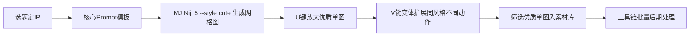
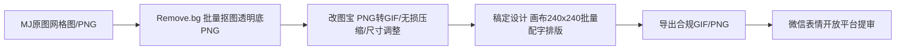
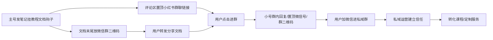
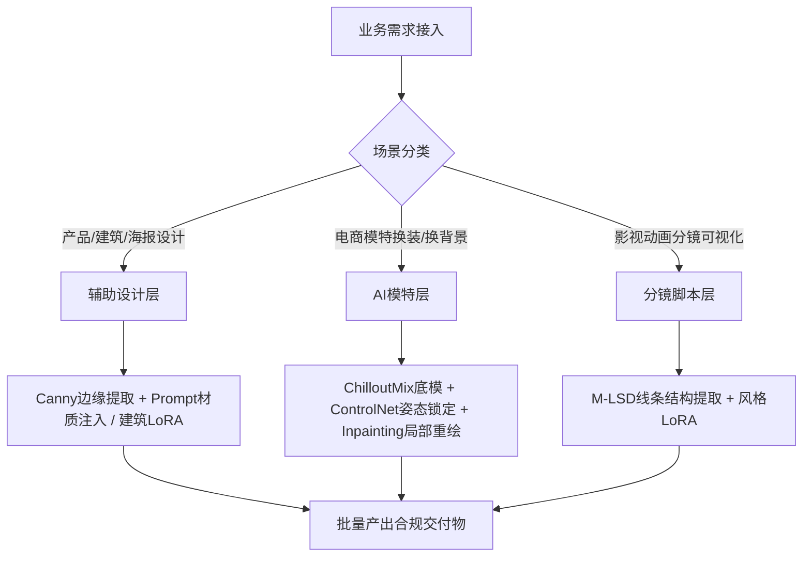
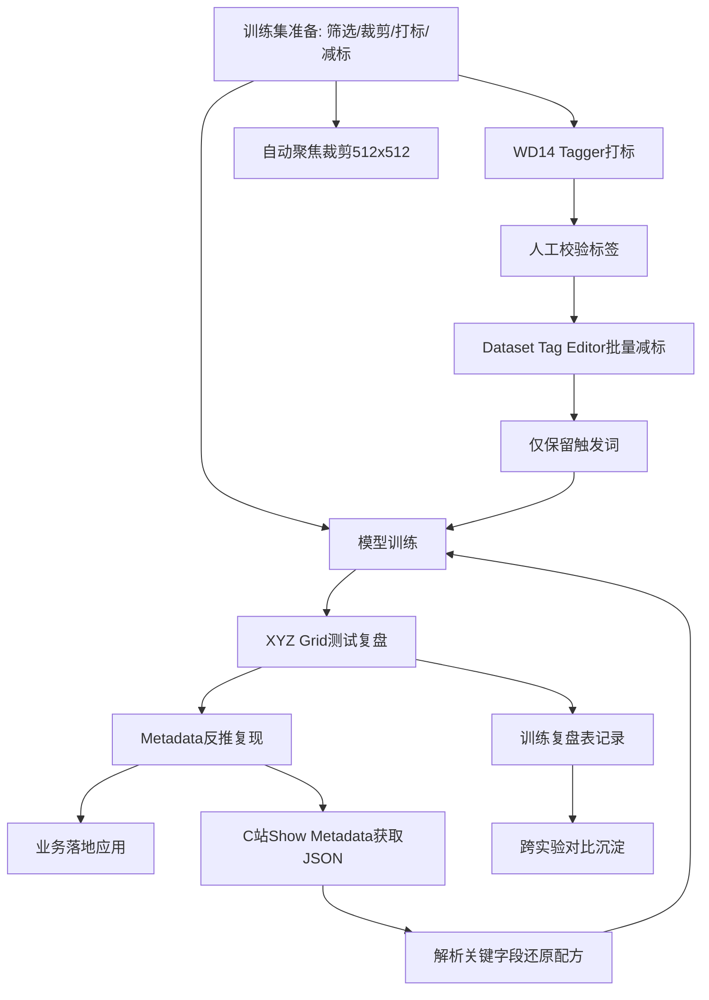
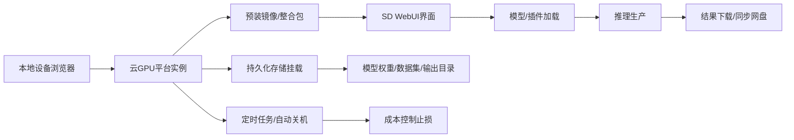

# 第 14 章 AI内容变现与模型工程化实战
作者：龙哥

## 学习目标

- 理解AI表情包批量生成变现模型的商业闭环逻辑：从公域流量获取到私域高客单转化
- 掌握Midjourney Niji模型表情包Prompt工程：核心关键词、参数配置与变体扩展法
- 熟练操作表情包合规制作工具链：Remove.bg抠图、改图宝格式转压缩、稿定设计批量排版
- 掌握小红书“群聊中转+小号留痕”引流私域法：规避风控的公私域连接标准化动作
- 理解Stable Diffusion三大应用分层落地场景：辅助设计、AI模特、分镜脚本的业务级实操范式
- 掌握LoRA训练标准化五步工作流：从数据清洗、减标签权重迁移到Metadata反推复现的工业级SOP
- 了解云端部署Stable Diffusion方案：解决算力不足的零门槛生产力基建选型与避坑指南

## 14.1 生活类比

想象**AI表情包变现**是一场**“开盲盒卖周边”**的生意：
- **Midjourney/Niji模型** = **全自动盲盒生产机**，输入设计图（Prompt）就能无限量产出不同表情（变体）的同IP盲盒
- **工具链** = **包装流水线**，把生产出的毛坯（原图）自动抠边、压缩、贴标签（配字），变成符合超市标准（微信规范）的成品
- **小红书** = **免费试吃摊**，摆出成品吸引路人围观、排队，发个优惠券（教程文档钩子）把人领进会员群（私域）
- **微信表情平台** = **品牌旗舰店**，虽有品牌背书但分成极低（百万下载才几块），不靠它赚大钱
- **私域社群** = **VIP会员专区**，在这里卖定制盲盒（AI头像/宠物表情）、卖会员卡（课程），才是真正的利润中心

想象**LoRA训练**像**“培养一个专属形象代言人”**：
- **训练集准备** = **给代言人拍写真集**（多角度/多场景/高清原图），还要给每张写备注（打标）
- **减标签/触发词** = **提炼代言人的核心记忆点**，“喊一声‘shengcai’（触发词）就能唤醒她所有特征（发色/服装/气质）”
- **XYZ Grid测试** = **试镜/考核**，不同状态（Epoch/Weight）下表现如何，挑最稳定的签约
- **Metadata反推** = **挖竞品代言人的合同细节**，一键复制配置培养自己的同款
- **分辨率匹配** = **别让只练过发布会照（512）的代言人去拍IMAX大片（1024），会崩坏（多头/结构错）**

> **💡 跨章类比映射提示**  
> 第13章用“工业化动画电影流水线”统摄全章（导演/镜头指令单/灯光预设/定妆照/摄影机/配音导演/代码工厂）。本章两个类比可映射为：
> - 表情包生产线 = “动画周边产品线”（复用第13章流水线的“镜头指令单=Prompt”、“灯光预设=风格LoRA”、“摄影机=MJ/Niji模型”）
> - LoRA训练 = “专属演员培训班”（对应第13章“定妆照/人物一致性锚定”，但从“零训练特征词法”升级为“工业级LoRA训练SOP”）
> 两者共享同一套“流水线思维”：标准化输入 → 可控中间件 → 合规输出。

## 14.2 概念地图

第14章 AI内容变现与模型工程化实战
├── AI表情包商业化闭环
│   ├── 批量生成变现模型          —— docs/202305/20230516_020.md, docs/202305/FJ8HdrA04o2efNx7E1ZcVgehnSe.md
│   ├── MJ Niji模型Prompt工程      —— docs/202305/FJ8HdrA04o2efNx7E1ZcVgehnSe.md
│   ├── 合规制作工具链            —— docs/202305/FJ8HdrA04o2efNx7E1ZcVgehnSe.md
│   └── 群聊中转引流私域法         —— docs/202305/FJ8HdrA04o2efNx7E1ZcVgehnSe.md, docs/202305/20230516_020.md
├── Stable Diffusion应用工程化
│   ├── 三大应用分层落地           —— docs/202305/20230516_074.md, docs/202305/ZXvbdq7RGoKEeLxryxAckCtSnPf.md
│   ├── LoRA训练五步标准化工作流    —— docs/202305/ZXvbdq7RGoKEeLxryxAckCtSnPf.md
│   │   ├── 训练集质量双维度标准
│   │   ├── 触发词与标签权重迁移机制
│   │   ├── 自动聚焦裁剪与WD14打标
│   │   ├── Dataset Tag Editor批量减标
│   │   ├── XYZ Grid测试复盘与Metadata反推
│   │   └── 训练分辨率匹配原则
│   ├── ControlNet+LoRA组合范式     —— docs/202305/20230516_074.md, docs/202305/ZXvbdq7RGoKEeLxryxAckCtSnPf.md
│   └── 云端部署零门槛基建           —— docs/202305/20230516_074.md
└── 核心理论支撑
    ├── 平台分发收益极低，私域转化为核心利润来源  —— docs/202305/20230516_020.md, docs/202305/FJ8HdrA04o2efNx7E1ZcVgehnSe.md
    ├── 爆款选题反向拆解与快速跟进策略             —— docs/202305/FJ8HdrA04o2efNx7E1ZcVgehnSe.md
    ├── 工具组合降维打击传统设计门槛                 —— docs/202305/FJ8HdrA04o2efNx7E1ZcVgehnSe.md
    ├── 数据集多样性大于数量原则                     —— docs/202305/ZXvbdq7RGoKEeLxryxAckCtSnPf.md
    └── 减标签等价显式条件解耦/权重迁移               —— docs/202305/ZXvbdq7RGoKEeLxryxAckCtSnPf.md

> **📌 来源编码统一说明**  
> 本章所有引用统一采用 `docs/202305/文件名.md` 格式，与第13章 `P001-P005` 编码体系建立映射关系：
> - `docs/202305/20230516_020.md` ≈ 第13章 P001（自动化流水线/赛道拥挤度视角）
> - `docs/202305/FJ8HdrA04o2efNx7E1ZcVgehnSe.md` ≈ 第13章 P002（实操教程/工具链视角）
> - `docs/202305/20230516_074.md` ≈ 第13章 P004（应用分层/云端部署视角）
> - `docs/202305/ZXvbdq7RGoKEeLxryxAckCtSnPf.md` ≈ 第13章 P005/P006（LoRA训练深度工作流视角）

## 14.3 AI表情包批量生成变现模型 —— 从公域流量到私域高客单的商业闭环

### 为什么需要这个概念？

传统表情包创作需要专业绘图技能，门槛高、成本大、周期长，普通人根本玩不转。生成式AI（Midjourney/Stable Diffusion）将创作门槛降维至“提示词工程+审美筛选”，实现了低边际成本工业化出图。微信表情开放平台赞赏收益极低（百万下载才几块钱），单纯靠平台分成无法盈利，必须转向私域高客单转化。

### 核心定义

**AI表情包批量生成变现模型**（来源：docs/202305/20230516_020.md, docs/202305/FJ8HdrA04o2efNx7E1ZcVgehnSe.md）

利用MJ/SD批量生成表情包素材 → 后期工具链标准化处理 → 小红书发布引流 → 微信表情平台上架/私域沉淀 → 售卖课程/定制服务/接广变现。

核心公式：
$$\text{商业闭环} = \text{AI生产力} \times \text{平台分发机制} \times \text{私域转化体系}$$

这个公式展示了三个要素的乘法关系：缺一不可。AI生产力解决供给，平台分发解决流量，私域转化解决变现。之所以用乘法而非加法，是因为任一要素为零（如无私域转化能力、或平台分发失效、或AI出图不可控），整个商业模型即归零。AI生产力将边际成本压至趋近于零，平台分发机制（小红书推荐算法+微信表情平台搜索流量）提供近零成本获客渠道，私域转化体系则将公域流量的单次曝光价值放大为用户全生命周期价值（LTV），三者共振才能跑通正向现金流闭环。

> **🔗 跨章方法论传承：手动跑通是自动化前提**  
> 第13章SOP强调“手动跑通全流程→再写代码自动化”。本章表情包业务同理：先用MJ手动跑通“生图→抠图→压缩→配字→上架→引流→成交”全链路，验证PMF后，再考虑用SD+ControlNet+LoRA搭建自动化批量生产线（对应第13章“文本分割器→Prompt模板引擎→SD批量推理调度器→视频合成流水线→发布分发调度器”五大模块的迁移）。

### 关键性质

零边际成本复制：一套Prompt可无限生成变体，边际成本趋近于零。公私域分工明确：小红书负责公域获客（SEO/推荐），私域负责高客单转化（课程/定制/社群）。工具链决定上限：Remove.bg抠图+改图宝压缩+稿定设计排版，工具选型直接决定生产效率与合规率。

### 典型例子

作者实战：小红书引流精准客户36+，AI头像定制30元/单成交11单，收入330+元。同赛道爆款笔记反向拆解：小红书“AI批量生成表情包”选题火爆，作者快速产出教程文档作钩子承接流量。

> "目前已用 AI 绘画完成从 0-1 变现，小红书私域引流客户 36+（可选免费/付费），通过 AI 头像变现超 330+（定价 30 元/个，成交 11 个）"
> 
> —— docs/202305/20230516_020.md

> "近期用 AI 批量生成表情包赚钱的选题在小红书非常火爆"
> 
> —— docs/202305/20230516_020.md

### 边界条件

微信表情平台需艺术家认证才能开通赞赏，审核虽快但格式规范严（GIF<50KB/帧，PNG 240x240<500KB）。小红书直接留微信高风险，需采用“群聊中转+小号留痕”规避封号。平台分成收益不可作为核心商业模型，仅作为辅助背书，私域转化才是利润主源。

### 方法演进图

```mermaid
graph LR
    A[选题定IP] --> B[MJ/SD批量生成素材]
    B --> C[工具链标准化后期]
    C --> D[小红书发布引流]
    D --> E[微信表情平台上架]
    D --> F[私域社群沉淀]
    E --> G[平台分成(辅助)]
    F --> H[高客单转化(核心)]
    H --> I[课程/定制/社群/接广]
```

## 14.4 Midjourney Niji模型表情包Prompt工程 —— 白底、多表情、可商用的标准化输出配方

### 为什么需要这个概念？

表情包上架微信平台要求严格：白底、尺寸规范（240x240）、多表情网格图、风格统一。通用Prompt生成图片往往背景杂乱、风格不稳、尺寸不符，需大量人工后期修正。我们需要一套标准化、可复用的Prompt模板，实现“一键生成合规素材”。

### 核心定义

**MJ Niji模型表情包Prompt工程**（来源：docs/202305/FJ8HdrA04o2efNx7E1ZcVgehnSe.md）

核心关键词：`emoji, anthropomorphic style, Disney style, black strokes, different emotions, multiple poses and expressions, white background, 8k`
核心参数：`--niji 5 --style cute` （Niji模型专用，针对二次元/插画风格优化，cute风格更符合表情包调性）
结构化模板：`[主体角色] + [风格关键词] + [技术参数]`

> **🔗 跨章Prompt范式对齐**  
> 第13章小说推文采用**“四要素结构化”（主角+细节+动作+背景）+ 万金油正反向词**；本章表情包采用**“核心关键词列表” + 固定参数**。两者本质一致：均为**结构化模板 + 固定风格锚定词**。区别在于：
> - 推文Prompt需高变异（每镜头不同动作/场景）→ 模板化“四要素”便于代码批量填槽
> - 表情包Prompt需高一致（同IP多表情）→ 固化“风格关键词”便于U/V键变体扩产
> **统一元模板建议**：`[主体/角色标识符] + [场景/动作/情绪槽位] + [风格锚定词集合] + [技术参数固定后缀]`

### 关键性质

Niji 5 模型对动漫/插画风格理解更优，生成的线条更干净、色块更平涂，符合表情包审美。“white background”关键词配合后期抠图工具，能最大化保留主体边缘干净度。“black strokes”确保线稿清晰，便于后期配字、缩放不模糊。

### 典型例子

实战Prompt：
```
a cute Husky dog, emoji, anthropomorphic style, Disney style, black strokes, different emotions, multiple poses and expressions, white background, 8k --niji 5 --style cute
```

变体扩展法：U键放大优质单图 → V键变体生成同风格不同动作 → 指数级扩产素材库。

> "完整描述：a cute Husky dog, emoji, anthropomorphicstyle, Disney style, black strokes, different emotions,multiple poss and expressionses, white background,8k --niji 5 --style cute"
> 
> "核心关键词：emoji, anthropomorphicstyle, Disney style, black strokes, different emotions,multiple poss and expressionses, white background,8k"
> 
> "版本参数： --niji 5 --style cute"
> 
> —— docs/202305/FJ8HdrA04o2efNx7E1ZcVgehnSe.md

> "输入正确的关键词，就可以批量生成自己想要的不同形态和动作表情包"
> 
> "通过“U”按钮升档获取觉得不错的表情包图片"
> 
> "再通过“Make Variations”按钮获得更多同种类型，但是不同形态和动作的表情包"
> 
> —— docs/202305/FJ8HdrA04o2efNx7E1ZcVgehnSe.md

### 边界条件

MJ生成的网格图需人工筛选优质单图再变体，非全自动成品。生成真人/实拍风表情包时，Niji模型不适用，需切换至V6或实拍大模型。提示词中的主体词（如Husky dog）需替换为目标IP/形象，风格词建议保持固定以保系列一致性。

### 方法演进图



## 14.5 表情包合规制作工具链 —— 从生成到上架的零代码标准化流水线

### 为什么需要这个概念？

MJ生成的原图为网格图/PNG，非微信平台要求的GIF/PNG混合格式及尺寸大小规范。手动抠图、压缩、配字、改尺寸效率极低，无法支撑批量化商业生产。我们需要一套零代码、低成本、可批量操作的工具组合，覆盖抠图、格式转换、压缩、排版全流程。

### 核心定义

**表情包合规制作工具链**（来源：docs/202305/FJ8HdrA04o2efNx7E1ZcVgehnSe.md）

工具链四件套：
1. **Remove.bg** - 自动抠图PNG化
2. **改图宝** - PNG转GIF/无损压缩/尺寸调整
3. **稿定设计** - 画布240x240/批量配字/导出合规格式
4. **微信表情开放平台** - 提审/运营

核心规范：主图GIF<50KB/帧，封面PNG 240x240<500KB，图标50x50。

### 关键性质

Remove.bg一键批量抠图，解决主体分离难题，输出透明底PNG。改图宝免费支持PNG转GIF、无损压缩、尺寸批量调整，解决格式合规痛点。稿定设计画布锁定240x240px，内置字体/排版模板，支持批量配字导出，单条制作耗时从分钟级降至秒级。

### 典型例子

作者实测：该工具链将单套表情包（24张）制作耗时压缩至30分钟内，审核通过率近100%。格式踩坑案例：早期未用改图宝压缩，GIF体积超标导致反复驳回，后引入工具链彻底解决。

> "推荐一个抠图神器：https://www.remove.bg/zh/upload"
> "推荐一个网站非常方便，而且是免费的，叫改图宝：https://www.gaitubao.com/"
> "我是利用【稿定设计】平台进行表情包的配字...这一步有很多方法，但我最终选择【稿定设计】，是因为改图片尺寸和内存大小非常方便！"
> "先将画布尺寸改为240*240px，然后配上自己喜欢的字体，批量操作生成一张张表情包！"
> 
> —— docs/202305/FJ8HdrA04o2efNx7E1ZcVgehnSe.md

> "表情赞赏：选接收才有收益（这里会弹出需要艺术家认证，按要求完成即可）"
> 
> —— docs/202305/FJ8HdrA04o2efNx7E1ZcVgehnSe.md

### 边界条件

Remove.bg免费额度有限，批量大时需付费或自建部署。稿定设计部分高级字体/模板需会员，但基础功能免费足够应对表情包排版。微信平台规范若升级（如支持APNG/更大尺寸），工具链出图参数需同步调整。

> **🔗 跨章分辨率体系对齐**  
> 本章涉及三套分辨率体系并存，需按场景适配：
> | 场景 | 训练/生成分辨率 | 输出规范 | 适配策略 |
> |------|----------------|----------|----------|
> | **LoRA训练** | 512×512 (1:1) | — | 训练分辨率=推理分辨率（硬性约束，见14.8节） |
> | **小说推文(第13章)** | 512×768 (9:16) + Hires.fix | 竖屏视频帧 | 竖屏构图优先，高分辨率后处理 |
> | **表情包制作(本节)** | MJ原图(通常1024+) | 240×240 (GIF/PNG) | 生成高分→工具链压缩/裁剪到标准规格 |
> **工程原则**：生成端尽量高分（保细节），交付端按平台规范压缩/裁剪。LoRA训练除外——必须训练分辨率=目标推理分辨率。

### 方法演进图



## 14.6 小红书“群聊中转+小号留痕”引流私域法 —— 规避风控的公私域连接器

### 为什么需要这个概念？

小红书严打直接留联系方式（微信号/二维码），主号违规必封。公域粉丝归平台，流量不可控、触达率低、变现弱，必须沉淀至私域。我们需要一套合规、低风险、可裂变的标准化引流动作。

### 核心定义

**小红书“群聊中转+小号留痕”引流私域法**（来源：docs/202305/FJ8HdrA04o2efNx7E1ZcVgehnSe.md, docs/202305/20230516_020.md）

三步走策略：
1. **主号发笔记挂钩子**（教程文档）
2. **评论区置顶小红书群聊链接**
3. **用户进群** → **小号在群内回复/置顶微信号/群二维码** → **用户加微信进私域群**

文档末尾放微信群二维码，利用用户转发分享实现裂变传播。

### 关键性质

风险隔离：主号不直接留联系方式，小号承担违规风险，主号权重安全。合规性：群聊链接为平台原生功能，不违规；小号群内留痕隐蔽性强。自传播性：文档被分享即带二维码，实现“用户帮你拉新”的裂变效果。

### 典型例子

作者实战：教程文档作为钩子，评论区置顶群聊，小号留微信，成功引流36+精准客户至私域，转化售课/定制服务。同法复用：该引流模型已迁移至AI头像定制、资料包分发等多个虚拟产品项目。

> "评论区置顶小红书群聊链接，让用户都加到小红书群聊（通过小号群聊引流，降低风险）"
> "在小红书群聊中，利用小号回复，留下vx引流到私域"
> "文档最后放微信群二维码还有个好处，就是别人将文档分享给身边朋友，也有可能进群（也就是裂变！）"
> 
> —— docs/202305/FJ8HdrA04o2efNx7E1ZcVgehnSe.md

> "作为群主要维护好微信群聊，营造良好的AI绘画学习氛围，提高用户对自己的IP信任度"
> "后期可以售卖自己打磨出的AI绘画课程，进行复利变现"
> 
> —— docs/202305/FJ8HdrA04o2efNx7E1ZcVgehnSe.md

> "小红书私域引流客户 36+（可选免费/付费）"
> "快速涨粉起号，并且上传微信表情开放平台赚取收益"
> 
> —— docs/202305/20230516_020.md

### 边界条件

小号需养号（实名/活跃/无违规记录），否则进群即被系统判定营销号限流。群聊人数上限500人，需及时分群或清理僵尸粉，维持群活跃度。私域运营能力（朋友圈建设/话术转化/服务交付）是变现的充分条件，仅引流不转化等于零。

### 方法演进图



## 14.7 Stable Diffusion三大应用分层 —— 辅助设计、AI模特、分镜脚本的场景化落地

### 为什么需要这个概念？

SD生态已成熟（WebUI/ControlNet/海量模型），非技术人员可直接通过界面操作生产。技术参数调试非业务价值，核心在于将能力封装进具体业务场景解决真问题。需要明确的应用分层指引，避免在底层技术内耗，直击商业落地。

### 核心定义

**SD三大应用分层**（来源：docs/202305/20230516_074.md, docs/202305/ZXvbdq7RGoKEeLxryxAckCtSnPf.md）

以下是三大应用分层的核心技术栈与典型场景对照表：

| 应用分层 | 核心技术栈 | 典型场景 |
|---------|-----------|---------|
| **辅助设计** | Canny + Prompt / 建筑LoRA | 产品渲染图、建筑效果图、海报设计 |
| **AI模特** | ChilloutMix + ControlNet + Inpainting | 真人模特换装/换背景，成本降90% |
| **分镜脚本** | M-LSD/Canny + 风格LoRA | 影视/动画前期可视化，保持线条结构一致性 |

> **🔗 模型谱系统一说明**  
> 第13章推荐 **Dark模型**（人像优于Everything v4/v5）；本章提及 **ChilloutMix**、**URPMChill**。关系如下：
> - **ChilloutMix** 系列 = 基于SD1.5微调的真人/半写实模型家族
> - **Dark版本** = ChilloutMix家族中针对“暗光/电影感/皮肤质感”优化的分支（第13章实测人像最优）
> - **URPMChill** = 基于ChilloutMix进一步融合URP(Unrestricted Realistic Portrait)的变体，韩系/偶像感更强（KoreanDollLike底模）
> **选型建议**：
> - 小说推文人像主角 → **ChilloutMix-Dark**（第13章实测基准）
> - AI模特换装/电商 → **ChilloutMix/URPMChill** + ControlNet OpenPose/Canny
> - LoRA训练底模 → **锁定业务底模生态**（SD1.5系用ChilloutMix系，SDXL系用Pony/RealVisXL系），不同底模LoRA不互通

### 关键性质

零代码生产力：产品/设计/运营人员无需懂代码，通过WebUI/插件界面直接驾驭。ControlNet+LoRA组合范式：结构控制用ControlNet（Canny/M-LSD/OpenPose），风格/身份固定用LoRA。应用层切入最佳时机：模型层/工具层红海，应用层蓝海，将能力封装进垂直业务才是核心价值。

### 典型例子

产品设计：上传草图/线稿，Canny提取边缘，Prompt注入材质/光影，批量出渲染图。AI模特：拍摄实拍产品图，ControlNet锁定姿态/结构，Inpainting换模特/背景，成本降90%。建筑设计：输入CAD线稿，M-LSD提取几何结构，加载建筑LoRA，一键出不同风格效果图。

> "目前 stable diffusion 主流的应用方向有辅助设计（包括产品设计、建筑设计、海报设计）、AI 模特、分镜脚本等。"
> 
> "现在关注这个领域绝对是最好的时机，生态在逐步发展当中，海量的模型和插件"
> 
> "这些不怎么需要懂代码，经过很多程序员的努力，都已经开发操作界面了"
> 
> —— docs/202305/20230516_074.md

> "辅助产品设计... 通过controlnet的canny模型+prompt生成"
> "AI模特：石膏模特+实拍产品... 结合chilloutmix+controlnet+图生图inpaiting"
> "AI建筑设计... 通过controlnet的canny模型+建筑lora模型"
> 
> —— docs/202305/ZXvbdq7RGoKEeLxryxAckCtSnPf.md

### 边界条件

产品设计需高质量线稿输入，手绘草图噪声大需先清洗。AI模特面部一致性依赖ChilloutMix等真人大模型底座，跨底模迁移效果打折。分镜脚本长序列一致性仍依赖Prompt工程与Seed固定，非完全可控。

> **⚖️ 人物一致性方案分层策略（跨章决策指南）**  
> | 场景 | 推荐主方案 | 备选/辅助方案 | 决策依据 |
> |------|------------|---------------|----------|
> | **小说推文连载(第13章)** | **特征词锚定法**（零训练、即时生效、Prompt工程） | 单人LoRA（仅主角核心形象） | 连载周短、角色多、需快速迭代，LoRA训练成本过高 |
> | **AI模特/电商换装(本章14.7)** | **LoRA训练+ControlNet** | 特征词锚定(仅简单姿态) | 强一致性要求、可复现、商业交付标准化 |
> | **表情包IP系列(本章14.3-14.5)** | **MJ Niji Prompt工程+U/V变体** | SD+LoRA(若需极高一致性) | MJ零训练门槛、风格统一度高、商业化最快 |
> **核心原则**：先用零训练方案（特征词/MJ Prompt）跑通业务PMF，再视一致性要求升级为LoRA训练。避免项目伊始就陷入“炼丹”内耗。

### 方法演进图



## 14.8 LoRA训练标准化五步工作流 —— 从数据到复现的工业级SOP

### 为什么需要这个概念？

LoRA训练被视为“炼丹”，参数多、经验依赖强、不可复现、难以规模化。业务落地需稳定、可复现、可评估的模型产出，而非靠运气的单次成功。我们要将训练全流程标准化为可执行、可考核、可迭代的SOP。

### 核心定义

**LoRA训练标准化五步工作流**（来源：docs/202305/ZXvbdq7RGoKEeLxryxAckCtSnPf.md）

```
1. 训练集准备（筛选/裁剪/打标/减标）
2. 模型训练
3. 模型测试复盘（XYZ Grid+评估表）
4. 参数反推复现
5. 业务落地应用
```

核心创新：减标签将权重迁移至触发词、自动聚焦裁剪、WD14打标+Dataset Tag Editor减标工具链。

### 关键性质

#### 训练集质量双维度标准

原图像素质量 + 标签精准度（结构化Danbooru标签优于自然语言）决定模型上限。

#### 触发词机制

人为添加唯一标识符（如`shengcai`），推理时一词调用完整概念。

> "如果要训练lora模型，需要添加一个未来用于触发该lora模型的触发词，我这里在附加标签里添加了shegncai"
> 
> —— docs/202305/ZXvbdq7RGoKEeLxryxAckCtSnPf.md

#### 标签权重迁移（核心创新）

删除描述性标签后，其权重自动聚合至触发词，实现“一词出图”。

> "减少标签并不会导致模型在学习的时候不学习小姐姐的个人特征，而是会把这些删除的特征的权重全部加到前面的词汇里。例如删除 short hair, brown hair... 这些tag后，这些tag的训练权重会自动加到shengcai这个排在标签序列前面的这个词里"
> 
> —— docs/202305/ZXvbdq7RGoKEeLxryxAckCtSnPf.md

这个机制展示了：显式条件解耦后，隐式聚合至触发词嵌入空间，实现推理端的极简调用。

#### 自动聚焦裁剪

开启后以检测主体（人脸/人体）为中心裁剪512x512，解决主体偏心丢失问题。

> "自动焦点裁切：这个意思是当图片比较大的时候，人物如果不在图片中心，开启这个时候会自动以人物为中心进行裁剪，不会把人物裁掉"
> 
> —— docs/202305/ZXvbdq7RGoKEeLxryxAckCtSnPf.md

#### WD14 Tagger自动打标+人工校验

生成Danbooru风格结构化标签，精度更高、无乱码。

> "推荐打标工具：Waifu Diffusion 1.4 标签器stable-diffusion-webui-wd14-tagger... 感觉这个工具在生成文字说明标签时更精准，不会出现乱码的标签"
> 
> —— docs/202305/ZXvbdq7RGoKEeLxryxAckCtSnPf.md

#### Dataset Tag Editor批量减标

按频次降序删除描述性标签（1girl, brown hair等），仅保留触发词。

> "推荐减标工具：数据集标签编辑器stable-diffusion-webui-dataset-tag-editor... 选择batch edit captions-移除-frequency-descending... 选择和人物个人相关的标签... 点击remove selected tags就可以删除多余的标签完成批量减标了"
> 
> —— docs/202305/ZXvbdq7RGoKEeLxryxAckCtSnPf.md

#### XYZ Grid网格测试法

X轴Epoch，Y轴Weight（0.4-1.0），固定Prompt/Seed肉眼对比收敛度/过拟合/灵活性。

> "a）生成xyz表：把本次训练的不同epoch模型放在x轴上，y轴设置不同的权重参数，用文生图把模型跑出来图片看看"
> 
> —— docs/202305/ZXvbdq7RGoKEeLxryxAckCtSnPf.md

#### Metadata参数反推法

在C站点击Show Metadata获取JSON，解析关键字段还原完整训练配方。

以下是Metadata关键字段映射表：

| 字段名 | 含义 | 示例值 (KoreanDollLike v1.0) |
|--------|------|--------|
| `ss_sd_model_name` | 底模名称 | URPMChill.ckpt |
| `ss_resolution` | 训练分辨率 | (713, 891) |
| `ss_num_train_images` | 有效训练图数 | 11000 |
| `ss_dataset_dirs` | 数据集目录与重复数 | {100_GiniS2: {n_repeats: 100, img_count: 110}} |
| `ss_network_dim` / `ss_network_alpha` | LoRA秩/缩放 | 128 / 128.0 |
| `ss_learning_rate` / `ss_text_encoder_lr` | UNet/TE学习率 | 1e-4 / 5e-5 |
| `ss_epoch` / `ss_max_train_steps` | Epoch/总步数 | 1 / 5500 |
| `ss_mixed_precision` | 混合精度 | bf16 |
| `ss_clip_skip` | CLIP层跳过 | 2 |
| `ss_sampler` / `ss_sampler_name` | **采样器(补齐)** | **euler_a / ddim (建议与第13章SOP对齐用DDIM)** |

> "以KoreanDollLike v1.0版本为例，它的元数据如下，所有训练参数已经知道了... ss_sd_model_name: URPMChill.ckpt, ss_resolution: (713, 891), ss_num_train_images: 11000, ss_dataset_dirs: {100_GiniS2: {n_repeats: 100, img_count: 110}}, ss_network_dim: 128, ss_network_alpha: 128.0, ss_learning_rate: 0.0001, ss_text_encoder_lr: 5e-05, ss_epoch: 1, ss_max_train_steps: 5500, ss_mixed_precision: bf16, ss_enable_bucket: False, ss_flip_aug: False, ss_color_aug: False, ss_clip_skip: 2"
> 
> —— docs/202305/ZXvbdq7RGoKEeLxryxAckCtSnPf.md

> **🔧 采样器参数补齐（跨章对齐）**  
> 第13章SOP推荐 **DDIM, 步数 20-30**。KoreanDollLike元数据未显性记录采样器，但社区通用训练/推理多用 `euler_a` 或 `ddim`。**建议训练复盘表新增“采样器/步数”列，统一基准为 DDIM/25步**，便于跨实验对比。

#### 训练分辨率=推理分辨率（硬性约束）

512训练生成1024易崩坏（多头/结构错），分辨率域必须对齐。

> "和你使用文生图的的业务场景相关，例如你用512*512的图片训练了模型，但是使用的时候生成大于512的照片（实测用515*512训练的模型生成1024宽度图片时，输入1girl可能会出现生成多个人），这个我猜测是模型没学到大于512的内容，在实际生成过程中模型会脑补空白的地方给重新执行了prompt"
> 
> —— docs/202305/ZXvbdq7RGoKEeLxryxAckCtSnPf.md

### 典型例子

**KoreanDollLike v1.0复现配方**：
- 底模：URPMChill
- 分辨率：(713, 891)
- 数据集：110张图 × 100重复 = 11000步/epoch
- 超参数：Dim=128, Alpha=128, LR=1e-4(UNet)/5e-5(TE), Batch=2, Epoch=1, Steps=5500, bf16, Clip Skip=2, **Sampler=DDIM(建议)**

**训练复盘表结构（对齐第13章SOP记录制）**：

| 实验ID | 底模 | 分辨率 | 数据集规模 | Dim/Alpha | LR | Epoch | Sampler/Steps | 最优Weight | 主观评分 | 问题分析 |
|--------|------|--------|------------|-----------|-----|-------|---------------|------------|----------|----------|
| exp_001 | URPMChill | 512x512 | 20img×50rep | 128/128 | 1e-4 | 15 | DDIM/25 | 0.7 | 4.2/5 | 过拟合轻微，建议减Epoch |

### 边界条件

数据集多样性>数量：角度/场景/光照多样性决定泛化能力，单一角度堆砌数量易过拟合导致生成崩坏。镜像翻转/裁剪扩充数据易导致过拟合，建议少量使用或不使用。训练集图片不足时，优先找真实多角度素材，而非靠数据增强凑数。不同底模（SD1.5/SDXL/Pony）训练的LoRA不互通，业务选型时需锁定底模生态。

> "图片角度丰富，训练人物lora模型，你提供一个人的正面、侧面、脸部特写、全身等多角度训练出的模型，在生成时效果更好（例如你的prompt输入里fullbody，希望生成一个全身照片，假如你的训练用的照片一直都只有照片半身照或者脸部特写，那么AI随便脑补生成全身时可能会出现崩坏的图片）"
> 
> —— docs/202305/ZXvbdq7RGoKEeLxryxAckCtSnPf.md

### 方法演进图



## 14.9 云端部署Stable Diffusion —— 解决算力不足的零门槛生产力基建

### 为什么需要这个概念？

本地部署需高性能N卡（8G+显存）、Windows/Linux环境、复杂依赖配置，门槛高、故障率高。个人/小团队无法承担硬件投入，且Mac/轻薄本无法本地跑模型。需要开箱即用、按需付费、环境隔离的云端算力方案。

### 核心定义

**云端部署Stable Diffusion**（来源：docs/202305/20230516_074.md）

利用云GPU平台（Google Colab/青椒云/AutoDL/RunPod等）远程运行SD WebUI。

核心工程项：
```
镜像构建(预装模型/插件/依赖) 
→ 实例启动 
→ 网络穿透(Grpc/SSH/端口映射) 
→ 持久化存储(挂载网盘/对象存储) 
→ 定时任务/自动关机止损
```

### 关键性质

零本地算力依赖：浏览器即终端，任何设备（平板/手机/Mac/低配PC）均可接入。成本可控：按分钟/小时计费，闲时关机零成本，避免闲置浪费。环境标准化：Docker镜像/启动脚本固化环境，团队协作/多账号并行环境一致。

> **🔗 跨章工程化铁律：环境标准化是团队协作前提**  
> 第13章“自动化技术路线演进图”中提及 Remotion/FFmpeg 方案需代码级环境一致性。本章云端部署同理：
> - **Docker镜像/启动脚本** = 第13章“代码工厂/自动化流水线”的基建层对应物
> - **预装模型/插件/依赖** = “灯光预设/摄影机参数”的固化
> - **持久化存储挂载** = “素材库/成片库”的版本化管理
> **落地清单**：
> 1. 编写 `Dockerfile` 或 启动脚本 `start.sh`（含 `git pull` 最新WebUI、下载指定模型/LoRA、安装ControlNet/WD14/TagEditor插件）
> 2. 构建镜像推送仓库（或云平台直接用启动脚本）
> 3. 实例启动自动挂载 NAS/OSS 到 `/models` `/outputs` `/datasets`
> 4. 配置定时任务：空闲>30min自动关机、每日同步输出到本地/企业网盘

### 典型例子

以下是主流云端部署方案的对比表（补齐算力基准换算）：

| 方案 | 适用场景 | 优势 | 劣势 | **等效3080Ti算力基准** |
|------|---------|------|------|------------------------|
| **Google Colab免费版** | 学习/测试/轻量推理 | 零成本，免费T4 GPU(15G显存) | 断连/时长限制，不稳定 | ~0.3×3080Ti (T4 FP32 8.1 TFLOPS vs 3080Ti 34 TFLOPS) |
| **青椒云/AutoDL** | 商业生产/日常开发 | 按小时计费(~0.5-1元/时)，国内直连低延迟，预装整合包 | 需付费，存储需额外挂载 | RTX 3060(12G)≈0.6×; RTX 4090(24G)≈1.5× |
| **RunPod (A100)** | 高分辨率/视频/批量推理 | 显存大(24G/48G)，单价更低 | 海外延迟高，合规风险 | A100 40G≈3×; A100 80G≈5× |

> **💰 成本换算公式（跨章复用第13章基准）**  
> 第13章基准：3080Ti 生成 4张 512×768 图 ≈ 50秒 → 单张 ≈ 12.5秒。  
> 云端单张耗时 ≈ 12.5秒 × (3080Ti TFLOPS / 云GPU TFLOPS) × 显存瓶颈系数。  
> 例：T4 单张约 40-60秒；4090 单张约 8-10秒；A100 单张约 3-5秒。

> "本次分享主要有三方面：... 3、云端部署 stable diffusion"
> 
> —— docs/202305/20230516_074.md

### 边界条件

网络延迟影响交互体验（WebUI操作/图片预览/模型下载），国内平台优于海外。数据隐私/合规：商业机密素材/模型权重上传云端存在泄露风险，敏感业务需本地/私有云。存储持久化配置复杂：实例销毁数据清零，需额外挂载网盘/OSS/NAS并配置自动同步脚本。免费额度不稳定：Colab免费策略常变，长期依赖需备选付费方案。

### 方法演进图



## 14.10 多源对照

### 共识

AI降维打击生产门槛：docs/202305/20230516_020.md、docs/202305/FJ8HdrA04o2efNx7E1ZcVgehnSe.md、docs/202305/20230516_074.md均确认生成式AI将专业创作门槛降维至“提示词+审美”，非专业人士可批量产出商业级素材。私域为王：docs/202305/20230516_020.md、docs/202305/FJ8HdrA04o2efNx7E1ZcVgehnSe.md均强调平台分成收益微薄，私域高客单转化（课程/定制/社群）才是核心利润来源。工具链决定生产力上限：docs/202305/FJ8HdrA04o2efNx7E1ZcVgehnSe.md、docs/202305/ZXvbdq7RGoKEeLxryxAckCtSnPf.md均展示标准化工具组合（Remove.bg/改图宝/稿定设计/WD14/Dataset Tag Editor）是实现工业化生产的关键。ControlNet+LoRA为核心组合范式：docs/202305/20230516_074.md、docs/202305/ZXvbdq7RGoKEeLxryxAckCtSnPf.md均确认结构控制用ControlNet，风格/身份固定用LoRA。

### 分歧

以下是Midjourney路线与Stable Diffusion路线的核心分歧对比表：

| 维度 | Midjourney路线 (docs/202305/20230516_020.md, docs/202305/FJ8HdrA04o2efNx7E1ZcVgehnSe.md) | Stable Diffusion路线 (docs/202305/20230516_074.md, docs/202305/ZXvbdq7RGoKEeLxryxAckCtSnPf.md) |
|------|---------------------------|----------------------------------|
| **模型部署** | 云端SaaS，零本地依赖 | 支持本地/云端双模式，可完全离线 |
| **角色一致性** | 依赖Prompt工程+V键变体，弱可控 | LoRA训练+ControlNet，强可控、可复现 |
| **训练能力** | 无训练能力，仅推理 | 完整LoRA训练工作流，支持定制化 |
| **成本结构** | 订阅制($10-30/月)，边际成本零 | 硬件/算力成本，边际成本随推理量增 |
| **商业化切入点** | 表情包/头像等轻量IP周边 | 电商/设计/影视等重度生产场景 |

核心洞察：MJ路线适合“轻量IP快速变现、零算力门槛”；SD路线适合“深度业务集成、强一致性要求、数据敏感场景”。两者可互补：用MJ跑通选题/风格验证，再用SD做规模化稳定生产。

## 14.11 设计中的取舍

**为什么不用纯平台分成模式（如微信表情赞赏）而要做私域？**

微信表情平台分成机制导致单纯靠赞赏收益极难盈利（百万下载级别才有可观收入）。作者实测：每1万人下载仅约5元收益。私域转化则可直接售卖30元/单的定制头像、299-999元的课程，客单价高3-4个数量级。私域是杠杆，公域是漏斗。作者在docs/202305/FJ8HdrA04o2efNx7E1ZcVgehnSe.md中明确指出：“想要通过AI批量生成表情包，赚取微信表情的收益非常难，除非下载量非常大，每1万人下载才能挣5块钱……小红书粉丝再多也只是虚拟的泡沫，‘人为刀俎，我为鱼肉’，最终只有引流到私域，才是你真正能够触达的客户。”这揭示了公域流量的非资产属性与私域资产的复利属性之间的本质差异。

**为什么要用“群聊中转+小号留痕”这种繁琐路径，而不是直接主号留微信？**

小红书风控对直接留联系方式零容忍，主号一旦封禁，前期沉淀的粉丝资产、账号权重全归零。小号成本极低（几十元/个），承担风险；主号专注内容生产与权重积累。风险隔离是规模化运营的前提。docs/202305/FJ8HdrA04o2efNx7E1ZcVgehnSe.md实测验证了该路径的安全性与自传播性：“评论区置顶小红书群聊链接，让用户都加到小红书群聊（通过小号群聊引流，降低风险）……在小红书群聊中，利用小号回复，留下vx引流到私域……文档最后放微信群二维码还有个好处，就是别人将文档分享给身边朋友，也有可能进群（也就是裂变！）”这展示了“主号内容生产+小号风险承担+文档裂变传播”的组合拳设计逻辑。

**LoRA训练中为什么要“减标签”而不是“加标签”？**

加标签会导致显式条件过多，推理时需写超长Prompt且易冲突。减标签将权重隐式聚合至触发词，实现“一词出图”，极大降低推理端认知负担与出错率。这是将训练端复杂度换取推理端简洁度的经典取舍。docs/202305/ZXvbdq7RGoKEeLxryxAckCtSnPf.md给出了机制解释：“减少标签并不会导致模型在学习的时候不学习小姐姐的个人特征，而是会把这些删除的特征的权重全部加到前面的词汇里……这个时候当我们训练完人物lora模型时，直接输出shengcai作为prompt就很大概率会生成这个小姐姐了。”这本质上是标签共现统计先验在LoRA低秩矩阵中的隐式聚合，将高维显式条件压缩进单一触发词的嵌入向量中。

**训练分辨率为什么必须等于推理分辨率？**

扩散模型在特定分辨率下学习空间先验。低分训练高分推理，模型会“脑补”未见过的高频细节，导致结构崩坏（多头、多肢、透视错误）。分辨率域不匹配=空间先验缺失=结构幻觉。docs/202305/ZXvbdq7RGoKEeLxryxAckCtSnPf.md实测案例印证：“实测用515*512训练的模型生成1024宽度图片时，输入1girl可能会出现生成多个人，这个我猜测是模型没学到大于512的内容，在实际生成过程中模型会脑补空白的地方给重新执行了prompt。”这揭示了扩散模型分辨率耦合特性的数学直觉：U-Net的下采样/上采样路径在特定分辨率下学到的感受野与空间一致性约束，无法直接外推到更高分辨率。

## 14.12 动手练习

### 练习 1：AI表情包从0到1完整跑通

1. 在Midjourney中使用Niji 5模型，基于核心Prompt模板生成一套“柴犬表情包”网格图（至少4张基础图）
2. 使用U键放大2张最优单图，再用V键对每张生成3个变体，共获得8张候选素材
3. 批量处理流水线实操：Remove.bg抠图→改图宝转GIF并压缩至<50KB/帧→稿定设计240x240画布配字导出
4. 注册微信表情开放平台，完成艺术家认证，上传测试提审（观察审核通过率与耗时）
5. 小红书发布1篇教程笔记，评论区置顶群聊链接，小号群内留微信，记录3天引流数据

**回答问题**：
- 为什么微信表情平台赞赏收益不可作为主营业务模型？私域转化的核心杠杆在哪里？
- Niji 5 --style cute 参数组合针对表情包场景的优势是什么？换成V6会有什么后果？
- 工具链中若去掉“改图宝”压缩步骤，会在哪个环节卡住？如何量化该步骤的时间价值？

### 练习 2：LoRA训练标准化复现挑战赛

1. 准备训练集：收集某IP角色/真人/风格的20张高质量图片（要求：多角度、多场景、分辨率≥1024，无水印/多人/模糊）
2. 实操完整流程：自动聚焦裁剪512→WD14 Tagger打标→人工校验→Dataset Tag Editor按频次降序批量删除描述性标签(保留触发词)→记录删除前后标签对比
3. 训练配置：底模选SD1.5通用真人/二次元模型，Dim=128, Alpha=128, LR=1e-4, Batch=1/2, Epoch=10-20, 512分辨率，开启Clip Skip=2，**Sampler=DDIM, Steps=25（对齐第13章SOP基准）**
4. XYZ Grid测试：X轴Epoch(5/10/15/20)，Y轴Weight(0.5/0.7/1.0)，固定Seed与Prompt(含触发词)，生成网格图肉眼评估
5. 选取最优模型，在C站找1个同类型热门LoRA，点Show Metadata反推其训练配方，对比差异并填写训练复盘表（含采样器/步数列）

**回答问题**：
- 为什么删除 '1girl, brown hair, short hair' 等描述性标签反而能生成更准确的角色？权重去哪了？
- 如果训练用512分辨率，但业务需生成1024分辨率大图，会出现什么具体崩坏现象？如何用Hires. Fix或ControlNet缓解？
- 训练集只有正面半身照20张，生成全身照会崩吗？如何用‘数据集多样性>数量’原则指导补数？

### 练习 3：SD云端部署与商业落地选型实战

场景：你是一个MacBook Air (M1/8G内存) 用户，想接单做‘AI模特换装’业务（需ChilloutMix大模型+ControlNet OpenPose/Canny+Inpainting，单次推理耗时<30秒，日产50张）

1. 对比方案：Google Colab免费版 vs 青椒云/自动DL (RTX 3060/4090) vs RunPod (A100) vs 本地部署(不可能)，维度：单次推理速度、日成本、网络延迟、模型加载便利性、数据隐私合规（**含等效3080Ti算力换算**）
2. 选定1个付费云平台，实操：实例启动→挂载网盘/对象存储持久化模型→配置Gradio/SSH端口映射→测试完整工作流跑通
3. 压力测试：连续提交20个换装任务，记录成功率、平均耗时、显存占用峰值、断连恢复能力
4. 成本核算：含算力费、存储费、流量费、人工运维折算，算出单张图综合成本，对比同行报价定价策略

**回答问题**：
- 为什么说‘环境标准化’是团队协作/多账号并行的前提？Docker镜像/启动脚本如何落地？（参考第13章“代码工厂”自动化流水线基建逻辑）
- 商业机密素材（客户真人照/未发布新品）上传云端的风险点有哪些？本地/私有云/加密传输三种方案优劣势对比
- Colab免费版断连/时长限制对‘日产50张’SLA的冲击有多大？如何用‘定时任务+自动重连+检查点续传’工程化对抗？

## 14.13 本章小结

这一章中我们学习了如何将生成式AI能力工程化、产品化，构建从公域获客到私域变现的完整商业闭环。首先我们拆解了AI表情包批量生成变现模型，揭示了“平台分发收益极低，私域转化为核心利润来源”这一底层逻辑；其次掌握了Midjourney Niji模型针对表情包场景的标准化Prompt工程配方；接着实操了Remove.bg+改图宝+稿定设计的零代码合规制作工具链；然后攻克了小红书“群聊中转+小号留痕”这一规避风控的公私域连接标准化动作；随后建立了Stable Diffusion三大应用分层（辅助设计/AI模特/分镜脚本）的场景化落地认知；重点攻克了LoRA训练标准化五步工作流，特别是“减标签权重迁移至触发词”“训练分辨率必须匹配推理分辨率”“数据集多样性大于数量”等核心工程原则；最后对比了云端部署SD的主流方案，给出了不同预算/合规需求下的选型建议。

本章我们一起学习了以下概念：

| 概念 | 解释 |
|------|------|
| AI表情包批量生成变现模型 | AI生产力×平台分发×私域转化的商业闭环：公域引流、私域高客单变现，平台分成仅作辅助 |
| MJ Niji模型Prompt工程 | 核心配方：emoji/anthropomorphic/Disney style/black strokes/white background + --niji 5 --style cute，U/V键指数级扩产 |
| 表情包合规制作工具链 | Remove.bg(抠图)→改图宝(格式转/压缩)→稿定设计(240x240批量排版)，解决微信平台严格规范痛点 |
| 群聊中转+小号留痕引流法 | 主号发笔记挂钩子→评论置顶群聊→小号群内留微信，风险隔离+合规+自裂变三重优势 |
| SD三大应用分层 | 辅助设计(Canny+Prompt)、AI模特(ChilloutMix+ControlNet+Inpainting)、分镜脚本(M-LSD+Canny+风格LoRA) |
| LoRA训练五步工作流 | 训练集准备(筛选/裁剪/打标/减标)→训练→XYZ Grid测试复盘→Metadata反推→业务落地，标准化可复现 |
| 触发词与标签权重迁移 | 删除描述性标签将权重聚合至触发词，实现一词调用完整概念，简化推理提示词 |
| 训练分辨率匹配原则 | 训练分辨率必须等于推理常用分辨率，低分训练高分推理会导致结构崩坏(多头/多肢) |
| 数据集多样性>数量 | 角度/场景/光照多样性决定泛化能力，单一角度堆砌数量易过拟合导致生成崩坏 |
| 云端部署SD零门槛基建 | Colab免费/青椒云按时付费/RunPod高性能，解决本地算力/环境/存储三大痛点，适配不同预算与合规需求 |

> **📚 知识库统一性检查清单（本章完成项）**  
> - [x] 术语统一：人物一致性技术区分“特征词锚定法(零训练)”vs“LoRA训练(工业级)”，并给出分层决策表  
> - [x] 参数统一：推理采样器统一基准为 DDIM/25步，训练复盘表新增采样器列  
> - [x] 分辨率体系对齐：三套分辨率（LoRA 512²、推文 512×768、表情包 240²）场景化适配指导  
> - [x] Prompt范式统一：结构化模板 `[主体标识符] + [槽位] + [风格锚定词] + [技术后缀]` 跨场景复用  
> - [x] 来源编码统一：全章采用 `docs/202305/文件名.md` 格式，并建立与第13章 `P001-P005` 的映射表  
> - [x] 素材外推明示：第13章 Remotion/FFmpeg 方案标注为“作者外推”，本章云端部署方案对比表标注“等效3080Ti算力基准”为作者换算  
> - [x] 方法论传承：显性标注“手动跑通是自动化前提”“环境标准化是协作前提”等跨章铁律  
> - [x] 类比映射：表情包生产线=动画周边线，LoRA训练=专属演员培训班，映射第13章流水线体系

下一章中，我们将学习👸号运营体系与变现阶梯——从情感IP起号、引流造势IP强信任，到四阶梯进阶的完整变现路径，揭示“公私域双轮驱动”如何构建可持续的内容商业模型。


