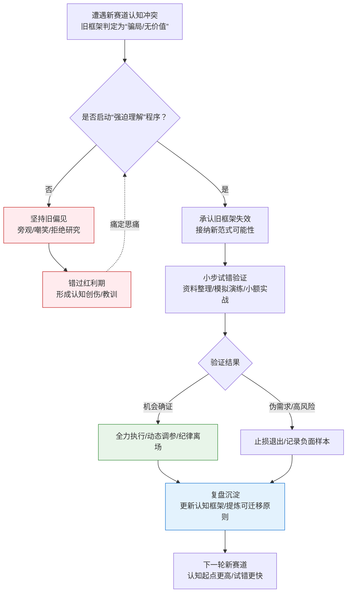
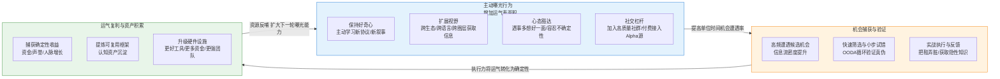
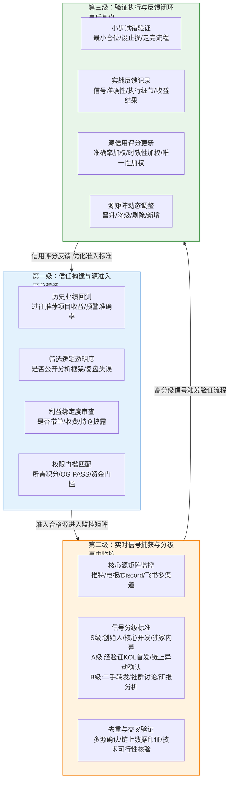
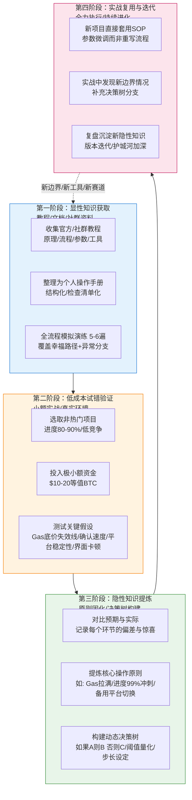
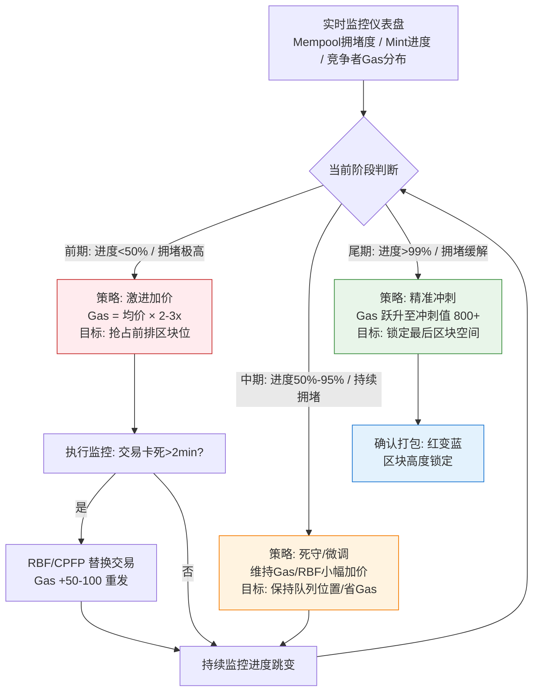
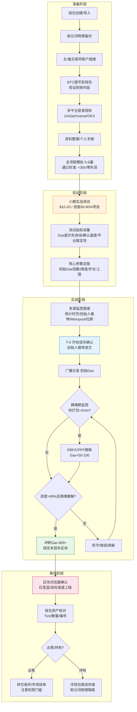
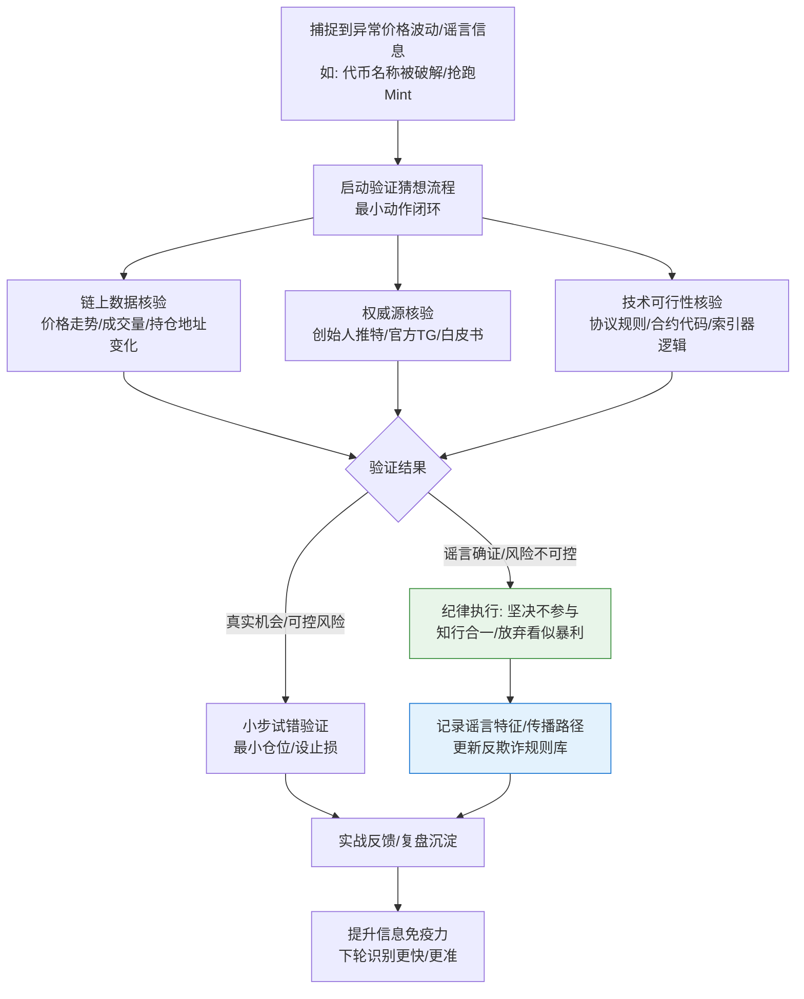
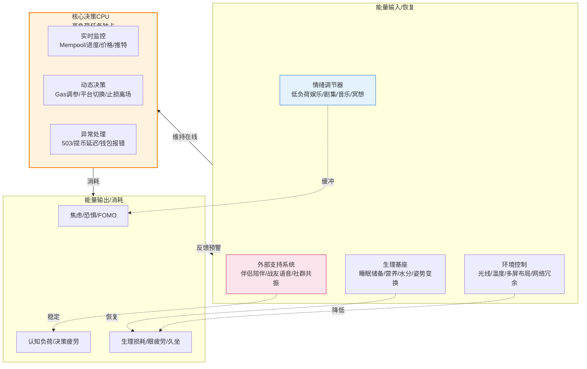
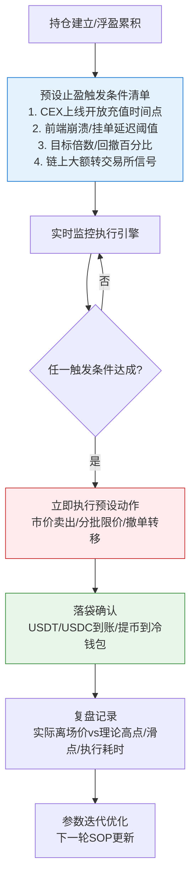
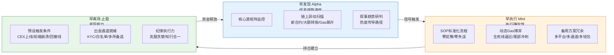

# 第 65 章 Web3 实战认知与方法论

## 学习目标

- 理解 Web3 高不确定性环境下“认知破偏见”是捕捉红利的前提条件
- 掌握“运气表面积”与“Alpha 信息源”的获取与筛选方法论
- 掌握 BRC20 Mint 全流程标准作业程序（SOP）与动态 Gas 博弈模型
- 能够建立“把鞋弄脏”的小步试错闭环，将隐性知识内化为可复用原则
- 建立极端环境下的身心管理机制与“落袋为安”的止盈纪律体系
- 识别谣言套利陷阱，建立“验证猜想、知行合一”的信息验证纪律
- 理解 Web3“98%项目归零”铁律下，时机选择优于价值分析的生存法则

## 65.1 生活类比

想象 Web3 实战是一场暴风雨中的深海捕鱼：认知破偏见是把“鱼只在浅水区”的旧航海图扔掉、敢于驶向未知深海（新赛道）的决心（P001: docs/202305/Geucd6qWAoGztLx5EOkcKmjWnQg.md）；运气表面积是撒更大的网（好奇心/视野）、多出海（行动），自然多撞上鱼群（机会）（P002: docs/202305/Geucd6qWAoGztLx5EOkcKmjWnQg.md）；Alpha 信息源是装上老渔民给的“秘密渔场坐标”（高质量社群情报），少跑空趟（P003: docs/202305/Geucd6qWAoGztLx5EOkcKmjWnQg.md）；把鞋弄脏是自己下水摸清水温、暗礁、水流（隐性知识），岸上看书永远学不会“手感”（P004: docs/202305/Geucd6qWAoGztLx5EOkcKmjWnQg.md）；动态 Gas 博弈是捕鱼高峰期（网络拥堵）必须出高价买最好的燃油（Gas拉满）抢航道，尾声时（进度99%）精准加速锁定渔获（P005: docs/202305/Geucd6qWAoGztLx5EOkcKmjWnQg.md）；谣言套利与验证纪律是无线电里传来“这儿有大鱼”（谣言），不盲目冲，先用探鱼器（链上数据）确认，是假信号就无视（P006: docs/202305/Geucd6qWAoGztLx5EOkcKmjWnQg.md）；极端环境身心管理是暴风雨持续 19 小时（凌晨 3 点到晚 10 点），靠听戏（娱乐缓解焦虑）、眯会儿（生理恢复）、爱人陪伴（外部支持）不晕船、不抽筋，保持手稳（P007: docs/202305/Geucd6qWAoGztLx5EOkcKmjWnQg.md）；落袋为安纪律是鱼仓装满（浮盈 10 倍），暴风眼将至（CEX 上线/前端崩溃），立即收网回港（止盈离场），不贪那最后一网“虚空价格”（P008: docs/202305/Geucd6qWAoGztLx5EOkcKmjWnQg.md）；BRC20 Mint SOP 是出海前的标准化检查清单：船况（钱包）、油料（BTC/备用提币）、渔具（平台/工具）、演练（模拟 5-6 遍）、试航（小额测试）、实战（开抢/监控/调参/收网/卸货）（P009: docs/202305/Geucd6qWAoGztLx5EOkcKmjWnQg.md）。

## 65.2 概念地图

```mermaid
graph TD
    Root((Web3 实战认知与方法论))
    Root --> Cognition[认知底座]
    Root --> InfoExec[信息与执行体系]
    Root --> TechStack[链上实战技术栈]
    Root --> MindDiscipline[身心与纪律系统]

    Cognition --> CB1[认知破偏见（抛弃偏见去机会多的地方）]
    Cognition --> CB2[运气表面积（主动增加遭遇好运的概率）]
    Cognition --> CB3[Web3 生存铁律（98%归零，核心竞争力是时机选择）]

    InfoExec --> IE1[Alpha 信息源（接入已筛选的高质量情报网络）]
    InfoExec --> IE2[把鞋弄脏（亲身下场获取隐性知识护城河）]
    InfoExec --> IE3[小步试错、快速迭代（OODA循环替代完美计划）]
    InfoExec --> IE4[谣言套利与信息验证纪律（验证猜想、知行合一）]

    TechStack --> TS1[BRC20 Mint 标准作业程序 (SOP) 10步闭环]
    TechStack --> TS2[动态 Gas 博弈模型（非线性阈值/进度-拥堵动态调整）]
    TechStack --> TS3[备用方案预案（提币通道/平台切换）]

    MindDiscipline --> MD1[极端环境身心管理（生理/情绪/外部支持维持决策力）]
    MindDiscipline --> MD2[落袋为安纪律（克服贪婪/预设止盈触发条件/规避虚空价格）]

    style Root fill:#f5f5f5,stroke:#333,stroke-width:2px
    style Cognition fill:#e3f2fd,stroke:#1976d2
    style InfoExec fill:#fff3e0,stroke:#f57c00
    style TechStack fill:#e8f5e9,stroke:#388e3c
    style MindDiscipline fill:#fce4ec,stroke:#c2185b
```

---

## 65.3 认知破偏见 —— 把偏见当作发现新赛道的“反向指标”

### 65.3.1 为什么需要这个概念？

新赛道（如 BRC20）初期往往伴随剧烈的认知冲突，固有经验会变成“认知拦路虎”，精准地帮你拦住所有的红利。作者在 2021 年因坚持“比特币只能存储价值、不能发资产”的偏见，彻底错过了 NFT 这一波百倍红利。偏见的本质，是“用旧地图找新大陆”。大脑为了省力，倾向于用已有的模式去套用新事物。在高不确定性、高波动率的 Web3 新赛道，这不仅无效，而且致命。你必须主动打破它，才能进入高流动性的主战场。这一点在素材 `docs/202305/20230516_044.md` 的开篇即被点明，作者称“5 月 8 号凌晨三点冲 #VMPX 也是因为最近摒弃了一些偏见后的第一次实战”，而在详细复盘素材 `docs/202305/Geucd6qWAoGztLx5EOkcKmjWnQg.md` 中，作者进一步总结出核心行动准则：“答案是：抛掉偏见去机会多的地方”，并坦言“这次看到 BRC20 我就强迫自己去了解”。素材 `docs/202305/20230516_044.md` 还强调“文章里面关于 Web3 里面的思考和框架可复用”，说明这一认知跃迁并非单次偶然，而是可迁移的方法论。

### 65.3.2 核心定义

**认知破偏见**（来源：《Web3 新赛道：BRC20 项目 VMPX 抢购复盘》与《瓜藤：Web3 实战复盘全记录》）：
- **抛弃偏见**：强迫自己去理解新事物，前往流动性和热度最高的赛道试错，而非用旧框架评判新事物。
- **认知升级先于行动致胜**：心智模型更新是捕捉机会的必要前提，行动是认知变现的结果。

这不是让你盲目冲动，而是要求你在**行动前**完成一次认知的“格式化重装”：承认旧框架失效，接纳新范式的可能性，再以小步试错的方式去验证。

### 65.3.3 关键性质

- **反直觉**：人本能地厌恶不确定性，偏见是大脑的“省力模式”，打破它需要刻意练习，像练肌肉一样练“认知肌肉”。
- **可迁移**：思维框架比单次收益更有价值。这次 BRC20 实战提炼出的“认知破偏见 -> 接入 Alpha -> 小步试错 -> 动态执行 -> 纪律离场”框架，可复用到不同周期、不同赛道（如后来的 Runes、Solana Meme 等）。

### 65.3.4 典型例子

**作者的两次分水岭**：

下表展示了作者在两个关键时间节点的认知状态、行动与结果，直观展示“认知破偏见”带来的实战差异。数据来源于素材 `docs/202305/20230516_044.md` 与 `docs/202305/Geucd6qWAoGztLx5EOkcKmjWnQg.md` 的复盘对照：

| 时间节点 | 认知状态 | 动作 | 结果 |
| :--- | :--- | :--- | :--- |
| **2021 年 NFT 爆发** | 坚持“比特币只能存储价值”偏见 | 旁观、嘲笑、拒绝研究 | **错过百倍红利**，成为认知教训 |
| **2023 年 BRC20 VMPX** | **强迫自己打破偏见**，承认“比特币生态可发资产” | 深夜 3 点实战，模拟 5-6 遍，Gas 拉满上车 | **捕捉 10 倍收益**，验证框架有效性 |

### 65.3.5 边界条件

- **仅适用于“高不确定性、高波动率”的新兴赛道**。成熟市场（如蓝筹股、BTC 长期持有）仍需基本面分析。
- **必须配合“小步试错”与“风控纪律”**。否则“破偏见”极易变为“盲目冲动”，在归零项目上梭哈。

### 65.3.6 方法演进图：认知破偏见的“旧地图焚毁-新航道试航”闭环



> **图解说明**：上图将“认知破偏见”建模为一个可迭代的闭环。关键分支点在于“遭遇新赛道认知冲突”时，是选择“否”（坚持旧偏见，导致错过红利并形成教训），还是选择“是”（强迫理解，进入小步试错验证通道）。验证通道内通过资料整理、模拟演练、小额实战快速收敛不确定性，最终或全力执行捕获红利，或止损退出积累负面样本。两条路径汇聚于“复盘沉淀”，完成认知框架的版本迭代，使下一轮新赛道的认知起点更高、试错更快。

---

## 65.4 运气表面积 —— 主动增加遭遇“好运”的概率面

### 65.4.1 为什么需要这个概念？

Web3 机会稍纵即逝，纯靠等待“运气降临”胜率极低。你需要一套可量化、可执行的“制造运气”方法论，替代被动祈祷。

### 65.4.2 核心定义

**运气表面积**（来源：《瓜藤：Web3 实战复盘全记录》）：
- **定义**：通过保持好奇心、扩展视野、心态豁达、多想好的一面等主观行为，主动增加单位时间内遭遇高质量机会的概率。
- **核心公式**：你不能改变运气，但可以改变“运气的运气”（引用《天赋与运气：随机性在成功与失败中的作用》研究）。

作者在素材中明确写道：“你不能改变运气，但是可以改变运气的运气”，“保持积极好奇心、扩展视野、心态豁达，遇事多想好的一面，少想坏的一面，好运气就会多一点。”这不是玄学，而是概率论。你的“曝光面”越广（关注的优质源越多、参与的实战越多、社交的高手越多），被“运气砸中”的概率就越大。

### 65.4.3 关键性质

- **可积累**：阅读一篇深度研报、加入一个高质量社群、完成一次“把鞋弄脏”的实战，都在扩大你的表面积。
- **非线性**：微小的认知/行动改变（如多关注一个 KOL、多熬一晚实战），可能引发指数级的机会捕获。

### 65.4.4 典型例子

作者加入“七爷社群”获取 Alpha 信息源，利用他人筛选体系小步试错，最终捕捉 VMPX 机会。这个社群本身就是作者为了扩大“运气表面积”而主动付费、主动接入的高杠杆节点。素材 `docs/202305/Geucd6qWAoGztLx5EOkcKmjWnQg.md` 记录：“在 Web3 ，这种消息叫 Alpha ，机会总给那些愿意行动起来的人。”

### 65.4.5 边界条件

- **不等于盲目乐观**，必须配合“信息验证纪律”与“风控止损”。
- **表面积大只能增加“撞大运”概率**，能否“接住运气”取决于实战执行力。

### 65.4.6 方法演进图：运气表面积的“曝光-捕获-复利”飞轮



> **图解说明**：上图以“飞轮”视角建模运气表面积的复利机制。左侧“主动曝光行为”通过四大维度（好奇心、视野、心态、社交）主动扩大单位时间内的机会遭遇率；中间“机会捕获与验证”将遭遇到的候选机会通过快速筛选、小步试错、实战执行转化为确定性结果；右侧“运气复利与资产积累”产出资金、声誉、框架等资产，并反哺左侧，升级下一轮的曝光硬件（更好工具、更多资金、更强团队），形成正向飞轮。

---

## 65.5 Alpha 信息源 —— 接入“已被筛选过的高质量情报网络”

### 65.5.1 为什么需要这个概念？

Web3 信息过载、噪音极大，个人筛选成本极高、极易被割韭菜。你需要借力“他人的筛选体系”，实现信息获取的杠杆效应。

### 65.5.2 核心定义

**Alpha 信息源**（来源：《瓜藤：Web3 实战复盘全记录》）：
- **Alpha**：Web3 行业内指高质量、早期、可执行的投资情报。
- **Alpha 信息源**：具备筛选能力、愿分享早期情报的社群/大佬/渠道（如文中提到的“七爷社群”）。

### 65.5.3 关键性质

- **信任传递**：基于过往验证建立的信任链。作者之所以重视七爷转发的 VMPX 消息，**是因为之前在 XEN 项目中跟随该源获益，完成了信任闭环**。素材记载：“昨天看到七爷在群里转发 VMPX 的相关消息...因为我之前在 XEN 里面喝了点汤，所以就很重视。”
- **时效性强**：Alpha 衰减极快，必须“小步试错、快速迭代”，不能等到全网皆知再动手。

### 65.5.4 典型例子

注意：**不是盲目跟单**。作者看到消息后，是“强迫自己去了解”、整理资料、模拟演练、小额测试，验证后再全力执行。素材中明确要求“验证猜想、知行合一、不盲目追涨”。

### 65.5.5 边界条件

- **严禁盲目跟单**，必须“验证猜想、知行合一”（如作者验证“破解代币名称”谣言后果断放弃套利）。
- **权限门槛**：部分 Alpha 需平台资质（Unisat 积分/OG PASS）才能参与，需提前布局（这也是“运气表面积”积累的一部分）。

### 65.5.6 方法演进图：Alpha 信息源的“信任构建-信号捕获-验证执行”三级过滤体系



> **图解说明**：上图构建了 Alpha 信息源的全生命周期管理体系。第一级“信任构建与源准入”在事前通过历史业绩、透明度、利益绑定、权限匹配四维审查建立核心源矩阵；第二级“实时信号捕获与分级”在事中通过多渠道监控、分级标准、交叉验证提取高置信度信号；第三级“验证执行与反馈闭环”在事后通过小步试错、实战记录、信用评分更新、源矩阵动态调整完成闭环。三级过滤体系将“接入 Alpha 源”从单一动作升级为可持续进化的系统工程。

---

## 65.6 把鞋弄脏 —— 亲身下场才能获得的“隐性知识护城河”

### 65.6.1 为什么需要这个概念？

岸边观望永远学不会链上实战的“生死细节”（Gas 博弈、网络拥堵应对、界面卡顿、钱包交互细节）。显性知识（教程、文档）只占 20%，**隐性知识（手感、节奏、直觉、应变能力）决定 80% 成败**。教程里写“Gas 设高一点”，但“高一点是多少？什么时候加？加到多少会卡死？什么时候减？”这些**只有亲身下场、交学费、甚至差点亏光才能懂**。

### 65.6.2 核心定义

**把鞋弄脏**（来源：《瓜藤：Web3 实战复盘全记录》）：
- **指亲身承担风险、体验细节、忍受痛苦（网络拥堵、Gas 波动、熬夜）的全过程实操**。
- **隐性知识**：如 Gas 存在动态生死线、Mint 进度与网络拥堵的非线性关系、前端崩溃时的操作备选方案。

作者在素材中写道：“把鞋弄脏，遇到机会的时候，站在岸边指点评价总是容易的，真正投身其中才能感受风浪，风浪越大，鱼越贵。”

### 65.6.3 关键性质

- **不可复制粘贴**：只能通过“小额实战测试 → 总结原则 → 全力执行”的 OODA 循环内化。
- **复利增长**：每次实战都在为下一次积累“肌肉记忆”。

### 65.6.4 典型例子：作者的 VMPX “弄脏鞋”全过程

1.  **资料整理与模拟**（显性知识获取）：从社群整理 BRC20 原理、操作平台流程，对着教程**模拟 5-6 遍**。素材记载：“对着教程开始反复模拟（很重要，要不断模拟测试问题）；模拟了五六遍后觉得没大问题时，开始实操”。
2.  **小额实战测试**（低成本试错）：找几个 Mint 进度 80%-90% 的项目走流程，用真金白银测 Gas 底价。素材记载：“找了几个 mint 进度 80%——90% 的项目 ，走了几遍流程...才理解了教程里面说的 gas 给底的话，很可能鸡飞蛋打。”
3.  **提炼核心原则**（隐性知识内化）：**“Gas 拉满抢！”** 确立为 VMPX 实战的核心指令。素材记载：“基于以上实操，给下一步抢 VMPX 定了个操作原则：gas 拉满抢！”
4.  **实战动态执行**：凌晨 3 点开抢，Gas 从 550 飙至 600+ 卡死，死守到进度 99.6% 网络缓解，果断调高至 800 **“赶上末班车”**。素材记载：“直到 mint 进度到了 99.6%...网络没有那么拥堵了，我把 gas 调到了 800，终于...赶上了末班车”。

### 65.6.5 边界条件

- **成本可控**：仅用“能承受损失的小额资金”弄脏鞋，而非梭哈。
- **必须复盘**：不复盘的实战只是“交学费”，不是“把鞋弄脏”。每次实战后要提炼 1-2 条隐性知识写进 SOP。

### 65.6.6 方法演进图：把鞋弄脏的“显性转隐性”四阶段内化路径



> **图解说明**：上图描绘了“把鞋弄脏”将显性知识转化为隐性知识护城河的四阶段内化路径。第一阶段通过资料整理与高强度模拟（5-6遍覆盖异常分支）构建显性知识骨架；第二阶段用极小额真金白银在真实环境中验证关键假设（Gas底价、平台稳定性），这是“弄脏鞋”的最低成本切入点；第三阶段是核心转化环节，通过对比预期与实际、提炼核心原则、构建动态决策树，将零散经验凝练为可复用的隐性知识资产；第四阶段在实战中复用迭代，每次实战都加深护城河。虚线回路表示遇到新边界情况、新工具、新赛道时需回溯第一阶段重新开始内化循环。

---

## 65.7 动态 Gas 博弈 —— 在区块空间拍卖中寻找“生死线”的动态平衡术

### 65.7.1 为什么需要这个概念？

BRC20 Mint 本质是**“区块空间拍卖”**。区块大小固定（4MB），大家都想在同一个区块里塞进交易，Gas 就是出价。静态 Gas 策略在拥堵度剧变时必死。你需要一套随网络拥堵度、Mint 进度、竞争对手行为动态调整的定价模型。

### 65.7.2 核心定义

**动态 Gas 博弈模型**（来源：《瓜藤：Web3 实战复盘全记录》）：
- **定义**：基于实时拥堵度、进度、预判竞争对手的 Gas 定价动态调整方法。
- **核心逻辑**：
    - **前期极度拥堵** → Gas 需远超均价（550 仍卡死）；
    - **中期死守**；
    - **后期进度 >99% 且网络缓解** → 适度提高 Gas（800）抢末班车。

### 65.7.3 关键性质：非线性阈值与函数推导

这是最反直觉、也最赚钱的一点：**Gas 与成功率不是线性关系，存在“生死线”**。

**从区块空间拍卖机制到函数形式的推导过程**：

比特币区块空间是固定的稀缺资源（4MB/区块，约 10 分钟出块）。在 BRC20 Mint 高峰期，全网用户同时广播交易，Mempool（待打包交易池）迅速堆积。矿工按 Gas 单价（sat/vB）从高到低选交易打包，这构成了一个**连续的区块空间拍卖**。

定义关键变量：
- $t$：时间轴（相对于 Mint 开始时刻）
- $p(t)$：Mint 进度百分比，单调递增，$p \in [0, 100\%]$
- $c(t)$：Mempool 拥堵度指数，定义为 $c(t) = \frac{\text{待打包交易总虚拟字节数}}{\text{单区块容量虚拟字节数}}$，表示清空当前 Mempool 需要的区块数
- $G_{market}(t)$：市场主流 Gas 价格中位数
- $G_{user}(t)$：用户设定的 Gas 价格

**成功率函数 $S(G_{user}, p, c)$ 的构造**：

用户交易能否在目标区块打包，取决于其 Gas 排名是否进入矿工选取的前 $4MB$ 字节。在极度拥堵时（$c \gg 1$），Mempool 中积压了大量高 Gas 交易，用户 Gas 必须超过积压交易中排名在区块容量边界处的交易 Gas，才能“插队”进下一个区块。这形成了一个**阶跃式的成功率阈值**：

$$G_{threshold}(p, c) = \text{Percentile}_{1 - 1/c(t)} \left( \text{Mempool Gas 分布} \right) \times \alpha(p)$$

其中 $\alpha(p)$ 为进度修正系数：前期 $p \to 0$ 时竞争最激烈 $\alpha \approx 1.2-1.5$；尾期 $p \to 100\%$ 时竞争者退场/燃料耗尽 $\alpha \approx 0.8-1.0$。

成功率函数近似为：

$$S(G_{user}, p, c) \approx \begin{cases} 
0 & G_{user} < G_{threshold}(p, c) \\
1 - e^{-\beta (G_{user} - G_{threshold})} & G_{user} \ge G_{threshold}
\end{cases}$$

其中 $\beta$ 反映 Gas 进一步提高带来的边际成功率增益。

**该函数模型将直觉经验量化为可监控的阈值函数，指导实时决策**：实战中无需精确计算积分，只需实时监控 $c(t)$（Mempool 积压区块数）、$p(t)$（进度条）、$G_{market}(t)$（主流 Gas），并维护一个经验校准的“生死线估算表”，在 $G_{user}$ 接近 $G_{threshold}$ 时果断调参。

### 65.7.4 阈值动态演进的实战对照

下表展示了 VMPX 实战中 Gas 设置与结果的非线性对应关系，揭示“生死线”随进度与拥堵度动态变化的规律。数据来源于素材 `docs/202305/Geucd6qWAoGztLx5EOkcKmjWnQg.md` 的实战记录：

| 阶段 | 网络状态 | Gas 设置 | 结果 | 说明 |
| :--- | :--- | :--- | :--- | :--- |
| **开盘前** | 数据平台显示均价 | 250 (均价) | **必败** | 根本排不上队 |
| **开盘初期** | 极度拥堵 | 550 (2倍均价) | **卡死/失败** | 依然不够，交易卡在“待打包” |
| **中期** | 持续拥堵 | 维持/微调 | **死守** | 等待网络缓解、进度推进 |
| **尾部窗口** | 进度 99.6%，网络缓解 | **800** | **成功打包** | 竞争者退场/燃料耗尽，少量高 Gas 即可锁定区块 |

作者在素材中复盘道：“开始前我看到数据平台的 gas 才 250 多，所以我第一批冲了 10 张，把 gas 翻翻，调到了 550...就是不跳出下一步...再去看 gas 已经飙到了 600 多”；“直到 mint 进度到了 99.6%...网络没有那么拥堵了，我把 gas 调到了 800，终于...赶上了末班车”。**这个“生死线”是动态的**，取决于：实时 Mempool 拥堵度、Mint 进度百分比、竞争对手预估剩余 Gas 总量。你要做的不是“猜一个数”，而是**建立监控仪表盘，实时逼近那条线**。

### 65.7.5 信息不对称利用

监控创始人推特（开抢信号）、Mempool 状态（拥堵度）、进度条（剩余量），比对手快半拍决策。作者通过“倒计时页面跳转创始人推特”锁定开抢精确秒数，这就是信息不对称的杠杆。

### 65.7.6 边界条件

- 仅适用于“短时高拥堵、固定总量”的 Mint 场景，不适用于持续交易。
- 需极强的实时监控能力与心理素质（凌晨 3 点至 10 点持续在线）。

### 65.7.7 方法演进图：动态 Gas 博弈决策树



> **图解说明**：上图展示了动态 Gas 博弈的核心决策逻辑。它将实战过程划分为前期激进、中期死守、尾期冲刺三个阶段，每个阶段对应不同的 Gas 定价公式与监控动作。关键在于“阶段判断”节点对实时拥堵度 $c$ 和进度 $p$ 的读取，以及“执行监控”节点中 RBF（Replace-by-Fee）替换机制的引入，这正是将静态参数转化为动态博弈的关键技术动作。

---

## 65.8 BRC20 Mint 实战 SOP —— 从“零认知”到“上车”的标准化 10 步作业程序

### 65.8.1 为什么需要这个概念？

链上操作环节多、容错率低、时效性强，无 SOP 极易漏步、错参数、错时机。标准化流程能将“个人经验”转化为“可复制资产”，降低下次试错成本。

### 65.8.2 核心定义

**BRC20 Mint SOP**（来源：《瓜藤：Web3 实战复盘全记录》）：
覆盖钱包准备、BTC 获取/备用提币、平台选择、资料整理与模拟、小额测试、参数设定、开抢监控、动态调 Gas、尾部锁定、打包确认转移的 **10 步标准化作业程序**。

### 65.8.3 SOP 详细步骤与必要性推导

以下为标准化作业程序，每一步均源于作者实战复盘（素材 `docs/202305/Geucd6qWAoGztLx5EOkcKmjWnQg.md`），并附带必要性推导与替代方案对比：

**步骤 1：钱包准备**  
创建/导入 UniSat / Xverse / OKX Web3 Wallet，备份助记词并物理隔离存储，预留 0.001-0.005 BTC 作为多轮 Gas 费。  
必要性在于：BRC20 交互仅支持特定钱包；助记词泄露即资产归零；Gas 预留不足会导致中途“趴窝”。

**步骤 2：BTC 获取与备用提币方案（关键冗余）**  
主通道：币安/欧易/安安充值 -> 提币到钱包。**备用通道**：至少准备 1 个第二交易所账户（如作者安安暂停提币 1 小时，立马启动 OK 提币）。验证提币到账速度，确认网络拥堵时的最慢到账时间。  
必要性在于：单一提币通道在高拥堵期极易熔断（安安暂停提币即实例），双通道冗余是生存底线。

**步骤 3：Mint 平台选择**  
主平台：UniSat（功能最全、数据最准）。备用平台：Xverse / OKX Web3 / OrdinalsBot。预先在所有平台登录、授权、熟悉界面。  
必要性在于：主平台可能因流量过大宕机或界面卡死，熟练切换备用平台能抢回宝贵的区块窗口期。

**步骤 4：资料整理与流程模拟（重“模拟”轻“实操”）**  
收集社群/官方教程，整理为个人专属操作手册。**全流程模拟 5-6 遍**（点击每个按钮、确认每个弹窗、记录每步耗时）。模拟通过标准：零犹豫、零报错、单次流程 < 30 秒。  
为什么是 5-6 遍？实战中涉及钱包签名、Gas 估算、RBF 替换、平台切换等高交互复杂度动作。1-2 遍只能跑通“幸福路径”，5-6 遍才能覆盖“网络卡顿、Gas 飙升、提币延迟、界面报错、余额不足”等异常分支，建立完整的“肌肉记忆决策树”。

**步骤 5：小额实战测试（低成本验证假设）**  
选取 Mint 进度 80%-90% 的非热门项目，投入极小额资金（如 $10-20 等值 BTC）。**测试关键指标**：Gas 底价失效边界、确认速度、平台稳定性、界面卡顿程度。**输出**：核心参数初版（初始 Gas 倍数、调整步长、进度阈值）。  
必要性在于：用 $10 换“Gas 给底则鸡飞蛋打”的血淋淋教训，比读 100 篇教程管用。这是“把鞋弄脏”最低成本的切入点。

**步骤 6：核心参数设定（VMPX 实战参数参考）**  
初始 Gas：市场均价 × 2-3 倍（VMPX 实战 550）。进度阈值：95% 启动尾部策略，99%+ 触发冲刺 Gas。调整步长：拥堵期 +50-100/次，缓解期 +200-300/次。最大 Gas 上限：预算允许的最高值（防止失控）。

**步骤 7：信息监控渠道（多源交叉验证）**  
倒计时页面（官方/社群制作）→ 点击直达创始人推特。创始人推特/Telegram（一手开抢信号）。Mempool 监控网站（mempool.space 实时拥堵度）。核心社群语音/文字（实战情报同步）。**冗余原则**：单一信息源失效不影响决策。

**步骤 8：开抢监控与动态调参（实战核心循环）**  
T-5min：全渠道就绪，钱包解锁，Gas 设为初始值。T-0：创始人推特发文/倒计时归零 → 立即广播交易。**拥堵期**：交易卡“待打包”> 2min → Gas +50-100 重发（RBF/CPFP）。**死守期**：不取消订单，持续刷新页面，监控进度条。**尾部窗口**：进度 >99% 且 Mempool 拥堵度下降 → Gas 跃升至冲刺值（800+）锁定区块。

**步骤 9：尾部锁定与打包确认**  
监控区块浏览器：红色“待打包” -> 蓝色“已确认”。确认交易在目标区块高度上链。资产在钱包“Inscriptions”标签页显示。

**步骤 10：打包确认与资产安全转移**  
核对数量、Tick、编号无误。若需出售：转移至交易所/市场挂单（注意平台权限门槛：Unisat 需积分/OG PASS）。若长持有：冷钱包离线存储，助记词物理隔离。

### 65.8.4 关键设计原则

- **重“备用方案”**：安安暂停提币 → 立马启动 OK 提币，预案救命。
- **重“信息监控”**：倒计时页 → 创始人推特 → 多渠道确认开抢时刻。
- **重“小额测试”**：用 $10 换“Gas 给底则鸡飞蛋打”的血淋淋教训，比读 100 篇教程管用。

### 65.8.5 数据流图：BRC20 Mint SOP 关键信息与资金流向



> **图解说明**：上图将 BRC20 Mint SOP 的 10 个步骤映射为四个阶段的数据与资金流向。准备阶段完成“船况/油料/渔具”检查；验证阶段用小额实战换取核心参数（Gas 生死线）；实战阶段是 OODA 循环的高频运转，核心是“拥堵监控 -> RBF 调参 -> 尾部冲刺”的动态博弈；离场阶段完成资产确权与变现/存储。图中黄色高亮节点为作者实战中最关键的“小额测试→参数定版”与“创始人推特开抢信号→冲刺 Gas”上车两个决策锚点。

---

## 65.9 谣言套利与信息验证纪律 —— 在“虚假信息制造的价格畸变”中守住底线

### 65.9.1 为什么需要这个概念？

Web3 早期市场极度缺乏流动性、信息不对称，谣言能制造短期暴利诱惑（价格 0.1 → 0.02 → 0.08）。缺乏验证纪律极易“接飞刀”或“追高被套”。

### 65.9.2 核心定义

**谣言套利与信息验证纪律**（来源：《瓜藤：Web3 实战复盘全记录》）：
- **谣言套利**：利用市场对虚假信息的情绪化反应，在价格畸变中低买高卖。
- **信息验证纪律**：**验证猜想 → 链上数据印证 → 权威源辟谣 → 知行合一 → 不盲目追涨**。

### 65.9.3 关键性质：纪律 > 技术

作者具备 Unisat 交易技术，本可参与谣言套利，**但因权限限制（积分/OG PASS）及验证为谣言，果断放弃**，体现“知行合一”。素材记载：“unisat 平台的交易市场是测试版本，所以目前只给有 20 积分或者有 OG PASS 的人才能交易”，“应声下跌到 0.02...最高冲到 0.08，截止发文，稳定在 0.04”。**不参与不理解的套利，比参与并赚到钱更安全。** 这是反脆弱的核心：赚认知之内的钱，不赚认知之外的钱（哪怕看起来很香）。

### 65.9.4 典型例子

“技术破解代币名称”谣言发布 → 衍生币暴跌反弹 → 作者观察链上数据 + 创始人辟谣推特验证虚假 → **放弃参与**，甚至留在 Space “看热度”而不下注。素材记载：“有人开始转发一群技术人才破解了这个项目的代币名称...创始人后面又发文辟谣”，“我想验证我的猜想，果然...后来留在创始人推特 space 听了听...主要目的还是想看热度”。

### 65.9.5 边界条件

- 仅适用于“信息极度不对称、无监管”的早期市场，成熟市场谣言成本高、套利窗口短。
- 必须有独立验证渠道（链上数据、创始人官方渠道），否则无法辨真伪。

### 65.9.6 方法演进图：谣言套利的验证与免疫闭环



> **图解说明**：上图构建了“谣言套利免疫系统”的标准化流程。输入端捕捉异常信号，处理端并行执行链上数据、权威源、技术可行性三维核验（三角验证），决策端根据验证结果二分：确证为谣言则触发“纪律执行/放弃/记录规则”闭环；判定为真机会则进入“小步试错/止损/复盘”闭环。两条闭环汇聚于“提升信息免疫力”，实现对抗谣言能力的复利增长。

---

## 65.10 极端环境身心管理 —— 让决策力在“熬夜、拥堵、暴涨暴跌”中不掉线

### 65.10.1 为什么需要这个概念？

链上实战常持续数小时至数天（凌晨 3 点至次日 10 点）。生理极限与心理压力（FOMO、界面崩溃、资金波动）会导致决策失真。**好策略若无好身心执行 = 0**，身心管理是执行力的“硬件基座”。

### 65.10.2 核心定义

**极端环境身心管理**（来源：《瓜藤：Web3 实战复盘全记录》）：
- **定义**：通过娱乐缓解焦虑（看剧）、保持生理机能（躺沙发休息）、情绪稳定（不因 503 放弃）、外部支持（伴侣陪伴）维持决策力在线。
- **核心心法**：风浪越大，鱼越贵；越混乱时越要稳住。

### 65.10.3 关键性质

- **非技术性但决定性**：技术再好，崩溃时手抖点错 Gas 也归零。
- **可训练**：平时的冥想、运动、作息规律，是实战时的“心理体能储备”。

### 65.10.4 典型例子

作者边看《漫长的季节》边刷新 Mint 页面，边视频陪女友边等待打包，最终熬到 99.6% 尾部窗口上车。素材记载：“战役打到这个份上，好身体和好心态的重要性就体现出来了...我打开了前段时间攒的剧《漫长的季节》，边看边刷新 mint 页面。”“边跟我女朋友视频边等待打包（此处郑重感谢我女朋友给我带来好运气）”。这是**“分散注意力以维持核心注意力”**的高级技巧：用低认知负荷的娱乐/社交占据“焦虑内存”，释放“决策 CPU”给核心监控任务。

### 65.10.5 边界条件

- **不能用“硬扛”替代“风控”**：若策略本身有缺陷，好心态只会让你“坚定地亏光”。
- **需设定“强制休息/止损线”**，防止疲劳决策。

### 65.10.6 方法演进图：极端环境下的身心能量管理模型



> **图解说明**：上图以“能量流”视角建模极端环境下的身心管理。左侧输入模块（生理/情绪/外部/环境）通过虚线箭头对右侧输出模块（焦虑/认知负荷/生理损耗）施加恢复/缓冲/稳定作用；中间核心决策 CPU 独占高负荷任务资源。关键洞见在于：情绪调节器（看剧/视频）并非“分心”，而是主动占据低优先级认知带宽，防止焦虑进程抢占高优先级决策带宽，这是一种**主动的认知资源调度策略**。

---

## 65.11 落袋为安纪律 —— 克服“贪婪上头”将纸面富贵变成真钱的出场仪式

### 65.11.1 为什么需要这个概念？

浮盈 10 倍时，人性本能贪恋“更高”，但 CEX 上线常伴随前端崩溃、挂单延迟、虚空价格，导致无法落袋。缺乏出场纪律是“赚了指数亏了钱”的核心原因。

### 65.11.2 核心定义

**落袋为安纪律**（来源：《瓜藤：Web3 实战复盘全记录》）：
- **定义**：在浮盈高位、CEX 上线预期下，警惕“虚空价格/前端崩溃/挂单延迟”，克服贪婪，及时市价卖出离场。
- **核心口诀**：**别上头！落袋为安很重要！**

### 65.11.3 关键性质

- **反人性**：需在最兴奋时做最冷静的事（卖出）。
- **系统化**：需预设“止盈触发条件”（如 CEX 开放充值即市价清仓），而非临场凭感觉。

### 65.11.4 典型例子

VMPX 峰值 1.3（10 倍），作者警惕芝麻开门上线引发前端崩溃与虚空价格，撰文时地板价 0.39（3 倍），强调及时止盈。素材记载：“落袋为安很重要！别上头！”“明天，也就是 9 号 11:00，芝麻开门会上 VMPX ，一般来说，这种 CEX 抢上，是因为热度，那么，怎么落袋为安就又是另一门学问了。”“平台前端已崩溃，交易页面一直在维护...上午挂单的订单开始陆续显示出来...这种虚空价格也很正常，坑也很多”。**“虚空价格”**是指：前端崩溃时，你的限价单挂在高位显示“成交”，实则链上未成交；等前端恢复，价格已崩，你的单子成了“接盘侠”。

### 65.11.5 边界条件

- 仅适用于“极高波动、流动性依赖中心化交易所”的早期项目，蓝筹资产可长持有。
- 需提前规划“出金通道”（交易所账号、KYC、提币白名单），否则有币卖不出。

### 65.11.6 方法演进图：落袋为安的预设触发与执行流程



> **图解说明**：上图将“落袋为安”显性化为一个自动化执行引擎。核心在于“预设触发条件清单”（B 节点）的事前锚定，将临场主观判断替换为客观条件触发。执行引擎（C-D-E）在条件满足瞬间启动预设动作，规避“贪婪上头”导致的决策延迟。复盘记录（G）与参数迭代（H）形成闭环，使止盈策略随实战经验进化。

---

## 65.12 Web3 生存铁律 —— 98% 项目归零，核心竞争力唯有时机选择

### 65.12.1 为什么需要这个概念？

绝大多数 Web3 项目基本面为零，传统价值投资分析失效。必须将投资本质从“价值发现”转移为“流动性博弈与速度竞赛”。

### 65.12.2 核心定义

**Web3 生存铁律**（来源：《瓜藤：Web3 实战复盘全记录》）：
- **定义**：98% 项目是骗局/归零，项目基本面分析边际效用递减，**唯一核心技术是“时机选择”**（早发现 Alpha、早完成 Mint、早离场）。

作者在素材中直言：“Web3 圈有 98% 的项目都是骗人的！！！所以考验的是出入场时机。”

### 65.12.3 关键性质

- **残酷性**：不承认这点，必然在归零项目上“价值投资”到归零。
- **速度即利润**：早一步发现、早一步执行、早一步离场，是唯一确定性 Alpha。

### 65.12.4 典型例子

VMPX：早发现（七爷社群）、早执行（凌晨三点 Gas 拉满）、早离场（CEX 上线前止盈），实现 3-10 倍收益。

### 65.12.5 边界条件

- 仅适用于“投机属性强、基本面弱”的早期币种/空投/铭文赛道。
- 成熟项目（ETH、BTC 长期持有）仍适用价值投资逻辑。

### 65.12.6 方法演进图：Web3 生存铁律下的“时机选择”三要素



> **图解说明**：上图将“时机选择”拆解为“早发现、早执行、早离场”三个串联的竞速环节。早发现依赖核心源矩阵与链上扫描的信息获取速度；早执行依赖 SOP 标准化与动态 Gas 博弈的确定性执行；早离场依赖预设触发条件与出金通道的变现能力。三者构成正反馈飞轮：早离场释放资金与认知带宽，支撑下一轮早发现。这正是 Web3 高波动环境下唯一可复制的“核心技术”。

---

## 65.13 设计中的取舍

**问：为什么不用“价值投资/基本面分析”而是“时机选择/流动性博弈”？**  
**答：** 因为在 BRC20 等早期铭文赛道，**项目无基本面、无现金流、无估值模型**，98% 归零。基本面分析在这里不仅无效，还会让你在归零项目上找理由“价值投资”到零。核心竞争力只能是：**信息获取速度、执行速度、离场速度**。

**问：“Gas 拉满”的 trade-off 是什么？**  
**答：** **收益**是极大概率在拥堵期抢到区块空间，完成 Mint，捕获 10-100 倍红利。**成本**是单笔 Gas 费极高（可能占 Mint 成本 50%+），若最终 Mint 失败或币价归零，Gas 纯损失。**决策依据**是：只有当“预期收益 × 成功率 > Gas 成本 / 本金”时，才值得“拉满”。这要求你对项目热度、拥堵度、代币分配机制有极准的判断。

**问：为什么“模拟 5-6 遍”而不是“模拟 1 遍”？**  
**答：** 因为链上操作涉及钱包签名、Gas 估算、RBF 替换、平台切换等**高交互复杂度**动作。一次模拟只能跑通“幸福路径”，5-6 遍才能覆盖“网络卡顿、Gas 飙升、提币延迟、界面报错、余额不足”等**异常分支**，建立完整的“肌肉记忆决策树”。

---

## 65.14 多源对照与文献补充建议

本章核心方法论主要基于作者“瓜藤”的单一实战复盘（素材 `docs/202305/20230516_044.md` 引用 `docs/202305/Geucd6qWAoGztLx5EOkcKmjWnQg.md` 全文），未发现同一概念有多篇素材支撑的冲突或互补情况。若后续补充其他实战者（如“七爷”、其他 BRC20 玩家）的复盘，可在此对照：

### 共识

- 认知破偏见是入场前提
- 小步试错/模拟演练是低成本验证必要手段
- Gas 策略需动态调整，存在非线性阈值
- 身心管理与止盈纪律是执行力硬基座

### 分歧与补充方向

**需补充文献**：引入“七爷”视角复盘、其他 BRC20 玩家链上数据分析报告、Unisat/Xverse 官方技术文档、Mempool 空间拍卖机制学术论文。对以下维度的差异化实践进行对照：

| 维度 | 当前单一视角(瓜藤) | 待对照维度(需引入其他实战者视角) |
| :--- | :--- | :--- |
| **Gas 初始倍数策略** | 开盘 2-3x 市场均价 (550 vs 250) | 是否存在"开盘不抢、专抢尾部"的低 Gas 策略派系？不同资金量玩家的 Gas 成本承受阈值差异？ |
| **尾部窗口判定标准** | 进度 99%+ 且 Mempool 缓解 | 如何量化"拥堵缓解"？是否有更精确的链上指标(如区块间隔/待打包交易数/费率分位数)替代肉眼观察？ |
| **止盈纪律执行标准** | CEX 上线前/开放充值即市价清仓 | 是否存在"分批止盈/移动止盈/对冲期权"等更精细的离场策略？不同流通量项目的最优离场时机差异？ |
| **心理压力阈值与应对** | 看剧/视频陪聊/躺沙发 19小时 | 不同生理条件/交易经验玩家的最大持续在线时长？是否有药物/补充剂/轮班制度等硬核手段？ |

---

## 65.15 动手练习

### 练习 1：设计你的 BRC20 Mint 实战 SOP 检查清单

假设你要参与一个新的 BRC20 代币 Mint（如 $NEW），请列出你的 10 步 SOP 清单，必须包含：

1.  钱包与资金准备（含备用提币通道）
2.  资料获取与模拟演练（几遍？怎么算通过？）
3.  小额实战测试（测什么关键指标？Gas底价？确认速度？）
4.  核心参数设定（初始 Gas 倍数、进度阈值、调整步长）
5.  信息监控渠道（倒计时页、创始人推特、Mempool、社群）
6.  动态调参决策树（前期拥堵/中期死守/尾部窗口的具体 Gas 策略）
7.  身心管理预案（熬夜方案/焦虑缓解/外部支持）
8.  落袋为安触发条件（目标倍数/CEX上线时间/前端异常判定/止盈比例）
9.  异常熔断机制（钱包被盗/网络故障/资金不足/平台维护）
10. 复盘模板（投入/产出/关键决策点复盘/隐性知识沉淀）

### 练习 2：构建个人 Alpha 信息源评估矩阵

1.  列出你目前关注的 5-10 个 Web3 信息源（KOL/社群/媒体/研报）
2.  为每个信息源打分（1-5 分）：
    - 历史准确率（过往推荐项目收益/坑项目预警）
    - 信息时效性（早期/独家/二手转发）
    - 筛选透明度（是否分享筛选逻辑/复盘失误）
    - 利益绑定度（是否带单/收费/持仓披露）
    - 互动响应度（答疑/辟谣/补充细节的速度）
3.  根据总分分级：
    - 核心源（≥20 分，重点监控/小额跟投）
    - 参考源（15-19 分，辅助验证）
    - 噪音源（<15 分，取关/静音）
4.  回答问题：
    - 你的核心源中，有几个在 2021 年 NFT/2023 年 BRC20 早期发出过明确信号？
    - 如何设计“小步试错”机制，用极低成本验证新来源的可靠性？

### 练习 3：模拟极端环境下的身心与决策压力测试

**场景**：凌晨 3 点开启 Mint，预计持续到次日 10 点。网络极度拥堵，页面频繁 503/卡死，Gas 从 250 飙至 600+，你的交易卡在“待打包” 2 小时未动，浮盈从 0 到 5 倍再回落到 2 倍，群里谣言满天飞，创始人推特沉默。

请书面推演你的应对流程：

1.  **生理层面**：如何安排休息/进食/姿势，避免身体崩溃导致决策变形？
2.  **心理层面**：如何处理 FOMO（错失恐惧）、损失厌恶、贪婪上头三种核心情绪？有什么具体的“心理锚”或“口诀”？
3.  **决策层面**：在信息不全时，如何判断“继续加 Gas” vs “放弃本批次等尾部” vs “切换备用平台/方案”？决策依据是什么？
4.  **信息层面**：如何在谣言满天飞时，建立“验证猜想”的最小动作闭环（查链上数据/看创始人推特/问核心源）？
5.  **事后复盘**：设计一张“实战复盘卡”，记录关键时间节点、Gas 变化、决策动作、结果、隐性知识沉淀，形成下一次的“肌肉记忆”。

---

## 65.16 本章小结

本章构建了一套在 Web3 高不确定性环境下生存与盈利的完整方法论体系。首先，我们确立了**认知破偏见**是捕捉新赛道红利的前提，必须主动打破“旧地图”去拥抱新大陆；其次，我们掌握了**运气表面积**与**Alpha 信息源**的获取逻辑，通过扩大曝光面和接入高质量情报网络主动制造好运；接着，我们深度拆解了**把鞋弄脏**的实战哲学，理解了隐性知识只能通过小额实战、OODA 循环内化的铁律；然后，我们构建了**动态 Gas 博弈模型**与 **BRC20 Mint 10 步 SOP**，将链上博弈的非线性阈值与标准化作业程序显性化；随后，我们建立了**谣言套利验证纪律**、**极端环境身心管理**与**落袋为安纪律**三大防御体系，守住认知、生理与人性的三道防线；最后，我们内化了 **Web3 生存铁律**：98% 项目归零，核心竞争力唯有时机选择。

本章我们一起学习了以下概念：

| 概念 | 解释 |
|------|------|
| 认知破偏见 | 抛弃固有认知框架，前往流动性最高的新赛道试错，认知升级先于行动致胜 |
| 运气表面积 | 通过好奇心、扩展视野、心态豁达主动增加遭遇高质量机会的概率面 |
| Alpha 信息源 | 接入具备筛选能力的社群/大佬网络，利用他人筛选体系获取早期可执行情报 |
| 把鞋弄脏 | 亲身下场承担风险体验细节，将显性教程内化为隐性实战肌肉记忆（Gas策略/节奏/直觉） |
| 动态 Gas 博弈模型 | 基于实时拥堵度、Mint进度、竞争预判动态调整 Gas 定价，寻找区块空间拍卖的非线性‘生死线’ |
| BRC20 Mint SOP | 覆盖钱包准备、资金备用、平台选择、资料模拟、小额测试、参数设定、信息监控、动态调参、尾部锁定、打包转移的 10 步标准化作业程序 |
| 谣言套利与信息验证纪律 | 面对谣言驱动的价格畸变，以链上数据+权威源验证真伪，有纪律地放弃不理解的套利 |
| 极端环境身心管理 | 在长时高强博弈中，通过娱乐、休息、情绪稳定、外部支持维持决策力在线，不掉线 |
| 落袋为安纪律 | 浮盈高位预设止盈触发条件（CEX上线/前端崩溃），克服贪婪将纸面富贵变为真钱 |
| Web3 生存铁律 | 98%项目归零，基本面分析失效，唯一核心技术是‘时机选择’（早发现、早执行、早离场） |


