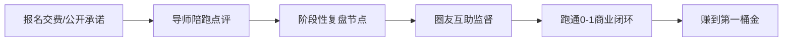
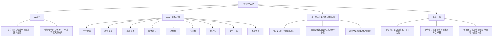
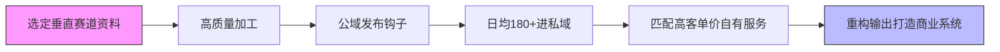
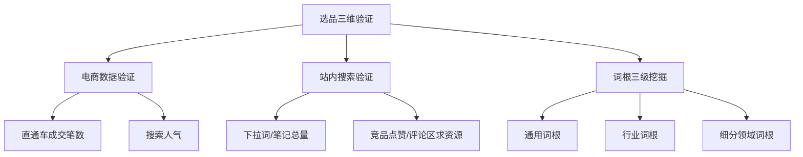
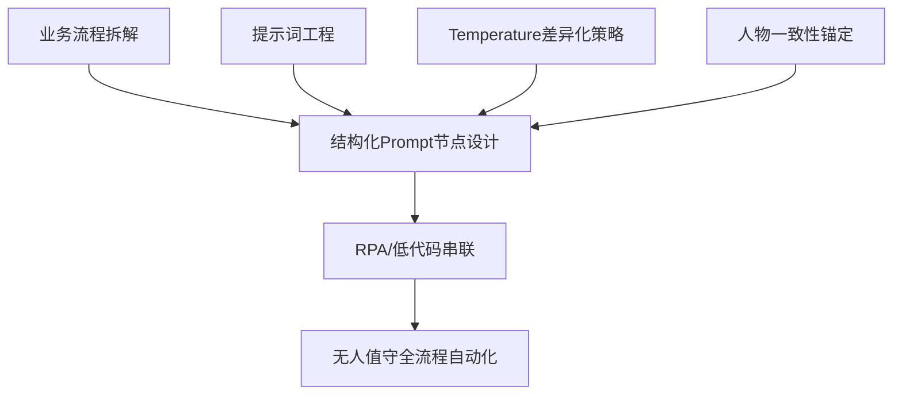
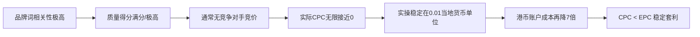
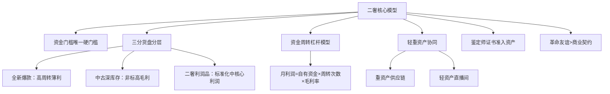
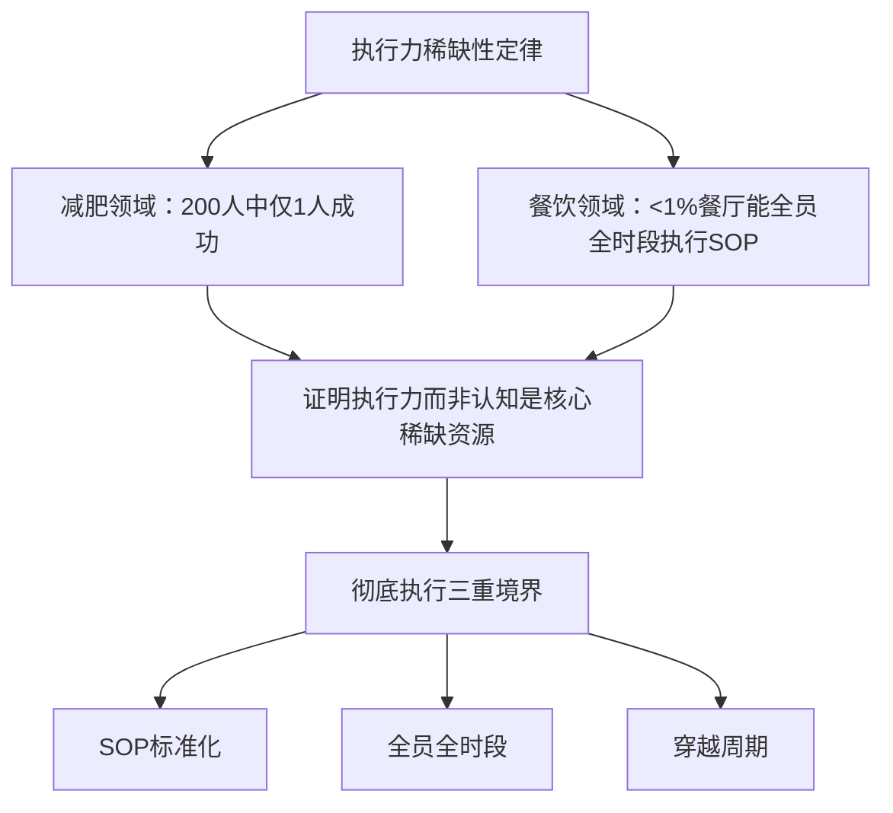
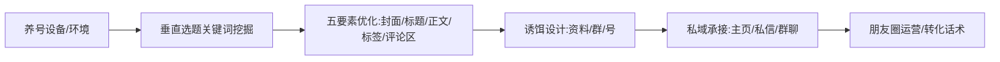

# 第 84 章 生财有术核心方法论体系总览

## 学习目标

- 理解生财小航海模式如何通过外部约束结构帮助普通人跨越知行鸿沟
- 掌握不出镜个人IP的双路径（一技之长/资源整合）与九大可对标形式的建设方法
- 理解资料整理引流法的核心逻辑：引流载体与变现主体分离、三维选品验证与私域分层漏斗设计
- 掌握AI内容自动化流水线的核心范式：提示词工程+业务流程拆解+自动化串联（RPA/低代码）
- 理解平民无货源电商模型在小红书、视频号、闲鱼三大平台的标准化SOP与核心壁垒差异
- 掌握知识付费/写作变现的高客单复利路径：个人IP信任背书+标准化交付产品+持续内容输出
- 了解海外Mediabuy品牌词竞价与独立站B2B冷启动的汇率杠杆下单人美元项目操作要点
- 识别长尾非标赛道（二奢/手机壳/写作店铺/快手知识付费）的“解决具体小问题”商业逻辑
- 内化认知底座三大铁律：利他思维、执行力优先、承认无知，并理解其与商业成果的耦合机制
- 建立公私域流量架构底层模型：公域蓄水池与私域提款机的标准化钩子、承接、转化通道

## 84.1 生活类比

想象**生财小航海是一场“有教练、有截止日期、有陪跑伙伴的马拉松训练营”**：报名交费 = 公开承诺目标（皮在肉里，不跑亏大了）；教练领跑 = 导师陪跑点评纠偏（避免跑偏、受伤、放弃）；配速员/兔子 = 圈友互助监督（集体动能托着你跑完全程）；补给站 = 阶段性复盘节点（补水、调整姿势、决定继续冲刺还是调整配速）；完赛奖牌 = 跑通0-1商业闭环，赚到第一桶金。就像零基础小白想跑马拉松，光买装备、看教程、加跑群（囤资料/学理论）没用，必须进“小航海”这种强制执行的训练营，才能在外部约束下把“想跑”变成“跑完”。再想象**资料整理引流法是“用免费试吃的奶酪（资料），筛选愿意买单的老鼠（精准付费用户），再卖给它们高利润的猫粮（后端产品/服务）”**：奶酪（资料）= 零边际成本、无限复制、别人不要也不要紧的“踏脚石”；老鼠（用户）= 只有真正饿（有强痛点/付费意识）的才会冒险来吃（付费9.9元下载）；猫粮（后端产品）= 真正的利润来源，针对老鼠的深层需求（咨询/训练营/资源对接）定制。就像超市试吃柜台：试吃（资料）免费/低成本，目的是筛选真正爱吃、愿买单的顾客，利润全在正价商品（后端）上。最后想象**AI内容自动化流水线是“把大厨（AI）从后厨请到流水线上，配上标准化菜谱、自动切菜机、传送带，实现标准化量产”**：大厨 = ChatGPT/Midjourney/SD（能力强但不稳定、需指挥）；标准化菜谱 = 结构化提示词模板（五段式/权重语法/万金油词库）；自动切菜机/传送带 = RPA/Coze/Make/Zapier（无需大厨盯着，自动流转）；质检员 = 人工抽检/数据反馈（只把关关键节点，不事必躬亲）。就像肯德基不靠大厨炒菜，靠标准化SOP+设备+半成品，让普通员工也能稳定出品“奥尔良烤翅”（爆款内容）。

## 84.2 概念地图

```mermaid
graph TD
    A[第84章核心方法论体系] --> B[训练体系：生财小航海]
    A --> C[IP资产化：不出镜个人IP]
    A --> D[引流变现：资料整理引流法]
    A --> E[AI生产力：内容自动化流水线]
    A --> F[电商模型：平民无货源标准化体系]
    A --> G[知识变现：高客单复利路径]
    A --> H[海外业务：汇率杠杆下的单人美元项目]
    A --> I[长尾赛道：非标利基生意拆解]
    A --> J[认知底座：三大铁律]
    A --> K[流量架构：公私域协同模型]
    
    B --> B1[核心机制：目标公开承诺 + 阶段性复盘 + 导师点评 + 圈友互助]
    B --> B2[项目筛选六大黄金标准]
    B --> B3[执行闭环：认知对齐 → 赛道筛选 → SOP抄作业 → MVP验证 → 复盘优化 → 矩阵放大]
    
    C --> C1[双路径：一技之长IP + 资源整合IP]
    C --> C2[九大形式：PPT混剪/虚拟头像/录屏解说/图文笔记/表情包/AI绘图/数字人/文档分享/工具推荐]
    C --> C3[起号核心：低粉爆款对标法]
    C --> C4[变现三角：卖课程/卖咨询/卖圈子]
    C --> C5[核心原则：百年不改名/全域同名/形式大于内容/内容即筛选器]
    
    D --> D1[核心原则：引流载体与变现主体分离]
    D --> D2[选品三维验证：电商数据+站内搜索+词根挖掘]
    D --> D3[私域分层漏斗：低价资料→低价咨询→高客单产品]
    D --> D4[话术SOP：付费筛选→咨询式成交→白嫖分层运营]
    D --> D5[多平台分发]
    
    E --> E1[核心定理：AI是放大器，竞争力=提示词工程+流程拆解+自动化串联]
    E --> E2[文本自动化：ChatGPT+RPA 13步法]
    E --> E3[图像自动化：SD云端零成本]
    E --> E4[视频自动化：短剧CPS批量化]
    E --> E5[进阶技巧：结构化提示词/Temperature差异化/人物一致性锚定]
    E --> E6[边界条件]
    
    F --> F1[小红书：三缺红利/三维交叉验证/双引擎流量/SEO长尾复利]
    F --> F2[视频号：投流范式/高客单选品/矩阵化测品/双阶段测品/品素决定论70/30/ROI1.8-2.0]
    F --> F3[闲鱼：反养号论/一机一卡一号/垂直店铺信任/矩阵霸屏/创业粉引流/400+店规模化]
    
    G --> G1[核心三要素：个人IP信任背书+标准化交付+持续内容输出]
    G --> G2[认知接口：旧瓶装新酒]
    G --> G3[选客户>服务客户]
    G --> G4[暴力交付]
    G --> G5[动态定位]
    G --> G6[组织进化三阶段]
    
    H --> H1[Mediabuy Brand Bid：品牌词近零CPC/CPC<EPC/港币账户降7倍]
    H --> H2[独立站B2B：内容为王/极简表单/极速响应/留钩子成交]
    H --> H3[跨境私域最小闭环：IG+FB/WhatsApp/代购人设/SPIN四步]
    
    I --> I1[二奢：资金门槛/三分货盘/资金周转杠杆/轻重协同/鉴定师证书]
    I --> I2[手机壳：AI设计+按需印刷+私域分发]
    I --> I3[写作店铺：蓝海细分/服务超预期=高复购70%+]
    I --> I4[快手知识付费：易知课堂零资质/短链路正反馈1-3天/双维蓝红海判定]
    
    J --> J1[利他思维：商业协作底层逻辑/降低交易成本]
    J --> J2[执行力优先：稀缺性定律/彻底执行三重境界/认知行动耦合律/元认知训练]
    J --> J3[承认无知：成长起点/名利分离定理/防守优先定理]
    
    K --> K1[核心模型：公域蓄水池→私域提款机→朋友圈/社群运营→高客单转化]
    K --> K2[小红书SOP：养号→选题/关键词→五要素优化→诱饵设计→私域承接→转化]
    K --> K3[多平台矩阵：一鱼多吃]
    K --> K4[引流即销售：成交率50%+/7天实测数据]
    K --> K5[闲鱼SEO霸屏/视频号生态内导流]
    K --> K6[边界条件]
```

第84章核心方法论体系
├── 训练体系：生财小航海
│   ├── 核心机制：目标公开承诺 + 阶段性复盘 + 导师点评 + 圈友互助
│   ├── 项目筛选六大黄金标准：现金流快/无囤货/可SOP/可AI/有获客路径/后端高客单
│   └── 执行闭环：认知对齐 → 赛道筛选 → SOP抄作业 → MVP验证 → 复盘优化 → 矩阵放大
├── IP资产化：不出镜个人IP
│   ├── 双路径：一技之长IP（深耕经验） + 资源整合IP（盘点信息）
│   ├── 九大形式：PPT混剪/虚拟头像/录屏解说/图文笔记/表情包/AI绘图/数字人/文档分享/工具推荐
│   ├── 起号核心：低粉爆款对标法（像素级模仿1-2万粉新号）
│   ├── 变现三角：卖课程/卖咨询/卖圈子 优劣势对比
│   └── 核心原则：百年不改名/全域同名/形式大于内容/内容即筛选器
├── 引流变现：资料整理引流法
│   ├── 核心原则：引流载体与变现主体分离（资料是钩子/产品是本体）
│   ├── 选品三维验证：电商数据+站内搜索+词根挖掘
│   ├── 私域分层漏斗：低价资料(筛选) → 低价咨询(连接/红包) → 高客单产品(核心利润)
│   ├── 话术SOP：付费筛选 → 咨询式成交 → 白嫖分层运营
│   └── 多平台分发：小红书/抖音/👸号/头条/闲鱼/快团团
├── AI生产力：内容自动化流水线
│   ├── 核心定理：AI是放大器而非救世主，竞争力=提示词工程+流程拆解+自动化串联
│   ├── 文本自动化：ChatGPT+RPA 13步法（结构化Prompt节点+无人值守流程）
│   ├── 图像自动化：SD云端零成本（Colab免费GPU+WebUI+API+定时任务）
│   ├── 视频自动化：短剧CPS批量化（ChatGPT改写+TTS+剪映模板+批量发布）
│   ├── 进阶技巧：结构化提示词模板/Temperature差异化/人物一致性锚定
│   └── 边界条件：手动跑通是前提/工具组合替代单一平台/素材为王投流为辅
├── 电商模型：平民无货源标准化体系
│   ├── 小红书：三缺红利/三维交叉验证选品/双引擎流量/SEO长尾复利/单店月纯利30-50万
│   ├── 视频号：投流范式/高客单选品/矩阵化测品组织/双阶段测品/品素决定论70/30/ROI1.8-2.0
│   └── 闲鱼：反养号论/一机一卡一号/垂直店铺信任/矩阵霸屏/创业粉引流闭环/400+店规模化
├── 知识变现：高客单复利路径
│   ├── 核心三要素：个人IP信任背书 + 标准化交付(SOP/模板/社群) + 持续内容输出
│   ├── 认知接口：旧瓶装新酒降低理解门槛
│   ├── 选客户>服务客户：筛选觉醒用户/拒绝低质客户
│   ├── 暴力交付：交付即筛选/优质用户需求简单直接
│   ├── 动态定位：定位服务于变现/赚钱后升级定位
│   └── 组织进化：零件(勤奋)→设计者(买时间)→带将者(合伙人制)
├── 海外业务：汇率杠杆下的单人美元项目
│   ├── Mediabuy Brand Bid：品牌词近零CPC定理/CPC<EPC套利/商家授权光谱/港币账户再降7倍/年入百万
│   ├── 独立站B2B：内容为王/极简表单/极速响应/留钩子成交法/25天成交$4551/100%毛利
│   └── 跨境私域最小闭环：IG+FB广告/WhatsApp聊单/代购人设/SPIN简化四步/7天首单$2000
├── 长尾赛道：非标利基生意拆解
│   ├── 二奢：资金门槛唯一硬门槛/三分货盘/资金周转杠杆/轻重协同/鉴定师证书/革命友谊>商业契约
│   ├── 手机壳：AI设计+按需印刷+私域分发/月入1万+
│   ├── 写作店铺：蓝海细分(回忆录/演讲稿)/服务超预期=高复购70%+/年入50万+
│   └── 快手知识付费：易知课堂零资质/短链路正反馈1-3天/双维蓝红海判定/无人直播自动化/焦虑贩卖论
├── 认知底座：三大铁律
│   ├── 利他思维：商业协作底层逻辑/降低交易成本/IP核心价值=利他
│   ├── 执行力优先：稀缺性定律(减肥1/200/餐厅SOP<1%)/彻底执行三重境界/认知行动耦合律/元认知训练
│   └── 承认无知：成长起点/放下体面/微小正反馈动作/名利分离定理/防守优先定理
└── 流量架构：公私域协同模型
├── 核心模型：公域(蓄水池)获客 → 私域(提款机)沉淀 → 朋友圈/社群运营 → 高客单/高复购转化
├── 小红书SOP：养号 → 选题/关键词 → 五要素优化 → 诱饵设计 → 私域承接 → 朋友圈/话术转化
├── 多平台矩阵：一份内容多平台分发(小红书/抖音/视频号/👸号/闲鱼/海外)一鱼多吃
├── 引流即销售：卖货套路做拉新/成交率50%+/7天实测300咨询→81加微→41成交
├── 闲鱼SEO霸屏：关键词布局+多账号矩阵占据搜索前排
├── 视频号生态内导流：微信生态内直接绑定跳转/内容互通提升微信指数
└── 边界条件：👸号闭塞需外部流量/引流沉淀双轮驱动/平台风控红线/征稿函违规风险

## 84.3 生财小航海 —— 普通人跨越“知行鸿沟”的标准化训练场

### 为什么需要这个概念？

大量普通人面临“道理都懂、却过不好这一生”的执行力缺失困境。自我驱动极难坚持，需要外部强制结构（截止节点、导师陪跑、同伴监督）将模糊意愿转化为确定性行动。新手缺乏项目筛选能力，易陷入“贪多嚼不烂”或“频繁切项目死循环”，需标准化筛选模型避坑。

### 核心定义

**生财小航海** 是社群发起的项目制训练营模式：设定明确目标/时间节点/导师陪跑，强制成员在周期内跑通 0-1 商业闭环。

核心机制：**目标公开承诺 + 阶段性复盘节点 + 导师点评纠偏 + 圈友互助监督**

> "如何借助生财小航海每月多赚 2 万元（附：小航海项目筛选模型）"
> 
> ——《SUMMARY.md》

### 关键性质

**筛选标准六大黄金指标**：

1. 正向现金流快
2. 无需复杂供应链/囤货
3. 可标准化 SOP
4. 可借力 AI 工具
5. 有明确公域获客路径
6. 后端有高复购/高客单产品

**执行闭环**：
认知对齐 → 赛道筛选 → SOP 抄作业 → MVP 低成本验证 → 复盘优化 → 矩阵放大

**核心战术**：
公域内容获客（SEO/算法推荐） → 私域信任转化（朋友圈/社群/1v1） → 后端高客单产品变现

### 典型例子

**案例一：应届生两周变现 7000 元**
圈友 CBJhdD0dTokH8tx8HKYc1nJSnnc 跟航海两周：加群→买号→调教→分销→写教程→办训练营→建星球→账号分销，完整跑通商业闭环。

**案例二：从“小透明”到年入 200 万**
圈友 Gn5NdifvBorUbdxvGl6ceQgXnpg：带着问题去精华帖“偷”成熟模块，像搭积木一样组合新项目，实现“以战代练”。

**案例三：8 元成本一个月赚 2 万+**
圈友 DGw1dYHSsohHu7x1AXhc4cQVnEN：低成本 MVP 验证优于完美策划，跑通陌生赛道。

### 边界条件

- 航海仅是催化剂，真正突破发生在“开始行动”那一刻，被动等待教学无效
- 仅适合符合筛选模型的低门槛项目，重资产/长周期/强合规赛道不适用
- 导师/教练质量参差不齐，需警惕“知行分离”的伪知识培训

---

## 84.4 不出镜个人 IP —— 让普通人用“资料号/工具号/笔记号”积累品牌复利

### 为什么需要这个概念？

普通人面临“不会拍视频、不想露脸、没颜值才艺”的内容生产门槛。传统认知认为 IP 必须真人出镜，导致大量人才在起号前自我劝退。需要一条低门槛、可标准化、边际成本趋近零的品牌资产积累路径。

### 核心定义

**不出镜个人 IP**：不露脸、不拍摄真人视频，通过整理资料、AI 生成内容、笔记类账号等形式建立个人品牌。

核心资产：统一 ID/头像/简介（百年不改名，全域用同名），降低用户认知成本，积累复利品牌资产。

变现逻辑：公域内容做“筛选器”吸引同频人群 → 私域高客单产品/服务变现。

### 关键性质

**双路径**：
- **一技之长 IP**：深耕行业经验输出避坑指南
- **资源整合 IP**：盘点公开信息节省决策时间

**九大可对标形式**：
PPT 混剪、虚拟头像、录屏解说、图文笔记、表情包、AI 绘图、数字人、文档分享、工具推荐

**起号核心：低粉爆款对标法**
找 1-2 万粉近期有单条爆款的新号像素级模仿，蹭同类新号算法标签红利。

> "模仿低粉爆款起号最快"
> 
> ——《docs/202305/20230516_013.md》

**变现三角**：
- 卖课程：低边际成本一锤子买卖
- 卖咨询：高单价非标服务时间杠杆弱
- 卖圈子：高复购资源聚合运营难易变冷群

### 典型例子

**“不讲李的笔记”**：10 个月 7 位数变现，零投流纯内容，PPT 排版/剪辑节奏/选题框架/引流话术固化为像素级 SOP，单人日产 3-5 小时高产出。

**木子田 PPT 项目拆解 IP**：0 基础 47 天变现 16.7 万，统一封面大字报风格将主页转粉率从个位数提升至 10%+。

**月林 AI 👸号写作变现**：法律赛道黄金洼地，标题预生成法 + 模板化生产 + 双号并行，单人日产 8 篇爆款文，日均 300 元收益。

### 边界条件

- 形式大于内容：直播/视频形式本身可迁移（AE 改文字直播 → AI 绘画/AI 聊天/虚拟主播带货），核心降低主播技能门槛提高产出比
- 内容即筛选器：爆点前置不宜过度标题党吸引急功近利小白破坏粉丝模型，需通过劝退话术筛选高质量受众
- 忠于自我阶段涨粉放缓但粉丝质量与变现单价显著提升，慢即是快

---

## 84.5 资料整理引流法 —— 用“零成本踏脚石”筛选精准付费用户

### 为什么需要这个概念？

公域流量获客成本上升、同质化严重，前端引流技巧红海化。虚拟资料边际成本为零、无库存、无限复售，是筛选“付费意向+强兴趣”用户的最优钩子。核心利润不在卖资料（红海低利），而在后端自有高附加值产品/服务体系（蓝海高利）。

### 核心定义

**引流载体与变现主体分离原则**：资料是别人的（钩子），产品必须是自己的（本体）。

> "资料是别人的，产品必须是自己的"
> 
> ——《docs/202305/20230516_046.md》

**全链路**：
选定垂直赛道资料 → 高质量加工 → 公域发布钩子 → 日均 180+ 进私域 → 匹配高客单价自有服务（咨询/训练营/陪伴营） → 重构输出打造商业系统

### 关键性质

**选品三维验证**：
- 淘宝/拼多多/抖音销量数据筛选（直通车成交笔数/搜索人气）
- 小红书站内搜索验证（下拉词/笔记总量/竞品点赞/评论区求资源）
- 词根三级挖掘（通用→行业→细分）

> "我们用名不虚传这个软件...软件主要围绕淘宝去分析，因为电商平台上的数据可以直观的展现给我们"
> 
> ——《docs/202305/20230516_033.md》

**私域分层漏斗**：
- 低价资料（筛选付费意向/建立信任 9.9-99 元）
- 低价咨询（深度连接/挖掘需求/互惠红包 200 元）
- 高客单产品/训练营/资源对接（核心利润/复利上限 999-9999 元）

**话术 SOP**：
付费筛选双重验证 → 咨询式成交（收费→解决问题→引导发红包强化互惠→推荐高客单） → 白嫖用户分层运营（免费给少量资料建立好感纳入长期池）

**多平台分发**：
小红书（笔记 SEO/推荐）、抖音（视频/直播）、👸号（搜索/推荐）、头条号（自动回复）、闲鱼（SEO 霸屏）、快团团（私域分销）

### 典型例子

**作者三恒**：4 天实测日均投入 2 小时，日均引流 180+，资料付费转化 60%，咨询二次转化 30%，单用户 ARPU 超 200 元。

**黄岛主小红书虚拟资料**：淘上红选品 + 词根挖掘 + 五步私域话术，反霸凌启蒙绘本/英语启蒙动画验证蓝海。

**饭饭写作店铺代写模式**：闲鱼/淘宝/拼多多/抖音开店售卖定制文案服务（回忆录/演讲稿/公文/软文），年入 50 万+。

### 边界条件

- 版权风险：资料源头合规性与供应链稳定性是规模化隐性门槛，迁移至微信私域（网盘/群）交付可大幅规避巡查
- 赛道生命周期必然枯竭：长久生存唯一路径是建立持续挖掘新赛道系统能力，而非依赖单一爆款
- 个体执照开店蓝 V 认证规则：一照开三店第 2/3 店需蓝 V 认证（600 元/年），规避实名占用

---

## 84.6 AI 内容自动化流水线 —— 从“会用工具”到“建流水线”的范式跃迁

### 为什么需要这个概念？

单纯会用 ChatGPT/MJ/SD 不赚钱，AI 只是放大器而非救世主。核心竞争力在于：提示词工程 + 业务流程拆解 + 自动化串联（RPA/代码/低代码）。AI 降低了“从 0 到 1”的技能门槛，但提高了“从 1 到 N”的标准化要求。

### 核心定义

结合 ChatGPT（文本生成）、Midjourney/SD（图像生成）、RPA/自动化工具（剪映、Coze、Make/Zapier），构建从选题、生产、发布到数据反馈的全自动化内容生产系统。覆盖短剧解说、表情包、数字人、SEO 文章、电商图、IP 形象等场景。

### 核心定理与推导

**核心定理：AI竞争力 = 提示词工程 + 业务流程拆解 + 自动化串联**

**推导过程**：
1. **业务流程拆解**：将内容生产拆解为标准化节点（选题→大纲→钩子→正文→标题→标签等），这是自动化的前提，解决“1到N”的标准化问题
2. **提示词工程**：为每个节点设计结构化Prompt（角色/任务/输入/输出格式/约束/少样本），将隐性经验显性化为可复用指令
3. **自动化串联**：用RPA/Coze/Make/Zapier将节点串联，实现批量生成、定时发布、数据回收无人值守
4. **Temperature差异化**：带货文案设0.3-0.7（保守连贯）、创意文案设0.9（发散），批量生成多版本供筛选
5. **人物一致性锚定**：无LoRA条件下固定核心外貌特征词（发色/瞳色/服饰），维持跨图视觉连续性

> "通过 ChatGPT+RPA 13 次拖拽实现文案全流程自动化"
> 
> ——《SUMMARY.md》

### 关键性质

**ChatGPT+RPA 文案自动化 13 步法**：
将创作拆解为 13 个结构化提示词节点（选题、大纲、钩子、正文、标题、标签等），配合 RPA 实现批量生成、定时发布、数据回收无人值守。

**SD 云端零成本批量出图**：
利用 Google Colab 免费 GPU 部署 SD WebUI (A1111/ComfyUI)，配合模型下载脚本、API 调用、定时任务，无需本地显卡、无限时长、可编程。

**结构化提示词模板法**：
五段式公式 [质量词+主体+细节+服饰+环境] + 权重语法 (词:权重) + 万金油正反向词预设。

**Temperature 差异化策略**：
带货文案 0.3-0.7（保守连贯），创意文案 0.9（发散），批量设定不同值生成多版本供筛选。

**人物一致性锚定法**：
无 LoRA 条件下强制固定核心外貌特征词（发色/瞳色/服饰），维持跨图角色视觉连续性。

### 典型例子

**惟乔短剧 CPS**：ChatGPT 写文案 + 剪映 TTS 配音 + 剪映模板智能剪辑，单人日更 10 条+，首月 1.4 万收益。

**月林 AI 👸号法律写作**：人工筛选高点击标题库 → GPT-4.0 批量生成全文 → 双号并行，30 分钟产 8 篇，日均 300 元收益。

**作者 AI 表情包**：批量生成 → 微信开放平台上架（赞赏收益极低） → 教程钩子引流小红书群聊 → 小号留微信入私域 → 售课/定制/分销变现。

### 边界条件

- **手动跑通是自动化前提**：任何 RPA 项目成功前提是手动 SOP 已跑通验证可行；自动化解决规模化（1 到 100）而非验证可行性（0 到 1）。
- **工具组合替代单一平台依赖**：组合专用小工具（热点宝选品、轻抖提取、超级写手生成、一帧秒创视频、RPA 分发）构建最优链路。
- **素材为王投流为辅**：高点击低转化素材必换原则，投流只能放大优质素材无法拯救烂素材。
- **平台风控红利期有窗口期**：快进快出榨取价值（废号轮播）而非硬刚平台（蓝 V 认证/开小店交保证金）。

---

## 84.7 平民无货源电商模型 —— 供应链轻量化的“选品-测品-放大”工程化体系

### 为什么需要这个概念？

传统电商需囤货/压资金/承担库存风险，普通人准入门槛高。平台流量红利期（小红书/闲鱼/视频号/快团团）需要低成本、快速试错、可矩阵复制的打法。核心优势：试错成本低（几百元启动）、可快速复制（SOP 化）、确定性强（数据驱动决策）。

### 核心定义

无需囤货，利用平台流量红利通过选品、铺货、客服外包实现低风险电商变现。三大主流模式：小红书无货源/虚拟资料、视频号短视频挂车投流、闲鱼矩阵霸屏。

### 关键性质

#### 三大平台核心指标对比

| 维度 | 小红书无货源 | 视频号投流带货 | 闲鱼矩阵霸屏 |
|------|-------------|---------------|-------------|
| **核心红利** | 三缺红利期（缺商家/产品/深度服务） | 投流范式（稳定/可复制/可放大/不废号） | 反养号论/一机一卡一号/垂直信任模型 |
| **启动资金** | 单店约 3000-4000 元 | 账号矩阵+投流预算 | 极低（仅需设备/手机卡） |
| **选品方法** | 三维交叉验证（同行+电商爆款+热度词） | 高客单高利润（利润率>70%、新奇特、排除黑五类） | 榜单复制+蓝海挖掘（买家多卖家少） |
| **流量模式** | 双引擎：商城搜推+笔记种草；SEO长尾复利>推荐脉冲 | 投流驱动：千川/投流工具测款 ROI>1.2 放量 | 搜索SEO霸屏：关键词布局+多账号矩阵占据前排 |
| **核心指标** | 单店稳态日销 5000-8000 元、三个月营收 50 万 | ROI 1.8-2.0；品素决定论 70/30 法则 | 7-10 店矩阵霸屏；400+ 店规模化向非核心城市迁移 |
| **组织形态** | 个人/小团队 SOP 化 | 3-6 人组+人均 5 台安卓机+专职投手 | 铁三角（客服-运营-财务）非一线城市低成本 |
| **核心壁垒** | 选品判力+伪原创SOP+私域承接 | 去重剪辑能力+选品判力+供应链熔断机制 | 设备隔离+转化率管理+差评炼丹+反侧写竞品销量 |
| **风控红线** | 违规引流/虚假发货/侵权售假 | 店铺体验分<4分隐形下架；合作门槛≥4.2分 | 违规关联管控；设备指纹污染 |

#### 小红书模式
- **三缺红利期**：缺商家/产品/深度服务
- **启动资金**：单店约 3000-4000 元
- **三维交叉验证选品法**：同行+电商爆款+热度词
- **双引擎流量**：商城搜推+笔记种草
- **SEO 长尾复利 > 推荐流量脉冲**
- **实证**：单店稳态日销 5000-8000 元、三个月营收 50 万

> "2023 年是小红书店铺无货源项目的风口红利期...现在入场小红书就犹如 10 年做淘宝电商一样"
> 
> ——《docs/202305/20230516_034.md》

#### 视频号模式
- **自然流高风险** → 转型投流（稳定/可复制/可放大/不废号）
- **高客单高利润选品**：利润率>70%、新奇特、排除黑五类
- **矩阵化测品组织**：3-6 人组+人均 5 台安卓机+专职投手
- **双阶段测品**：1 测验品/2 测探价
- **品素决定论（70/30 法则）**：品与素材贡献度超 70%，投放技巧不超 30%
- **实证**：新号冷启动曲线验证 ROI 1.8-2.0

#### 闲鱼模式
- **反养号论**：养号仅提升买家标签，不提升卖家权重
- **一机一卡一号**设备隔离
- **垂直店铺专业度信任模型**
- **矩阵店铺霸屏策略**：7-10 店占据搜索前排
- **创业粉引流闭环**：低价虚拟课钩子→文件过大引导加微→5 元/个批发变现→分销代理裂变
- **400+ 店铺规模化**必然向非核心城市迁移（山东聊城/滨州低成本组建铁三角团队）

### 典型例子

**卧龙/宅男小红书无货源**：单店三个月营收 50 万，五步选品法 + 伪原创素材生产标准。

**东哥视频号带货矩阵化**：一证五号身份证合规模型 + 安卓手机双开物理隔离 + 测品-爆款-放大三阶段数据驱动 + 爆款定制链接/SKU 阶梯定价 + 供应链熔断机制，累计收益 4 万+。

**远方/公子唯心闲鱼矩阵**：保姆级教程 12 大章 64 小章，二手书合规准入，快团团推广大团长模式。

### 边界条件

- 副业天花板：个人全职年入 15-20 万，有货源优势应切淘宝/拼多多
- 店铺体验分风控红线：视频号店铺分<4 分触发隐形下架，合作门槛≥4.2 分
- 供应链响应速度决定爆款变现上限：48 小时发货红线，单一供应链依赖风险极高
- 闲鱼隐藏销量需反侧写：追踪总销量增量+咨询转化估算+未屏蔽同行采样三维校准

---

## 84.8 知识付费/写作变现 —— 个人 IP 信任背书下的高客单复利路径

### 为什么需要这个概念？

普通人缺乏实物供应链/资金/技术，但拥有认知/经验/技能可变现。知识付费边际成本趋近零、可无限复售、复利效应强，是个人 IP 最高杠杆变现形态。核心难点在于获客而非交付，需公域内容建立信任背书、私域标准化转化。

### 核心定义

通过👸号/小红书/快手/抖音/视频号引流，售卖 99-9999 元训练营/社群/咨询/模板/陪跑，实现年入百万/月入 5 万+。

**核心三要素**：个人 IP 信任背书 + 标准化交付产品（SOP/模板/社群） + 持续内容输出

### 关键性质

**认知接口**：旧瓶装新酒，降低用户理解门槛（如 ChatGPT 课不讲原理，只讲“原流程不变，效率提升 10 倍”）。

**选客户比服务客户重要**：筛选“正在觉醒/已觉醒”客户，稍加助力即成，拒绝“需监督执行”的低质客户。

**暴力交付**：交付本质是筛选优质用户，而非无限陪伴；优质用户需求简单直接（结果/资源/流量），服务越重往往产品越弱、用户越差。

**动态定位**：定位服务于变现，而非长期主义信仰；判断项目赚钱 → 定位服务项目 → 赚钱后升级定位。

**组织进化三阶段**：零件（勤奋）→ 设计者（懒惰/买时间/外包运营交付社群）→ 带将者（搞定合伙人/合伙人制）。

**交付标准化**：1 对 1 陪跑打磨 SOP/FAQ → 降维标品规模化（299/599/999 元）；统一封面风格将主页转粉率从个位数提升至 10%+。

### 典型例子

**芷蓝**：ChatGPT 大师课借势单渠道预售 60 万+、全年预计 300 万，核心心法：创业失败必然论、核心三件事、暴力交付。

**老金写作 BOSS 模式**：多平台矩阵开店避坑，私域物理隔离微信账号分层定价（微信 A 接高客单/微信 B 接拼多多，同质服务利润差 40%+），ChatGPT 辅助 SOP，写手团队四阶段进化。

**漫漫小红书知识付费 IP**：半年涨粉 20 万年变现 40 万，垂直于用户而非内容选题、暴露弱点建立真实人设、广告调性预埋反向定制商业价值。

**杨小六快手知识付费**：易知课堂零资质入驻，双维度蓝红海判定法，无人直播自动化成交，课程焦虑贩卖论/冲动消费变现模型。

### 边界条件

- 个体执照注册👸号推流受限风险：社群共识建议新手优先用个人身份证注册
- 315 等节点主动下架虚拟类目商品链接避险：保全大店存活，风波过后再上架
- 服务质量超预期是高复购（70%+）唯一护城河：拒绝一次性生意，定金验收机制建立安全感

---

## 84.9 海外 Mediabuy 与独立站 B2B —— 汇率杠杆下的单人美元项目

### 为什么需要这个概念？

国内流量红利见顶、竞争内卷，海外市场汇率杠杆（7 倍）、高客单价、低竞争强度形成结构性机会。单人/小团队缺乏外贸经验/英语/合规/收款渠道，需最小闭环验证路径。核心模式：联盟营销、品牌词竞价、独立站 B2B 询盘成交，均属轻资产、高利润、可复制。

### 核心定义

**Mediabuy Brand Bid**：利用 Google Ads 竞价商家品牌词（CPC 近 0.01 当地货币）直链联盟追踪链接，CPC<EPC 即稳赚，三组实盘 ROI 359%-496%，港币账户成本再降 7 倍，单人年净利破百万“非常轻松”。

**独立站 B2B 冷启动**：细分 Niche 选品 → 独立站搭建 → 内容 SEO/社媒矩阵获客 → 询盘跟进/报价/成交 → 收款 → 复购/转介绍，25 天成交 $4551.7，100% 毛利。

**跨境私域最小闭环**：IG+FB 广告引流 → WhatsApp 聊单 → 代购人设降低防备 → SPIN 简化版四步聊单 → B 端挖掘复购，7 天首单 $2000+，有效对话成本 ≤$5。

### 核心定理与推导

**品牌词近零成本定理**：

**推导过程**：
1. **相关性极高**：品牌词与广告主落地页/业务高度相关，Google 给予极高质量得分（满分/接近满分）
2. **无竞争**：多数商家不竞价自己品牌词，竞争对手因商标保护/政策风险不敢竞价
3. **CPC→0**：在 Google Ads 竞价机制下，质量得分高+无竞争=实际 CPC 可压至极低（实测 0.01 当地货币）
4. **货币杠杆**：港币账户出价 0.01 HKD ≈ 0.0013 USD，成本较美元账户再降 7 倍
5. **套利条件**：联盟 Offer EPC 很少低于 0.01 美元，只要 CPC < EPC 即可稳定盈利

> "因为你是出价品牌词，品牌词实际谷歌出价是无限接近于零...单价到0.01完全没有问题"
> 
> ——《docs/202305/M0hMdjWj3o8WtNxZdv4cLnfenIh.md》

**港币账户汇率杠杆计算公式**：
- 美元账户 CPC 成本 = $0.01/次
- 港币账户 CPC 成本 = HK$0.01/次 ≈ $0.0013/次（按 7.8 汇率）
- 成本降低倍数 = 0.01 / 0.0013 ≈ 7.7 倍

### 关键性质

**商家授权光谱三层级**：
- 显性允许：商家条款明确许可品牌词竞价
- 默许：商家知情但不干预（需流量）
- 允许竞品词：禁止自有品牌词但允许竞品词竞价

**内容为王技术为辅**：Google 算法已足够智能，唯有持续输出高质量专业博客文章是核心；外链建设/过度技术优化属低 ROI 行为。

**FB 账号资产与广告资产分离**：企业户授权个人户抗封体系，核心资产沉淀在个人号/WhatsApp/INS 私域好友，广告账户/主页视为可消耗耗材。

**代购/中间商人设**：天然站在“帮客户省钱/避坑”一方，非卖家身份消除推销对抗感，更易成交高客单，成交后自然转型“全品类采购顾问”赚差价。

**Wise 推荐计划同构验证**：品牌词低价竞价赚取固定佣金，单日佣金破万英镑，即时结算、无扣量风险。

### 典型例子

**M0hMdjWj3o8WtNxZdv4cLnfenIh**：三组真实账户数据验证 ROI 359%-496%，模式运行十余年非短期漏洞。

**VILid7sleoZ6puxkchxcRM9vn6g**：25 天成交法国 B 端订单 $4551.7，留钩子成交法（预判需求主动提供测试文件）锁单。

**Nt9IdI0b0okp1MxGKBacQtxSn3e**：一人即公司（1 部手机+1 张 HK 卡+1 台电脑+1 套 FB 账号体系），减法启动无备货/建站/复杂物流。

### 边界条件

- 门槛在于英语/工具/合规/收款渠道：Wise/Payoneer 实名、香港/美国银行卡、企业户授权体系是基建
- 平台风控：FB 广告账户易封需企业户授权隔离，Google Ads 需规避品牌词授权红线
- 物流成本参数：欧美正常单票物流费 $100-300 为定价提供关键成本锚点
- 品牌词竞价非全违规：需筛选允许竞价的大品牌 Offer，Awin 等联盟双周支付保障现金流安全

---

## 84.10 长尾非标赛道拆解 —— “解决具体小问题”即生意的利基威力

### 为什么需要这个概念？

主流赛道竞争激烈、流量昂贵，长尾非标赛道竞争较小、需求巨大、门槛适中。普通人无需追求“大而全”，深耕具体垂直痛点即可构建“小而美”高利润生意。验证“方法论迁移能力强于单一业务护城河”的反脆弱性。

### 核心定义

二奢/手机壳/写作店铺/快手知识付费等非主流赛道实操，年入 10 万-300 万+，证明“解决具体小问题”即可生意。核心逻辑：垂直细分 + 标准化交付 + 私域高客单/高复购 + 轻资产运营。

### 关键性质

**二奢资金周转杠杆模型**：

$$
\text{月利润} = \text{自有资金} \times \text{周转次数/月} \times \text{单次毛利率}
$$

**变量定义**：
- 自有资金：投入运营的自有现金（单位：万元）
- 周转次数/月：资金在一个月内完成“采购→销售→回款”的完整循环次数
- 单次毛利率：单次周转的毛利率（如 10% 即 0.1）

**单位说明**：月利润单位与自有资金单位一致（如万元）。

**边界条件**：
- 前提是货源稳定、销售渠道畅通、回款周期可控
- 资金流动比例建议 3:1（压货资金:流动采购资金）
- 动销率（周转速度）是生死线，非库存总值

**手机壳**：定制/无货源月入 1 万+，AI 设计+按需印刷+私域分发

**写作店铺**：代写/改简历/文案年入 50 万+，蓝海细分策略聚焦“写回忆录/演讲稿”等具体垂直需求，服务质量超预期是高复购（70%+）唯一护城河

**快手知识付费**：易知课堂零资质入驻，短链路正反馈（1-3 天出单），视频混剪去重技术栈+无人直播自动化，双维度蓝红海判定法+赛道双维度分类矩阵

### 典型例子

**凡响二奢**：从零入局一年完整历程，十个阶段从试错、野蛮生长、错误决策崩盘、破釜沉舟转型至起死回生，前员工拆分 4 小团队人均效能利润率更高。

**杨小六快手知识付费**：大厂研发转创业，新手出单周期最快当天、最长 6 天，判断账号权重简易标准：搬运美女视频测播放量>几百。

**老金写作店铺**：多平台矩阵开店避坑，三类客户分级过滤低价比价型。

### 边界条件

- 二奢现金流业务优先保障：品牌业务在现金流安全垫之上建设，资源错配导致现金奶牛断奶、资金链断裂
- 革命友谊>商业契约：共同经历生死、相互补位、系统性思考高效执行的信任关系，是穿越周期实现反转根本原因
- 平台政策窗口期：快手/视频号早期算法扶持力度大，优质内容可自然流分发，属平台生态建设期红利窗口
- 单纯卖资料天花板低：核心在于利用资料作“钩子”筛选高意向用户，再通过附加产品/解决方案实现高客单转化

---

## 84.11 认知底座三大铁律 —— 利他思维、执行力优先、承认无知

### 为什么需要这个概念？

普通人逆袭核心障碍非技术/资源，而是“打工思维”导致的认知鸿沟：想赚钱却不愿付出价值、只想不做、不敢承认无能。缺乏底层操作系统，易被“捷径思维/完美主义/体面焦虑”绑架，无法在行动中迭代认知。

### 核心定义

**利他思维**：商业协作底层逻辑，优先为用户/合作伙伴创造价值、解决问题，而非单向索取，是高客单/高复购业务基石。

**执行力 > 创意/认知**：好主意很多，做下去的很少；认知突破本质是在行动中获得反馈修正认知，核心口诀“解决真正的问题，赚钱的事多做十遍”。

**承认无能与无知**：成长起点，接纳自己“无能、无知、无资源”现实，放下体面，从最微小、最具体、最确定的正反馈动作做起（抄作业、跟航海、卖资料）。

### 关键性质

**利他思维即降低交易成本**：持续高价值输出建立专业可信标签，大幅降低后续交易决策成本与信任成本，IP 核心商业价值=利他。

**执行力稀缺性定律**：减肥 1/200 成功率、餐厅 SOP 落地率<1% 跨域数据证明执行力而非认知是核心稀缺资源，“彻底执行”三重境界：SOP 标准化/全员全时段/穿越周期。

> "经营企业的道理其实一点也不复杂，跟减肥一样，难的是，你能不能彻底执行。"
> 
> ——《docs/202305/20230516_003.md》

**数据来源与互证分析**：
- **减肥 1/200 成功率**：来源于《docs/202305/20230516_003.md》作者经验估算，反映生理本能层面的“知易行难”
- **餐厅 SOP 落地率<1%**：来源于同一文献作者行业观察，反映商业组织层面的“知易行难”
- **跨域互证逻辑**：两个领域分属生理本能与商业组织，均表现为“认知清晰（少吃多动/标准动作明确）”但“执行极难（成功率<1%）”，证明执行力稀缺是普世规律而非特定领域现象

**认知-行动耦合律**：认知清晰→行动坚定→高耗能执行传导机制，只有深度认知能支撑穿越周期的困难任务。

**元认知训练**：停留几秒激活理智脑、写作复盘疏解情绪、三维语言（积极/和善/开放）重塑思维，从生理层面重塑大脑决策回路。

### 典型例子

**古茗拉横幅/每日分享/早会案例**：对标“彻底执行”三重境界，组织执行力边界验证。

**作者每日分享获出版邀约 vs 古茗横幅规模化崩塌**：执行复利非线性收益曲线正反面教材。

**996 程序员 21 天从零到变现**：社群杠杆×高频行动×利他分享模型验证副业可复制路径。

**老吴/二丫/梦宸三条不同起点财富跃迁**：记账基座、被动收入锚点、三阶段风控、保险四件套、双腿走路模型。

### 边界条件

- **名利分离定理**：财务自由阈值后，名气转为纯成本项（隐私/安全/精力/舆论风险），高认知群体理性最优解是主动隐退/物理隔离/社交防火墙。
- **认知觉醒三层级**：主流追名逐利→被迫以隐私换钱→觉醒者识破代价主动选择清福，“能觉得钱够用”属高阶认知稀缺品。
- **防守优先定理**：有房贷/幼儿/积蓄有限阶段，“主业防守+副业进攻”边际收益高于裸辞创业，金钟罩（社保+保险四件套）守住城池。

---

## 84.12 公私域流量架构 —— 蓄水池与提款机的底层通道

### 为什么需要这个概念？

公域流量归平台、不确定、易被收割；私域流量归自己、可反复触达、高信任、高转化。所有平台玩法最终归宿一致，缺乏统一底层模型导致动作割裂、资产沉淀困难。需要标准化“钩子设计、诱饵、承接、话术”四大关键动作打通转化链路。

### 核心定义

**公私域协同模型**：公域（小红书/抖音/视频号/👸号/闲鱼/海外社媒）获客 → 私域（微信/社群）沉淀 → 朋友圈/社群运营 → 高客单/高复购转化。

资料整理、钩子设计、后端话术、附加产品/服务是私域转化率的核心决定因素。

### 关键性质

**小红书探照灯计划/笔记引流 SOP**：

**多平台矩阵运营**：
一份内容多平台分发（小红书/抖音/视频号/👸号/闲鱼/快团团/Ins/FB/LinkedIn/TikTok），一鱼多吃，降低单平台算法风险。

**引流即销售**：
用卖货套路做拉新，成交率 50%+（开场建立信任→需求确认/痛点挖掘→方案展示→处理顾虑→明确行动号召→成交后服务），7 天实测咨询 300+→加微 81 人(27%)→成交 41 人(50.6%)。

**闲鱼 SEO 霸屏**：
利用搜索规则，关键词布局+多账号矩阵发布占据搜索结果前排，精准流量被动获取再引导至私域。

**视频号生态内导流**：
同属微信生态可直接绑定跳转无第三方流失，视频号内容与👸号互通共同作用于微信指数排名。

### 典型例子

**辰风视频号导流👸号**：半个月 10W+ 浏览量，共情文案+卡点剪辑+跨平台复用抖音爆款文案音频+剪映混剪去重标准化流程。

**叁斤小红书 IP**：从月入 30 元到 IP 变现 2 万+，五维筛选标准（有成绩/有方法论/可复制/主业关联/个人喜好）锁定小红书赛道。

**木子田私域放大器**：公域是放大镜筛选精准用户，私域是放大器深度信任最大化单客价值。

**老彭小红书航海日志**：三阶段运营模型（快速起号-高效做号-安全引流）实测日引流 100+。

### 边界条件

- 👸号高度闭塞：单靠内部推荐无法规模化冷启动，必须主动站内互推/站外投放/多平台分发引入外部流量
- 引流沉淀双轮驱动：单纯引流不维护用户(无内容促活/无社群运营/无朋友圈建设)导致粉丝流失低活跃
- 平台风控红线：小红书私信前置检测（长按无引用/回复选项即隐形限流）、群聊单账号日承接上限 200 人、企业号抗风险显著优于个人号
- 征稿函引流近期违规风险加大：平台监管趋势打击力度加大，建议暂停操作

---

## 84.13 多源对照

### 共识

所有素材均认同：**执行力是核心稀缺资源**，认知突破必须在行动中完成，私域流量是变现的核心资产，标准化 SOP 是规模化前提。

### 分歧

- **项目筛选策略**：毛韩主张“筛选匹配当下能力”，芷蓝主张“低成本试错多尝试”，二者在风险偏好上存在差异
- **IP 起号路径**：“不讲李”主张像素级模仿低粉爆款，漫漫主张暴露弱点建立真实人设，前者重形式复制，后者重内容差异化
- **AI 变现路径**：月林主张“标题即产品 AI 为流水线工人”，惟乔主张“解说模式降低剪辑门槛”，前者重文本结构化，后者重视频形式创新

---

## 84.14 设计中的取舍

**为什么不用“全平台铺开”而是“单点突破+矩阵复制”？**
资源有限时，全平台铺开导致注意力分散、单平台深度不足、SOP 无法打磨。单点跑通模型（如小红书/视频号/闲鱼任一平台），验证“选品-内容-转化”全链路后，再通过矩阵号横向复制，边际成本递减、抗风险能力增强。

**为什么“资料引流”不直接“卖资料”而要“分层漏斗”？**
单纯卖资料陷入红海价格战，边际利润极低；引流载体（资料）与变现主体（高客单服务）分离，前端筛选精准用户，后端提供深度解决方案，才能实现 LTV 最大化。

**为什么“Mediabuy Brand Bid”不建站落地页而直接直链？**
自建落地页增加技术门槛、合规审核风险、维护成本；Direct Linking 直链联盟追踪链接，零技术门槛、极速部署、可快速测试切换 Offer。若建站落地页会增加具体合规风险：Google Ads 着陆页政策要求落地页内容与广告高度相关、禁止桥页/门页、需提供真实业务信息与联系方式、不可仅作跳转中转，直链联盟链接天然规避此类审核风险。

**为什么“视频号带货”选择“投流”而非“自然流”？**
自然流不稳定、易限流封号，账号资产易报废；投流具备稳定、可复制、可放大、不废号四大优势，是长期可复利的范式。

---

## 84.15 动手练习

### 练习 1：设计你的‘小航海’项目筛选清单

假设你想在未来 3 个月内启动一个副业项目，请依据‘小航海项目筛选六大黄金标准’设计一份自查清单：

1. 正向现金流有多快？（预计首单周期：___天）
2. 是否涉及复杂供应链/囤货？（是/否，若是则 PASS）
3. 核心流程能否拆解为标准化 SOP？（列出关键 3-5 个标准动作：___）
4. 能否借力 AI 工具提效？（具体工具与环节：___）
5. 公域获客路径是否明确？（搜索/推荐/投流/私域裂变，主渠道：___）
6. 后端是否有高复购/高客单产品规划？（产品形态/价格带：___）

回答问题：
- 若某指标不达标，是选择‘换赛道’还是‘补能力’？决策依据是什么？
- 如何用‘飞书工具表单’将此清单固化为可复用的筛选模型？

### 练习 2：拆解一个‘不出镜 IP’的像素级模仿 SOP

在小红书/抖音/视频号搜索你感兴趣的垂直领域，找到 3 个‘粉丝 1-2 万、近期有单条爆款、非头部大 V’的‘低粉爆款’账号：

1. 账号主页四件套（昵称/头像/简介/背景图）像素级拆解：核心关键词/视觉风格/信任背书/行动指令是什么？
2. 爆款笔记/视频结构复刻：封面大字报文案/标题钩子/正文段落结构/BGM 节奏/剪辑转场/评论区引导话术
3. 引流钩子设计：诱饵形式（资料/群/号/小程序）/ 植入位置/话术脚本/私域承接路径
4. 将上述拆解整理为‘像素级模仿 SOP 清单’，包含：选题表/封面模板/文案结构/剪辑节奏表/发布清单/引流话术库

回答问题：
- 为何起号初期要避开头部大 V，专找‘低粉爆款’模仿？
- ‘形式大于内容’在不出镜 IP 中如何体现？给出一个跨品类迁移的例子。

### 练习 3：搭建一条‘资料引流→私域分层转化’的最小闭环

选择一个你熟悉的垂直领域（如：考公/育儿/职场技能/AI 工具/跨境电商），完成以下动作：

1. 选品验证：用‘淘上红’法在淘宝/拼多多/抖音搜索核心词，筛选直通车成交笔数>100、搜索人气高的虚拟资料/实物单品；再在小红书搜索下拉词/笔记量/竞品点赞/评论区求资源三维交叉验证。
2. 制作钩子：整理一份高感知价值、低获取成本的‘资料包’（如：思维导图/工具合集/避坑指南/模板），设计封面/标题/钩子文案。
3. 公域分发：在小红书/抖音/👸号其中一个平台发布 3-5 条引流笔记/视频，植入‘评论/私信关键词领取’钩子。
4. 私域承接与分层：建立‘资料群’（自动进群发资料）→ 筛选付费用户进‘咨询群’（9.9-99 元资料/低价咨询）→ 邀请高意向进‘核心群’（高客单产品/服务）。
5. 话术执行：编写‘付费筛选→咨询式成交→红包复投→高客单推荐’四步标准话术，实测转化率。

回答问题：
- 为何说‘资料是别人的，产品必须是自己的’？若混淆二者会陷入什么红海？
- 如何用‘白嫖用户分层运营’策略处理拒绝付费的用户？边际成本与未来转化概率如何权衡？

### 练习 4：手工跑通一条‘ChatGPT+RPA 文案自动化’微流程

不写代码，利用 Coze/扣子/影刀 RPA/按键精灵等低代码工具，完成一个‘选题→大纲→标题→正文→标签→定时发布’的微闭环：

1. 在 Coze 搭建一个 Bot：配置 6 个技能节点（选题生成/大纲生成/标题生成/正文生成/标签生成/格式化输出），每个节点使用结构化 Prompt（角色/任务/输入/输出格式/约束/少样本）。
2. 在影刀 RPA/按键精灵录制流程：打开目标平台后台 → 循环调用 Bot API 获取内容 → 填入编辑器 → 点击发布/定时 → 记录链接到 Excel。
3. 测试跑通 3-5 条内容，记录：单条耗时/通过率/人工干预次数/数据表现（阅读/互动）。

回答问题：
- 为何强调‘手动跑通是自动化前提’？若 SOP 未跑通直接上 RPA 会发生什么？
- Temperature 参数在带货文案(0.3-0.7)与创意文案(0.9)中的差异化设定原理是什么？如何批量设定不同值生成多版本供筛选？

### 练习 5：对标拆解一个‘长尾非标赛道’的商业模式画布

从‘二奢/手机壳定制/写作店铺/快手知识付费’中选择一个，完成商业模式画布九宫格拆解：

1. 客户细分：目标用户画像（年龄/性别/地域/收入/痛点/觉醒度）
2. 价值主张：解决的具体小问题是什么？核心差异化优势（价格/服务/信任/效率）？
3. 渠道通路：公域获客平台/内容形式/私域承接路径/转化场景
4. 客户关系：自动化/人工服务/社群运营/个人 IP 信任背书/超预期服务
5. 收入来源：主产品价格/客单价/复购率/LTV/边际成本结构
6. 核心资源：供应链/技能/工具/账号矩阵/私域流量池/信任背书（如鉴定师证书）
7. 关键业务：选品/内容生产/引流/转化/交付/售后/供应链管理/风控
8. 重要合作：上游供应商/平台官方/同行联盟/工具方/支付渠道/物流商
9. 成本结构：固定成本/变动成本/获客成本(CAC)/运营成本/合规成本/试错成本

回答问题：
- 该赛道的‘反脆弱性’体现在哪里？（如：二奢前员工拆分小团队人均效能更高/方法论迁移能力强于单一业务护城河）
- 若平台风控收紧/供应链断供/流量红利消退，该模式的‘最小生存单元’是什么？如何快速切换？

---

## 84.16 本章小结

这一章中我们学习了生财有术社群沉淀的核心方法论体系。首先从**生财小航海**切入，理解外部约束结构如何帮助普通人跨越知行鸿沟；其次掌握**不出镜个人 IP**的双路径与九大形式，建立低门槛品牌资产积累路径；接着深度拆解**资料整理引流法**的“引流载体与变现主体分离”核心逻辑与私域分层漏斗设计；然后系统讲解**AI 内容自动化流水线**的提示词工程+业务拆解+自动化串联范式；随后对比**平民无货源电商模型**在小红书、视频号、闲鱼三大平台的差异化打法与核心壁垒；再剖析**知识付费/写作变现**的高客单复利路径与组织进化法则；进而揭示**海外 Mediabuy 与独立站 B2B**的汇率杠杆下单人美元项目操作要点；继而识别**长尾非标赛道**的“解决具体小问题”商业逻辑与反脆弱性；接着内化**认知底座三大铁律**及其与商业成果的耦合机制；最后建立**公私域流量架构**底层模型，标准化钩子、承接、转化通道。

本章我们一起学习了以下概念：

| 概念 | 解释 |
|------|------|
| 生财小航海 | 普通人跨越知行鸿沟的标准化训练场：外部约束+导师陪跑+SOP抄作业+MVP验证 |
| 不出镜个人 IP | 低门槛品牌资产积累路径：双路径/九大形式/低粉爆款对标/百年不改名/变现三角 |
| 资料整理引流法 | 引流载体与变现主体分离：资料作钩子筛选用户，后端高客单产品作利润核心 |
| AI 内容自动化流水线 | AI是放大器非救世主：提示词工程+业务拆解+RPA串联，实现文本/图像/视频全自动化生产 |
| 平民无货源电商模型 | 三大平台差异化打法：小红书SEO长尾/视频号投流稳/闲鱼矩阵霸屏，核心壁垒各异 |
| 知识付费/写作变现 | 个人IP信任背书+标准化交付+持续内容输出：选客户>服务客户，暴力交付筛选优质用户 |
| 海外 Mediabuy/独立站 B2B | 汇率杠杆下单人美元项目：品牌词近零CPC套利/内容为王B2B询盘/跨境私域最小闭环 |
| 长尾非标赛道拆解 | 解决具体小问题即生意：二奢资金周转/手机壳AI定制/写作店铺服务超预期/快手短链路正反馈 |
| 认知底座三大铁律 | 利他思维降低交易成本/执行力稀缺性定律/承认无知是成长起点/名利分离/防守优先 |
| 公私域流量架构 | 公域蓄水池引流→私域提款机沉淀→朋友圈/社群运营→高客单转化：钩子/诱饵/承接/话术四大动作标准化 |

下一章中，我们将学习如何将这些方法论整合为个人的商业操作系统，并针对不同资源禀赋设计定制化的执行路线图。

