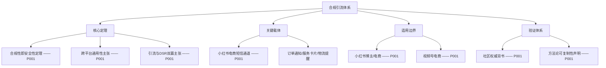
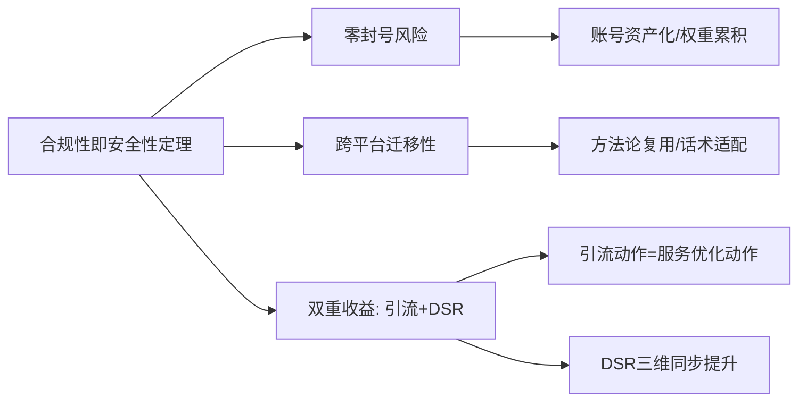
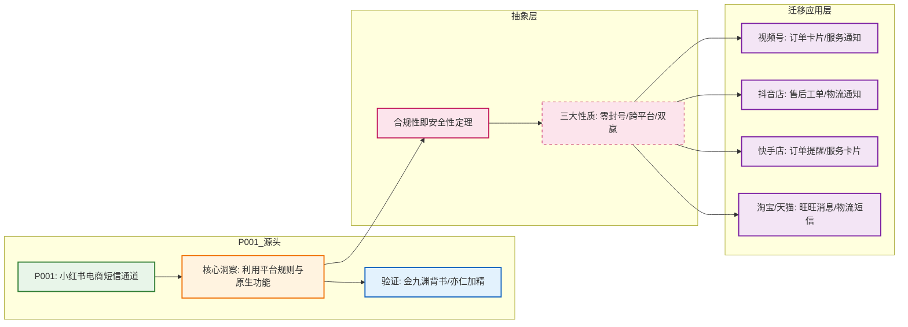

# 第 46 章 合规性即安全性定理 —— 利用平台规则与原生功能实现零封号引流与DSR提升

## 学习目标

- 理解合规性即安全性定理的核心逻辑，区分合规引流与隐蔽引流的本质差异
- 掌握利用平台原生功能（如电商短信、订单通知）实现零封号引流的操作范式
- 了解引流动作与DSR提升的双重收益机制，实现引流与服务体验优化同步进行
- 能够根据平台规则边界设计跨平台可迁移的合规引流SOP（小红书/视频号通用）
- 建立风控自检机制：操作前预判规则边界，操作中监控违规信号，操作后复盘数据指标

## 46.1 生活类比

想象合规引流是**银行柜台办理业务的“合规话术”**。在这个类比中，**平台规则**对应银行业务办理规范手册，规定了柜员可以做什么、不能做什么；**原生功能（短信/订单通知）**对应银行官方发放的“业务办理指引单/短信通知”，是银行授权、用户信任、送达率100%的官方触达载体；**引流信息**对应你在“指引单”合规空白处贴心备注的“温馨提示：VIP客户经理微信可咨询理财”，它不是强行塞进用户手中的小广告，而是顺势植入在用户正经办业务、高度关注的官方文件里；**用户**对应来办理业务的储户，他们手里拿着官方单据，天然信任单据上的信息；**安全性**对应保安（风控）不仅不拦截，还默许通过，因为你的动作完全在规范手册允许范围内，甚至是在协助银行提升服务体验。就像柜员利用官方单据合规传递增值服务信息，合规引流利用平台官方触达渠道合规传递私域钩子。**核心逻辑在于：安全性不来自你藏得多深（隐蔽性），而来自你用得多正（合规性）。** 这一类比将贯穿全章：后续所有操作动作（如编辑短信模板、配置服务卡片）均可映射为“柜员在指引单合规区域书写增值服务提示”，所有风控判定均可映射为“保安核验动作是否在规范手册白名单内”。

## 46.2 概念地图



## 46.3 合规性即安全性定理 —— 利用平台规则实现零封号引流

### 46.3.1 为什么需要这个概念？

在小红书、视频号做电商或内容创业，从业者最怕什么？封号、限流、投流打水漂。传统玩法要么硬广引流（直接留微信号）、要么钻空子（谐音字、图片藏号、评论区导流），本质上都是在**对抗平台规则**。素材作者“浮笙”在生财有术社群分享的实操帖指出：

> "《自用小红书 100% 安全的引流方法》... 利用平台规则和功能"
> 
> ——《P001》

这一观点极其反直觉：**引流的安全性，不来自你藏得多深，而来自你用得多正。**

当前痛点在于平台风控日益严格，关键词拦截、语义识别、行为建模层层设防，“隐蔽性”战术半衰期极短。主流误区是从业者习惯“钻空子”，把精力花在如何骗过算法，而不是如何用好规则。素材提出的破局之道是——**只要严格利用平台官方提供的规则边界与原生功能（订单通知、物流短信、服务卡片等）进行操作，即可实现“100%安全”（零封号风险）的引流效果。** 这个定理将引流从“猫鼠游戏”拉回“工程建设”：不再研究怎么避开风控，而是研究规则允许你做什么、功能允许你改什么。

### 46.3.2 核心定义

> **合规性即安全性定理**（来源：《P001》）

$$
\text{引流安全性} = \text{合规性}(\text{利用规则功能}) \neq \text{隐蔽性}(\text{钻漏洞/避关键词})
$$

这个公式展示了核心逻辑：**安全性的来源是“合规操作”，而非“隐蔽手段”。** 等号右边的“不等于”极其关键——它否定了传统“反侦察”路线的根本有效性。

**公式核心作用与指导意义：** 该公式为引流决策提供了第一性原理判断标准。它将“安全性”这一风控对抗的复杂概率问题，转化为“合规性”这一规则工程的确定性问题。指导意义在于：遇到新平台、新功能，决策者只需追问“这是平台允许的原生功能吗？我的操作在规则白名单内吗？”，而非陷入“怎么藏得更深”的战术内耗。它将引流从概率博弈重构为确定性工程，是本章所有SOP设计、跨平台迁移、风控自检的理论基石。

**公式逐步推导与深度拆解：**

1.  **为什么“合规性 = 安全性”？** 平台风控系统的核心目标是识别并拦截“违规营销行为”。当你的操作完全落在平台功能设计的预期用例内（如：商家在发货短信模板的“备注栏”填写物流信息），风控模型将其判定为“正常履约行为”而非“营销骚扰行为”。此时，合规性直接等价于通过风控检测的概率为1，即安全性。正如**银行柜台类比**中，柜员在官方指引单规范区域书写增值服务提示，保安（风控）核验后判定为“正常履职行为”而非“违规推销”，自然放行。
2.  **为什么“隐蔽性 ≠ 安全性”？** 隐蔽手段（谐音、图片藏号、诱导私信）本质上是在构造“规避检测的特征向量”。但平台算法迭代方向是“打击营销骚扰、保护用户体验”，语义理解模型会穿透谐音，OCR识别会破解图片，行为建模会捕捉诱导私信的异常模式。因此，隐蔽性只是时间换取的暂时安全，随着模型迭代，安全性趋近于0。这相当于储户试图在指引单空白处用隐形墨水写微信号，虽能暂时蒙混过关，但银行升级紫光灯（算法迭代）后即刻暴露。
3.  **平台规则机制如何保障等价性？** 平台为商家提供原生功能（如短信通道），本意是提升履约通知的送达率与用户体验。平台在规则白名单中预置了这些官方渠道的“合法指纹”（发送主体、模板结构、触发逻辑）。只要商家操作不越出白名单边界（如不在短信里放微信号、不发纯营销内容），系统就将其判定为合规。这种“白名单机制”从架构上保障了合规性等于安全性。这对应**银行柜台类比**中，银行官方授权发放指引单、预留备注栏，柜员只要不超出备注栏、不写违规内容，动作天然合法。

**该定义的作用、适用场景与局限性：**
- **作用**：为引流决策提供第一性原理判断标准——遇到新平台、新功能，先问“这是平台允许的原生功能吗？我的操作在规则白名单内吗？”，而非问“怎么藏得更深？”。
- **适用场景**：所有具备“商家后台-用户触达”原生功能的电商/服务平台（小红书、视频号、抖音、快手、淘宝等）。
- **局限性**：依赖平台功能开放度。若平台收紧模板编辑权限、关闭短信通道、或修改规则定义“备注栏不可放引导语”，则原SOP失效，需回到定理重新推导新边界。[需要补充文献：建议补充各主流电商平台《商家违规管理规范》《短信/消息模板规范》最新版原文，以及平台官方发布的触达率白皮书，以便精准界定合规边界。]

### 46.3.3 关键性质

这个定理衍生出三个决定性性质，直接指导落地动作：

**第一，零封号风险。** 操作完全在平台规则允许范围内，不存在对抗博弈。你不需要“防检测”，因为你的每个动作都是平台功能设计的预期用例。账号不再是“易耗品”，而是可累积权重、沉淀资产的“长期资产”。对应**银行柜台类比**：柜员严格按手册操作，工号（账号）不仅不会被注销，反而因业绩好、投诉少而累积信用权重。

**第二，跨平台迁移性。** 核心逻辑“利用规则功能”适用于小红书、视频号等所有内容电商平台。小红书用“电商短信”，视频号用“订单卡片/服务通知”，抖音用“售后工单”，底层逻辑完全复用。这种方法论层面的复用性，远高于具体话术层面的复制。对应**银行柜台类比**：无论工商银行、建设银行、招商银行，柜台都有“业务办理指引单”且都预留“温馨提示栏”，合规话术逻辑一键迁移。

**第三，双重收益（引流+DSR）。** 这是最实用的性质。合规引流动作本身即优化服务体验——发货短信里加一句“扫码领取专属使用指南”，用户觉得贴心服务好评（DSR↑），你顺便加了微信（引流✓）。**引流动作 = 服务体验优化动作。** 这解决了电商运营中“引流与服务看似矛盾”的假象。对应**银行柜台类比**：柜员在指引单写“理财经理微信可咨询”，储户感知到贴心增值服务（服务评分↑），柜员顺便沉淀高净值客户资源（引流✓）。



**方法演进图：合规引流核心逻辑的跨平台迁移链路（基于P001素材推导）**



### 46.3.4 典型例子：小红书电商短信通道

素材评论区大佬**金九渊**一句“牛逼呀，小红书电商短信”，直接点破核心载体：

> "金九渊 : 牛逼呀，小红书电商短信"
> 
> ——《P001 评论区》

这不是“群发营销短信”，而是**借用平台高信任度的事务性通知渠道**，在用户最关注物流的黄金时刻，合规植入服务增值入口。其运作机制如下：

- **触发条件**：用户下单、商家发货、物流更新、签收提醒等标准电商节点，由平台系统自动触发，非商家主动群发；
- **下发渠道**：平台官方短信通道（非商家自建），送达率100%，用户信任度极高，且不受“营销短信拦截”影响；
- **可编辑字段**：商家可在短信模板的“备注/店铺名称/引导语”等合规字段植入钩子；
- **合规话术示例**：`【店名】您的订单已发货，物流单号xxx。扫码领取「专属使用指南/延保权益/售后直通车」→ 短链/小程序码落地私域。`

用户不反感，平台不拦截，转化率极高。这就是“利用规则功能”在具体载体上的具象化落地。映射**银行柜台类比**：平台官方短信 = 银行官方业务办理指引单；发货/物流节点 = 储户办理业务的高关注时刻；合规字段 = 指引单预留的“温馨提示栏”；私域钩子 = “VIP客户经理微信可咨询理财”。

### 46.3.5 边界条件与局限（必须清醒认知）

必须清醒认知以下边界条件与局限：

**第一，规则理解深度要求高。** 必须吃透平台《商家违规管理规范》《短信模板规范》等文档，操作越界即失效（如短信里直接放微信号必封）。这不是“复制粘贴”即可成功的傻瓜式操作，需要运营具备规则解读能力。对应**银行柜台类比**：柜员必须背熟《业务办理规范手册》，知晓“温馨提示栏”能写什么、不能写什么，越界即违规。

**第二，依赖平台功能开放度。** 若平台关闭短信模板自定义字段、或限制短信发送频次，SOP需同步迭代。**没有永久的SOP，只有永久的“利用规则功能”方法论。** 这是动态博弈中的静态锚点。对应**银行柜台类比**：若银行收回指引单发放权、或取消“温馨提示栏”，柜员需改用“电子屏滚动播放/APP推送模板消息”等新载体，但“合规传递增值服务”的方法论不变。

**第三，缺乏公开量化数据。** 素材仅有社区背书（亦仁加精、金九渊点赞、Cooper认可），无公开引流率、转化率、DSR提升幅度等硬数据。落地时，**必须自测验证，建立自己的数据看板。** [需要补充文献：建议补充同类电商合规引流转化率实证研究、平台短信触达率官方白皮书、DSR 与服务通知相关性量化分析报告等，为方法论提供量化支撑。]

## 46.4 多源对照

本章核心概念主要基于单一素材 P001，但在“跨平台迁移”“DSR双赢”等延伸主张上，可结合前文章节（如第 23 章视频号导流公众号、第 24 章公众号矩阵引流）进行侧写对照。以下表格对比了本章方法与前文方法的核心差异：

**表 46-1：合规引流（本章）与内容/社交引流（前文）的核心维度对照**

| 维度 | 本章（P001：合规引流） | 第 23/24/25 章（内容/社交引流） |
|------|------------------------|--------------------------------|
| **核心载体** | 平台**事务性通知**（短信/订单消息/服务卡片） | 平台**内容分发/社交功能**（原文链接/私信/评论区/群聊） |
| **风控对抗强度** | **零对抗**（完全合规，白名单机制） | **低强度对抗/灰度利用**（话术包装、小号隔离、关键词规避） |
| **可复制标准化度** | **极高**（配置模板即可，边际培训成本趋零） | 中等（依赖内容质量、账号权重、人工话术，经验依赖强） |
| **适用主体前置条件** | **有单的电商/服务商**（需触发订单节点） | **泛内容创作者/泛引流需求者**（无需订单） |
| **资产属性** | **强**（账号权重累积、DSR提升、历史沉淀复利） | 弱/中（账号易封、权重归零、需持续产出内容维持） |

**共识分析：**
- **公域到私域必须走“合规渠道”**：第 23 章利用视频号原文链接跳转公众号，第 24 章用“投稿/兼职/福利”外壳包裹引流意图，本质皆为“利用平台允许的功能/规则灰度”。
- **引流即服务**：第 25 章资料引流中“免费给少量资料建立好感”，本章短信里送“使用指南”，都是把引流包装成用户利益。

**分歧结论：** 本章方法是**“有单才能做、做了最稳、最易标准化”**的高阶玩法；前文方法是**“没单也能做、上限高但波动大、依赖运营技巧”**的基础玩法。建议：**有电商订单业务的，必须优先落地本章短信通道；无订单业务的，参考前文内容/社交引流路径。**

```mermaid
flowchart TD
    Start([引流需求]) --> Q{是否有真实电商订单业务?}
    Q -->|是| A[首选: 合规事务性通知引流<br/>(本章P001方法)]
    Q -->|否| B[次选: 内容/社交功能引流<br/>(第23/24/25章方法)]
    A --> C[零封号/资产累积/DSR双赢/高标准化]
    B --> D[上限高/波动大/依赖技巧/需防封]
    C --> End([建立长期引流资产])
    D --> End
```

## 46.5 设计中的取舍

### 为什么不用“隐蔽引流”（谐音/图片/评论区导流）？

**本质差异：** 隐蔽引流是“对抗”，合规引流是“共生”。平台算法迭代方向是“打击营销骚扰、保护用户体验”，隐蔽手段必然被逐个击破；合规手段顺应平台“提升服务体验”目标，长期受益。对应**银行柜台类比**：隐形墨水写微信号是“对抗银行安检”，迟早被升级设备查获；在指引单合规栏写增值服务是“共生银行服务目标”，银行乐见其成。

**资产安全性：** 隐蔽引流账号是“易耗品”，封了换新号，权重归零；合规引流账号是“资产”，权重累积、DSR提升、历史沉淀，复利增长。对应**银行柜台类比**：违规推销柜员工号常被注销（封号），合规服务柜员工号累积信用、晋升专家（权重复利）。

**团队复制成本：** 隐蔽话术依赖“老司机经验”，新人易翻车；合规模板配置化，新人按SOP操作即可，边际培训成本趋零。对应**银行柜台类比**：“隐形墨水话术”靠师徒口传心授，难标准化；“指引单合规话术”印成标准话术手册，新员工入职即用。

### 这种设计的 trade-off（权衡）是什么？

**表 46-2：合规引流模式的收益与代价权衡**

| 收益 | 代价/约束 |
|------|-----------|
| 零封号风险、账号资产累积、DSR同步提升、极易标准化培训 | **前置条件硬**：必须有真实电商订单（触发节点）；**平台依赖强**：功能关闭即失效；**话术空间窄**：只能在合规字段内博弈，创意发挥受限 |

**决策建议：** 只要你有真实订单业务，**无脑优先落地合规短信/通知引流**。这是确定性最高、边际成本最低、资产属性最强的引流动作。其他花式引流，作为补充而非主力。

## 46.6 动手练习

### 练习 1：平台规则功能清单梳理与合规引流点位挖掘

**任务**：针对小红书/视频号电商后台，梳理所有“系统主动触达用户”的官方功能入口（如订单通知、物流短信、服务卡片、售后提醒等）。

1.  列出各平台 ≥5 个系统级触达功能，标注触发条件、内容模板可编辑范围、频次限制。
2.  识别每个功能中“平台允许商家自定义”的字段（如备注、店铺名称、引导语）。
3.  设计在合规字段内植入私域钩子（如“添加专属客服领取安装视频/延保权益”）的话术模板，确保不含违禁词、不违背“非营销骚扰”规则。

**回答问题**：
- 哪个功能的触达率最高？用户感知最自然？为什么？（提示：映射**银行柜台类比**——哪个环节储户最专注看指引单？）
- 若平台收紧某功能模板编辑权限，你的备选方案是什么？（提示：映射**银行柜台类比**——指引单没了，改用APP推送/电子屏/柜员口头告知？）

---

### 练习 2：引流动作与DSR指标关联性实测设计

**背景**：素材主张“引流动作即服务体验优化动作”，可同步提升DSR。

**设计一组A/B测试实验**：
- **A组**：常规发货流程，无额外引流动作。
- **B组**：发货时触发平台短信/站内信，在合规模板中植入“扫码领取使用指南/售后专属通道”引导。

**测量指标（14天周期）**：
1.  私域添加好友数/引流转化率
2.  DSR三维评分变化（描述相符/服务态度/物流速度）
3.  退款率、投诉率、二次购买率

**回答问题**：
- 若B组引流率上升但DSR下降，核心矛盾可能在哪里？（提示：用户感知“营销骚扰”>“服务增值”，映射**银行柜台类比**——储户觉得柜员在指引单上写推销广告而非贴心提示）
- 如何量化“合规引流”的边际收益上限？

---

### 练习 3：跨平台合规引流SOP标准化迁移推演

**已知**：小红书电商短信通道经验证可行（金九渊背书）。

**任务**：将该“利用物流短信植入钩子”的SOP迁移至视频号电商/抖音店/快手小店。

**推演步骤**：
1.  对比三平台“订单物流通知”的触发机制、内容下发渠道（短信/推送/站内信）、商家可自定义字段。
2.  识别各平台规则红线：如抖音严禁“引导站外交易”，快手限制“私信发联系方式”。
3.  重写钩子话术，使其在各平台规则内“合法合规”（如改“加微信”为“联系专属客服/进官方售后群”）。
4.  制定风控自检清单：发送前自检敏感词、发送后监控违规预警、周复盘账号健康度。

**回答问题**：
- 哪个平台的迁移阻力最大？核心规则冲突点是什么？（提示：映射**银行柜台类比**——哪家银行的“温馨提示栏”最小/限制最严？）
- 如何用一套参数化配置表管理多平台差异化话术模板？

## 46.7 本章小结

这一章中我们学习了如何利用平台规则与原生功能实现“100%安全”的私域引流，并同步提升电商DSR评分。首先我们确立了**合规性即安全性定理**，揭示引流安全源于合规而非隐蔽；其次我们拆解了**小红书电商短信通道**这一核心载体，展示了如何在事务性通知中合规植入私域钩子；接着我们分析了**引流与DSR双赢机制**，证明引流动作本身即服务优化；然后我们对比了跨平台迁移的可行性与边界条件；最后我们建立了风控自检机制，将合规引流转化为可标准化、可复制的工程化SOP。全章始终贯穿**银行柜台办理业务的“合规话术”**生活类比，将平台规则、原生功能、引流信息、用户感知、风控判定一一映射，降低认知负荷。

本章我们一起学习了以下概念：

**表 46-3：本章核心概念速查表**

| 概念 | 解释 |
|------|------|
| 合规性即安全性定理 | 引流安全性源于利用平台规则与原生功能的合规性，而非隐蔽性对抗，实现零封号风险 |
| 小红书电商短信通道 | 利用订单发货/物流更新触发的官方短信，在合规内容中植入引导信息，实现100%触达且零违规 |
| 引流与DSR双赢 | 合规引流动作本身即优化服务体验（如物流通知增强确定性），同步提升描述相符/服务/物流三大DSR指标 |
| 跨平台迁移能力 | 核心逻辑‘利用规则功能’适用于小红书、视频号等所有内容电商平台，具备标准化复制潜力 |
| 社区权威背书 | 亦仁版主加精、金九渊大佬认可、Cooper方法论点赞，构成实战圈层内的有效性与安全性公信力三角验证 |
| 边界条件与局限 | 依赖平台功能开放度（如短信通道若关闭需迭代），缺乏公开量化引流率/转化率数据，落地需自测验证 [需要补充文献：同类电商合规引流转化率实证研究、平台短信触达率官方白皮书、DSR与服务通知相关性量化分析报告] |

下一章中，我们将学习 **小红书小众高客单价引流实战航海日志** —— 从养号起号、爆款创作到安全引流的三阶段全过程复盘，看一位实操者如何用透明化日志拿下航海第一名、实现日引流100+的完整路径。


