# 第 6 章 个人IP与知识变现体系 —— 百年不改名、现金投票、100-10-5-1验证、私域终点是一对一
作者：龙哥

## 学习目标

- 理解个人IP名字资产化的复利逻辑与全域同名策略的核心判断准则
- 掌握实战手册化标准与陪跑式组织模式，将隐性经验转化为显性组织资产
- 熟练运用现金投票与先开课再完善的逆向研发法，实现知识产品零成本试错
- 建立100-10-5-1验证模型与三阶段师生关系模型，判断课程体系可持续性
- 设计全流程标准化交付SOP（确认词、固定上课、结业仪式、私发毕业证），将复购率从5%提升至30%
- 构建主编体系与手动分销机制，以利他筛选核心团队、以人工深化信任链接
- 内化认知清晰度、承认无能、认知黑洞、元认知训练、身心底层升级等核心认知重构工具
- 掌握费曼技巧、关键点触发读书、刻意练习缝合、长价值写作法等高效学习与创作内化工具箱

## 6.1 生活类比

想象个人IP建设是一场百年树人的“种树游戏”。唯一名字是树的根系，只有唯一、深扎、不挪窝，才能织成庞大的地下网络（影响力之网）。全域同名是同一棵树在不同季节（平台）、不同角度（内容形态）展示，路人无论从哪个方向看，认出的都是同一棵树。实战手册是嫁接技术规范书，把大师的嫁接经验（隐性技艺）写成标准化SOP，新丁（种子用户）照着书就能复活、增产。陪跑式组织是师带徒“压茬种树”，师傅（核心运营者）手把手带徒弟（种子用户）跑通“育苗-移栽-结果”最小闭环，再筛选优秀徒弟当合伙人扩大林场。现金投票是预售果实，还没开花结果就先收订金，收到钱再拼命施肥浇水（倒逼产出），没人订就立刻砍树换地（止损换向）。100-10-5-1模型是果园分级考核标准：亩产百斤（100人次）、回头客超一成（10%复购）、连续五年有收成（5期）、必须有深加工产品（1进阶课）。全流程SOP是标准化果园管理流水线：《确认词》是签合同前的“明白卡”，《私发毕业证》是收获季的一对一“致谢信”，让复购率从5%飙升到30%。主编体系/手动分销是“熟人推熟人”的合伙人制，不靠广告（自动工具），靠老板亲自送红包、聊家常（手动分销）绑定核心合伙人，整体复购50%。认知清晰度是果农的“农时日历”，知规律、定阶段、预估产量，心中有数，动作才坚定、耐心才持久。承认无能/归因校准是敢于承认“这地我不懂/这虫子我治不了”，请教专家、知进退，而非装专家误施肥。认知黑洞/三阶段决策是遇到新品种（未知）不“一票否决”，先乐观构想“能成大树”，再悲观计划“防虫防旱”，最后乐观实行“种下去”。元认知三件套是果农的“随身工具”：决策前“停留几秒”看天象、遭灾时“写作复盘”找原因、日常“三维语言”对树说好话（积极/和善/开放）。身心底层升级是果农的“体能训练”：冥想练“定力”（增厚灰质）、运动促“生长”（运动后黄金窗口强化神经元）、身心合一“享受种地”。高效学习工具箱是“偷师学艺”神器：费曼技巧“用大白话讲透嫁接原理”、关键点触发“只学触动感性的绝招”、刻意练习“卡壳处反复练至肌肉记忆”。长价值写作/双轨制是写“百年树谱”而非“当日花报”：用故事（感性）引入、以底层知识（理性）服人，十年后读仍管用，吸引同频果农成合伙人。

## 6.2 概念地图

第6章 个人IP与知识变现体系
├── 核心资产层
│   ├── 全域同名策略  —— P057
│   │   ├── 唯一名字复利定律
│   │   ├── 名字优先级判断准则
│   │   └── 改名损耗成本
│   ├── 个人IP名字资产化  —— P057
│   └── 认知清晰度  —— M5lpdRp7OoHZAYxuDiicgGtSnpg
├── 方法论层
│   ├── 实战手册化标准  —— P066
│   │   ├── 标准化SOP
│   │   ├── 迭代性更新
│   │   └── 资产化沉淀
│   ├── 陪跑式组织模式  —— P066
│   │   ├── 手册先行
│   │   ├── 种子用户陪跑
│   │   ├── 话术/FAQ/思维导图/直播课迭代
│   │   └── 规模化交付
│   ├── 现金投票与先开课再完善  —— QPFgdHgZsorQvdxDkl9cw58LnVf
│   │   ├── 极低试错成本
│   │   ├── 微信群滚动交付
│   │   └── 适合新手与专家
│   ├── 100-10-5-1验证模型  —— QPFgdHgZsorQvdxDkl9cw58LnVf
│   │   ├── 100人次付款
│   │   ├── 10%复购率
│   │   ├── 5期课程
│   │   └── 1种进阶课
│   ├── 三阶段师生关系  —— QPFgdHgZsorQvdxDkl9cw58LnVf
│   │   ├── 学生选师
│   │   ├── 师选生
│   │   └── 师影响生
│   ├── 全流程标准化交付SOP  —— QPFgdHgZsorQvdxDkl9cw58LnVf
│   │   ├── 确认词机制
│   │   ├── 固定上课/红包/心得/优惠券仪式
│   │   ├── 私发毕业证促复购30%
│   │   └── 私域终点是一对一
│   ├── 主编体系与手动分销  —— QPFgdHgZsorQvdxDkl9cw58LnVf
│   │   ├── 福利先行筛选核心助教
│   │   ├── 5期筛选7-10人核心团队
│   │   ├── 拒绝自动分销工具
│   │   └── 亲自打款聊天牺牲广度换深度
│   ├── 认知重构工具箱  —— M5lpdRp7OoHZAYxuDiicgGtSnpg
│   │   ├── 承认无能与归因校准三步法
│   │   ├── 认知黑洞与三阶段决策模型
│   │   ├── 元认知训练三件套
│   │   └── 身心底层升级协议
│   └── 高效学习内化工具箱  —— M5lpdRp7OoHZAYxuDiicgGtSnpg
│       ├── 费曼技巧
│       ├── 关键点触发式读书
│       ├── 刻意练习缝合知识
│       ├── 番茄工作法/精力桶管理
│       ├── 黄金时间攻克难事
│       └── 预案式规划
├── 创作变现层
│   ├── 长价值写作法  —— M5lpdRp7OoHZAYxuDiicgGtSnpg
│   │   ├── 远离热点
│   │   ├── 10年生命力
│   │   └── 影响力第六奇迹
│   ├── 感性故事-理性道理双轨写作法  —— M5lpdRp7OoHZAYxuDiicgGtSnpg
│   └── 价值交换规律  —— M5lpdRp7OoHZAYxuDiicgGtSnpg
└── 验证与复利层
    ├── 异常值信号捕捉  —— P066
    ├── 付费即承诺筛选机制  —— QPFgdHgZsorQvdxDkl9cw58LnVf
    ├── 转型习惯置换期定律  —— QPFgdHgZsorQvdxDkl9cw58LnVf
    ├── 人脉先于产品原则  —— QPFgdHgZsorQvdxDkl9cw58LnVf
    └── 互联网知识付费零成本试错定律  —— QPFgdHgZsorQvdxDkl9cw58LnVf

## 6.3 全域同名策略 —— 让名字成为唯一的资产容器

### 6.3.1 为什么需要这个概念？

个人IP的核心资产是名字，而非内容本身。频繁改名或跨平台用不同名字会切断心智积累，导致品牌资产归零。用户在任何平台看到内容，必须能通过唯一名字瞬间找到你，形成影响力网络。

### 6.3.2 核心定义

**全域同名策略**（来源：P057）

全网全域全形式（各平台账号、作者署名、微信群昵称、出书署名、海报介绍等）任何时候仅使用唯一、固定的个人IP名字，从不改名、不分平台差异化命名。名字是个人品牌资产、营销积淀、心智积累、信任累加、口碑传播的核心容器。

**个人IP名字资产化**（来源：P057）

将个人IP名字视为核心资产容器，所有个人品牌资产、营销积淀、心智积累、信任累加、口碑传播均沉淀于此唯一名字之下，形成复利效应。

**唯一名字复利定律**（来源：P057）

个人IP的影响力呈指数级增长取决于名字的唯一性与时间跨度的乘积。唯一名字将分散的内容节点连接成网，时间越久、覆盖面越广，网络效应威力越大；任何改名或多名并行行为均会切断网络连接，归零累积效应。

**名字优先级判断准则**（来源：P057）

判断名字好坏的唯一标准是“能否用一辈子”，而非名字本身的语义美感或创意新颖度。追求“更好名字”的过程往往伴随着改名成本，属于最差策略。

**改名损耗成本**（来源：P057）

指因频繁改名或跨平台使用不同名字，导致用户认知断层、搜索失配、品牌资产无法叠加，从而造成百万千万级别的隐性商业价值损失。

### 6.3.3 方法演进图

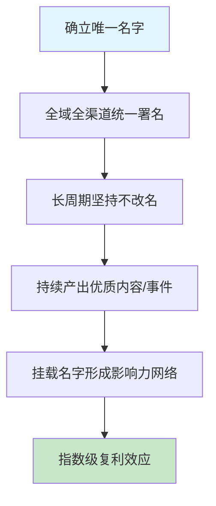

### 6.3.4 关键性质

唯一名字复利定律展示了：名字不是标签，而是连接器。当你在👸号、抖音、小红书、视频号、知识星球、微信群昵称、出书署名、线下海报上都只用“粥左罗”这一个名字时，用户在任意触点看到内容，都能通过这个唯一键找到你的全域资产。这种“织网”动作，随着时间推移，会产生不可替代的护城河。

名字优先级判断准则展示了：不要在“起个更好的名字”上消耗认知带宽。一个中规中矩但坚持十年的名字，远比每年换一个“绝妙好名”的策略价值高得多。因为改名的沉没成本，是你之前所有内容积累的心智归零。

改名损耗成本揭示了：频繁改名会导致用户认知断层、搜索失配、品牌资产无法叠加，造成百万千万级别的隐性商业价值损失。

### 6.3.5 典型例子

粥左罗：12年坚持“粥左罗”全网同名，微信昵称12年未变，👸号8年，全网署名文章3000+篇，覆盖短视频/社群/电子书/纸质书全形态。评论区用户“AI洁妈”反馈：昨天正苦于改名字，看完立刻停止改名冲动。

> "简单说核心就一点：全网全域全形式的任何时候都做到只用唯一的名字+从不改名。"
> 
> "IP 到最后，最值钱的就是你的名字，所有的个人品牌资产，营销积淀，心智积累，信任累加，口碑传播，都在这一个名字上。"
> 
> "你播种的，能否很好的收到回报，取决于任何人任何时候在任何地方看到你的任何内容，都能马上找到到你，和你名字有关的所有东西都因为你的名字勾连着而织成一张巨大的影响力之网，铺在这个世界上，越铺越大，覆盖的人越来越多，覆盖的人也因为由你的名字连在一起，时间越久，威力越大。"
> 
> "人生的各个阶段，你永远都可以取一个更好的名字，但不断改为更好的名字，却是一个最差的策略。"
> 
> "所以，粥左罗这名字，不管是好是坏，能用一辈子它就是好名字。"
> 
> —— P057

### 6.3.6 边界条件

仅适用于长期主义个人IP建设，短期投机项目无需此策略。名字本身无需极佳语义美感，核心是“唯一性+时间跨度”。若名字涉及法律风险（如商标冲突）被迫改名，属不可抗力例外。

## 6.4 实战手册化标准 —— 将隐性经验转化为显性组织资产

### 6.4.1 为什么需要这个概念？

单人经验无法规模化，只有固化为SOP才能实现团队复制与组织化放大。普通人缺乏管理经验，手册是低成本习得标准化运营能力的核心载体。项目周期短，能力长久；手册将项目经验沉淀为可跨项目复用的方法论资产。

### 6.4.2 核心定义

**实战手册化标准**（来源：P066）

将项目执行过程中的关键动作、避坑指南、话术、工具链整理为结构化、可复制、可迭代的文档体系（SOP），作为团队协作的基础设施和知识资产的核心载体。核心交付物包含：实战手册、沟通话术SOP、常见问题手册(FAQ)、思维导图、视频直播课。

### 6.4.3 方法演进图

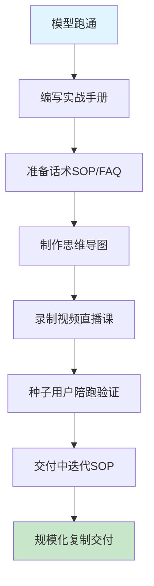

### 6.4.4 关键性质

标准化：把模型跑通后，先写手册再招人，手册是交付标准与信任锚点。迭代性：交付中同步迭代SOP（话术、FAQ、思维导图、直播课），形成规模化复制体系。资产性：手册是知识资产核心载体，比单一项目收益更具长期价值。

### 6.4.5 典型例子

思蒙短剧推广：模型跑通2-3天内完成手册，首批种子用户通过社群分享手册自然转化，交付中迭代SOP，最终累计招募257人团队。获渠道方(亮宇)高度认可反向邀请做知识付费，验证手册专业度。

> "把模型跑通之后，就按照之前在生财学到的写实战手册的模式，写了一份【短剧推广的实战手册】。"
> 
> "提前准备沟通话术 SOP，并且整理常见问题手册...整理出一份全面、清晰，而且容易查找相关问题的思维导图，和视频直播课。"
> 
> "让我又一次学习到了，什么叫专业的、真正的、保姆级实战手册"
> 
> —— P066

### 6.4.6 边界条件

必须基于已跑通的真实模型编写，空想手册无实战指导价值。手册需持续迭代，固化僵化的SOP会阻碍业务适应新环境。核心逻辑与隐性判断（如审美、直觉）难以完全手册化，需配合陪跑式教学。

## 6.5 陪跑式组织模式 —— 用手册带种子用户跑通闭环

### 6.5.1 为什么需要这个概念？

传统知识付费“卖课不管”交付率低，纯代运营模式依赖性强。新手缺乏执行力，需要“手把手”带着跑通最小闭环建立信心。陪跑过程既是交付，也是筛选合伙人、建立信任护城河的过程。

### 6.5.2 核心定义

**陪跑式组织模式**（来源：P066）

核心运营者以“实战手册+社群陪伴+定期直播+优秀学员分享”为交付标准，带领种子用户共同跑通商业闭环。区别于大班课，强调小规模、高强度、全流程陪伴式教学。

### 6.5.3 方法演进图

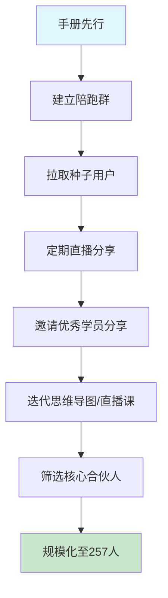

### 6.5.4 关键性质

信任前置：高准入社群内信任成本低，陪跑招募摩擦极小。筛选机制：陪跑中观察学员执行力与契合度，筛选核心合伙人。复利循环：优秀学员产出案例反哺手册，吸引更多种子用户。

### 6.5.5 典型例子

思蒙短剧陪跑：手册先行→建立陪跑群→定期直播分享→邀请优秀学员分享→迭代思维导图/直播课→规模化至257人。航海志愿者/教练角色：作者通过服务他人强制自己深度参与标准化运营流程，习得SOP编写、节奏把控、异常处理能力。

> "迅速成立了一个陪跑群，拉到了第一批种子用户。"
> 
> "在做交付的途中，就用到了，一些在参与航海志愿者事学到的方法...定期的直播分享，以及邀请优秀学员分享。"
> 
> "很荣幸，在自己赚钱的路上，也帮大家赚到了一些钱，所以除了赚钱，我还收获了更多的认可、感谢、红包，以及行业大佬的支持。"
> 
> —— P066

### 6.5.6 边界条件

依赖高信任社群环境，低信任公域难以复制。核心运营者需具备极强执行力与服务意识，非躺赚模式。规模受限于核心运营者精力，需通过主编/合伙人体系分层放大。

## 6.6 现金投票与先开课再完善 —— 零成本验证市场需求的逆向研发法

### 6.6.1 为什么需要这个概念？

传统“备课完美主义”导致迟迟不敢发布，错过市场窗口。互联网知识产品边际成本为零，支持“收钱再生产”逆向流程。只有真金白银的付费意愿，才是市场需求的唯一硬指标。

### 6.6.2 核心定义

**现金投票**（来源：QPFgdHgZsorQvdxDkl9cw58LnVf）

仅凭主题/价格/时间三要素向好友预售，收到款项再开发内容。

**先开课再完善**（来源：QPFgdHgZsorQvdxDkl9cw58LnVf）

收到钱倒逼内容产出，用微信群滚动交付（两天一课）完成0-1跨越。

### 6.6.3 方法演进图

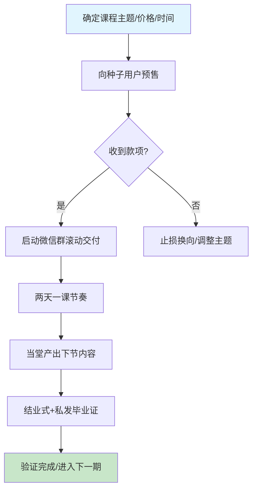

### 6.6.4 关键性质

极低试错成本：仅付出时间成本，无金钱沉没成本。适合两类人群：新手（倒逼输入输出）和专家（经验即课纲）。验证逻辑：有人愿付费=有市场，无人付费=立即止损换方向。

### 6.6.5 典型例子

根源首期沟通课：7天预售期，日均成交10人，累计近80人，成交率80%，单价131.4元，零课件启动。作者自述：“卖课的重点是‘卖’；开课的重点是‘开’”。

> "产品还没发布之前，可以先问问身边的朋友，对于这样的产品，有没有付钱的意愿，有人愿意付钱再开课"
> 
> "我一直有个思维：卖课的重点是『卖』；开课的重点是『开』"
> 
> "初期的做课，就一个『标题』，就可以到市场上卖"
> 
> "假设七天课程，也不需要收了钱就把七天全准备好，可以把七天的课程，用微信群交付，平均两天上一次课，第一天上完再准备第二天内容"
> 
> —— QPFgdHgZsorQvdxDkl9cw58LnVf

### 6.6.6 边界条件

仅适用于交付成本可控、可滚动迭代的知识服务产品。实体商品/高定制化服务无法直接套用。需具备基础信任背书（如混圈混群积累的种子用户），完全冷启动转化率极低。

## 6.7 100-10-5-1验证模型 —— 课程体系可持续性的量化硬指标

### 6.7.1 为什么需要这个概念？

主观感觉“好像不错”不可靠，需要量化标准判断课程是否可规模化。新手缺乏经验，易被单次爆款迷惑，忽视长期体系建设。复购与进阶课是知识付费复利的核心，单课模式无可持续性。

### 6.7.2 核心定义

**100-10-5-1验证模型**（来源：QPFgdHgZsorQvdxDkl9cw58LnVf）

累计100人次付款（验证基础需求）、达成10%复购率（验证交付质量与信任）、最少开5期课程（验证标准化复制能力）、包含1种进阶课（验证产品阶梯与LTV延伸能力）。

**三阶段师生关系模型**（来源：QPFgdHgZsorQvdxDkl9cw58LnVf）

师生关系演进模型：第一阶段“学生选老师”（无流量期靠内容吸引）；第二阶段“老师选学生”（有池子后筛选契合度高者）；第三阶段“老师影响学生”（通过教学与私聊转化低契合度学员为理想学员）。

### 6.7.3 方法演进图

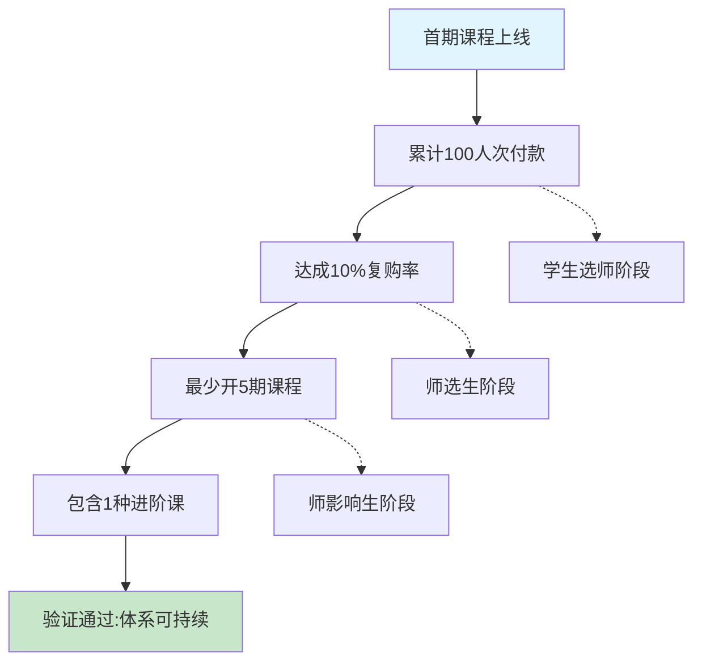

### 6.7.4 关键性质

漏斗式筛选：层层递进，缺一不可，任一指标不达标即需优化体系。动态验证：非一次性考核，而是持续运营中的常态化监控指标。体系化思维：强制要求从“单品”进化为“产品矩阵”。

三阶段师生关系模型展示了：知识付费不是单向灌输，而是双向筛选与共振的过程。初期你没名气，只能靠内容让学生来选你；中期有池子了，你要反向筛选适合你的学生，提升交付效率；后期你有影响力了，通过深度交付和私聊，把原本不匹配的学生也“影响”成你的理想学员，从而最大化LTV。

### 6.7.5 典型例子

根源全年运营：十几期付费群，累计付费用户1200人，复购近600人，整体复购率50%，远超10%基线。主编团队复购率85%，验证核心用户粘性极高。

> "对于这块有个大原则：### 100 - 10 - 5 - 1"
> 
> "100：100人次付款 10：想办法完成10%的复购率 5：最少开5期（可以是不同主题） 1：包含1种『进阶课』"
> 
> "最后的『1』包含一种进阶课，这很重要。因为所有课程结束，一定要有个『转化路径』"
> 
> "我其实会把知识付费分为三大阶段，应该是说，把老师跟学生的关系，分为三大阶段"
> 
> "第一阶段：学生选老师... 第二阶段：老师选学生... 第三阶段：老师「影响」学生"
> 
> —— QPFgdHgZsorQvdxDkl9cw58LnVf

### 6.7.6 边界条件

适用于标准化课程体系，非标咨询/服务类产品需调整指标。初期可放宽“5期”要求，但“100人次”与“10%复购”为核心红线。进阶课设计即转化路径设计，无进阶课=无后端变现路径。

## 6.8 全流程标准化交付SOP —— 从确认词到私发毕业证的信任制造机器

### 6.8.1 为什么需要这个概念？

非标服务交付质量不稳定，依赖讲师临时状态，无法规模化。售后纠纷、退费争议消耗大量精力，需规则前置规避。群运营活跃度≠转化率，私域终点是一对一深度连接。

### 6.8.2 核心定义

**确认词机制**（来源：QPFgdHgZsorQvdxDkl9cw58LnVf）

付款后强制要求买家回复特定确认语（含开课时间、配合事项、不退费条款、确认指令）才算成交，通过规则前置规避售后纠纷，适用于全价位段产品。

**固定时间/红包/心得/优惠券仪式化流程**（来源：QPFgdHgZsorQvdxDkl9cw58LnVf）

固定上课时间养成习惯，结业式第9天发红包+心得+下期预售+优惠券，构建仪式感与获得感。

**私发毕业证机制**（来源：QPFgdHgZsorQvdxDkl9cw58LnVf）

讲师一对一发电子证书+个性化反馈+回放链接+优惠券+新课介绍，将复购从5%提至30%，私域终点是一对一。

### 6.8.3 方法演进图

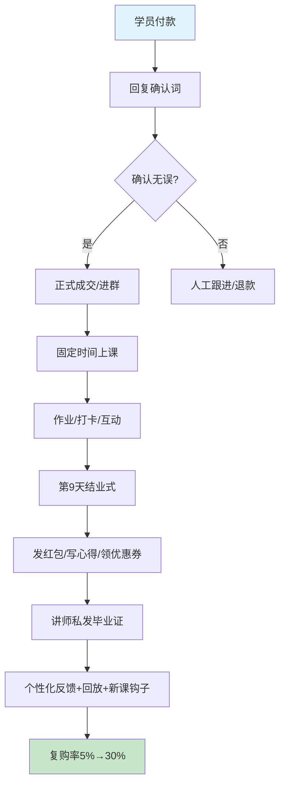

### 6.8.4 关键性质

规则即人设：温和坚定的规则表达体现专业度，而非生硬条款。仪式感设计：红包、心得、证书构建“获得感”，强化沉没成本与归属感。私聊转化：利用私聊触达率优势，建立信任、挖掘高客单转化、筛选核心用户。

### 6.8.5 典型例子

根源实测：同一批学员，群内结业推新课复购率仅5%，私发毕业证+聊天推课后跃升至30%。确认词机制实现零退费纠纷，“成年人必须为自己的决定负责”。

> "付款后的『确定词』，最好能包含，以下几个重要资讯：1、开课日期 2、谢谢对方... 3、对方需要配合的事项 4、重要备注 5、让对方确定"
> 
> "只要对方没打「确认没问题」，都还不能算正式成交... 因为规则事先说，后面可以避免掉，很多不必要的纷争。"
> 
> "我的每一次课程开营，都会包含两个很重要的元素：1. 发红包（超过4包以上）... 2. 时间短 大概会在10~15分钟左右结束"
> 
> "我都会「一对一」地重新发一次毕业证书，以及给一段我个人对于课程的反馈以及结尾，然后还会给上上课的回放。"
> 
> "我发现每一次结业式的过程，我顺便介绍新课程，大概都只会有5%的人复购。但是如果说我在私下的一对一说，就可以让这5%的复购率提升到30%"
> 
> —— QPFgdHgZsorQvdxDkl9cw58LnVf

### 6.8.6 边界条件

低客单价（三位数）课程适用，高客单价需更深度售前沟通。依赖讲师极强的执行力与服务意识，非标准化工具可替代。学员规模超出讲师私聊承载上限时，需引入主编体系分层代理。

## 6.9 主编体系与手动分销 —— 以利他筛选核心团队，以人工深化信任链接

### 6.9.1 为什么需要这个概念？

自动化分销工具导致推荐质量失控，刷单/虚假宣传风险高。讲师精力有限，需从学员中筛选、训练核心助教团队分担交付。金钱激励吸引投机者，权益激励筛选真信徒，更利长期共生。

### 6.9.2 核心定义

**主编体系**（来源：QPFgdHgZsorQvdxDkl9cw58LnVf）

用课程折扣/咨询权益而非金钱激励，5期筛选7-10人核心团队，承担交付辅助/氛围维护/转介绍功能。

**手动分销**（来源：QPFgdHgZsorQvdxDkl9cw58LnVf）

拒绝自动工具，讲师亲自打款分佣并借机深度聊天，牺牲广度换深度，实现整体50%复购。

### 6.9.3 方法演进图

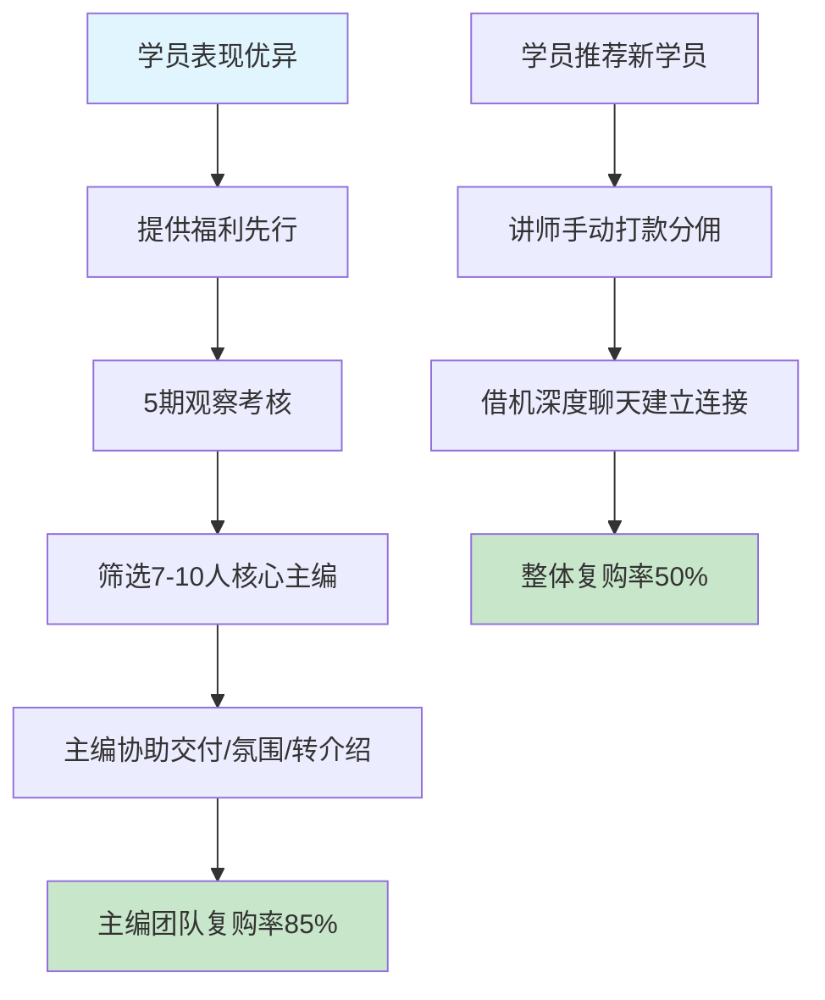

### 6.9.4 关键性质

福利先行：先给权益（一对一咨询/大额折扣/专属礼物），再观察态度与执行力。长期筛选：最少5期课程观察，而非一次性招募，确保价值观对齐。关系深化：分佣过程即深度连接过程，“打钱聊天”建立强情感绑定。

### 6.9.5 典型例子

根源操作：主编福利不给钱，送一对一咨询/折扣/礼物；分销佣金亲自打款+聊两三句+致谢。结果：主编团队复购率85%，整体复购率50%，高客单产品（3万/15万）均有成交。

> "主编，其实是最贴近讲师的角色... 初期我不建议只找短期用的主编，要找长期使用的"
> 
> "主编的福利，不要给钱... 可以选择：送ㄧ对一谘询、也能给一个更大的折扣、又或者是，送一个特别的小礼物"
> 
> "福利先说，再做事... 最少用五期的课程筛选，选出大概7~10人的核心主编团队"
> 
> "我所有的分销（就是学生推学生的过程），我都是手动分销。"
> 
> "这个人帮我推了什么课，我就会私下的把钱打给他。然后把分润打给他的过程，我就会顺便跟这个人聊个两三句，同时给一点感谢。"
> 
> —— QPFgdHgZsorQvdxDkl9cw58LnVf

### 6.9.6 边界条件

仅适用于高信任、高客单、长周期的知识付费体系。讲师需承担极高沟通成本，团队超20人时需分层管理。核心风险：主编离职/竞品挖角，需通过持续价值共创与情感绑定防御。

## 6.10 认知清晰度 —— 消除混沌、坚定行动的前提

### 6.10.1 为什么需要这个概念？

人生混沌源于认知不清而非环境复杂，模糊导致行动犹豫、焦虑内耗。认知清晰度决定行动坚定度，只有深度认知能支撑穿越周期的高耗能执行。制造清晰是主动行为（学习/复盘/实践），而非被动等待顿悟。

### 6.10.2 核心定义

**认知清晰度**（来源：M5lpdRp7OoHZAYxuDiicgGtSnpg）

指个体对事物本质、规律及未来走向的清晰认知程度。通过持续学习不断加深，是消除心中模糊、建立行动确信的核心变量。

### 6.10.3 方法演进图

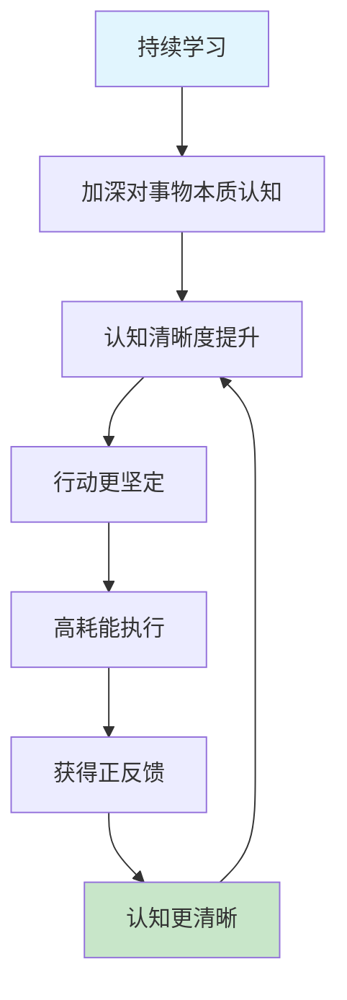

### 6.10.4 关键性质

传导机制：认知清晰 → 行动坚定 → 高耗能执行 → 正反馈 → 认知更清晰（正向飞轮）。区别于“知道道理”：清晰度体现为“现实结果发生真正改变”，而非知识囤积量。耐心来源：知规律→定位阶段→预估结果→增强信心→生成耐心。

### 6.10.5 典型例子

作者从“焦虑迷茫小白”到“年入百万操盘手”，核心跃迁源于通过阅读/复盘/实践不断制造认知清晰。巴菲特12大特质（大量阅读、独立思考、圈内能力、复盘等）本质是认知清晰度的行为化表现。

> "而只有制造清晰，才能消除心中的模糊。"
> 
> "从混沌到清晰，关键在于，通过学习不断地加深自己对事物的认知，只有认知越清晰，我们的行动才会越坚定"
> 
> "现实结果是最好的“评判师”，如果学习不能让自己发生真正的改变，那学再多又有什么用呢？"
> 
> "因此，懂得百点不如改变一点。真正的成长不在于自己懂得了多少道理，而在于自己真正改变了多少。"
> 
> "因为当我们知道的规律越多，就越能定位自己所处的阶段和位置、预估未来的结果，进而增强自己对未来的信心和持续行动的耐心。"
> 
> —— M5lpdRp7OoHZAYxuDiicgGtSnpg

### 6.10.6 边界条件

认知清晰度有边际递减规律，需配合“行动验证”避免陷入“伪清晰”（只懂不做）。完全清晰不可达，仅能在“不确定性区间”内持续压缩模糊区。依赖元认知能力（感受自己在想什么），无元认知者难以主动制造清晰。

## 6.11 承认无能与归因校准 —— 破除全能幻觉的认知觉醒三步法

### 6.11.1 为什么需要这个概念？

身居高位者因镜像神经元衰退，易产生“全能幻觉”，将运气归因于能力。无法承认无知导致拒绝建议、决策失误、组织僵化。只有承认无能，才能开启“听取建议→知进退”的进阶通道。

### 6.11.2 核心定义

**承认无能与归因校准**（来源：M5lpdRp7OoHZAYxuDiicgGtSnpg）

承认无知：主动声明“我不懂/我不会/我搞不定”，而非伪装全知。归因校准法：将成功中的运气成分剥离，归因于外部红利/他人助力/概率事件，而非仅靠个人能力。认知校准三步法：承认无知 → 听取建议 → 知进退（仅在圈内能力范围内决策）。

### 6.11.3 方法演进图

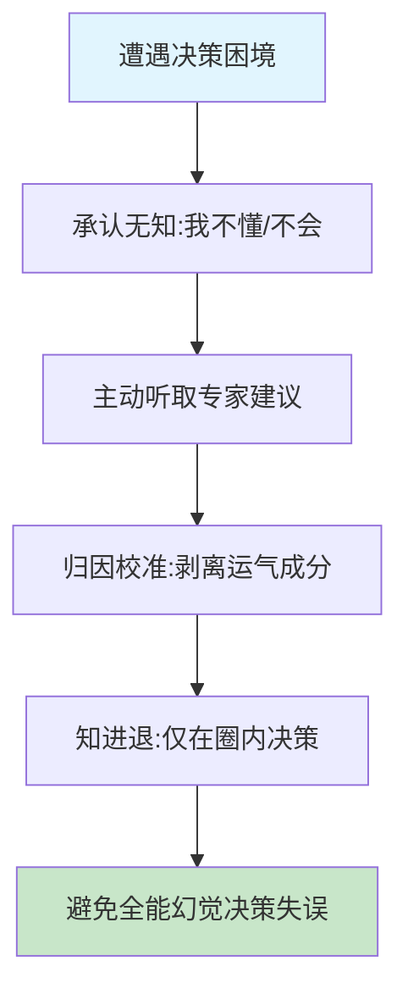

### 6.11.4 关键性质

系统性偏差：高位者大脑自动过滤负面信息，放大正面反馈，形成认知闭环。镜像神经元机制：权力地位导致共情能力下降，无法感知他人真实反馈。进阶前提：承认无能非软弱，而是高阶认知稀缺品，是突破瓶颈的唯一入口。

### 6.11.5 典型例子

作者引用《权力为什么会让人变坏》机制：权力使大脑运动皮层对镜像神经元的激活减弱。巴菲特“圈内能力”特质：明确知道自己不懂什么，坚决不碰不懂的领域。

> "运气归因于能力的系统性偏差"
> 
> "提供‘承认无知→听取建议→知进退’的认知校准三步法。"
> 
> "引入镜像神经元衰退机制，剖析‘运气归因于能力’的系统性偏差"
> 
> —— M5lpdRp7OoHZAYxuDiicgGtSnpg

### 6.11.6 边界条件

需区分“战略性承认无知”（开放学习）与“战术性装弱示强”（操纵手段）。过度承认无知可能削弱团队信心，需在核心圈层内部进行，对外保持确定性。归因校准需数据支撑，纯主观归因易陷入“幸存者偏差”反向操作。

## 6.12 认知黑洞与决策力 —— 抛开评判心吸收优质信息

### 6.12.1 为什么需要这个概念？

理性思维天然排斥未知/反直觉信息，“否决即关上认知大门”。评判心导致错过非常规机会（如早期AI/加密货币/新平台红利）。决策质量取决于信息输入质量，黑洞效应切断优质信息源。

### 6.12.2 核心定义

**认知黑洞与决策力**（来源：M5lpdRp7OoHZAYxuDiicgGtSnpg）

认知黑洞：因主观评判（不可能/骗局/不靠谱）而自动屏蔽信息的心理机制。信息吸收术：鸡屎里找鸡蛋——从低质/争议/反感来源中提炼有效信号。三阶段决策模型：乐观构想（感性愿景）→ 悲观计划（理性风控）→ 乐观实行（感性执行）。

### 6.12.3 方法演进图

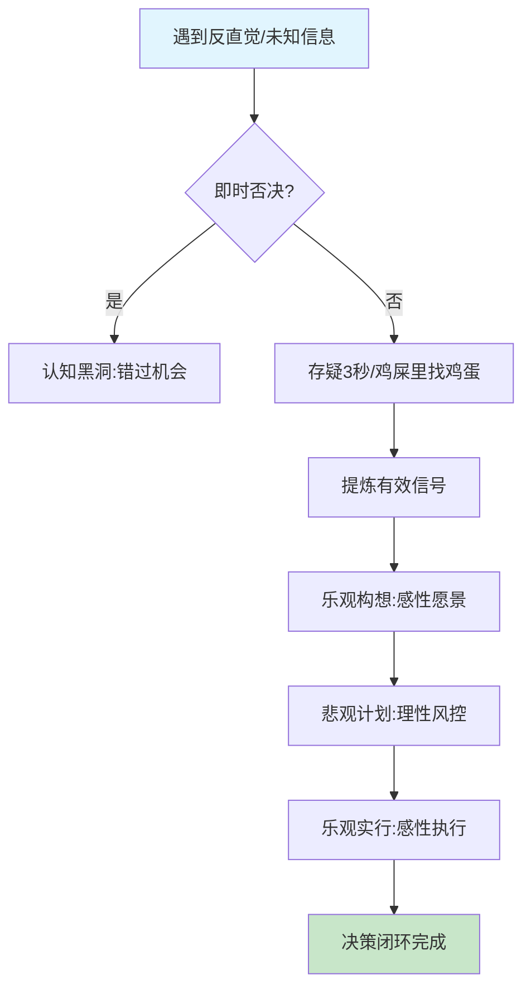

### 6.12.4 关键性质

理性局限：理性仅信已知、排斥未知，必须引入感性补全决策闭环。非对称收益：吸收一个被低估的真信号（如早期比特币）收益远超屏蔽100个噪音的成本。实操微动作：看到反直觉信息先“存疑3秒”而非“即时否决”。

### 6.12.5 典型例子

作者早期因“骗局”评判屏蔽加密货币/ChatGPT/视频号红利，事后复盘损失巨大。“乐观构想-悲观计划-乐观实行”规避了理性思维对未知的排斥，实现决策闭环。

> "定义‘否决即关上认知大门’的黑洞效应，传授‘鸡屎里找鸡蛋’的信息吸收术与三阶段决策模型，规避理性思维对未知的排斥。"
> 
> "因此，按照乐观构想（感性）、悲观计划（理性）、乐观实行（感性）的路径，就可以巧妙地避开理性思维的局限。"
> 
> "理性思维的局限在于它只相信自己所见所闻的一切事情，对于已知之外的未知，它会主动怀疑并排斥。"
> 
> —— M5lpdRp7OoHZAYxuDiicgGtSnpg

### 6.12.6 边界条件

需建立基础认知框架（常识/逻辑/概率论）作为过滤器，否则全盘吸收陷入认知混乱。高风险决策（涉及生存/合规/巨额资金）仍需理性主导，感性仅作辅助。“鸡屎里找鸡蛋”耗时极高，仅对高潜力信号源（如头部大佬观点/前沿论文）执行。

## 6.13 元认知训练三件套 —— 停留几秒、写作复盘、三维语言重塑

### 6.13.1 为什么需要这个概念？

本能反应（系统1）主导95%决策，导致重复性错误、情绪失控、认知固化。理智脑（系统2）需主动激活，微操作可低成本重塑大脑决策回路。语言塑造思维，强制输出积极/和善/开放语言可逆向重塑认知模式。

### 6.13.2 核心定义

**元认知训练三件套**（来源：M5lpdRp7OoHZAYxuDiicgGtSnpg）

停留几秒：面对选择强制停留3-5秒，启动元认知审视思维，打破本能默认。写作复盘：情绪失控时书写外化内心，利用理智掌控肉身，实现情绪解离。三维语言：禁用消极/刻薄/绝对词，强制输出积极/和善/开放语言，重塑思维回路。

### 6.13.3 方法演进图

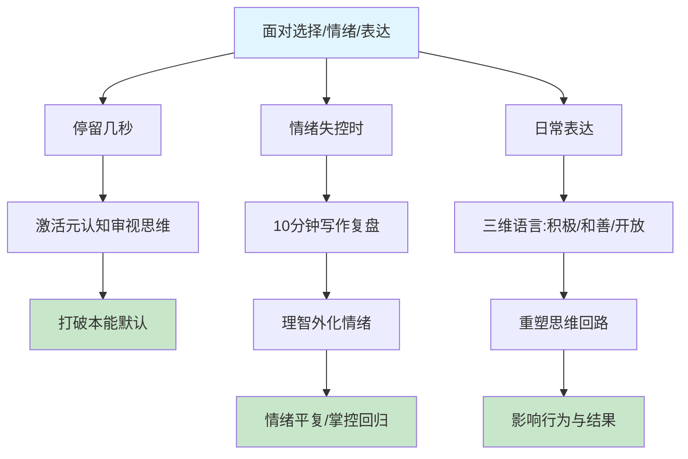

### 6.13.4 关键性质

生理级干预：从大脑物理机制（前额叶激活/杏仁核抑制）层面重塑决策。复利效应：单次微动作效果微弱，长期积累形成“自动化理智反应”新习惯。可迁移性：三套微操作适用于商业决策/人际冲突/学习瓶颈/焦虑失眠全场景。

### 6.13.5 典型例子

作者实测：焦虑失眠时写作复盘10分钟即入睡；面对诱惑停留几秒避免冲动消费。巴菲特“情绪控制”特质：从不在恐慌时抛售，源于长期元认知训练。

> "每当遇到需要选择的情况时，你要是能先停留几秒思考一下，就有可能激活自己的理智脑，启用元认知来审视当前的思维，然后做出不一样的选择。"
> 
> "假如真的碰到一件烦心事，可以通过写作复盘来疏解自己的烦心事，当你写下来的时候，你会发现也没什么大不了的"
> 
> "利用理智将内心的情绪“写下来”，情绪就会平缓下来，而你的理智就能够把控肉身、掌控全局。"
> 
> "注意你自己的语言，语言会影响你的思维：无论遇到什么事情，说积极的话，不说消极的话；无论遇到什么人物，说和善的话，不说刻薄的话；无论遇到什么问题，说开放的话，不说绝对的话。"
> 
> —— M5lpdRp7OoHZAYxuDiicgGtSnpg

### 6.13.6 边界条件

需配合冥想/运动等硬件级升级，单纯微操作难以对抗强生理应激。初期执行极其反本能，需外部约束（闹钟/打卡/教练）强制启动。三维语言非“毒鸡汤”，需基于事实的积极重构，而非盲目乐观。

## 6.14 身心底层升级协议 —— 冥想增厚灰质、运动后黄金窗口强化神经元

### 6.14.1 为什么需要这个概念？

认知软件升级（学习/思维模型）受限于大脑硬件（神经元数量/连接强度/灰质厚度）。焦虑/拖延/注意力涣散本质是生理机能不足，非单纯心理问题。科学验证的物理变强手段，边际收益远高于单纯“努力学习”。

### 6.14.2 核心定义

**身心底层升级协议**（来源：M5lpdRp7OoHZAYxuDiicgGtSnpg）

冥想：集中注意力训练，物理增大大脑皮层表面积、增厚灰质，提升专注与智力。运动后黄金窗口：运动促生新神经元，运动后1-2小时内进行高强度脑力活动，刺激新神经元生长存活。身心合一：专注并享受当下行动（工作/学习/跑步），缓解焦虑、实现从容不迫。

### 6.14.3 方法演进图

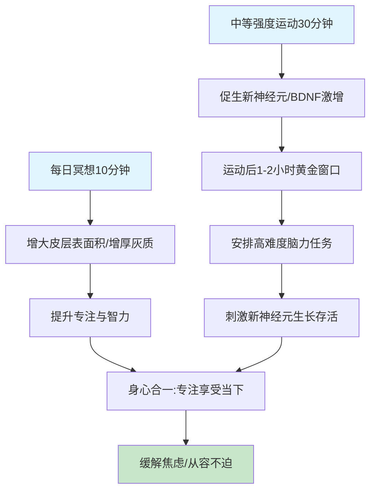

### 6.14.4 关键性质

硬件级复利：冥想/运动效果随时间累积，大脑物理结构永久改善。协同增强：冥想提升专注控制力，运动提供神经元原料，脑力任务雕刻连接回路，三位一体。低门槛高回报：零成本、可居家、仅需时间投入，边际收益极高。

### 6.14.5 典型例子

作者每日冥想+运动+写作固化周计划表，2年迭代形成个人化运行系统。科学研究：长期冥想者大脑皮层更厚、杏仁核更小；运动后BDNF蛋白激增促进神经生成。

> "科学研究表明，通过这种集中注意力的冥想练习，人大脑皮层表面积增大，大脑灰质变厚，意味着练习冥想可以从物理上让你变得更加聪明。"
> 
> "科学研究证明，运动能够使大脑长出更多新的神经元，这意味着运动可以在物理上让你变得更“聪明”。"
> 
> "然后，在运动后的1~2小时内进行高强度、高难度的脑力活动...可以让你的新神经元受到刺激，不断生长"
> 
> "让你的感受回归你当下的行动，工作、学习、跑步、睡觉、吃饭。身心合一的要领不仅是专注于当下，更是享受当下"
> 
> —— M5lpdRp7OoHZAYxuDiicgGtSnpg

### 6.14.6 边界条件

冥想初期极其枯燥难坚持，需“呼吸计数/引导音频”辅助降低门槛。运动强度需达中等强度（心率120-140）以上才能显著促生神经元。运动后1-2小时窗口期错过则失效，需精准安排高难度脑力任务（写作/编程/复盘）。

## 6.15 高效学习内化工具箱 —— 费曼技巧、关键点触发读书、刻意练习缝合知识

### 6.15.1 为什么需要这个概念？

传统“全书精读/笔记整理”效率极低，且易陷入“收藏夹吃灰”假努力。学习本质是“关联旧知+刻意缝合”，卡壳根源是基础不熟练而非智商不足。需一套低门槛、高迁移、可标准化的学习操作系统。

### 6.15.2 核心定义

**高效学习内化工具箱**（来源：M5lpdRp7OoHZAYxuDiicgGtSnpg）

费曼技巧：用自己的语言、最简单的话讲清楚复杂概念，让外行也能听懂，检验并深化理解。关键点触发式读书：不求全读，仅捕捉触动感性的关键点/块，打碎重组为个人知识网络。刻意练习缝合：针对“卡壳”点（基础不熟练处），高强度重复训练至自动化。

### 6.15.3 方法演进图

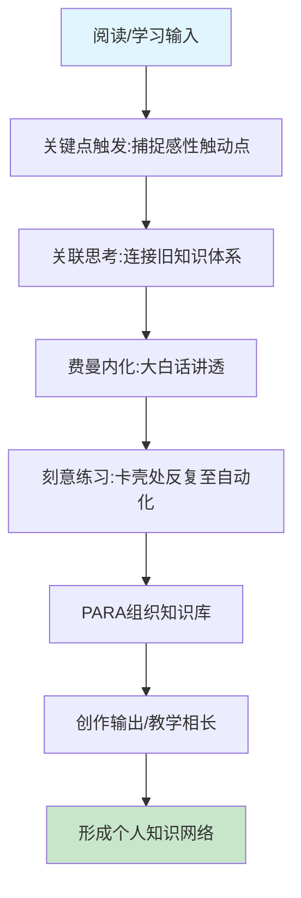

### 6.15.4 关键性质

感性选择+理性深思：先用感性筛选触动点，再用理性拆解整合，保持在学习“拉伸区”。输出倒逼输入：费曼技巧/写作复盘/公开分享，以输出为目的反向驱动深度输入。标准化流程：关键点记录→关联思考→费曼内化→PARA组织→创作输出，形成闭环。

### 6.15.5 典型例子

作者阅读《认知觉醒》/《纳瓦尔宝典》等：仅摘录触动段落→关联经验→费曼讲述→形成精华帖。番茄工作法/精力桶管理：持续专注+主动休息，维持高效节奏，避免过度消耗。

> "学习就是把新知识关联到旧的知识体系中，然后再通过刻意练习将链接处的地方进行深度缝合。"
> 
> "最后，利用费曼技巧，通过自己的语言，用最简单的话把一件事情讲清楚，让外行人也能听懂。"
> 
> "你只需学习那些让你深深触动的知识，尝试去打碎各家的知识体系，只取其中最触动自己的点或块，然后将其拼接成自己的知识网络。"
> 
> "那些轻松的学霸，他们学习时从不过度消耗自己，只要感到精力不足，就停下来主动休息，这反而使他们精力桶的水位得到快速回升。"
> 
> —— M5lpdRp7OoHZAYxuDiicgGtSnpg

### 6.15.6 边界条件

适用于“概念/方法论/策略”类知识，技能类（编程/乐器/运动）需大量物理重复训练。触发点捕捉依赖既有认知框架，零基础新手需先建立最小知识骨架。费曼技巧需真实受众（或模拟受众）反馈，自说自话易陷入“自以为懂”。

## 6.16 长价值写作法与双轨制 —— 远离热点、10年生命力、感性故事载理性道理

### 6.16.1 为什么需要这个概念？

追热点/蹭流量内容生命周期短，无法沉淀资产，且吸引低质量泛流量。纯理性说教枯燥难读，纯感性故事空洞无物，需“故事激活感性→传递理性”双轨制。作品价值吸引连接（利他）远超推销说服（利己），构建第六奇迹影响力。

### 6.16.2 核心定义

**长价值写作法**（来源：M5lpdRp7OoHZAYxuDiicgGtSnpg）

静心阅读/用心关联/持续打磨，生产具备10年生命力的内容，用底层知识驱动读者认知更新。

**感性故事-理性道理双轨写作法**（来源：M5lpdRp7OoHZAYxuDiicgGtSnpg）

先用故事引起“感性小人”兴趣，再通过感性通道将道理传给“理性小人”，润物细无声。

**价值交换规律**（来源：M5lpdRp7OoHZAYxuDiicgGtSnpg）

写作、成长、成功的底层逻辑：生产有价值内容即生产价值，做有价值的人即成长，为社会贡献价值即成功，核心是利他之心。

### 6.16.3 方法演进图

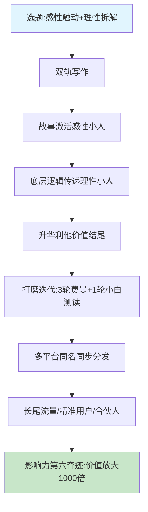

### 6.16.4 关键性质

非交易型连接：读者因价值主动链接、付费、成长、成合伙人，而非被营销转化。复利资产：单篇长文持续带来精准流量/高信任用户/商业机会，边际成本趋零。筛选器功能：真实内容筛选同频人群，慢即是快，真实成长换真实信任。

### 6.16.5 典型例子

漫漫：半年涨粉20万、年变现40万，完全依据评论/私信选题，暴露弱点（功利/自卑/焦虑）建立真实人设。作者主张：远离热点、静心阅读、用心关联、持续打磨，以作品价值吸引连接而非推销说服。

> "一定要扎扎实实地生产具有长远价值（最好能持续10年）的内容。"
> 
> "正确的写作应该是怎样的？远离热点、静心阅读、用心关联、持续打磨，力争用最底层的知识和简单易懂的表述去驱动读者更新自己的知识体系。"
> 
> "好的写作就是聊天，好的聊天也是写作。先用合适的故事引起对方“感性小人”的兴趣和注意，然后把想要表达的道理通过“感性小人”转达给“理性小人”。"
> 
> "复利，是世界的第五大奇迹。而影响力，在我心中则是第六大奇迹...后者的社会价值就是前者的1000倍。"
> 
> —— M5lpdRp7OoHZAYxuDiicgGtSnpg

### 6.16.6 边界条件

起量慢：前期需忍受低阅读/低正反馈，非急需变现者适用。需具备深度思考能力与表达能力，纯搬运/浅层内容无法生产长价值。商业化路径长：广告/知识付费/矩阵/卖号/引流高阶玩法，需耐心打磨产品体系。

## 6.17 多源对照

### 共识

不同素材对“个人IP核心资产”达成一致：名字是唯一锚点，时间是放大器，信任是变现基石。无论是粥左罗的“百年不改名”，还是根源的“混圈混群积累信任”，或是漫漫的“暴露弱点建立真实人设”，核心逻辑都是：用唯一标识符（名字/人设）跨时间累积信任资产，再通过标准化交付（SOP/手册/陪跑）放大商业价值。

### 分歧

起号策略差异：
- P057主张“内容为王，名字为器”，通过持续产出优质内容（3000+篇）构建影响力网络
- P066主张“模型先行，手册跟上”，先跑通商业闭环（短剧推广），再写手册、带陪跑、组团队
- QPFgdHgZsorQvdxDkl9cw58LnVf主张“人脉先于产品”，转型前一年先“混圈混群”积累种子用户，再用现金投票验证选品
- M5lpdRp7OoHZAYxuDiicgGtSnpg主张“认知先行”，通过认知清晰度提升、元认知训练、身心底层升级，夯实执行力地基，再谈项目与变现

交付模式差异：
- P066强调“陪跑式组织”：手册先行+种子用户陪跑+直播迭代，筛选合伙人
- QPFgdHgZsorQvdxDkl9cw58LnVf强调“标准化SOP+一对一私聊”：确认词/固定上课/私发毕业证/手动分销，将复购从5%提至30%
- M5lpdRp7OoHZAYxuDiicgGtSnpg强调“长价值写作吸引连接”：远离热点、双轨写作、以作品价值筛选同频人群，构建第六奇迹影响力

## 6.18 设计中的取舍

**问：为什么不用“多平台分发不同名字”而是“全域同名”？**

答：多平台分发不同名字（如抖音叫A、小红书叫B）看似能适配各平台调性，实则切断了跨平台心智叠加。用户在抖音看到你、在小红书搜不到同名账号，信任链条断裂。全域同名虽然前期可能不够“土味”或“文艺”，但时间换空间，唯一名字×长周期=指数级网络效应，这是任何单平台爆款都无法比拟的复利资产。

**问：为什么不用“自动化分销工具”而是“手动分销”？**

答：自动化分销工具（如裂变海报、分销后台）能快速铺开推广广度，但无法建立“讲师-推荐人-新学员”的三方深度信任链。根源的手动分销：讲师亲自打款分佣+聊两三句，把分佣过程变成深度连接过程。牺牲广度换深度，整体复购率达50%，远超行业平均水平。这是“非标服务高客单”赛道的核心护城河——信任不可规模化复制，但可通过“人工笨功夫”深度积累。

**问：为什么不用“完美备课再开课”而是“先开课再完善”？**

答：完美备课是拖延症的高级伪装。互联网知识产品边际成本为零，支持“收钱→倒逼产出”的逆向流程。现金投票用真金白银验证需求，先开课再完善用滚动交付消除库存积压。这不是偷懒，而是用市场反馈替代主观臆测，用现金流替代完美主义，实现“极低成本试错、快速迭代、止损果断”。

## 6.19 动手练习

### 练习 1：设计你的个人IP名字资产审计表

1. 列出你目前在所有平台（微信、👸号、小红书、抖音、视频号、知识星球、微信群昵称、出书署名等）使用的名字，是否完全一致？
2. 近3年是否有过改名记录？每次改名前后的流量/信任/变现数据有何变化？
3. 基于“能用一辈子就是好名字”准则，你的当前名字是否通过测试？若不通过，列出改名的机会成本（已积累内容量、搜索权重、用户心智成本）。
4. 制定“百年不改名”执行清单：统一修改所有平台名字、更新微信群昵称、告知核心圈友、固定署名模板。

### 练习 2：从0到1编写一份“最小可行性实战手册”

1. 选择一个你已跑通闭环的微型项目（如：闲鱼卖货首单、小红书引流首100粉、知识付费首期课）。
2. 按“实战手册化标准”拆解为：核心SOP（步骤/工具/参数）、避坑指南（血泪教训/红线）、话术库（开场/异议/成交）、FAQ（高频问答）、思维导图（全流程可视化）。
3. 找1-2位种子用户（朋友/社群同学）进行“陪跑式”测试：把手册给他们，观察能否不靠你讲解独立跑通，记录卡顿点迭代手册。
4. 反思：手册中哪些是显性知识（可直接复制），哪些是隐性判断（审美/直觉/节奏）？后者如何通过“直播课/陪跑”补全？

### 练习 3：实战演练：现金投票验证一个知识产品想法

1. 确定一个你想做的课程/服务主题，设定价格（建议三位数）和开课时间（7-14天内）。
2. 编写一条“现金投票”邀约文案（含主题/价格/时间/确认词模板），发送给50位精准微信好友/社群种子用户。
3. 统计：多少人回复“确认没问题”并付款？转化率是否达标（建议>10%）？
4. 若达标：立即按“先开课再完善”启动微信群滚动交付；若不达标：复盘主题/价格/信任度，调整或止损换向。
5. 记录全过程数据与心理变化，对比“备课完美主义”路径的时间/金钱成本差异。

### 练习 4：搭建你的课程体系“100-10-5-1”仪表盘

1. 统计现有课程体系：累计付费人次（是否≥100）、复购率（是否≥10%）、开课期数（是否≥5）、是否有进阶课（是否≥1）。
2. 针对不达标指标，制定提升方案：如复购率<10%→引入“私发毕业证+一对一聊天”机制；期数<5→规划季度开课节奏；无进阶课→设计“初阶→进阶→复训”产品阶梯。
3. 绘制三阶段师生关系地图：标注当前学员分布在哪个阶段？下一阶段转化动作是什么？
4. 设定季度复盘节奏：每季度更新仪表盘数据，动态调整运营策略。

### 练习 5：设计你的“全流程标准化交付SOP”最小闭环

1. 确认词机制：设计付款后必须回复的确认词模板（含开课时间/配合事项/不退费/确认指令），测试在支付页面/私信中的转化率。
2. 仪式化流程：固定上课时间/红包数量/心得模板/优惠券话术，制作“结业式SOP清单”。
3. 私发毕业证话术库：设计“证书模板+个性化反馈框架+回放链接+优惠券+新课钩子”五合一私聊标准流程。
4. 实测对比：同一批学员，群内推课 vs 私发毕业证聊天推课，记录复购率差异。
5. 主编筛选标准：列出“福利先行”清单（一对一咨询/大额折扣/专属礼物），设定“5期观察期”考核指标。

### 练习 6：认知重构微操作21天挑战

第一周·元认知激活：每天记录3次“停留几秒”的决策时刻（消费/回复/选题），事后复盘是否避免了本能陷阱。
第二周·情绪外化：遇到焦虑/烦躁立即启动“10分钟写作复盘”，记录触发点→深层原因→改进措施，观察情绪平复速度。
第三周·语言重塑：全天候执行“三维语言”——说积极/和善/开放话，禁消极/刻薄/绝对词，每晚记录违规次数与人际反馈变化。
全程并行：每日冥想10分钟+中等强度运动30分钟+运动后1-2小时安排最高难度脑力任务，记录专注度/产出质量变化。
最终输出：21天认知重构复盘报告，量化“认知清晰度”提升的行为证据（如：决策失误减少、执行拖延降低、深度工作时长增加）。

### 练习 7：长价值内容生产实战：打造你的“10年生命力”种子作品

1. 选题：基于“感性触动+理性拆解”，选定一个你深有体会、能用底层知识驱动读者认知更新的主题（拒绝热点/蹭流量）。
2. 双轨写作：先写一个真实故事（激活感性），再嵌入核心方法论/底层逻辑（传递理性），最后升华为“利他价值”结尾。
3. 打磨迭代：至少3轮自我费曼内化（用大白话讲透）、1轮外部小白测读（外行能否听懂）、SEO关键词自然植入。
4. 多平台同步分发：同一内容同名发布至👸号/小红书/知乎/即刻/个人网站，观察7天/30天/90天的长尾流量与精准用户引流效果。
5. 追踪“第六奇迹”指标：该内容直接/间接带来的高信任私域用户数、高客单转化额、合伙人/核心合作机会数，验证“影响力放大价值1000倍”假设。

## 6.20 本章小结

这一章中我们学习/了解/讨论了个人IP与知识变现体系的完整架构。首先我们建立了全域同名策略，确立名字作为唯一资产容器的复利逻辑；其次我们掌握了实战手册化标准与陪跑式组织模式，将隐性经验转化为显性组织资产；接着我们熟练运用了现金投票与先开课再完善的逆向研发法，实现知识产品零成本试错；然后我们建立了100-10-5-1验证模型与三阶段师生关系模型，判断课程体系可持续性；接着我们设计了全流程标准化交付SOP，将复购率从5%提升至30%；然后我们构建了主编体系与手动分销机制，以利他筛选核心团队、以人工深化信任链接；最后我们内化了认知清晰度、承认无能、认知黑洞、元认知训练、身心底层升级等核心认知重构工具，并掌握了费曼技巧、关键点触发读书、刻意练习缝合、长价值写作法等高效学习与创作内化工具箱。

本章我们一起学习了以下概念：

| 概念 | 解释 |
|------|------|
| 全域同名策略 | 个人IP核心资产是名字，全网全域全形式仅用唯一固定名字，从不改名，时间×唯一性产生指数级复利 |
| 唯一名字复利定律 | 名字是连接所有内容节点的唯一键，任何改名或多名并行均切断网络连接，归零累积效应 |
| 名字优先级判断准则 | 能用一辈子的名字就是好名字，追求‘更好名字’而频繁改名是最差策略 |
| 实战手册化标准 | 将项目执行关键动作、避坑指南、工具链整理为结构化、可复制、可迭代的SOP文档体系，是知识资产核心载体 |
| 陪跑式组织模式 | 手册先行→种子用户陪跑→话术/FAQ/思维导图/直播课迭代→规模化交付，筛选合伙人、建立信任护城河 |
| 现金投票 | 仅凭主题/价格/时间三要素预售，收款再产出，互联网零边际成本下的逆向研发验证法 |
| 先开课再完善 | 微信群滚动交付（两天一课），收到钱倒逼内容产出，完成0-1跨越，消除‘备课完美主义’拖延 |
| 100-10-5-1验证模型 | 累计100人次付款、10%复购率、最少5期课程、含1种进阶课，判断课程体系可持续性的量化硬指标 |
| 三阶段师生关系 | 学生选师→老师选生→师影响生，师生关系演进模型，配合进阶课设计构建产品阶梯 |
| 全流程标准化交付SOP | 确认词前置规则、固定时间/红包/心得仪式、私发毕业证促复购30%，私域终点是一对一 |
| 主编体系 | 福利先行（折扣/咨询权益）筛选核心助教，5期筛选7-10人团队，非金钱激励筛选真信徒 |
| 手动分销 | 拒绝自动工具，讲师亲自打款分佣并深度聊天，牺牲广度换深度，实现整体50%复购 |
| 认知清晰度 | 消除人生混沌、坚定行动力的前提，通过持续学习加深，认知清晰→行动坚定→高耗能执行 |
| 承认无能与归因校准 | 破除全能幻觉三步法：承认无知→听取建议→知进退，将运气成分剥离归因外部红利 |
| 认知黑洞与决策力 | 否决即关上认知大门，需‘鸡屎里找鸡蛋’吸收优质信息，遵循乐观构想-悲观计划-乐观实行三阶段决策 |
| 元认知训练三件套 | 停留几秒激活理智脑、写作复盘疏解情绪、三维语言（积极/和善/开放）重塑思维回路 |
| 身心底层升级协议 | 冥想增厚灰质、运动后1-2小时黄金窗口强化神经元、身心合一缓解焦虑，从硬件层面升级认知算力 |
| 高效学习内化工具箱 | 费曼技巧、关键点触发读书、刻意练习缝合、番茄工作法、黄金时间攻克难事、预案式规划 |
| 长价值写作法 | 远离热点、静心阅读、用心关联、持续打磨，生产10年生命力内容，以作品价值吸引连接而非推销说服 |
| 感性故事-理性道理双轨制 | 先用故事激活感性小人，再通过感性通道将道理传给理性小人，润物细无声实现认知升级 |
| 价值交换规律 | 生产有价值内容=生产价值，做有价值的人=成长，贡献社会价值=成功，核心是利他之心 |
| 异常值信号捕捉 | 关键词在可信源高频跨渠道重复出现=市场机会强信号，触发快速决策与资源投入 |
| 付费即承诺筛选机制 | 付费行为是最高效的意愿筛选器与行动触发器，显著提升沉没成本心理与执行力 |
| 转型习惯置换期定律 | 行业转型核心难点是线下习惯→线上习惯的肌肉记忆重写，需固定时间做固定事强制重复度过 |
| 人脉先于产品原则 | 副业准备期经营精准好友池优于决定卖什么，有谁能卖比卖什么更重要 |
| 互联网知识付费零成本试错定律 | 线上课程边际成本为零，支持现金投票→收钱→再做内容的逆向研发，仅付出时间成本无限试错 |

下一章中，我们将学习财富跃迁与风险防守体系 —— 从负债19万到年入百万的多渠道组合、三阶段风控、防守优先。

