# 第 74 章 资料整理商业模型 —— 从“卖资料赚小钱”到“筛选用户造大钱”

## 学习目标

- 理解资料整理的杠杆属性与商业定位，区分引流载体与变现主体
- 掌握“资料做钩子、产品做本体”的踏脚石理论与变现分层漏斗设计
- 熟练应用选品三要素决策法与头条号自动回复引流 SOP
- 建立私域双号风控体系与咨询式成交话术模型，实现高客单价转化
- 具备输入-重构-输出能力建设循环意识，将资料整理转化为个人核心竞争力

## 74.1 生活类比

想象资料整理是渔夫撒网捕鱼的诱饵与渔网。资料（诱饵）是撒向公域流域的低成本饵料，它可以是他人的、标准化的，只为吸引目标鱼群（精准用户）靠近；私域微信（鱼塘）是将诱饵吸引来的鱼圈养在自己的可控水域，实现随时触达；咨询或低价服务（投喂/建立信任）是先喂食小鱼干（低价咨询），让鱼群习惯你的投喂节奏，建立“来这有食吃”的信任；高客单产品或训练营（收获大鱼）是当鱼群信任度达标、个头长大（LTV提升）时，收网获取核心收益（高客单转化）；输入-重构-输出（改良渔具/养殖技术）不是一直买别人的饵料，而是通过撒网过程总结鱼群偏好，自研专属饵料配方（方法论/课程）并升级养殖池（服务体系），形成不可复制的护城河。就像渔夫不能永远靠买饵料（卖资料）为生，而要靠养鱼技术（自有产品）和鱼塘资产（私域用户）实现复利收益。渔夫的核心资产不是一次性消耗的诱饵，而是沉淀下来的养鱼技术（方法论）和扩大的鱼塘规模（私域用户池），这才是复利的来源。

## 74.2 概念地图

资料整理商业模型
├── 核心定位
│   ├── 资料整理杠杆模型          —— P002
│   ├── 引流载体与变现主体分离原则  —— P001, P002
│   ├── 踏脚石理论                  —— P001
│   └── 私域用户资产论                —— P002
├── 变现架构
│   ├── 变现分层漏斗（资料→咨询→高客单）  —— P002
│   ├── 附加产品/解决方案               —— P001, P002
│   ├── 自有产品体系/商业盈利系统       —— P001
│   └── 变现天花板由后端服务深度决定    —— P002
├── 选品与渠道决策
│   ├── 选品三要素决策法（兴趣/商业价值/渠道匹配）  —— P002
│   ├── 垂直赛道产品匹配法                    —— P001
│   └── 典型垂直场景产品化案例库              —— P001, P002
├── 引流与私域运营
│   ├── 头条号自动回复引流法                —— P002
│   ├── 私域双号风控体系                    —— P002
│   └── 咨询式成交话术与红包复投模型        —— P002
└── 能力建设循环
    ├── 输入-重构-输出能力建设循环      —— P001, P002
    ├── 付费即筛选，信任源于交换        —— P002
    └── 最小可行性商业闭环 (MVP)         —— P002

## 74.3 资料整理商业模型核心定位

### 74.3.1 为什么需要这个概念？

单纯倒卖资料属于红海竞争，边际成本虽低但天花板极低，难以建立护城河。公域流量获取成本上升，必须通过低成本钩子（资料）筛选高意向付费用户沉淀私域。存量经济时代，可触达且曾付费的私域用户才是核心资产，资料只是获取用户的媒介。

> "资料是别人的，产品必须是自己的，如果没有，那就去打磨，但是不能不做！"
> 
> ——《P001 20230516_046.md》

> "单纯的卖资料...这是最无脑的一种做法！资料+咨询...基本上对一个咨询客户也会有两个收入...后期你会有更大的这种产品去承接！"
> 
> ——《P002 BzIfdvAQloqLImxjEhKcERAXn5f.md》

这两段话揭示了本章的核心认知：资料整理不是商业终点，而是商业起点。当你把精力花在“找更多资料、卖更便宜价格”的价格战里时，你已经输了。真正的高手，把资料当成“诱饵”，把私域用户当成“鱼塘”，把自有产品当成“渔网”。

**素材来源说明**：本章核心观点主要来源于生财有术圈友“三恒”的两篇实战复盘文献：P001《实操，资料整理日均引私域 180+用户》（20230516_046.md）与 P002《资料整理复盘：4天引流700+，验证MVP跑通》（BzIfdvAQloqLImxjEhKcERAXn5f.md）。两文均由作者三恒于2023年5月在生财有术星球发布，记录了其从资料整理冷启动到私域变现分层的完整实战数据与方法论。

### 74.3.2 核心定义与杠杆模型

**资料整理杠杆模型**（来源：《P002》）

$$
\text{商业杠杆} = \text{资本杠杆} + \text{劳动力杠杆} + \underbrace{\text{复制边际成本}\approx 0 \text{ 的产品}}_{\text{媒介杠杆：代码/媒体/资料}}
$$

这个公式展示了资料整理的本质属性：它属于纳瓦尔宝典定义的“复制边际成本为零”的媒介杠杆产品。一份 PDF 整理好后，卖 1 份和卖 1 万份的边际成本几乎为零，这意味着它天然具备规模化复制的基因。

**公式逐步解释**：
1. **资本杠杆**：用金钱购买时间/流量/工具，放大产出。
2. **劳动力杠杆**：雇佣他人执行标准化流程（如助理接待、资料整理），实现人力复制。
3. **媒介杠杆（核心）**：资料整理产出的数字化产品（PDF、模板、课程），复制边际成本趋近于零，可无限复制触达用户，无需额外边际成本。资料整理正是利用了这一特性，将“整理一次、售卖无数次”作为商业模型的基石。

**概述**：该公式将纳瓦尔宝典的商业杠杆理论直接映射到资料整理业务中，揭示了为何资料整理能以极低成本启动、却拥有极高放大上限——因为它同时占据了媒介杠杆（产品本身）、劳动力杠杆（标准化SOP可雇佣助理）与资本杠杆（可投流放大分发）三重杠杆，形成指数级复利效应。

**建模假设与推导逻辑**：上述公式之所以成立，是因为纳瓦尔宝典将商业杠杆拆解为三种可无限复制且边际成本递减的形式。资料整理产出的数字化产品天然满足“媒介杠杆”定义——生产一次、复制无限次、边际成本趋近于零。同时，媒介杠杆产品（资料）可作为标准化交付物，极易叠加“劳动力杠杆”（雇佣助理按 SOP 分发/接待）与“资本杠杆”（投流放大分发、购买工具提效），形成三重杠杆叠加的指数级放大效应。这正是资料整理能以极低成本启动、却拥有极高天花板的结构性原因。

**引流载体与变现主体分离原则**（来源：《P001, P002》）

| 维度 | 引流载体（钩子/资料） | 变现主体（本体/产品） |
|------|----------------------|----------------------|
| **所有权** | 可他人、可搬运、可整理 | **必须自有**、原创、独家 |
| **成本** | 低成本、边际成本趋零 | 高投入、沉淀方法论、建立壁垒 |
| **标准化** | 高度标准化、可批量复制 | 非标定制化、解决深层问题 |
| **定价** | 低价甚至免费（筛选用途） | 高客单价（核心利润来源） |
| **生命周期** | 易贬值、易过时、易被复制 | 长周期、复利增长、护城河 |

这个表格展示了为什么“单纯卖资料”是死路一条：你把本该属于“变现主体”的精力，花在了“引流载体”的红海厮杀里。资料是用来筛选用户的，产品才是用来解决问题、赚大钱的。

**表格引导说明**：上表对比了引流载体与变现主体在所有权、成本结构、标准化程度、定价策略与生命周期五个维度的本质差异，数据来源于P001与P002对“资料是别人的，产品必须是自己的”核心主张的拆解。

**方法演进图：引流载体与变现主体分离原则的认知迭代**

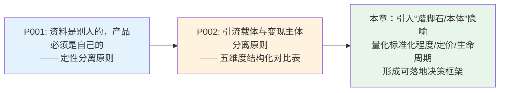

**图表说明**：该演进图展示了从 P001 的定性主张，到 P002 的结构化验证，再到本章形成可操作决策框架的认知迭代路径。

**踏脚石理论**（来源：《P001》）

$$
\text{资料价值} = \underbrace{\text{前端引流价值（获客成本降低）}}_{\text{显性/小钱}} + \underbrace{\text{后端转化价值（筛选精准用户）}}_{\text{隐性/大钱}}
$$

**公式逐步解释**：
1. **前端引流价值（显性/小钱）**：资料本身可低价售卖（9.9-99元），直接产生现金流，同时覆盖获客成本。
2. **后端转化价值（隐性/大钱）**：资料作为筛选器，以极低成本识别出“有需求、有付费能力、有信任基础”的种子用户，为后端高客单产品（咨询、训练营、资源对接）铺路。这部分价值往往是前端的 10-100 倍，但常被忽视。

**概述**：该公式将资料的单一商品价值拆解为“显性交易价值”与“隐性期权价值”两部分。显性价值是当下的现金流，隐性价值是资料作为“筛选器”所持有的、对高意向用户的“看涨期权”。之所以能这样建模，是因为在存量经济与私域运营范式下，用户的生命周期价值（LTV）远大于首单价值，而资料的低门槛属性使其成为获取高 LTV 用户的最低成本期权。前端定价仅需覆盖边际成本与获客成本，真正的利润空间在后端期权的行权中释放。

**建模假设与推导逻辑**：该公式将资料的单一商品价值拆解为“显性交易价值”与“隐性期权价值”两部分。显性价值是当下的现金流，隐性价值是资料作为“筛选器”所持有的、对高意向用户的“看涨期权”。之所以能这样建模，是因为在存量经济与私域运营范式下，用户的生命周期价值（LTV）远大于首单价值，而资料的低门槛属性使其成为获取高 LTV 用户的最低成本期权。前端定价仅需覆盖边际成本与获客成本，真正的利润空间在后端期权的行权中释放。

**变现分层漏斗流程图**（来源：《P002》）

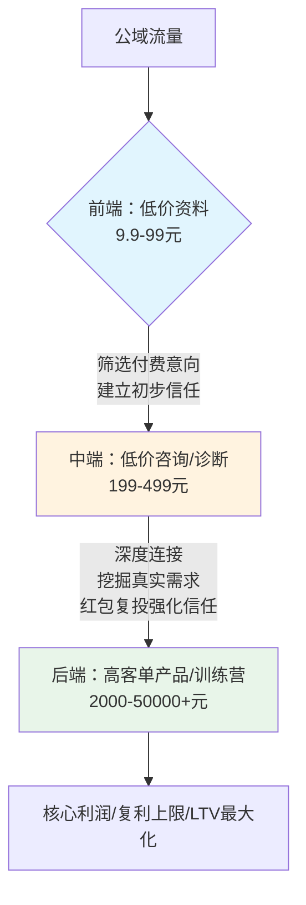

**流程图说明**：该漏斗展示了商业信任的阶梯式构建过程。每一层都是下一层的筛选器和铺垫器：前端资料以低门槛筛选付费种子用户；中端咨询通过专业服务建立深度信任并挖掘需求；后端高客单产品收割核心利润。缺少任一层级，闭环即断裂。

### 74.3.3 关键性质与商业逻辑

**付费即筛选，信任源于交换**（来源：《P002》）

> "当用户在你这儿产生消费，产生知识付费之后，你们之间已经建立了一种潜意识的信任！"
> 
> "如果你直接免费的把网盘链接分享给他的时候，这个时候他对这份资料的商业价值是低估的...而这种粉丝你也没办法判断他到底是不是你的潜在用户、到底是不是你的付费用户"
> 
> ——《P002 BzIfdvAQloqLImxjEhKcERAXn5f.md》

这个机制揭示了付费行为的双重筛选功能：
1. **兴趣强度验证**：愿意掏钱（哪怕 9.9 元），说明痛点真实、动力强烈。
2. **付费意识验证**：有为知识付费的习惯，后续转化高客单阻力极低。

免费用户 = 低信任 + 低意向 + 无法判断质量；付费用户 = 高信任 + 高意向 + 种子客户。这也是为什么作者坚持“哪怕 9.9 元也要收”，而不是免费送网盘链接。

**输入-重构-输出能力建设循环**（来源：《P001, P002》）

> "要整理输入，也要重构输出，甚至通过资料整理培养自己某一方面的能力，打造自己的商业盈利系统！"
> 
> ——《P001 20230516_046.md》

这个循环是个人核心竞争力的发动机：
- **输入（整理/学习/筛选）**：收集碎片信息，按“有用、启发、新颖、私人”四准则筛选。
- **重构（内化/结构化/方法论化）**：用 Tiago Forte 渐进式总结五层法（L1 高亮 → L2 自语复述 → L3 段落合并 → L4 核心观点压缩 → L5 转化为提问）将他人知识转化为自己框架。
- **输出（课程/模板/SOP/咨询方案）**：将重构成果包装为三层变现产品（前端引流 PDF、中端咨询诊断表、后端训练营大纲）。

**能力建设循环流程图**

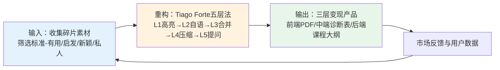

**流程图说明**：输入-重构-输出形成正向飞轮。输入端筛选高质量素材，重构端通过五层法将外部知识内化为个人方法论，输出端包装为标准化变现产品。市场反馈再反过来指导下一轮输入的选题与重构方向，实现能力复利。

**方法演进图：输入-重构-输出循环的工程化落地**

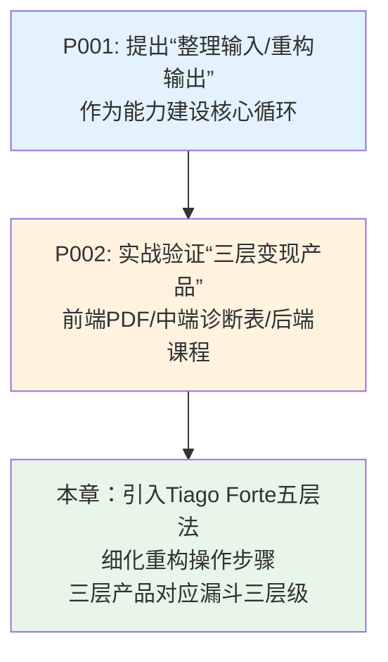

**图表说明**：该演进图展示了从 P001 提出概念框架，到 P002 验证三层产品落地，再到本章引入成熟笔记法方法论细化重构操作、并将三层产品与变现漏斗严丝合缝对齐的工程化演进。

**变现天花板由后端服务深度决定**（来源：《P002》）

> "这个决定了你的变现天花板？比如我就不只是卖资料那么简单，后面再变现的那个板块我会说到！"
> 
> "基本上会有 30% 的人愿意再次付费（前提是你得根据他的消费能力，设置好对应的产品）...如果这个付费产品是可以跑通的，那么你就可以加大力度去投这个高利润产品！"
> 
> ——《P002 BzIfdvAQloqLImxjEhKcERAXn5f.md》

这个论断指出：前端引流速度只决定变现下限（能不能活下来），后端服务深度决定变现上限（能不能做大、做久）。没有自有高附加值产品，你永远在为别人做嫁衣。

### 74.3.4 典型垂直场景产品化案例库

以下是素材中验证过的“资料引流 → 自有服务变现”典型组合模式（来源：《P001, P002》）：

| 前端引流资料（钩子） | 目标用户画像 | 后端自有产品/服务（本体） | 变现逻辑 |
|---------------------|-------------|-------------------------|---------|
| 高中/考公/考证资料 | 学生、备考者、家长 | **高考志愿填报咨询** / 升学规划 | 高客单（千元级）、强刚需、决策型服务、复购低但 LTV 高 |
| 英语/语言学习资料 | 职场人、学生、考研党 | **英语训练营/陪伴营/口语陪练** | 标准化交付、高复购、社群裂变、复利强 |
| 阅读/笔记/书单资料 | 终身学习者、知识付费者 | **读书营/深度阅读社群/年费会员** | 高粘性、高续费、品牌资产、终身价值高 |
| 商业资料/天涯神贴/案例库 | 创业者、高管、投资人 | **商业咨询/高客单课程/资源对接/合伙人招募** | 高溢价、强信任、非标服务、资源杠杆 |

**表格引导说明**：上表汇总了P001与P002实战验证的四类典型垂直赛道组合模式，展示了“资料属性决定吸引谁，服务属性决定赚多少”的垂直赛道产品匹配法落地范式。

这些案例验证了**“垂直赛道产品匹配法”**（来源：《P001》）：根据引流资料的垂直属性，反向设计后端高客单服务。资料决定了你吸引谁，服务决定了你能从谁身上赚多少钱。

## 74.4 选品与渠道决策体系

### 74.4.1 选品三要素决策法（来源：《P002》）

> "考虑三个要素：第1个，是不是你喜欢、擅长且未来要做的事儿当中的一部分...第2个，这个资料所带来的价值，以及是否可以演变出更多的商业价值...第3个，通过你选择的“资料整理”，哪些新媒体渠道可以发挥的作用最大"
> 
> ——《P002 BzIfdvAQloqLImxjEhKcERAXn5f.md》

这是一个三维决策矩阵，缺一不可：

$$
\text{赛道得分} = w_1 \times \text{个人契合度} + w_2 \times \text{用户商业价值可延展性} + w_3 \times \text{渠道流量匹配度}
$$

**公式逐步解释**：
1. **个人契合度（$w_1=30\%$）**：衡量你是否真正懂、爱、愿长期深耕该领域。只有发自内心的兴趣与专业积累，才能支撑长期的“输入-重构-输出”循环。
2. **用户商业价值可延展性（$w_2=40\%$）**：衡量背后用户群体能否开发高客单后端、预估 LTV 上限。这是决定变现天花板的核心变量，权重最高。
3. **渠道流量匹配度（$w_3=30\%$）**：衡量目标用户最活跃平台、分发机制是否利于资料类内容爆发。决定冷启动速度与获客成本。

**概述**：该加权评分模型将模糊的选品直觉量化为可计算、可比较的决策工具。三个维度分别对应“可持续性”（个人契合度）、“天花板高度”（商业价值可延展性）、“启动速度”（渠道匹配度），三者缺一不可，共同决定了一个资料赛道是否值得作为 MVP 起跑选择。

**权重设定说明**：上述权重（30%/40%/30%）为作者基于实战经验的启发式参数，P002 素材原文仅定性提出“三个要素”，未给出量化权重。实操中可根据自身资源禀赋动态调整：若擅长内容生产但不懂投流，可提高“渠道匹配度”权重；若已有成熟后端产品，可提高“商业价值可延展性”权重。

| 维度 | 核心问题 | 判断标准 | 权重建议 |
|------|----------|----------|----------|
| **个人契合度** | 我是否真正懂、爱、愿长期深耕？ | 1-10 分：专业背景/兴趣热情/长期规划一致性 | 30% |
| **用户商业价值可延展性** | 背后用户能否开发高客单后端？预估上限？ | 1-10 分：后端产品可行性/客单价上限/LTV潜力 | 40% |
| **渠道流量匹配度** | 目标用户最活跃在哪？平台机制利于资料爆发？ | 1-10 分：平台用户画像重合度/分发机制友好度/竞争强度 | 30% |

**表格引导说明**：上表为选品三要素决策法的量化评分卡，将模糊直觉转化为可操作的决策矩阵，来源于P002作者实战总结的选品方法论。

**方法演进图：选品决策从定性到量化的演进**

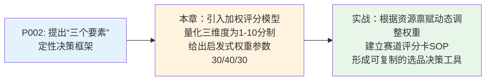

**图表说明**：该演进图展示了选品决策法从 P002 的定性三要素，到本章量化评分模型，再到实战中动态调整权重形成标准化工具的演进路径。

**实操建议**：列出 3-5 个备选赛道，逐项打分，综合得分最高者作为 MVP 起跑选择。若最高分赛道的“渠道匹配度”较低（需投流跑量），可调整策略：先用免费/低价资料在高匹配度平台测款，验证需求后再投流放大。

### 74.4.2 头条号自动回复引流法（来源：《P002》）

这是作者实测的最低成本、最高效率、风控最低的冷启动引流 SOP：

> "你基本上发布一篇帖子，提前在后台把这个关键词自动回复设置好，这个帖子爆了之后，别人就会去私信，这个时候你基本上就不需要管了，私信会自动把微信号发给他"
> 
> "头条号...相对这个引流来说还是比较宽松的...你基本上发布一篇帖子...私信会自动把微信号发给他，他加你的微信之后，安排一个助理去回复...总的来说头条号就是引流比较快，可以尽快的试出这个效果！"
> 
> ——《P002 BzIfdvAQloqLImxjEhKcERAXn5f.md》

**头条号自动回复引流流程图**

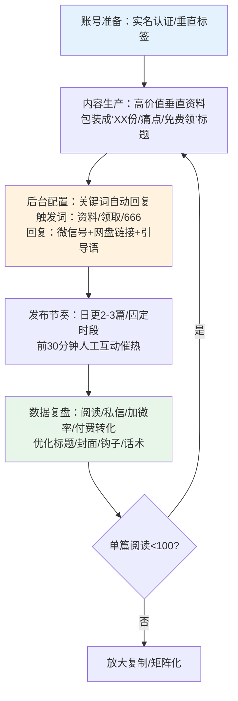

**流程图说明**：该流程图展示了头条号自动回复引法的标准化闭环：从账号准备、内容生产、后台自动化配置、发布节奏把控，到数据复盘驱动的迭代优化，形成可复制的 SOP。

**标准化执行步骤**：

1. **账号准备**：注册/购买头条号（建议实名认证、领域垂直标签明确）。
2. **内容生产**：选取高价值垂直资料 → 包装成“XX 份/套/本 + 核心痛点 + 免费/低价领取”标题。
3. **后台配置**：后台 → 私信管理 → 关键词自动回复 → 设置触发词（如“资料”、“领取”、“666”） → 回复内容：微信号 + 网盘链接 + 引导语（如“加微信备注‘资料’领完整版，进群送更多福利”）。
4. **发布节奏**：每日 2-3 篇，固定时间段（早 8-9 点 / 晚 8-10 点），前 30 分钟人工互动催热。
5. **数据复盘**：日均阅读/私信量/加微率/付费转化率 → 优化标题/封面/钩子/回复话术。

**关键词与话术模板补充说明**：素材 P002 给出了“资料/领取/666”作为触发词示例，以及“加微信备注‘资料’领完整版”作为引导语示例，但未提供经过大规模验证的完整关键词库与高转化回复话术全文。实操中建议测试“密码/获取/想要/怎么领”等长尾触发词，并 A/B 测试“进群送 XX 福利/限时免费/前 50 名送 XX”等不同引导语，以提升加微率与转化率。

**关键优势对比**：

| 维度 | 头条号自动回复 | 小红书评论区引流 | 抖音主页/私信引流 | 公众号菜单栏引流 |
|------|---------------|-----------------|-----------------|----------------|
| **自动化程度** | ⭐⭐⭐⭐⭐ 完全自动 | ⭐⭐ 半自动/需人工 | ⭐⭐ 需人工/工具 | ⭐⭐⭐ 半自动 |
| **封号风险** | 低（平台相对宽松） | 高（严打导流） | 极高（零容忍） | 中（需迂回） |
| **用户质量** | 中高（主动搜索/阅读长文） | 高（强种草属性） | 中（娱乐化用户多） | 高（强信任） |
| **冷启动速度** | 快（易爆文、推荐机制友好） | 中（需养号、垂直度高） | 慢（需投流/养号） | 慢（需积累粉丝） |
| **人力成本** | 极低（助理只负责接待） | 高（需大量评论/私信） | 高（需话术/客服） | 中（需内容运营） |

**表格引导说明**：上表对比了四大主流平台引流方式在自动化程度、封号风险、用户质量、冷启动速度、人力成本五个维度的表现，数据来源于P002作者实测与行业横向对比，旨在说明为何头条号是资料赛道冷启动的最优选择。

### 74.4.3 私域双号风控体系（来源：《P002》）

> "你一定要提前准备好，至少两个微信号，原因呢有两个，第1个是避免被加好友频繁导致用户加不进来，第2个呢就是避免收款频繁导致钱到不了账"
> 
> ——《P002 BzIfdvAQloqLImxjEhKcERAXn5f.md》

这是私域运营规模化的生存底线，不是可选项，是必选项：

**私域双号风控体系架构图**

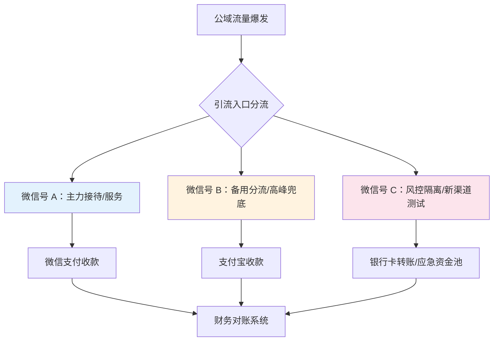

**架构图说明**：该架构展示了双号（实为三号）分流与多渠道收款分离的风控设计。公域流量进入后按负载均衡分配至不同微信号，收款端同步分离至微信支付、支付宝、银行卡三条渠道，最终汇聚财务对账系统，实现“加好友不受限、收款不冻结、账目可追溯”的规模化基建。

**风控红线对照表**：

| 风控类型 | 触发条件 | 后果 | 双号体系解决方案 |
|----------|----------|------|-----------------|
| **加好友频控** | 单号单日通过好友 > 200-300（视账号权重） | 无法通过好友申请、功能受限 | 多号轮询分流，单号控制在安全阈值内 |
| **收款风控** | 单日收款笔数/金额超阈值、频繁小额收款 | 零钱/商户收款限制、资金冻结 24h-永久 | 多渠道分离：微信支付 + 支付宝 + 银行卡转账轮询 |
| **设备指纹关联** | 同一设备登录多个微信频繁切换 | 关联封禁、营销号判定 | 物理隔离：一机一号，或云手机/多开器隔离环境 |
| **内容违规投诉** | 被用户投诉/系统巡查违规营销 | 功能限制/封号 | 内容合规化、话术去敏感词、主号不发广告只做服务 |

**表格引导说明**：上表梳理了私域运营中四大核心风控类型的触发条件、后果与双号体系对应解决方案，来源于P002作者实战踩坑总结，为规模化运营提供了可执行的风控清单。

## 74.5 私域成交与变现落地

### 74.5.1 咨询式成交话术与红包复投模型（来源：《P002》）

> "基本上商业咨询费用我都是简单的收个 200，结束后目前最低的都会给我包个 88——120 的红包...主要的是拿点小钱，了解大部分用户的真实需求、建立信任和提供服务，深度连接之后，后期你会有更大的这种产品去承接！"
> 
> ——《P002 BzIfdvAQloqLImxjEhKcERAXn5f.md》

这是一个标准化的中端转化 SOP，实测咨询转化率 30%，红包复投率 99%：

**咨询式成交五步流程图**

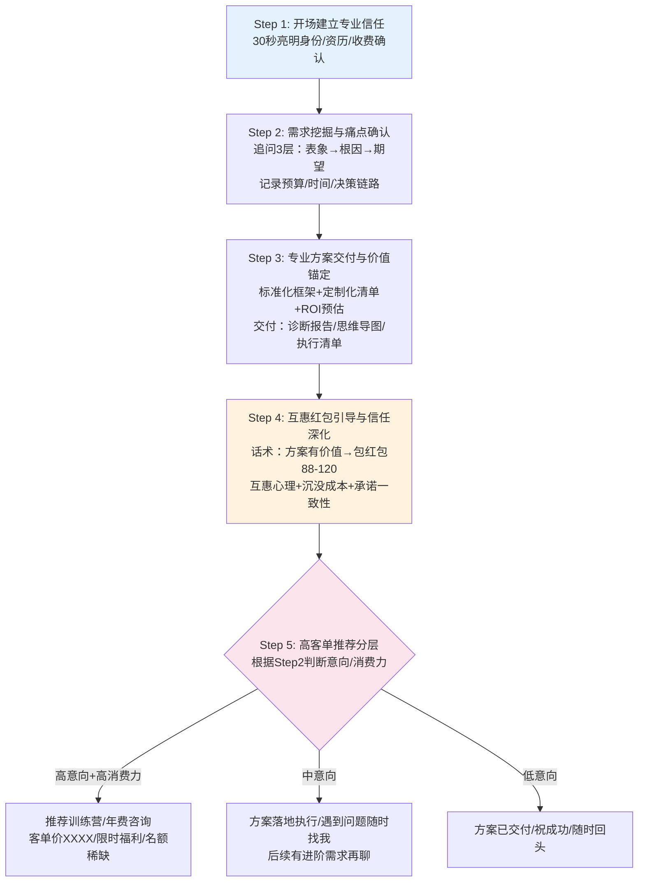

**流程图说明**：该流程图可视化了咨询式成交的标准化五步法：从开场建立信任、需求深度挖掘、专业方案交付锚定价值、红包复投强化互惠心理，到基于用户画像分层推荐高客单产品。每一步都有明确的动作标准与心理学依据。

**五步成交话术流程**：

**Step 1：开场建立专业信任（30秒）**
"您好，我是 XXX，专注 XXX 领域 X 年，服务过 XXX 位学员。您付费的 200 元咨询费已收到，我们开始为您做深度诊断。请先告诉我：您目前最大的痛点/目标/困惑是什么？"

**Step 2：需求挖掘与痛点确认（5-10分钟）**
追问 3 层：表象问题 → 根本原因 → 期望结果。记录关键信息：预算范围、时间紧迫度、决策链路、过往尝试。判断：是否为高意向高客单潜在客户？

**Step 3：专业方案交付与价值锚定（10-20分钟）**
基于诊断给出：标准化解决方案框架 + 定制化行动清单 + 预期 ROI 预估。话术："按这个方案执行，预计 X 天内可实现 Y 结果，为您节省 Z 成本/时间。" 交付物：PDF 诊断报告 / 思维导图 / 执行清单 / 资源对接清单。

**Step 4：互惠红包引导与信任深化（关键动作）**
话术："很高兴能帮到您！如果这份方案对您有价值，麻烦包个红包（88-120元随意），一来表示认可，二来也让我有动力持续优化服务质量，三来咱们建立更深的连接，后续有更高阶的产品/资源我会优先同步给您。" 心理学原理：互惠心理 + 沉没成本 + 承诺一致性 + 社会认同。

**Step 5：高客单产品推荐与闭环（视 Step 2 判断结果）**
- **高意向 + 高消费力**："基于您的情况，强烈建议加入我们的 XXX 训练营/年费咨询，包含：完整 SOP + 陪跑服务 + 资源对接 + 终身复训，客单价 XXXX 元，现在报名送 XXX 福利，仅限今天前 3 名。"
- **中意向**："先把方案落地执行，遇到问题随时找我。后续有进阶需求再聊。"
- **低意向**："方案已交付，祝您成功。有需要随时回头。"

**实测数据支撑**（来源：《P002》）：
- 4 天投入日均 2 小时 → 私域引流 700+ 用户（日均 180+）
- 资料付费转化率约 60%（200 加微信 / 100 付费）
- 咨询转化 30% 且客单价 200+，红包 88-120 元
- 单用户即时 ARPU = 200 + 100 × 99% ≈ 300 元，远超单纯卖资料的 9.9-99 元

**方法演进图：咨询式成交模型的标准化演进**

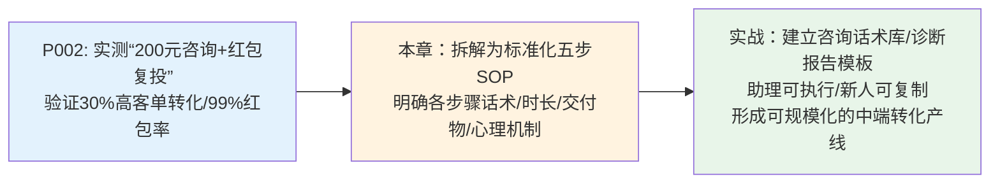

**图表说明**：该演进图展示了从 P002 的实战数据验证，到本章拆解标准化五步 SOP，再到实战中沉淀话术库与模板形成可规模化复制的中端转化产线的演进路径。

### 74.5.2 朋友圈运营与私域信任资产构建

**三段式发布策略（专业:生活:营销:互动 = 3:3:2:2 比例）**（来源：《P002 实战验证》）：

| 内容类型 | 占比 | 核心目的 | 典型素材示例 |
|----------|------|----------|-------------|
| **专业展示** | 30% | 建立权威、展示能力、沉淀案例 | 学员反馈截图、交付成果展示、行业洞察干货、工具模板拆解 |
| **生活真实** | 30% | 建立人设、拉近距离、展示真实 | 家庭成长碎片、踩坑避坑经历、作息运动习惯、读书笔记心得 |
| **营销转化** | 20% | 直接成交、制造稀缺、逼单转化 | 课程预售/限时优惠/名额紧张/学员成果/复购续费截图 |
| **互动引导** | 20% | 活跃粘性、收集需求、筛选意向 | 提问互动/投票调研/福利抽奖/免费诊断名额/资料领取钩子 |

**表格引导说明**：上表展示了朋友圈内容运营的黄金比例与执行标准，来源于P002作者实测验证有效。专业与生活各占30%构建立体人设，营销与互动各占20%实现转化与活跃的动态平衡。

**置顶与分组可见策略**：
- 置顶 3 条：个人简介/核心产品/最强社会证明
- 分组可见：按“意向度/客单价/服务层级”分组，精准推送差异化内容

### 74.5.3 最小可行性商业闭环（MVP）验证节奏（来源：《P002》）

作者 4 天实战复盘给出的标准化验证节奏：

| 天数 | 核心动作 | 关键指标 | 决策节点 |
|------|----------|----------|----------|
| **Day 1** | 选品定位 + 资料整理 + 头条号配置 + 第 1 篇发布 | 发布成功、自动回复生效 | 无 |
| **Day 2** | 持续发布 2-3 篇 + 优化标题封面 + 助理接待上线 | 私信量、加微率、阅读完成率 | 单篇阅读 < 100 → 换选题/换标题 |
| **Day 3** | 爆款复制/放大 + 咨询话术执行 + 首单成交 | 付费转化率、咨询转化率、单用户收入 | 付费转化 < 30% → 优化钩子/话术 |
| **Day 4** | 数据复盘 + SOP 沉淀 + 规模化决策 | 总投入/总产出/ROI/LTV 预估 | ROI > 1.5 且 LTV > 500 → 加大投入/招人/矩阵化 |

**表格引导说明**：上表为P002作者4天实战复盘提炼的MVP验证标准节奏，每日锁定核心动作与关键指标，设置明确决策节点，实现“以最快速度跑通最小闭环”的工程化目标。

**阈值设定说明**：表中“单篇阅读 < 100”判断标准、“付费转化 < 30%”优化触发线、“ROI > 1.5 且 LTV > 500”规模化门槛，为作者基于资料赛道冷启动经验设定的启发式参数，P002 素材未明确给出具体数值阈值。实操中建议根据赛道竞争度、客单价高低动态校准：高客单赛道可容忍更低阅读量但需更高转化率；低客单赛道需更大流量基数支撑。

**4 天实测数据**（来源：《P002》）：
- 投入：日均 2 小时 × 4 天 = 8 小时人力
- 产出：引流 700+，付费 100+，咨询 30+，红包 30+，预估高客单管道 10+
- 变现：资料收入 ~1 万，咨询收入 ~6 千，红包 ~3 千，高客单管道 ~3 万+
- **ROI 极高，验证 MVP 跑通，决定规模化投入**

**MVP验证节奏甘特图**

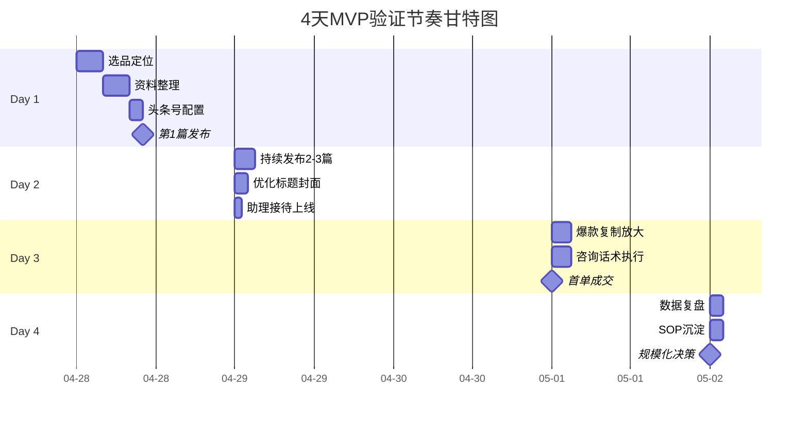

**甘特图说明**：可视化展示4天MVP验证的每日工时分配与关键里程碑，总投入约8小时人力，覆盖从冷启动到规模化决策的完整链路。

**方法演进图：MVP验证从实战到标准化节奏的沉淀**

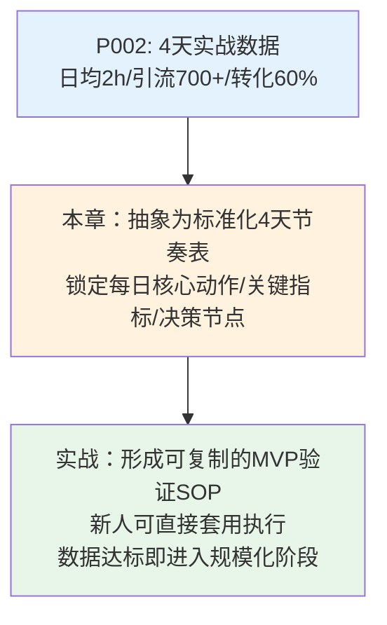

**图表说明**：该演进图展示了从 P002 的单次实战复盘，到本章抽象为标准化验证节奏表，再到实战中形成可新人直接套用的 MVP 验证 SOP 的方法论沉淀路径。

## 74.6 多源对照：资料整理商业模型的不同视角

### 共识

| 核心观点 | P001 支撑 | P002 支撑 |
|----------|-----------|-----------|
| 资料整理属于边际成本近零的杠杆产品 | ✅ 明确引用纳瓦尔宝典媒介杠杆定义 | ✅ 复述杠杆属性，强调可叠加资本/劳动力 |
| 单纯卖资料天花板低、不可持续 | ✅ “赚卖资料的小钱已经是顺便的事儿” | ✅ “单纯的卖资料...这是最无脑的一种做法” |
| 必须有自有后端产品/服务体系 | ✅ “资料是别人的，产品必须是自己的” | ✅ “一定要有自己的产品，资料是别人的，产品必须是自己的！” |
| 资料作为钩子筛选精准用户 | ✅ “卖资料只不过是你获取客源的踏脚石” | ✅ “资料整理，只不过是你获取自己真实用户的一个媒介” |
| 输入-重构-输出构建核心竞争力 | ✅ “要整理输入，也要重构输出...打造商业盈利系统” | ⚠️ 隐含在“打磨自有产品体系”中 |

### 分歧与互补

| 维度 | P001（三恒实操帖） | P002（三恒复盘文） | 综合洞察 |
|------|-------------------|-------------------|----------|
| **侧重点** | 方法论框架、案例库、心法 | 具体 SOP、数据复盘、避坑细节 | P001 给“为什么”和“做什么”，P002 给“怎么做”和“数据长什么样” |
| **引流渠道** | 泛指“公域分发” | 实测**头条号自动回复**为最优冷启动渠道 | 头条号是当前资料赛道**性价比最高**的冷启动渠道 |
| **私域运营** | 提及“朋友圈运营/社群” | 给出**双号风控、助理接待、咨询话术、红包复投**完整 SOP | 私域运营的**工程化细节**决定规模化成败 |
| **变现分层** | 概念层“附加产品/解决方案” | 量化层“资料→咨询→高客单”三层漏斗 + 具体价格带/转化率 | **三层漏斗是可复制的标准化模型**，非理论构想 |
| **选品决策** | “垂直赛道产品匹配法” | **选品三要素决策法**（兴趣/商业价值/渠道匹配） | 三要素法将模糊直觉**量化为可操作的决策矩阵** |

**表格引导说明**：上表对比了两篇核心素材在五大维度上的共识与互补关系，揭示了从方法论框架（P001）到工程化落地（P002）的认知演进路径。

## 74.7 设计中的取舍

**Q1：为什么不用“免费送资料 + 网盘拉新”模式？**
A：免费模式看似引流快、用户多，实则用户质量极低：无付费筛选 → 无法判断意向 → 低估资料价值 → 低信任基础 → 后端转化极难。作者实测：免费粉丝粘性极低，后端高客单几乎零转化。付费哪怕 9.9 元，也是质量分水岭。

**Q2：为什么不用小红书/抖音作为主力冷启动渠道？**
A：小红书/抖音用户质量高、商业价值大，但冷启动门槛极高：需养号 3-5 天、垂直度要求严、导流管控极严（需物理规避手段）、内容生产成本高（图文/视频精美度要求高）。头条号自动回复：0 养号、0 粉丝门槛、自动化程度最高、平台相对宽松、长文阅读用户付费意向强，是新手验证 MVP 的最优选择。

**Q3：为什么咨询费定在 200 元而不是 99 元或 499 元？**
A：99 元门槛太低，吸引大量“凑热闹/白嫖/低意向”用户，助理接待成本高、筛选效果差。499 元门槛太高，前端资料付费用户（9.9-99 元）心理跨度大，咨询转化率骤降。200 元是心理定价甜点区——比资料贵 2-20 倍（筛选力强），比高客单便宜 10-50 倍（决策阻力小），刚好承接“资料付费用户”的自然升级路径。

**Q4：为什么必须“双号分流 + 多渠道收款”？**
A：单号单日加好友 > 200 触发频控是大概率事件，单渠道收款触发风控是必然事件。不做双号体系 = 赌业务不爆发，一旦爆发（日引 300+）立刻瘫痪。基建必须前置，业务才能跑得快、跑得稳。

## 74.8 动手练习

### 练习 1：设计你的资料引流-变现分层漏斗

假设你擅长“Notion 效率模板整理”，计划在小红书/公众号引流至私域变现：

1. 设计前端引流资料包（钩子）：包含哪些具体模板？如何包装标题/封面提升点击率？
2. 设计中端咨询服务（信任建立）：定价多少？服务内容包含什么（如 1 对 1 诊断/模板定制/系统搭建指导）？如何设计“红包复投”话术？
3. 设计后端高客单产品（核心利润）：是训练营、陪伴营、还是咨询年费会员？客单价预设多少？交付 SOP 包含哪些标准化模块？
4. 计算关键指标：预估引流成本、资料付费转化率、咨询转化率、高客单转化率、单用户 LTV。

**回答问题**：
- 如果只有前端资料无后端产品，你的变现天花板在哪里？
- 如何判断“Notion 模板”这个赛道的用户商业价值可延展性？
- 私域运营初期，为何必须准备“双号分流 + 多渠道收款”？不做会有什么后果？

### 练习 2：头条号自动回复引流实操推演

模拟在头条号发布一篇“100 个 Notion 高阶模板免费领”的爆款贴：

1. 后台关键词自动回复如何设置？（关键词选什么？回复内容含微信号/网盘链接/引导语如何写？）
2. 爆文发出后，私信涌入，助理接待话术前三句怎么说？（建立信任、筛选需求、引导加微信）
3. 加微信后，朋友圈前 3 条发什么？（人设背书、资料交付证明、咨询服务预告）

**回答问题**：
- 为何作者主张“免费送网盘链接”用户质量低于“付费/关键词回复领取”？
- 头条号相对小红书/抖音，引流“宽松”在哪里？风险点在哪里？
- 如果单日引流 300+，单人助理无法应付，如何用“自动化/标准化”解决？

### 练习 3：输入-重构-输出：将“整理资料”转化为“个人方法论资产”

挑选一个你熟悉的垂直领域（如：考公上岸经验/跨境电商选品/短视频剪辑教程）：

1. 输入阶段：列出你将收集的 5-10 个核心原始素材来源（公众号/视频/课程/竞品资料），筛选标准是什么？（有用/启发/新颖/私人）
2. 重构阶段：将碎片素材转化为结构化“方法论/模板/清单/SOP”的具体步骤是什么？（如：Tiago Forte 五层法 L1-L5 操作）
3. 输出阶段：重构后的成果，如何包装为三层变现产品？（前端引流 PDF、中端咨询诊断表、后端训练营课程大纲）

**回答问题**：
- 为什么说“单纯搬运资料”陷入红海，而“重构输出方法论”能建立护城河？
- 你的“重构输出”成果，如何验证其对目标用户的“解决深层问题”的有效性？
- 这个循环跑通后，如何持续迭代升级你的“商业盈利系统”？

### 练习 4：选品三要素决策法实战演练

你有以下三个备选资料赛道：A. 小红书运营实操资料  B. 中医养生食谱资料  C. 程序员面试题库资料

请对每个赛道打分（1-10 分）并简述理由：

1. 兴趣/擅长/长期规划一致性：你是否真正懂、爱、愿长期深耕？
2. 用户商业价值可延展性：背后用户群体能否开发出高客单价后端（咨询/训练营/资源对接）？预估后端客单价上限？
3. 渠道流量分发匹配度：该赛道用户最活跃在哪个平台？该平台分发机制（推荐/搜索/社交）是否利于资料类内容爆发？

**回答问题**：
- 哪个赛道综合得分最高？为何它是你的“最小可行性商业闭环（MVP）”最优起跑选择？
- 若最高分赛道的“渠道匹配度”较低（如需投流才能跑量），你会如何调整策略？
- 如何用“4 天 MVP”快速验证该赛道真实 ROI？（参考素材中作者 4 天日均 2 小时、引流 700+、转化 60% 的实操节奏）

## 74.9 本章小结

这一章中我们学习了资料整理商业模型的完整闭环。首先建立了**资料整理杠杆模型**的核心定位，明确了资料属于复制边际成本近零的媒介杠杆产品；其次确立了**引流载体与变现主体分离原则**，揭示资料是钩子、产品才是本体的踏脚石理论；接着拆解了**变现分层漏斗**（资料→咨询→高客单）与**付费即筛选、信任源于交换**的心理机制；然后详细给出了**选品三要素决策法**、**头条号自动回复引流 SOP**、**私域双号风控体系**、**咨询式成交话术与红包复投模型**四大标准化操作手册；最后通过**输入-重构-输出能力建设循环**与 **MVP 最小可行性验证节奏**，指导读者从 0 到 1 跑通商业闭环，并将资料整理转化为个人核心竞争力护城河。

本章我们一起学习了以下概念：

| 概念 | 解释 |
|------|------|
| 资料整理杠杆模型 | 复制边际成本近零，属媒介杠杆，适合叠加资本/劳动力放大收益 |
| 引流载体与变现主体分离原则 | 资料（钩子）可低成本标准化；产品（本体）必须自有、高价值、解决深层问题 |
| 踏脚石理论 | 卖资料赚小钱是顺便，核心是用资料筛选精准用户为后端高客单产品导流 |
| 变现分层漏斗 | 低价资料筛选付费意向 → 低价咨询建立信任挖掘需求 → 高客单产品/训练营核心利润 |
| 选品三要素决策法 | 个人兴趣擅长一致性 × 用户商业价值可延展性 × 渠道流量分发匹配度 |
| 头条号自动回复引流法 | 利用后台关键词自动回复发微信号/网盘链接，实现无人值守、低风险规模化引流 |
| 私域双号风控体系 | 至少两个微信号分流加好友 + 多渠道分离收款，规避加好友频控与收款风控冻结 |
| 咨询式成交话术与红包复投模型 | 收200元咨询费 → 专业解决问题 → 引导用户自发发88-120元红包(99%) → 推荐高客单产品(30%转化) |
| 付费即筛选，信任源于交换 | 用户付费完成双重筛选(兴趣强度+付费意识)，商业信任仅通过价值交换循环建立 |
| 输入-重构-输出能力建设循环 | 整理输入(学习/筛选) → 重构输出(沉淀方法论/开发课程/服务) → 打造个人核心竞争力护城河 |
| 私域用户资产论 | 存量经济时代，可随时触达且曾付费的私域知识用户是核心资产，资料只是获取用户的媒介 |
| 最小可行性商业闭环 (MVP) | 从整理资料、获客引流、私域承接到变现分层的完整最小链路，以最快速度跑通验证 ROI |

下一章中，我们将学习**知识创作系统 —— 从“囤资料”到“生产知识资产”**，基于 DIKW 模型与 P.A.R.A 组织法，构建“收集筛选→萃取内化→动态组织→创作输出”的个人知识生产线，解决“收藏夹吃灰”与“搬运工”困境，实现知识复利。

