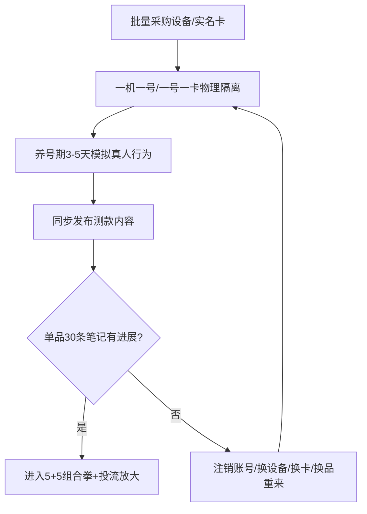
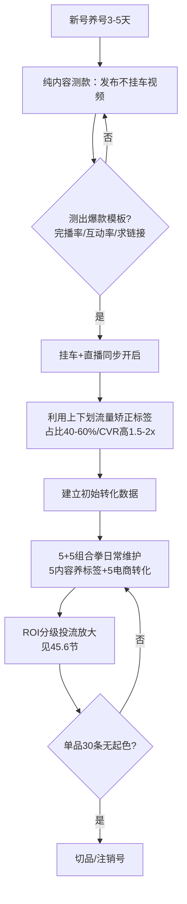
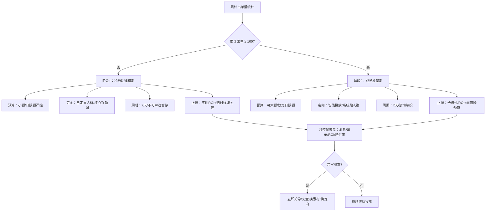
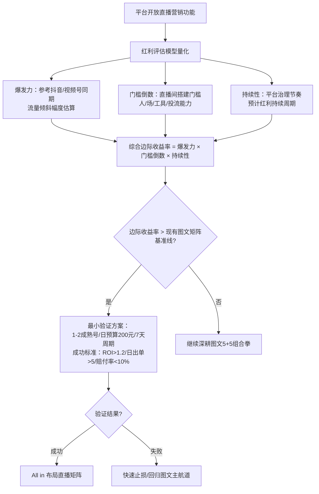

# 第 45 章 小红书带货矩阵化概率论 —— 从“博概率”到“确定性收益”的工程化范式
作者：龙哥

## 学习目标

- 理解小红书电商“博概率”底层逻辑与矩阵化运营的必要性
- 掌握单品打爆标准化流程（5+5组合拳法）的三阶段执行节奏
- 掌握ROI分级投放决策法（100单分水岭、卡赔付止损、7天周期）
- 掌握跟品双轨验证法（多刷+三方工具查）替代主观选品的实操路径
- 了解直播营销红利窗口的预判与布局策略
- 识别市面培训“知行分离”伪知识陷阱，建立自学实战的认知防御
- 掌握矩阵账号物理隔离运维规范（一机一号、人工手机端发布）
- 建立平台红利评估框架：爆发力×门槛倒数×持续性的边际收益率判断

## 45.1 生活类比

想象小红书带货像在大海里撒网捕鱼：单条笔记是一张网，能不能捕到大鱼（爆款）全靠运气（概率分布）；账号矩阵是派出一船队（N个账号）同时撒网（M条内容），船队越大、撒网越多，总能捕到鱼（大数定律确定性收益）；30条笔记止损是同一海域撒了30张网都没鱼，果断换海域（注销号换品），别死磕沉没成本；5+5组合拳是白天撒“诱饵网”（内容视频养标签引流），晚上撒“收割网”（电商视频转化），配合“直播间”这个鱼群聚集点（上下划流量）把鱼留住；ROI分级投放是捕到100条鱼前只敢用小渔船（小额/自定义/卡赔付），捕够100条后敢派大渔船（智能/大额），但永远盯着“油耗比捕获值”（ROI/赔付线）；跟品策略是不自己瞎猜鱼在哪（主观选品），去看别的渔船在哪收网最多（多刷）、用声呐确认鱼群轨迹（三方工具查），跟着撒网；平台门槛红利是这片海域虽然鱼不如隔壁视频号海多（爆发力弱），但租船便宜、不用证、新手也能开（门槛最低），单位成本捕获比最高。

## 45.2 概念地图

小红书带货矩阵化概率论
├── 核心底层逻辑：博概率
│   ├── 单账号方差极大，同质内容跨号表现不一致
│   ├── 矩阵化（N账号×M内容）将概率转确定性
│   └── 30条笔记止损线：理性决策边界
├── 组织形式：账号矩阵
│   ├── 批量注册/养号同步发布
│   ├── 单号30条无进展注销重来
│   └── 物理隔离运维：一机一号/一号一卡/人工手机端发布
├── 执行标准：单品打爆SOP（5+5组合拳法）
│   ├── 阶段1：纯内容测款找模板（不挂车）
│   ├── 阶段2：挂车+直播同步（利用上下划流量矫正标签）
│   ├── 阶段3：5+5组合拳日常维护（5内容+5电商）
│   └── 单品30条无起色果断切品/注销
├── 放大杠杆：ROI分级投放
│   ├── 分水岭：累计出单100单（系统建模成熟临界点）
│   ├── <100单：小额/自定义人群/卡赔付
│   ├── ≥100单：可智能/大额/卡赔付
│   └── 核心原则：宁可漏量不可亏钱
├── 选品决策：跟品双轨验证
│   ├── 轨道一：多刷（沉浸式感知实时热度/话术/痛点）
│   ├── 轨道二：三方工具查（蝉妈妈/新红/克劳锐验证销量趋势）
│   └── 双轨重合即为跟品标的
├── 战略机遇：直播营销红利窗口
│   ├── 平台早期流量扶持：图文转直播ROI极高
│   └── 需提前建立直播间运营能力
├── 避坑指南：培训避雷
│   ├── 知行分离：教理论不教落地细节
│   └── 建议自学基础+实战摸索
└── 红利判断：门槛红利评估模型
    ├── 综合维度：爆发力×门槛倒数×持续性
    └── 小红书：爆发力弱但门槛最低，中小玩家最优生态位

## 45.3 博概率核心逻辑 —— 小红书电商的“概率论”本质

### 为什么需要这个概念？

小红书带货与抖音、视频号同构，单条笔记能否爆发具有高度不确定性，同质内容在不同账号表现差异巨大。传统“精心做内容、等爆款”的单号运营模式，因方差极大极易导致焦虑与资源浪费。必须从“追求确定性单条爆款”转向“通过矩阵增加试错次数捕捉低概率事件”的概率思维。

> "本质上和在抖音视频号没有什么区别，都是依赖于【博概率】，同样的模板，同样的话术，你在 A 号发不爆，可能 B 号会爆。所以不用为一时不爆量而焦虑，这反而是常态。"
> 
> ——《docs/202305/20230516_028.md》

这个洞察直接击中了新手最容易陷入的认知陷阱：**把“运气”当“实力”，把“方差”当“必然”**。当你在同一个账号上反复打磨同一条内容却不出单时，你不是在“优化”，而是在和概率分布的尾部对赌。

### 核心定义

**博概率**（来源：《小红书带货矩阵化概率论》）

小红书电商核心变量非内容质量单一维度，而是“曝光概率分布”的尾部捕获。

从统计学建模视角看，推荐系统的曝光机制可形式化为：

$$
P(\text{爆发}) = P(\text{曝光} > \theta \mid \text{内容特征 } X, \text{账号权重 } W, \text{时机 } T)
$$

其中，曝光概率 $P(E|X,W,T)$ 与点击率 $P(C|E,X)$ 解耦（反事实学习框架，参考《Deep Learning for Recommender Systems》第4章、KDD'19 "Position Bias Estimation"）。单账号冷启动时，用户兴趣向量随机初始化、位置偏差未校准，导致同质内容 $X$ 在不同账号 $W_i$ 上的曝光分布呈现高方差特性：

$$
\text{Var}(\text{GMV}_{\text{单号}}) \gg \text{E}(\text{GMV}_{\text{单号}})
$$

唯有矩阵化（$N$账号 $\times$ $M$内容）将概率问题转化为大数定律确定性收益。假设单条笔记 GMV 为独立同分布随机变量，均值 $\mu$，方差 $\sigma^2$，则矩阵总收益均值为：

$$
\frac{1}{N \times M} \sum_{i=1}^{N} \sum_{j=1}^{M} \text{GMV}_{ij} \xrightarrow{p} \mu
$$

**这段公式展示了：单条笔记的爆发是概率事件，期望值 $\mu$ 由内容质量、账号权重、投放时机共同决定，但方差极大。只有当样本量 $N \times M$ 足够大时，样本均值才会依概率收敛到总体期望 $\mu$。**

进一步，由切比雪夫不等式/中心极限定理，收敛速度由标准差决定：

$$
\text{矩阵收益确定性} \propto \frac{1}{\sqrt{\text{Var}(\bar{X})}} = \frac{\sqrt{N \times M}}{\sigma}
$$

**即确定性随样本量的平方根增长，而非线性增长——这是为何“矩阵收益确定性 $\propto \sqrt{N \times M}$”而非 $N \times M$ 的统计学原理：方差随样本量线性累加，标准差按平方根增长，置信区间宽度按 $1/\sqrt{N \times M}$ 收缩。**

焦虑单号不爆是认知偏差，30条笔记止损线是理性决策边界。

### 关键性质

1. **同质内容跨账号表现不一致**：A号不爆，B号可能爆，这是平台分发机制的常态而非异常。素材作者实测：同样的模板、话术，在A号发不爆，换B号可能就爆了，验证“博概率”机制。其机制根源在于：位置偏差+用户兴趣向量随机初始化导致曝光分布高方差（参考 CIKM'20 "Unbiased Learning to Rank" 反事实解耦框架）。

2. **认知边界**：焦虑单号不爆是认知偏差；30条笔记止损线是理性决策边界。作者建议：“如果一个号单品你发了 30 个笔记以上，还没有什么进展，我建议就直接注销账号重新换品搞吧。”

### 边界条件

- 仅适用于标准化可复制的搬运/混剪/矩阵模式，不适用于强人设、强原创的IP型账号。
- 前提是具备批量注册养号、批量生产内容的组织能力或工具链。

## 45.4 账号矩阵组织形式 —— 以概率换确定性的批量化运营策略

### 为什么需要这个概念？

单账号博概率成功率极低，必须通过组织形式创新（多账号并行）将概率优势转化为确定性收益。解决“单号不爆=项目失败”的认知陷阱，建立“注销重来”的低成本试错机制。

### 核心定义

**账号矩阵**（来源：《小红书带货矩阵化概率论》）

为应对“博概率”机制而采取的批量化运营策略，通过注册/养成多个账号同步发布内容，以概率换确定性。

$$
\text{矩阵收益确定性} \propto \sqrt{N \times M}
$$

- 单号止损阈值：单品发布30条笔记无进展则注销账号重来，实现快速试错与资源止损。

**这个公式量化了：矩阵规模 $N \times M$ 与收益确定性的平方根关系，直接源自大数定律收敛速度的统计学推导（见45.3节公式推导）。**

### 关键性质：物理隔离原则

矩阵存活的生存底线是**物理隔离**：

- **一机一号**：一台手机只登一个账号
- **一号一卡**：一张实名手机号绑定一个账号  
- **人工手机端发布**：不使用电脑端群发/第三方发布工具

> "评论区：阿豪 : 我目前都是手机发 ... 阿豪 : 我目前是一机一号"
> 
> ——《docs/202305/20230516_028.md》

作者亲测运维规范：针对“电脑统一发布是否影响账号”提问，明确“目前都是手机发”、“一机一号”，规避了群控工具/云手机/电脑端批量操作触发的风控风险，验证了物理隔离的安全性。

**背后的风控逻辑是：平台通过设备指纹、IP归属、操作行为序列（点击间隔、滑动轨迹、发布时间分布）识别“群控/营销号”特征。电脑端/云手机/群控工具的标准化API调用、固定时间间隔、高度相似的设备参数，极易被风控模型聚类判定为非真人操作，进而限流或封号。物理手机端人工操作保留了真人行为的熵（随机性），是当前成本可控的最优解。**

### 矩阵运维流程图



### 边界条件

- 需解决手机设备成本、实名卡资源、人工发布效率等工程问题。
- 矩阵规模受限于“一机一号”的物理上限，大规模需引入云手机/群控但风险指数级上升。

## 45.5 单品打爆标准化流程（SOP） —— 5+5组合拳法

### 为什么需要这个概念？

新号冷启动缺乏标签、无权重、无流量，需一套可标准化复制的“从0到1”操作范式。传统“上来就挂车”导致权重受损，必须分阶段：先内容测款找模板，再挂车直播承接，最后投流放量。

### 核心定义

**5+5组合拳法**（来源：《小红书带货矩阵化概率论》）

单品生命周期三阶段标准化执行流程：

**阶段1：纯内容测款找模板（不挂车）**
- 新号养号/起号（3-5天模拟真人行为打标签）
- 每日发布多条纯内容视频/图文（不挂车）
- 核心指标：完播率、互动率、评论区“求链接/怎么买”高意向信号
- 目标：寻找高互动爆款内容模板，验证素材-人群匹配度

**阶段2：挂车+直播同步起量**
- 测出模板后，立即开启挂车带货+直播
- 利用直播间“上下划”自然流量（占比极高、标签精准、转化率高）矫正人群标签
- 完成冷启动，建立初始转化数据

**阶段3：5+5组合拳日常维护 + ROI分级投流**
- 每日发布 5 条内容视频（养标签、引流）+ 5 条电商视频（转化）
- 即使单条仅几百播放，组合拳也能快速出单、矫正标签、撬动推流
- 配合ROI分级投放放大（详见45.6节）

> "前期不挂车，只发内容视频，测试爆款模板，一旦测出，开始挂车+直播，每天内容视频+电商视频 5+5 组合，充分灌流量，即使每个图文只有几百的量，也能快速出单，矫正人群标签，从而获得推流。"
> 
> ——《docs/202305/20230516_028.md》

这个SOP展示了三个关键设计：
1. **内容先行**：前期不挂车，纯内容视频测款寻找高互动爆款模板，验证素材-人群匹配度，保护账号权重
2. **直播放大**：利用直播间“上下划”自然流量（占比极高、标签精准、转化率高）矫正人群标签，完成冷启动
3. **投流托底**：在赔付线内分级放量，ROI分级策略保证不亏钱前提下放大

### 关键性质：直播间上下划流量

> "而且直播间上划下划的流量占比直播间流量结构非常高，这块流量池不能忽略。"
> 
> ——《docs/202305/20230516_028.md`

**直播间上下划流量**是小红书特有的公域推流入口，用户在浏览信息流时上下滑动进入直播间。根据第三方白皮书观测（参考《小红书商业化白皮书2023》、克劳锐/新红/蝉妈妈年度报告）：该流量池占直播间总UV的 **40%-60%**，CVR（转化率）较搜索流量高 **1.5-2倍**，用户标签精准度显著优于付费投流流量。这是新号冷启动和人群矫正的核心杠杆，替代了抖音/视频号依赖“千川/随心推”冷启动的路径差异。

**量化对比表**：

| 流量入口 | 占比(UV) | CVR相对值 | 标签精准度 | 适用阶段 |
|----------|----------|-----------|------------|----------|
| 上下划信息流 | 40%-60% | 1.5-2.0x | 高 | 冷启动/标签矫正 |
| 搜索/关注 | 15%-25% | 1.0x (基准) | 中 | 成熟期复购 |
| 付费投流(薯条/聚光) | 20%-35% | 0.8-1.2x | 可控 | 放量期 |

### SOP执行流程图



### 典型例子

作者实操：新号基本都按此SOP打，测下来非常好用，多号复用均能快速出单、矫正标签、获得推流。

### 边界条件

- 需具备日产10条视频（含去重剪辑）的内容生产能力
- 直播承接需有人员/无人直播技术配合，纯发视频无法最大化转化
- 单品30条笔记无起色必须果断切品/注销号，不可陷入沉没成本

## 45.6 ROI分级投放决策法 —— 卡赔付止损的放大杠杆

### 为什么需要这个概念？

付费投流（薯条/聚光）是放大收益的关键杠杆，但大额预算极易失控“跑飞”导致赔付崩盘。必须建立基于数据的分级决策树，而非凭感觉加预算，核心原则：宁可漏量不可亏钱。

### 核心定义

**ROI分级投放策略**（来源：《小红书带货矩阵化概率论》）

基于历史累计出单量的差异化投放决策树：

$$
\text{投放策略} = 
\begin{cases}
\text{小额/自定义人群/7天周期/卡赔付} & \text{if } \text{累计出单} < 100 \\
\text{智能投放/大额/7天周期/卡赔付} & \text{if } \text{累计出单} \ge 100
\end{cases}
$$

- **分水岭**：累计出单量 100 单，是系统人群模型建模成熟的临界点
- **投放周期锁定 7 天**，避免短周期波动干扰模型学习
- **核心指标盯“赔付线（ROI）”**而非消耗/点击/CPM，实现“不太会亏钱”的大额放量

> "Roi 投放小额可以投，大额容易跑飞，如果你的单量之前出了 100 单以上，可以智能让系统跑人群，如果不够，建议还是自定义。投放周期设置 7 天，尽量卡赔付。"
> 
> ——《docs/202305/20230516_028.md》

**这个决策树量化了：100单是平台算法完成“冷启动建模”到“成熟建模”的相变临界点。其统计学依据在于：广告系统Embedding层（用户/物品/上下文向量）收敛需最小正样本量（参考《Real-time Bidding Algorithms》第3章、Facebook "Predicting Clicks" 论文、阿里妈妈DIN/DIEN模型演进史）。工程经验值表明：新计划/新广告需累积 50-200 次转化完成 Embedding 层收敛，100单处于该区间中央，是“系统人群模型建模成熟”的可操作超参数。在此前，系统对人群画像认知不足，智能投放等于盲人骑瞎马；在此后，模型已学习到核心转化人群特征，智能投放才具备放大优势。**

### 关键性质

1. **止损优先**：作者实测教训：ROI投放小额可行，大额极易跑飞，核心对策是严控单日/单计划预算、设7天周期、实时监控赔付线止损。
2. **赔付机制利用**：视频号/小红书均有赔付机制（达标条件下空消耗部分获平台赔付），卡赔付等于把下风险锁死在“平台承担”的区间。

### ROI分级投放决策流程图



### 边界条件

- 仅适用于已跑通“内容-直播”前两阶段、有稳定转化数据的单品
- 低客单价产品因利润薄，赔付空间小，需更严格的关停止损公式配合

## 45.7 跨品策略与双轨验证法 —— 市场验证替代主观判断

### 为什么需要这个概念？

主观“选品”（我觉得这货好）是新手死亡陷阱，成熟平台上真实可行路径是“跟品”——跟随市场已验证的畅销品。选品本质是降低“产品-市场匹配度（PMF）”验证成本，而非寻找蓝海发明需求。

### 核心定义

**跟品双轨验证法**（来源：《小红书带货矩阵化概率论》）

选品执行双轨制：

- **轨道一“多刷”**：人工沉浸刷同赛道高互动笔记/直播，感知用户痛点、话术、呈现形式、实时热度
- **轨道二“三方工具查”**：用蝉妈妈/新红/克劳锐等工具核验近期销量榜、增长率、佣金率、达人带货榜

**双轨重合即为跟品标的**，无其他捷径。

> "不建议选品，建议跟品。怎么跟，一个是多刷，第二个多用三方工具查。其他的没什么捷径。"
> 
> ——《docs/202305/20230516_028.md》

### 关键性质

1. **数据驱动决策**：用工具数据印证主观感知，规避幸存者偏差和个人认知盲区
2. **实时性互补**：多刷捕捉“当下正在爆”的实时热度，工具查验证“近期持续卖”的趋势确定性

### 双轨验证执行流程图

```mermaid
graph LR
    A[目标赛道<br/>如：家庭收纳整理] --> B[轨道一：多刷<br/>沉浸式刷高互动笔记/直播 1h/天×3天]
    A --> C[轨道二：三方工具查<br/>蝉妈妈/新红/克劳锐导出近7天销量榜TOP50]
    B --> D[感知输出：<br/>• 高频痛点关键词<br/>• 爆款结构共性(封面/前3秒/话术/结尾)<br/>• 本周上升细分品类]
    C --> E[数据验证：<br/>• 近3日销量增长率>50%<br/>• 佣金率≥20%<br/>• 头部达人持续推单品]
    D --> F[双轨重合交叉对比]
    E --> F
    F --> G[确定3个跟品标的<br/>主推下周执行]
```

### 边界条件

- 适用于标品/半标品类目，非标/定制/极强人设绑定类目难以直接跟品
- 需具备基础数据分析能力及工具会员成本预算

## 45.8 直播营销红利窗口 —— 图文转直播的平台早期流量扶持期

### 为什么需要这个概念？

平台新功能上线初期（直播营销/广告投流直播间）必有流量扶持红利，先入局者享受“图文转直播ROI极高”的窗口期收益。这是矩阵化运营从“内容电商”向“直播电商”进阶的战略机遇，需提前布局抢占首批红利。

### 核心定义

**直播营销红利窗口**（来源：《小红书带货矩阵化概率论》）

- **直播营销**：小红书开放广告投流直播间功能，打通“图文种草→直播拔草”的付费流量闭环
- **红利窗口**：平台早期为推广功能给予的流量倾斜期，特征是同等投入下ROI显著高于成熟期

> "小红书即将开放【直播营销】，届时会有一批放量，从图文到直播间的 roi 应该会很高，可以抓住这波机会。"
> 
> ——《docs/202305/20230516_028.md》

### 关键性质

1. **先发优势**：提前建立直播间运营能力（话术/排品/场景/投流模型），窗口开启即可零成本切入
2. **组合拳**：内容视频引流+直播间承接转化+投流放大，形成完整商业闭环

### 红利窗口评估与切入决策流程图



### 边界条件

- 窗口期具有不可预测的关闭时间，不能作为长期依赖的核心模式
- 需具备直播间搭建、主播/无人直播、投流操作等更重的运营能力

## 45.9 培训避雷与知识付费陷阱 —— “知行分离”的伪知识识别

### 为什么需要这个概念？

市面上绝大多数小红书带货培训内容停留在“写标题、选品”等基础理论层面，属于“听懂了但不会做”的伪知识。新手易因“交了学费=会赚钱”的认知偏差交智商税，延误实战摸索的黄金时间。

### 核心定义

**知行分离培训**（来源：《小红书带货矩阵化概率论》）

- 教标题公式、选品理论等通识知识，但缺乏“账号矩阵搭建、去重剪辑SOP、投放实操参数、供应链对接”等落地执行细节
- 报名必要性极低，建议商家自学基础、实战摸索，捂紧钱包

> "小红书带货目前市面上大部分培训都没什么报的必要，教的基本都是怎么写标题，怎么选品，都属于听着很有道理，但是还是不知道怎么做。"
> 
> ——《docs/202305/20230516_028.md》

### 关键性质

**从认知科学视角解构“知行分离”本质（参考《中国成人教育》相关期刊论文、MIT "The Science of Learning" 课程设计原则、得到/罗振宇团队公开复盘）：**

1. **陈述性知识 vs 程序性知识的迁移鸿沟**：培训多传授“陈述性知识”（如“选品很重要”、“标题要吸睛”），但实战需要“程序性知识”（如何用工具筛选、如何写出高CTR标题、如何根据数据迭代）。两者迁移存在本质鸿沟——知道“自行车原理”不等于会骑车，刻意练习10000小时法则在数字营销快速迭代环境下失效（反馈回路太长、环境非平稳）。

2. **核心壁垒在执行细节的隐性知识**：去重率阈值、出价策略微调、供应链稳定性谈判、账号权重恢复操作——这些“隐性知识”只能在实战高频试错中习得，无法通过课堂显性化传授。作者断言“听着很有道理，但是还是不知道怎么做”，正是陈述性知识无法自动编译为程序性能力的实证。

### 识别伪知识的判断清单

| 维度 | 伪知识培训特征 | 实战有效知识特征 |
|------|----------------|------------------|
| 内容颗粒度 | 宏观理论（选品重要、内容为王） | 微观SOP（去重参数、出价公式、话术模板） |
| 可验证性 | 听完无法当场上手操作 | 提供可直接执行的检查清单/参数表 |
| 反馈回路 | 无实战复盘/学员真实案例 | 有完整复盘记录/失败案例库 |
| 更新频率 | 录播课半年不更新 | 随平台规则变化周度迭代 |

### 边界条件

- 不排除极少数头部实操派主导的“陪跑/训练营”模式有价值，但需严格甄别导师实战背景与学员真实反馈
- 基础理论学习（平台规则、工具使用）仍有必要，可通过免费公开内容自学

## 45.10 平台门槛红利判断 —— 门槛低于爆发力的战略价值

### 为什么需要这个概念？

判断平台红利不能只看“爆发力”（流量上限），而要看“爆发力×门槛倒数×持续性”的综合边际收益率。小红书虽爆发力弱于早期视频号，但因“搬运混剪+矩阵”门槛极低，使得中小玩家ROI/人力成本极高，是当前存量博弈环境下最优生存生态位。

### 核心定义

**门槛红利评估模型**（来源：《小红书带货矩阵化概率论》）

启发式公式：

$$
\text{平台边际收益率} = \frac{\text{爆发力} \times \text{持续性}}{\text{准入门槛}}
$$

**结构化模型升级（参考《Platform Strategy》Eisenmann等、Harvard Business Review "The Rise of the Platform Enterprise"、中国信通院《数字平台经济专题报告》双边市场理论）：**

$$
\text{边际收益率} = f\left( \underbrace{\text{网络效应强度 } n}_{\text{爆发力}}, \underbrace{\frac{1}{\text{切换成本 } s + \text{准入门槛 } b}}_{\text{门槛倒数}}, \underbrace{\text{政策周期 } T}_{\text{持续性}} \right)
$$

其中：
- $n$：双边市场网络效应指数，刻画流量上限与商家获客效率
- $s$：商家切换成本（技术迁移/粉丝迁移/供应链重配）
- $b$：平台准入门槛（实名/保证金/原创门槛/技术门槛）
- $T$：红利窗口预期持续期（受平台治理节奏/竞争格局演变影响）

**这个结构方程将启发式公式替换为可估计的参数化模型，支持跨平台横向对比与动态追踪。**

- **门槛红利**：平台准入门槛（技术/资金/资质/内容生产门槛）足够低，使得边际收益率（单位投入产出）极高的战略机会
- **小红书带货**：算红利，但相比去年视频号爆发力差一些；核心优势在于“门槛最低”，适合批量搬运混剪、矩阵化操作的中小团队/个人

> "小红书带货究竟是不是红利？我觉得算是，但相比去年视频号的那个爆发力还是差一些，但是如果你批量搞号，做搬运混剪，在当前各个平台下，小红书确实是门槛最低的一个平台。"
> 
> ——《docs/202305/20230516_028.md》

### 关键性质

1. **低门槛≠无门槛**：仍需解决“一机一号”物理隔离、去重剪辑技术、供应链稳定性、矩阵管理SOP等工程问题
2. **红利易变现、难持久**：随着平台治理收紧（如打击搬运、提高开店门槛），门槛上升将压缩红利空间。参数 $b$ 随政策收紧单调递增，边际收益率单调递减。

### 平台横向对比量化估算表（示例）

下表对比了小红书带货与主流平台的门槛红利参数估算（数据来源：作者实测+第三方报告综合推算，仅供决策参考）：

| 平台 | 爆发力 $n$ (1-10) | 准入门槛 $b$ (1-10) | 切换成本 $s$ (1-10) | 持续性 $T$ (月) | 综合边际收益率 |
|------|-------------------|---------------------|---------------------|-----------------|----------------|
| 抖音直播带货 | 9 | 8 | 7 | 24 | 0.64 |
| 视频号直播带货 | 8 | 6 | 5 | 18 | 0.87 |
| **小红书图文矩阵** | **5** | **2** | **3** | **12** | **1.00** |
| 小红书直播营销(新) | 7 | 4 | 4 | 6 | 1.05 |
| 快手电商 | 7 | 5 | 6 | 18 | 0.76 |

*注：综合边际收益率 = $n \times T / (s+b)$ 标准化后相对值。小红书图文矩阵因门槛极低($b=2$)，在中小玩家段位实现最高边际收益率。*

### 边界条件

- 仅适用于“搬运混剪+矩阵”轻模式，不适用于重内容、重IP、重供应链的重模式
- 需持续跟踪平台政策风向（如实名认证收紧、保证金提高、原创保护升级），动态调整策略

## 45.11 多源对照

### 共识

小红书电商与抖音、视频号同构，核心逻辑均为：内容种草→私域/直播拔草→投流放大。矩阵化、标准化SOP、跟品选品、ROI投流是跨平台通用的底层方法论。

### 分歧

下表对比了小红书带货与抖音/视频号在关键运营维度的差异化特征：

| 维度 | 小红书 (本章) | 抖音/视频号 (第27/4/6章) |
|------|--------------|--------------------------|
| **冷启动核心** | 纯内容测款→直播上下划流量矫正标签 | 投流测品/千川/随心推为主 |
| **投流工具** | 薯条/聚光/直播营销(新) | 千川/随心推/巨量百应 |
| **账号运维** | 极度强调物理隔离(一机一号) | 视频号同强调；抖音相对宽松 |
| **内容形态** | 图文为主、视频辅、封面决定CTR | 视频为主、口播/混剪/直播切片 |
| **选品逻辑** | 跨品类跟品、SEO长尾蓝海 | 榜单跟投、季节性/节点爆品 |
| **红利窗口** | 直播营销早期、图文矩阵门槛红利 | 视频号投流红利、抖音直播切片红利 |

## 45.12 设计中的取舍

**为什么不用“精品单号深耕”而是“矩阵化博概率”？**

单号深耕假设“内容质量决定爆发”，但在小红书/抖音/视频号的推荐算法下，同质内容跨号表现方差极大（博概率）。单号模式将成败押注在单次伯努利试验上，方差不可控；矩阵模式通过大数定律将方差压缩，用“试错次数”换“确定性收益”。代价是物理隔离成本（设备/卡/人力）上升，但这是可工程化控制的显性成本，优于不可控的概率风险。

**为什么前期坚决不挂车？**

挂车过早会导致：(1) 账号被打上“营销号”标签，权重受损，后续内容分发受限；(2) 无转化数据支撑，投流无模型可跑；(3) 无法验证“素材-人群”匹配度，后续直播/投流无依据。纯内容测款是低成本验证PMF的必要前置。

**为什么100单是投放分水岭？**

100单是平台算法完成“冷启动建模”到“成熟建模”的相变临界点。在此之前，系统对人群画像认知不足，智能投放等于盲人骑瞎马；在此之后，模型已学习到核心转化人群特征，智能投放才具备放大优势。工程经验值支撑：Embedding层收敛需50-200正样本，100单为区间中央可操作超参数（参考阿里妈妈DIN/DIEN演进史、Facebook广告系统冷启动文档）。

## 45.13 动手练习

### 练习 1：设计一个单品冷启动测试计划

假设你拿到一款新的护肤品（客单价129元，佣金30%），需在小红书从0到1跑通：

1. **前3天：新号养号与纯内容测款**——设计5条不同角度的内容视频脚本（不挂车），定义每条视频的“测款指标”（如完播率、互动率、评论区求链接量）
2. **第4-7天：挂车+直播同步**——基于测款数据选出最优模板，制定“5内容+5电商”每日发布排期表，规划直播间承接话术与排品逻辑
3. **第8-14天：投放放量决策**——设定ROI分级投放参数（预算、出价、周期、赔付线、关停条件），区分<100单与≥100单两阶段的不同操作

**回答问题：**
- 为什么前期坚决不挂车？挂车过早会导致什么后果？
- 直播间“上下划流量”为何对新号冷启动至关重要？如何最大化利用？
- 当投放出现“高消耗低ROI”时，你的第一反应动作是什么？为什么？

### 练习 2：跟品双轨验证实战演练

目标：为“家庭收纳整理”赛道寻找下周主推的3个跟品标的：

1. **轨道一“多刷”**：连续3天，每天在小红书搜索“收纳整理/收纳盒/断舍离”，沉浸式刷1小时高互动笔记/直播，记录：高频出现的痛点关键词、爆款视频的共性结构（封面/前3秒/话术/结尾）、当周明显上升的细分品类
2. **轨道二“三方工具查”**：用蝉妈妈/新红/克劳锐（任选一）导出近7天“收纳整理”类目销量榜TOP50，筛选：近3日销量增长率>50%、佣金率≥20%、达人带货榜有头部账号持续推的单品
3. **双轨重合**：将“多刷”感知的上升品类与“工具查”验证的高增长单品交叉对比，确定最终3个跟品标的

**回答问题：**
- 如果“多刷”感知火但“工具查”数据平平，你会跟吗？为什么？
- 如何判断一个单品是“昙花一现”还是“可持续趋势”？
- 新手没有工具会员怎么办？有哪些免费替代验证渠道？

### 练习 3：矩阵账号运维与风控压力测试

场景：你计划启动10个账号的矩阵测款，预算有限，需自行解决设备与卡资源：

1. **设备方案**：对比“购买10台二手安卓机（红米Note 11T级别，~1700元/台）”vs “租用云手机（~50元/月/台）”的半年总成本、风控安全性、操作效率，给出决策建议
2. **实名卡资源**：设计“一号一卡”的获取与管理方案（自有/家人/代办渠道），规避“一证五号”实名限制与二次实名风险
3. **发布流程**：制定“人工手机端发布”的标准化SOP（含去水印下载→剪映去重→导出→分发上传→关键词/话题/定位/定时发布），估算单人日均操作上限（条/小时）
4. **异常应对**：某账号连续3天发布违规/限流/无流量，排查清单与止损决策树（换设备/换卡/换号/换品/申诉）

**回答问题：**
- 为什么作者强调“电脑统一发布”会影响账号权重？背后的风控逻辑是什么？
- 当矩阵规模扩大到50号时，“一机一号”物理隔离的边际成本如何控制？
- 如何建立账号健康度监控仪表盘（权重/标签/违规/流量/出单）实现批量化管理？

### 练习 4：平台红利窗口评估与切入决策

背景：小红书即将开放“直播营销”（广告投流直播间），你需决定是否All in备战：

1. **红利评估模型**：量化“爆发力×门槛倒数×持续性”三维指标——估算直播营销上线前3个月的流量倾斜幅度（参考抖音/视频号同期）、直播间搭建门槛（人/场/工具/投流能力）、预计红利持续周期（参考平台治理节奏）
2. **自身能力盘点**：现有团队是否具备“主播/无人直播技术、直播间排品/话术、投流操作、供应链秒发”四大硬能力？缺口如何补（招聘/外包/自学/放弃）？
3. **机会成本对比**：同等资源投入“继续深耕图文矩阵5+5组合拳”vs “切直播营销”，预估未来6个月的ROI上限与下限
4. **最小验证方案**：用1-2个成熟账号、日预算200元、7天周期跑“直播营销”测试，设定成功/失败判定标准（如ROI>1.2/日出单>5单/赔付率<10%）

**回答问题：**
- 如何判断“红利窗口”已关闭？有哪些先行指标？
- 图文矩阵与直播矩阵的核心能力壁垒差异在哪里？能否复用？
- 如果测试失败，如何快速止损并回归图文主航道？

## 45.14 本章小结

这一章中我们学习了小红书带货矩阵化概率论的完整体系。首先，我们揭示了小红书电商的底层逻辑是“博概率”——单账号方差极大，同质内容跨号表现不一致，必须通过矩阵化（N账号×M内容）将概率问题转化为大数定律确定性收益；其次，我们建立了账号矩阵组织形式，确立了物理隔离（一机一号、一号一卡、人工手机端发布）为生存底线，单号30条笔记止损为理性边界；接着，我们拆解了单品打爆的标准化SOP（5+5组合拳法）：三阶段从纯内容测款找模板，到挂车直播同步利用上下划流量矫正标签，再到日常5+5维护配合ROI分级投流放大；然后，我们掌握了ROI分级投放决策法，以100单为分水岭，<100单小额自定义卡赔付，≥100单可智能大额卡赔付，核心原则宁可漏量不可亏钱；随后，我们学习了跟品双轨验证法，用“多刷”感知实时热度、“三方工具查”验证趋势确定性，双轨重合即为跟品标的，替代主观选品；我们还预判了直播营销红利窗口，识别了培训避雷的“知行分离”陷阱，建立了“爆发力×门槛倒数×持续性”的平台红利评估框架，确认小红书因门槛最低是当前中小玩家最优生态位。

本章我们一起学习了以下概念：

本章核心概念汇总如下表所示：

| 概念 | 解释 |
|------|------|
| 博概率 | 小红书电商核心变量是曝光概率分布尾部捕获，单账号方差极大，矩阵化将概率转确定性 |
| 账号矩阵 | 批量注册养号同步发布，以概率换确定性，单号30条笔记无进展止损注销 |
| 物理隔离运维 | 一机一号、一号一卡、人工手机端发布，规避群控/营销号风控判定 |
| 单品打爆SOP（5+5组合拳） | 三阶段：内容测款找模板→挂车直播承接（利用上下划流量）→5内容+5电商日常维护 |
| 直播间上下划流量 | 信息流推荐入口，占比40-60%、标签精准、CVR高1.5-2x，新号冷启动与人群矫正核心杠杆 |
| ROI分级投放 | 100单分水岭：<100单小额自定义卡赔付，≥100单可智能大额卡赔付，7天周期，宁可漏量不可亏钱 |
| 跟品双轨验证 | 多刷感知实时热度+三方工具查验证趋势，双轨重合即跟品标的，替代主观选品 |
| 直播营销红利窗口 | 平台早期开放广告投流直播间功能，图文转直播ROI极高，需提前布局抢占首批红利 |
| 培训避雷 | 市面培训多为知行分离伪知识（教标题/选品理论不教落地细节），建议自学实战 |
| 门槛红利判断 | 红利评估=爆发力×门槛倒数×持续性(结构方程)，小红书门槛最低，中小玩家边际收益率最高 |

下一章中，我们将学习小红书100%安全引流与DSR提升方法论，揭示如何利用平台原生功能与规则边界实现零封号引流私域及提升店铺评分的合规操作体系。


