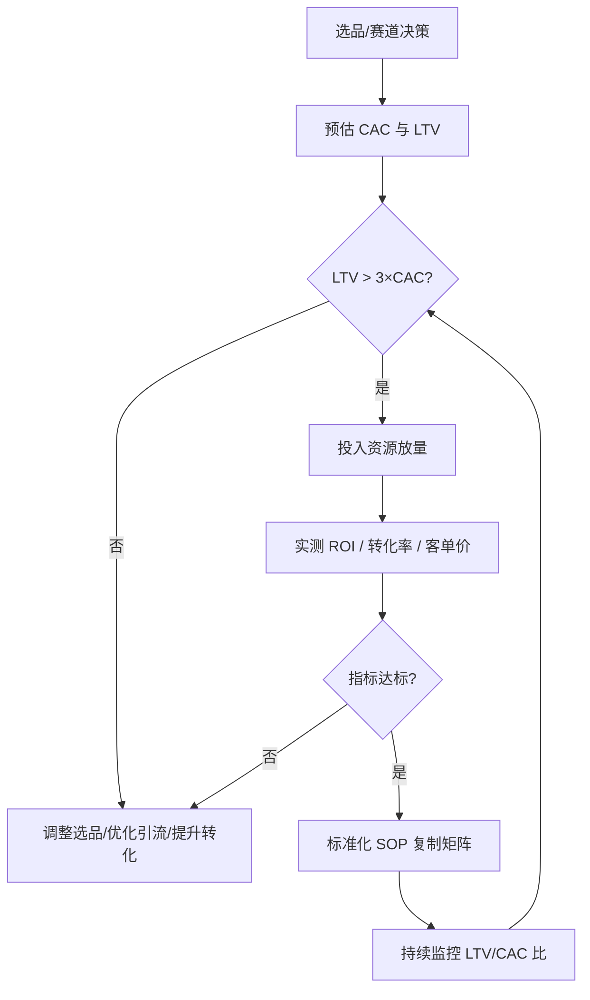
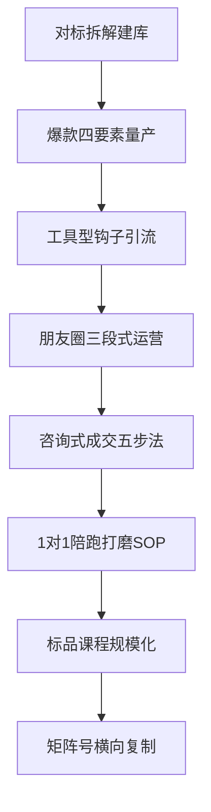
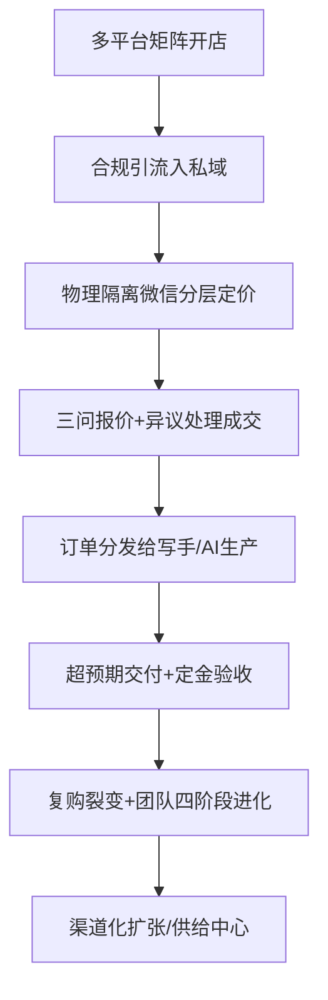
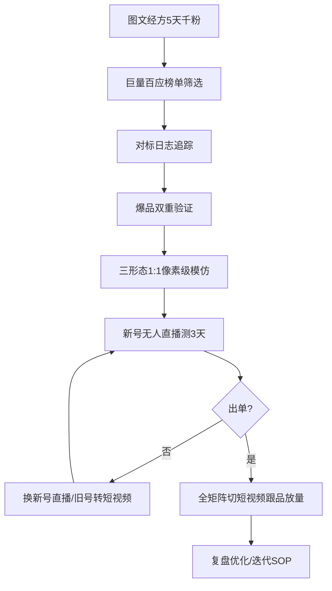

# 第 56 章 知识付费与内容电商实战体系
作者：龙哥

## 学习目标

- 理解PPT项目拆解IP、写作BOSS模式、抖音养生号三大知识付费/内容电商模式的核心逻辑与适用场景
- 掌握'前端公域引流-后端私域转化'商业闭环的标准化搭建流程（账号定位、爆款内容生产、钩子设计、朋友圈运营、咨询式成交）
- 熟练运用'对标拆解-像素级模仿-微创新'的内容生产方法论，以及'MVP先卖再做'的产品迭代策略
- 掌握多平台（抖音/小红书/闲鱼/拼多多/视频号）开店、合规引流、私域分层定价、团队化交付的实操SOP
- 建立'执行力>完美主义''赛道决定上限细节决定下限''私域是放大器公域是放大镜''利他思维作护城河'等底层认知模型
- 识别平台风控红线（虚拟类目限制、学术合规、315打压、混剪举报、无人直播灰产风险）与规避策略

## 56.1 生活类比

把知识付费项目想象成**开一家"标准化连锁餐厅"**：选品/赛道 = 选址(人流量/消费力/竞争度) —— PPT/写作/养生都是"黄金地段"刚需赛道；对标拆解/像素级模仿 = 照抄"肯德基/麦当劳"的标准化操作手册(SOP) —— 从炸鸡温度到摆盘角度全复刻，先跑通再优化；公域流量(抖音/小红书/闲鱼) = 商场自带客流/广告位 —— 利用平台算法"放大镜"筛选精准食客；私域(微信/朋友圈/社群) = 会员体系/私房菜单 —— 高频触达、深度信任、高客单复购的"放大器"；引流钩子(源文件/素材包/试吃装) = 门口"免费试吃/送小礼品" —— 低成本高感知价值，筛选付费意向；咨询式成交/分层定价 = 店长根据食客穿着/点单推荐"套餐A/套餐B" —— 同质服务不同画像差异化定价；MVP先卖再做/陪跑打磨标品 = 先做"外卖测试款/限量尝鲜"收反馈 → 再上"正式菜单"规模化供应；利他思维/服务超预期 = 海底捞式服务 —— 不是为了单次翻台率，而是为了让食客带全家再来、带朋友再来(LTV最大化)。就像连锁餐厅：选对赛道(地段)是生死线，标准化SOP(手册)是复制基石，私域会员体系(放大器)是利润池，利他服务(护城河)才能穿越周期。

这一类比贯穿全章三大模式：在PPT项目拆解IP模式中，PPT赛道是"黄金地段"，对标拆解建库是拿到操作手册，爆款四要素是标准化炸鸡制作流程，工具型钩子是门口的免费试吃，朋友圈三段式运营是会员专属菜单与服务，咨询式成交是店长的推荐话术，1对1陪跑打磨SOP是后厨根据反馈优化菜谱，最终形成标品课程实现连锁复制。在写作BOSS模式中，多平台开店就是在不同商场租柜台，合规引流是柜台导购把客户带进会员群，私域分层定价是针对不同商场客群设计不同价格菜单，三问报价成交流程是标准化销售SOP，写手团队四阶段进化是从外包中央厨房到自建供应链再到成为供给中心的过程，AI辅助写作是引入预制菜技术降本增效，拒接学术论文是坚守食品安全红线，服务超预期则是海底捞式的复购引擎。在抖音养生号体系中，中医大师IP授权是品牌加盟授权，图文经方5天千粉是新店开业冲业绩的标准动作，巨量百应榜单与对标日志是总部下发的爆品情报，1:1像素级模仿是严格按SOP复刻爆款菜品，无人直播测品矩阵置换是用多家分店试菜品筛选爆款，同行是最好老师先抄后超是加盟商心法，执行力与隐性资本决定上限是店长内功，团队透明化鼓励单干是合伙人机制。

## 56.2 概念地图

知识付费与内容电商实战体系
├── PPT项目拆解IP模式（木子田案例）[P085]
│   ├── 核心定位：刚需强、变现路径清、复购高、交付标准化
│   ├── 冷启动：对标拆解建库 → 照搬微创新
│   ├── 爆款四要素：统一封面大字报、黄金3秒钩子、BGM卡点、快节奏剪辑
│   ├── 私域转化：工具型钩子(源文件/素材包) > 资料型钩子、朋友圈三段式(专业/生活/营销5:3:2)、咨询式成交五步法
│   ├── 产品迭代：1对1陪跑打磨SOP/FAQ → 降维标品规模化
│   └── 核心定律：执行力>完美主义、赛道定上限细节定下限、私域放大器公域放大镜、利他思维作护城河
├── 写作BOSS模式（饭饭案例）[P_G2Z]
│   ├── 核心跃迁：写手(卖时间) → 老板(卖系统/获客渠道/供应链/风控)
│   ├── 平台矩阵：闲鱼(高客单首选)/小红书(高净值)/拼多多(流量大易封)/淘宝(竞争烈)/抖音视频号
│   ├── 合规引流库：拼多多发文件/截图、闲鱼电话/图片、小红书大小号联动、抖音粉丝群托管
│   ├── 私域分层定价：物理隔离微信号(微信A高客单/微信B低客单)实现价格歧视利润差40%+
│   ├── 客户分级：质量导向/救急应付/低价比价(过滤第三类)
│   ├── 团队进化：外包同行 → 兼职写手 → 收费招募培训 → 整合上游成供给中心
│   ├── AI降本：角色设定→大纲→分段写作→口语化润色→搜爆文反哺指令
│   ├── 合规红线：禁接学术论文、315主动下架避险、垂直深耕建专家护城河
│   └── 服务超预期：定金验收+拒绝一次性生意 → 复购70%+ LTV最大化
└── 抖音养生号/中医号（微笑案例）[P_ZbF]
    ├── 核心逻辑：借中医大师势能 + 中老年精准粉 + 橱窗带货
    ├── 三式起号：混剪/缅怀/图文经方(5天千粉最快)
    ├── 选品双引擎：巨量百应榜单筛选(爆款视频/图书教育/作者等级0/近24h) + 对标日志追踪(20-30账号/日记录销量/高赞视频)
    ├── 1:1像素级模仿三形态：混剪(音画一致+70%画中画)、实拍(逐镜头复刻)、真人出境替代(图文+音频/二创混剪避举报)
    ├── 测品置换策略：新号无人直播测3天/日发5条 → 不爆换号/旧号转短视频 → 爆品验证后全矩阵切短视频跟品
    ├── 核心心法：同行最好老师先抄后超、执行力与隐性资本(作息/习惯/读书)定上限、团队透明化鼓励单干再谈分成
    └── 边界风险：混剪/无人直播属灰产生命周期短、对标日志依赖人力难自动化、真人出境模仿门槛高

## 56.3 核心指标计算公式与推导

本节核心指标公式为作者依据三大案例隐性数据（如 47 天 16.7 万、团队月入 11 万、单品日佣 2 万等）反推构建的通用量化模型，旨在提供决策复盘工具，非原文直接摘录。以下公式及其推导逻辑均为作者综合推导，素材 ID 标注为 [作者综合推导]。

在知识付费与内容电商实战中，以下核心指标公式是衡量项目健康度、指导业务决策的量化工具。每个公式后附带逐步推导说明与业务决策作用解释。

### 56.3.1 ROI（投资回报率）计算公式

**公式**：
$$ROI = \frac{GMV - 总投入}{总投入} \times 100\%$$

**逐步推导**：
首先，GMV（商品交易总额）等于客单价乘以订单量，代表项目产生的总营收规模。其次，总投入包含广告投放成本、人力成本、工具订阅费、样品/测品成本以及合规风控成本。再次，净利润等于 GMV 减去总投入，即扣除所有显性成本后的实际收益。最后，ROI 等于净利润除以总投入，衡量每投入 1 元能产出多少收益。

**业务决策作用**：
该公式用于评估单个项目或单个渠道的投资效率。在 PPT 项目中，木子田 47 天投入主要为时间成本与少量工具费，GMV 16.7 万带来极高 ROI [P085]；在写作 BOSS 模式中，团队旺季月营收 11 万对比人力房租工具成本，可算出月度 ROI 指导扩招决策 [P_G2Z]；在养生号矩阵中，账号注册成本、无人直播设备折旧、素材制作人力作为分母，单品日佣 2 万作为分子，可快速判断是否继续加大矩阵投入 [P_ZbF]。

### 56.3.2 转化率计算公式

**公式**：
$$转化率 = \frac{成交量}{进线量/咨询量} \times 100\%$$

**逐步推导**：
首先，进线量/咨询量指公域内容引流至私域的有效沟通用户数，即加微信后发起咨询者。其次，成交量指完成付费的用户数。最后，转化率反映私域销售话术、产品价值感知、信任建设的综合效果。

**业务决策作用**：
该指标直接指导私域运营优化。木子田 PPT 项目中，单条爆款引流 300+ 精准粉直接成交数万，转化率高得惊人，证明工具型钩子+咨询式成交五步法极其有效 [P085]；写作 BOSS 模式中，三问报价+异议处理话术将转化率标准化，新人也能快速上手 [P_G2Z]；养生号中，无人直播间观看人数与下单人数之比，指导直播话术与商品陈列优化 [P_ZbF]。转化率低时，优先检查钩子吸引力、朋友圈信任资产、话术异议处理环节。

### 56.3.3 客单价计算公式

**公式**：
$$客单价 = \frac{总营收}{订单数}$$

**逐步推导**：
首先，总营收等于各产品价格乘以对应销量的求和。其次，订单数等于所有付费订单总量，含复购订单。最后，客单价反映产品定价策略与用户支付能力的匹配度。

**业务决策作用**：
该指标是定价策略的核心锚点。PPT 项目中，课程 299-999 元、陪跑 2999/4999 元构建价格阶梯，客单价结构指导产品线设计 [P085]；写作 BOSS 模式中，微信 A 同款服务比微信 B 利润高 40%+，正是通过物理隔离微信实现客单价差异化，同一份 5000 字演讲稿在不同微信报价差异区间直接决定利润结构 [P_G2Z]；养生号中，橱窗带货佣金率固定，客单价由选品决定，面相书籍等高客单价图书成为重点跟品对象 [P_ZbF]。

### 56.3.4 客户终身价值（LTV）计算公式

**公式**：
$$LTV = 客单价 \times 年购买频次 \times 平均留存年限$$

**逐步推导**：
首先，客单价等于总营收除以订单数。其次，年购买频次等于总订单数除以活跃客户数再除以运营年限。再次，平均留存年限等于 1 除以流失率，或根据历史数据统计平均复购周期。最后，LTV 量化单个客户在全生命周期内的总贡献价值。

**业务决策作用**：
该指标验证"利他思维/服务超预期"护城河的商业价值。写作 BOSS 模式中，复购率 70%+、单客下单 10 次以上常态，LTV 极高，证明定金验收+超预期交付策略正确 [P_G2Z]；PPT 项目中，陪跑学员后续购买进阶课、推荐同事，LTV 远超首单课程价 [P085]；养生号中，中老年群体对养生书籍复购率高，私域沉淀后可二次推荐高客单价养生课程/产品，LTV 决定了可承担的获客成本（CAC）上限 [P_ZbF]。

### 56.3.5 获客成本（CAC）计算公式

**公式**：
$$CAC = \frac{总获客投入}{新增付费客户数}$$

**逐步推导**：
首先，总获客投入包含公域内容制作成本、平台开店成本、引流钩子制作成本、合规引流测试成本。其次，新增付费客户数指统计周期内首次完成付费的用户数。最后，CAC 衡量获得一个付费用户的平均边际成本。

**业务决策作用**：
该指标与 LTV 配合使用，判断商业模式可持续性（需 LTV > 3×CAC）。PPT 项目中，爆款视频自然流量获客 CAC 极低 [P085]；写作 BOSS 模式中，拼多多流量大但引流难、闲鱼低投入高回报、小红书养号成本高但客单价高，不同渠道 CAC 差异巨大，指导预算分配 [P_G2Z]；养生号中，账号注册成本、起号内容制作成本、无人直播设备分摊构成 CAC，矩阵置换策略本质是用账号数量摊薄单账号 CAC [P_ZbF]。

---

**方法演进图：核心指标决策闭环**



---

## 56.4 PPT知识付费IP —— 从零基础到47天16.7万的可复制范式 [P085]

### 为什么需要这个概念？

普通人缺乏原创内容生产能力，但拥有结构化整理与拆解能力。PPT赛道具备刚需强、变现路径清晰、复购率高、交付标准化特征，是跨阶层优质赛道。你需要一套从冷启动、内容生产、私域转化到产品迭代的标准化SOP，降低试错成本。

> "分享我做了八个多月的 PPT 项目拆解的玩法心得。教你怎么打造一个 PPT 项目拆解的抖音知识付费 ip 博主。"
> ——《木子田PPT实战复盘》[P085]

### 核心定义

- **PPT项目拆解IP**：将优秀PPT作品拆解为动画/排版/配色等可学步骤，作为内容载体打造抖音知识付费个人品牌 [P085]。
- **前端引流-后端变现模型**：抖音公域获客（前端），微信私域深度信任建设与高客单成交（后端）的商业闭环 [P085]。
- **人设信任资产**：通过真实经历、价值观、朋友圈生活化运营积累的用户信任资本，是高客单成交核心杠杆 [P085]。
- **MVP思维**：课程未完善前先以低价内测版/1对1陪跑售卖，用市场验证打磨再规模化交付 [P085]。

### 关键性质

**执行力 > 完美主义**：0-1阶段完成比完美重要，先发布再修正，用市场反馈倒逼升级 [P085]。

**赛道决定上限，细节决定下限**：选对赛道是前提，封面统一性/前3秒完播率/钩子诱惑力等细节决定能否跑通闭环 [P085]。

**私域是放大器，公域是放大镜**：抖音筛选精准用户（放大镜），私域高频触达最大化单客价值（放大器）[P085]。

**利他思维是长期护城河**：真心帮用户解决问题而非割韭菜，获得口碑裂变、高复购与抗风险能力 [P085]。

### 方法论：对标账号拆解法

> **对标账号拆解法**（来源：《木子田PPT实战复盘》[P085]）

```
1. 寻找 10-20 个同赛道头部/腰部账号
2. 拆解其爆款视频的选题逻辑、封面风格、文案结构、BGM 节奏、变现路径
3. 建立『素材库』与『选题库』
4. 照搬复制再微创新
```

这段伪代码展示了如何通过站在巨人的肩膀上，用最低成本获取经过市场验证的内容生产公式。你不需要从零发明，只需要做"复刻+微调" [P085]。

> "找对标账号，拆解爆款逻辑，建立选题库、素材库、文案库，照抄对标账号的爆款选题，然后微创新。"
> ——《木子田PPT实战复盘》[P085]

### 方法论：爆款视频四要素制作法

> **爆款视频四要素制作法**（来源：《木子田PPT实战复盘》[P085]）

```
1. 封面：统一风格 + 大字报标题 + 痛点/结果前置
2. 文案：黄金前 3 秒钩子 + 干货拆解步骤 + 引导互动
3. BGM：卡点 + 热门榜单 + 情绪适配
4. 剪辑：节奏快 + 关键帧标注 + 去水印/调色
```

这套标准化SOP将"做视频"这个模糊动作，拆解为四个可量化、可考核、可替换的工业化模块。每个模块都有明确的及格线，比如封面必须统一大字报风格，文案前3秒必须有钩子 [P085]。

> "封面：统一风格，大字报，突出结果/痛点。文案：黄金前三秒，干货步骤，引导评论。BGM：卡点，抖音热榜，匹配情绪。剪辑：节奏快，关键步骤打码/标注。"
> ——《木子田PPT实战复盘》[P085]

### 方法论：私域引流钩子设计法

> **私域引流钩子设计法**（来源：《木子田PPT实战复盘》[P085]）

```
1. 设计高感知价值、低获取成本的虚拟资源（PPT模板库、配色表、动画素材包、拆解源文件）
2. 通过抖音主页简介、粉丝群、评论区置顶、私信自动回复等多触点引导加微信
```

这套方法论的核心洞察是：**工具型钩子（源文件/素材包）的转化率显著高于资料型钩子（电子书/思维导图）**。因为用户感知到的是"即拿即用"的确定性价值，而非"还要自己消化"的模糊价值 [P085]。

> "设计引流钩子：PPT 模板、配色表、素材包、源文件。抖音主页挂链接，粉丝群发福利，评论区置顶，私信自动回复。"
> ——《木子田PPT实战复盘》[P085]

### 方法论：朋友圈三段式运营法

> **朋友圈三段式运营法**（来源：《木子田PPT实战复盘》[P085]）

```
1. 专业展示（作品/学员反馈/干货）— 占比 5
2. 生活真实（家庭/成长/踩坑）— 占比 3
3. 营销转化（课程预售/限时优惠/名额紧张）— 占比 2
```

这不是简单发朋友圈，而是将朋友圈经营为"店面"和"人设"。5:3:2的黄金比例，既保证了专业度的持续背书，又用生活化内容拉近心理距离，最后用稀缺性营销促单 [P085]。

> "朋友圈发什么：专业度展示、真实生活、营销转化。打造专业、真实、有温度的人设。"
> ——《木子田PPT实战复盘》[P085]

### 方法论：高客单价咨询式成交话术

> **高客单价咨询式成交话术**（来源：《木子田PPT实战复盘》[P085]）

```
1. 诊断现状：了解需求、现有基础、痛点场景
2. 揭示痛点：指出不学的代价、当前方法的局限
3. 提供方案：展示课程体系、陪跑服务、交付标准
4. 展示案例：同类学员前后对比、收入增量截图
5. 限时锚定：名额限制/价格上涨倒计时/赠送钩子
```

这个五步法不是推销，而是"咨询"。你站在专家视角帮用户做决策，解决信任、价值、紧迫三大异议 [P085]。

> "不卖课，卖结果，卖确定性。聊天话术：了解需求 -> 分析痛点 -> 给方案 -> 看案例 -> 促单。"
> ——《木子田PPT实战复盘》[P085]

### 方法论：MVP思维与1对1陪跑打磨标品

> **MVP思维：先卖再做，1对1陪跑打磨SOP**（来源：《木子田PPT实战复盘》[P085]）

```
1. 课程未完善前，先推出低价内测版/高价1对1陪跑
2. 用真实付费用户的"奇葩问题"倒逼产出标准化FAQ与课程大纲
3. 打磨成熟后，降维推出标品课程（299/599/999元）规模化交付
```

这种"被逼着把课做好"的机制，比闭门造车强百倍。真实用户的真实问题，就是最好的产品经理 [P085]。

> "先做 1 对 1 陪跑，把课程打磨成熟。陪跑过程中整理出标准课程大纲和 FAQ。"
> ——《木子田PPT实战复盘》[P085]

### 实证数据验证

下表展示了PPT项目拆解IP模式的关键实战数据，验证了该模式的可行性与复制潜力 [P085]：

| 验证指标 | 实测数据 | 来源 |
|---------|---------|------|
| 总周期变现 | 47天 16.7万 | [P085] |
| 产品价格带 | 课程299-999元，陪跑2999/4999元 | [P085] |
| 爆款视频节点 | 第21条视频播放10万+ | [P085] |
| 单条爆款引流 | 300+精准粉，直接成交数万 | [P085] |
| 主页转粉率提升 | 统一封面后从个位数→10%+ | [P085] |
| 钩子转化率对比 | 工具包(源文件/素材) > 电子书/思维导图 | [P085] |

### 边界条件与风控

- 依赖抖音算法分发机制，平台规则变动可能影响流量获取稳定性 [P085]
- 需要持续产出高质量拆解内容，对PPT专业度与审美有基础要求 [P085]
- 私域运营强依赖个人精力与服务意识，规模化受限于人力边际成本 [P085]
- 虚拟产品交付易引发"仅退款/白嫖"纠纷，需建立定金验收等风控机制 [P085]



## 56.5 写作BOSS模式 —— 从写手到老板的规模化跃迁 [P_G2Z]

### 为什么需要这个概念？

单纯卖写作时间（写手模式）上限极低，手一伸碰到天花板。代写本质是生意而非写作，核心竞争力在于获客渠道、转化话术、供应链管理与风控。你需要将个人技能转化为可复制、可规模化的商业系统（老板/运营模式）。

> "我们不能单独的充当写手，这样上限太低，手一伸就碰到天花板，把自己当做一个老板，建好桥梁，做好运营，赚更多的钱。"
> ——《饭饭写作BOSS实操教程》[P_G2Z]

### 核心定义

- **写作BOSS模式**：搭建获客渠道+私域转化体系+写手团队+AI工具，从卖时间跃迁为卖系统/服务 [P_G2Z]。
- **电商平台代写模式**：利用拼多多/淘宝/闲鱼/小红书等电商平台的搜索流量与信任体系，发布虚拟服务商品获取精准咨询客户，再通过话术引导至私域（微信）成交交付，规避平台虚拟类目限制与佣金 [P_G2Z]。
- **回忆录代写赛道**：针对企业家、老年人、普通大众记录人生经历、传承家族记忆的刚性需求，客单价高（单单1-2万+）、复购低但推荐率高、非标品易溢价、核心难点在于获客而非写作难度，年增长率约10%的蓝海细分市场 [P_G2Z]。
- **私域分层定价体系**：根据来源平台用户画像（支付能力、价格敏感度）将微信账号物理隔离（微信A接闲鱼/小红书/淘宝高客单价客户，微信B接拼多多低客单价客户），实现同质服务差异化定价，利润率差异可达40%以上 [P_G2Z]。
- **合规引流话术库**：针对各平台违规管控特性，设计的一套"不违规留联系方式"标准化动作（如拼多多"发文件/截图微信号"、闲鱼"电话沟通/图片引流"、小红书"大小号联动/图片引流"、抖音"粉丝群小号托管"），平衡获客效率与店铺存活率 [P_G2Z]。
- **三类客户分级策略**：按需求动机将客户分为"质量导向型"（高溢价、重服务）、"救急应付型"（中溢价、低要求）、"低价比价型"（高维护成本、低利润），主张过滤第三类，重点服务前两类以提升ROI [P_G2Z]。

### 关键性质

**代写本质是"生意"而非"写作"**：代写项目的天花板不在于写作能力，而在于获客渠道建设、转化话术设计、供应链（写手/AI）管理及风险控制。只提升文笔无法突破收入上限，必须建立商业系统 [P_G2Z]。

**虚拟服务电商核心矛盾：流量精准度 vs 平台合规性**：电商平台提供精准搜索流量（客户进店即需求），但严禁导流私域。核心竞争力在于设计"擦边球"引流动作（话术/图片/群控），在不触发封店红线的前提下最大化私域导流率 [P_G2Z]。

**非标服务定价锚定于"客户画像"而非"成本"**：同一份稿件，因客户来源平台不同（如小红书高净值女生 vs 拼多多价格敏感用户），支付意愿差异巨大。通过物理隔离微信账号实施价格歧视，是利润最大化的关键杠杆 [P_G2Z]。

**合规红线：严禁接单学术论文，垂直深耕长期主义**：学术代写虽需求量大（咨询占比40%+）但合规风险极高（平台重点打击、法律风险），坚决拒单可换取店铺权重垂直度、账号长寿命及品牌专业度，符合"一厘米宽度、一万米深度"的专家定位策略 [P_G2Z]。

**服务质量超预期是高复购（70%+）的唯一护城河**：代写属于高信任、高复购服务。拒绝一次性生意，坚持"满足需求为基础，超出期望为目标"，配合定金验收机制建立安全感，可将客户终身价值（LTV）最大化，单客下单10次以上为常态 [P_G2Z]。

### 方法论：多平台开店与合规引流实操

#### 拼多多开店避坑实操法

> **拼多多开店避坑实操法**（来源：《饭饭写作BOSS实操教程》[P_G2Z]）

```
1. 个人店低门槛入场（1000元保证金）
2. 使用安全标题组合关键词规避违禁词
3. 详情页单张副图极简化
4. 核心技巧：规避4万保证金类目设置
5. 两大合规引流话术：
   - "这边怎么跟您发文件呢？" 诱导客户回联系方式
   - 截图微信号发图给客户
```

拼多多流量大但规则严，核心是规避"4万保证金"类目陷阱，用"发文件/截图"两招合规引流 [P_G2Z]。

> "新手建议做个人店：准备一台手机、一张电话卡、个人身份证、1000元保证金。标题非常重要...错误的标题也会直接导致封店或者4w的保证金。拼多多商品发布如何避开4W保证金 这个方法目前知道的人并不多，不少人专门卖这个教程都收费上百元。这里推荐的两个方法和专业话术：1.这边怎么跟您发文件呢？ 2.发送图片 在聊天窗口输入微信号: 然后截图发给客户。"
> ——《饭饭写作BOSS实操教程》[P_G2Z]

#### 闲鱼高转化开店法

> **闲鱼高转化开店法**（来源：《饭饭写作BOSS实操教程》[P_G2Z]）

```
1. 零门槛授权登录
2. "人设+服务清单"式标题建立信任（如"建筑学硕士，事业编在编"）
3. 极简商品图
4. 发布地设为一线/强教育城市增加权重
5. 无需发货虚拟交易
6. 双通道引流：图片引流 / 电话沟通引流
```

闲鱼是作者最爱的平台：低投入、高回报、竞争小、转化快。人设标题是核心转化器 [P_G2Z]。

> "闲鱼开店属于非常简单的...低投入绝对的高回报，而且闲鱼上面做写作类目的竞争非常小。标题发布：闲鱼是一个很自由的平台...【1】写作、改稿、润色、演讲、降重、调整还有考编咨询、倾诉皆可。建筑学硕士，事业编在编...发布地：这里建议选择哪些自带流量和光环，发达一点的城市...客户会根据你的发布地址来推测你有没有能力做他的单子。闲鱼引流方法 【1】图片引流... 【2】电话沟通，让客户先拍下，然后打电话或者直接添加微信。"
> ——《饭饭写作BOSS实操教程》[P_G2Z]

#### 小红书种草引流法

> **小红书种草引流法**（来源：《饭饭写作BOSS实操教程》[P_G2Z]）

```
1. 养号5-7天建立垂直标签（每天3-4次，每次15分钟+）
2. 选题对标爆款心理需求
3. 素材跨平台搬运筛选高互动内容
4. 可画/Word+截图制作大字版图文
5. 剪映剪辑图文视频
6. 定时发布（11:30/18:30）
7. 大小号评论区联动/图片引流至微信
```

小红书用户高净值、高客单，但需养号、审核严。核心是"大号发作品，小号评论区留联系方式"的大小号联动 [P_G2Z]。

> "小红书发笔记 引流 微信谈单成交。写作账号我的养号方法如下：每个小红书养号5-7天，每天养号3~4次，每次15分钟以上。选题：这个板块是极其重要的，他取决于用户刷到你的视频之后会不会点赞？找素材：...最重要的一点就是看他的点赞量，评论，收藏。作图方法：1.用可画做... 2.用word文档做，做好点击打印（快捷键ctrl +P）截图即可。大小号引流（就是大号发作品，然后评论区用户咨询的时候@小号，通过小号发一个作品留联系方式）。"
> ——《饭饭写作BOSS实操教程》[P_G2Z]

#### 抖音/视频号图文视频引流法

> **抖音/视频号图文视频引流法**（来源：《饭饭写作BOSS实操教程》[P_G2Z]）

```
1. 账号包装（漫画头像/背景图/无违禁词简介）
2. 爆款三要素：选题击中痛点 + 视频提升完播率 + 图片承载核心内容
3. 定时发布
4. 引流核心：
   - 粉丝群设置小号管理员托管留联系方式
   - 小号评论区扮"助手"引导
```

视频号比抖音多一个优点：不用导流，可直接加微信 [P_G2Z]。

> "一个优质的视频包括三个部分：【1】选题... 【2】视频...提高整个视频和播放的完播率... 【3】图片...决定刷到你的用户，会不会给你点赞和收藏以及评论。抖音引流方法：1.创建粉丝群聊。设置小号管理员托管留联系方式。 2.小号在评论区引导客户，小号改名为xx助手【大号助手】，相对安全一点。"
> ——《饭饭写作BOSS实操教程》[P_G2Z]

### 方法论：私域成交标准化流程

> **私域成交标准化流程（三问报价+异议处理）**（来源：《饭饭写作BOSS实操教程》[P_G2Z]）

```
1. 接待必问三要素：写什么 / 多少字 / 何时交
2. 查报价表报价
3. 核心异议处理：
   - "贵"：认可门槛 → 反问预算 → 顺势砍价成交（利润+15%）
   - "怕被骗"：平台担保 / 定金+验收尾款双保险
```

标准化话术把"聊天"变成"销售流程"，新人也能快速上手 [P_G2Z]。

> "报价之前必问三个问题及话术: 1确定写作类型、主题、字数、交稿日期。 【1】你好，咱这边需要写什么呢？ 【2】需要写多少字呢？ 【3】什么时候需要呢？【如果客户觉得贵】...先认可客户：相当于谈话的时候告诉了客户自己的门槛和标准，多数人心理都是，越贵的质量越好...顺势给他降价一点就可以...适当的做一个销售角色，可以把利润增加15%以上。【如果客户担心被骗】 【1】 平台保障... 【2】先付定金...写作完成以后录屏视频源文件内容和查重报告给您验收没问题以后再付尾款。"
> ——《饭饭写作BOSS实操教程》[P_G2Z]

### 方法论：ChatGPT辅助写作SOP

> **ChatGPT辅助写作SOP**（来源：《饭饭写作BOSS实操教程》[P_G2Z]）

```
1. 角色设定
2. 详细指令拆解：大纲 → 分段写作
3. 禁忌机械复制：口语化润色 / 注入温度
4. 指令详细化技巧：搜同类爆文要素反哺Prompt
5. 质量红线：超预期交付，拒绝一次性生意
```

关键点是**第3步"口语化润色/注入温度"**，这是体现"非机械化复制"核心价值的关键步骤。AI生成的初稿只有骨架，人工注入的"温度"才是溢价来源 [P_G2Z]。

> "【1】现在设定你是xxx角色 【2】现在需要按“xxx'来写一篇文章，拟出大纲 【3】按大纲写作。切忌机械化复制...把他当做一个工具来使用效果更好，chatGPT写出来的文章不能照搬使用，适当修改，将内容变得口语化一点。根据客户需求将指令详细化...网上搜索：自媒体招商账号爆文的一些相关内容...一系列的指令就可以用得上。强化质优意识...在你店里下单的东西一定要以满足他的需求为基础，然后超出他的期望为目标...回头率超70%。"
> ——《饭饭写作BOSS实操教程》[P_G2Z]

### 方法论：写手团队四阶段进化法

> **写手团队四阶段进化法**（来源：《饭饭写作BOSS实操教程》[P_G2Z]）

```
阶段1：外包给大店同行（轻资产启动）
阶段2：招募兼职写手建立规则体系
阶段3：收费招募/培训写手（筛选忠诚度、一鱼双吃）
阶段4：整合上游渠道（对接小商家/校园团队）成为稳定供给中心，构建护城河
```

从"找人写"进化到"建供给中心"，这是从老板到渠道商的跃迁 [P_G2Z]。

> "第1阶段：找优质同行过度... 第2阶段：在开店的同时会不断有写手来应聘，制定规则... 第3阶段：高阶玩法，收费写手招募...极大的提高了自己内部团队的写作质量和写稿速度。 第4阶段：成为渠道 打造优质团队、主动链接和洽谈哪些小商家和大学生校园团队。"
> ——《饭饭写作BOSS实操教程》[P_G2Z]

### 实证数据验证

下表展示了写作BOSS模式的关键实战数据，验证了该模式的规模化潜力与抗风险能力 [P_G2Z]：

| 验证指标 | 实测数据 | 来源 |
|---------|---------|------|
| 团队旺季月营收 | 11万 | [P_G2Z] |
| 团队淡季月营收 | 6万 | [P_G2Z] |
| 个人年入 | 50万级 | [P_G2Z] |
| 回忆录单品年入 | 5万+ | [P_G2Z] |
| 315生存策略 | 主动下架保全两大店 | [P_G2Z] |
| 同质服务利润差 | 微信A比微信B高40%+ | [P_G2Z] |
| 复购率 | 70%+，单客下单10次+常态 | [P_G2Z] |

### 边界条件与风控

- 电商平台规则频繁变动，引流话术有时效性，需持续迭代 [P_G2Z]
- 写手团队管理存在质量波动与忠诚度风险，四阶段进化法需长期投入 [P_G2Z]
- 学术代写等高风险品类虽需求大但合规红线不可触碰 [P_G2Z]
- 非标服务交付依赖人工质检，规模化受限于管理半径 [P_G2Z]
- 回忆录等高客单品类获客周期长，现金流不稳定，需组合低客单品类平衡 [P_G2Z]



## 56.6 抖音养生号实操体系 —— 同行是最好老师，先抄后超的执行美学 [P_ZbF]

### 为什么需要这个概念？

普通人缺乏原创内容生产能力与医疗专业背景，但养生赛道中老年粉丝价值高、变现路径清晰。你需要一套不依赖专业背景、可标准化复制的起号、选品、内容生产、测品放量全流程SOP。核心痛点：如何快速建立精准中老年画像、如何低成本跟进爆品、如何规避原创门槛与违规风险。

> "抖音养生号也叫中医号，简单来说:就是混剪中医ip大师的视频，涨到1000粉丝，开通橱窗进行带货，主要就是借势，借中医大师的势能来进行带货赚钱。我们的定位是:中医养生、针对的用户人群是'中老年人'。"
> ——《微笑抖音养生号实操复盘》[P_ZbF]

### 核心定义

- **抖音养生号（中医号）**：借助中医大师IP势能，通过混剪或二创形式输出养生内容，吸引中老年精准粉丝，开通橱窗带货变现的账号模式 [P_ZbF]。
- **图文经方起号法**：以单张图片呈现中医经方/药方文本，配合大师讲课音频为背景音，利用中老年群体对"秘方"的高关注度实现快速涨粉（实测5天千粉） [P_ZbF]。
- **1:1像素级模仿**：对标爆款带货视频，从选品、拍摄构图、剪辑节奏、文案话术到发布时间全维度复刻，将相似度做到极致以复现爆款概率 [P_ZbF]。
- **对标账号橱窗销量日志追踪**：人工每日记录20-30个对标账号橱窗商品销量及近24小时带货视频点赞数据，捕捉同行爆单信号，实现选品跟进的"零延迟" [P_ZbF]。
- **无人直播测品-账号矩阵置换策略**：新号千粉后先上无人直播测3天/发5条，不爆即替换新号做直播，原号转短视频带货；以账号数量博取起量概率，筛选出爆品后全矩阵切短视频跟品 [P_ZbF]。

### 关键性质

**同行是最好的老师，先抄后超**：所有技术门槛均可通过模仿跨越；选品、内容、形式均以已验证爆款为标准，1:1复刻为基线，熟练后再优化迭代 [P_ZbF]。

**执行力与隐性资本（作息/习惯/读书）决定上限**：项目本身技术含量低，核心竞争力在于长期主义的执行力，由早睡早起、运动、读书等"内功心法"支撑的身心状态是持续盈利的真正护城河 [P_ZbF]。

**团队管理：极度透明+鼓励单干+利益分配谈判**：通过开放核心SOP、鼓励员工出去单干倒逼自身迭代、学会后再谈利益分成，解决小团队管理中的情绪与利益冲突，实现共赢 [P_ZbF]。

### 方法论：三式起号法

> **三式起号法**（来源：《微笑抖音养生号实操复盘》[P_ZbF]）

```
1. 混剪：混剪中医大师视频片段
2. 缅怀：借势热点人物/事件致敬
3. 图文经方+大师音频（最快）：
   - 前3天日更3条
   - 第4天起日更5条
   - 5天达成精准中老年千粉
```

图文经方是性价比最高的起号形态：制作门槛最低（一张图+一段音频），精准度最高（中老年对药方/秘方极度敏感） [P_ZbF]。

> "3.图文经方+大师讲课音频：中老年人对药方、秘方、经方等特别感兴趣，这类内容播放量高、涨粉也特别快，也是我最常用的一种。新账号:前面三天，每天发3条起号作品、从第四天开始每天可以发5条...我这边实测是:5天就能起一个精准的中老年粉丝画像的千粉账号。"
> ——《微笑抖音养生号实操复盘》[P_ZbF]

### 方法论：巨量百应榜单选品法

> **巨量百应榜单选品法**（来源：《微笑抖音养生号实操复盘》[P_ZbF]）

```
1. 利用千粉账号权限进入巨量百应创意中心
2. 筛选条件：爆款视频 → 图书教育 → 图书 → 作者等级0 → 近24小时
3. 锁定同行最新爆款带货视频与选品
```

这个筛选条件是"作弊码"：**作者等级0=新号/小号，近24小时=最新爆发**。这意味着你直接锁定了"当下正在爆"的同行新品，实现零延迟跟品 [P_ZbF]。

> "第三步:筛选条件:爆款视频~图书教育~图书~作者等级为0~近24小时。看见同行销量不错的带货视频，就可以保存下来，1:1像素级模仿。"
> ——《微笑抖音养生号实操复盘》[P_ZbF]

### 方法论：对标账号日志追踪法

> **对标账号日志追踪法**（来源：《微笑抖音养生号实操复盘》[P_ZbF]）

```
1. 建立20-30个对标账号库
2. 每日人工记录橱窗销量变化及近24h高赞带货视频
3. 通过数据异动捕捉爆品信号
4. 指导当日跟品决策
```

这是一个"笨方法"：每天手工记20-30个账号的销量。**但很多月入5-10万的大佬都在悄悄用**。因为工具只能给你数据，人工记录能让你建立"盘感"——那种数据异动时的直觉触觉，是工具给不了的 [P_ZbF]。

> "我是记录了20~30个对标账号，每天都会手动记录一遍，这个动作可以让我在同行爆单时，第一时间跟上他们的爆品。这个方法，很多月入5w、10w+的大佬都在悄悄用。"
> ——《微笑抖音养生号实操复盘》[P_ZbF]

### 方法论：1:1像素级模仿三形态标准化作业

> **三大带货形式1:1模仿标准化作业**（来源：《微笑抖音养生号实操复盘》[P_ZbF]）

| 形态 | 执行标准 | 风险提示 |
|------|---------|---------|
| **混剪** | 音画一致 + 70%画中画原创 | 相对安全 |
| **实拍** | 逐镜头复刻构图/光线/动作 | 制作成本高 |
| **真人出境替代** | 01.图文+原音频 02.二创混剪 | 混剪有被原作者举报下架风险 |

> "1. 混剪...简单二创一下，做到音画一致+70%的内容是自己加入的画中画原创就行。2. 实拍...把原视频用去水印软件保存下来，笨一点的方法就是:一个镜头一个镜头的模仿。3. 真人出境...01.图文+音频 02.混剪...【有个小风险:被原作者看到后，视频会被举报下架】"
> ——《微笑抖音养生号实操复盘》[P_ZbF]

### 方法论：无人直播测品-矩阵置换策略

> **新号无人直播冷启动与矩阵置换法**（来源：《微笑抖音养生号实操复盘》[P_ZbF]）

```
1. 新号千粉即开无人直播测3天（日发5条）
2. 未出单即替换新号直播，旧号转短视频带货
3. 爆品验证后全矩阵切短视频跟品
4. 以账号数量博取起量概率
```

新号直播有"权重期红利"：平台给新账号流量扶持，很容易起量出单。用"量"博"爆"，是概率论的工程化应用 [P_ZbF]。

> "当一个新号到千粉时，先上无人直播测三天，每天发5条，如果不爆再用新起的千粉账号换下来...用账号数量来博一个做爆的概率。新号做无人直播，很容易起量、出单...无人直播的账号全部换成短视频带货。"
> ——《微笑抖音养生号实操复盘》[P_ZbF]

### 实证数据验证

下表展示了抖音养生号实操体系的关键实战数据，验证了该模式的爆发力与可复制性 [P_ZbF]：

| 验证指标 | 实测数据 | 来源 |
|---------|---------|------|
| 图文经方起号周期 | 5天千粉（3+3+3+5+5+5节奏） | [P_ZbF] |
| 面相书籍爆品案例 | 4月16日跟品→当晚日佣破万→连续日入过万→峰值日佣2万→20日完成月10万目标 | [P_ZbF] |
| 无人直播冷启动 | 4台账号日佣稳定过千至数千 | [P_ZbF] |
| 对标日志有效性 | 4月5日榜单发现面相书籍→16日验证爆发，零延迟跟进 | [P_ZbF] |
| 巨量百应筛选条件 | 爆款视频-图书教育-图书-作者等级0-近24小时 | [P_ZbF] |
| 模仿合格线 | "做到和原视频一模一样，60分就算合格" | [P_ZbF] |

### 边界条件与风控

- 高度依赖中医大师IP授权与素材合规性，平台打击混剪/二创风险持续存在 [P_ZbF]
- 无人直播模式属灰产/擦边，生命周期短，平台风控收紧会导致模式失效 [P_ZbF]
- 对标日志法依赖人工每日记录，规模化受限于人力成本，未实现自动化数据监控 [P_ZbF]
- 真人出境口播模仿难度大，替代方案(图文/混剪)存在被原作者举报下架风险 [P_ZbF]
- 团队管理透明化策略仅适用于小团队，大规模组织需引入制度化管理 [P_ZbF]



## 56.7 多源对照：三大模式的共识与分歧

### 共识

1. **前端公域引流 + 后端私域转化**是标准商业闭环：抖音/小红书/闲鱼/拼多多负责获客筛选（放大镜），微信私域负责深度信任与高客单成交（放大器）[P085][P_G2Z][P_ZbF]。
2. **对标拆解 + 像素级模仿 + 微创新**是内容生产的通用范式：从0发明不如从1复刻，复刻到60分合格线再优化 [P085][P_G2Z][P_ZbF]。
3. **MVP先卖再做 / 陪跑打磨标品**是产品迭代的最优路径：用真实付费用户的问题倒逼标准化SOP产出 [P085][P_G2Z]。
4. **执行力 > 完美主义，赛道定上限，细节定下限**：选对赛道是生死线，封面/前3秒/钩子/话术等细节决定能否跑通 [P085][P_G2Z][P_ZbF]。
5. **利他思维/服务超预期是长期护城河**：真心帮用户解决问题，获得口碑裂变、高复购、抗风险能力 [P085][P_G2Z]。

### 分歧

下表对比了三大模式在核心维度上的分歧，帮助你根据自身资源选择适配路径：

| 维度 | PPT项目拆解IP [P085] | 写作BOSS模式 [P_G2Z] | 抖音养生号 [P_ZbF] |
|------|---------------------|---------------------|-------------------|
| **核心资产** | 个人IP+标准化课程 | 获客渠道+写手供应链+AI工具 | 中医大师IP授权+账号矩阵 |
| **内容生产** | 原创拆解教程（高专业度） | 代写交付/AI辅助（标准化流程） | 混剪/二创/像素级模仿（低原创度） |
| **选品逻辑** | 赛道内痛点挖掘 | 平台搜索需求+客户定制需求 | 巨量百应榜单+对标日志双引擎 |
| **私域转化** | 咨询式成交+工具型钩子 | 三问报价+异议处理+分层定价 | 无人直播测品+短视频矩阵跟品 |
| **风控红线** | 虚拟产品退款/白嫖 | 学术合规/315打压/平台引流限制 | 混剪举报/无人直播灰产/素材版权 |
| **规模化路径** | 矩阵号横向复制+陪跑降维 | 写手团队四阶段进化+渠道化 | 账号矩阵置换+团队透明化管理 |
| **核心杠杆** | 个人品牌信任资产 | 平台流量套利+价格歧视 | 账号数量概率博弈+新号权重期 |

## 56.8 设计中的取舍

**问：为什么不用"原创内容"起号，而要"像素级模仿"？**

答：原创内容面临"选题不确定、制作周期长、爆款率低、新手无经验"四大死穴。像素级模仿将"内容生产"转化为"工业化复刻"：选题已验证、结构已成熟、节奏已跑通、风险可控。新手的核心任务不是"创造"，是"复刻到及格线"。正如木子田所言："找对标账号，拆解爆款逻辑，建立选题库、素材库、文案库，照抄对标账号的爆款选题，然后微创新。"[P085] 微笑同样主张："同行是最好的老师，看见优秀的同行账号，先去拆解评估一下，是否具备可复制性，如果可以，就从各个维度1:1精细化模仿即可。先抄后超，一个字:抄，谁牛你就抄谁。"[P_ZbF]

**问：这种设计的trade-off是什么？**

答：得：极大降低试错成本，缩短冷启动周期，新手可执行，标准化程度高，易于团队复制。失：存在被原作者举报/平台判定搬运的风险（尤其养生号混剪）[P_ZbF]；缺乏独家护城河，易陷入同质化红海；依赖对标账号持续产出爆款，若对标源枯竭则跟进失效。

**问：为什么PPT/写作模式要"私域分层定价/物理隔离微信"，而养生号不需要？**

答：PPT/写作属于非标服务/知识付费，**同质服务对不同画像客户价格敏感度差异巨大**（小红书女生 vs 拼多多比价党）[P_G2Z]，物理隔离微信实施价格歧视可提利润40%+。养生号属于标品橱窗带货，**价格由商家/平台决定，团长无定价权**[P_ZbF]，私域主要承接复购/高客单私域产品，不涉及同品差价。

**问：为什么养生号用"无人直播测品+矩阵置换"，而PPT/写作模式不用？**

答：养生号是**标品带货，转化路径短（看视频→下单），新号直播有权重期红利**[P_ZbF]，适合"以量博爆、快速筛选爆品"。PPT/写作是**非标高客单，转化路径长（引流→建立信任→咨询→成交），依赖个人IP信任积累**[P085][P_G2Z]，不适合无人直播这种"灰产/擦边/短周期"模式。

## 56.9 动手练习

### 练习1：PPT项目拆解IP冷启动实战推演 [P085]

假设你决定从零开始做PPT项目拆解抖音号，请完成以下推演：

1. **定位阶段**：在抖音搜索"PPT教程/拆解/动画"，筛选10个粉丝1-5万、近期有爆款视频的对标账号，记录其：主页封面风格、最近3条爆款视频的选题/标题/前3秒钩子/BGM/变现路径(挂小程序/引流私域卖课/卖模板)。

2. **起号阶段**：基于对标数据，规划你前10条视频的选题表(含选题方向、预计封面大字报文案、核心痛点/结果)，并设定发布节奏(前3天日更3条/后续日更5条)。

3. **钩子设计**：对比"PPT电子书合集"、"PPT动画源文件包"、"配色表/字体包"、"拆解思维导图"四种钩子，分析哪种"即拿即用"感知价值最高、制作成本最低、最能筛选高意向付费用户？

4. **私域转化**：设计从"加微信"到"成交999元课程"的3条咨询式话术路径(分别针对：零基础小白/有一定基础想接单/企业内训需求)，包含诊断问题、锚定价值、展示案例、限时促单关键节点。

**回答问题**：
- 为什么统一封面风格(大字报+固定配色+头像)能将主页转粉率从个位数提升至10%+？因为统一封面建立了视觉一致性，向访客传递"专业、系统、可信"的强信号，主页即店面，封面即招牌，降低陌生用户的信任决策成本 [P085]。
- "先做1对1陪跑再降维标品"相比"直接录制标品课程"的核心优势是什么？真实付费用户的"奇葩问题"倒逼产出标准化FAQ与课程大纲，实现"被逼着把课做好"，产品市场契合度(PMF)从第一天就锁定，避免闭门造车导致的无效产出 [P085]。

### 练习2：写作BOSS模式多平台开店与合规引流压力测试 [P_G2Z]

你计划在闲鱼、小红书、拼多多三个平台同步开设代写店铺，请针对每个平台完成：

1. **开店配置清单**：店铺类型选择(个人/个体/企业)、保证金预算、类目关键词布局、安全标题模板(规避违禁词/4万保证金陷阱)、详情页核心截图内容。

2. **合规引流话术设计**：针对各平台风控特性，编写3套"不违规留微信"标准化话术/图片方案(闲鱼：电话沟通/图片引流；小红书：大小号联动/评论区图片；拼多多：发文件诱导回联系方式/截图微信号)。

3. **私域分层定价策略**：设计微信A(承接闲鱼/小红书/淘宝高净值客户)与微信B(承接拼多多价格敏感客户)的报价表差异，同一份"5000字演讲稿"在两个微信上的报价差异合理区间是多少？如何通过朋友圈差异化运营支撑价格锚定？

4. **客户分级筛选**：新咨询客户发来"多少钱/能不能便宜/先发我看看"，如何用3个追问在5分钟内判断其属于"质量导向/救急应付/低价比价"哪一类，并给出对应处理策略？

**回答问题**：
- 为什么"严禁接学术论文"虽然流失40%咨询量，反而能保全店铺权重垂直度、账号长寿命与品牌专业度？因为学术代写是平台重点打击的高风险红线[P_G2Z]，拒单换取垂直标签精准度，避免店铺被封、账号废弃，符合"一厘米宽度、一万米深度"专家定位，长期主义视角下保全核心资产才是最大收益。
- ChatGPT辅助写作"角色设定→大纲→分段写作→口语化润色→搜爆文反哺"流程中，哪一步最能体现"非机械化复制"的核心价值？第4步"口语化润色/注入温度"。AI生成的初稿只有骨架，人工注入的"温度"、语感、共情能力才是溢价来源，也是区分"工具使用者"与"机械复制者"的分水岭 [P_G2Z]。

### 练习3：抖音养生号选品跟品与矩阵置换实战沙盘 [P_ZbF]

模拟你运营5个养生号矩阵(均已千粉)的单日操作流程：

1. **选品会议(每日早9点前)**：登录巨量百应创意中心，按"爆款视频-图书教育-图书-作者等级0-近24小时"筛选条件，导出前20条带货视频数据(视频链接/商品/销量/佣金/点赞/对标账号)；同步记录你维护的20个对标账号橱窗销量日志(昨日销量/增量/近24h高赞视频)。

2. **跨验证决策**：将榜单商品与日志高赞商品交叉对比，圈出"双重验证"的爆品候选(如"面相书籍"同时出现在榜单TOP3和3个对标账号高赞视频中)。

3. **1:1模仿执行**：针对圈定爆品，分配5个账号按三形态分工模仿(2个混剪/2个实拍/1个图文+音频)，要求：混剪保证音画一致+70%画中画原创；实拍逐镜头复刻构图/光线/动作；图文版提取核心卖点文案配大师原音频。

4. **测品置换操作**：新起号A/B/C三号上无人直播(日发5条/测3天)，旧号1/2发短视频跟品；若新号A第2天出单，则B/C停止直播转短视频跟品，旧号1/2继续发；若3天均无单，A/B/C全部停播换新号，旧号1/2维持。

5. **数据复盘看板**：建立日度看板记录：测品数/出单品数/单品日佣/素材制作耗时/违规预警/账号权重变化。

**回答问题**：
- 为什么"对标账号橱窗销量日志追踪(人工日记录20-30账号)"这种笨方法，反而被月入5-10万大佬悄悄用且有效？因为工具只能给数据，人工记录能建立"盘感"——数据异动时的直觉触觉，这是隐性知识内化的过程，也是竞争对手难以用工具复制的核心壁垒 [P_ZbF]。
- 无人直播"新号权重期易起量"的底层逻辑是什么？平台风控收紧后该策略失效的信号有哪些？底层逻辑：平台为激励新内容生产，给予新账号流量扶持期（冷启动流量池），无人直播低成本承接这波红利。失效信号：新号直播推流量级持续走低、违规预警频发、同行大面积封号、平台官方公告打击"无人直播/录播"关键词 [P_ZbF]。

## 56.10 本章小结

这一章中我们系统拆解了三大经过实战验证的知识付费与内容电商模式：PPT项目拆解IP、写作BOSS模式、抖音养生号。首先，我们确立了"前端公域引流-后端私域转化"的通用商业闭环架构；其次，深度解析了"对标拆解-像素级模仿-微创新"的标准化内容生产方法论；接着，讲解了MVP思维下的产品迭代路径（1对1陪跑打磨SOP→降维标品规模化）；然后，详细拆解了多平台开店配置、合规引流话术库、私域分层定价、咨询式成交话术等可直接落地的操作SOP；最后，提炼了"执行力>完美主义""赛道定上限细节定下限""私域放大器公域放大镜""利他思维作护城河"四大底层认知定律，并识别了混剪举报、学术合规、315打压、无人直播灰产等核心风控红线与规避策略。

本章我们一起学习了以下概念：

下表汇总了本章核心概念及其解释，供快速检索与复盘：

| 概念 | 解释 |
|------|------|
| PPT项目拆解IP | 将复杂PPT拆解为可学步骤教程，打造抖音知识付费IP，通过前端引流后端变现实现47天16.7万变现 [P085] |
| 前端引流-后端变现模型 | 抖音公域获客筛选精准用户(放大镜)，微信私域高频触达深度信任最大化单客价值(放大器) [P085] |
| 对标拆解-像素级模仿 | 寻找10-20个对标账号拆解爆款逻辑建库，1:1复刻选题/封面/文案/BGM/剪辑为基线再微创新 [P085][P_G2Z][P_ZbF] |
| MVP思维/先卖再做 | 课程未完善前先低价内测版/1对1陪跑售卖，用市场验证打磨SOP/FAQ再规模化交付降维打击 [P085][P_G2Z] |
| 写作BOSS模式 | 从卖写作时间(写手)跃迁为卖获客渠道/转化体系/写手团队/AI工具的商业系统(老板)，年入50万+团队月入11万 [P_G2Z] |
| 电商平台代写模式 | 利用拼多多/闲鱼/小红书搜索流量获精准客户，合规引流至私域成交，规避平台虚拟类目限制与佣金 [P_G2Z] |
| 私域分层定价体系 | 按来源平台用户画像物理隔离微信号(微信A接高客单/微信B接低客单)，同质服务差异化定价利润差40%+ [P_G2Z] |
| 回忆录代写赛道 | 针对人生记录/家族传承刚需，客单1-2万+复购低推荐高，年增长10%蓝海，核心难点在获客非写作 [P_G2Z] |
| 抖音养生号(中医号) | 借中医大师IP势能输出养生内容吸引中老年粉开橱窗带货，图文经方5天千粉最快 [P_ZbF] |
| 巨量百应榜单+对标日志双引擎选品 | 榜单筛选近24h作者等级0爆款视频锁定同行最新爆品，日志追踪20-30对标账号销量捕捉零延迟跟品信号 [P_ZbF] |
| 1:1像素级模仿三形态 | 混剪(音画一致+70%画中画)、实拍(逐镜头复刻)、真人出境替代(图文+音频/二创混剪避举报风险) [P_ZbF] |
| 无人直播测品-矩阵置换 | 新号千粉上无人直播测3天/日发5条不爆换号，爆品验证后全矩阵切短视频跟品，以量博爆 [P_ZbF] |
| 同行是最好老师先抄后超 | 所有技术门槛均可通过模仿跨越，以已验证爆款为标准1:1复刻为基线熟练后再优化迭代 [P_ZbF] |
| 执行力与隐性资本决定上限 | 项目技术含量低核心竞争力在长期执行力，作息/习惯/读书等内功心法支撑身心状态是真正护城河 [P_ZbF] |
| 利他思维/服务超预期作护城河 | 真心帮用户解决问题而非割韭菜，定金验收+超预期交付获得口碑裂变高复购抗风险，单客下单10次+常态 [P085][P_G2Z] |

下一章中，我们将学习 **元数据与导航 —— 周报索引、版权声明与社群入口**，了解《龙哥赚钱周报》2023年5月期的文献溯源体系、内容分类标识、社群互动数据与生态入口，帮助你理解教材素材的组织结构、溯源路径及接入"生财有术"核心社群、参与"小航海"训练营的具体路径。


