# 第 70 章 利基软件工程化开发与冷启动 —— 问题导向、MVP 算账、用户画像决渠道、竞品反向分析
作者：龙哥

## 学习目标

- 理解"工具源于问题而非技术"的第一性原理，避免技术至上主义陷阱
- 掌握5 Whys根因分析法，将用户表层痛点转化为软件可解的核心根因
- 学会MVP算账决策，在时间/技术/人力三重约束下聚焦最高ROI功能
- 构建用户画像三维模型（公司/个人/互联网偏好），作为渠道选择的前置依据
- 运用竞品反向三步走选渠道，用数据替代主观臆测确定冷启动路径
- 设计AI+SEO标题生成方案，实现数据锚定与智能重组的混合创作范式
- 区分冷启动期与稳定期的渠道策略差异，建立阶段性获客动作清单
- 内化营销底层逻辑三问（谁/什么/哪里），防止战术忙碌掩盖战略懒惰

## 70.1 生活类比

想象你是一名急诊科医生，面对满屋子喊疼的病人：5 Whys 就是你的分诊问诊手册——病人喊"胃疼"，你追问五层发现是"阑尾炎穿孔"这个根因，而不是开止痛药治标；MVP算账就是黄金抢救时间——只有两小时手术窗口，必须切掉坏死组织，没空做整形美容；用户画像就是精准输血档案——血型对应公司维度、过敏史对应个人维度、过往输血记录对应互联网偏好，输错血型直接致死；竞品反向就是研读前人手术录像——别人切阑尾用单孔腹腔镜成功率 95%，你非要发明新刀具，概率极低；冷启动与稳定期就是急诊抢救与康复理疗——ICU 里只盯命悬一线，出 ICU 后才精细调养。就像医生不因"有了达芬奇手术机器人"就给所有人做手术，开发者也不该因"会写代码"就造产品——诊断先于手术，问题先于工具。

## 70.2 概念地图

利基软件工程化开发与冷启动
├── 核心认知
│   ├── 工具源于问题而非技术          —— P001
│   ├── 问题的标本区分（标vs本）        —— P009
│   └── 营销底层逻辑三问（谁/什么/哪里） —— P008
├── 产品定义方法论
│   ├── 5 Whys 根因分析                 —— P002
│   ├── MVP 算账决策                    —— P003
│   └── AI+SEO 标题生成方案（落地实践）  —— P006
├── 用户与渠道匹配
│   ├── 用户画像三维模型                —— P004
│   ├── 竞品反向三步走选渠道            —— P005
│   └── 冷启动渠道阶段性策略            —— P007
└── 实战验证闭环
    ├── 黑客马拉松两天跑通Demo       —— P010
    ├── 竞品流量渠道分析实操          —— P010
    └── 内容营销痛点根因实证          —— P010

## 70.3 工具源于问题而非技术 —— 别让技术至上主义绑架产品方向

### 方法演进图

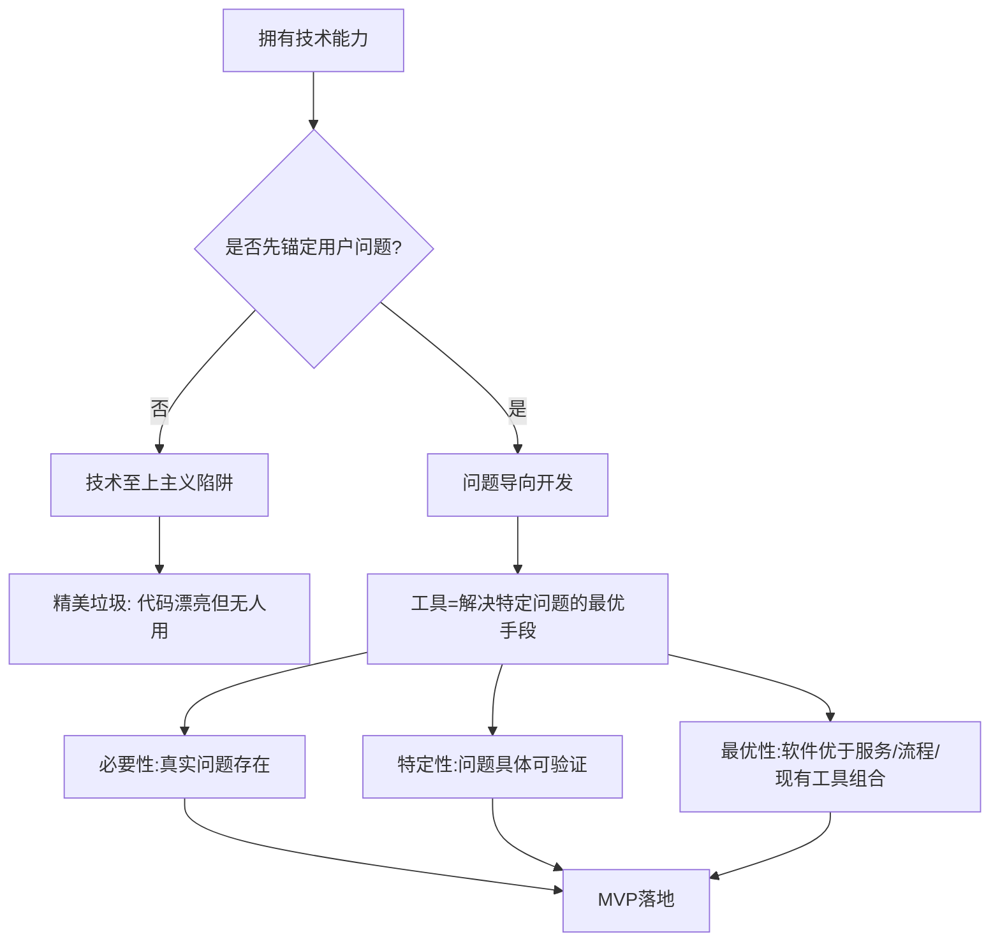

### 核心认知

> "明确问题，是第一步。任何工具的存在，都是为了解决问题。但解决方案，不一定是软件，还有服务，还有其他各个方式。别以为软件是万能的。"
> 
> ——《docs/202305/20230516_062.md》

这段话直接指出了开发者最容易犯的认知错误：**拥有技术能力 ≠ 拥有产品洞察**。你可能精通全栈、熟悉架构、会写算法，但如果你不先锚定"用户到底在为哪个具体困难付费"，写出的再漂亮的代码也是"精美垃圾"。

**核心定义**

$$
\text{工具存在的必要条件} = \text{解决特定问题的最优手段}
$$

这个公式由三个约束条件共同构成。首先，**必要性**要求必须有真实问题存在，否则工具就是无源之水；其次，**特定性**要求问题要足够具体、可验证，模糊的"提高效率"不是问题，"内容运营每天花 3 小时想标题却点击率低"才是；最后，**最优性**要求软件方案要比"人工服务/流程优化/现有工具组合"更划算，这也是为什么我们要在 MVP 阶段做算账。三个约束缺一不可，共同界定了工具存在的合法边界。

**关键性质**

工具源于问题而非技术这一原则具有三个关键性质。第一，**问题导向**：从"用户遇到什么困难"反推"需要什么功能"，而不是从"我会什么技术"推"能做什么功能"。第二，**非技术决定论**：技术是实现手段，问题才是存在理由；当服务或流程优化能更低成本解决问题时，不应写代码。第三，**成本约束敏感**：MVP 阶段必须在时间、人力、技术三重约束下做减法，只保留最高 ROI 的核心功能。

**典型例子**

黑客马拉松中，作者发现内容营销痛点，未盲目开发 CMS，而是聚焦"标题生成"单一功能。对比之下，许多开发者先学全栈、搭架构、做后台，最后发现没人需要。

**边界条件**

当问题本身就是技术性极强时（如编译器、数据库内核），技术即问题。该原则不适用于纯技术基础设施建设，仅适用于面向业务用户的应用层工具。

## 70.4 5 Whys 根因分析 —— 穿透表象痛点，直击软件可解的本质

### 方法演进图

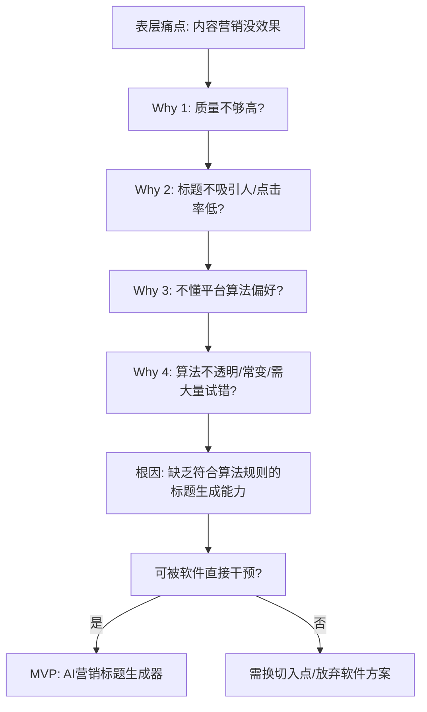

### 核心认知

> "发现用户面临的问题，是痛点，但只是'标'，不是'本'。利用 5 whys 法，反复问造成该问题的根本原因是什么，这是'本'。"
> 
> ——《docs/202305/20230516_062.md》

用户擅长描述感受（"我内容没流量"、"我写得太累"），不擅长诊断本质。直接解决表层症状会导致功能蔓延、偏离核心价值、资源浪费。只有找到软件能解决的"本"，才能界定清晰的 MVP 范围。

**核心定义**

$$
\text{根因} = \text{5 Whys}(\text{表层痛点}) \quad \text{s.t.} \quad \text{可被软件逻辑直接干预}
$$

这个公式展示了两个关键约束。第一，**层层递进**：每一层"为什么"都基于上一层的回答，形成因果链条。第二，**可干预性**：停止条件是找到可被软件/系统直接干预的关键环节。这里的 `s.t.`（subject to）表示约束条件——如果追问到第 5 层发现根因是"平台政策不可控"或"用户懒惰"，则不满足可干预性约束，需回溯或放弃软件方案。

**关键推导过程**

以下表格展示了以黑客马拉松内容营销案例为例的 5 Whys 推导过程，数据来源于素材中的实战复盘：

| 追问层级 | 问题 | 回答 | 判断 |
|----------|------|------|------|
| 第 1 层 | 为什么内容营销没效果？ | 内容质量不够高 | 太宽泛，软件难直接解决 |
| 第 2 层 | 为什么质量不够？ | 标题不吸引人，点击率低 | 缩小范围，但仍是表象 |
| 第 3 层 | 为什么标题不吸引人？ | 不懂平台算法偏好什么标题 | 接近核心，知识缺口 |
| 第 4 层 | 为什么不懂算法偏好？ | 算法规则不透明、常变、需大量试错 | 发现系统性矛盾 |
| 第 5 层 | **根因** | **缺乏"符合平台算法规则的标题生成能力"** | ✅ 可被软件自动化解决 |

这个推导展示了如何从模糊抱怨定位到**可被软件逻辑封装的具体能力缺口**。最终定位：开发"AI营销标题生成器"而非"智能编辑器"。

**边界条件**

当根因涉及不可控外部因素（如平台政策突变、宏观经济）时，软件无法直接解决；需结合领域知识，避免陷入无限递归或伪根因（如"因为用户懒"）。

## 70.5 MVP 算账决策 —— 在约束下只做最高优先级的事

### 方法演进图

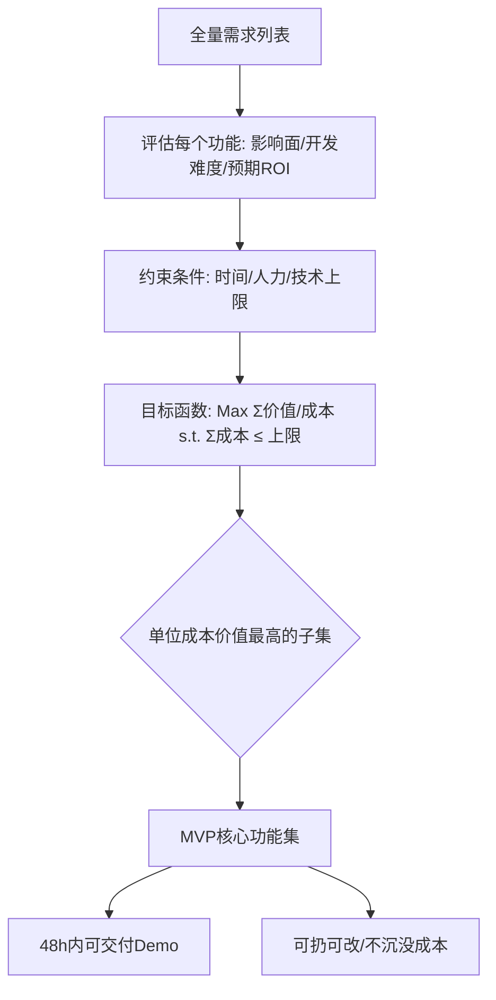

### 核心认知

> "这里就需要 MVP 思维和算账能力（包括技术成本、人力成本、时间成本等）。hackthon 是两天时间，所以我这边选择最重要的点，先去解决标题问题。"
> 
> ——《docs/202305/20230516_062.md》

资源永远有限（黑客马拉松仅 2 天、创业初期人手少、技术债高）。追求"功能完备"会导致交付无限延期、错过市场窗口、耗尽现金流。必须建立"在约束下最大化价值"的显性决策框架。

**核心定义**

$$
\text{MVP} = \underset{\text{功能集} \subseteq \text{全量需求}}{\arg\max} \frac{\text{预期价值}}{\text{开发成本}} \quad \text{s.t.} \quad \sum \text{成本} \leq \text{资源上限}
$$

这个公式将 MVP 决策形式化为一个约束优化问题。目标函数是**单位成本产出价值之和最大化**；约束条件是**总成本不超过资源上限**。其中"预期价值"可用影响面评分（1-5）近似，"开发成本"可用开发难度评分（1-5）近似。在黑客马拉松 48 小时这一硬性约束下，算账的本质就是在有限预算里买到性价比最高的功能组合。

**关键性质**

MVP 算账决策具有三个关键性质。第一，**单一核心**：每个版本只解决一个核心问题，拒绝"顺便加个"功能。第二，**快速验证**：以最低成本跑通"问题-方案-用户-价值"闭环。第三，**可扔可改**：代码/架构为验证服务，验证失败即丢弃，不沉没成本。

**典型例子**

黑客马拉松 2 天算账表，数据来源于素材实战复盘：

| 候选功能 | 影响面(1-5) | 开发难度(1-5) | 预期 ROI | 决策 |
|----------|-------------|---------------|----------|------|
| 标题生成 | 5 | 3 | **高** | ✅ 核心 |
| 内容生成 | 3 | 5 | 低 | ❌ 放弃 |
| 发布管理 | 2 | 4 | 低 | ❌ 放弃 |
| 数据分析 | 2 | 4 | 低 | ❌ 放弃 |
| 多平台适配 | 4 | 5 | 中 | ⏸ 后续 |

算账逻辑：标题是流量入口，影响面最广，开发难度中等，ROI 最高。

**边界条件**

核心功能若极其复杂（如自动驾驶感知），可能无法在极短周期内做出可用 MVP；合规/安全类产品（医疗、金融）有底线功能集，不能过度精简。

## 70.6 用户画像三维模型 —— 画像是找到用户的"藏宝图"

### 方法演进图

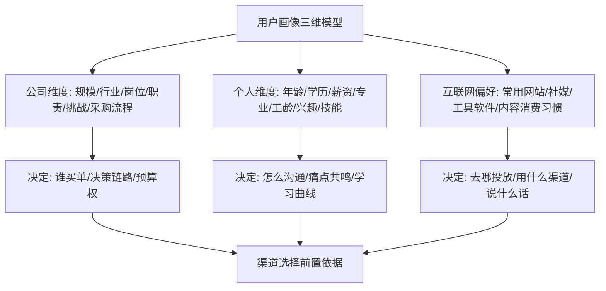

### 核心认知

> "用户画像特征包括以下：1. 公司维度：公司规模、行业、地理位置、岗位、职责、岗位挑战、采购软件流程 2. 个人维度：年龄、教育水平、平均工资、毕业专业、工作年限、爱好兴趣、所属技能、 3. 互联网偏好：网站平台偏好、社交媒体偏好、还用其他哪些互联网软件等等"
> 
> "因为只有明确了用户画像特征，才能更好的做流量，做营销，做冷启动。用户在哪，我的产品在哪？就这句话，但你都不知道用户画像特征，你咋知道用户在哪呢？"
> 
> ——《docs/202305/20230516_062.md》

不知道用户是谁，就不知道去哪里找他们、说什么话、用什么渠道。"所有人"是最差的用户画像，会导致营销预算打水漂、转化率极低。画像是渠道选择、文案撰写、产品设计的统一前置依据。

**核心定义**

$$
\text{用户画像} = \{\text{公司维度}, \text{个人维度}, \text{互联网偏好}\}
$$

这个三元组定义展示了画像的三个正交维度。公司维度决定"谁买单、决策链路、预算权"；个人维度决定"怎么沟通、痛点共鸣、学习曲线"；互联网偏好直接决定"去哪投放、用什么渠道、说什么话"。三个维度缺一不可，共同构成渠道选择的前置藏宝图。

**关键性质**

用户画像三维模型具有三个关键性质。第一，**决策前置**：画像必须在选渠道、写文案、设功能之前完成。第二，**可验证**：画像假设需通过访谈、数据、竞品分析不断校准。第三，**动态更新**：随着产品迭代、市场变化，画像需定期修正。

**典型例子**

AI 标题工具目标用户画像，基于素材实战总结：

| 维度 | 具体画像 |
|------|----------|
| 公司维度 | 中小企业、内容团队、有 SEO/新媒体 KPI、月预算 5k-50k |
| 个人维度 | 25-35 岁、大专以上、月薪 8k-20k、焦虑流量、懂基础 AI 工具 |
| 互联网偏好 | 小红书/👸号/知乎/抖音创作者后台、用剪映/Canva/ChatGPT |

**边界条件**

早期画像常基于假设，需警惕"画像即真理"的教条主义；细分市场过小时（如仅 10 家潜在客户），画像价值低于直接逐个拜访。

## 70.7 竞品反向三步走选渠道 —— 站在巨人肩膀上抄近道

### 方法演进图

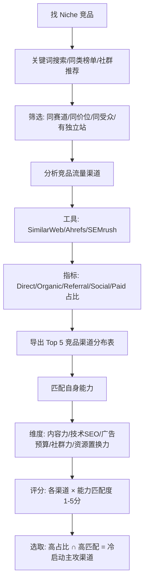

### 核心认知

> "如何通过竞品分析，确定用户对应营销渠道很简单。那如何确定合适你的流量渠道呢？三步走：1、找到 niched 竞品 ... 2、分析竞争对手的流量渠道 ... 3、选择合适你的流量渠道。在进行竞争对手流量渠道分析时，需要统计每个竞品网站的流量渠道并进行排序。可以使用 similarweb 提供的功能进行统计，如下图所示。"
> 
> ——《docs/202305/20230516_062.md》

渠道太多（SEO、SEM、社媒、KOL、邮件、社群……），新团队无法全铺。盲目尝试成本极高，且易陷入"幸存者偏差"。竞品已用真金白银帮你测过渠道，直接分析其流量结构性价比最高。

**核心定义**

$$
\text{最优渠道} = \text{TopK}(\text{竞品流量占比}) \cap \text{能力匹配度}(\text{团队}) \cap \text{阶段适配度}(\text{冷启动/稳定期})
$$

这个公式展示了渠道选择的三重过滤机制。第一，**市场验证**：竞品流量数据是市场真实投票结果。第二，**能力匹配**：不是照抄竞品，而是选"竞品强且我也能打"的渠道。第三，**阶段适配**：冷启动期找"低成本、高精准、我能赢"；稳定期聚焦 Top 3 规模化。

**标准化操作流程**

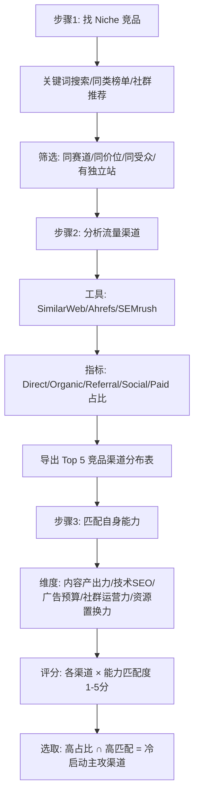

**典型例子**

竞品流量：Direct 40%、Organic Search 30%、Referral 20%、Social 10%。若我有内容团队，优先做 SEO；若我擅长视频，切 Social；若我有资源，谈 Referral 合作。

**边界条件**

竞品处于完全不同商业模式（如竞品靠品牌词、我靠长尾词）时，渠道不可直接迁移；新兴渠道（如新社交 App）竞品可能尚未布局，需自行小额测试；工具数据有滞后性（通常月度更新），不适合捕捉极短期爆发机会。

## 70.8 AI+SEO 标题生成方案 —— 用数据喂 AI，产出既懂算法又懂人性的标题

### 方法演进图

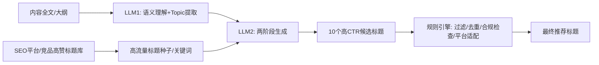

### 核心认知

> "其「AI 营销标题：高流量 & 高推荐 -> 高点击转化」解决方案：● 利用 AI 总结内容的 Topic + SEO 数据服务平台获取高流量相关标题 ● 通过 AI 技术再次生成高传播和高点击的标题"
> 
> ——《docs/202305/20230516_062.md》

纯 AI 生成标题往往"正确但平庸"，缺乏平台热门模式的数据支撑。纯 SEO 关键词堆砌标题"难读、不转化"，违背用户体验。需要一种"数据锚定+智能重组"的混合范式，兼顾分发与转化。

**核心定义**

$$
\text{高转化标题} = \text{LLM}_2(\text{LLM}_1(\text{内容}) \rightarrow \text{Topic}, \text{SEO数据}(\text{高流量标题库}))
$$

这个公式展示了两阶段混合生成范式。第一阶段，**理解**：LLM₁ 提取内容核心 Topic 标签，将非结构化文本压缩为结构化语义锚点。第二阶段，**创作**：LLM₂ 基于 Topic + 真实高流量标题种子生成候选标题，实现"数据锚定+智能重组"。这里的关键在于 SEO 数据作为先验知识注入 LLM₂，规避了纯生成式模式的幻觉与平庸。

**关键性质**

AI+SEO 标题生成方案具有三个关键性质。第一，**数据驱动创意**：用真实高流量标题作为"种子"，规避 AI 幻觉。第二，**平台适配性**：不同平台算法偏好不同，需分平台训练/调优。第三，**可批量化**：标准化 Prompt + 规则引擎，支持百/千级标题批量产出。

**两阶段 Prompt 工程设计**

```python
# 阶段1：语义理解与Topic提取
prompt_1 = """
角色：资深内容运营专家
任务：从输入内容中提取核心Topic标签(3-5个)
要求：标签需覆盖[痛点/人群/场景/工具/结果]维度
输出格式：#标签1 #标签2 #标签3
内容：{content}
"""

# 阶段2：数据锚定标题生成
prompt_2 = """
角色：爆款标题工程师
任务：基于Topic标签 + 爆款标题库样本，生成10个高CTR候选标题
约束：
- 必须包含: 情绪词/数字/疑问句/痛点词 至少2种
- 适配平台: {platform} (小红书/👸号/抖音/知乎)
- 字数: 15-30字
参考样本(高赞标题):
{top_titles_sample}
Topic标签: {tags}
输出: 10个标题, 每行一个
"""
```

**典型例子**

输入一篇"AI 绘图教程"正文 → 提取 Topic "新手入门/避坑/工具推荐" → 检索小红书高赞标题"小白必看/保姆级/从 0 到 1" → 生成《小白保姆级避坑！AI 绘图从 0 到 1 全流程，工具推荐附赠》。

**边界条件**

依赖 SEO 平台数据质量，冷门领域/新平台数据不足时效果下降；标题只是"钩子"，内容质量不支撑会导致高跳出、低完读、账号权重受损；需持续迭代 Prompt 与规则，适配平台算法更新（如小红书打击标题党）。

## 70.9 冷启动渠道阶段性策略 —— 前期求生存，后期求规模

### 方法演进图

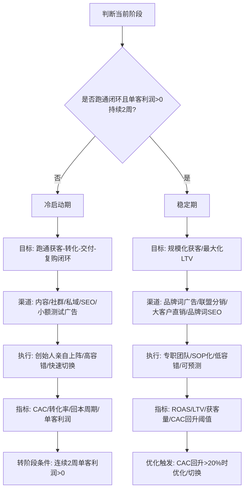

### 核心认知

> "在冷启动阶段，需要综合考虑自身能力和流量渠道，找到最合适的匹配方案。在稳定阶段，应选择最适合的 Top 几个渠道，以获得更多的用户。"
> 
> ——《docs/202305/20230516_062.md》

同一渠道在不同阶段 ROI 截然不同，混淆阶段会导致资源错配。早期盲目追求规模化渠道（如大额广告）会烧光现金流。晚期仍用"捡漏"心态做冷启动渠道，会错失红利期、被竞品超越。

**核心定义**

$$
\text{阶段判断} = \begin{cases}
\text{冷启动期}, & \text{未跑通闭环 或 单客利润} \leq 0 \\
\text{稳定期}, & \text{已跑通闭环 且 单客利润} > 0 \text{ 持续 2 周}
\end{cases}
$$

这个分段函数展示了阶段划分的硬性标准：以"商业闭环是否跑通"为唯一分界线，而非时间长短。冷启动期的核心任务是验证商业模式，稳定期的核心任务是放大商业模式。

**阶段对照表**

以下表格对比了冷启动期与稳定期在核心目标、主攻渠道、执行主体、关键指标、容错率及转阶段条件上的差异：

| 维度 | 冷启动期 | 稳定期 |
|------|----------|--------|
| 核心目标 | 跑通"获客-转化-交付-复购"闭环 | 规模化获客、最大化 LTV |
| 主攻渠道 | 内容/社群/私域/SEO/小额测试广告 | 品牌词广告/联盟分销/大客户直销/品牌词 SEO |
| 执行主体 | 创始人亲自上阵 | 专职团队/外包/SOP 化 |
| 关键指标 | CAC、转化率、回本周期、单客利润 | ROAS、LTV、获客量、CAC 回升阈值 |
| 容错率 | 高（可快速切换） | 低（需稳定性、可预测性） |
| 停止/转阶段条件 | 连续 2 周单客利润 > 0 | CAC 回升 > 20% 时优化/切换 |

**典型例子**

冷启动：创始人亲自在知乎/小红书答疑引流、发冷邮件、进社群做价值输出、跑小额广告测转化。稳定期：雇佣专职 SEO/投手、建立分销体系、开品牌词广告、搭建销售团队。

**边界条件**

产品周期极短（如节日应季品）可能没有"稳定期"，全程高强度冷启动；平台规则突变（如算法大更新、政策封杀）可能强制倒退回冷启动期；团队核心能力变更（如核心内容人员离职）需重新评估渠道匹配度。

## 70.10 营销底层逻辑三问 —— 谁、什么、哪里，缺一不可

### 方法演进图

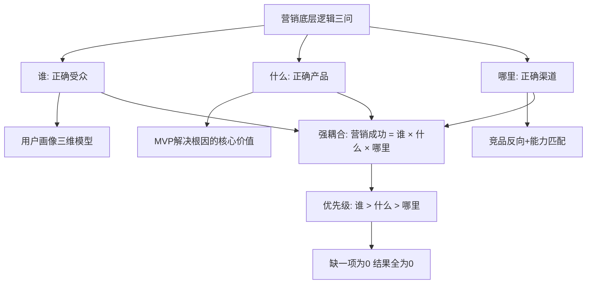

### 核心认知

> "成功的营销，最关键的是在正确的受众（目标客户）面前展示正确的产品。谁是目标客户？在哪里找到他们？目标客户的定义，就是对你提供的产品或服务感兴趣的受众群体。"
> 
> ——《docs/202305/20230516_062.md》

很多团队只想"推广"，不想"卖给谁"、"卖什么"、"去哪卖"。三要素任一缺失：受众错=流量垃圾；产品错=留不住；渠道错=触达不到。这是所有营销动作的底层检查清单，防止战术忙碌掩盖战略懒惰。

**核心定义**

$$
\text{营销成功} = \text{正确的受众}(\text{谁}) \times \text{正确的产品}(\text{什么}) \times \text{正确的渠道}(\text{哪里})
$$

这个乘法公式展示了三要素的**强耦合性**：任一项为 0，结果全为 0。其中"谁"由用户画像三维模型决定，"什么"由 MVP 解决根因的核心价值决定，"哪里"由竞品反向三步走结合能力匹配决定。

**关键性质**

营销底层逻辑三问具有三个关键性质。第一，**强耦合**：三要素必须基于同一假设体系推导，不能拼凑。第二，**优先级**：谁 > 什么 > 哪里（搞错谁，后面全错）。第三，**可迁移**：同一产品面对不同"谁"，需匹配不同"什么"（包装）和"哪里"（渠道）。

**典型例子**

AI 标题工具三要素对照：

| 要素 | 正确答案 | 反面教材 |
|------|----------|----------|
| 谁 | 焦虑流量的内容运营/自媒体/营销人员 | "所有人" / "想赚钱的人" |
| 什么 | 秒出爆款标题的在线工具，解决"标题不懂算法"根因 | "功能全面的内容营销 SaaS" |
| 哪里 | 小红书/👸号/知乎/抖音创作者聚集地 | 朋友圈群发 / 陌生邮件群发 / 买数据包 |

**边界条件**

早期"谁"常模糊，需用"广撒网、精筛选"快速验证，而非追求完美画像；"什么"在 PMF 前会频繁变化，需建立快速迭代机制而非锁死路线图。

## 70.11 问题的标本区分 —— 不要给感冒开脑外科手术单

### 方法演进图

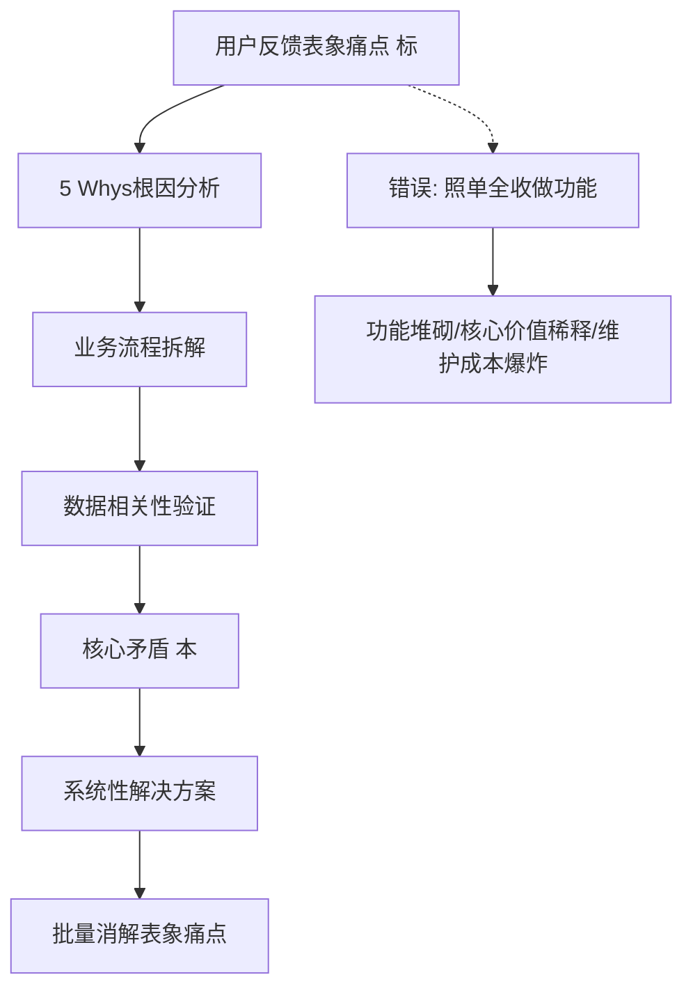

### 核心认知

> "发现用户面临的问题，是痛点，但只是'标'，不是'本'。利用 5 whys 法，反复问造成该问题的根本原因是什么，这是'本'。"
> 
> ——《docs/202305/20230516_062.md》

用户擅长描述感受（标），不擅长诊断本质（本）。照单全收用户需求会导致功能堆砌、核心价值稀释、维护成本爆炸。产品经理的核心价值在于"听懂标、找到本、做对事"。

**核心定义**

$$
\begin{aligned}
\text{标(表象/痛点)} &: \text{用户主观感受到的困扰、抱怨、期望} \\
\text{本(根因/需求)} &: \text{经分析挖掘的、可被系统性解决的核心矛盾} \\
\text{区分方法} &: \text{5 Whys} + \text{业务流程拆解} + \text{数据相关性验证}
\end{aligned}
$$

这个定义体系展示了标本关系的三个核心性质。第一，**标多本少**：同一根因可衍生出大量表象痛点。第二，**标变本不变**：平台/技术/形态变了，用户核心诉求常不变。第三，**解本治标**：解决根因通常能批量消解表象痛点，反之则不能。

**典型对照表**

以下表格对比了用户表象痛点、根因诊断、正确方案与错误方案：

| 用户表象痛点(标) | 根因诊断(本) | 正确方案 | 错误方案(治标) |
|------------------|--------------|----------|----------------|
| "需要定时发布功能" | 需要在用户活跃高峰自动触达 | 智能选时发布 | 单纯做定时器 |
| "内容没流量/写得累" | 标题不符合平台算法规则 | AI 标题生成器 | 智能编辑器/排版工具 |
| "想要更好看的界面" | 核心任务完成效率低 | 简化核心流程/快捷键 | 重构 UI 组件库 |
| "导出格式不够多" | 数据无法流转到下游工具 | API/集成主流工具 | 增加 10 种导出格式 |

**边界条件**

当用户显性需求即为核心价值时（如"我要个计算器算账"），标本合一，直接做；涉及用户隐私/伦理/合规的"标"，不能单纯用技术手段"解本"绕过。

## 70.12 黑客马拉松实战验证 —— 两天跑通"问题-方案-用户-价值"闭环

### 方法演进图

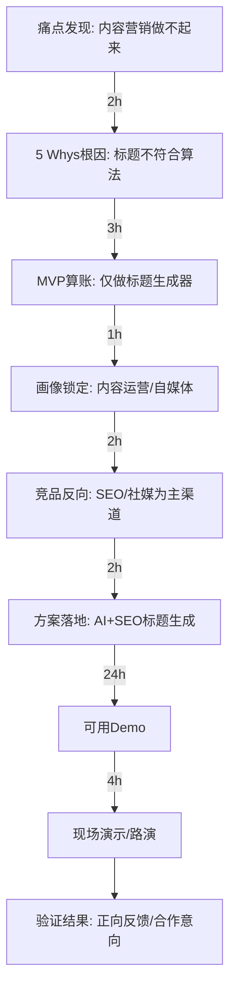

### 核心认知

> "hackthon 是两天时间，所以我这边选择最重要的点，先去解决标题问题。让标题满足被推荐，被搜索到。如下图，就是我们做的 demo 页面。"
> 
> ——《docs/202305/20230516_062.md》

方法论不经实战检验只是"心法"，只有极限条件下跑通才证明"术法"有效。黑客马拉松的高压（2 天、陌生队友、现场开发、现场路演）是最佳压力测试。复盘实战细节能提炼出可复用的"标准动作"，而非不可复制的"运气好"。

**核心定义**

$$
\text{实战验证} = \mathbb{1}\{\text{48h内产出可演示Demo} \land \text{现场获正向反馈} \land \text{产生后续合作意向}\}
$$

这个指示函数定义了实战验证的三个硬性达标线：48 小时内产出可演示 Demo、现场获得正向反馈、产生后续合作意向。三个条件同时满足，验证才算通过。

**完整执行链路复盘**

以下表格复盘了黑客马拉松 48 小时的完整执行链路，每一步的耗时、关键决策点与产出物均基于素材实战记录：

| 步骤 | 动作 | 耗时 | 关键决策点 | 产出物 |
|------|------|------|------------|--------|
| 1 | 痛点发现：内容营销做不起来 | 2h | 基于自身经历，非假设 | 问题陈述 |
| 2 | 5 Whys 根因：标题不符合算法 | 3h | 定位"可被软件解决"的根因 | 根因文档 |
| 3 | MVP 算账：仅做标题生成器 | 1h | 放弃内容生成/发布/分析 | 功能清单 |
| 4 | 画像锁定：内容运营/自媒体 | 2h | 三维画像指向具体渠道 | 画像档案 |
| 5 | 竞品反向：SEO/社媒为主渠道 | 2h | SimilarWeb 数据验证 | 渠道策略 |
| 6 | 方案落地：AI+SEO 标题生成 | 24h | 两阶段 Prompt 工程 | 可用 Demo |
| 7 | 现场演示/路演 | 4h | 真实用户/评委反馈 | 验证结果 |

**工具链路架构图**

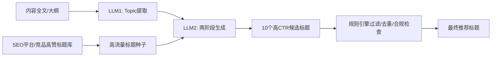

**关键性质**

黑客马拉松实战验证具有三个关键性质。第一，**时间盒倒逼聚焦**：硬性截止日期强制切掉所有非核心功能。第二，**真实反馈校准**：现场用户/评委反馈比内部会议讨论价值高 100 倍。第三，**资源约束常态化**：黑客马拉松的约束（时间/人/技术）是创业常态的放大版。

**边界条件**

黑客马拉松成果通常为"可演示原型"，距"可商用产品"尚有工程化、合规化、稳定性鸿沟；团队默契度高、技能互补时成功率高；随机组队可能因沟通成本过高而失败；仅适用于"应用层工具/消费级产品"，不适用于深技术/重监管/长周期研发项目。

## 70.13 多源对照

本章方法论主要基于单一核心素材（黑客马拉松实战总结），但在"竞品反向渠道分析"与"AI+SEO 标题生成"两个环节，存在业界通用的替代性工具与范式，在此并列对照。

### 共识

- **竞品流量反向分析**是确定冷启动渠道的标准化范式，业界通用 SimilarWeb/Ahrefs/SEMrush 三大工具 [需要补充文献：增长黑客/SEO 领域经典文献，如 *Growth Hacking* 相关章节、Ahrefs/SEMrush 官方方法论白皮书]。
- **数据锚定+AI 重组**是生成高转化标题/文案的主流范式，核心逻辑一致：真实高表现数据作种子 → LLM 二次创作 [需要补充文献：RAG/检索增强生成相关学术论文，如 *Retrieval-Augmented Generation for Knowledge-Intensive NLP Tasks*, Lewis et al. 2020]。

### 分歧

| 维度 | 本章方案（黑客马拉松实战版） | 业界成熟 SaaS 方案（如 Jasper/Copy.ai/周伯通） |
|------|-------------------------------|-----------------------------------------------|
| 数据源 | 手工采集/SimilarWeb 导出/SEO 平台 API | 自建爬虫池/购买第三方数据/平台官方 API |
| Prompt 架构 | 两阶段手工 Prompt + 规则引擎 | 微调专用模型 / RAG 检索增强 / Agent 工作流 |
| 平台适配 | 人工维护各平台规则/违禁词库 | 自动化合规检测 / 平台官方合作白名单 |
| 批量化能力 | 单次调用生成 10-50 个 | 千级/万级并发生成、A/B 测试内置 |
| 成本结构 | 极低（仅 API 调用费） | 高（模型训练/数据采购/算力/人力） |
| 适用阶段 | 冷启动/0-1 验证/PMF 前 | PMF 后/规模化/企业级服务 |

## 70.14 设计中的取舍

**Q1：为什么不用"全功能 SaaS"起步，而要做"单一功能 Micro-tool"？**

因为早期资源约束下，功能广度与深度呈负相关。全功能 SaaS 需要：用户系统、计费、多租户、权限、通知、后台管理……这些"非核心功能"会消耗 80% 以上工时，却贡献 0% 的核心价值验证。单一功能 Micro-tool 只做"标题生成"一件事，却能在 2 天内跑通"用户输入内容→得到标题→发布获流量"的完整价值闭环。这就是 MVP 算账决策的本质：在约束下最大化验证效率。

**Q2：这种设计的 trade-off 是什么？**

得：极速验证核心价值假设、近零开发成本、可随时弃用重来。失：无用户体系（无法留存/复购）、无计费（无法直接变现）、无数据积累（无法训练模型）。补救路径：验证通过后，用"插件化架构"逐层叠加：先加用户系统→再加计费→再加数据看板→最后加团队协作。每层都有独立验证指标，避免大爆炸式重构。

**Q3：为何选 5 Whys 而非用户故事地图？**

5 Whys 适合"已有模糊痛点、需快速定位根因"的 0 期场景，单人/小团队 30 分钟可完成；用户故事地图适合"已明确核心用户、需梳理完整旅程"的 PMF 后场景，需跨职能研讨半天以上。黑客马拉松 48 小时极限约束下，5 Whys 的时间 ROI 远高于故事地图。

**Q4：为何选 SimilarWeb 而非 Ahrefs/SEMrush？**

SimilarWeb 在网站整体流量渠道分布估算上样本量最大、UI 最直观、免费额度最友好，适合"快速看清竞品从哪来"；Ahrefs/SEMrush 在关键词难度、反链分析、内容缺口挖掘上更强，适合"深度 SEO 选题规划"。冷启动渠道定策略阶段，前者决策效率更高。

**Q5：为何选两阶段 Prompt 而非微调模型？**

微调需千级标注数据、GPU 算力、MLOps 流水线，投入产出比在 PMF 前极低；两阶段 Prompt 仅需精心设计的指令 + 少量高质量种子样本，即刻可用、迭代成本极低。冷启动期"能不能跑通"优先于"效果能不能 SOTA"。

**Q6：冷启动/稳定期划分依据为何选单客利润而非时间/用户量？**

时间长短不代表商业模式跑通（有人烧钱 3 年仍未 PMF）；用户量虚高不代表盈利（免费用户千万仍倒闭）。单客利润 > 0 且持续 2 周，直接证明"获客成本 < 单客终身价值"这一商业方程成立，是阶段跃迁的唯一硬性证据 [需要补充文献：*The Lean Startup* (Ries) 中关于"引擎切换"、PMF 前后获客策略差异的论述；*Traction* (Weinberg & Mares) 关于渠道阶段性的论述]。

**Q7：营销三问中"谁>什么>哪里"的优先级来源？**

源于定位理论与跨越鸿沟理论：细分市场优先于产品定义，产品定义优先于渠道选择。搞错"谁"，后续"什么"与"哪里"全错，成本呈指数级放大 [需要补充文献：*Positioning* (Ries & Trout) 关于细分市场优先的论证；*Crossing the Chasm* (Moore) 关于早期主流市场聚焦的论述]。

**Q8：黑客马拉松作为验证手段的有效性边界在哪里？**

适用于应用层工具、消费级产品、B2B SaaS 早期 MVP；不适用于深技术（需长周期研发）、重监管（医疗/金融合规前置）、硬件/生物技术（物理约束不可压缩）。有效性取决于"能否在 48h 内产出可演示的核心价值交付件" [需要补充文献：软件工程/创业教育领域关于 Hackathon 验证 MVP 可行性的实证研究，如 *Hackathons as an Innovation Platform* 相关文献]。

## 70.15 动手练习

### 练习 1：为你的副业项目做一次 5 Whys 根因手术

选定一个你正在做或想做的项目（如：卖 AI 提示词、做短视频带货、开发小工具）：

1. 写下用户最直观的 3 个抱怨/痛点（标）
2. 对每个痛点连续追问 5 次"为什么"，直到找到可被系统/软件/流程直接干预的根因（本）
3. 判断：这个根因是否适合用软件解决？还是服务/文档/社群更优？
4. 基于根因，写出你的 MVP 核心功能清单（不超过 3 项）

回答问题：
- 如果不做 5 Whys 直接按痛点开发，会造出什么"精美垃圾"？
- 你的 MVP 能否在 2 周内跑通"问题-方案-用户-价值"闭环？

### 练习 2：竞品反向渠道复盘实战

找到你所在赛道的 3-5 个头部竞品（要有独立站/👸号/小红书主页等可分析主体）：

1. 用 SimilarWeb/Ahrefs/蝉妈妈等工具导出其流量渠道占比（Direct/Organic Search/Social/Referral/Paid 等）
2. 制作表格：竞品 | Top 3 渠道 | 占比 | 你的团队能力匹配度 (1-5 分)
3. 圈出"高占比+高匹配"的渠道作为冷启动主攻方向
4. 写出该渠道的前 3 周具体执行 SOP（如 SEO：选词→写文→发布→收录→复盘）

回答问题：
- 为什么竞品强的渠道你不一定能打？举一个"能力不匹配"的反例
- 冷启动期为何不能同时铺开 Top 5 渠道？资源稀释的边际成本怎么算？

### 练习 3：设计一个'AI+数据'的混合生成 Prompt

场景：你要为"小红书避坑指南"类内容批量生成高点击标题：

1. 先人工收集该赛道近期 100 篇爆款笔记标题，提取高频结构/情绪词/数字/钩子
2. 设计两阶段 Prompt：
   - 第一阶段：输入正文 → 输出核心 Topic 标签（如：#避坑 #省钱 #新手）
   - 第二阶段：输入 Topic 标签 + 爆款标题库样本 → 输出 10 个候选标题
3. 实测：用 3 篇历史普通笔记正文跑 Prompt，对比生成标题 vs 原标题的预估 CTR

回答问题：
- 纯 AI 生成标题为何常"正确但平庸"？数据锚定解决了什么问题？
- 当平台算法更新打击"标题党"时，你的 Prompt 规则引擎该如何快速迭代？

### 练习 4：冷启动 vs 稳定期渠道动作清单对标

以你当前项目为例，填写下表（若未跑通闭环，按预判填写）：

| 阶段 | 核心目标 | 主攻渠道(≤3) | 单周执行动作 | 关键指标 | 停止/转阶段条件 |
|------|----------|----------------|----------------|----------|------------------|
| 冷启动 | 跑通闭环 | 1.  2.  3. |  | CAC/转化率/回本周期 | 连续 2 周单客利润 > 0 |
| 稳定期 | 规模化   | 1.  2.  3. |  | ROAS/LTV/获客量 | CAC 回升 > 20% 时优化 |

回答问题：
- 你的项目目前处于哪个阶段？证据是什么？
- 冷启动期若用"稳定期"的大额广告/分销渠道，现金流能撑几周？

## 70.16 本章小结

这一章中我们学习了利基软件工程化开发的完整方法论：从"工具源于问题而非技术"的第一性原理出发，通过 5 Whys 根因分析穿透表象痛点，用 MVP 算账决策在约束下聚焦最高 ROI 功能，构建用户画像三维模型作为渠道选择的前置依据，运用竞品反向三步走选渠道用数据替代主观臆测，设计 AI+SEO 标题生成方案实现数据锚定与智能重组的混合创作范式，区分冷启动期与稳定期的渠道策略差异建立阶段性获客动作清单，最后内化营销底层逻辑三问（谁/什么/哪里）防止战术忙碌掩盖战略懒惰，并在黑客马拉松 48 小时极限压力测试中验证了全流程可执行性。

本章我们一起学习了以下概念：

| 概念 | 解释 |
|------|------|
| 工具源于问题而非技术 | 方案不一定是软件，开发前必须锚定真实痛点 |
| 5 Whys 根因分析 | 连续追问 5 次将表层痛点(标)转化为可被软件解决的根因(本) |
| MVP 算账决策 | 在三重约束下仅做最高优先级功能，跑通闭环优于功能完备 |
| 用户画像三维模型 | 公司/个人/互联网偏好三维构建，是渠道选择的前置藏宝图 |
| 竞品反向三步走选渠道 | 找 Niche 竞品→分析流量渠道占比→匹配自身能力选最优解 |
| AI+SEO 标题生成方案 | AI 提取 Topic+SEO 高流量数据→AI 二次生成兼顾算法与人性的标题 |
| 冷启动渠道阶段性策略 | 早期求生存(低成本/可控/快见效)；晚期求规模(聚焦 Top 3 高效渠道) |
| 营销底层逻辑三问 | 正确受众+正确产品+正确渠道，谁>什么>哪里，强耦合缺一不可 |
| 问题的标本区分 | 标=用户主观抱怨；本=经分析可系统性解决的核心矛盾；解本治标 |
| 黑客马拉松实战验证 | 48 小时极限压力测试，验证六步法可执行性，产出 AI 标题生成器 Demo |

下一章中，我们将学习资料整理商业模型——从"卖资料赚小钱"到"筛选用户造大钱"的范式跃迁，揭示零边际成本资料如何成为高客单价服务的最强钩子。

