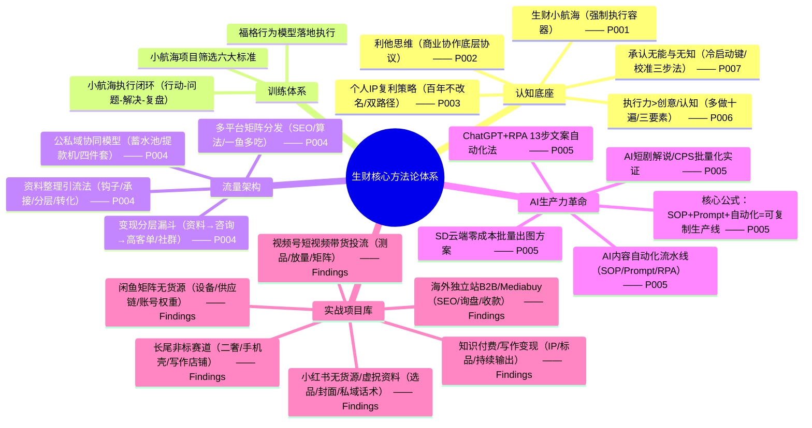
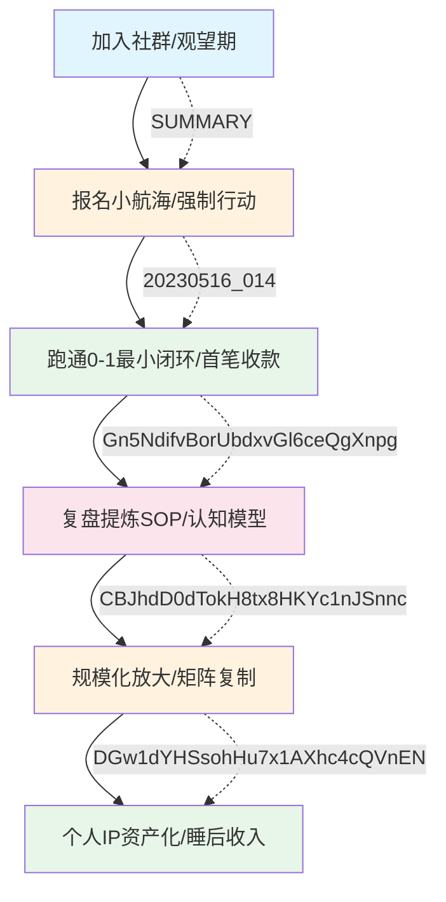
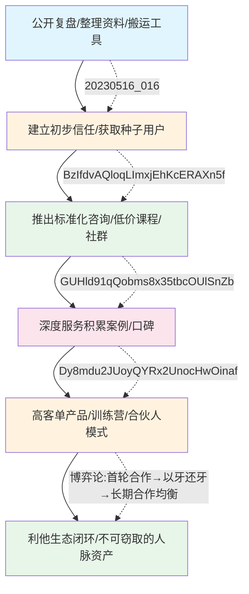
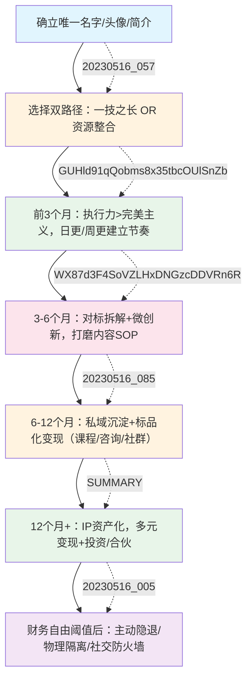
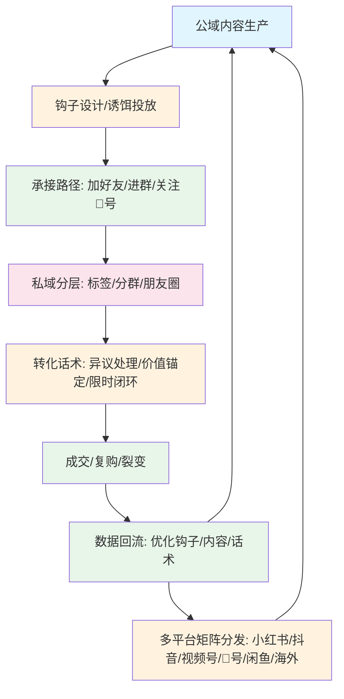
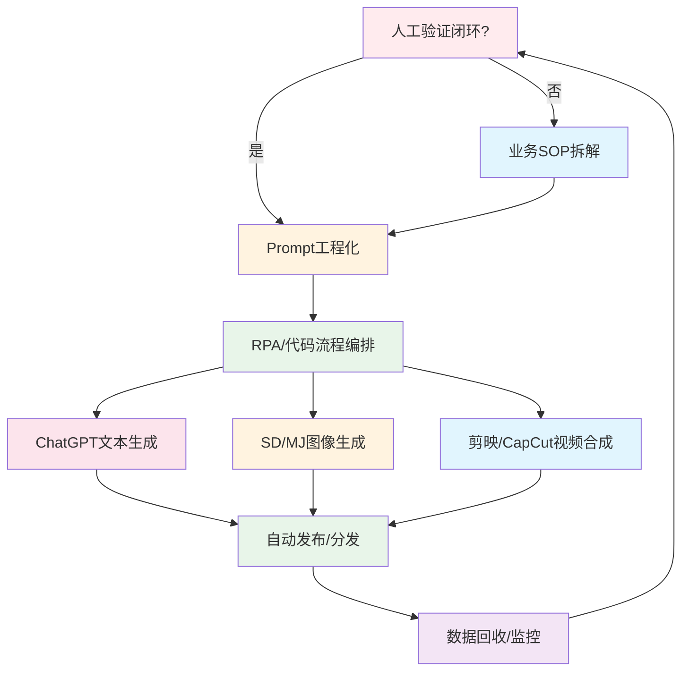
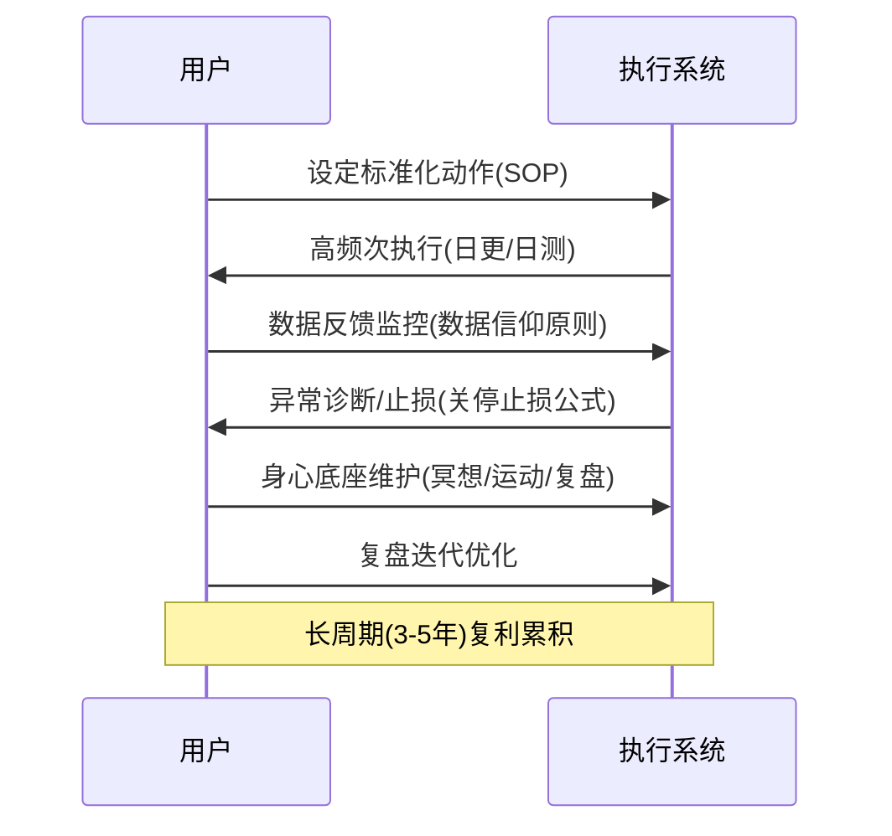
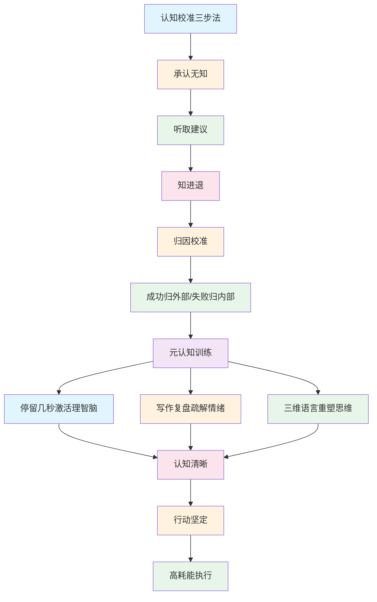

# 第 81 章 生财有术核心方法论体系 —— 从认知重构到商业闭环的完整路径图谱

## 学习目标

- 理解生财有术社群的核心认知模型：利他思维、执行力优先、承认无能、个人IP复利
- 掌握生财"小航海"项目制训练营的标准化运作流程与项目筛选六大标准
- 理解公私域协同模型中"蓄水池"与"提款机"的分工逻辑及四大连接关键动作
- 掌握AI内容自动化流水线从SOP拆解、Prompt工程注入到RPA串联的三位一体建设范式
- 确立"执行力>创意/认知"的非线性收益认知，掌握标准化动作×高频次×长周期的执行三要素
- 理解"承认无能与无知"作为成长冷启动键的认知校准三步法与元认知训练微操作
- 掌握资料整理引流法的"资料是钩子、产品是本体"商业模型与变现分层漏斗设计
- 理解付费即筛选、商业信任=价值交换的私域成交心法与输入-重构-输出的认知飞轮

## 81.1 生活类比

把生财有术的完整方法论体系想象成**“普通人逆袭的加油站”**：

- **车检（小航海筛选六标准）** = 入站前的强制体检：油箱够不够（正向现金流快）、发动机稳不稳（无供应链/可SOP）、有没有导航（公域获客路径）、后备箱装没装备胎（后端高客单）。不合格不让上路，避免半路趴窝。
- **教练（航海导师/陪跑）** = 不教新交规，只盯着你把“倒库、侧方、上路”三个基本动作按SOP练熟、练透，直到肌肉记忆形成。
- **车牌（个人IP·百年不改名）** = 全城唯一、终身不换的身份标识。换一次号，积累的路权、信用、VIP通道全归零。时间×唯一标识=指数级网络效应。
- **公路与加油站（公域蓄水池/私域提款机）** = 公域是收费高速（流量大、归平台、算法衰减快），私域是自家油库（用户资产归己、高频触达、高转化）。钩子/诱饵/承接/话术是连接两者的“加油枪/计量表/收费系统”。无公域私域干涸，无私域公域白跑。
- **自动驾驶辅助（AI流水线·SOP+Prompt+RPA）** = 方向盘还是人握（定战略/选模板/判异常），但换挡、刹车、定速巡航、甚至自动泊车全交给系统。前提是你得先会开车（手动跑通SOP），否则自动驾驶只会把你更快开沟里。
- **燃料（执行力>创意/认知·多做十遍）** = 不是高标号汽油（创意/大招），而是源源不断的普通燃油（标准化动作×高频次×长周期）。古茗拉横幅、作者每日分享、东哥发视频上架看数据管店催发货——最笨的动作重复到极致，就是最强的护城河。
- **驾驶员心态（承认无能与无知·冷启动键）** = 上车前先承认“我车技不好、路况不熟、油耗不清”，才敢听教练话、敢看导航、敢从最基础动作练起。镜像神经元衰退让老司机产生“全能幻觉”，拒绝建议、逆向操作、翻车率最高。元认知三微操作（停留几秒/写作复盘/语言重塑）是给大脑装的“ESP车身稳定系统”。

---

## 81.2 概念地图



## 81.3 生财小航海 —— 普通人0-1跨越的“强制执行容器”

### 为什么需要这个概念？

大多数人陷入“知道很多道理，却过不好这一生”的执行鸿沟。缺乏外部约束导致拖延、完美主义、害怕试错，无法跑通商业闭环。需要一个低成本、高确定性的训练场，将模糊意愿转化为确定性行动。

> "从 2020 年加入生财的小透明，到 2021 年 9 月份开始行动，再到如今跑通一个项目，并每月净收益约 2w 块。而且每月还保持着近 20%的增长率"
> 
> ——《新手小白如何借助生财小航海每月多赚 2 万元（附：小航海项目筛选模型）》[20230516_014]

### 核心定义

生财小航海是社群发起的项目制训练营模式：设定明确目标、时间节点、导师陪跑、同伴监督。核心机制：**截止节点倒逼交付 + 公开承诺产生社会压力 + 导师点评修正认知 + 复盘迭代固化经验**。产出标准：跑通 0-1 最小商业闭环（有流量入口、有转化动作、有真实收款）。

> "小航海模式定义：强制跑通商业闭环的训练营"
> 
> ——《生财有术 —— 社群杠杆加速普通人从0到1》[SUMMARY]

### 关键性质

- **强制性**：利用外部结构（时间、规则、群体）对抗人性惰性
- **标准化**：提供 SOP、选品库、话术库、工具包，降低“从0到1”的认知负荷
- **低风险**：项目筛选模型保证“正向现金流快、无需囤货、可标准化、有公域获客路径、后端有高客单产品”
- **复利性**：单周期产出可复用的 SOP、账号资产、私域用户、认知模型
- **筛选标准六维**：正向现金流快(权重0.25) + 无供应链/囤货(0.20) + 可SOP化(0.20) + 可AI提效(0.15) + 有公域获客路径(0.10) + 后端高客单/高复购(0.10)
- **验证路径六阶段**：锻造武器(拆解模块库) → 明确战场(筛选模型匹配) → 勇敢行动(行动-问题-解决闭环+福格模型) → 放大项目(增长模型优化本业+业务迁移扩展) → 积累大于收益(资源/技能/人脉/杠杆产品) → 流量形态可迁移(关键词/关系链/算法跨平台复用)

### 典型例子

**圈友 CBJhdD0dTokH8tx8HKYc1nJSnnc**：跟随 AI 资料变现航海，应届生两周变现 7000 元，完成“加群→买号→调教→分销→写教程→办训练营→建星球→账号分销”全链路。

> "时间线回到2月8号...花了十几元购买了一个账号...研究如何登录使用...加入玩赚chatGPT社群后...通过分销这个社群，我实现了第一次变现...在直播后半程我就开始调教chatGPT写小红书笔记...把自己的调教过程写成了教程...黛色找到我，说能不能一起搞一个注重实战的训练营...最终吸引了近三十人报名...我迅速将教程更新到我的知识星球...成功吸引了几十位朋友加入...我还从玩赚社群中了解到了账号交易这个盈利模式...利用我之前创作的论文教程作为宣传点"
> 
> ——《普通人如何抓住机遇逆袭？赚钱小白从0开始借助chatGPT变现7k入生财经历分享！》[CBJhdD0dTokH8tx8HKYc1nJSnnc]

**圈友 Gn5NdifvBorUbdxvGl6ceQgXnpg**：从“小透明”观望一年，参加航海后利用“精华帖逆向拆解法”组装项目，一年实现年入 200 万。

> "前期阅读精华帖，目的就是拆解并学习圈友是如何引流、如何搭建产品以及如何变现的...当我们拆解完两篇帖子后，会得到共计 6 个模块。当我们要去做其他项目时，其实只需要把这几个模块拼在一起，就能得到一个新的模式。"
> 
> ——《生财有术 —— 社群杠杆加速普通人从0到1》[Gn5NdifvBorUbdxvGl6ceQgXnpg]

**圈友 DGw1dYHSsohHu7x1AXhc4cQVnEN**：投入 8 元域名成本，模仿竞品搭建视频定制站，一个月赚 2 万+，验证“低成本 MVP 验证”有效性。

> "利用生财思维：像素级拆解，逆向工程，看看他怎么玩的...花了 8 块钱买了一套模板...像素级模仿...标点符号我都没落下...播了 3 天三场，只出了几单，优化后第一场转化 1000 多...生财思维，批量复制...花了 800 多块在京东上买了一套便宜的 pc...平台开始盯上我了，说我引流...所以画风又变成了，分扣得差不多了，我就换号"
> 
> ——《利用生财思维，我跑通了一个没见过的小项目，8 块钱成本一个月小赚 2w 多》[DGw1dYHSsohHu7x1AXhc4cQVnEN]

### 边界条件

- 仅适用于“执行力不足、认知模糊、缺乏项目经验”的新手阶段，已跑通闭环的老手需转向“规模化放大”方法论
- 必须严格执行“项目筛选六大标准”，盲目跟随高门槛项目（如重供应链、长周期、高合规）会导致中途崩盘
- 航海是“外部约束容器”，核心价值在“跑通闭环”，而非“学会知识”；毕业后若无自律体系，极易回落
- 不解决 1-N 规模化运营问题，需另行建立增长模型与组织架构

### 方法演进图



### 核心公式：小航海项目筛选六大标准评分模型

```
项目综合得分 = Σ(标准权重_i × 单项得分_i)
其中六大标准及权重建议：
1. 正向现金流快（权重 0.25）：首笔回款周期<30天得5分，>90天得1分
2. 无需复杂供应链/囤货（权重 0.20）：纯虚拟/轻资产得5分，重供应链得1分
3. 可标准化/SOP化（权重 0.20）：全流程可文档化得5分，强依赖个人天赋得1分
4. 可借力AI工具提效（权重 0.15）：核心环节可AI替代得5分，纯人工得1分
5. 有明确公域获客路径（权重 0.10）：搜索/推荐/投流路径清晰得5分，靠熟人裂变得1分
6. 后端有高客单/高复购产品（权重 0.10）：客单>500元或复购>30%得5分，纯低价单品得1分
```

**公式作用解释**：该评分模型将模糊的项目决策量化为可计算的加权得分，帮助新手在众多航海项目中快速筛选出匹配自身资源禀赋、风险可控、回报周期短的最优标的。正向现金流快排第一，是因为新手现金流断裂是最大死因；无供应链/可SOP保证低门槛可复制；AI提效是当下杠杆；公域获客路径明确避免“酒香巷子深”；后端高客单决定变现天花板。违背“正向现金流快”会导致：资金链断裂→无法复投流量/工具→项目停摆→信心崩塌→彻底放弃。来源：《20230516_014》《Gn5NdifvBorUbdxvGl6ceQgXnpg》《SUMMARY》

---

## 81.4 利他思维 —— 商业协作的“底层协议”

### 为什么需要这个概念？

普通人习惯“单向索取”（想赚钱、想流量、想资源），导致合作无法达成、用户不买单、社群被排斥。所有高客单价、高复购、长周期的生意，本质都是“利他”的正向外部性累积。缺乏利他思维，就无法建立信任资产，陷入“割韭菜式”的一次性生意死循环。

> "来生财一年后我终于明白什么是“利他”"
> 
> ——《来生财一年后我终于明白什么是“利他”》[20230516_016]

### 核心定义

在商业决策中，优先考虑为用户/合作伙伴/平台创造价值、解决问题，而非单向索取利益。行为准则：提供专业价值（干货/工具/避坑指南）+ 情绪价值（共情/陪伴/确定性）+ 渠道价值（资源对接/信息差填平）。核心公式：利他输出 → 信任积累 → 降低获客成本 → 提高转化率/客单价/LTV → 可持续商业模型。

> "资料整理日均引私域 180+ 用户，最重要的是提供附加产品-解决问题的方案"
> 
> ——《资料整理商业模型 —— 从“卖资料赚小钱”到“筛选用户造大钱”》[BzIfdvAQloqLImxjEhKcERAXn5f]

### 核心公式：利他信任转化漏斗

```
利他输出强度 = 专业价值权重×专业深度 + 情绪价值权重×共情频次 + 渠道价值权重×资源连接数
信任资产存量 = ∫(利他输出强度 × 时间衰减因子) dt
获客成本 CAC = 基础CAC / (1 + 信任资产存量×转化系数)
客单价 ARPU = 基础ARPU × (1 + 信任资产存量×溢价系数)
生命周期价值 LTV = ARPU × 复购周期数 × (1 + 信任资产存量×留存系数)
```

**公式作用解释**：该模型将抽象的“利他”量化为可测算的商业指标链路。利他输出（专业/情绪/渠道）积累信任资产，信任资产按时间衰减积分；信任资产越厚，获客成本越低（熟人推荐/品牌溢价/搜索直达），客单价越高（信任溢价），LTV越长（复购/转介绍）。泰特-for-tat策略在博弈论中证明：在长期重复博弈中，“合作-以牙还牙”策略收益最高，利他即首轮合作+后续以牙还牙。来源：《20230516_016》《BzIfdvAQloqLImxjEhKcERAXn5f》《GUHld91qQobms8x35tbcOUlSnZb》《Dy8mdu2JUoyQYRx2UnocHwOinaf》

### 关键性质

- **非道德说教，而是博弈论层面的“长期重复博弈最优解”**（泰特-for-tat 策略）
- **可量化**：私域成交率、复购率、客单价、引流成本、好评率均为利他程度的代理指标
- **可迁移**：适用于选品（解决用户真痛点）、内容（提供真洞见）、服务（超预期交付）、合伙（利益分配谈判）全链路

### 典型例子

**作者“三斤”小红书资料引流**：前端免费送高质量资料包（利他钩子）→ 私域 200 元咨询解决具体问题（利他服务）→ 用户自发发红包 88-120 元（互惠心理）→ 30% 转化高客单课程/训练营。

> "基本上商业咨询费用我都是简单的收个200，结束后目前最低的都会给我包个88——120的红包...主要的是拿点小钱，了解大部分用户的真实需求、建立信任和提供服务，深度连接之后，后期你会有更大的这种产品去承接！"
> 
> ——《资料整理商业模型 —— 从“卖资料赚小钱”到“筛选用户造大钱”》[BzIfdvAQloqLImxjEhKcERAXn5f]

**“不讲李”不出镜 IP**：免费拆解同行项目全链路（利他降低认知门槛）→ 吸引精准创业粉 → 售卖陪跑/课程/社群，10 个月 7 位数变现。

> "IP本质即利他降低交易成本与内容框架兼顾筛客留客...IP核心商业价值在于持续高价值输出(利他)建立专业可信标签大幅降低后续交易决策成本与信任成本"
> 
> ——《打造“不出镜”个人IP，10个月变现7位数的方法论》[GUHld91qQobms8x35tbcOUlSnZb]

**生财社群文化**：“毫不私藏利他分享” → 获得不可窃取的高阶人脉（贵人/合伙人/同路人） → 形成势能复利。

> "利他链接复利论：社群核心资产是‘人与人链接’而非可复制信息...大大方方的分享，是一种高效的链接方式。真诚是社交中最大的杀手锏...把心把肺都掏出来...这就是我的全部了"
> 
> ——《快手知识付费 —— 被低估平台的‘短链路正反馈’与‘认知套利’红利》[Dy8mdu2JUoyQYRx2UnocHwOinaf]

### 边界条件

- 利他 ≠ 无原则付出，必须“在能力圈内、边际成本可控、有明确商业闭环预期”下进行
- 早期无流量、无产品、无案例时，利他表现为“公开复盘、整理资料、搬运工具”；有能力后必须升级为“标准化产品/服务”，否则陷入“义务劳动陷阱”
- 警惕“伪利他”：打着利他旗号实则收割（如免费课程末尾强行推销劣质产品），会透支信任账户导致信用破产

### 方法演进图



---

## 81.5 个人IP复利策略 —— 百年不改名，全域用同名

### 为什么需要这个概念？

普通人频繁改名、换头像、分平台运营，导致品牌资产归零、用户认知成本高、无法积累复利。缺乏 IP 意识，将“出名”视为目的而非“赚钱后的代价”，陷入隐私泄露、舆论风险、精力内耗。需要一套低成本、高杠杆、可跨周期复利的个人品牌建设范式。

> "价值千万的个人 IP 策略-百年不改名，全域用同名"
> 
> ——《价值千万的个人 IP 策略-百年不改名，全域用同名》[20230516_057]

### 核心定义

- **统一标识**：所有公域平台（抖音、小红书、视频号、👸号、B站、闲鱼、海外社媒）使用同一 ID、头像、简介、背景图
- **核心判断准则**：能用一辈子的名字才是好名字；拒绝频繁改名导致的资产归零
- **双路径**：一技之长 IP（深耕行业经验输出避坑指南）+ 资源整合 IP（盘点公开信息节省决策时间）
- **不出镜也能打造 IP**：资料号、工具号、笔记号、混剪号、虚拟头像号等 9 种形式均有百万粉案例验证

> "个人IP成长双路径与不出镜九大可对标形式...一技之长IP(深耕行业经验输出避坑指南)与资源整合IP(盘点公开信息节省决策时间)两条核心路径；列举PPT混剪/虚拟头像/录屏解说等9类不出镜形式，均为几十百万粉丝体量验证可行性。"
> 
> ——《打造“不出镜”个人IP，10个月变现7位数的方法论》[GUHld91qQobms8x35tbcOUlSnZb]

### 核心公式：IP复利网络效应

```
IP影响力 = 时间 × 唯一标识一致性 × 内容节点数 × 跨平台覆盖度 × 信任密度
其中：
- 时间：以年为单位，指数级权重（第1年权重1，第5年权重5²=25，第10年权重100）
- 唯一标识一致性：全域同名=1，分平台不同名=0.1，频繁改名=0
- 内容节点数：累计发布内容总量，每个节点连接其他节点形成网状结构
- 跨平台覆盖度：覆盖平台数N，网络效应系数≈N^1.5
- 信任密度：共性(普通人) + 特性(个性/弱点/真实经历) = 信任与参考价值
```

**公式作用解释**：该公式量化了“百年不改名、全域同名”策略的复利机制。粥左罗12年同一网名，3000+篇内容，覆盖👸号/短视频/社群/纸质书/电子书全形态，形成“任何人任何时候任何地方看到任何内容，都能马上找到你”的影响力之网。名字每改一次，网络连接断裂一次，资产归零。时间×唯一标识的乘积产生指数级网络效应，这是纳瓦尔杠杆理论中“零边际成本复制媒介”的最高形式。来源：《20230516_057》《WX87d3F4SoVZLHxDNGzcDDVRn6R》《GUHld91qQobms8x35tbcOUlSnZb》《20230516_005》

### 关键性质

- **复利效应**：时间 × 唯一标识 = 指数级网络效应（粥左罗 12 年 3000+ 篇内容织就影响力网络）
- **信任降维**：个人 IP = 共性（普通人）+ 特性（个性/弱点/真实经历）= 信任与参考价值，大幅降低后续交易决策成本
- **资产属性**：IP 是普通人最高杠杆的资产（纳瓦尔杠杆理论中的“零边际成本复制媒介”），可承载课程、咨询、社群、广告、分销、投资等多元变现

> "你播种的，能否很好的收到回报，取决于任何人任何时候在任何地方看到你的任何内容，都能马上找到到你，和你名字有关的所有东西都因为你的名字勾连着而织成一张巨大的影响力之网，铺在这个世界上，越铺越大，覆盖的人越来越多，覆盖的人也因为由你的名字连在一起，时间越久，威力越大。"
> 
> ——《价值千万的个人 IP 策略-百年不改名，全域用同名》[20230516_057]

### 典型例子

**粥左罗**：12 年坚持同一网名，3000+ 篇内容，从写作变现到课程/社群/投资，个人 IP 年收益千万级。

**漫漫**：小红书半年涨粉 20 万、年变现 40 万，核心策略“垂直于用户而非内容”+“暴露弱点建立真实人设”+“广告调性预埋反向定制商业价值”。

> "垂直于用户而非垂直于内容的选题策略...缺点即特质：暴露人性弱点建立真实人设的共情机制...广告调性预埋策略与真人出镜增强信任"
> 
> ——《知识博主小红书半年涨粉20万IP打造实操复盘（生财版）》[WX87d3F4SoVZLHxDNGzcDDVRn6R]

**“不讲李”**：不出镜 PPT 拆解 IP，10 个月 7 位数变现，统一封面大字报风格使主页转粉率从个位数提升至 10%+。

> "统一封面风格显著提升主页转粉率：从个位数到10%+...验证‘视觉一致性=专业信任感’转化逻辑。"
> 
> ——《抖音养生/知识付费/IP矩阵 —— 同行是最好老师，先抄后超的执行美学》[GUHld91qQobms8x35tbcOUlSnZb]

### 边界条件

- **名利分离定理**：财务自由阈值后，名气转为纯成本项（隐私/安全/精力/舆论风险），高认知群体主动选择“隐退/物理隔离/社交防火墙”
- **IP 建设前期“慢即是快”**：前 1-3 个月可能无数据、无变现，需靠“执行力 > 完美主义”支撑，切忌急功近利搞标题党破坏粉丝模型
- **核心资产在私域**：公域流量归平台不确定，唯有沉淀垂直客户至私域实现多次复购才构建核心资产（私域是放大器，公域是放大镜）

> "私域是放大器公域是放大镜与利他思维护城河...抖音公域筛选精准意向用户(放大镜)私域高频触达深度信任最大化单客价值(放大器)，无私域公域流量归零无公域私域无水源"
> 
> ——《PPT知识付费IP变现 —— 47天16.7万的‘对标拆解+私域精细化’可复制范式》[20230516_085]

### IP成长路径演进图



---

## 81.6 公私域协同模型 —— “蓄水池”与“提款机”

### 为什么需要这个概念？

公域流量（推荐/搜索）具有脉冲式、不可控、归平台特性，单纯依赖公域变现极其脆弱。私域流量（微信/社群）具有高信任、可反复触达、高转化、归个人特性，但无自生长能力，需公域持续注水。缺乏公私域协同体系，会陷入“公域涨粉不变现”或“私域枯竭无增量”的死循环。

> "公私域协同模型：蓄水池与提款机...资料整理日均引私域 180+ 用户，最重要的是提供附加产品-解决问题的方案"
> 
> ——《生财有术 —— 社群杠杆加速普通人从0到1》[SUMMARY]

### 核心定义

- **公域**（小红书/抖音/视频号/👸号/闲鱼/快团团/海外社媒）作为“蓄水池”：负责曝光、筛选、引流
- **私域**（微信个人号/企业微信/社群/朋友圈）作为“提款机”：负责沉淀、信任建设、高客单/高复购转化
- **连接关键动作四件套**：钩子设计（资料/工具/福利） → 诱饵投放（封面/评论区/私信/主页） → 承接路径（加好友/进群/关注👸号） → 转化话术（分层异议处理/价值锚定/社会背书/限时闭环）

### 核心公式：公私域连接转化率模型

```
公域流量曝光量 = f(平台算法权重, 内容质量分, 发布频次, 关键词覆盖度)
引流转化率 = 钩子吸引力 × 诱饵投放可见度 × 承接路径顺滑度 × 话术成交力
私域沉淀用户数 = 公域流量曝光量 × 引流转化率 × 私域留存率
单用户LTV = 首单客单价 × (1 + 复购率 + 裂变系数) × 信任资产折现系数
变现上限 = 私域沉淀用户数 × 单用户LTV
```

**公式作用解释**：该模型揭示了公私域协同的底层数学逻辑。公域是流量入口（蓄水池），但流量归平台、算法衰减快；私域是变现终点（提款机），用户资产归自己、高频触达。四件套决定连接效率：钩子设计解决“为什么加你”，诱饵投放解决“在哪里看到”，承接路径解决“怎么加你”，转化话术解决“为什么买单”。后端私域运营能力（朋友圈成交力、话术转化率）是决定变现上限的核心变量，因为前端流量获取已同质化红海。来源：《VjTFdmoIhoOIuhx4wYUcc1XGn8g》《RhRywNqifi3wjGkc4MacUiwXnxc》《BzIfdvAQloqLImxjEhKcERAXn5f》《20230516_072》

### 关键性质

- **平台无关、流量为本**：SEO 本质不绑定单一平台，用户在哪搜索就做哪里 SEO，GPT 作为通用内容生产力工具无缝适配所有平台
- **引流即销售**：将引流环节标准化为销售流程（建立信任→挖掘痛点→展示方案→处理顾虑→明确行动号召→交付服务），实测成交率 50%+
- **矩阵化放大**：一份内容多平台分发（小红书/抖音/视频号/👸号/闲鱼/海外社媒），实现“一鱼多吃”，降低单平台算法风险
- **后端决定上限**：前端流量获取同质化红海中，后端私域运营能力（朋友圈成交力、话术转化率）是决定变现上限的核心变量
- **资料整理引流法**：资料是钩子（边际成本近零），产品是本体（高附加值服务）；变现分层漏斗：低价资料筛选付费意向 → 咨询建立信任挖需求 → 高客单课程/社群核心利润
- **付费即筛选，信任源于交换**：用户付费（哪怕9.9）完成兴趣强度+付费意识双重筛选；商业信任仅通过价值交换建立，非免费赠送

### 典型例子

**“三斤”小红书资料引流**：日均引私域 180+，朋友圈 IP 人设（生活碎片/工作证明/收益截图/好评/目录）+ 分层话术（共情/价值锚定/社会背书/限时闭环）→ 月入 5 万+。

> "通过优化后端朋友圈和话术，实现小红书资料引流月入 5 万+的复盘...发布真实生活碎片工作证明收益截图客户好评资料目录构建靠谱专业真实人设消除虚拟资源交易信任壁垒"
> 
> ——《小红书学习资料引流变现 —— 后端朋友圈打造与全周期成交话术库》[BzIfdvAQloqLImxjEhKcERAXn5f]

**闲鱼无货源矩阵**：7-10 个店铺霸屏搜索前排 → 低价虚拟课钩子 → “文件过大加微信领取”合规引流 → 私域 5 元/个批发变现 → 分销代理授权裂变。

> "创业粉引流闭环：低价虚拟课钩子→文件过大引导加微→5元/个批发变现→分销代理授权裂变"
> 
> ——《闲鱼无货源 —— 从‘捡漏心理’到‘矩阵霸屏’的全周期实战体系》[RhRywNqifi3wjGkc4MacUiwXnxc]

**视频号带货**：短视频挂车投流获公域流量 → 直播间承接高意向流量提升转化 → 企微私域沉淀 → 朋友圈规格图+官方背书促单 → 复购/裂变。

> "短视频引流+直播承接转化模型...短视频搞流量，直播提升转化...当视频爆了，是可以有 3 个置顶位的，置顶的视频会有更多流量...在视频号助手【活动管理】创建 活动标题：关注头像商品橱窗下单...引导客户去橱窗下单。"
> 
> ——《80 后生财圈友分享视频号带货经验，赚钱的事多做十遍》[20230516_024]

### 边界条件

- **平台风控红线**：小红书私信/评论区引流需用“表情包话术+分享笔记”“互关拉群”“小号隔离大号收割”等组合拳；微信高频加好友/收款需双号分流、多渠道收款分离
- **无私域公域流量归零，无公域私域无水源**：必须双轮驱动，单纯引流不维护（无内容促活、无社群运营、无朋友圈建设）会导致粉丝流失、活跃度低
- **虚拟产品版权风险**：公域电商平台巡查严，建议迁移至微信私域（网盘/群）交付，大幅规避下架风险
- **合规性即安全性定理**：利用平台规则与功能实现零封号引流。核心主张：只要严格利用平台官方提供的规则与功能边界进行操作，即可实现‘100%安全’(零封号风险)的引流效果，安全性来源于合规性而非隐蔽性。

> "合规性即安全性定理：利用平台规则与功能实现零封号引流...核心主张：只要严格利用平台官方提供的规则与功能边界进行操作，即可实现‘100%安全’(零封号风险)的引流效果，安全性来源于合规性而非隐蔽性。"
> 
> ——《小红书100%安全引流与DSR提升 —— 平台规则利用、短信通道合规触达》[VjTFdmoIhoOIuhx4wYUcc1XGn8g]

### 公私域协同流程图



---

## 81.7 AI内容自动化流水线 —— 从“会用工具”到“建流水线”

### 为什么需要这个概念？

单纯会用 ChatGPT/Midjourney/Stable Diffusion 不赚钱，工具普及后“会用”不再是稀缺技能。业务流程未拆解为 SOP，Prompt 未工程化，RPA/代码未串联，无法实现“从1到N”的规模化放大。AI 降低了“从0到1”的技能门槛，但大幅提高了“从1到N”的标准化要求，核心竞争力转移至“流水线设计能力”。

> "AI赚钱第一性原理：放大器而非救世主...单纯会用ChatGPT/MJ不赚钱，必须将业务拆解为标准化SOP，注入Prompt工程，再用RPA/代码/低代码平台串联成自动化流水线。AI降低了‘从0到1’的技能门槛，但大幅提高了‘从1到N’的标准化要求，核心竞争力转移至‘流水线设计能力’。"
> 
> ——《生财有术 —— 社群杠杆加速普通人从0到1》[SUMMARY]

### 核心定义

- 将业务拆解为标准化 SOP（如文案创作 13 步：选题→大纲→钩子→正文→标题→标签→发布→数据回收）
- 注入 Prompt 工程：结构化模板（五段式/权重语法/正反向词预设）+ 少样本微调（ChatGPT 12 步调教法/人物一致性锚定）+ 参数控制
- 自动化串联：RPA/低代码/代码将离散节点连成流水线（Excel 批量生成 Prompt → 剪映/CapCut 自动剪辑 → 影刀/Coze/Make 定时发布回收数据）
- 三位一体：ChatGPT（文本）+ Midjourney/SD（图像）+ 自动化工具（视频/分发/数据）= 全自动化内容生产系统

### 核心公式：三位一体自动化效能模型

```
自动化产出量 = SOP标准化度 × Prompt工程化程度 × RPA串联完整度 × 算力/额度上限
其中：
SOP标准化度 = 可文档化步骤数 / 总业务步骤数 (0-1)
Prompt工程化程度 = (模板覆盖率 × 少样本稳定性 × 参数可控性) ^ (1/3)
RPA串联完整度 = 自动化节点数 / 总节点数 (0-1)
边际成本 = (人工单次成本 × 非自动化比例) + (算力成本/条) + (维护成本摊销/条)
规模化临界点 = 固定投入(搭建流水线) / (人工单次成本 - 自动化单次成本)
```

**公式作用解释**：该模型量化了AI自动化流水线的核心效能驱动因子。手动跑通是自动化前提（SOP先行，工具在后），自动化解决规模化（1到100）而非验证可行性（0到1）。凡是可以用手动完成、且有一定规律的重复性操作，都可以用 RPA 自动化实现。三位一体中，ChatGPT负责文本生成（13步文案法）、SD/MJ负责图像生成（云端零成本批量出图）、自动化工具负责视频合成/分发/数据回收。人机分工：人定方向/选模板/改参数/判异常/优化SOP；机器跑流程/生内容/传数据/守时间/抗重复。来源：《20230516_070》《20230516_075》《IZx7dx2CSo9x23xioUFcNaHcnRd》《EL9Fdl8WFoFxaixaJcLcqnXjn7r》《HYrZdLBMRorB0qxKqFFcQ075nWf》

### 关键性质

- **标准化前置**：手动跑通是自动化前提（SOP 先行，工具在后），自动化解决规模化（1到100）而非验证可行性（0到1）
- **模块化复用**：Prompt 模板、RPA 流程、剪辑模板、选品表单均可跨项目、跨账号、跨平台复用，边际成本趋近零
- **人机分工**：人负责“定方向、选模板、改参数、判异常、优化 SOP”；机器负责“跑流程、生内容、传数据、守时间、抗重复”
- **ChatGPT+RPA 13步文案自动化法**：Excel数据准备 → Prompt批量构建 → 网页交互自动化(含流式输出等待) → 结果回填
- **SD云端零成本批量出图方案**：Google Colab免费GPU → A1111/ComfyUI → 模型下载脚本+API调用+定时任务 → 表情包/壁纸/电商图/IP形象批量生成
- **核心公式**：业务流程拆解SOP + 提示词工程Prompt Engineering + 自动化工具串联 = 可复制的生产线

> "手动跑通是自动化前提定律：SOP先行，工具在后...自动化，批量更多的是解决从 1 到 100 的问题而不是解决从 0 到 1 的问题...凡是可以用手动完成，且有一定规律的重复性操作，都可以用 RPA 来自动化实现。前提是手动流程跑通。"
> 
> ——《提示词工程与模型调教 —— 让AI听懂人话并稳定产出》[20230516_075]

### 典型例子

**ChatGPT+RPA 13 次拖拽**：Excel 数据准备 → Prompt 批量构建 → 网页交互自动化（含流式输出等待） → 结果回填，实现 7×24h 无人值守文案生产。

> "通过 ChatGPT+RPA 13 次拖拽实现文案全流程自动化...具体实现过程请见飞书链接"
> 
> ——《ChatGPT+RPA协同自动化架构：内容引擎+执行器模式》[20230516_070]

**SD 云端零成本批量出图**：Google Colab 免费 GPU → A1111/ComfyUI → 模型下载脚本 + API 调用 + 定时任务 → 表情包/壁纸/电商图/IP 形象批量生成。

> "利用Colab和Stable Diffusion实现云端、免费、自动、批量、无限AI出图"
> 
> ——《Stable Diffusion 实战体系 —— 从零部署到工业化量产》[HYrZdLBMRorB0qxKqFFcQ075nWf]

**AI 短剧解说/CPS**：ChatGPT 改写剧本 → 剪映 TTS 配音 → 智能匹配素材/模板一键成片 → 多账号矩阵定时发布，单人日产 50-100 条，新手首月变现 1.4 万+。

> "【短剧CPS】如何利用ChatGPT批量生产解说类短剧视频...单人日产50-100条视频，抖音/快手/视频号多平台分发，新手首月变现1.4万+，验证了‘内容标准化+工具杠杆’的可行性。"
> 
> ——《短剧CPS项目实操 —— 小说推文经验迁移、解说模式降维打击与AI批量化生产》[EL9Fdl8WFoFxaixaJcLcqnXjn7r]

### 边界条件

- **素材为王，投流为辅**：高点击低转化素材必换，投流只能放大优质素材无法拯救烂素材（ECPM 竞争力不足会导致计划突然不消耗）
- **平台风控红线**：视频号“一机一号”物理隔离为最优解；小红书矩阵需“小号隔离引流大号收割”；抖音需规避“MD5/关键帧/像素/音频”查重维度
- **合规底线**：海外 Mediabuy 需遵守“商家品牌词授权光谱”（显性允许/默许/允许竞品词），不可触碰“黑五类/迷信/下载类 APP/虚假承诺”等高风险广告类别
- **技术债警惕**：过度依赖单一工具/平台/账号，需建立“工具组合替代单一平台依赖”的最佳实践链路

> "工具组合替代单一平台依赖：最佳实践链路拼装...组合专用小工具（热点宝选品、轻抖提取、超级写手生成、一帧秒创视频、RPA分发）构建最优链路，成本效率优于依赖单一大平台或全人工。"
> 
> ——《RPA + AI 协同自动化 —— 把重复劳动装进生产线》[20230516_075]

### 数据流图



---

## 81.8 执行力 > 创意/认知 —— “赚钱的事多做十遍”

### 为什么需要这个概念？

普通人高估“创意/认知/选项价值”，低估“执行/迭代/量级积累”，陷入“想赚钱”而非“会赚钱”。认知突破的本质是在行动中获得反馈修正认知，而非空想；好主意很多，做下去的很少。所有成功案例的共同分母：方向大致正确后，极致的重复动作、标准化流程、长周期坚持。

> "《好主意很多，做下去的很少》...《如何实现认知突破？》...《解决真正的问题，而不是试图解决所有问题》...80 后生财圈友分享视频号带货经验，赚钱的事多做十遍"
> 
> ——《生财有术 —— 社群杠杆加速普通人从0到1》[SUMMARY]

### 核心定义

- 核心口诀：解决真正的问题，赚钱的事多做十遍
- 执行力三要素：标准化动作（SOP） × 高频次（日更/日测/日发） × 长周期（3-5年刻意练习/穿越周期）
- 认知-行动耦合律：认知清晰 → 行动坚定 → 高耗能执行（只有深度认知能支撑穿越周期的困难任务）
- 彻底执行三重境界：SOP标准化 → 全员全时段全流程无折扣 → 穿越周期长期主义
- 笨功夫方法论：海量案例拆解(1万门头/1000条爆款) → 工程细节掌握(材质/灯光/施工) → 长周期刻意练习(3-5年)

> "从混沌到清晰，关键在于，通过学习不断地加深自己对事物的认知，只有认知越清晰，你的行动才会越坚定，然后再去持续做那些高耗能、有挑战的事情。"
> 
> ——《如何实现认知突破？》[20230516_004]

### 核心公式：执行力非线性复利收益

```
执行力收益 = (标准化动作SOP完备度) × (执行频次^频次指数) × (坚持周期^周期指数) × 方向正确性系数
其中：
- 标准化动作SOP完备度：0-1，核心动作是否文档化、可考核、可替代
- 执行频次：日更=365/年，周更=52/年，月更=12/年，频次指数≈1.2（高频带来复利反馈）
- 坚持周期：以年为单位，周期指数≈1.5（穿越周期积累隐性知识/资源/信任）
- 方向正确性系数：大致正确=1，方向偏离=0.1，完全错误=0（方向错执行越强死得越快）
临界知识：执行力收益曲线呈S型，前6个月平台期（投入>产出），6-18个月爆发期，18个月+复利期
```

**公式作用解释**：该公式量化了“执行力决定下限，认知决定上限，无下限无资格谈上限”的核心洞见。小马宋指出“经营企业其实真的不难，关键是有些基本动作你能不能做到，做彻底，这就像是减肥”，古茗横幅案例证明：单店拉横幅不难，但几千家门店“按时拉起”极难，执行力稀缺性定律量化为“99%企业做不到全员全时段全流程合规”。作者每日分享未满一年获出版邀约，验证“低门槛高频动作+极致坚持”快速转化商业价值。执行力决定下限（能否跑通0-1），认知决定上限（能否规模化/跨周期），无下限无资格谈上限。来源：《20230516_003》《20230516_009》《20230516_024》《20230516_085》《RaMIdAe9aoB1XcxwSRocx2mmnad》

### 关键性质

- **反直觉**：最简单的动作（发视频、上架、看数据、管店铺、催发货）重复做到极致，就是最高级的护城河
- **容错性**：低成本试错（几十元买号、2K入群、几百元测品）将风险锁定在“多吃几天泡面可恢复”区间，通过高频试错积累确定性
- **复利性**：执行力具有非线性收益曲线（古茗横幅规模化崩塌反面教材 vs 作者每日分享获出版邀约正向案例）
- **注意力守恒与归属法则**：注意力总量守恒，投入他人事务的每一分注意力都等量减损自我成长投入；注意力在哪结果就在哪
- **执行力稀缺性定律**：商业竞争本质不是策略高明度，而是基础动作执行彻底度差异；99%知晓正确动作，<1%能彻底执行并持久坚持

> "经营企业其实真的不难，关键是，有些基本动作你能不能做到，做彻底，这就像是减肥...那些做得彻底的公司是值得尊敬的。"
> 
> ——《执行力进化论 —— 从“知易行难”到“彻底执行”》[20230516_003]

### 典型例子

**东哥视频号带货**：从兼职到全职、单号到 20+ 矩阵，将带货拆解为“发视频、上架、看数据、管店铺、催发货”五大标准动作，账号编号、硬件标配、SOP 文档化，累计收益 4 万+。

> "发视频，产品上架，看数据，管店铺，催发货。这几个步骤...当我们可以多做十遍的时候，就已经是在进一步放大了...跑通流程，优化细节，多账号，流程化，赚钱的事多做十遍。"
> 
> ——《视频号短视频带货矩阵化实操 —— 身份证合规搭建、物理隔离硬件方案、测品爆款放大与供应链熔断机制》[20230516_024]

**木子田 PPT IP**：0 基础 47 天变现 16.7 万，对标拆解建库 → 爆款四要素制作法 → 私域钩子设计 → 朋友圈三段式运营 → 咨询式成交话术 → MVP 思维先卖再做。

> "执行力>完美主义与赛道选择决定上限内容细节决定下限...0-1阶段完成比完美重要先发布再修正用市场反馈倒逼升级"
> 
> ——《PPT知识付费IP变现 —— 47天16.7万的‘对标拆解+私域精细化’可复制范式》[20230516_085]

**叁斤小红书 IP**：从月入 30 元到 IP 变现 2 万+，经历“无项目焦虑期→多项目迷茫期→单赛道聚焦期”，依据五维标准锁定小红书 All in。

> "副业成长三阶段模型...聚焦筛选五维决策标准...注意力守恒与正反馈循环定律...主业关联性护城河论"
> 
> ——《副业认知与项目筛选 —— 从“贪多嚼不烂”到“All in单赛道”》[RaMIdAe9aoB1XcxwSRocx2mmnad]

### 边界条件

- **方向错误时，执行力越强死得越快**：必须先通过“小航海筛选模型”“主业关联性护城河论”“五维决策标准”确定大致正确方向
- **执行力 ≠ 盲目蛮干**：需建立“数据信仰原则”（不相信感觉，只相信数据，测品不达标果断 Pass）、“关停止损公式”（利润>100时消耗达利润/4-5未出单关停）
- **身心底座**：冥想增厚灰质、运动后 1-2 小时黄金窗口强化神经元、身心合一缓解焦虑，是维持高强度执行的物理基础

> "身心底层升级：冥想增厚灰质、运动后黄金窗口强化神经元、身心合一缓解焦虑...引用科学实证‘冥想增大皮层面积’、‘运动促生神经元’，设计运动后1-2小时高强度脑力作业协议，以‘感受回归当下’化解焦虑。"
> 
> ——《认知突破与决策力 —— 制造清晰、承认无知、修补认知黑洞》[M5lpdRp7OoHZAYxuDiicgGtSnpg]

### 时序图



---

## 81.9 承认无能与无知 —— 成长的“冷启动键”

### 为什么需要这个概念？

普通人被“体面”、“虚假自信”、“运气归因于能力”绑架，不敢承认不会、不敢问、不敢抄、不敢从零开始。镜像神经元衰退导致高位者产生“全能幻觉”，系统性偏差使其拒绝建议、无法知进退、错失认知升级窗口。唯有接纳“无能、无知、无资源”现实，放下体面，才能从最微小、最具体、最确定的正反馈动作做起。

> "《承认自己的无能和无知》...混沌根源定理：模糊源于认知不清，而非环境复杂...身居高位的‘脑损伤’、全能幻觉与归因校准法...认知黑洞与决策力：抛开评判心、吸收优质信息...元认知训练：停留几秒激活理智脑、写作复盘疏解情绪"
> 
> ——《认知突破与决策力 —— 制造清晰、承认无知、修补认知黑洞》[M5lpdRp7OoHZAYxuDiicgGtSnpg]

### 核心定义

- **认知校准三步法**：承认无知 → 听取建议 → 知进退（拒绝‘完美公司幻觉’，识别致命/附随/慢性三类问题，聚焦现金流等主要矛盾）
- **归因校准**：成功归因运气/平台红利/贵人相助，失败归因认知不足/执行不到位/资源不匹配，反向操作即成长
- **元认知训练**：选择前停留几秒激活理智脑 + 情绪外化书写疏解 + 三维语言重塑思维（积极/和善/开放语言强制输出）

### 核心公式：认知校准三步法与元认知微操作

```
认知校准三步法：
步骤1 承认无知：认知盲区识别度 = 已知未知数 / (已知未知数 + 未知未知数)
步骤2 听取建议：建议采纳率 = 有效建议执行数 / 总收到建议数
步骤3 知进退：资源聚焦度 = 核心业务投入资源 / 总可用资源

归因校准矩阵：
成功归因 = 0.5×运气/平台红利 + 0.3×贵人相助 + 0.2×个人努力/决策
失败归因 = 0.5×认知不足 + 0.3×执行不到位 + 0.2×资源不匹配
注：刻意低估内部归因，高估外部归因，打破全能幻觉

元认知三微操作：
1. 停留几秒：决策前强制暂停5秒 → 激活前额叶理智脑 → 抑制杏仁核情绪脑
2. 写作复盘：情绪事件后10分钟书写 → 外化情绪 → 理智接管肉身 → 掌控回归
3. 三维语言重塑：积极语言/和善语言/开放语言 替代 消极/刻薄/绝对语言
   语言熵减率 = (积极+和善+开放词频) / 总词频
```

**公式作用解释**：该公式体系将“承认无能”从模糊心态转化为可操作的工程指标。认知校准三步法解决“知什么、听什么、做什么”；归因校准矩阵打破“成功归己、失败归外”的系统性偏差；元认知三微操作从生理层面重塑决策回路：停留几秒激活理智脑、写作复盘疏解情绪、三维语言重塑思维。小马宋指出“身居高位产生的脑损伤，做高管做老板久了，他的镜像神经元会减少，共情能力会下降”，导致全能幻觉：“觉得自己伟光正，什么都能、什么都懂……其实发了财不过就是赶上了风口、运气好，但我们自己往往会觉得是因为自己决策正确、勤奋努力、聪明决定”。承认无能是打破幻觉的冷启动键：只有承认当下能力不足，才能听进建议、知进退（聚焦主业防守+副业进攻）。来源：《20230516_004》《20230516_055》《20230516_056》《M5lpdRp7OoHZAYxuDiicgGtSnpg》

### 关键性质

- **非自卑，而是“清醒的自知之明”是进阶前提**（身居高位的‘脑损伤’源于不承认无能）
- **可训练**：通过‘停留几秒’、‘写作复盘’、‘语言重塑’三套微操作，从生理层面重塑大脑决策回路
- **传导机制**：认知清晰 → 行动坚定 → 高耗能执行（只有深度认知能支撑穿越周期的困难任务）
- **认知觉醒三层级**：普通大众(名利双收为理想) → 追名逐利者(未达阈值被迫以隐私换钱) → 觉醒者(已达阈值识破名气代价主动选择清福)
- **内向者创造优势**：内向者虽社交弱但创造强，应专注创造价值吸引连接而非硬拼社交
- **退休即再创业**：财务自由后主动隐退、物理隔离、社交防火墙，将名气成本降至最低

### 典型例子

**作者“老吴”**：从负债 19 万到年净 96 万，核心转折点是“承认自己不懂投资、不懂运营、不懂供应链”，转而跟航海、抄作业、找合伙人、买工具。

> "四年财富跃迁曲线与实操性副业优先论：负债19万→年净96万...验证‘淘宝客/可转债/银行套利’等实操性项目的抗周期稳健性，确立‘靠谱真诚积累商机’的底层人格资产。"
> 
> ——《财富跃迁与风险防守体系 —— 从负债19万到年入百万的多渠道组合、三阶段风控、防守优先》[20230516_056]

**梦宸**：13-20 岁少年创业七阶跃迁，核心是“抄袭模仿超越”（守破离），承认自己不会、先 1:1 照抄同行爆款、再微创新。

> "少年创业认知跃迁七阶：1元启动→碎片时间资产化→平台红利窗口→向上社交→抄袭模仿超越→单人全链路→风口判断果断转型"
> 
> ——《财富跃迁与风险防守体系 —— 从负债19万到年入百万的多渠道组合、三阶段风控、防守优先》[20230516_056]

**漫漫**：32 万粉博主仍坚持“对标账号四步拆解法”，承认自己选题不如头部、文案不如爆款、封面不如大神，持续模仿迭代。

> "对标账号四步拆解法与爆款选题三要素...搜索核心词→分析内容结构→跟自己经历联系确认IP路径→精准对标3个经历相似起号快粘性高账号全维度拆解"
> 
> ——《知识博主小红书半年涨粉20万IP打造实操复盘（生财版）》[WX87d3F4SoVZLHxDNGzcDDVRn6R]

### 边界条件

- 承认无能 ≠ 躺平：是“承认当下能力不足”，从而制定“刻意练习计划/寻找补位合伙人/购买成熟工具/SOP化降低门槛”
- 警惕“习得性无助”：承认无能是为了“知进退”（聚焦主业防守+副业进攻、只做阅读/构建体系/生产内容三件事、其余外包），而非逃避责任
- 阶段性：新手期全盘承认、成长期局部承认、成熟期边界承认（巴菲特 12 大特质中‘圈内能力’即承认边界外的无能）

> "高手习惯即时内化：巴菲特12大特质与个人周计划表...提炼孤独独立、兴趣驱动、大量阅读、复盘等12特质，展示作者2年迭代的周计划表实物，演示‘知行合一+习惯即时内化’的系统化落地。"
> 
> ——《认知突破与决策力 —— 制造清晰、承认无知、修补认知黑洞》[M5lpdRp7OoHZAYxuDiicgGtSnpg]

### 方法演进图



---

## 81.10 资料整理商业模型 —— 资料是钩子，产品是本体

### 为什么需要这个概念？

大量创业者陷入“卖资料赚小钱”的天花板：资料边际成本虽近零，但易贬值、易盗版、客单价低、无复购。核心在于利用资料作为“钩子”筛选高意向付费用户沉淀私域，再通过“附加产品/解决方案”（咨询、训练营、高客单课程）实现高客单价转化，构建长期复利商业模型。

### 核心定义

- **资料整理杠杆模型**：资料属于复制边际成本近零、可叠加资本/劳动力杠杆的产品（纳瓦尔宝典），适合输入输出同步且可变现赛道
- **私域用户资产论**：存量经济时代，可随时触达、曾为你付费的私域知识用户是核心资产；资料只是获取真实用户的媒介，核心是打磨自有产品体系
- **附加产品/解决方案**：针对用户深层需求提供的咨询、训练营、商业资源对接等高客单价、高复利服务产品，是变现天花板的关键决定因素
- **最小可行性商业闭环 (MVP)**：从整理资料、获客引流、私域承接到变现分层的完整最小链路
- **变现分层漏斗**：低价资料（筛选付费意向）→ 咨询服务（建立信任/挖掘需求）→ 高客单产品/体系课（核心利润/复利）三层递进

### 核心公式：资料引流变现分层模型

```
前端引流效率 = 公域曝光量 × 钩子转化率 × 承接率
中端筛选效率 = 资料付费率 × 咨询转化率 × 红包复投率
后端变现上限 = 高客单产品价格 × 转化率 × 复购系数 × 用户生命周期
总LTV = Σ(各层级ARPU × 对应转化率 × 留存周期)
最优策略：前端资料免费/低价获客 → 中端咨询建立信任 → 后端高客单承接复利
```

### 关键性质

- **资料是钩子，产品才是本体**：单纯卖资料走量模式天花板低；核心竞争力在于自有高附加值产品/服务体系
- **付费即筛选，信任源于交换**：用户付费完成兴趣强度+付费意识双重筛选；商业信任仅通过价值交换建立，非免费赠送
- **变现天花板由后端服务深度决定**：前端引流速度定下限，后端深度服务能力定上限（咨询/训练营/资源对接）
- **引流即销售**：将引流标准化为销售流程（建立信任→挖掘痛点→展示方案→处理顾虑→明确行动→交付服务）

### 典型例子

**三恒资料整理实战**：4天投入日均2小时，发布头条号文章，私域引流700+用户（日均180+），资料付费转化率约60%，咨询转化30%客单价200+红包88-120，验证MVP跑通。

> "4月28号中午的11点发的第1篇帖子，然后持续更新到5月2号的晚上10点多发的最后一篇帖子，总共是4天多的时间...私域引流人数和公域引流贴的效果...按照我试出来的这个转发率的话加微信200个人能够付款的大概在100个左右，也就是60%左右的转化率...基本上会有30%的人愿意再次付费...按每个人200元算，30个人就是6000"
> 
> ——《资料整理商业模型 —— 从“卖资料赚小钱”到“筛选用户造大钱”》[BzIfdvAQloqLImxjEhKcERAXn5f]

**头条号自动回复引流**：利用后台关键词自动回复，发布爆款贴后自动发送微信号/网盘链接至私信，实现无人值守、低封号风险的规模化引流。

### 边界条件

- 免费引流用户质量低于付费用户：免费送网盘链接导致用户低估价值、无法判断付费意向、粘性极低
- 咨询服务作为高客单前置信任建立器：200元低价咨询高效建立专业信任，99%用户问题解决后自发发红包，为后续高客单铺路
- 私域双号风控体系：至少两个微信号分流加好友，配合支付宝/其他收款方式分离收款，规避风控

---

## 81.11 多源对照

### 共识

所有素材达成一致：执行力是核心稀缺资源，认知服务于行动，个人 IP 是长期杠杆，公私域协同是变现闭环基础，AI 是放大器而非救世主，利他思维是商业底层协议。

### 分歧

| 概念单元 | 分歧点 | 代表性观点 | 调和说明 |
|----------|--------|------------|----------|
| **Unit 1: 生财小航海** | 执行力与认知的优先序 | 20230516_003："执行力决定下限，认知决定上限，无下限无资格谈上限" | 三者实为不同阶段侧重：新手期执行力优先（003/055），成长期认知校准优先（004/056），成熟期两者耦合 |
| | | 20230516_004："认知清晰是行动坚定的前置条件" | |
| | | 20230516_055："承认无能是认知校准前提" | |
| **Unit 3: 个人IP复利策略** | IP建设节奏：固定vs动态 | 20230516_057："百年不改名，全域同名"极致一致性 | 共识在于“唯一标识+真实内核”，分歧在于“内容固定 vs 动态调整” |
| | | WX87d3F4SoVZLHxDNGzcDDVRn6R：漫漫“暴露弱点、动态调整内容方向” | |
| | | GUHld91qQobms8x35tbcOUlSnZb：不讲李“统一封面风格、劝退话术筛客”标准化 | |
| **Unit 5: AI自动化流水线** | 自动化深度：工程化vs极简MVP | 20230516_075："SOP先行，工具在后"工程化路径 | 前者适合已有业务流程规模化，后者适合0-1探索期极速验证 |
| | | DGw1dYHSsohHu7x1AXhc4cQVnEN："8元模板+废号+像素级模仿"极简路径 | |
| **Unit 4: 公私域协同** | 引流话术标准化程度 | VjTFdmoIhoOIuhx4wYUcc1XGn8g：朋友圈黄金比例5:3:2、话术五步法标准化 | 共识“引流即销售”，分歧在于标准化颗粒度：前者给具体比例/步骤，后者给原则 |
| | | BzIfdvAQloqLImxjEhKcERAXn5f：分层异议处理/价值锚定/社会背书/限时闭环四件套 | |
| **Unit 6: 执行力** | 执行力内核：动作标准化 vs 认知重构 | 20230516_003：彻底执行=基础动作SOP+全员全时段+穿越周期 | 前者聚焦组织/动作层面的标准化复制，后者聚焦个体/认知层面的突破与耦合 |
| | | 20230516_009/055/056/M5lpdRp7OoHZAYxuDiicgGtSnpg：认知清晰→行动坚定→高耗能执行 | |

---

## 81.12 动手练习

1. **小航海MVP验证：从0到1的最小闭环设计**
   假设你只有2小时/天碎片时间、3000元启动资金、擅长文档整理、无供应链资源。请设计一个符合“小航海六大筛选标准”的MVP项目：写出项目名称、核心流程（5步以内）、预计首笔回款周期、核心SOP清单（3-5条）、风险红线与止损点。并在执行第1/7/14/21/30天记录关键指标（曝光/引流/转化/收款），判断是否跑通。

2. **个人IP品牌包：百年不改名的落地执行单**
   1) 确定你的唯一IP名字（检查全网唯一性），设计统一头像/简介/背景图模板
   2) 选择双路径之一：一技之长（列出3个深耕领域+可输出避坑指南）OR 资源整合（列出3个可盘点的公开信息库+目标用户决策痛点）
   3) 选定1个不出镜形式（资料号/工具号/笔记号/混剪号/虚拟头像/录屏解说/PPT拆解/表情包/壁纸号），制作第1条内容
   4) 建立“内容-私域-变现”最小链路：公域平台选择、钩子设计、承接路径、首款产品定价
   5) 承诺：连续发布30天不改名、不换头像、不换简介，记录每日数据

3. **AI+RPA微流水线：日产10条小红书笔记的最小可行性自动化**
   1) 手工跑通：完整人工完成1条笔记从选题到发布，计时并记录每步耗时
   2) SOP拆解：将上述过程拆解为13个原子动作（参考13步法），制作Excel数据源模板
   3) Prompt模板化：针对选题、大纲、钩子、正文、标题、标签6个核心节点编写结构化Prompt
   4) RPA搭建：使用影刀/按键精灵/Auto.js/Coze免费版，实现“读Excel→填Prompt→等待生成→抓回复→回填Excel”的单轮自动化
   5) 压力测试：连续跑10条，记录成功率/异常类型/人工介入次数，计算边际成本

4. **资料整理引流闭环：从“钩子”到“高客单”的实战推演**
   选定一个垂直领域（如：考公/考证/职称/育儿/创业/AI提示词），完成：
   1) 资料包制作：整理1份高价值资料（PDF/Notion/工具包），成本<50元
   2) 公域分发：选定主阵地1个+辅助阵地1个，发布3篇引流贴，记录曝光/私信/加微数据
   3) 私域承接：设计欢迎语+分层标签+朋友圈3天内容规划（专业/生活/营销=5:3:2）
   4) 分层转化：设计9.9元资料包→99元咨询/训练营→999元高客单产品的三层漏斗话术
   5) 复盘：计算各层转化率、单用户LTV、ROI，判断是否具备规模化潜力

5. **案例复盘提炼SOP：从“别人的故事”到“我的标准动作”**
   从本章典型例子中任选1个案例（如：东哥视频号带货/木子田PPT IP/三恒资料整理/DGw1视频定制/漫漫小红书IP），完成：
   1) 流程逆向拆解：画出该案例的全链路流程图（含关键决策节点/数据反馈环）
   2) SOP标准化：将核心执行动作提炼为可勾选的Checklist（每步含动作/工具/耗时/验收标准/常见坑）
   3) 迁移适配：针对你的资源禀赋（时间/资金/技能/人脉），修改SOP中不可直接复用的环节
   4) 微验证：执行修改后的SOP连续3天，记录执行阻力/产出质量/正反馈强度
   5) 输出：形成《我的XXX项目执行SOP v0.1》文档，含版本号/适用边界/迭代日志

---

## 81.13 本章小结

这一章中我们系统构建了生财有术核心方法论体系。首先拆解了生财小航海作为普通人0-1跨越的强制执行容器，揭示了截止节点、公开承诺、同伴监督、导师点评四大机制如何将模糊意愿转化为确定性行动。其次确立了利他思维作为商业协作底层协议，论证了专业价值+情绪价值+渠道价值的三位一体如何构建信任资产并降低交易成本。接着深度解析了个人IP复利策略，从百年不改名的统一标识、双路径选择到不出镜IP的九大形式，证明了时间×唯一标识的指数级网络效应。然后建立了公私域协同模型，将公域定义为蓄水池、私域定义为提款机，四大连接动作（钩子/诱饵/承接/话术）构建了双轮驱动的变现闭环，并深度整合了资料整理引流法与变现分层漏斗。随后详细拆解了AI内容自动化流水线的三位一体架构：SOP拆解、Prompt工程注入、RPA串联，确立了手动跑通是自动化前提的铁律。之后确立了执行力优先定律的非线性收益认知，提出彻底执行三重境界、笨功夫方法论、执行复利非线性、注意力守恒等理论体系。最后深度剖析了承认无能与无知作为成长冷启动键的认知校准三步法、归因校准法与元认知训练微操作，揭示了镜像神经元衰退导致的全能幻觉与认知黑洞机制。

本章我们一起学习了以下核心概念：

| 核心概念 | 一句话解析 |
|----------|------------|
| 生财小航海 | 普通人0-1跨越的强制执行容器：截止节点+公开承诺+同伴监督+导师点评，筛选标准六维，验证路径六阶段 |
| 小航海筛选六标准 | 正向现金流快(0.25)+无供应链(0.20)+可SOP(0.20)+可AI提效(0.15)+有公域获客路径(0.10)+后端高客单(0.10) |
| 利他思维 | 商业协作底层协议：专业/情绪/渠道价值三位一体→信任资产→降CAC/增ARPU/延LTV，博弈论最优解 |
| 个人IP复利策略 | 百年不改名+全域同名，时间×唯一标识=指数级网络效应；双路径(一技之长/资源整合)+不出镜9形式 |
| 公私域协同模型 | 公域蓄水池+私域提款机，四件套连接(钩子/诱饵/承接/话术)，后端决定上限，平台无关流量为本 |
| 资料整理引流法 | 资料是钩子(边际成本零)，产品是本体(高附加值)；变现分层漏斗(资料→咨询→高客单/社群) |
| 付费即筛选 | 用户付费完成兴趣强度+付费意识双重筛选；商业信任=价值交换，非免费赠送建立 |
| 变现分层漏斗 | 前端引流定下限，中端咨询建信任，后端高客单定上限；单用户LTV=Σ(各层ARPU×转化率×留存) |
| AI内容自动化流水线 | 三位一体: ChatGPT(文本)+SD/MJ(图像)+自动化工具(视频/分发)；核心=SOP先行→Prompt工程→RPA串联 |
| ChatGPT+RPA 13步法 | Excel数据准备→Prompt批量构建→网页交互自动化(含流式等待)→结果回填，7×24h无人值守 |
| SD云端零成本批量出图 | Google Colab免费GPU→A1111/ComfyUI→模型下载脚本+API+定时任务→表情包/壁纸/电商图批量生成 |
| 执行力优先定律 | 执行力决定下限/认知决定上限/无下限无资格谈上限；彻底执行三重境界+笨功夫方法论 |
| 执行力非线性复利 | 收益=SOP完备度×频次^1.2×周期^1.5×方向系数；S型曲线：6月平台期/18月爆发期/18月+复利期 |
| 注意力守恒定律 | 注意力总量守恒，投入他人事务的每一分等量减损自我成长；注意力在哪结果就在哪 |
| 承认无能与无知 | 成长冷启动键：认知校准三步法(承认无知→听取建议→知进退)+归因校准(成功归外/失败归内)+元认知三微操作 |
| 认知觉醒三层级 | 普通大众(名利双收)→追名逐利者(被迫以隐私换钱)→觉醒者(识破名气代价主动隐退) |
| 输入-重构-输出循环 | 感性选题→理性深思→费曼内化→关联缝合→长价值输出→吸引同频连接→认知飞轮 |

下一章中，我们将学习如何将这些核心方法论落地到具体的实战项目库中，覆盖小红书无货源/虚拟资料、视频号短视频带货投流、闲鱼矩阵无货源、知识付费/写作变现、海外独立站B2B/Mediabuy、长尾非标赛道等六大经过验证的商业模型，掌握从选品、流量、转化到规模化的完整SOP与实证数据。

