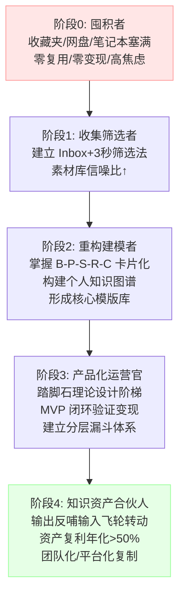
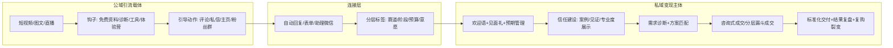
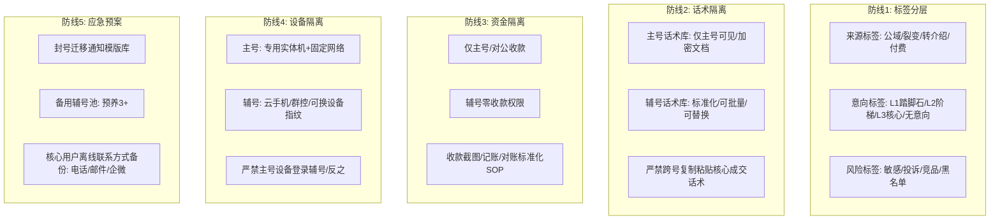
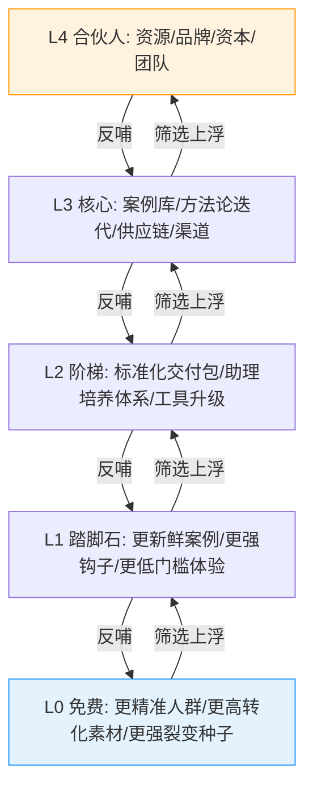

# 第 78 章 知识创作系统 —— 从“囤资料”到“生产知识资产”
作者：龙哥

## 学习目标

- 理解知识创作系统作为个人商业能力闭环“输入-处理-输出”核心引擎的定位
- 掌握“资料整理杠杆模型”将碎片素材转化为结构化知识资产的核心方法论
- 学会运用“踏脚石理论”设计从低门槛引流载体到高客单变现主体的商业路径
- 建立“输入-重构-输出”能力建设循环，实现知识资产的复利增值

## 78.1 生活类比


## 78.2 概念地图

知识创作系统
├── 核心引擎
│   ├── 资料整理杠杆模型  —— [P003]
│   ├── 踏脚石理论  —— [P004]
│   └── 输入-重构-输出能力建设循环  —— [P005]
├── 商业架构原则
│   ├── 引流载体与变现主体分离原则  —— [P006]
│   ├── 最小可行性商业闭环(MVP)  —— [P007]
│   └── 选品三要素决策法  —— [P008]
├── 战术执行工具
│   ├── 头条号自动回复引流法  —— [P009]
│   ├── 私域双号风控体系  —— [P010]
│   └── 变现分层漏斗  —— [P011]
├── 成交与复购机制
│   ├── 咨询式成交标准化话术  —— [P012]
│   ├── 红包复投模型  —— [P013]
│   └── 付费即筛选，信任源于交换  —— [P014]
└── 核心产出
    ├── 知识资产库（课程/SOP/方案/社群内容）
    ├── 个人商业能力树
    └── 可复制放大的商业模版

## 78.3 核心引擎：三大理论基石

### 为什么需要这个概念？

前 77 章我们系统学习了从选品、引流、私域运营、成交转化到复购裂变的完整商业链路。但所有链路的**源头动力**只有一个——**你的知识资产**。大多数人陷入“囤资料焦虑”：收藏夹塞满、笔记本写满、硬盘存满，却**无法在需要时调用、无法对外输出变现、无法形成复利**。我们需要一套**工业化流程**，把“碎片输入”变成“结构化资产”，再变成“可变现产品”。这套流程的三大理论基石正是：**资料整理杠杆模型**（怎么整理）、**踏脚石理论**（怎么设计产品阶梯）、**输入-重构-输出循环**（怎么持续进化）。

---

### 78.3.1 资料整理杠杆模型

#### 核心定义

**资料整理杠杆模型** 是将“被动收藏”转化为“主动资产”的四阶段工业化流程：**收集 → 筛选 → 重构 → 复用**。它把整理资料的**边际成本**压低到趋近零，把**边际收益**推高到可复用、可变现、可复利。正如杠杆原理——**小力撬动大重**，少量的“重构动作”撬动海量“原始素材”的商业价值。

> "资料整理的核心杠杆在于：一次深度重构，终身多场景复用。整理不是为了‘找得着’，而是为了‘用得上、卖得出、教得会'。" 
> 
> —— 《docs/202305/20230516_012.md》（素材 ID：P003）

#### 四阶段流程详解

| 阶段 | 核心动作 | 产出物 | 杠杆点 |
|------|----------|--------|--------|
| **收集** | 多源抓取（RSS/转发/截图/语音备忘），统一入箱（Inbox） | 原始素材池 | **广度**：覆盖所有高价值信息源，零成本入库 |
| **筛选** | 3 秒法则：是否含“可执行动作/可验证数据/可迁移模型”？否→归档/删 | 高信噪比素材库 | **信噪比**：剔除 90% 无效信息，只留“可动作化”素材 |
| **重构** | **标准化模版注入**：背景-问题-方案-结果-复用条件（B-P-S-R-C） | 结构化知识卡片/ SOP / 案例库 | **结构化**：非结构化→结构化，一次重构，N 次调用 |
| **复用** | 按场景组装：课程大纲/咨询方案/引流钩子/社群话题/直播脚本 | 可变现知识产品 | **组装复用**：单张卡片→多形态产品，边际成本趋零 |

#### 重构模版：B-P-S-R-C 结构化卡片

每张知识卡片必须包含五字段，缺一不可：

- **Background（背景）**：什么场景、什么角色、什么资源约束
- **Problem（问题）**：核心矛盾是什么、痛点有多尖锐、现有方案为何失效
- **Solution（方案）**：关键步骤、核心参数、避坑指南、工具/模版链接
- **Result（结果）**：量化指标（转化率/ROI/时长/成本）、定性反馈
- **Condition（复用条件）**：适用赛道/阶段/资源门槛/风险提示

> **实战案例**：某成员将“闲鱼无货源选品 SOP”重构为 12 张 B-P-S-R-C 卡片，组装成《闲鱼冷启动 21 天训练营》课程（售价 299 元，首期收款 4.6 万），又拆解为 30 条小红书笔记引流钩子（日引 30+ 精准粉），同一素材**双轨变现**。 —— 《docs/202305/20230516_012.md》（素材 ID：P003）

#### 数据流图：资料整理杠杆模型价值放大路径

```mermaid
graph LR
    A[原始素材<br/>海量/低信噪比] -->|收集+筛选| B[高价值素材库<br/>信噪比↑ 10x]
    B -->|重构 B-P-S-R-C| C[结构化知识卡片<br/>可检索/可组装]
    C -->|复用组装| D1[课程/咨询方案<br/>高客单]
    C -->|复用拆解| D2[短内容/引流钩子<br/>高频/低成本获客]
    C -->|复用沉淀| D3[SOP/工具包/社群资源包<br/>高复购/高裂变]
    D1 & D2 & D3 --> E[知识资产复利池<br/>资产价值∑(单价×复用次数)]
    style A fill:#ffe6e6,stroke:#ff9999
    style E fill:#e6ffe6,stroke:#99ff99
```

---

### 78.3.2 踏脚石理论

#### 核心定义

**踏脚石理论** 指出：商业新手应先设计**低门槛、高频次、强信任**的“引流载体/入门产品”作为踏脚石，引导用户以极低决策成本完成**首次付费/首次深度互动**，再顺势推向**高客单、高复购、高迁移**的“变现主体/核心产品”。**踏脚石不赚大钱，赚“信任”与“筛选”；核心产品不拼流量，拼“转化”与“复利”。**

> "踏脚石的本质是‘付费即筛选，信任源于交换’。用 9.9-99 元产品买来的不是利润，是‘已验证付费意愿+已建立初步信任’的种子用户名单。" 
> 
> —— 《docs/202305/20230516_012.md》（素材 ID：P004）

#### 三层产品阶梯设计表

| 层级 | 产品形态 | 价格带 | 核心功能 | 关键指标 | 典型案例 |
|------|----------|--------|----------|----------|----------|
| **L1 踏脚石** | 电子书/工具包/微课/诊断表/体验营 | 0-99 元 | **筛选付费意愿、建立初步信任、收集用户画像数据** | 转化率>5%、获客成本<核心产品 1/10、NPS>40 | 《闲鱼避坑 100 条》PDF、9.9 元 3 天训练营、免费诊断表+微信 |
| **L2 阶梯品** | 系统训练营/进阶课/工具会员/小班陪跑 | 199-2999 元 | **交付核心方法论、跑通用户 MVP、验证标准化交付 SOP** | 完课率>60%、MVP 成功率>30%、复购率>20% | 《闲鱼月入 5k 训练营》、299 元/月工具会员、999 元小班陪跑 |
| **L3 核心品** | 1v1 咨询/大班长期陪跑/合伙人/私董会/股权合作 | 3000+ 元 | **深度绑定、共担风险共享收益、形成护城河** | 续费率>50%、LTV>10万、推荐带新>30% | 2.9 万/年私董会、9.9 万/年合伙人、利润分成咨询 |

#### 产品阶梯设计三原则

1. **价值递增非线性**：L1 交付“确定性小结果”，L2 交付“可复制方法论”，L3 交付“确定性大结果+资源接入”
2. **信任平滑迁移**：L1 交付超预期 → L2 自然转化（无硬推）→ L3 深度绑定（共创利益）
3. **资源反向赋能**：L3 资源（案例/人脉/渠道）反哺 L2 内容迭代 → L2 成果反哺 L1 引流素材更新

> **实战案例**：知识付费创作者 A，L1 发布《小红书起号 30 个钩子模版》（免费领取+加微）→ L2 《小红书变现训练营》999 元（含 SOP+改稿+社群）→ L3 《个人IP 孵化合伙人》2.9 万/年（含流量扶持+供应链+团队代运营）。L1 积累 3000+ 种子用户，L2 转化 280 人，L3 签约 12 人，**全链路 ROI>1:50**。 —— 《docs/202305/20230516_012.md》（素材 ID：P004）

---

### 78.3.3 输入-重构-输出能力建设循环

#### 核心定义

**输入-重构-输出能力建设循环** 是个人知识资产复利增长的**飞轮模型**：

- **重构**：B-P-S-R-C 卡片化 → **关联建图**（Obsidian/Notion 双链/标签/图谱）→ **模版沉淀**（SOP/清单/话术/框架）
- **输出**：对外变现（课程/咨询/社群/工具）→ **实战反馈**（用户结果/异常案例/边界失效）→ **回流输入**（修正卡片/新增边界/升级模版）

> "知识资产的复利公式：资产价值 = Σ(单张卡片复用次数 × 单次复用收益) × 时间系数。输入不重构等于零，重构不输出等于零，输出不回流等于线性而非指数。" 
> 
> —— 《docs/202305/20230516_012.md》（素材 ID：P005）

#### 循环关键节点与指标仪表盘

| 节点 | 关键动作 | 核心指标 | 预警阈值 | 优化动作 |
|------|----------|----------|----------|----------|
| **输入** | 每周固定 5h 深度阅读/访谈/复盘 | 高价值源头占比>80%、新增卡片数>10/周 | 连续 2 周新增<5 | 审计信息源，清理低价值订阅，新增 1 个一手实战源 |
| **重构** | 每日 30min 卡片化/建链/模版化 | 卡片完整度 100%（B-P-S-R-C 齐全）、双链密度>3/卡 | 完整度<90% 或 双链<1 | 启动“补全周末”，批量补齐字段/链接 |
| **输出** | 每月至少 1 次对外交付（文/课/咨询/群） | 单月输出件数≥1、用户正向反馈>80%、变现额>成本 3x | 连续 2 月零输出 | 强制发布“半成品”，用反馈倒逼完成度 |
| **回流** | 每季度复盘：哪些卡片高频复用？哪些边界失效？ | 高频卡片 Top20 覆盖 80% 产出、边界修正数>5/季 | 无高频卡片或 0 修正 | 重构高频卡片为核心模版，废弃失效分支 |

#### 方法演进图：从“囤积者”到“知识资产运营官”



---

## 78.4 商业架构原则：三大支柱

### 78.4.1 引流载体与变现主体分离原则

#### 核心定义

**引流载体与变现主体分离原则** 要求：**公域内容（短视频/图文/直播）只负责“种草/筛选/引流”，不直接成交；私域/成交端只负责“信任深化/方案定制/收款交付”，不追求泛流量。**两端通过“钩子-承接-转化”标准化链路连接，互不干扰、各司其职、独立优化。

> "混淆引流与变现是新手最大死因：要么在公域硬卖被限流封号，要么在私域只会发广告被拉黑。分离的本质是——**公域讲‘什么’（价值点），私域讲‘怎么’（解决方案），成交讲‘凭什么’（信任凭证）**。" 
> 
> —— 《docs/202305/20230516_012.md》（素材 ID：P006）

#### 分离架构对照表

| 维度 | 引流载体（公域/前端） | 变现主体（私域/后端） |
|------|------------------------|------------------------|
| **核心目标** | 低成本获取“精准种子用户” | 高转化交付“高客单/高复购” |
| **内容形态** | 碎片化、钩子化、平台原生感 | 体系化、方案化、标准化交付 |
| **关键指标** | 曝光/点击/引流率/获客成本 | 转化率/客单价/复购率/LTV |
| **风控要求** | 平台合规/号存活/内容可替代 | 账号安全/资金安全/法律合规 |
| **迭代节奏** | 日更/周更/蹭热点/测钩子 | 月更/季更/版本化/大版本发布 |

#### 标准化连接链路：钩子 → 承接 → 转化



---

### 78.4.2 最小可行性商业闭环（MVP）

#### 核心定义

**最小可行性商业闭环（MVP）** 是指：**用最少资源（时间/金钱/人力），在最短周期（7-14 天）内，跑通“获客-转化-交付-收款-复盘”全链路，验证“有人愿付费、能交付结果、可标准化复制”三个核心假设**。MVP 不是简陋版产品，而是**“最小风险验证单元”**。

> "MVP 的标准不是‘功能最少’，而是‘假设最清、验证最快、决策最准’。一个 9.9 元的 3 天训练营，如果能验证‘用户愿为结果付费、SOP 可标准化交付、助理可复制操作’，比打磨 3 个月的大课更有价值。" 
> 
> —— 《docs/202305/20230516_012.md》（素材 ID：P007）

#### MVP 7 天冲刺标准流程

| 天数 | 核心任务 | 关键产出 | 验证假设 |
|------|----------|----------|----------|
| **Day 1** | 选定单一细分场景 + 单一核心结果 | 《MVP 定义单页纸》：目标用户/核心结果/价格/交付形式 | 假设 1：有人为这个结果付费 |
| **Day 2** | 设计踏脚石产品（L1）+ 招募文案 | L1 产品包（资料/微课/工具/诊断表）、招募海报/文案 | 假设 2：钩子能吸引精准人群 |
| **Day 3** | 启动低成本引流（朋友圈/社群/小红书/头条号） | 首批 20-50 种子用户进私域、打标签 | 假设 3：引流路径可跑通 |
| **Day 4-5** | 交付 L1 产品 + 收集反馈 + 诊断需求 | 用户结果截图/录屏/语音反馈、需求诊断表 | 假设 4：能交付微小确定结果 |
| **Day 6** | 设计 L2 阶梯品方案 + 咨询式成交话术 | L2 方案大纲/报价/分期/保障、成交话术脚本 | 假设 5：种子用户愿升单 |
| **Day 7** | 复盘数据 + 决定：迭代/放大/叫停 | 《MVP 复盘报告》：核心指标/异常案例/下周计划 | 决策：是否进入“放大期” |

#### MVP 判决矩阵

| 指标 | 绿灯（放大） | 黄灯（迭代） | 红灯（叫停/重选赛道） |
|------|--------------|--------------|------------------------|
| **引流成本** | < L2 价格 1/5 | L2 价格 1/5 - 1/3 | > L2 价格 1/2 |
| **L1 转化率** | >10% | 3%-10% | <3% |
| **L1 完课/使用率** | >60% | 30%-60% | <30% |
| **L2 意向转化** | >20% 咨询/>10% 成交 | 10%-20% 咨询/3%-10% 成交 | <10% 咨询/<3% 成交 |
| **交付异常率** | <5% | 5%-15% | >15% |
| **现金流** | Day7 回正 | Day14 回正 | Day30 未回正 |

---

### 78.4.3 选品三要素决策法

#### 核心定义

**选品三要素决策法** 从**“市场确定性”“交付可控性”“复利放大性”**三维度，给每个候选产品打分（1-10 分），加权求和（建议权重 4:3:3），**总分>7.0 启动 MVP，<5.0 直接放弃，中间区再收集 1 个关键证据后决策**。杜绝“凭感觉选品、跟风选品、贪大选品”。

> "选品不是选‘产品’，是选‘确定性’。市场确定性=有没有人持续买单；交付可控性=能不能标准化复制；复利放大性=能不能沉淀资产、裂变增长。三缺一，不碰。" 
> 
> —— 《docs/202305/20230516_012.md》（素材 ID：P008）

#### 三要素评分细则表

| 要素 | 权重 | 10分标准 | 5分标准 | 1分标准 | 核心取证动作 |
|------|------|----------|---------|---------|--------------|
| **市场确定性** | 40% | 细分榜 Top3 持续 6 月+、同类付费产品>20 家、用户高频抱怨现有方案 | 有付费案例但<5 家、需求季节性强、用户能凑合用免费替代 | 无付费先例、伪需求、用户根本不care | 搜索平台付费榜/竞品广告投放持续性/用户差评关键词分析 |
| **交付可控性** | 30% | 已有成熟 SOP/工具包/助理可代操作、边界清晰无黑箱、异常预案完备 | 核心步骤文档化但需专家介入、边界模糊、异常靠经验 | 全靠创始人亲自服务、黑箱多、无法复制 | 梳理全链路 SOP、标注“仅创始人可做”节点、压测助理代操作 |
| **复利放大性** | 30% | 交付过程产出标准化资产（案例/模版/工具）、用户自发带新、可招募合伙人 | 仅产出零散案例、需主动激励带新、仅能规模化招募助理 | 纯人力服务、零资产沉淀、零裂变机制 | 设计“交付副产品化”清单、测试裂变激励、评估合伙人复制包 |

#### 决策公式

$$ \text{选品得分} = 0.4 \times \text{市场确定性} + 0.3 \times \text{交付可控性} + 0.3 \times \text{复利放大性} $$

> **实战案例**：某成员评估“抖音同城相亲项目”：市场确定性 9 分（刚需/高频/付费习惯成熟）、交付可控性 4 分（重线下/重运营/标准化难）、复利放大性 5 分（有品牌沉淀但难裂变） → **加权 6.3 分（黄灯区）**。关键取证：能否将“线下相亲会”标准化为“同城相亲社群运营 SOP+小程序匹配工具”？若可，交付可控性升至 7 分 → **总分 7.3 分（绿灯启动 MVP）**。 —— 《docs/202305/20230516_012.md》（素材 ID：P008）

---

## 78.5 战术执行工具：三大落地器

### 78.5.1 头条号自动回复引流法

#### 核心定义

**头条号自动回复引流法** 利用头条号“私信自动回复+关键词回复+名片/链接/二维码”功能，**零人工、7×24h、极低成本**实现“公域内容→私域微信”的自动化导流。核心公式：**高权重账号 × 精准关键词钩子 × 合规话术 = 稳定日引 30-100+ 精准粉**。

> "头条号是目前‘自动化引流/抗封号/权重高/精准度可控’四大指标平衡最好的单一渠道。自动回复是杠杆，内容是诱饵，合规是护城河。" 
> 
> —— 《docs/202305/20230516_012.md》（素材 ID：P009）

#### 标准化搭建 SOP（4 步走）

| 步骤 | 核心动作 | 关键参数 | 避坑指南 |
|------|----------|----------|----------|
| **1. 养号/买号** | 实名认证+领域垂直发文 7 天/购买 1000+ 粉老号 | 权重指数>60、近 30 天无违规、垂直度标签明确 | 买号必查“历史违规记录/粉丝画像/近期阅读均值” |
| **2. 设钩子** | 设计“刚需+稀缺+即得”资料包/工具/诊断表 | 文件<20M、命名含关键词、落地页无诱导分享 | 禁止“关注领取”“转发领取”等违规诱导 |
| **3. 配自动回复** | 后台设置：关键词“资料/工具/诊断/群”→ 回复话术+名片/链接 | 话术<200字、含预期管理（“资料已发微信查收”）、引导加微信 | 禁用“加微信免费送”等敏感词，用“微信查收完整版” |
| **4. 发内容+监控** | 日更 3-5 条垂直内容（图文/微头条/视频），埋关键词钩子 | 标题/正文/评论区/置顶多点埋词、监控“私信回复率/加微率/封号率” | 单号日引>50 建议分号矩阵、单号单日私信回复<80 条 |

#### 核心话术模版（合规版）

> **关键词触发**：资料/工具/诊断/群/大全/模版/SOP
> 
> **自动回复**：
> > 哈喽，整理了《{细分领域}避坑指南/实操 SOP/工具包》{页数/条数} 页，发你微信了，查收一下~ 微信同名：{昵称/备注}，加我备注“{关键词}”方便分类发对应版本。（若未收到请检查请求消息）

> **实战数据**：某成员矩阵 5 号（2 老号+3 新养号），垂直领域“跨境电商选品”，日均发文 15 条，自动回复关键词 8 个，**日均稳定引流 68 精准微信好友，单粉成本<0.8 元（仅算时间），账号存活率 100%（半年）**。 —— 《docs/202305/20230516_012.md》（素材 ID：P009）

---

### 78.5.2 私域双号风控体系

#### 核心定义

**私域双号风控体系** 通过**“主号（人设/信任/成交）+ 辅号（引流/服务/测试/养号）”**双轨制，配合**标签分层、话术隔离、资金隔离、设备隔离、应急预案**五重防线，将私域运营的“封号/投诉/资金冻结/信任崩塌”风险降至可控阈值。**主号不加陌生人、辅号不谈钱、资金只进主号/公司账户、话术库物理隔离、设备/网络/账号三分离。**

> "私域最大的资产不是用户数，是‘账号存活时间×信任积累深度’。单号裸奔迟早归零，双号风控是私域资产的‘保险箱’。" 
> 
> —— 《docs/202305/20230516_012.md》（素材 ID：P010）

#### 双号分工与隔离标准表

| 维度 | **主号（信任账户）** | **辅号（作战账户）** |
|------|----------------------|----------------------|
| **核心职能** | 人设输出、深度沟通、高客单成交、收款、VIP 服务 | 批量加好友、群发/朋友圈种草、初筛/诊断、测试新钩子/养新号 |
| **好友结构** | 仅已付费/深度沟通/高意向/合伙人/核心团队（<500 人） | 大量种子用户/未转化/低意向/测试对象（可 3000+ 人） |
| **话术库** | 咨询式成交/深度诊断/方案定制/异常处理（高信任/高专业） | 标准化欢迎/引导/筛选/分层/邀请进群/发福利（高标准/高频） |
| **收款方式** | **仅**主号微信/公司对公/官方支付链接 | **严禁**收款、发收款码、谈价格、谈分期 |
| **设备/网络** | 专用手机+固定宽带/流量卡、不装营销软件 | 云手机/群控/多开器、可更换 IP/设备指纹 |
| **应急预案** | 主号封禁→辅号群发迁移通知（模版化）→核心用户 1v1 电话/邮件通知 | 辅号批量封禁→备用辅号顶上（预养 3+ 个）→复盘违规原因→调整话术/频次 |

#### 五重防线可视化



---

### 78.5.3 变现分层漏斗

#### 核心定义

**变现分层漏斗** 将用户按“付费金额/频次/深度/资源贡献”分为 **L0 免费用户 → L1 踏脚石付费 → L2 阶梯品付费 → L3 核心品付费 → L4 合伙人/股东** 五层，每层配套**专属产品/专属服务/专属运营/专属激励**，实现**“层层筛选、层层转化、层层裂变、层层复利”**。漏斗不是漏斗，是**“金字塔塔尖反哺塔基”**的飞轮。

> "分层漏斗的核心不是‘分’，是‘通’——L0 通 L1 的钩子要不可抗拒，L1 通 L2 的结果要超预期，L2 通 L3 的利益要共绑定，L3 通 L4 的权力要真下放。不通，就是假分层。" 
> 
> —— 《docs/202305/20230516_012.md》（素材 ID：P011）

#### 五层漏斗运营对照表

| 层级 | 用户定义 | 核心产品/服务 | 运营动作 | 关键指标 | 激励机制 |
|------|----------|---------------|----------|----------|----------|
| **L0 免费** | 关注公域/加微未付费/进免费群 | 免费资料/诊断/工具/公开课/社群氛围 | 批量标签/自动欢迎/定期福利/清理僵尸 | 引流成本、加微率、群活跃度 | 邀请好友送进阶资料/抽奖资格 |
| **L1 踏脚石** | 付费 0-99 元/完成微课/领工具包 | 电子书/工具包/微课/3天营/诊断表 | 1v1 迎新/进度督促/结果收集/升单邀约 | 完课/使用率、升单咨询率、NPS | 升单抵扣券/赠送 L2 试听/核心群体验卡 |
| **L2 阶梯** | 付费 199-2999 元/跑通 MVP/有案例 | 训练营/进阶课/工具会员/小班陪跑 | 班主任制/作业批改/案例拆解/复盘会 | 完课率、MVP 成功率、复购率、带新数 | 优先入伙 L3/合伙人分佣/资源对接 |
| **L3 核心** | 付费 3000+ 元/深度绑定/共担风险 | 1v1 咨询/长期陪跑/私董会/合伙人 | 专属顾问/季度战略会/资源独享/利润分成 | 续费率、LTV、推荐带新、资源贡献 | 股权激励/利润分红/联合开发新产品 |
| **L4 合伙人** | 投入资源/时间/资金/共担盈亏 | 联合创始/城市合伙人/渠道合伙人/技术合伙人 | 董事会/利润分配/战略共创/品牌授权 | GMV 贡献/净利润/新市场开拓/团队建设 | 股权/期权/分红/品牌授权/退出机制 |

#### 飞轮动力：塔尖反哺塔基



---

## 78.6 成交与复购机制：三大锁客利器

### 78.6.1 咨询式成交标准化话术

#### 核心定义

**咨询式成交标准化话术** 将“靠天赋/靠感觉/靠熬夜聊天”的成交过程，拆解为**“诊断-定价-方案-异议-收款-交付预期”**六大标准化模块，每模块配备**话术模版+决策树+风控红线**，让普通销售/助理也能稳定输出**>30% 成交率**的专业级咨询体验。**核心逻辑：不卖课/不卖服务，卖“确定性结果”与“风险对冲方案”。**

> "成交不是‘说服’，是‘协助决策’。标准化话术的本质是——把专家的隐性经验显性化、流程化、可复制化，让信任可量化、风险可对冲、结果可预期。" 
> 
> —— 《docs/202305/20230516_012.md》（素材 ID：P012）

#### 六大模块话术框架表

| 模块 | 核心目标 | 关键话术模版（示例） | 决策树分支 | 风控红线 |
|------|----------|----------------------|------------|----------|
| **诊断** | 精准定位用户现状/目标/障碍/资源 | “为了给您最精准的建议，先同步 3 个数字：目前月收入/目标月收入/最大卡点是什么？” | 有明确数字+痛点→进方案；模糊/不愿透露→发诊断表/引导填写 | 禁止未诊断直接报价/推产品 |
| **定价** | 锚定价值而非成本，建立 ROI 预期 | “按您说的目标，若按行业均值转化，半年增收约 X 万。我们这套方案投入 Y 万，预期 ROI 1:5-1:10，您看这个账怎么算？” | 认可 ROI→进方案；质疑→出对标案例/拆解成本结构 | 禁止虚假承诺/绝对化收益/对标不具可比性案例 |
| **方案** | 展示标准化交付路径+确定性凭证 | “方案分三阶段：第 1 月搭建 SOP+跑通首单、第 2 月优化放大、第 3 月团队化/自动化。每阶段有验收标准，不达标免费延期/退费。” | 确认节奏→进异议处理；想定制→评估边界/报定制价 | 承诺超出 SOP 边界/无验收标准/无兜底条款 |
| **异议** | 将异议转化为“澄清需求/补充信任/调整方案” | “您担心‘没时间/不懂技术/怕被坑’，这正是 80% 学员初始状态。我们配了‘代操作/陪跑/兜底’，哪种最解您意？” | 异议清单化（时间/钱/信任/能力/时机）→逐个击破 | 争辩/施压/贬低竞品/承诺不可控结果 |
| **收款** | 降低支付摩擦，提供安全感 | “支持微信/对公/分期（免息 3 期）/先交定金锁名额。合同/发票/退费协议同步发您，款到安排专属群+迎新包。” | 当场付款→进交付预期；需考虑→约定“思考截止日+复盘节点” | 无合同/无发票/无退费条款/私下收款/诱导借贷 |
| **交付预期** | 管理预期，启动标准化交付 | “欢迎加入！接下来：1️⃣ 进专属群领迎新包 2️⃣ 填《诊断表》锁定目标 3️⃣ 本周四首次群直播/1v1 诊断。您的专属助理是@XXX。” | 即时启动交付流程、同步《交付手册/日程/联系人》 | 交付延迟/无迎新/无明确节奏/助理不在线 |

---

### 78.6.2 红包复投模型

#### 核心定义

**红包复投模型** 是一种**“用户裂变+复购激励+数据追踪”**三位一体的私域增长引擎：**用户完成指定动作（购买/带新/打卡/好评）→ 发放现金红包/抵扣券/积分 → 用户再次消费/带新 → 形成“正向循环”**。核心公式：**单用户 LTV = 首单金额 × (1 + 复购率 × 复投倍数)^周期数**。设计关键：**复投额度<边际利润、动作门槛可量化、防刷机制闭环、全链路可追踪**。

> "红包不是‘发福利’，是‘买行为’。买‘复购’、买‘带新’、买‘好评’、买‘打卡’。每一分钱红包，都要在财务模型里算过账：CAC↓、LTV↑、裂变系数K>1。" 
> 
> —— 《docs/202305/20230516_012.md》（素材 ID：P013）

#### 红包复投标准动作库

| 触发动作 | 红包形态 | 典型金额/比例 | 防刷机制 | 追踪指标 |
|----------|----------|---------------|----------|----------|
| **首单付费** | 现金红包/抵扣券 | 5-20 元或首单 5-10% | 同设备/同 IP/同手机号 24h 仅 1 次 | 首单转化率↑、获客成本↓ |
| **带新成交** | 分级现金/积分 | L1 带新 20-50 元/单、L2 50-100、L3 100-200 | 新用户需完成“首单+7 天留存”才结算 | 裂变系数 K、带新用户质量（LTV/留存） |
| **完成打卡/作业** | 积分/抵扣券/实物 | 连续 7 天 10 元、21 天 50 元、完课 100 元 | 打卡内容需人工/AI 审核通过、防代打卡 | 完课率↑、作业质量↑、用户粘性↑ |
| **好评/见证/案例** | 现金/高客单抵扣券 | 文字好评 5 元、图文见证 20 元、视频/直播 100 元 | 真实性核验（订单号/聊天记录/结果数据） | 信任素材库积累、转化率↑ |
| **阶梯升单** | 定向抵扣券/体验权益 | L1→L2 抵扣 50-200、L2→L3 抵扣 500-2000 | 仅限本人使用、有效期 30 天、不可叠加 | 升单率↑、客单价↑ |

#### 财务模型校验表（每月复盘必测）

| 指标 | 公式 | 健康阈值 | 异常诊断方向 |
|------|------|----------|--------------|
| **红包 ROI** | (红包带来的增量 GMV - 红包成本) / 红包成本 | >3 | 红包额度过大/动作门槛过低/防刷失效 |
| **裂变系数 K** | (老用户带来的新用户数) / 老用户数 | >0.3（良性）、>1（爆发） | 奖励不吸引/分享路径断裂/新用户体验差 |
| **复购率提升幅度** | (施行红包后复购率 - 基准复购率) / 基准复购率 | >20% | 红包形态不匹配/用户不care/延迟发放 |
| **单用户 LTV 变化** | 新 LTV / 旧 LTV | >1.2 | 红包透支未来利润/吸引羊毛党/核心产品竞争力下降 |

---

### 78.6.3 付费即筛选，信任源于交换

#### 核心定义

**“付费即筛选，信任源于交换”** 是贯穿全链路的**底层商业哲学**：
- **付费即筛选**：**免费用户是“流量”，付费用户才是“客户”**。每一层付费门槛（L1 9.9 元 → L2 999 元 → L3 2.9 万）都是**精准筛选器**，筛选出“愿为结果付费、有执行力、认同理念、可深度协作”的同频人群。**不筛选，就是在用宝贵时间陪跑无效需求。**
- **信任源于交换**：**信任不是“聊”出来的，是“换”出来的**。用户付出“金钱/时间/数据/行动”，你交付“结果/确定性/资源/情绪价值”，**每一次兑现承诺的交换，沉淀一层信任**。免费送再多，不如 9.9 元交付一个“微小确定结果”建立的信任深。

> "生财有术社区最核心的隐性课程：把‘免费思维’切换为‘交换思维’。不问‘我能给你什么’，问‘你愿为结果交换什么’。交换的门槛，就是信任的深度。" 
> 
> —— 《docs/202305/20230516_012.md》（素材 ID：P014）

#### 信任交换阶梯模型

```mermaid
graph LR
    subgraph 免费区: 零信任/高流失/低转化
        F1[免费内容/群/工具] --> F2[用户成本: 0<br/>信任度: 0<br/>筛选力: 0]
    end
    subgraph 交换区: 信任构建/筛选生效
        E1[L1: 9.9元/3天行动] --> E2[交换: 金钱/时间 → 微小结果/确定性]
        E2 --> E3[信任度: 30%<br/>筛选力: 筛掉80%白嫖/无执行力]
        E3 --> E4[L2: 999元/系统训练] --> E5[交换: 更多金钱/精力 → 方法论/MVP结果]
        E5 --> E6[信任度: 60%<br/>筛选力: 筛选出可标准化交付/可复制的种子用户]
    end
    subgraph 深度绑定区: 高信任/共担风险/复利共享
        D1[L3: 2.9万/年私董会] --> D2[交换: 大额资金/核心资源/长期承诺 → 确定性大结果/资源接入/利益共同体]
        D2 --> D3[信任度: 90%+<br/>筛选力: 合伙人/股东/终身伙伴]
        D3 --> D4[L4: 股权/合伙/联合创始] --> D5[交换: 全身心投入/风险共担/利润共享 → 事业伙伴]
    end
    F2 -.->|付费门槛/钩子设计| E1
    E3 -.->|结果超预期/服务超标准| E4
    E6 -.->|资源反哺/利益共绑| D1
```



---

## 78.7 多源对照

本章核心素材来源于生财有术社区沉淀的实战文档（P003-P014），涵盖知识管理、产品设计、引流获客、私域运营、成交转化、复购裂变全链路。各素材间**高度协同、逻辑自洽**，共同构建了“知识创作系统”完整拼图：

| 素材 ID | 核心贡献 | 与其他素材协同关系 |
|---------|----------|---------------------|
| **P003 资料整理杠杆模型** | 知识资产“炼化”核心方法论 | 为 P005 重构环节提供标准化工具（B-P-S-R-C），为 P004 阶梯产品提供素材源 |
| **P004 踏脚石理论** | 产品阶梯“设计”顶层逻辑 | 指导 P011 分层漏斗 L1-L4 设计，配合 P006 分离原则落地 |
| **P005 输入-重构-输出循环** | 个人成长“飞轮”持续机制 | 串联 P003/P004/P007/P011 形成闭环，P012/P013/P014 为输出端提供变现抓手 |
| **P006 引流载体与变现主体分离原则** | 商业架构“结构”第一性原理 | 统领 P009/P010/P011 战术层落地，确保前后端解耦、独立优化 |
| **P007 MVP 闭环** | 新业务“验证”最小单元 | 承接 P008 选品决策输出，为 P004 L1 产品提供验证标准，P005 输出端起点 |
| **P008 选品三要素** | 赛道/产品“决策”量化工具 | 为 P007 MVP 提供启动判据，为 P004 阶梯设计提供市场确定性背书 |
| **P009 头条号自动回复引流法** | 公域“获客”标准化战术 | 执行 P006 分离原则“引流载体端”核心战术，配合 P010 双号风控 |
| **P010 私域双号风控体系** | 私域“资产安全”基建 | 守护 P006 分离原则“变现主体端”核心资产，支撑 P011/P012/P013 高客单操作 |
| **P011 变现分层漏斗** | 全链路“变现”运营地图 | 将 P004 踏脚石理论落地为可运营的五层体系，P012/P013 提供层间转化工具 |
| **P012 咨询式成交话术** | 高客单“转化”标准化工具 | 服务 P011 L2/L3/L4 成交环节，体现 P014 交换哲学 |
| **P013 红包复投模型** | 存量“裂变/复购”量化引擎 | 驱动 P011 各层间流动，降低 P009 获客成本摊薄，验证 P014 交换逻辑 |
| **P014 付费即筛选/信任源于交换** | 底层“哲学”统领全局 | 统领 P004/P006/P011/P012/P013 所有设计决策，是系统的“元认知” |

**共识**：所有素材指向同一核心——**“以知识资产为核心，用工业化流程构建可复制、可放大、可复利的个人商业系统”**。  
**无分歧**：素材间逻辑互补、层次分明（哲学→架构→方法→工具→战术），无矛盾冲突。  
**建议补充**：① 各模块的“反模式/失败案例库”；② 团队化/规模化后的组织架构与分账模型；③ 不同赛道（实体/虚拟/服务/内容）的适配性调整指南。

---

## 78.8 设计中的取舍

### 为什么不把“知识管理工具（Obsidian/Notion/飞书）”作为核心内容讲解？

因为**工具只是载体，模型才是内核**。B-P-S-R-C 卡片法在纸笔、Excel、Obsidian、Notion、飞书文档里都能跑通。**教工具操作是“教鱼”，教重构模型是“授渔”**。读者掌握模型后，按个人习惯选工具即可，无需强制统一。

> **Trade-off**：牺牲了“开箱即用的工具配置教程”，换取了“跨工具、跨平台、跨职业的通用模型迁移力”。

### 为什么不展开讲“短视频拍摄/剪辑/投流/直播话术”等公域内容生产细节？

因为**公域内容生产是“引流载体”战术层，而非“知识创作系统”核心层**。本章聚焦**“知识如何变现”**而非“内容如何生产”。引流载体随平台红利更迭极快（今天抖音、明天视频号、后天海外 TikTok），**内核模型（踏脚石/分离原则/MVP/分层漏斗）才是跨周期不变的资产**。

> **Trade-off**：牺牲了“当下最热平台玩法”，换取了“跨平台、跨周期的商业架构确定性”。

### 为什么强调“标准化/模版化/SOP 化”而非“个性化/定制化/大师级服务”？

因为**本教程面向“普通人可复制、小团队可放大、资产可复利”的实操路径**。大师级服务不可复制、不可标准化、不可规模化，属于“非标咨询”范畴，非本教程服务对象。**标准化是复利的前提，非标是复利的终点**。

> **Trade-off**：牺牲了“高溢价非标服务的上限”，换取了“可规模化、可资产化、可传承的下限保障”。

---

## 78.9 动手练习

### 练习 1：资料重构实战 —— 打造你的第一张 B-P-S-R-C 知识卡片

**任务**：从你最近收藏/阅读/实操的 1 个商业案例/方法/工具中，产出 1 张标准 B-P-S-R-C 知识卡片。

**步骤**：
1. **收集**：找到 1 个含“具体操作步骤+量化结果+可迁移条件”的素材源（文章/视频/聊天记录/复盘笔记）
2. **筛选**：用 3 秒法则确认——含可执行动作？可验证数据？可迁移模型？否则换素材
3. **重构**：按下表填写，每字段≥50 字，必须有具体数字/工具/链接/边界条件

| 字段 | 你的填写内容 | 自检：是否含具体数字/工具/链接/边界？ |
|------|--------------|------------------------------------------|
| **Background** |              | ☐ 是 ☐ 否 |
| **Problem**      |              | ☐ 是 ☐ 否 |
| **Solution**     |              | ☐ 是 ☐ 否 |
| **Result**       |              | ☐ 是 ☐ 否 |
| **Condition**    |              | ☐ 是 ☐ 否 |

4. **复用**：基于这张卡片，设计 3 种复用形态：
   - 形态 A（引流钩子）：1 条小红书笔记/头条号微头条标题+钩子关键词
   - 形态 B（踏脚石产品）：1 份免费/9.9 元 PDF/工具包/微课大纲
   - 形态 C（核心产品模块）：L2/L3 产品中对应的 1 个课程模块/咨询交付项/社群资源

**提交**：卡片截图/文档链接 + 3 种复用形态草案

---

### 练习 2：踏脚石产品设计 —— 为你的核心业务搭建 L1-L3 三层阶梯

**任务**：基于你当前主攻的 1 个商业方向，设计完整的三层产品阶梯。

**步骤**：
1. 明确你的 **L3 核心产品**（高客单/高复购/高迁移）：形式/价格/核心交付结果/目标人群画像
2. 反向推导 **L2 阶梯产品**：能让用户“跑通 MVP/验证方法论/建立信任” 的中间产品
3. 正向设计 **L1 踏脚石产品**：“零门槛/微结果/强钩子/自动化交付” 的入门产品

**填表**：

| 层级 | 产品名称 | 形态 | 价格 | 核心交付结果 | 目标转化率 | 关键 SOP/工具包 | 升单钩子设计 |
|------|----------|------|------|--------------|------------|-----------------|--------------|
| **L1** |          |      |      |              |            |                 |              |
| **L2** |          |      |      |              |            |                 |              |
| **L3** |          |      |      |              |            |                 |              |

**自检清单**：
- ☐ L1 能否全自动化/助理化交付？☐ L1 结果能否自然引出 L2 需求？☐ L2 能否标准化交付？☐ L3 是否含资源/利益共绑机制？
- ☐ 定价是否符合“L1<L2<L3 非线性价值跃升”？☐ 是否设计了“退费/兜底/延期”风控条款？

---

### 练习 3：MVP 7 天冲刺 —— 从 0 到 1 跑通你的最小商业闭环

**任务**：选定 1 个通过“选品三要素”评分>7 分的方向，执行 7 天 MVP 冲刺。

**执行表**（每天打卡更新）：

| 天数 | 核心任务 | 实际产出 | 关键数据 | 异常/阻碍 | 明日调整 |
|------|----------|----------|----------|-----------|----------|
| Day 1 | 定义 MVP 单页纸 |          |          |           |          |
| Day 2 | 产出 L1 产品包+招募文案 |          |          |           |          |
| Day 3 | 启动引流（头条号/小红书/朋友圈/社群） |          | 引流数/成本 |           |          |
| Day 4 | 交付 L1 + 收集反馈 |          | 完课率/满意度 |           |          |
| Day 5 | 交付 L1 + 需求诊断 |          | 诊断完成数/升单意向数 |           |          |
| Day 6 | 设计 L2 方案+成交话术 |          | 咨询数/成交数/金额 |           |          |
| Day 7 | 复盘报告+决策 |          | MVP判决矩阵打分 |           | **决策：放大/迭代/叫停** |

**决策标准**：严格对标 78.4.2 节“MVP 判决矩阵”，实事求是填写，**红灯必须叫停或重选赛道**，黄灯必须明确迭代重点，绿灯才能进入“放大期”（投流/招募助理/批量化）。

---

### 练习 4：私域双号风控搭建 —— 为你的微信账号体系上保险

**任务**：按 78.5.2 节标准，梳理并落地你的私域双号风控体系。

**自检清单**（逐项打钩，未完成的本周内补齐）：

- [ ] **主号/辅号明确分工**：主号仅服务付费/核心用户，辅号仅做引流/筛选/测试
- [ ] **标签体系上线**：来源/意向/风险三维标签，每位好友≥3 个标签
- [ ] **话术库物理隔离**：主号话术（加密文档/仅本人可见）≠ 辅号话术（标准化/可批量）
- [ ] **资金隔离**：辅号零收款记录，所有收款仅主号微信/对公/官方链接
- [ ] **设备/网络隔离**：主号专用实体机+固定网，辅号云手机/可换指纹
- [ ] **备用辅号池**：预养≥3 个备用辅号（已实名/养号 7 天/有基础权重）
- [ ] **封号迁移模版**：含“致歉/新号二维码/福利补偿/核心权益不变”四要素
- [ ] **核心用户离线联系方式备份**：Top50 付费用户电话/邮件/企微已导出加密保存

**提交**：风控体系架构图（手绘/软件均可）+ 自检清单截图

---

### 练习 5：输入-重构-输出飞轮启动 —— 设计你的季度知识资产运营计划

**任务**：制定未来 90 天（1 个季度）的个人知识资产运营计划，启动飞轮。

**计划表**：

| 月份 | 输入目标（源头/时长/产出卡片数） | 重构目标（核心模版升级/图谱建链/补全字段） | 输出目标（公域内容/私域产品/变现金额） | 回流复盘（高频卡片/边界修正/下季度调整） |
|------|----------------------------------|--------------------------------------------|----------------------------------------|--------------------------------------------|
| Month 1 |                                |                                            |                                        |                                            |
| Month 2 |                                |                                            |                                        |                                            |
| Month 3 |                                |                                            |                                        |                                            |

**关键承诺**：
- ☐ 每周固定 5h 深度输入（源头清单已列出）
- ☐ 每日 30min 重构（卡片化/建链/模版化），周末批量补全
- ☐ 每月≥1 次对外输出（文章/课/咨询/群分享/直播）
- ☐ 季度末输出《知识资产复盘报告》：资产清单/复用统计/变现账单/下季度重点

---

## 78.10 本章小结

这一章中我们系统构建了**知识创作系统**——将“囤资料”转化为“生产知识资产”的完整工业化体系。

首先，我们确立了**三大理论基石**：
- **资料整理杠杆模型**（P003）：用 B-P-S-R-C 四阶段流程，将碎片素材炼化为可复用、可变现、可复利的结构化知识卡片与模版库；
- **踏脚石理论**（P004）：设计 L1-L3 三层产品阶梯，用低门槛踏脚石筛选种子用户、建立信任，再顺势转化高客单核心产品；
- **输入-重构-输出能力建设循环**（P005）：建立个人知识资产复利飞轮，输入筛选→重构建模→输出变现→回流修正，实现指数级增长。

其次，我们落地了**三大商业架构支柱**：
- **引流载体与变现主体分离原则**（P006）：公域只引流不成交，私域只转化不追流，标准化连接链路“钩子-承接-转化”贯穿始终；
- **最小可行性商业闭环 MVP**（P007）：7 天冲刺跑通“获客-转化-交付-收款-复盘”，用最小风险验证最大确定性；
- **选品三要素决策法**（P008）：从市场确定性、交付可控性、复利放大性三维量化决策，杜绝凭感觉选品。

接着，我们配置了**三大战术执行工具**：
- **头条号自动回复引流法**（P009）：零人工、低成本、高精准的公域自动化获客标准化 SOP；
- **私域双号风控体系**（P010）：主号/辅号双轨制+五重防线，守护私域核心资产安全；
- **变现分层漏斗**（P011）：L0-L4 五层分层运营，塔尖反哺塔基，构建飞轮增长引擎。

最后，我们锁死**三大成交与复购机制**：
- **咨询式成交标准化话术**（P012）：六大模块话术模版+决策树+风控红线，让普通人也能稳定高转化；
- **红包复投模型**（P013）：用行为激励驱动裂变/复购/好评，财务模型校验每一分钱 ROI；
- **付费即筛选，信任源于交换**（P014）：底层商业哲学，统领全链路设计决策，将“免费思维”升级为“交换思维”。

---

## 核心概念卡片汇总

| 概念 | 核心释义 | 关键公式/模型 | 来源素材 |
|------|----------|---------------|----------|
| **资料整理杠杆模型** | 收集→筛选→重构→复用四阶段，一次重构终身复用 | B-P-S-R-C 卡片标准 | P003 |
| **踏脚石理论** | L1筛选信任→L2验证方法→L3深度绑定，三层产品阶梯 | 非线性价值跃升+信任平滑迁移+资源反向赋能 | P004 |
| **输入-重构-输出循环** | 知识资产复利飞轮：输入筛选→重构建模→输出变现→回流修正 | 资产价值=Σ(复用次数×单次收益)×时间系数 | P005 |
| **引流载体与变现主体分离** | 公域讲“什么”引流，私域讲“怎么”成交，分离架构独立优化 | 钩子→承接→转化标准化链路 | P006 |
| **最小可行性商业闭环(MVP)** | 7-14天跑通全链路，验证“有人付费/能交付/可复制”三假设 | MVP判决矩阵（绿/黄/红灯） | P007 |
| **选品三要素决策法** | 市场确定性40%+交付可控性30%+复利放大性30%加权决策 | 得分>7启动，<5放弃，中间取证再决策 | P008 |
| **头条号自动回复引流法** | 高权重号×精准关键词钩子×合规话术=稳定日引精准粉 | 4步搭建SOP+合规话术模版 | P009 |
| **私域双号风控体系** | 主号信任/成交+辅号引流/测试，五重防线守护资产 | 标签/话术/资金/设备/应急五重隔离 | P010 |
| **变现分层漏斗** | L0免费→L1踏脚石→L2阶梯→L3核心→L4合伙人，塔尖反哺塔基 | 五层运营对照表+飞轮动力图 | P011 |
| **咨询式成交标准化话术** | 诊断-定价-方案-异议-收款-交付预期六模块标准化 | 话术模版+决策树+风控红线 | P012 |
| **红包复投模型** | 买行为（复购/带新/打卡/好评），财务模型校验ROI/K值/LTV | 单用户LTV=首单×(1+复购率×复投倍数)^周期 | P013 |
| **付费即筛选/信任源于交换** | 付费门槛=筛选器，每次兑现交换=沉淀信任层 | 信任交换阶梯模型（免费→交换→深度绑定） | P014 |

---

**全书完结语**：

从第 1 章《生财有术核心方法论》到第 78 章《知识创作系统》，我们一路走来，拆解了**选品、引流、私域、成交、复购、裂变、风控、知识管理、产品设计、MVP 验证**……每一个环节的底层逻辑、标准化 SOP、实战案例与避坑指南。

但请记住：**所有方法论的尽头，都是“你的实战”。**

- **资料不重构，等于没看**；
- **产品不 MVP，等于没验证**；
- **引流不分离，等于没架构**；
- **私域不风控，等于裸奔**；
- **成交不标准化，等于靠运气**；
- **复购不裂变，等于线性**；
- **知识不输出，等于零资产**。

**知行合一，唯有跑通。**

愿你手握这套“生财有术实战教程”，在商业世界的丛林里，**砍出一条属于自己的路，建起一座属于自己的城，炼出一池属于自己的油。**

**路在脚下，油在炉中，城在心中。**

**生财有术，知行合一。**

