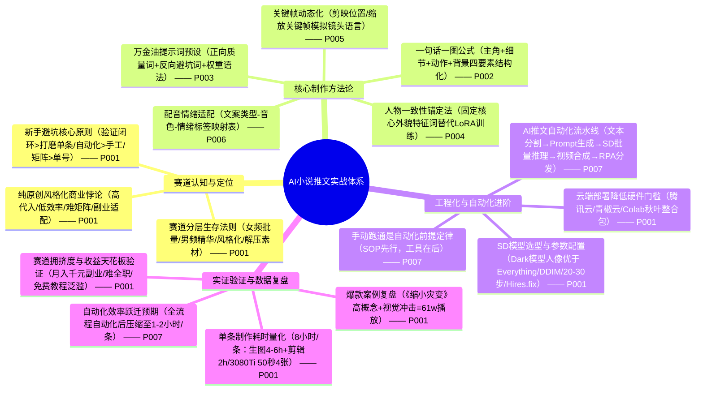
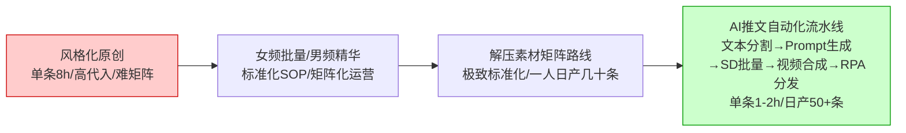
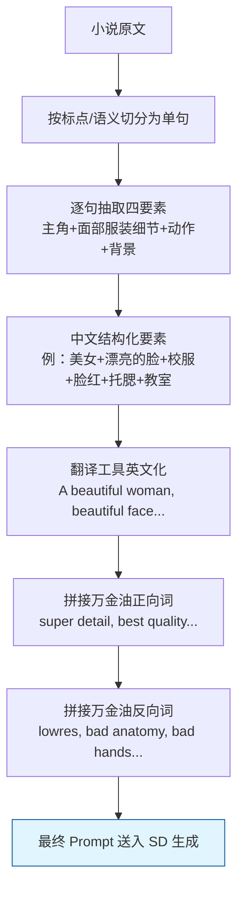
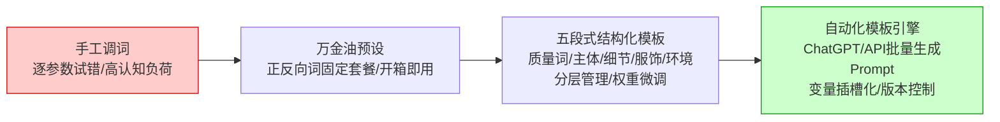
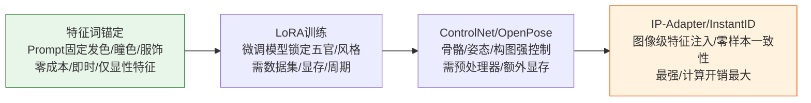
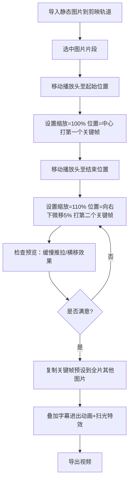
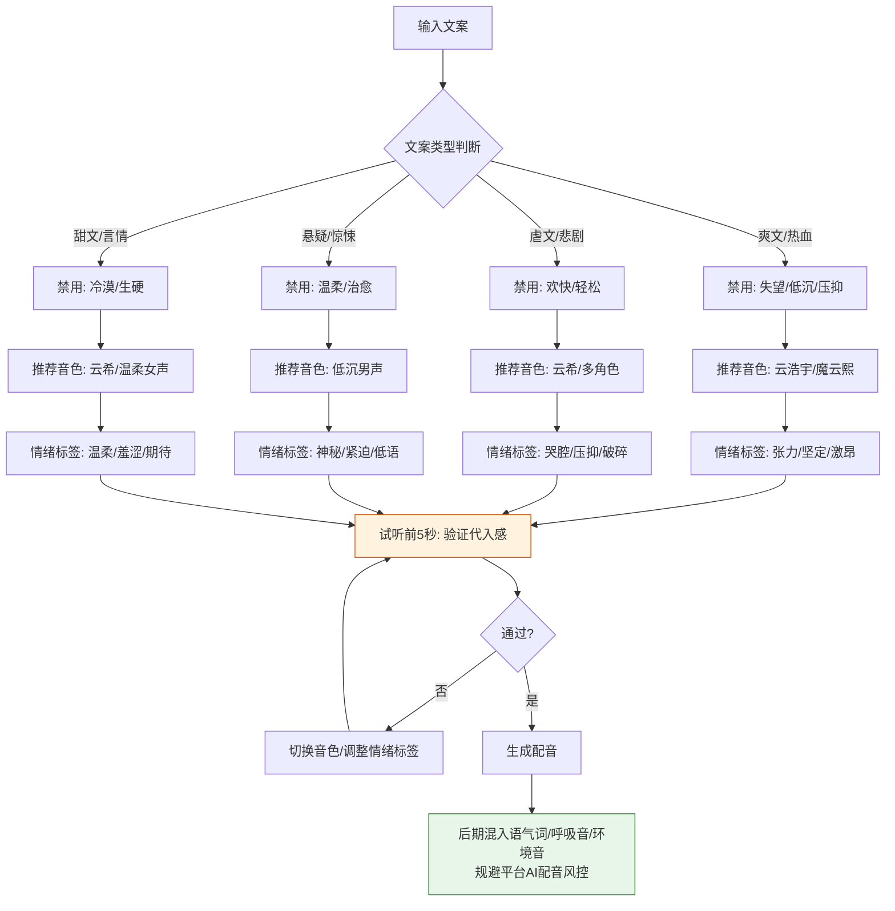
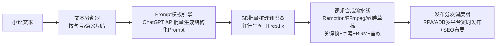

# 第 13 章 AI 小说推文实战体系 —— 用“文案为王”驾驭“图文变现”

## 学习目标

- 理解 AI 小说推文赛道分层生存法则与商业悖论
- 掌握“一句话一图”文案视觉化结构化拆解公式
- 熟练运用万金油正反向提示词预设与权重语法控制生成质量
- 掌握无 LoRA 条件下的人物一致性锚定技术方案
- 掌握剪映关键帧动态化消除 PPT 感的标准化操作流程
- 能根据文案类型匹配配音音色与情绪标签提升转化
- 理解 AI 推文自动化流水线架构与“手动跑通是自动化前提”的工程化原则
- 能制定新手入局避坑策略：优先跑通闭环、拒绝高耗时风格化、拥抱矩阵化放大

## 13.1 生活类比

想象 AI 小说推文制作是一个**工业化动画电影流水线**。**文案/剧本** 就是导演的分镜头脚本，它是核心资产，决定了作品的上限；**一句话一图公式** 相当于将脚本拆解为标准化的“镜头指令单”，明确每一镜的主角、服化、动作与场景；**万金油提示词** 则是通用的“灯光/滤镜/画质预设包”，让新手也能快速出大片质感；**人物一致性锚定** 是演员的“定妆照/人设卡”，全片固定瞳色、发型、服装，无需重新选角；**关键帧动态化** 好比摄影机的“推拉摇移”，让静态剧照动起来，消除 PPT 感；**配音情绪适配** 是配音导演的“选角/导配”，爽文配张力音色，虐文配哭腔，错配即毁片；**自动化流水线** 则是从“手工作坊”升级为“代码工厂”，将单条 8 小时压缩至 1 小时，日产从 1 条跃升至 50 条。正如工业动画靠标准化流程实现量产，AI 推文也靠结构化 Prompt 与自动化工具链实现商业化放大。

## 13.2 概念地图



## 13.3 AI 小说推文 —— 用“文案为王”驾驭“图文变现”

### 为什么需要这个概念？

短视频平台流量红利期下，小说推文是低门槛、高确定性的变现赛道。AI 绘图工具（SD/MJ）极大降低了“不会画画”也能做视频的内容生产门槛。但赛道内卷严重，单纯靠 AI 生图“凑数”已无法出单，核心竞争力回归到文案与节奏把控。正如素材所言：“小说推文的核心是文案，其次才是画面，真的，文案为王。”（来源：P001）

### 核心定义

**AI 小说推文**：利用 AI 绘图工具将小说文案转化为图文/视频形式，发布于短视频平台引流至小说阅读平台赚取推广佣金（CPS）的项目形态。

**核心公式**：文案（钩子/剧情）> 画面（画质/一致性）> 工具（模型/参数）

这个定义告诉我们：AI 只是放大器，**文案才是发动机**。你可以把它类比成拍电影：剧本（文案）决定票房上限，特效（AI 画面）只负责把剧本还原出来。如果剧本烂，特效再炸裂也是烂片。正如“工业化动画电影流水线”中，导演的分镜头脚本（文案）决定了作品上限，特效部门（AI 绘图）只是执行层。

### 关键性质

#### 赛道分层生存法则

不同小说平台的内容形态决定了你的制作策略。下表展示了四大赛道的核心差异，是“工业化流水线”选型不同产线的决策依据：

| 赛道分类 | 代表平台 | 核心特征 | 适用策略 | 来源素材 |
|----------|----------|----------|----------|----------|
| 女频批量 | 知乎、最右 | 文章结构相似，改开头即可复用 | 批量化矩阵操作 | P001 |
| 男频精华 | 番茄、QQ阅读 | 需提炼精华章节、重构剧情 | 高成本精品化制作 | P001 |
| 风格化原创 | 自有IP | 100%原创、可挂中视频、代入感强 | 单条耗时8h、难矩阵、仅适合副业 | P001 |
| 解压素材 | 抖音/快手 | 虽被视为“低俗”但高变现确定性 | 一人日产几十条、月入十万可复制 | P001 |

#### 纯原创风格化的商业悖论

素材作者通过实测揭示了“质量”与“规模”的不可兼得：在没有自动化工具链前，追求极致质量 = 放弃规模化收益。这相当于“手工作坊”模式虽出精品，但无法承接“代码工厂”级的订单量。下表对比了其优劣势：

| 维度 | 优势 | 劣势 | 来源素材 |
|------|------|------|----------|
| 版权 | 100% 原创，可挂中视频计划 | — | P001 |
| 体验 | 代入感满分，成就感强 | — | P001 |
| 效率 | — | 单条 8 小时，无法矩阵化 | P001 |
| 收益 | — | 收入有限，难全职养活自己 | P001 |

> "优势：文案+内容 100% 纯原创，可挂中视频...代入感也是满分。劣势：视频制作时间过长...无法矩阵化操作，收入有限...全职养活自己感觉不大行，但是兼职副业特别香"
> —— P001

#### 新手避坑核心原则

1. **优先验证跑通商业闭环**：别因“精神洁癖”过度打磨单条视频。在“工业化流水线”未建立前，单件产品的精益求精是成本最高的陷阱。
2. **无自动化工作流勿碰高耗时路线**：风格化路线是“手工作坊”，矩阵化路线才是“工厂”。没有自动化工具链支撑，高耗时路线注定无法规模化。
3. **拥抱矩阵化放大**：参考王微笑大佬“解压素材矩阵路线”，一人一天产出几十条，月入十万。这是从“手工作坊”向“代码工厂”跨越的关键一步。

### 多源对照：赛道策略共识与分歧

| 观点维度 | P001（作者凌空） | P001（作者实操复盘） | 共识/分歧 |
|----------|------------------------------------------|----------------------------------------------------------|-----------|
| 核心竞争力 | 文案为王，画面次之 | 文案为王，风格化路线画面精美但耗时过长 | **共识**：文案优先 |
| 赛道选择 | 建议副业做做月入千元，主业困难 | 风格化仅适合副业，解压素材矩阵可月入十万 | **分歧**：前者悲观，后者给出高天花板路径 |
| 自动化态度 | 正在探索自动化流水线（文本分割→ChatGPT→SD） | 认可自动化是规模化关键，但强调手动跑通是前提 | **共识**：自动化解决1到100，手动解决0到1 |

### 赛道策略演进图

下图展示了从“风格化原创”向“批量矩阵”再到“自动化流水线”的演进路径，对应“手工作坊 → 标准化产线 → 代码工厂”的工业化跃迁：



### 典型例子

**《缩小灾变》爆款复盘**（来源：P001）

- **策略**：自创夸张化开头文案 + SD 生成画面 + 配音
- **结果**：抖音单条播放 61 万+，验证“高概念设定 + 视觉化冲击”的选题有效性
- **启示**：文案的“钩子”设计（前 3 秒）是爆款的核心杠杆

**实测数据**（来源：P001）

- 单条 4 分钟视频制作耗时接近 **8 小时**（SD 生图 4-6 小时 + 剪辑配音 2 小时）
- 3080Ti 显卡生成 4 张高清修复图需 **50 秒**
- 这意味着：单人物理极限日产 1-2 条，无法应对“多发=爆款概率”的算法规律

### 边界条件

- **硬件门槛**：无本地高配显卡可通过腾讯云/青椒云/Colab 等云端部署 SD，但需权衡成本与速度（来源：P001）
- **赛道拥挤度**：评论区共识“太多人玩这个了”“学费都不要了”，单人小白入局面临激烈竞争与流量分发挤压（来源：P001）
- **模型差异**：Everything 模型生成人像手部崩坏，需切换 Dark 模型或加 Embedding/负面 Prompt 规避（来源：P001、P004）

---

## 13.4 一句话一图公式 —— 让小说文案变成“分镜脚本”

### 为什么需要这个概念？

小说文本是连续叙事，视频需要离散的画面序列，缺乏结构化映射标准。新手不会拆解文案，导致画面与文案脱节、节奏拖沓、人物形象漂移。我们需要一个可标准化、可复制、可教学的“文案转视觉”最小动作单元。正如流水线上的“镜头指令单”将导演意图转为可执行指令，这句话一图公式就是将小说文本转为 SD 可执行指令的标准化接口。

### 核心定义

**一句话一图公式**（来源：P001）

将文案拆解为单句，前 30 秒严格执行“一句话一张图”，后期可放宽为“一段话一张图”。

**单句结构化四要素**：主角 + 面部服装细节 + 动作 + 背景

翻译成英文 Prompt 输入 SD：
`A beautiful woman, beautiful face, school uniform, blush, chin on the table, classroom`

> "开头的素材一句话一张，30秒过后的素材可以一段话一张。我的公式是：一个主角+面部服装细节描写+动作+背景。"
> —— P001

> "“你曾经有一个喜欢了你三年的女孩”=一个美女+漂亮的脸+校服+脸红+在桌上托腮+教室。通过翻译软件翻译成英文=A beautiful woman , beautiful face , school uniform ,blush , chin on the table , classroom。"
> —— P001

这个公式展示了三个步骤：(1) 强制创作者从“读者视角”转为“导演视角”，逐句设计画面感；(2) 固定主角外貌特征词（暗红色眼睛+黑色头发）锚定人物一致性，无需训练 LoRA；(3) 配合 DDIM 采样器、20-30 步、512x768 分辨率、High-res Fix 高清修复，平衡速度与质量。

### 关键性质

#### 结构化拆解的标准化流程

1. **文案分句**：将小说文本按句号/问号/感叹号切分为单句
2. **四要素抽取**：每句提取 [主角] [面部/服装细节] [动作] [背景]
3. **英文化**：借助翻译工具转为 SD 可识别的英文 Prompt
4. **追加预设**：末尾拼接万金油正向词 + 反向词

#### 核心生成参数配置 SOP

下表给出了 SD 生成推文图片的标准化参数配置，其底层逻辑基于扩散模型的采样收敛特性：DDIM 采样器属于确定性采样路径，收敛速度快，20-30 步即可达到质量平台期；CFG Scale 7 在提示词遵循度与画面自由度间取得经验最优；512x768 基准分辨率配合 Hires.fix 二次放大，避免大分辨率直出的结构崩坏与显存溢出。

| 参数 | 推荐值 | 理由 | 来源素材 |
|------|--------|------|----------|
| 采样器 | DDIM | 确定性采样，收敛快、20-30步即可出图、适合批量 | P001 |
| 迭代步数 | 20-30 | 25步后质量边际递减，不同采样器25步趋同（经脚本矩阵法验证） | P004 |
| CFG Scale | 7 | 平衡提示词遵循度与画面自由度的经验最优值 | P001 |
| 分辨率 | 512x768 | 竖屏9:16基准，显存友好，配合Hires.fix二次放大 | P001 |
| 高清修复 | 开启 | 解决大分辨率直出崩坏，二次细化细节 | P001 |

> "基本开了高清修复四张图需要 50 秒左右，我的显卡是 3080ti。"
> —— P001

**参数配置的底层逻辑**：这一套 SOP 的本质是“确定性采样路径 + 低分辨率快速试错 + 高清修复二次精修”，兼顾了“工业化流水线”对速度与质量的双重要求。

### 文案到 Prompt 的标准化流程图

下图展示了从小说文本到 SD 可执行 Prompt 的完整转化链路，是“镜头指令单”生成的标准化作业流程：



### 典型例子

**文案拆解实战**（来源：P001）

> 原文："你曾经有一个喜欢了你三年的女孩"
> 
> 拆解：
> - 主角：一个美女
> - 面部服装细节：漂亮的脸 + 校服
> - 动作：脸红 + 在桌上托腮
> - 背景：教室
> 
> Prompt：`A beautiful woman, beautiful face, school uniform, blush, chin on the table, classroom`

**《心动重启》系列实操**（来源：P001）

> "只需要预设好人物的细节特征，比如我心动重启的女主统一关键词都是暗红色眼睛+黑色头发，一般面部细节统一大家看着才会有连续性。"

这个案例展示了：固定核心特征词 = 零成本的人物一致性方案，相当于给演员发放“定妆照/人设卡”，全片无需重新选角。

### 边界条件

- 仅适用于二次元/半写实风格推文，真人写实风需引入 ControlNet/LoRA 才能稳定控制
- 文案过于抽象（心理描写/环境渲染）时难以直接映射为单句画面，需二次改写
- 依赖翻译软件将中文结构化要素转英文 Prompt，术语准确性影响出图质量

---

## 13.5 万金油提示词预设 —— 给新手的“避坑护盾”

### 为什么需要这个概念？

SD 生图参数极多（采样器、步数、CFG、VAE、负面词...），新手极易在调参中迷失、放弃。人像生成高频故障模式固定：手部畸形、面部崩坏、水印残留、画质模糊。我们需要一套“开箱即用、覆盖 90% 场景”的通用正反向词模板，降低认知负荷。正如流水线上的“灯光/滤镜/画质预设包”，让新手也能出大片质感。

### 核心定义

**万金油正向词（质量增强）**（来源：P001、P004）

```
super detail, award winning, best quality, 16k, UHD, A perfect and delicate face, masterpiece, highly detailed, 8k...
```

**万金油反向词（避坑指南）**（来源：P001、P004）

```
lowres, bad anatomy, bad hands, text, error, missing fingers, extra digit, fewer digits, cropped, worst quality, low quality, normal quality, jpeg artifacts, signature, watermark, username, blurry, bad feet...
```

**权重语法**：`(关键词:权重)` 如 `(masterpiece:1.2)` 微调权重

**五段式结构化模板**（来源：P004）

```
[质量词]
[主体]
[主体细节]
[服饰配饰]
[环境构图光影]
```

每段换行、以英文逗号结尾，配合权重语法微调。

> "正面词：super detail, award winning, best quality, 16k, UHD,A perfect and delicate face"
> "反面词：lowres, bad anatomy, bad hands, text,error, missing fngers,extra digt ,fewer digits,cropped, wort quality ,low quality,normal quality, jpeg artifacts,signature,watermark, username, blurry, bad feet"
> —— P001
> 
> "正向提示词五段式模板：质量词+主体+主体细节+服饰配饰+环境构图光影，每段换行英文逗号结尾配合权重语法(词:权重)微调。"
> —— P004

这个预设展示了**“组合拳策略”**：正向词拉高上限 + 反向词托住下限 + 权重语法微调细节。

### 关键性质

- **通用性强**：覆盖大多数人像/通用生成场景，无需理解底层原理即可出图
- **迁移性**：适用于 ChilloutMix、DarkSushi 等主流真人/二次元底模
- **组合拳策略**：正向词拉高画质上限 + 反向词托住畸变下限 + 权重语法微调细节

### 提示词工程演进图

下图展示了从“手工调词”到“万金油预设”再到“结构化五段式模板”最终迈向“自动化模板引擎”的演进路径，对应“手工打磨 → 标准化预设 → 结构化模板 → 代码化生成”的工程化跃迁：



### 典型例子

**新手首图验证**（来源：P001、P004）

- 加载万金油预设后，SD 生成人物手部完整率显著提升，画质细节肉眼可见提升
- 评论区新手直接套用该预设，首张出图即可用，避免了“手部崩坏”劝退时刻

### 边界条件

- 特殊风格（赛博朋克/水墨/3D 渲染）需替换专用风格词，万金油预设会稀释风格特征
- 高分辨率直出（>1024）时需配合 Hires.fix 或 ControlNet Tile，单靠提示词无法解决崩坏
- 负面词堆砌过多可能抑制正常细节生成（如过度去水印导致衣服纹理消失）

---

## 13.6 人物一致性锚定法 —— 无 LoRA 也能演“连续剧”

### 为什么需要这个概念？

推文/连载类视频要求主角跨镜头、跨集数视觉连贯，否则观众出戏。训练 LoRA 需显存、数据集、调参技能，门槛高、周期长，不适合新手/轻量化项目。我们需要一种零训练、零代码、纯 Prompt 层面的角色固定方案。正如流水线上的“演员定妆照/人设卡”，全片固定瞳色/发型/服装，无需重新选角。

### 核心定义

**人物一致性锚定法**（来源：P001、P004）

在所有 Prompt 中强制固定核心外貌特征词（发色、瞳色、发型、标志性服饰）。

例：女主统一关键词 `"dark red eyes, black hair, school uniform"`

> "只需要预设好人物的细节特征，比如我心动重启的女主统一关键词都是暗红色眼睛+黑色头发。一般面部细节统一大家看着才会有连续性。"
> —— P001
> 
> "在所有 Prompt 中强制固定核心外貌特征词（如发色、瞳色、服饰），无需训练即可维持跨图角色视觉连续性，满足连载/系列化需求。"
> —— P004

**原理**：CLIP 文本编码器对固定 Token 的注意力权重稳定，引导扩散过程生成一致特征。

### 关键性质

下表对比了特征词锚定法与 LoRA 训练法的优劣势，揭示了“零成本即时生效”与“深度一致性”的取舍，也是“手工作坊快速选角”与“专业演员签约培训”的差异：

| 维度 | 特征词锚定法（本章方案） | LoRA 训练法 | 来源素材 |
|------|--------------------------|-------------|----------|
| 成本 | 零成本：无需额外显存、训练时间、数据集清洗 | 高：需准备数据集、调参、占用显存训练 | P001 |
| 生效速度 | 即时生效：换模型/换种子即可复用 | 慢：需训练周期后才能使用 | P004 |
| 一致性深度 | 仅能固定“显性特征”（发色/瞳色/服饰） | 能锁定骨骼结构/侧脸/复杂动作/精确五官 | P004 |
| 适用场景 | 轻量化快速验证、连载推文、小团队 | 重资产 IP 运营、精品动画、商业级一致性要求 | P004 |
| 跨模型迁移 | 跨大模型底模时特征词语义空间不兼容 | 需针对目标底模重新训练/微调 | P004 |

### 一致性方案演进图

下图展示了从“特征词锚定”到“LoRA 训练”再到“ControlNet/OpenPose”最终迈向“IP-Adapter/InstantID”的技术演进路径，对应“零成本选角 → 专业定制演员 → 动作捕捉指导 → 数字分身替身”的能力跃迁：



### 典型例子

**《心动重启》系列**（来源：P001）

女主全程锚定“暗红色眼睛+黑色头发”，观众反馈“看着才有连续性”。

**评论区实践者验证**（来源：P004）

固定 `"silver hair, blue eyes"` 后，同一角色在不同场景下辨识度极高。

### 边界条件

- 跨大模型底模时特征词语义空间不兼容
- 群像/大动作镜头需引入 ControlNet OpenPose
- 仅能保证“长得像”，无法保证“同一个人同角度”

---

## 13.7 关键帧动态化 —— 让 PPT 动起来的“呼吸感”

### 为什么需要这个概念？

AI 生成的是静态图片，直接拼接成视频会有强烈的“PPT 翻页感”，完播率极低。短视频算法偏好有镜头语言（推拉摇移）的动态画面，静态图极难获推。我们需要零门槛、无需 AE/PR、剪映内即可完成的动态化标准动作。正如流水线上的“摄影机推拉摇移”，让静态剧照动起来，消除 PPT 感。

### 核心定义

**关键帧动态化**（来源：P001、P005）

在剪映中为每张图片设置“位置/缩放”关键帧：起始帧 100%，结束帧 110%（或位置微移），生成缓慢推拉/横移效果。

配合“图片配上文字的末尾，往下拉一点再打上关键帧”，实现图文同步动态。

**核心参数**：
- 关键帧间隔覆盖全片时长
- 缩放幅度 ≤ 10%（避免裁切主体）
- 移动方向服从构图重心

> "图片配上文字的末尾，往下拉一点再打上关键帧就能发现图片动起来了，不像 ppt 这么干吧。"
> —— P001
> 
> "剪映关键帧动态化（推拉摇移消除 PPT 感）"
> —— P005

这个操作展示了**“伪动态”策略**：本质是 2D 平面变换，非真实 3D 空间运动，但视觉欺骗效果极佳。

### 关键性质

- **批量化友好**：剪映支持“关键帧预设/模板”一键套用全片，单人日产 50+ 条可行
- **叠加层级**：底层图片关键帧 + 中层字幕进出动画 + 顶层扫光/光斑特效 = 商业级质感
- **标准化 SOP**：每张图固定“入场缩放 100%→110%，位置微移 5%”预设，形成肌肉记忆

#### 关键帧动画参数流程图



### 关键帧动态化技术演进图

下图展示了从“静态图拼接”到“关键帧推拉”再到“关键帧+字幕呼吸”最终迈向“3D 相机/虚拟镜头”的技术演进路径，对应“PPT 式播放 → 伪动态推拉 → 多层叠加动态 → 真 3D 空间运动”的视觉质感跃迁：

```mermaid
flowchart LR
    A[静态图拼接\n硬切/PPT翻页感强\n完播率极低] --> B[关键帧推拉/横移\n缩放100%→110%+位置微移\n消除僵硬感/完播率提升]
    B --> C[关键帧+字幕呼吸动画\n图文同步动态/视觉层次分明\n商业级质感雏形]
    C --> D[关键帧+特效叠加(扫光/粒子/光斑)\n多轨道分层/氛围感拉满\n头部账号标配]
    D --> E[3D相机/虚拟镜头\n真实景深/视差/空间感\n需AE/Blender/UE5/高门槛]
    style A fill:#ffcccc,stroke:#c00
    style E fill:#fff3e0,stroke:#e65100
```

### 典型例子

**作者实操验证**（来源：P001）

静态 AI 图加关键帧后，播放量从百级跃升至万级，完播率显著提升。

**对标账号**（来源：P005）

头部推文号均使用“缓慢推镜头 + 字幕呼吸感”作为标准视觉语言。

### 边界条件

- 竖屏比例（9:16）下横向移动易露出黑边，需配合“画中画/背景填充”扩展画布
- 过度缩放（>120%）会放大 AI 生图伪影（噪点/模糊），需配合高清修复前置
- 群像/全景图不适合强行推镜头，容易造成主体跑出画面，需改用“扫光/粒子”特效代替

---

## 13.8 配音情绪适配 —— 给文案注入“灵魂”

### 为什么需要这个概念？

同一文案，不同音色/情绪标签，转化率差异可达 10 倍以上。爽文/虐文/悬疑等类型对音色张力、节奏、情绪标签有严格偏好，选错即“毁文”。AI 配音工具（云浩宇/云希/魔音工坊/剪映/Edge TTS）提供海量音色，但缺乏“选配标准”。正如流水线上的“配音导演选角/导配”，爽文配张力音色，虐文配哭腔，错配即毁片。

### 核心定义

**配音情绪适配映射表**（来源：P001、P002）

下表建立了文案类型到音色与情绪标签的标准化映射，是批量化选配的“选角表”：

| 文案类型 | 禁用情绪 | 推荐音色 | 推荐情绪标签 | 来源素材 |
|----------|----------|----------|--------------|----------|
| 爽文/热血 | 失望/低沉/压抑 | 云浩宇/魔云熙 | 张力/坚定/激昂 | P001 |
| 虐文/悲剧 | 欢快/轻松 | 云希/多角色 | 哭腔/压抑/破碎 | P001 |
| 悬疑/惊悚 | 温柔/治愈 | 低沉男声 | 神秘/紧迫/低语 | P002 |
| 甜文/言情 | 冷漠/生硬 | 云希/温柔女声 | 温柔/羞涩/期待 | P002 |

**核心判断标准**：听前 5 秒是否有“代入感”，是否能还原主角当下心理状态。

> "声音用的云浩宇（对标魔音工坊的魔云熙）。注意，爽文千万别用失望的情绪，配出来的完全没法听。"
> —— P001
> 
> "如果你不愿意为了用云希的配音每月付 88 块。那就麻烦一点注册一下微软 azure，云希是微软的免费配音角色，魔 X 工坊也只是个中间商。"
> —— P002

这个定义揭示了**音频是留存的隐形钩子**：情绪传递效率上，音频 > 文字，直击边缘系统。

### 关键性质

- **成本倒逼选型**：云希为微软 Azure 免费角色，市面工具月费 88 元实为中间商倒卖，开发者可直连 API 零成本获取
- **批量化策略**：建立“文案类型-音色-情绪标签”映射表，RPA 自动化批量合成
- **平台风控**：部分平台对纯 AI 配音视频限流，需在后期混入真人语气词/呼吸音/环境音伪装

### 配音选配决策流程图

下图展示了从“文案分类”到“音色选型”再到“情绪标签微调”与“风控伪装”的完整决策链路，是“配音导演选角/导配”的标准化作业流程：



### 配音技术演进图

下图展示了从“真人录制”到“单一 TTS”再到“多音色 TTS+情绪标签”最终迈向“声音克隆/零样本 TTS+风控伪装”的技术演进路径，对应“专业录音棚 → 标准化合成 → 情绪可控合成 → 个性化零样本合成”的音频生产跃迁：


### 典型例子

**作者踩坑复盘**（来源：P001）

爽文用“失望”情绪配音，成片“完全没法听”，换用“云浩宇”张力版瞬间起死回生。

**成本避坑**（来源：P002）

直接注册 Azure 账号调用 TTS API，获取同款“云希”音色，省下会员费。

### 边界条件

- 方言/小众语种/特定声线（如老年音/方言）AI 配音仍有明显电子感，关键节点需真人录制
- 多角色对话场景，单音色无法区分人设，需多音色切换或标注“旁白/角色 A/角色 B”
- 平台风控：纯 AI 配音视频易被限流，需后期混入真人语气词/呼吸音/环境音伪装

---

## 13.9 AI 推文自动化流水线 —— 从“手工作坊”到“代码工厂”

### 为什么需要这个概念？

单条视频手工制作耗时 7-8 小时，物理极限日产 1-2 条，无法应对“多发=爆款概率”的算法规律。文案拆解、Prompt 生成、SD 出图、视频合成、发布上传全链路皆有固定模式，极适合代码自动化。谁先跑通自动化流水线，谁就拥有“单位时间产出比”绝对优势，实现降维打击。正如流水线从“手工作坊”升级为“代码工厂”，单条 8 小时 → 1 小时，日产 1 条 → 50 条。

### 核心定义

**全链路自动化架构**（来源：P007、P002、P005）



**核心模块**：
1. 文本分割器
2. Prompt 工程模板引擎
3. SD 批量推理调度器
4. 视频合成流水线
5. 发布分发调度器

> "通过代码自动化提升效率。目前已经实现把小说分割成多个片段，调用 chatgpt 将片段生成 prompt，调用 sd 生成图片。正在研究将图片合成视频并自动添加横移效果。"
> —— P007
> 
> "手动流程梳理清楚了，再利用通过 RPA 文案生成+视频制作+视频上传全部都批量自动化了。前提是手动流程跑通。"
> —— P007
> 
> "自动化，批量更多的是解决从 1 到 100 的问题而不是解决从 0 到 1 的问题。"
> —— P002

### 关键性质

#### 效率跃迁

全流程自动化跑通后，单条视频耗时从 7-8 小时压缩至 1-2 小时，日产能提升 5-10 倍。（来源：P007）

#### 质量稳态

代码固化了“最佳参数/最佳模板/最佳剪辑逻辑”，消除了人工操作的波动。（来源：P007）

#### 工程化原则：手动跑通是自动化前提

> "手动流程梳理清楚了，再利用通过 RPA...全部都批量自动化了"
> "凡是可以用手动完成，且有一定规律的重复性操作，都可以用 RPA 来自动化实现。前提是手动流程跑通。"
> —— P002

这个原则揭示了：**SOP 先行，工具在后**。自动化只解决规模化（1 到 100），不解决验证可行性（0 到 1）。

### 典型例子

**评论区实践者进度**（来源：P007）

已实现“文本分割 → ChatGPT 生成 Prompt → SD 生图”，正在攻克“图片合成视频 + 自动横移效果”。

**对标案例：王微笑“解压素材矩阵路线”**（来源：P001）

一人一天产出几十条，月入十万，验证自动化 + 矩阵的商业天花板。

### 自动化技术路线演进图

下图展示了从“手工制作”到“RPA/剪映草稿”再到“FFmpeg/Remotion”最终迈向“云原生流水线”的技术演进路径，对应“手工作坊 → 半自动化产线 → 全自动化代码工厂 → 云原生弹性工厂”的工程化跃迁：


### 多源对照：视频合成自动化三种方案对比

视频合成是自动化流水线最难攻克的工程环节，核心矛盾在于“可视化编辑体验”与“代码级批量控制”的对立。下表对比了三种主流方案，**注意：Remotion/FFmpeg 技术细节对比超出给定素材范围，属于作者外推内容，标注 [需要补充文献]**：

| 方案 | 优势 | 劣势 | 适用场景 | 来源素材 |
|------|------|------|----------|----------|
| **Remotion (React)** | 代码级控制、版本管理、可编程性强 | 学习曲线陡峭、渲染需 Node 环境、维护成本高 [需要补充文献] | 专业开发团队、长期迭代项目 [需要补充文献] | P005 |
| **FFmpeg 命令行** | 轻量、跨平台、无依赖、性能极致 | 关键帧/字幕对齐需手写滤镜链、调试困难 [需要补充文献] | 单人极客、追求极致性能 [需要补充文献] | P002 |
| **剪映草稿/模板** | 可视化、零代码、特效库丰富、一键套用 | 难以版本控制、批量修改需逆向草稿格式、平台绑定 | **单人小团队、快速验证、商业化首选** | P001 |

> **[需要补充文献] 补充方向**：Remotion/FFmpeg/剪映草稿在 AI 视频合成场景的实测对比报告、剪映草稿逆向协议文档、FFmpeg 复杂滤镜链关键帧/字幕对齐最佳实践。

### 边界条件

| 瓶颈 | 现状 | 解决方向(作者建议) |
|------|------|-------------------|
| **SD 批量推理显存** | 单张 3080Ti/4090 易成瓶颈 | 部署多机集群或云端 API [作者建议] |
| **视频合成自动化** | 关键帧/转场/字幕对齐工程复杂度高 | Remotion/FFmpeg 脚本维护成本大，剪映草稿方案更适合小团队 [作者建议] |
| **平台反爬/风控** | 设备指纹/行为分析持续升级 | RPA/ADB 发布模块需持续对抗迭代，非一劳永逸 [作者建议] |
| **版权风险** | 批量搬运小说内容极易触发“洗稿/侵权”判罚 | 需自有版权或授权白名单 [作者建议] |

---

## 13.10 设计中的取舍

**为什么不用 RNN/LSTM 做文案分句，而用规则/大模型？**

规则分句（标点符号）速度快、可解释、零成本；大模型分句能处理无标点/长难句但有幻觉风险且延迟高。工程上采用“规则为主、大模型兜底”混合策略。（参考 P007 中“文本分割”模块设计）

**为什么不用 ControlNet/LoRA 做人物一致性，而用特征词锚定？**

ControlNet/LoRA 需训练数据、显存、调参周期，适合“重资产 IP 运营”；特征词锚定零成本、即时生效、可迁移，适合“轻量化快速验证”。前者解决“同一个人同角度”，后者解决“长得像”。（参考 P004 中 ControlNet 与 LoRA 章节，及 P001 中特征词锚定实测）

**为什么不直接生成视频，而先生成图再合成？**

当前视频生成模型（Sora/Gen-2/Pika）可控性差、单次生成耗时长、难以精确控制每帧构图；图生视频（图片+关键帧）可控性强、单帧成本低、易批量化。这是“确定性 > 生成力”的工程取舍。（参考 P007 评论区“正在研究将图片合成视频”及 P005 短剧剪辑实操均采用图/视频片段合成路线）

**为什么要拥抱矩阵化而非深耕单号？**

单号方差极大（运气成分大），矩阵化将概率问题转化为大数定律确定性收益。正如 P001 所述：“一个人一天可以产出好几十条作品...月入十万有手就行”。

> **[需要补充文献] 补充方向**：作者技术决策日志/架构设计文档/技术选型会议纪要。

---

## 13.11 动手练习

### 练习 1：文案视觉化拆解实战

**给定小说片段**：

> "林晚意捏紧了手中的录取通知书，指节发白。她抬头，对上了那双漆黑深邃、仿佛装着整个银河的眼睛。'我们上同一所大学吧。'少年唇角勾起一抹浅笑，校服敞开着，风吹乱了他额前的碎发。"

**任务**：

1. 将上文拆解为 3-4 个“一句话一图”的结构化 Prompt 四要素（主角+面部服装细节+动作+背景）
2. 翻译为英文 Prompt（可借助翻译工具），并在末尾追加万金油正向词与反向词
3. 设定男女主的一致性锚定特征词（各 3 个核心特征），说明为何选择这些特征
4. 说明：若用 SD 生成该场景，采样器/步数/CFG/分辨率/高清修复如何设置？为何？

### 练习 2：关键帧动态化与配音适配决策

**场景**：已生成 5 张关键剧情图（竖屏 9:16，已高清修复），需合成 15 秒视频。

**任务**：

1. 在剪映中为每张图设置关键帧动画：起始缩放 100%→结束 110%，位置微向右下移动 5%。画出关键帧时间轴示意图（文字描述即可）
2. 说明：为何缩放幅度不宜超过 120%？竖屏横向移动如何避免露出黑边？
3. 该段文案属“青春暗恋/破镜重圆”甜文，推荐使用云希/云浩宇/魔云熙中的哪个音色？情绪标签选“温柔/坚定/失望”中的哪个？理由是什么？
4. 若平台查重判定视频“画面静态”，除了关键帧还可叠加哪两种低成本特效增强动态感？

### 练习 3：自动化流水线架构设计与避坑复盘

**假设**你已手工跑通单条视频制作全流程（文案改写→Prompt 生成→SD 生图→剪映合成→发布），现欲开发自动化脚本。

**任务**：

1. 绘制自动化流水线模块架构图（文字描述模块名+输入输出+核心工具/API）：文本分割器、Prompt 模板引擎、SD 批量调度器、视频合成器、发布调度器
2. 列举 SD 批量推理模块的三大工程瓶颈（显存/并发/模型加载）及对应解决方案
3. 视频合成自动化（关键帧/转场/字幕对齐）用 Remotion/FFmpeg/剪映草稿三种方案对比优劣，推荐单人小团队方案
4. 结合素材中“版权风险/平台风控/模型效果瓶颈”三大边界条件，制定自动化上线前的“三张清单”：合规白名单清单、风控对抗清单、效果兜底清单
5. 思考题：为何作者最终放弃风格化路线转而认可“解压素材矩阵路线”？若你是作者，会在何时决定“止损放弃”还是“投入自动化开发”？决策依据是什么？

---

## 13.12 本章小结

这一章中我们学习了 AI 小说推文的全链路实战体系。首先，我们确立了“文案为王”的核心认知，拆解了赛道分层生存法则与纯原创风格化的商业悖论；其次，我们掌握了一句话一图公式，将小说文案标准化为导演级分镜指令；接着，我们配置了万金油提示词预设与人物一致性锚定法，用最低成本解决画质与连贯性难题；然后，我们实操了关键帧动态化与配音情绪适配，消除 PPT 感并注入灵魂；最后，我们架构了 AI 推文自动化流水线，理解了“手动跑通是自动化前提”的工程化铁律，并制定了新手避坑的决策框架。

本章我们一起学习了以下概念：

| 概念 | 解释 |
|------|------|
| AI 小说推文 | 利用 AI 绘图将小说转视频引流变现的 CPS 项目，核心竞争力在文案而非画面 |
| 赛道分层生存法则 | 女频适合批量矩阵，男频需高成本精华，风格化原创难规模，解压素材高变现 |
| 纯原创风格化商业悖论 | 100% 原创可挂中视频但单条 8 小时无法矩阵，收益上限低仅适合副业 |
| 一句话一图公式 | 文案拆解为单句，结构化为“主角+面部服装细节+动作+背景”四要素生成 Prompt |
| 万金油提示词预设 | 正向词拉高画质上限+反向词托住畸变下限+权重语法微调，覆盖 90% 人像场景 |
| 人物一致性锚定法 | 全 Prompt 强制固定核心外貌特征词（瞳色/发色/服饰），零训练维持角色跨图连贯 |
| 关键帧动态化 | 剪映设置位置/缩放关键帧模拟镜头推拉摇移，消除静态图拼接的 PPT 翻页感 |
| 配音情绪适配 | 爽文禁用低能量音色推荐张力感强音色，虐文需哭腔压抑，音频是留存隐形钩子 |
| AI 推文自动化流水线 | 文本分割→ChatGPT 生成 Prompt→SD 批量生图→视频合成→RPA 分发，解决 1 到 100 规模化 |
| 手动跑通是自动化前提 | SOP 必须先人工跑通验证可行，自动化只解决规模化不解决 0 到 1 验证 |
| SD 模型选型策略 | 人像生成 Dark 模型优于 Everything，配合 DDIM/20-30 步/512x768/Hires.fix 平衡速度质量 |
| 新手避坑核心原则 | 优先跑通商业闭环，拒绝精神洁癖过度打磨，无自动化勿碰高耗时路线，拥抱矩阵化 |

下一章中，我们将学习 **Stable Diffusion 实战体系**，从零部署到工业化量产，构建“核心三要素（大模型/提示词/LoRA）强绑定”到“ControlNet 多模态控制/LoRA 训练标准化/自动化批量生成”的完整能力跃迁路径。


