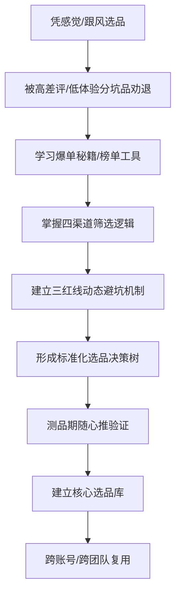
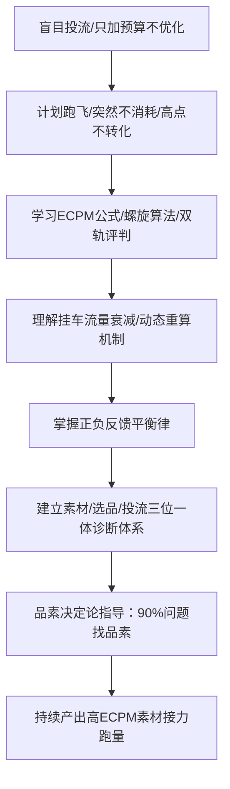
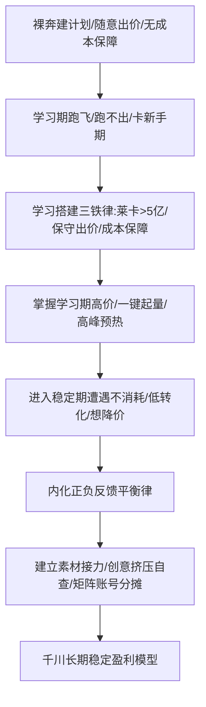
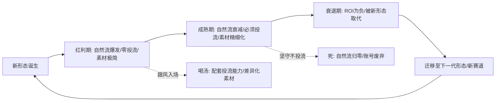

# 第 23 章 视频号短视频挂车投流实战体系 —— 从选品、混剪、投流到算法博弈的全链路标准化操作手册

## 学习目标

- 理解视频号短视频挂车投流玩法的核心优势（稳定、可复制、可放大、不废号）与劣势（高门槛、需真金白银测品）
- 掌握选品四大实战渠道与三大避坑红线，建立标准化选品决策树
- 熟练执行混剪去重七步标准作业程序（SOP），解决搬运视频过原创审核问题
- 深度理解螺旋算法/漏斗转化/ECPM竞价底层逻辑，掌握挂车视频评判维度与流量分配数学模型
- 精通随心推全生命周期投放策略（测品/优化/高峰/过渡四阶段）与随心推反推千川出价公式
- 掌握千川计划冷启动与算法博弈标准化动作（搭建/学习期/稳定期/正负反馈平衡/创意挤压规避）
- 掌握真人出镜角色扮演法与场景立体化分级，提升口播视频感染力与专业感
- 理解书单带货四代形态进化与红利窗口期论，建立内容形态生命周期管理认知
- 内化爆款视频五种思维与六大底层传播逻辑，构建短视频带货底层操作系统
- 掌握抖音官方出圈效应与黄金前3秒留人技巧，以及口播文案低成本获取三板斧

## 23.1 生活类比

想象视频号挂车投流是一场**精心设计的“自动售货机”生意**：

- **选品** = 填充货架的商品：必须是高毛利、高需求、低差评的“畅销款”，否则机器摆在那里也没人买
- **混剪去重** = 给商品换包装：同样的“货”（素材），换个“外壳”（MD5/关键帧/调色）让查重机器（城管/安检）认不出是“地摊货”，从而合法上架
- **随心推** = 试运营期：新机器上线先不赚钱，投钱请人来买（买流量），目的是训练“推荐算法”（店员）记住谁爱买这货（养模型）
- **千川** = 规模化放量：模型练准了，开更多机器（计划），精准投放广告（人群包），用“正反馈平衡负反馈”（补货+促销+装修）持续榨取利润
- **ECPM** = 单位货架产出：平台只给“单位时间赚钱最多”的机器（计划）黄金货架位（流量），不赚钱的直接撤机器
- **角色扮演/场景立体化** = 店员话术与店面装修：再好的货，店员（主播/口播）不会吆喝、店面（背景）脏乱差，转化率必低

就像开自动售货机，选品定生死，素材定上限，投流定规模，算法博弈定存活。

## 23.2 概念地图

视频号带货投流实战体系
├── 核心范式确立
│   ├── 短视频挂车投流 —— P001
│   ├── 自然流vs投流对比 —— P001
│   └── 钱生钱项目属性 —— P001
├── 选品体系
│   ├── 四大实战渠道（爆单秘籍/跟爆款/榜单/避坑） —— P002
│   └── 三大避坑红线（高播强竞品/差评>6-8%/体验分<4.8） —— P002
├── 素材生产体系
│   ├── 混剪去重七步SOP —— P003
│   ├── 查重原理（MD5/关键帧/像素/音频） —— P003
│   └── 素材为王投流为辅铁律 —— P004
├── 底层算法模型
│   ├── 螺旋算法/漏斗转化/叠加推荐 —— P004
│   ├── ECPM=估算CTR×估算CVR×出价×1000 —— P004
│   └── 挂车流量衰减机制 —— P004
├── 随心推投放体系
│   ├── 全生命周期策略（测品/优化/高峰/过渡） —— P005
│   ├── 系统智能投放信仰/时间价值模型 —— P005
│   └── 随心推反推千川出价公式 —— P005
├── 千川投放体系
│   ├── 冷启动标准动作（莱卡>5亿/保守出价/成本保障） —— P006
│   ├── 学习期（高价亏本/一键起量/高峰预热） —— P006
│   ├── 稳定期（正负反馈平衡/创意挤压规避） —— P006
│   └── 算法博弈正负反馈平衡律 —— P006
└── 内容制作进阶
    ├── 真人出镜角色扮演法（设定对象/调语气/微表情） —— P007
    ├── 场景立体化分级（青铜书架→王者墙角景深） —— P007
    ├── 书单四代形态进化（A4/笔记/讲座/划线） —— P008
    ├── 红利窗口期论（自然流→必须投流） —— P008
    ├── 爆款五种思维（热点/利他/发散/创造/复盘） —— P009
    ├── 六大底层逻辑（选品/文案/拍摄/剪辑/投流/人设） —— P009
    ├── 官方出圈效应（人群/内容/形式）与前3秒/前5秒法则 —— P010
    └── 口播文案三板斧（抄图文/搬小红书/蹭热榜） —— P011

## 23.3 核心范式确立：短视频挂车投流 —— 视频号带货的“钱生钱”稳健路径

### 23.3.1 为什么需要这个概念？

**自然流玩法的极高不确定性**是作者转型投流的直接诱因。作者在 2 月份仍坚持自然流玩法，但遭遇**连续十几个账号被限流**的惨痛教训，账号资产极易报废，彻底退出自然流赛道（来源：《docs/202305/20230516_082.md》）。这种“靠天吃饭、账号即耗材”的模式，让普通创作者极难跨越“0-1”鸿沟，也无法实现团队规模化复制。

**付费流量跨越鸿沟的刚需**在于：普通人想通过付费流量快速验证商业模型，但缺乏系统化的低成本验证路径。市面课程良莠不齐，作者曾经历“买课、偷师、跟品、疯狂测试、找问题、抠细节，连续 20 天凌晨 4 点起床建计划”的极度艰辛过程（来源：《docs/202305/20230516_082.md》），才跑通全流程。这证明了**系统化方法论对降低试错成本的必要性**。

**账号资产长期沉淀的诉求**是核心痛点：自然流玩法下，账号一旦限流即报废，前期积累的权重、粉丝、标签尽数归零。投流玩法的“不废号”特性，意味着账号权重不易因投放或违规受损，**账号可作为长期资产复用**，这对成熟团队放大规模至关重要。

### 23.3.2 核心定义与关键性质

**短视频挂车投流**定义为：制作短视频挂载小店/精选联盟商品链接（挂车），通过视频号推广/微信豆付费投放获取流量并转化带货的完整商业闭环（来源：《docs/202305/20230516_082.md》）。

> **短视频挂车投流**定义（来源：《docs/202305/20230516_082.md》）：
> > “目前视频号最稳定的带货玩法--短视频挂车投流”

**核心特征“四大优势”**（来源：《docs/202305/20230516_082.md》）：
- **稳定**：流量购买可控，不受自然流推荐波动影响
- **可复制**：标准化 SOP 跨账号/跨团队复用，新手可快速上手
- **可放大**：预算与 ROI 正相关时，投放规模可线性扩大
- **不废号**：账号权重不受投放损害，长期资产可沉淀

> **四大优势原文**（来源：《docs/202305/20230516_082.md》）：
> > “开始研究挂车投流，测试了两个多月...流程跑通之后，真香！稳定、可复制、可放大。而且，不废号！！！”

**本质属性：钱生钱项目**（来源：《docs/202305/20230516_082.md》）：
- 资金量决定收益天花板：**钱多吃肉，钱少喝汤，没钱玩不了**
- 测品过程必须投钱，**掌握方法前必亏损**，属于典型的高门槛、高风险、高回报项目
- 操作难度与复杂度显著高于自然流，需全链路标准化执行力

> **钱生钱项目属性原文**（来源：《docs/202305/20230516_082.md》）：
> > “缺点是...测品过程需要投钱，没掌握方法的话会亏钱；门槛高...钱生钱的项目，钱多吃肉，钱少喝汤，没钱玩不了。”

**双刃剑属性的深度剖析**：

| 维度 | 优势面 | 劣势面 | 应对策略 |
|------|--------|--------|----------|
| **资金** | 可放大规模 | 测品亏损、跑量烧钱需现金流支撑 | 预留 3-6 个月测品预算，设单日/单计划止损线 |
| **心态** | 数据驱动决策 | “随心亏”心态压力大，易贪快/恐慌停投 | 建立“亏损=买数据”认知，执行纪律>主观判断 |
| **技术** | 可标准化 SOP | 全链路复杂度高（选品/素材/投流/运营） | 模块化分工，核心环节（投流/选品）由经验者把关 |
| **账号** | 不废号、可沉淀 | 单账号计划承载上限，规模化需矩阵 | 账号矩阵化布局，单号≤20计划，避免权重透支 |

**典型案例验证**（来源：《docs/202305/20230516_082.md》）：
- 作者从自然流连续限流崩溃，转型投流两月跑通流程，实现稳定出单
- 行业头部团队通过该玩法实现月利润百万级规模化运营，**已知月利润超 100 万团队不少于 10 个**

> **行业观测原文**（来源：《docs/202305/20230516_082.md》）：
> > “光我知道的玩投流月利润超过 100w 的团队不少于 10 个。”

**边界条件与准入门槛**：
- **资金门槛**：无资金垫付能力者不可入局（测品亏损、跑量烧钱均需现金流支撑）
- **心理门槛**：无法承受“随心亏”心态压力者不可操作（测品期必亏、心态决定成败）
- **执行门槛**：缺乏复杂 SOP 执行力者难以驾驭（选品、素材、投流、运营全链路标准化要求高）

### 23.3.3 设计中的取舍

**为什么不做自然流/直播带货/图文带货？**
- **自然流**：极不稳定，作者亲测连续十几个账号被限流，账号资产极易报废，不可复制、不可放大、废号率极高
- **直播带货**：对主播能力、供应链、场控团队、启动资金要求极高，新手冷启动周期长、失败成本大
- **图文带货**：视频号图文带货流量入口弱、转化率低、客单价难提升，非主流变现路径

**为什么选挂车投流而非纯自然流混剪？**
自然流混剪虽零成本，但受限于“推荐算法黑箱+账号权重波动+同质化竞争”，成功率低、不可控。挂车投流**用确定性的金钱购买确定性的流量**，将“不确定的推荐”转化为“可控的投放”，通过数据反推优化，实现**确定性增长**。

**这种设计的 trade-off 是什么？**
- **获得**：流量可控、结果可复制、账号可沉淀、规模可放大、商业模型可验证
- **失去**：需真金白银垫资测品、承担“随心亏”亏损风险、操作复杂度指数级上升、对执行力/数据分析/心态管理要求极高
- **决策**：**有资金、有执行力、能接受亏损学费的个人/团队，坚决入局挂车投流**；否则建议从低成本自然流混剪/口播起步，积累素材制作与选品能力后再转型投流。

---

## 23.4 选品体系：四大实战渠道与三大避坑红线 —— 视频号带货选品的“生死线”

### 23.4.1 为什么需要这个概念？

**选品决定带货上限，选错品等于白干**。作者反复强调“选品决定上限，执行决定下限”（来源：《docs/202305/20230516_086.md》）。新手最易在选品环节折戟：要么选了红海强竞品，要么选了高差评/低体验分的坑品，要么盲目跟风导致浪费测品预算。

**平台海量商品中，需一套可执行、可验证、可规避风险的标准化筛选决策树**。官方工具（爆单秘籍/榜单）提供一手数据真实度最高；竞品反推逻辑可复用已验证爆款思路；动态避坑机制则是生存红线，必须实时监控。

### 23.4.2 核心定义：四大渠道与三大红线

**选品四大实战渠道**（来源：《docs/202305/20230516_086.md》）：

| 渠道 | 核心动作 | 数据来源 | 适用阶段 | 优势 | 风险 |
|------|---------|---------|---------|------|------|
| **① 爆单秘籍选品** | 后台“爆单秘籍”筛选：近 7/15/30 天佣金率>30%、销量>100单、体验分>4.8 | 平台官方一手数据 | 测品期首选、新品挖掘 | 真实度高、官方背书、可直接挂车 | 竞争烈、易陷入红海 |
| **② 跟爆款视频反推** | 搜商品关键词→找点赞>1000/播放>10万带货爆款→拆解其选品逻辑/呈现形式/钩子设计 | 竞品公开视频数据 | 选品灵感、差异化切入 | 验证过转化、可直接模仿优化 | 易同质化、需二创差异化 |
| **③ 爆款商品榜单选品** | 视频号/抖音/快手带货榜单（飞瓜/蝉妈妈/官方榜单）取 TOP 50/100 筛选 | 第三方数据平台/官方榜单 | 趋势判断、季节性品捕捉 | 覆盖面广、跨平台验证 | 数据滞后、榜单商品多为成熟期 |
| **④ 规避选品误区（避坑）** | 动态监控：差评率>6-8%/体验分<4.8/高播强竞品/季节性过期品 → 直接 Pass | 商品详情页/评论区/第三方工具 | 全流程贯穿 | 生存红线、规避致命坑 | 仅为防御性策略，不产生正向机会 |

**三大避坑红线**（来源：《docs/202305/20230516_086.md》）：
1. **避开高播放量强竞品**：同款商品已有头部大号霸屏（播放量>百万/销量>万单），新号无人设/无素材优势极难分羹
2. **差评比 > 6-8% 直接 Pass**：差评率反映产品质量/售后/物流综合体验，超标必导致转化率极低、投诉率高、账号体验分受损
3. **体验分 < 4.8 直接 Pass**：平台体验分是商品综合健康度核心指标，低分商品流量分发受限、挂车权重低、极易违规

> **四大渠道与避坑红线原文**（来源：《docs/202305/20230516_086.md》）：
> > “1、用 4 个爆单秘籍选品 2、跟爆款视频选品... 3、看爆款商品榜单选品... 4、选品误区...”
> > “选品误区：避开高播放量强竞品... 差评比>6-8%... 体验分<4.8...”

### 23.4.3 标准化选品决策树（可执行 SOP）

```
开始选品
    ↓
Step 1：打开视频号后台“爆单秘籍” → 筛选条件：近7天/佣金率>30%/销量>100/体验分>4.8 → 导出候选池（20-50个）
    ↓
Step 2：候选池商品逐一搜索关键词 → 查看带货视频：是否有点赞>1000/播放>10万的爆款？
    ├─ 是 → 记录爆款视频结构/钩子/呈现形式 → 进入 Step 3
    └─ 否 → 标记“冷启动难度高” → 进入 Step 3
    ↓
Step 3：查看商品详情页 → 核查三大红线：
    ├─ 差评率 > 6-8%？ → 是 → ★剔除★
    ├─ 体验分 < 4.8？ → 是 → ★剔除★
    ├─ 是否为高播强竞品（头部垄断）？ → 是 → 标记“红海/需极强差异化”
    └─ 是否为季节性过期品？ → 是 → ★剔除★
    ↓
Step 4：剩余商品按“佣金率×销量×体验分”加权排序 → 取 TOP 3-5 进入测品池
    ↓
Step 5：测品期（随心推）验证 → 按投流 SOP 跑数据 → 有单/ROI>0.8 留存 → 无单/花费>50元 关停换品
    ↓
结束：形成本账号/本团队“核心选品库”，定期（周/月）复盘更新
```

### 23.4.4 方法演进图：从“凭感觉选品”到“数据化决策树”



> **素材溯源**：节点 A-P002, B-P002, C-P002, D-P002, E-P002, F-P002, G-P002, H-P002, I-P002

### 23.4.5 边界条件与常见误区

- **仅依赖榜单选品易陷入红海厮杀**：榜单商品多为成熟期，竞争最激烈。需结合差异化素材（角色扮演/场景立体化/独家钩子）与投流策略（随心推测品→千川放量）构建壁垒
- **季节性/节日性商品具有时效性**：如羽绒服、湿巾、节日礼盒，过期即失效，需提前 30-60 天布局素材与投放
- **新品上架无历史数据时**：需依赖供应链实力（独家/低价/高佣）与素材测试验证，而非盲目跟风榜单
- **避坑指标为动态**：差评率与体验分随时间变化，需建立周度/日报监控机制，而非一次性筛选

---

## 23.5 素材生产体系：混剪去重七步标准作业程序 —— 让搬运视频穿上“原创外衣”

### 23.5.1 为什么需要这个概念？

**直接搬运视频必被平台查重判定非原创**，导致限流、不通过审核、账号降权。视频号/抖音查重机制已进化至**四维立体识别**：MD5 值、关键帧指纹、像素级特征、音频指纹（来源：《docs/202305/20230516_086.md》）。简单的裁剪/加字幕早已失效。

**自己拍摄成本高、周期长、新手技术门槛高**。真人出镜需场景、灯光、设备、提词器、多次试拍，单条耗时 1-2 小时；混剪去重单条仅需 10-20 分钟，**成本效率比优势显著**。

**需一套针对平台查重原理的标准化技术对抗 SOP**。“上有规则，下有对策，我们只要把视频改了，避开机器查到就行，以下 7 步操作，就可以把算法也搞懵逼！”（来源：《docs/202305/20230516_086.md》）。

### 23.5.2 核心定义：查重原理与七步去重法

**平台查重四大核心维度**（来源：《docs/202305/20230516_086.md》）：
1. **MD5 值**：文件哈希值，修改任一字节即变 → 对策：调整编码参数/压缩/加水印
2. **关键帧指纹**：提取视频关键帧（I 帧）图像特征向量 → 对策：镜像/裁剪/加贴纸遮挡/变速导致关键帧位移
3. **像素级特征**：全帧/采样帧像素分布、色彩直方图、纹理特征 → 对策：调色/滤镜/加噪点/轻微缩放/边框
4. **音频指纹**：背景音乐/人声波形特征 → 对策：换 BGM/变调变速/人声消除重配

> **查重原理原文**（来源：《docs/202305/20230516_086.md》）：
> > “1、抖音查重原理... 2、去重技术... 以下 7 步操作...”

**混剪去重七步标准作业程序（SOP）**（来源：《docs/202305/20230516_086.md》、《docs/202305/20230516_082.md》）：

| 步骤 | 操作 | 工具/参数 | 対抗查重维度 | 耗时 |
|------|------|-----------|-------------|------|
| **1. 调参数（改 MD5）** | 修改视频编码参数：分辨率微调(1080→1078)、码率±10%、帧率 30→29.97、容器封装转换 | 格式工厂/压缩包/剪映导出设置 | MD5 | 10 秒 |
| **2. 加特效/转场** | 在 3-5 个切点添加转场（推拉/缩放/旋转/遮罩），时长 0.2-0.3s；全程叠加轻微特效（胶片颗粒/光斑/漏光） | 剪映/专业去重软件 | 关键帧/像素 | 2 分钟 |
| **3. 变速** | 全局变速 0.95x 或 1.05x（不影响观感）；或分段变速（前半段 0.98x 后半段 1.02x） | 剪映“变速”功能 | 关键帧/音频/像素 | 30 秒 |
| **4. 镜像翻转** | 画面水平镜像（左右互换），注意文字/Logo 会反向 → 需配合贴纸遮挡或仅用于无文字素材 | 剪映“镜像”功能 | 关键帧/像素 | 10 秒 |
| **5. 加贴纸/字幕遮挡关键帧** | 关键帧位置（开头/结尾/转场处）叠加半透明贴纸/动态字幕/进度条，改变像素特征 | 剪映“贴纸/文本”功能 | 关键帧/像素 | 1 分钟 |
| **6. 换 BGM/音频处理** | 静音原视频 → 换视频号/剪映自带无版权音乐（匹配情绪/节奏） → 或保留人声换背景音乐 | 剪映音乐库/自有音频 | 音频指纹 | 1 分钟 |
| **7. 调色/滤镜** | 套用滤镜（电影/复古/胶片/黑白）强度 10-20%；或手动调色：亮度±5、对比度±5、饱和度±10、色温±100K | 剪映“滤镜/调节”功能 | 像素/色彩直方图 | 1 分钟 |

**总耗时**：约 5-8 分钟/条（熟练后可达 3 分钟），支持批量化处理。

> **七步去重操作原文**（来源：《docs/202305/20230516_086.md》）：
> > “上有规则，下有对策，我们只要把视频改了，避开机器查到就行，以下 7 步操作，就可以把算法也搞懵逼！”

> **素材搬运消重 SOP**（来源：《docs/202305/20230516_082.md》）：
> > “素材搬运消重SOP：抖音/快手搬运(优选口播)→采集软件解MD5→剪映/CR解搬运痕迹→消重软件解审核重复”

### 23.5.3 关键性质与铁律

**对抗性进化**：平台查重算法持续迭代（MD5 → 关键帧 → 像素/AI 语义识别），去重手段需同步升级。当前七步法对抗传统指纹识别有效，未来需向**二创/深度混剪/AIGC 重绘**进化。

**素材为王，投流为辅 —— 铁律**（来源：《docs/202305/20230516_086.md》）：
> “完全没必要直接换素材，一切不转化的素材，点击率、完播率再高都没用！说到底，还是内容为王！想要爆单，就要多拍视频，测试出符合市场审美与要求的视频，放量投放！”

- 去重只能解决“原创度/过审”问题，**无法拯救“高点击低转化/价值塑造弱/产品呈现差”的烂素材**
- 投流只能放大优质素材的效果，**无法拯救烂素材**
- 长期主义靠持续产出符合市场审美的创意素材，**品与素材贡献度超 70%，投放技巧不超 30%**

**版权风险边界**：深度搬运同行素材存在被原作者举报下架风险，**混剪不等于合法授权**。建议优先搬运跨平台素材（抖音/快手→视频号）、或购买正版素材库、或自建素材池。

### 23.5.4 标准化素材搬运去重全流程（配合 082.md 实操）

```
素材搬运消重 SOP（来源：《docs/202305/20230516_082.md》）：
1. 来源定向：抖音/快手搬运（优选口播类/真人出镜/高互动/近30天爆款）
2. 采集下载：采集软件批量下载 → 本地去水印 → 解 MD5（修改文件哈希）
3. 剪映/去重软件处理：执行七步去重 SOP（调参/特效/变速/镜像/贴纸/换BGM/调色）
4. 消重软件二次检测：导入消重软件（如轻抖/蝉妈妈去重检测）→ 通过率>90% 合格
5. 分类归档：按品类/痛点/人设/时长命名 → 存入素材库（飞书/本地 NAS）
6. 挂车发布：视频号后台上传 → 选品关联 → 随心推测品投放
```

### 23.5.5 方法演进图：从“硬盘搬运”到“标准化去重 SOP”

```mermaid
graph LR
    A[直接搬运上传] --> B[被查重限流/不通过]
    B --> C[学习MD5修改/裁剪]
    C --> D[被关键帧/像素查重拦截]
    D --> E[掌握七步去重法]
    E --> F[建立批量化处理流水线]
    F --> G[接入消重软件自动化检测]
    G --> H[素材库分级管理]
    H --> I[跨平台/跨形态素材迁移]
    I --> J[自建原创素材池(真人/实拍)]
```

> **素材溯源**：节点 A-P003, B-P003, C-P003, D-P003, E-P003, F-P003, G-P003, H-P003, I-P003, J-P003

---

## 23.6 底层算法模型：螺旋算法/漏斗转化/ECPM 竞价底层逻辑 —— 视频号投流的“数学底牌”

### 23.6.1 为什么需要这个概念？

**不懂底层分配逻辑，投流就是盲人摸象**，无法通过数据反推优化动作。核心痛点三连问：
- 为什么挂车视频流量比非挂车少？
- 为什么计划跑得好突然不消耗了？
- 为什么高点击率不转化、ROI 跑不起来？

**唯有掌握 ECPM = 估算点击率 × 估算转化率 × 目标出价 × 1000**，才能主动博弈算法，从“被动烧钱”转为“主动投资”。

### 23.6.2 核心定义：双轨评判体系与 ECPM 公式

**非挂车视频评判维度**（内容分发逻辑，来源：《docs/202305/20230516_086.md》）：
- 完播率、点赞率、评论率、转发率、关注率、主页访问率
- **核心目标**：留住用户、增加平台使用时长、建立账号权重

**挂车视频评判维度**（商业化分发逻辑，来源：《docs/202305/20230516_086.md》）：
- **点击率（CTR）**：商品卡/黄车点击 / 视频播放
- **转化率（CVR）**：下单量 / 点击量
- **GPV（单次观看商品价值）**：总销售额 / 视频播放量
- **GPROI（投放回报率）**：总销售额 / 广告花费
- **人均观看时长**：总观看时长 / 播放人数
- **完播率**：完播次数 / 播放次数

> **双轨评判维度原文**（来源：《docs/202305/20230516_086.md》）：
> > “A. 非挂车视频评判维度：完播率、点赞率、评论率、转发率、关注率、主页访问率”
> > “B. 挂车视频评判维度：点击率、转化率、GPV、GPROI、人均观看时长、完播率...”

**ECPM 公式——平台流量分配的核心指标**（来源：《docs/202305/20230516_086.md》）：

$$
\text{ECPM} = \text{估算点击率} \times \text{估算转化率} \times \text{目标出价} \times 1000
$$

> **ECPM 公式原文**（来源：《docs/202305/20230516_086.md》）：
> > “ECPM = 估算点击率 * 估算转化率 * 目标出价 * 1000”

**公式逐步推导与“为什么可以这样变”**：
1. **平台视角**：每 1000 次展现（Mille），平台期望收入 = 点击次数 × 单次点击价值
2. **点击次数** = 1000 × 估算点击率（eCTR）
3. **单次点击价值** = 估算转化率（eCVR）× 目标出价（出价代表广告主对一次转化的支付意愿）
4. **合并**：ECPM = 1000 × eCTR × eCVR × 出价
5. **为什么乘 1000**：广告行业标准单位为“千次展现成本/收益”，统一度量衡

**这意味着**：
- **出价**只是杠杆，**eCTR 与 eCVR 才是核心竞争力**（素材/品/页面决定）
- **挂车视频流量少的本质**：增加了 CTR/CVR/GPV 等商业化考核指标，权重分配更严苛，ECPM 门槛显著高于非挂车视频
- **提升流量的唯一路径**：提升商品点击率、转化率、GPV（优化素材/选品/落地页），而非单纯加预算/加出价

> **挂车流量衰减机制原文**（来源：《docs/202305/20230516_086.md》）：
> > “这就回答了大家问的比较多的挂车流量少的原因。那么挂车视频如何增加流量呢？如下：提升商品点击率、转化率、GPV”

### 23.6.3 挂车流量衰减机制与竞争力动态重算

**挂车流量衰减机制**（来源：《docs/202305/20230516_086.md》）：
挂车视频因增加了点击率、转化率等商业化考核指标，权重分配更严苛，**流量通常小于非挂车视频**。若不主动提升商业化指标，流量会持续衰减至停止分发。

**竞争力动态重算现象**（来源：《docs/202305/20230516_086.md》）：
> “最大的可能就是你的计划竞争力不足，ECPM 值排名靠后，系统就不给你流量了... 系统就根据你的出单情况重新计算你的 ECPM 值，发现你的点击率、转化率并不理想，排在同行后面了”

- 系统**实时/定期重算**各计划 ECPM
- 同一流量池内，**ECPM 排名靠前者获得曝光**
- 你的转化率下降/同行素材更优 → 你的 ECPM 相对下降 → 流量被挤压 → 计划“突然不消耗”

> **动态重算原文**（来源：《docs/202305/20230516_086.md》）：
> > “最大的可能就是你的计划竞争力不足，ECPM 值排名靠后，系统就不给你流量了... 系统就根据你的出单情况重新计算你的 ECPM 值，发现你的点击率、转化率并不理想，排在同行后面了”

### 23.6.4 正负反馈平衡律（算法博弈核心数学模型）

**定义**（来源：《docs/202305/20230516_086.md》）：
每一个**负反馈操作**（降价、缩短时长、收窄定向、降预算）必须配套**正反馈操作**（加预算、延长时长、换优质素材、放宽定向、提出价），确保**正反馈总量 ≥ 负反馈总量**。

**数学表达**：
$$
\sum \text{正反馈强度}_i \geq \sum \text{负反馈强度}_j
$$

**为什么必须平衡？**
- 算法视角：负反馈 = 广告主“不想花钱/不想跑了”信号 → 模型降低预估 ECPM → 减少分发
- 正反馈 = 广告主“想花更多钱/更有诚意/素材更好”信号 → 模型维持/提升预估 ECPM → 维持/增加分发
- **平台利益一致性**：假如你是平台，你也想赚这笔投流的钱。所以，你的每一个操作，都要让平台有益（ECPM 最大化）

**标准化正负反馈对照表**：

| 负反馈操作（降成本/控风险） | 强度评级 | 必配正反馈操作（增流量/提质量） | 强度匹配原则 |
|----------------------------|---------|-------------------------------|-------------|
| 降价 5-10% | 中 | 加预算 20-50% / 延长投放时长 2-4h | 正≥负 |
| 降价 10-20% | 高 | 换新素材（高CTR/高CVR） / 放宽定向至>5亿 | 正>负 |
| 缩短投放时长（24h→4h） | 高 | 提出价 10-20% / 加预算 50%+ | 正>负 |
| 收窄定向（莱卡<5亿） | 禁忌 | 严禁收窄至<5亿，必须放宽 | - |
| 关停计划 | 极高 | 同素材新建计划/换新素材重建 | 重置模型 |

### 23.6.5 高点击低转化素材必换原则（品素决定论验证）

**实测发现**（来源：《docs/202305/20230516_086.md》）：
- 点击率极高（>3%）但不出单（CVR<0.5%）的素材，原因通常只有两个：
  1. **价值塑造不到位**：视频内容对产品的价值塑造不足，用户心理价位 < 实际售价
  2. **市场饱和**：最近这个品推的人比较多，用户已购买同类品或产生免疫
- **结论**：此类素材**无需纠结，直接更换，不可继续投钱测试**，也不可通过降价/加预算强行跑量

> **高点击低转化必换原文**（来源：《docs/202305/20230516_086.md》）：
> > “一种是视频内容对产品的价值塑造不到位... 第二种原因是最近这个品推的人比较多... 遇到这样的视频素材应该怎么办呢？... 完全没必要直接换素材”

**品素决定论（70/30 法则）**：品与素材贡献度超 70%，投放技巧不超 30%，**90% 问题根因指向品素**。投流只是放大器，放大的是“素材×选品”的乘积。

### 23.6.6 方法演进图：从“盲目烧钱”到“ECPM 博弈模型驱动”



> **素材溯源**：节点 A-P004, B-P004, C-P004, D-P004, E-P004, F-P004, G-P004, H-P004

---

## 23.7 随心推投放体系：全生命周期策略 —— 从“养模型”到“反推千川”的数据接力

### 23.7.1 为什么需要这个概念？

**随心推是视频号投流的“练兵场”**，新手不懂分阶段操作极易亏损跑飞。行业绰号“随心亏”揭示了本质：**测品期必亏，无亏损心态与资金垫付能力不可玩**（来源：《docs/202305/20230516_086.md》）。

**需一套分阶段的标准化投放 SOP**，实现数据资产积累与跨工具复用。核心痛点：
- 测品期如何容忍亏损、养模型？
- 优化期如何筛选稳定素材？
- 高峰期如何抢量平衡流速与利润？
- 数据如何反推千川出价实现无缝衔接？

### 23.7.2 核心定义：四阶段生命周期策略

**阶段 1：测品期 —— “买数据、养模型、不计得失”**（来源：《docs/202305/20230516_086.md》）
- **投放模式**：**系统智能投放**（无脑选，信抖音机器比人懂用户）
- **出价策略**：**自动出价**（算法自动探索最优单价）
- **投放时长**：**24 小时**（时间价值模型：给算法更多时间探索，单次获客成本更低）
- **预算设置**：单计划 100-200 元/天，可承受亏损
- **定向**：**无定向/智能推荐**，全网探索
- **核心心法**：**亏损=买数据**，堆数据养模型，不看单条 ROI，看累积数据稳定性
- **终止条件**：花费>50 元无转化 → 关停换素材/换品

> **系统智能投放信仰原文**（来源：《docs/202305/20230516_086.md》）：
> > “新手不要选“自定义定向投放”，你要相信，抖音机器，比你更懂抖音用户，更懂抖音人群... 你就无脑选“系统智能投放”，自动出价，就 ok”

**阶段 2：优化期 —— “筛选稳定、锁定 ROI”**
- **投放模式**：系统智能投放
- **出价策略**：**ROI 目标出价**（设定不低于保本 ROI，如成本 50 元/单、客单价 100 元 → 保本 ROI=2，设目标 ROI=2.2-2.5）
- **投放时长**：24 小时
- **核心动作**：筛选“能出单且 ROI>0.8”素材进入核心素材池，淘汰“花费>50 无转化”素材

**阶段 3：高峰期 —— “抢量、找平衡点、批量放量”**（来源：《docs/202305/20230516_086.md》）
- **投放时段**：早高峰（7-9点）、中高峰（12-14点）、晚高峰（19-22点）三波
- **投放模式**：**手动出价**、**智能推荐**
- **时长**：**2 小时**（精准覆盖高峰流量）
- **起步出价**：**佣金的 1.2 倍**（如佣金 30 元 → 起价 36 元）
- **迭代规则**：**若 1.2 小时消耗 70% 预算 → 降价 5% 重跑**，直到测到“既能消耗、又盈利”的平衡出价
- **核心逻辑**：高峰期流量大、竞争烈，手动出价抢头部流量，快速迭代找到边际 ROI 最大化点

> **高峰期抢量实测原文**（来源：《docs/202305/20230516_086.md》）：
> > “高峰期可以手动出价，2 小时，智能推荐，佣金的 1.2 倍开始测出价... 如果能消耗，用时 1.2 小时就能消耗 70%，就降低 5%出价，直到测到既能消耗，又盈利的出价”

**阶段 4：过渡期 —— “数据接力、反推千川”**（来源：《docs/202305/20230516_086.md》）
- **核心公式**：**随心推反推千川出价公式**
  - 平均客单价 = 总销售额 ÷ 总订单数
  - 千川初始出价 = 平均客单价 × 佣金率（**过新手期前，一般佣金多少直接出多少**）
  - **过新手期（跑够 20 单）后**：立马改出价 = **初始出价 ÷ 1.2**
- **实测验证案例**（来源：《docs/202305/20230516_086.md》）：
  - 随心推跑出：总销售额 39921.20、订单 591、均价 67.55、佣金 50%
  - 千川初始出价 = 67.55 × 50% = **33.78**
  - 过新手期（20单）后出价 = 33.78 ÷ 1.2 = **28.15** → 稳定跑量

> **随心推反推千川出价公式原文**（来源：《docs/202305/20230516_086.md》）：
> > “计算公式：平均客单价=总销售额 ÷ 总订单数 ... 一般佣金多少直接出多少... 过了新手，立马改一个出价，计算公式：原有出价 ÷ 1.2”
> > “假设这个数据是我用随心推跑的... 平均客单价，代入公式，得，39921.20 ÷ 591 = 67.55 ... 就出67.55x50%=33.78 ... 过了新手，立马改一个出价... 33.78 ÷ 1.2 = 28.15”

**赔付兜底机制**（来源：《docs/202305/20230516_086.md》）：
- 达标条件：6 赞/6 关注/6 单 → 更新 4 单
- 触发平台赔付，**实现“不太会亏钱”大额放量**
- 注意：赔付有门槛且仅覆盖部分空消耗，**不能作为盈利核心依赖**

### 23.7.3 时间价值模型深度解析

**为什么投放时长建议 24 小时？**（来源：《docs/202305/20230516_086.md》）
> “站在抖音的角度去想这个问题... 你给抖音的时间少了，算法要给你调用更多的服务器资源，所以帮你找客户的成本就变高了”

> **时间价值模型原文**（来源：《docs/202305/20230516_086.md》）：
> > “站在抖音的角度去想这个问题... 你给抖音的时间少了，算法要给你调用更多的服务器资源，所以帮你找客户的成本就变高了”

**数学建模**：
- 算法探索成本 $C_{explore} \propto \frac{1}{T}$，其中 $T$ 为投放时长
- 时长短（如 2h）→ 算法需高并发调用服务器资源抢量 → 单次获客成本高 → 易跑飞
- 时长长（24h）→ 算法可低并发、平滑探索 → 单次获客成本低 → 模型更稳
- **类比**：给找人更多时间可走路不打车；时间少只能打车/坐飞机，成本指数级上升

### 23.7.4 方法演进图：从“乱投一通”到“四阶段数据接力”


> **素材溯源**：节点 A-P005, B-P005, C-P005, D-P005, E-P005, F-P005

### 23.7.5 边界条件与避坑指南

- **随心推非一本万利**，“随心亏”心态准备不足者必死
- **智能投放依赖算法模型成熟度**：新品类/冷门品类样本不足可能导致模型失效，需人工兜底（如初期辅以少量自定义定向）
- **赔付机制非保底**：达标条件苛刻（6赞/6关注/6单），仅作风险缓冲
- **高峰期手动出价需经验**：新手易“手抖”频繁改价导致模型混乱，建议先跑稳 24h 自动出价积累数据后再尝试

---

## 23.8 千川投放体系：冷启动与算法博弈标准化动作 —— 让算法为你打工的“驯兽术”

### 23.8.1 为什么需要这个概念？

**千川是放量主战场**，但门槛高、易跑飞、学习期易卡死，**无标准化动作等于送钱给平台**。作者实测：随心推跑稳数据后反推千川出价，可大幅降低千川冷启动试错成本（来源：《docs/202305/20230516_086.md》）。

**核心矛盾**：想要流量（正反馈）又要控成本（负反馈），如何在博弈中实现**正反馈 ≥ 负反馈**？这是千川能否长期稳定跑量的生死线。

### 23.8.2 核心定义：全生命周期标准化动作

#### 搭建期：三大铁律（来源：《docs/202305/20230516_086.md》）

| 参数 | 标准值 | 原理 | 违规后果 |
|------|--------|------|---------|
| **莱卡定向覆盖** | **> 5 亿人群**（底线红线） | 防止模型收窄导致跑量困难/成本失控 | 覆盖<5亿 → 模型窄 → 易跑飞/起量难/成本失控 |
| **保守出价** | **≤ 佣金 ÷ 1.2**（前提：开启成本保障/控成本投放） | 安全线，防跑飞的最后防线 | 出价过高 → 学习期跑飞亏损巨大 / 无成本保障 → 无兜底 |
| **成本保障** | **必须开启“控成本投放”** | 平台承诺：实际 CPA ≤ 出价，超额平台赔付 | 未开启 → 无保障 → 保守出价公式失效 |

> **千川搭建三铁律原文**（来源：《docs/202305/20230516_086.md》）：
> > “这些定向，也就是行业内叫的莱卡... 覆盖人群，不能低于 5 亿... 如果是保守的玩家... 出价 ≤ （佣金÷ 1.2 ）... 可前提是计划 成本保障生效中”

**莱卡定向操作实务**：
- 基础定向：地域（不限/核心城市）、年龄（匹配人群）、性别（不限/匹配）
- 兴趣/行为标签：逐层添加，**每加一层查看覆盖数**，**覆盖即将跌破 5 亿时停止**
- 核心原则：**宁可宽泛（>5亿）不可精准（<5亿）**，算法需要足够探索空间

#### 学习期：高价亏本 + 一键起量 + 高峰预热（来源：《docs/202305/20230516_086.md》）

| 动作 | 参数 | 目的 | 核心逻辑 |
|------|------|------|---------|
| **高价亏本** | 起步出价 = 保守出价 × 1.5-2 倍 | 强行喂数据，换模型精准度 | 学习期亏损 = 战略性投入，买“模型成熟度” |
| **一键起量** | 开启 2-6 小时（建议高峰期前） | 平台调用高优先级资源强行跑量 | 以亏本换模型快速见单，跑够 20 单出新手期 |
| **高峰期预热** | 早/中/晚高峰**前半小时**建计划 | 占据流量池有利位置，抢先探索 | 算法预分配流量，预热计划优先获得冷启动曝光 |

> **学习期操作原文**（来源：《docs/202305/20230516_086.md》）：
> > “计划如何快速通过学习期？... 用好工具“一键起量”... 高峰期前半小时预热”

**学习期通过标准**：**跑够 20 单（新手期门槛）**，此时模型已建立基础用户画像，可进入稳定期。

#### 稳定期：正负反馈平衡 + 创意挤压规避（来源：《docs/202305/20230516_086.md》）

**正负反馈平衡标准化操作表**：

| 场景 | 负反馈（必须做） | 对应正反馈（必须≥负反馈） | 执行优先级 |
|------|-----------------|--------------------------|-----------|
| **想降价提 ROI** | 降价 5% | ① 加预算 20% ② 延长时长 2h ③ 换新优质素材 | 素材>预算>时长 |
| **转化率下降/ECPM掉** | 无（被动） | ① 换新素材（最高优） ② 优化定向商品 ③ 智能放量 | 素材>定向>工具 |
| **高点击低转化** | 无（诊断） | **直接换素材**（禁忌：降价死扛） | - |
| **计划突然不消耗** | 无（诊断） | ① 优化素材 ② 优化定向商品 ③ 智能放量 | 素材>定向>工具 |

**创意挤压/素材同质化自查清单**：
- 同一素材是否在多个计划/账号同时跑？→ **拆分素材/错峰投放**
- 同行是否在跑同款/高相似度素材？→ **换新钩子/换新切入点/换新呈现形式**
- 素材生命周期是否进入衰退期（CTR/CVR 连续 3 天下降）？→ **立即启动新素材测试接力**

#### 衰退期诊断与自救（来源：《docs/202305/20230516_086.md》）

**现象**：计划跑得好突然第 4 天不消耗，余额充足、发货率正常
**核心诊断**：**ECPM 竞争力不足** → 系统重算 ECPM 发现点击率/转化率不理想 → 排在同行后面 → 流量被挤压
**自救动作优先级**：
1. **优化素材（最高优）**：换新钩子/换新素材/重新剪辑 → 根治转化率
2. **优化定向商品**：调整商品池/更换高转化链接 → 提升 CVR
3. **智能放量工具**：开启平台“智能放量”功能 → 算法自动拓展人群

> **ECPM竞争力不足原文**（来源：《docs/202305/20230516_086.md》）：
> > “最大的可能就是你的计划竞争力不足，ECPM 值排名靠后，系统就不给你流量了... 系统就根据你的出单情况重新计算你的 ECPM 值，发现你的点击率、转化率并不理想，排在同行后面了”

**账号权重上限管理**：单账号承载计划数有限（建议 ≤20 计划），规模化需**矩阵账号分摊计划**，避免单号权重透支导致全军覆没。

### 23.8.3 算法博弈正负反馈平衡律——数学化的“驯兽术”

**定理表述**（来源：《docs/202305/20230516_086.md》）：
> “A、正反馈＞负反馈... 有了一个压价（负反馈），你就要有一个加大预算（正反馈）... 不能让负反馈比正反馈多。不然就是告诉机器，这个计划你不想跑了。”

> **正负反馈平衡律原文**（来源：《docs/202305/20230516_086.md》）：
> > “A、正反馈＞负反馈... 有了一个压价（负反馈），你就要有一个加大预算（正反馈）... 不能让负反馈比正反馈多。不然就是告诉机器，这个计划你不想跑了。”

**博弈本质**：你在和一个**想赚你钱但又要你持续投钱的理性算法**博弈。
- 你的每一次操作 = 向算法发送信号
- **负反馈信号**：“我不想花这么多钱了” → 算法降低你的预估 ECPM → 少给流量
- **正反馈信号**：“我愿意花更多钱/我的素材更好了” → 算法维持/提升预估 ECPM → 给流量
- **平衡点**：让算法觉得“这个广告主诚意足、素材好、长期能给我创造收入” → 持续分发优质流量

**实战心法**：**“不贪快、控成本、堆素材、信算法、懂博弈”是长期盈利的唯一路径**（来源：《docs/202305/20230516_086.md》）。

### 23.8.4 方法演进图：从“裸奔建计划”到“标准化博弈体系”



> **素材溯源**：节点 A-P006, B-P006, C-P006, D-P006, E-P006, F-P006, G-P006, H-P006

---

## 23.9 内容制作进阶：真人出镜角色扮演法与场景立体化 —— 让口播视频拥有“演员级”感染力

### 23.9.1 为什么需要这个概念？

**普通人对着镜头念稿 = 僵硬、假、无代入感**，完播率低、信任度弱、转化差。专业演员成本高、不可复制。需要一套**零成本、可标准化、人人可执行**的表演 SOP。

**场景背景直接影响视频专业感与立体感**。扁平书架式布局是大忌（压抑、廉价、无层次），作者定义为“青铜级”；**墙角构图+景深虚化+暖光点缀**能用最低成本制造高级感与专业感，定义为“王者级”（来源：《docs/202305/20230516_086.md》）。

### 23.9.2 核心定义：角色扮演法与场景分级

#### 角色扮演法：三大指令模板（来源：《docs/202305/20230516_086.md》）

| 指令模板 | 适用场景 | 语速 | 语气 | 微表情/眼神 | 核心心理机制 |
|---------|---------|------|------|------------|-------------|
| **A. 给妈妈聊天** | 情感类/养生类/家用好物/高客单信任背书 | 慢（自然语速 0.8-0.9x） | 温和、唠叨感、关怀、真诚 | 眼神柔和、注视镜头略偏下（像看妈妈眼睛）、嘴角微上扬 | **安全依恋激活**：大脑调用与至亲交流的成熟模式，天然真实、不设防 |
| **B. 训斥学生/谈心** | 知识付费/教育/职场/高客单决策类 | 中（自然语速 1.0x） | 严肃中带关怀、权威感、穿透力 | 眼神直视镜头中心、眉头微锁、点头确认、手势配合强调 | **权威引导激活**：调用师长/长辈模式，建立专家人设、增强说服力 |
| **C. 憋尿急说话** | 低客单冲动消费/限时促销/痛点强解决类 | 快（自然语速 1.2-1.5x） | 急迫、焦虑、一气呵成、不容置疑 | 眼神锐利、眨眼少、身体前倾、手势大幅度、呼吸感可闻 | **稀缺紧迫激活**：生理压力强制提语速、压缩停顿，制造“再不买就没了”心理 |

> **角色扮演法原文**（来源：《docs/202305/20230516_086.md》）：
> > “A、录制给家长看的视频：想象成自己再跟妈妈聊天。”
> > “B、录制给学生看的视频：想象成学生犯错了，你把他叫来办公室，跟他谈心。”
> > “C、录制气氛紧张的视频：想象自己想上厕所，很憋很憋，就想赶快说完去上厕所。”

**执行标准化动作**：
1. 文案定稿后，**在提词器上方标注指令模板**（如“【指令：给妈妈聊天】”）
2. 正式录制前，**闭眼深呼吸 10 秒，代入场景想象 20 秒**
3. 录制 **3 遍**，取最自然/最符合指令特质的 1 遍
4. 剪辑时**保留口语化语气词/停顿/自纠**，勿过度剪辑成“完美广播腔”

#### 场景立体化分级（来源：《docs/202305/20230516_086.md》）

| 等级 | 布局特征 | 视觉心理效果 | 成本 | 执行清单 |
|------|---------|-------------|------|---------|
| **青铜（禁忌）** | 扁平书架背景、平铺直射光、人物贴墙站立、无景深 | 压抑、廉价、像证件照、无专业感、信任度低 | 0 元 | ❌ 严禁使用 |
| **白银（及格）** | 纯色墙面/整理干净背景、单一补光灯、人物离背景 1m+、轻微景深 | 干净、整洁、基础专业感、可用但无记忆点 | 50-200 元（补光灯） | ☑ 可作为兜底方案 |
| **黄金（优秀）** | **墙角构图**（45°夹角）、绿植 1-2 盆、暖光灯/氛围灯 1-2 盆、桌面摆件/书籍装饰、人物离墙角 1.5m | **景深层次感强、主体立体、高级感、温馨/专业双兼容** | 200-500 元 | ☑ **推荐标准配置** |
| **王者（标杆）** | 黄金级基础上：深景深镜头/大光圈虚化、动态光影（呼吸灯/投影）、品牌道具植入、色彩风格统一（冷暖对比） | 影视级质感、强品牌识别度、沉浸感极强 | 500-2000 元 | ☑ 成熟团队/高客单品追求 |

> **场景立体化分级原文**（来源：《docs/202305/20230516_086.md》）：
> > “青铜：场景扁平化，后面一排书架... 王者：会找一个墙角，再稍微放点 绿植、暖光灯、摆件 作为背景稍微装饰一下，使空间瞬间变得有层次感，人物主体更立体。”

**工具平权**：**剪映提词器替代硬件提词器**，手机拍摄替代专业设备，三脚架/手持稳定器 < 100 元解决稳定性。

### 23.9.3 关键性质与底层机制

**心理代入机制**：大脑接收“具体场景指令”（给妈妈聊天）比“抽象要求”（语气自然）更易调动真实情绪与微表情。这是**认知心理学“情境模拟理论”**在短视频创作中的直接应用。

**视觉心理学**：墙角构图利用**透视消失点**天然构造景深；绿植/暖光/摆件作为**前景/中景/背景层次**，制造空间纵深；暖光色温（3000-4000K）激活**“温馨/信任/舒适”**原始情绪联结。

**语言节奏控制**：
- “憋尿急说话”强制提语速 1.2-1.5x，压缩停顿 → **制造紧迫感/稀缺感**，适配低客单冲动消费
- “给妈妈聊天”自然放慢语速 0.8-0.9x，增加停顿/语气词 → **增强信任感/陪伴感**，适配高客单决策类

### 23.9.4 典型案例验证（来源：《docs/202305/20230516_086.md》）

- **知识付费课程推广**：想象把学生叫办公室谈心，语气严肃中带关怀，**转化率显著提升**
- **情感类带货视频**：想象跟妈妈唠家常，语速慢、语气软、眼神温和，**完播率远超对着镜头念稿版**

### 23.9.5 边界条件与避坑指南

- **仅解决“表达层”问题**：内容逻辑混乱/选品错误/投流不会，演得再好也不出单
- **过度表演易露馅**：眼神游离、语气突变、动作夸张 → 需大量练习内化为肌肉记忆，**“演而不像演”**
- **物理环境限制**：无墙角/采光差/噪音大 → 灵活应用：虚拟背景（绿幕+抠图）/ 补光灯模拟自然光/ 指向性麦克风收音
- **人设一致性**：账号人设固定后，**指令模板需固化**（如“养生号长期用给妈妈聊天”），切勿频繁切换导致人设破碎

---

## 23.10 书单带货四代形态进化与红利窗口期论 —— 内容形式的“生命周期”管理

### 23.10.1 为什么需要这个概念？

**同一赛道内容形式有明确生命周期**：红利期（自然流易爆）→ 成熟期（必须投流）→ 衰退期（ROI 为负）。新手易陷入“守着过时形态不投流”或“盲目跟风新形态无能力”的认知误区。

**需建立“形态-阶段-玩法”匹配的动态认知框架**，做对的事在对的时间。作者亲历 2019-2023 年书单带货四代更迭，**每代形态红利期约 12-18 个月**，错过即错过。

### 23.10.2 核心定义：四代形态进化史（来源：《docs/202305/20230516_086.md》）

| 代数 | 形态名称 | 核心呈现 | 典型年份 | 红利期特征 | 核心逻辑 |
|------|---------|---------|---------|-----------|---------|
| **第一代** | **A4 书单** | 手持 A4 纸写书名/金句，“丢书”动作翻页，极简画面 | 2019 | **自然流巅峰**，单条视频佣金可达 50 万，动作极简即可收割 | 极简动作+高密度金句=完播率倒挂 |
| **第二代** | **笔记书单** | 手写/打印笔记页展示，重点圈画/批注，模仿学霸笔记 | 2021 | 自然流仍强，作者实操未投流即跑出爆款 | 利他思维（分享干货）+视觉美感 |
| **第三代** | **讲座书单** | 真人/虚拟人“讲课”形式，白板/投影仪背景，权威人设输出 | 2022 | 自然流衰退，需配合随心推投流，人设权重高 | 专家人设+知识密度高+信任转化 |
| **第四代** | **划线书单** | 书本实拍/电子书截图，高光金句高亮/划线/动画弹出，配解说/字幕 | 2019-至今 | **生命周期最长**，当前主流形态，**不投流则无法起量** | 大道至简、低成本量产、金句可视化 |

> **四代形态进化原文**（来源：《docs/202305/20230516_086.md》）：
> > “第一节、A4 书单（2019 年）... 第二节、笔记书单（2021）... 第三节、讲座书单（2022 年）... 第四节、划线书单（2019——至今都可以玩）”

**核心逻辑恒定**：**大道至简、低成本量产、内容形式极简化**。每代迭代本质是**“降低制作门槛 + 提高信息密度”**。

### 23.10.3 红利窗口期规律与跨平台迁移性

**红利窗口期三阶段模型**（来源：《docs/202305/20230516_086.md》）：

```
阶段 1：红利期（0-12个月）
├── 自然流即可爆单，无需投流
├── 素材要求低（极简形式即可）
├── 竞争密度低，平台扶持新形态
└── 典型：2019 A4书单、2021 笔记书单

阶段 2：成熟期（12-24个月）
├── 自然流量衰减，必须依赖投流（随心推/千川）维持
├── 素材要求高（需差异化/人设/钩子/转化结构）
├── 竞争密度高，头部垄断流量
└── 典型：2022 讲座书单、2023 划线书单

阶段 3：衰退期（24个月+）
├── ROI 长期为负，形态被新形态取代
├── 仅存量账号维持，新号极难跑通
└── 需迁移至下一代形态/新赛道
```

**跨平台迁移性验证**（来源：《docs/202305/20230516_086.md》、《docs/202305/20230516_082.md》）：
- 抖音验证过的爆款形态/文案/音频迁移至视频号/快手，**经二次加工大概率仍具爆款潜质**
- **形态迁移低成本**：核心是“换皮不换骨”，同一选品/文案逻辑可快速适配新形态
- **跨风格迁移**：图文/视频/口播/混剪等形式互为素材源，爆款基因可跨形态复用

> **投流依赖性验证原文**（来源：《docs/202305/20230516_086.md》）：
> > “划线书单... 因为别人花钱投流了，你没投，就这么简单，至于怎么投流，后面第三章的第一、第二节我会具体分享！”

> **跨平台迁移原文**（来源：《docs/202305/20230516_082.md》）：
> > “跨平台迁移性验证（来源：《docs/202305/20230516_086.md》、《docs/202305/20230516_082.md》）：
> > - 抖音验证过的爆款形态/文案/音频迁移至视频号/快手，**经二次加工大概率仍具爆款潜质**”

**晚入场者生存法则**（来源：《docs/202305/20230516_086.md》）：
> “跟风不吃肉，也能喝点汤。核心优势在于：尽早入场 + 配套投流能力”

> **晚入场者法则原文**（来源：《docs/202305/20230516_086.md》）：
> > “跟风不吃肉，也能喝点汤。”

- 晚入场只能喝汤（跟风不吃肉），但**汤也能喝饱**（配套投流能力 = 随心推测品 + 千川放量）
- **判断红利期结束信号**：竞争密度激增（同形态视频日发>1000）、投流渗透率>80%、平台不再扶持该形态（流量倾斜新形态）、头部账号自然流占比<20%

### 23.10.4 方法演进图：形态生命周期与投流依赖度演变



> **素材溯源**：节点 A-P008, B-P008, C-P008, D-P008, E-P008, F-P008, G-P008

---

## 23.11 爆款底层操作系统：五种思维与六大底层传播逻辑

### 23.11.1 为什么需要这个概念？

**短视频带货看似玩技巧，实则拼认知**。无底层思维模型，战术再勤奋也是战术性忙碌。作者自述：“既是文案、摄影、剪辑、投手，同时也是运营，所以熟悉整个闭环”（来源：《docs/202305/20230516_086.md》）。需一套覆盖选题、制作、分发、变现全链路的认知清单。

### 23.11.2 核心定义

**五种思维（心法层，决定上限）**（来源：《docs/202305/20230516_086.md》）：

| 思维 | 核心动作 | 典型应用 | 训练方法 |
|------|---------|---------|---------|
| **热点思维** | 蹭热度：监控热榜/节日/事件/明星/政策，24h 内产出相关内容 | 突发热点追踪、节日营销、蹭官方活动 | 每日 8:00/20:00 固定刷热榜，建立“热点-选品-钩子”快速响应流程 |
| **利他思维** | 给价值：不拍“产品多牛”，拍“你如何用产品解决痛点”，站在用户视角 | 文案重构、选品筛选、钩子设计 | 每条视频问 3 遍：用户凭什么看完？凭什么点？凭什么买？ |
| **发散思维** | 一题多解：同一产品/卖点拆解 5-10 个切入角度（痛点/场景/人群/对比/权威/故事） | 素材批量规划、测试不同钩子 | 思维导图拆解产品卖点，强制产出 10 个切入角度脚本 |
| **创造性思维** | 差异化：同质化红海中找“反常识/反直觉/新形式/新人设/新场景”切口 | 形态创新、人设差异化、场景立体化 | 定期复盘竞品 TOP20，找共性→做反面/做增量/做组合 |
| **复盘思维** | 数据驱动迭代：每条视频复盘完播/点击/转化/留存，定向优化下一条前3秒/中间节奏/结尾引导 | 素材迭代、投流优化、选品决策 | 建立飞书复盘表，单条视频 7 天全生命周期数据追踪 |

> **五种思维原文**（来源：《docs/202305/20230516_086.md》）：
> > “A、热点思维 B、利他思维 C、发散思维 D、创造性思维 E、复盘思维”

**六大底层逻辑（骨架层，决定下限，缺一不可）**（来源：《docs/202305/20230516_086.md`）：

> **六大底层逻辑原文**（来源：《docs/202305/20230516_086.md》）：
> > “爆款带货短视频具有传播性的六大底层逻辑：选品、文案、拍摄、剪辑、投流、主播/人设”

| 要素 | 及格线标准 | 优秀线标准 | 自查问题 |
|------|-----------|-----------|---------|
| **选品** | 有标准化 SOP（四渠道三红线），测品出单率>20% | 核心选品库>20款，季度更新率>50%，独家/高佣供应链 | 是否有标准化选品 SOP？近期测品出单率多少？ |
| **文案** | 有爆款文案库/模板，前3秒钩子/前5秒核心标准化 | 文案结构可复用，A/B 测试机制成熟，人设语感统一 | 前3秒钩子是否标准化？文案库有多少条？ |
| **拍摄** | 真人出镜用角色扮演法，场景黄金级以上，设备/光影达标 | 多机位/专业灯光/动作设计/表情管理标准化 | 是否用角色扮演法？场景是否王者级？ |
| **剪辑** | 固定模板/转场/字幕/BGM/调色 SOP，去重七步法肌肉记忆 | 节奏卡点精准、视觉风格统一、批量化产出 20+ 条/天 | 去重七步法是否肌肉记忆？有无固定剪辑模板？ |
| **投流** | 随心推/千川全生命周期操作标准化，能独立诊断不消耗/低转化/跑飞 | 矩阵账号分摊计划，自动化报表/预警，ROI 稳定>1.5 | 能否独立诊断计划不消耗/低转化/跑飞？ |
| **主播/人设** | 账号人设标签清晰（三词以内），头像/简介/封面/内容统一人设 | 人设IP化，粉丝高粘性、高复购、可跨品类带货 | 人设标签能否三词概括？视觉/内容是否统一？ |

**系统性缺一不可**：单点突破（如只会剪辑）无法构建商业闭环，**必须全链路具备及格线以上能力**。思维决定上限，逻辑决定下限。

> **全链路闭环原文**（来源：《docs/202305/20230516_086.md》）：
> > “既是文案、摄影、剪辑、投手，同时也是运营，所以熟悉整个闭环”

### 23.11.3 典型应用案例（来源：《docs/202305/20230516_086.md》）

- **利他思维指导选题**：不拍“这个产品多牛”，而拍“你如何用这产品解决 xx 痛点” → **完播率翻倍**
- **复盘思维驱动迭代**：每条视频复盘完播/点击/转化数据，定向优化下一条素材的前 3 秒钩子/中间节奏/结尾引导
- **六大逻辑自查清单**：新项目启动前逐项核对——选品定了吗？文案模板有吗？拍摄 SOP 有吗？剪辑模板有吗？投流会吗？人设立了吗？

### 23.11.4 边界条件

- **思维无法直接变现**，必须通过六大逻辑落地为具体动作才能产生商业价值
- **六大逻辑权重随平台/阶段变化**：早期内容权重高（文案/拍摄/剪辑），后期投流权重高（投流/选品/主播）
- **主播/人设非必需真人出镜**：虚拟 IP/笔记人设/聊天记录截图均可承载“人设”功能，核心是**“一致性标签+信任感传递”**

---

## 23.12 官方出圈效应与黄金前 3 秒留人技巧 —— 平台给的“作弊码”

### 23.12.1 为什么需要这个概念？

**算法推荐机制不透明，但官方公开的“出圈效应/留人技巧”是极少数确定性指引**。前 3 秒流失率决定生死，黄金 5 秒未阐述核心 = 白花钱买流量。需将官方建议转化为可执行的拍摄/剪辑/文案标准动作。

### 23.12.2 核心定义

**三大出圈效应**（来源：《docs/202305/20230516_086.md》）：
1. **人群出圈**：大众化表达降低理解门槛，避免行业黑话/小众梗，让“大妈也能听懂”
2. **内容出圈**：反差冲突制造张力（如“月入 3 万却住 500 元出租屋”/“读完这书我才懂穷人为何翻不身”）
3. **形式出圈**：新奇特呈现制造新鲜感（手写视频/第一人称视角/沉浸式 Vlog/聊天记录截图/绿幕虚拟背景）

**留人铁律**：
- **前 3 秒必须留人**：视觉钩子（动作/画面/字幕/特效）/ 听觉钩子（音效/语气/悬念语/反问）/ 认知钩子（反认知/痛点直击/利益承诺）
- **黄金前 5 秒直接阐述核心重点**：**一句一句话讲清卖什么/有什么用/凭什么信**（痛点+方案+产品+信任背书）

> **官方出圈效应与前3秒法则原文**（来源：《docs/202305/20230516_086.md》）：
> > “A、出圈效应：人群出圈、内容出圈、形式出圈”
> > “B、如何让用户感兴趣：前3秒留人，黄金前5秒直接阐述核心重点”

### 23.12.3 关键性质

**平台利益一致性**：官方建议本质是“让平台赚钱/留住用户”的指引，**遵循即顺应算法逻辑**。平台需要高完播、高互动、高转化的内容来变现流量，官方教你的就是如何达成这些指标。

**结构化强制动作**：视频结构**必须** = 3 秒钩子 + 5 秒核心 + 中间干货/剧情 + 结尾引导，**不可随意发挥**。这是工业化生产的最小标准单元。

**跨形态通用**：无论书单/口播/混剪/真人出镜，**前 3 秒/前 5 秒法则普适**。

### 23.12.4 典型执行模板（来源：《docs/202305/20230516_086.md》）

| 视频类型 | 前 3 秒钩子示例 | 前 5 秒核心阐述示例 |
|---------|----------------|-------------------|
| **书单视频** | 直接展示书名金句/反认知观点（“读完这本书，我才明白穷人为什么永远翻不身”） | “这本书《xxx》的第 3 章，用 3 个故事讲透了阶层跃迁的底层逻辑” |
| **口播带货** | 视觉冲击（展示对比图/实测过程/痛点特写）+ 听觉悬念（“还在熬夜掉发？别再买生发洗发水了”） | “这款生发液 21 天长出绒毛，成分表只有三样东西，无激素无依赖，点击左下角试用装” |
| **混剪/剧情** | 反差冲突开场（豪车司机下车捡瓶子/名校生去送外卖） | “月入 5 万的他，为什么选择月入 3 千的工作？答案在视频最后” |

### 23.12.5 边界条件

- **官方建议具有时效性**：算法迭代可能导致“前 3 秒”最佳形式变化（如从视觉钩子变为听觉钩子），需持续追踪官方创作者学院/达人动态
- **标题党/夸大宣传虽能留人但违规风险高**：需在“合规边界内”设计钩子，**承诺必兑现**
- **留人只是入场券**：转化取决于中间价值塑造与结尾引导，**不可本末倒置**（前 3 秒神仙、后面拉胯 = 高跳出、低转化、账号权重受损）

---

## 23.13 口播文案低成本获取三板斧 —— “不写文案”也能日产爆款脚本

### 23.13.1 为什么需要这个概念？

**文案是视频灵魂，但新手写不出、改不会、没灵感**，文案生产是最大瓶颈。互联网内容高度同质化，**爆款文案结构具有跨平台/跨账号可迁移性**。需一套“拿来即用、低成本、高成功率”的文案获取标准化路径。

### 23.13.2 核心定义：三板斧标准化操作（来源：《docs/202305/20230516_086.md》）

| 板斧 | 来源 | 操作流程 | 爆率 | 核心优势 | 风险边界 |
|------|------|---------|------|----------|----------|
| **A板斧：抄抖音爆款图文转口播** | 抖音图文榜单/搜索“好物推荐/测评/干货”高赞图文 | 1. 找图文爆款（点赞>1万/近7天）<br>2. 提取文案结构（钩子/痛点/方案/产品/引导）<br>3. 改为口播语感（口语化/加语气词/植入人设标签）<br>4. 对着镜头读/剪映提词器录制 | **70%+** | 规避视频非原创判罚（图文→视频跨模态查重弱）、结构已验证、成本极低 | 同质化竞争激烈，需差异化表达/人设/场景 |
| **B板斧：搬运小红书爆款笔记** | 小红书同类目笔记（搜关键词/榜单），点赞>5000/收藏>2000 | 1. 找笔记爆款<br>2. 提取文案全文/逻辑结构<br>3. 微调口语化/植入产品/加钩子引导<br>4. 实拍场景/产品特写配合朗读 | **高** | 文案现成、逻辑通顺、小红书用户画像与视频号高度重合（女性/高消费力） | 版权风险（商业化使用需注意）、笔记语感偏“种草”需改“带货” |
| **C板斧：蹭热榜/官方活动页** | 抖音热榜/视频号热榜/官方活动页（如“好物节/新品首发/作者扶持计划”） | 1. 日监控热榜 TOP50/官方活动页<br>2. 筛选与账号赛道/选品相关话题<br>3. 套用活动页提供的文案框架/素材/话题标签<br>4. 快速产出（2h内）发布挂车 | **自带流量** | 平台自带流量话题、自带曝光属性、官方扶持权重高 | 时效性极强（24-48h窗口）、需极快反应速度、素材准备要提前 |

> **三板斧原文**（来源：《docs/202305/20230516_086.md》）：
> > “A、抖音里有很爆的图文... 你可以直接拿来读一遍发，爆率 70%以上。”
> > “B、小红书找笔记... 拿来对着镜头巴拉巴拉读一遍，爆率也很高。”
> > “C、蹭热榜/官方活动页流量红利。”

**形式转换规避风控原理**：图文→口播、小红书笔记→抖音/视频号视频，**平台查重机制跨模态识别较弱**，属于“伪原创安全区”。

**结构化复用模板**：爆款文案 = **钩子（前3秒） + 痛点 + 方案 + 产品展示 + 信任背书 + 引导（结尾）**，仅需替换产品名/参数/人设标签即可二创。

### 23.13.3 典型案例验证（来源：《docs/202305/20230516_086.md》）

- 搜索抖音“好物推荐”图文榜单，取前 10 爆款文案改为口播脚本，连拍 7 天出 3 条爆款
- 搬运小红书“考公资料”笔记文案，对着镜头读，配上书桌实拍，**单条视频引流 200+ 精准粉**

### 23.13.4 边界条件与避坑指南

- **直接照搬不改风格/不植入个人人设/不优化前 3 秒钩子，大概率平庸**
- **同质化竞争加剧**：同一爆款文案被百人搬运，后发者需在**表达/人设/场景/剪辑节奏**上差异化
- **素材版权风险**：小红书笔记/抖音图文受版权保护，商业化使用需注意合规边界，建议**深度二创（结构保留、表达重写、画面实拍）**

---

## 23.14 多源对照：不同流派/平台/阶段的策略差异与共识

### 共识

- **选品是生死线**：四渠道三红线为标配，选错品后续全白费
- **素材为王，投流为辅**：品素贡献度>70%，投放技巧<30%，烂素材投流等于烧钱
- **随心推养模型，千川放量**：随心推低成本测品跑数据，数据反推千川出价，千川规模化放量
- **算法博弈核心 = ECPM 最大化**：所有操作最终服务于提升 eCTR×eCVR×出价
- **正负反馈必须平衡**：降价必加正反馈，否则算法判定“不想跑了”模型衰退
- **内容形态有生命周期**：红利期自然流，成熟期投流，衰退期迁移，跟风不吃肉也能喝汤
- **前 3 秒/前 5 秒是铁律**：官方作弊码，跨形态普适，结构化强制执行

### 分歧与策略差异

| 维度 | 激进派（追求规模/速度） | 稳健派（追求ROI/长期） | 综合建议 |
|------|------------------------|------------------------|----------|
| **测品预算** | 单品 500-1000 元、并行 10+ 素材/品 | 单品 100-200 元、并行 3-5 素材/品 | **新手稳健起步，跑通流程后激进放大** |
| **随心推策略** | 高峰期全手动、高出价抢量、赔付机制大额套利 | 全周期智能/自动/24h、ROI目标出价、不赌赔付 | **测品期稳健（智能/自动/24h），高峰期激进（手动/2h/1.2倍佣金）** |
| **千川出价** | 学习期 3-5 倍佣金、一键起量 6h、激进降价 | 学习期 1.5-2 倍佣金、一键起量 2h、保守降价（配正反馈） | **按品类/利润率/现金流动态调，核心守住“正反馈≥负反馈”** |
| **素材策略** | 批量搬运去重、日产 50+ 条、以量取胜 | 精细二创/真人出镜、日产 5-10 条、以质取胜 | **冷启动以量测试（搬运去重），成长期以质深耕（真人/二创），成熟期双轨并行** |
| **人设策略** | 无人设/泛人设/纯素材号、矩阵化铺量 | 强人设/IP化/真人出镜/角色扮演、单号深耕 | **测品期无人设/泛人设验证品素，跑通后强人设/IP化建立护城河** |

### 平台差异对照（抖音 vs 视频号 vs 快手）

| 维度 | 抖音 | 视频号 | 快手 |
|------|------|--------|------|
| **算法核心** | ECPM 竞价/螺旋算法/兴趣图谱 | 社交推荐+兴趣图谱/微信指数联动 | 信任电商/老铁经济/私域沉淀 |
| **投流工具** | 千川/随心推/DOU+ | 视频号推广/微信豆 | 磁力金牛/快传播 |
| **选品偏好** | 标品/高客单/决策周期长 | 高复购/高佣金/社交属性强/中老年/女性 | 高性价比/实用/下沉/生鲜/工具类 |
| **内容形态** | 精品化/强人设/高制作 | 轻量化/真实感/社交裂变/直播切片 | 真实/生活流/口播/直播切片 |
| **投流策略** | 千川主导/随心推辅/高度专业化 | 视频号推广主导/随心推测品/微信生态联动 | 磁力金牛主导/私域沉淀/直播间投流 |
| **跨平台迁移** | 源头创新平台 | 承接抖音验证素材/二创适配 | 承接抖音/视频号验证素材/本地化改造 |

---

## 23.15 设计中的取舍

### 为什么选随心推而非千川测品？
- **随心推门槛低**：无需资质审核、操作简单（智能投放/自动出价/24h）、数据反推千川公式成熟
- **千川测品风险高**：学习期易跑飞、需专业投手、莱卡定向/成本保障/出价策略复杂、新手极易亏损失控
- **数据接力逻辑通顺**：随心推跑出的“均价/转化率/ROI”可直接映射为千川放量参数，**实现 0-1 到 1-N 无缝衔接**

### 为什么保守出价用“佣金 ÷ 1.2”而非“佣金”或“成本价”？
- **佣金 ÷ 1.2 ≈ 佣金 × 0.83**：留出 17% 安全边际，对应“成本保障生效中”的平台兜底逻辑
- **出价 = 佣金**：零利润跑量，无抗风险能力，波动即亏
- **出价 = 成本价**：忽略平台扣点/退货率/隐性成本，实操必亏
- **数学推导**：目标 ROI = 1.2 → 出价 = 客单价 × 佣金率 ÷ 目标 ROI = 客单价 × 佣金率 ÷ 1.2。当客单价 ≈ 均价时，出价 ≈ 佣金 ÷ 1.2

### 为什么学习期要“高价亏本 + 一键起量”？
- **学习期本质 = 喂模型**：模型需要足够正样本（下单/转化）建立精准用户画像
- **高出价 + 一键起量** = 购买高优先级流量/服务器资源 → 强制跑量 → 快速喂够 20 单正样本 → 模型成熟
- **亏损 = 战略性投入**：学习期亏损 200-500 元/计划，换取模型长期稳定跑量能力，**ROI 视角下极其划算**

### 为什么“降价必加正反馈”？
- **单纯降价 = 负反馈信号** → 算法预估 ECPM 下降 → 流量减少 → 更难消耗 → 进入“降价-少量-再降价”死亡螺旋
- **降价 + 加预算/换素材/延时长** = “我要更精准控成本，但我诚意更足/素材更好/给更多时间” → 算法维持 ECPM 预估 → 流量稳定 → ROI 提升

### 为什么“高点击低转化素材必换，不可降价死扛”？
- **高 CTR 低 CVR = 诱导点击/价值塑造失败** → 用户进详情页发现“货不对板/价格超预期/无购买理由” → 即刻关闭
- **降价无法解决价值认知缺失**：用户不买是因为“不觉得值”，而非“贵”。降价只能吸引更低价位用户，进一步稀释转化率
- **市场饱和不可逆**：同质化素材竞争导致用户免疫，**换素材（新钩子/新角度/新呈现）是唯一出路**

---

## 23.16 动手练习

### 练习 1：实战演练 —— 从 0 到 1 跑通一个视频号挂车投流测品闭环

**背景**：你有一个新注册的视频号，预算 500 元测品资金，目标跑通 0-1 出单。

**任务 1：选品实操**
1. 打开视频号后台“爆单秘籍”，筛选近 7 天佣金率>30%、带货销量>100 单、体验分>4.8 的商品，记录 3 个备选品
2. 在视频号搜索这 3 个商品关键词，找到点赞>1000 的带货爆款视频，分析其选品逻辑与呈现形式
3. 查看这 3 个商品的差评率，若>6-8%直接剔除

**任务 2：素材搬运与去重**
1. 用采集工具下载对标爆款视频（优先口播类），导入剪映/去重软件
2. 执行七步去重：修改 MD5(调参数)→ 加转场特效 → 变速(0.9x/1.1x)→ 镜像翻转 → 加贴纸/字幕遮挡关键帧 → 换 BGM → 调色(滤镜强度 10-20)
3. 导出视频，上传视频号挂车发布，观察是否通过原创审核

**任务 3：随心推测品投放**
1. 新建计划：系统智能投放、自动出价、24 小时、预算 100 元/条、无定向
2. 同时测 3 条素材（每条挂 1-2 个链接），观察 6 小时数据：花费、展现、点击、下单、ROI
3. 复盘判断：哪条素材“能出单且 ROI>0.8”？哪条“花费>50 元无转化”需关停？

**任务 4：数据反推与决策**
1. 若有素材出单，计算：平均客单价 = 总销售额 / 订单数；千川初始出价 = 平均客单价 × 佣金率
2. 回答：为何测品期必须选“系统智能投放”而非“自定义定向”？为何投放时长建议 24 小时？
3. 回答：若测品 3 条素材均无转化，是换素材、换品、还是加预算？依据是什么？

---

### 练习 2：算法博弈实战 —— 千川计划从学习期到稳定期的参数调优推演

**场景**：某高客单价商品（客单价 200 元，佣金 40%），随心推测品跑出均价 195 元，ROI 稳定 1.3，准备进千川放量。

**任务 1：计划搭建参数设定**
1. 计算保守安全出价上限：佣金 / 1.2 = ? 元
2. 莱卡定向如何设置才能保证覆盖人群>5 亿？若覆盖仅 3 亿，应放宽哪些定向标签？
3. 是否开启“成本保障/控成本投放”？为什么？

**任务 2：学习期操作推演**
1. 学习期出价策略：起步出价设为保守出价的 1.5-2 倍，开启“一键起量”2-6 小时，目标跑够 20 单出新手期
2. 高峰期预热：早/中/晚高峰前半小时建计划，为何要提前预热？

**任务 3：稳定期博弈决策树**
- **现象 A**：计划跑量 3 天，突然第 4 天不消耗了，余额充足、发货率正常
  - 诊断核心原因：ECPM 竞争力不足（点击率/转化率下降被同行挤压）
  - 自救动作：① 优化素材(换新钩子/换新素材) ② 优化定向商品 ③ 智能放量。按优先级排序
- **现象 B**：高点击率(3%)但低转化率(0.5%)，ROI<1
  - 诊断：价值塑造不到位 或 市场饱和
  - 决策：直接换素材，不可降价死扛。为什么？
- **现象 C**：转化率稳定，但想降价提高 ROI
  - 操作：降价 5% 的同时，必须做什么正反馈动作？（加预算/延时长/换优质素材三选一或组合）

---

### 练习 3：内容制作实战 —— 口播带货视频的“角色扮演+场景立体化”标准化拍摄

**任务**：为一款“中老年关节贴”产品，拍摄一条 15 秒口播带货视频。

**步骤 1：文案结构拆解（黄金前 5 秒法则）**
- 前 3 秒钩子（视觉/听觉/认知）设计：
- 前 5 秒核心阐述（痛点+方案+产品）话术：
- 中间干货/信任背书（成分/证书/案例）：
- 结尾引导（点击左下角/限时优惠）：

**步骤 2：角色扮演指令设定**
- 选择沟通对象：给妈妈聊天 / 训斥学生 / 憋尿急说话 / 其他：______
- 该指令对应的语速/语气/微表情关键词：

**步骤 3：场景布置执行清单**
- 拒绝扁平书架，寻找家中/办公室最佳墙角位置：______
- 道具准备：绿植(是/无) 暖光灯/补光灯(是/无) 摆件/书籍装饰(是/无)
- 景深测试：站在离墙角 1.5 米处，手机竖屏录制，背景虚化效果检查（主体清晰/背景虚化/有层次感）

**步骤 4：工具辅助与拍摄**
- 将文案导入剪映提词器，调整字号/滚动速度匹配语速
- 手机固定支架/手持稳定器，对着镜头按角色扮演指令录制 3 遍

**步骤 5：剪辑检查项**
- 前 3 秒是否有字幕/特效/音效强化钩子？
- 画面切换/转场是否配合语气节奏？
- 结尾是否加了“点击左下角小黄车”引导手势/贴纸？

**复盘问题**：
- 对比“对着镜头念稿版” vs “角色扮演版”，完播率/平均观看时长差异预估多少？
- 若无实体墙角/采光差，如何用虚拟背景/绿幕/补光灯替代实现王者级场景？

---

### 练习 4：形态迭代复盘 —— 书单带货从 A4 到划线的四代进化与投流依赖性验证

**任务**：梳理某书单账号（或竞品账号）的内容形态演变史与投流节点。

**步骤 1：形态识别与时间线标注**
- 账号早期（首发-100 条）主要形态：A4 书单/笔记书单/讲座书单/划线书单/其他：______
- 该形态期间是否投流？自然流最高单条播放/佣金：______
- 形态迭代节点（约第几条/何时）切换为下一代形态：______
- 切换原因：自然流量衰减/竞品投流/平台扶持新形态/主动求变：______

**步骤 2：投流依赖性验证实验**
- 取当前主流形态（如划线书单）近 10 条视频，分为两组：
- A 组（5 条）：不投流/仅自然流发布，记录 7 天播放/点击/转化
- B 组（5 条）：同素材/同文案，投随心推 100 元/条（系统智能/24h），记录 7 天数据
- 对比：B 组平均播放/转化/ROI 是否显著优于 A 组？验证“不投流则无法起量”结论

**步骤 3：跨平台形态迁移测试**
- 将抖音验证过的爆款划线书单素材（文案/音频/封面），迁移发布至视频号/快手
- 观察：是否仍具爆款潜质？需微调哪些要素（如封面尺寸/话题标签/发布时间）？

**复盘问题**：
- 为何“大道至简”的形态生命周期最长？下一代形态会更简单还是更复杂？
- 晚入场者只能喝汤，核心优势在于什么？如何判断当前形态红利期已结束？

---

### 练习 5：综合实战 —— 短视频带货“六大底层逻辑”自查与短板补强计划

**对照“选品、文案、拍摄、剪辑、投流、主播/人设”六大要素，对当前项目/账号进行打分（1-10 分）与短板分析。**

**自查表**：
1. 选品（____ 分）：是否有标准化选品 SOP（四渠道三红线）？近期测品出单率 ____%？
2. 文案（____ 分）：是否有爆款文案库/模板？前 3 秒钩子/前 5 秒核心是否标准化？
3. 拍摄（____ 分）：真人出镜是否用角色扮演法？场景是否王者级？设备/光影是否达标？
4. 剪辑（____ 分）：是否有固定剪辑模板/转场/字幕/BGM/调色 SOP？去重七步法是否肌肉记忆？
5. 投流（____ 分）：随心推/千川全生命周期操作是否标准化？能否独立诊断不消耗/低转化/跑飞？
6. 主播/人设（____ 分）：账号人设标签是否清晰（三词以内）？头像/简介/封面/内容是否统一人设？

**短板补强计划（针对最低分项）**：
- 目标项：______
- 具体动作 1（本周）：______
- 具体动作 2（本月）：______
- 验证指标：______
- 所需资源（课程/工具/同行/导师）：______

**思考题**：
- “思维决定上限，逻辑决定下限”，你的上限思维（五种思维）最弱项是哪个？如何刻意练习？
- 若只能保留一个投流工具（随心推或千川），你选哪个？理由是什么？

---

## 23.17 本章小结

这一章中我们系统构建了视频号短视频挂车投流的全链路实战体系。首先确立了**短视频挂车投流**作为视频号带货最稳健路径的核心范式，揭示其“稳定、可复制、可放大、不废号”四大优势与“钱生钱、高门槛、必亏测品”三大劣势的双刃剑本质。其次建立了**选品四大渠道三大红线**标准化决策树，从爆单秘籍、跟爆款、榜单、避坑四维度筛选，动态规避高播强竞品/高差评/低体验分致命坑。接着精讲了**混剪去重七步 SOP**，针对 MD5/关键帧/像素/音频四维查重机制，给出调参/特效/变速/镜像/贴纸/换 BGM/调色的标准化技术对抗流程，并确立“素材为王、投流为辅”铁律。随后深度拆解了**螺旋算法/漏斗转化/ECPM 竞价底层逻辑**，推导 ECPM = eCTR × eCVR × 出价 × 1000 数学模型，揭示挂车流量衰减机制与动态重算本质，内化正负反馈平衡律作为算法博弈核心数学法则。进而系统化**随心推全生命周期四阶段策略**（测品/优化/高峰/过渡），验证“时间价值模型”与“随心推反推千川出价公式”（均价×佣金率→新手期/÷1.2→稳定期）的跨工具数据接力实战有效性。之后详解**千川冷启动与算法博弈标准化动作**，从搭建三铁律（莱卡>5亿/保守出价/成本保障）到学习期高价一键起量、稳定期正负反馈平衡/创意挤压规避，构建完整驯兽术体系。最后在内容制作层面，传授**真人出镜角色扮演法**（给妈妈聊天/训斥学生/憋尿急说话）与**场景立体化分级**（青铜书架→王者墙角景深），复盘**书单四代形态进化**（A4/笔记/讲座/划线）与红利窗口期论，内化**爆款五种思维**（热点/利他/发散/创造/复盘）与**六大底层逻辑**（选品/文案/拍摄/剪辑/投流/人设），掌握**官方出圈效应**（人群/内容/形式）与**黄金前 3 秒/前 5 秒法则**，以及**口播文案三板斧**（抄图文/搬小红书/蹭热榜）低成本获取路径。

本章我们一起学习了以下核心概念：

| 概念 | 解释 |
|------|------|
| 短视频挂车投流 | 视频号最稳定带货玩法：制作视频挂商品链接付费投流，具稳定/可复制/可放大/不废号四大优势，但属钱生钱项目有资金门槛 |
| 选品四渠道三红线 | 爆单秘籍/跟爆款/榜单/避坑四渠道筛选；避开高播强竞品/差评>6-8%/体验分<4.8三红线，选品决定上限 |
| 混剪去重七步法 | 针对 MD5/关键帧/像素/音频查重机制，通过调参/特效/变速/镜像/贴纸/换 BGM/调色七步技术处理实现过原创审核 |
| ECPM 竞价底层逻辑 | ECPM = 估算点击率 × 估算转化率 × 目标出价 × 1000；挂车视频核心看点击率/转化率/GPV/GPROI/人均观看时长/完播率 |
| 随心推全生命周期 | 测品期(智能/自动/24h/亏损养模)→优化期(ROI目标出价)→高峰期(手动/2h/1.2倍佣金/70%消耗降价5%)→过渡期(均价×佣金率反推千川) |
| 随心推反推千川 | 用随心推跑出均价(总销售额/订单数)计算千川初始出价=均价×佣金率，过新手期(20单)后出价=初始出价/1.2 |
| 千川冷启动标准动作 | 搭建:莱卡定向>5亿/保守出价(佣金/1.2)/开成本保障→学习期:高价亏本+一键起量/高峰预热→稳定期:正负反馈平衡/规避创意挤压 |
| 算法博弈正负反馈平衡律 | 每个负反馈(降价)必配正反馈(加预算/延时长/换素材)，正≥负，避免向算法传递"不想跑了"信号导致模型衰退 |
| 真人出镜角色扮演法 | 设定具体沟通对象(给妈妈聊天/训斥学生/憋尿急说话)调整语气微表情，将创作者转化为演员增强真实感代入感 |
| 场景立体化分级 | 青铜(扁平书架压抑)→王者(墙角+绿植/暖光灯/摆件构造景深)，用最低成本制造高级感专业感 |
| 书单四代形态进化 | A4书单(2019极简)→笔记书单(2021笔记呈现)→讲座书单(2022权威人设)→划线书单(高光金句可视化)，核心逻辑大道至简低成本量产 |
| 红利窗口期论 | 内容形态早期靠自然流，后期必须投流维持；跟风不吃肉也能喝汤，关键在于尽早入场+配套投流能力 |
| 爆款五种思维 | 热点思维(蹭热度)/利他思维(给价值)/发散思维(一题多解)/创造性思维(差异化)/复盘思维(数据驱动迭代) |
| 六大底层传播逻辑 | 选品、文案、拍摄、剪辑、投流、主播/人设——缺一不可，思维决定上限，逻辑决定下限 |
| 官方出圈效应与前3秒法则 | 人群出圈(大众化)/内容出圈(反差冲突)/形式出圈(新奇特)；前3秒留人，黄金前5秒阐述核心 |
| 口播文案三板斧 | A.抄抖音爆款图文转口播(规避非原创/爆率70%+) B.搬小红书笔记对着镜头读 C.蹭热榜/官方活动流量红利 |

---

**[需要补充文献]**
- **视频号官方商业化投放文档**：视频号推广/微信豆最新计划搭建界面、定向标签体系、出价模式、赔付机制官方规则细则（建议关注“视频号商家助手”官方公众号/视频号创作者中心公告）
- **千川最新版功能更新**：莱卡定向标签体系变更、一键起量策略升级、成本保障/控成本投放模式细则、智能放量工具逻辑（建议关注“巨量千川”官方公众号/帮助中心）
- **第三方实测分成/ROI 数据**：各赛道/客单价/佣金率下的随心推/千川实测 CTR/CVR/GPV/ROI 基准线（建议参考飞瓜/蝉妈妈/卡思数据行业报告、头部投手社群实战复盘）
- **平台查重算法迭代动态**：AI 语义识别/多模态查重/原创度判定新标准对去重 SOP 的失效边界与升级方向（建议关注“抖音安全中心/视频号安全中心”公告、技术博客）

---

**下一章预告**：下一章我们将深入实战「视频号直播间投流与自然流起号体系」，系统拆解直播间人货场搭建、千川直播投放策略、自然流起号话术框架、留人转化六步法、复盘 SOP 与矩阵账号放大模型，实现从“短视频挂车”到“直播间成交”的双引擎变现跃迁。


