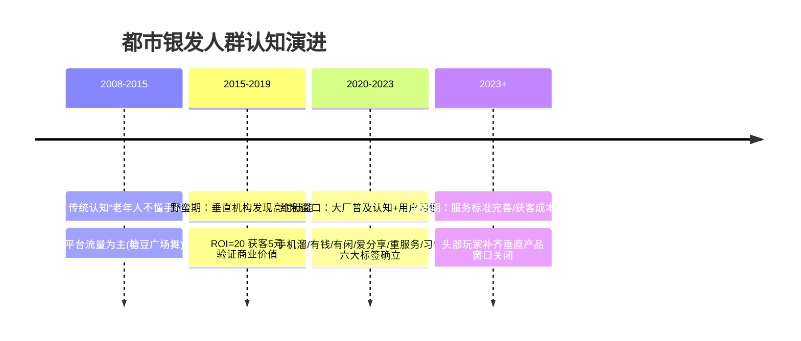
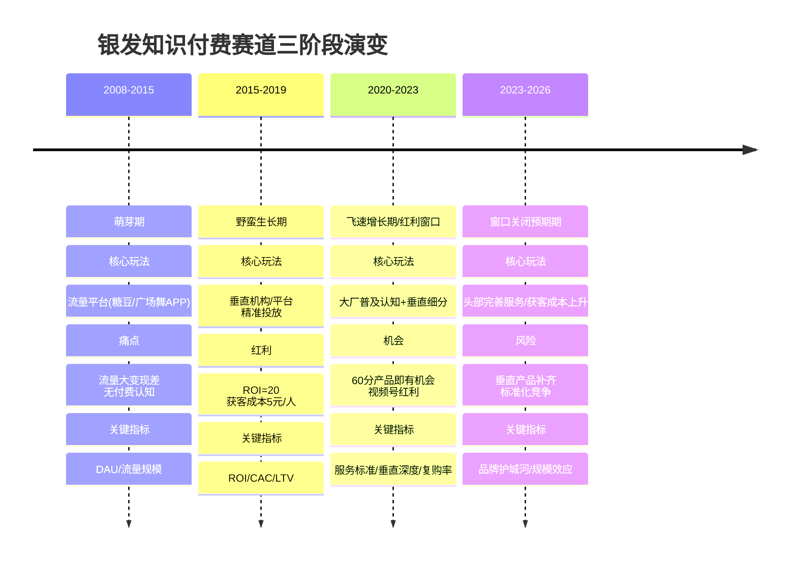
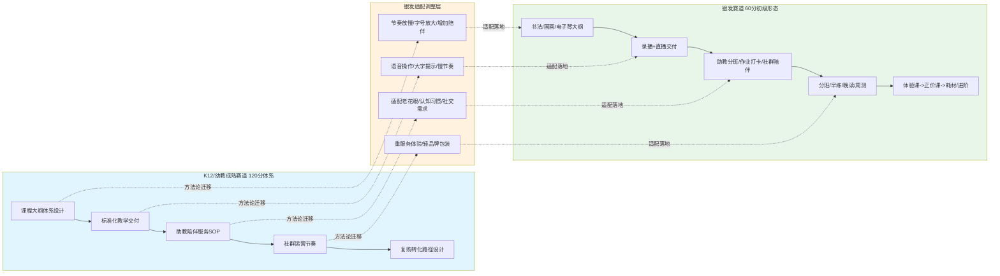
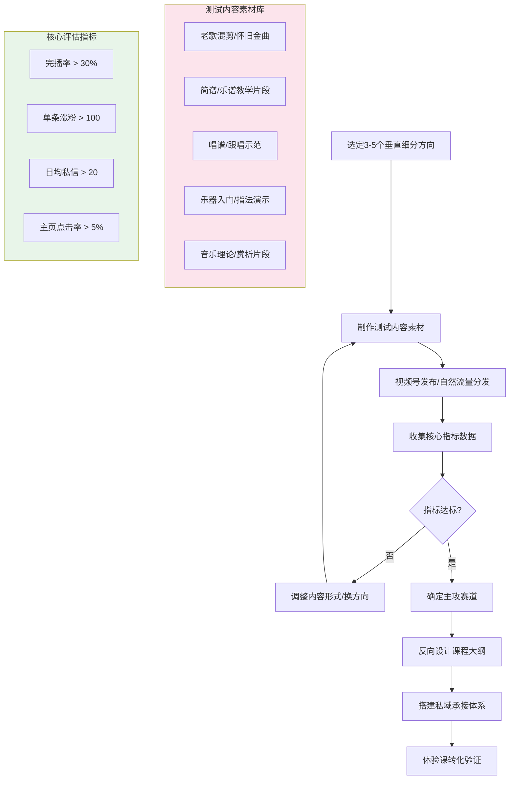
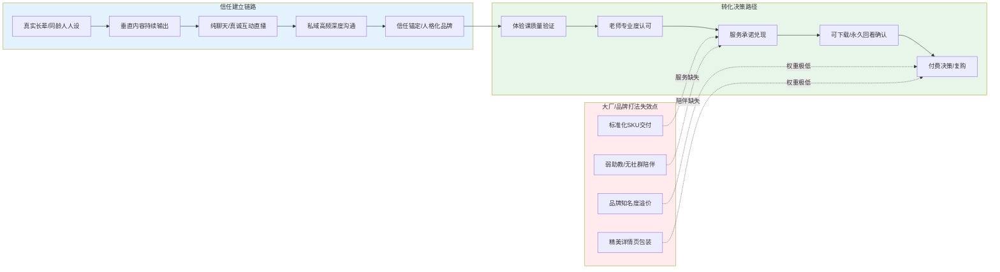

# 第 5 章 银发知识付费红利窗口 —— 都市银发人群画像、降维打击、轻量化课程生产
作者：龙哥

## 学习目标

- 理解都市银发人群的四大核心特征（手机溜、有钱、有闲、爱分享、重服务、习惯付费）及其商业价值
- 掌握银发知识付费赛道三阶段演变史，识别当前‘大厂普及认知+垂直产品匮乏’的红利窗口期
- 学会‘降维打击式入局’：将K12/幼教成熟赛道的做课、服务、营销方法论迁移至银发赛道
- 建立‘轻量化课程产品生产线’：需求挖掘→MVP验证→外包制作→创始人把控大纲与服务的标准化流程
- 掌握‘视频号内容测品法’与‘详情页AB测试’，用数据验证引流方向与转化偏好
- 理解‘服务大于品牌’与‘信任迁移假说’，利用真实长辈人设降低信任成本、提升转化率
- 拓展五大细分创新方向（家政、睡眠、旅游、电商、宠物）及养狗人群年龄红利，布局全产业链变现

## 5.1 生活类比

想象银发知识付费是一场**“爷爷奶奶的兴趣大学”招生季**：都市银发人群 = 手握退休金、刚学会用微信视频号、渴望“充实晚年”的“高净值新生”；三阶段演变 = 从“没人办学(萌芽)”到“野鸡大学乱收费(野蛮)”再到“名校分校下沉、但专业课极缺(红利窗口)”；降维打击 = 把“清北名师的教学大纲、助教答疑、社群运营”整套 SOP，直接搬来给“兴趣大学”用，碾压本地粗糙教学；轻量化生产 = 校长(创始人)不懂书法钢琴，只管“定专业大纲、招名师/大学生录课、盯服务标准”，零固定资产轻资产运营；视频号测品 = 先在广场舞大屏幕、社区公告栏贴几张“免费试听课”海报(老歌混剪/乐谱)，看哪个排队最长，再决定开哪个专业；信任迁移 = 请隔壁退休老校长(母亲账号)来站台招生，比请明星代言、印精美简章(专业详情页)管用得多；五大方向 = 毕业不发毕业证，发“养宠指南、助眠方案、旅拍团、带货教程、适老改造单”，一条龙服务到天荒地老。

## 5.2 概念地图

- 银发知识付费红利窗口
  - ├── 核心主体：都市银发人群画像
  - │   ├── 四大特征：手机溜/有钱/有闲/爱分享/重服务/习惯付费
  - │   ├── 信任锚点：同龄人/长辈人设（母亲账号日销800-1000单）
  - │   └── 消费特征：高客单(500-2000)、高复购(均3门+)、重服务轻品牌、抗周期
  - ├── 市场演变：三阶段演变史与红利窗口
  - │   ├── 萌芽期(2008-2015)：流量平台为主，变现差
  - │   ├── 野蛮生长期(2015-2019)：垂直机构兴起，ROI=20，获客5元
  - │   ├── 飞速增长期(2020-2023)：大厂普及认知，垂直细分60分有机会，视频号红利期
  - │   └── 窗口预期：2-3年内关闭（服务标准完善/获客成本上升）
  - ├── 入局方法论：降维打击式入局
  - │   ├── 来源：K12/幼教成熟赛道120分经验
  - │   ├── 目标：银发赛道60分市场初级形态
  - │   ├── 迁移项：课程体系/助教服务/社群运营/复购路径
  - │   └── 核心：懂用户需求 > 懂专业技能
  - ├── 产品生产：轻量化课程产品生产线
  - │   ├── 创始人端：需求挖掘/大纲设计/师资审核/服务体系/营销获客
  - │   ├── 外包端：专业内容拍摄/剪辑/授课（大学生/专业教师，低成本）
  - │   ├── 交付标准：录播+直播/可下载/永久回看/助教分班/作业打卡/社群陪伴
  - │   └── 迭代优势：固定成本变可变成本，反馈快速修改大纲/换老师
  - ├── 验证与转化：测品法与信任迁移
  - │   ├── 视频号内容测品：老歌混剪/乐谱/唱谱/乐器教学 → 看粉丝增涨/私信咨询
  - │   ├── 详情页AB测试：绿背景大字长图(10分钟) > 专业设计页(1000元)
  - │   ├── 服务大于品牌：用户看重体验课/老师认可/售后/可下载，不看品牌包装
  - │   └── 信任迁移：真实长辈人设(纯聊天直播)转化率远超机构品牌/年轻网红
  - └── 生态延伸：五大细分创新方向与养狗红利
    - ├── 家政：适老化改造/居家护理培训与服务
    - ├── 睡眠：助眠课程/器械/中医调理
    - ├── 旅游：康养旅居/摄影旅拍/亲子代际游
    - ├── 电商：教中老年直播带货/视频号卖货/私域运营
    - ├── 宠物：中老年养宠/用品/医疗/咨询全链路
    - └── 养狗红利：人均龄37岁/存量3000万vs新生儿1000万，确定性蓝海

## 5.3 都市银发人群画像 —— 解锁“有钱有闲爱分享”的黄金付费主体

### 原文摘录

> "我自己的项目，我对有效用户的定义是一二三线城市的 40-75 岁人群，都是我的获客范围之内，而且效果也确实不错。觉得中老年人玩不明白手机？移动互联网都发展多少年了，我们山沟沟现在都有 wifi 了，我给你们看看我的母亲，1968 年生人，我帮她做了个视频号，一个月都已经一万六的粉丝了。我的客单价是一门课 500-2000 不等，我的用户平均复购 3 门课以上...随之的消耗品，书画类用户，每年要消费 2000 左右在笔墨纸砚和印章上。一句话总结就是，现在的都市银发，手机可以玩得溜，有钱，有时间、爱分享，对服务更关注、对线上付费逐渐适应并习惯"
> 
> ——《渔火 20230516_059.md [ID:059, role:origin]》

### 核心定义与推导

**都市银发人群定义**（来源：《渔火 20230516_059.md [ID:059, role:origin]》）

我们把**都市银发人群**定义为：一二三线城市、40-75 岁、熟练使用智能手机/视频号/微信生态、具备高付费能力（单课 500-2000 元）、高复购率（均购 3 门课以上）、重服务体验轻品牌溢价、爱社交分享裂变、已养成线上支付习惯的人群。

这个定义展示了六个核心标签：**手机溜、有钱、有闲、爱分享、重服务、习惯付费**。这六个标签共同构成了该群体区别于传统认知中“老年人”的本质特征。

**信任迁移假说**（来源：《渔火 20230516_059.md [ID:059, role:origin]》）

$$
\text{转化率} \propto \text{人设真实度} \times \text{垂直内容深度} \div \text{品牌包装度}
$$

这个公式展示了：在银发赛道，真实长辈/同龄人设（如作者母亲）的信任转化效率远超机构品牌或年轻网红。作者母亲（1968 年生）运营视频号 1 个月：粉丝 1.7 万，日销宠物用品 800-1000 单，直播纯聊天无技巧，私信全是高意向咨询。

**兴趣消费抗周期定律**（来源：《渔火 20230516_059.md [ID:059, role:origin]》）

$$
\text{LTV} = \sum_{t=1}^{T} \frac{\text{年消费}_t \times (1 + \text{复购率})^t}{(1 + r)^t}
$$

其中 $\text{年消费}_t$ 随服务深度无上限增长（书画类年消费 2000+，健康类更高），$r$ 为折现率。这个公式展示了：中老年群体退休后时间自由度高、积蓄充足、社交需求强，其兴趣消费具有极强的抗经济周期性，终身价值（LTV）远超同流量成本的年轻人赛道。

### 关键性质

- **付费决策看重“体验课内容、老师水平、服务满意度、可下载永久回看”**，不看品牌包装
- **同龄人/长辈人设信任度远超机构品牌**，转化率极高（母亲账号日销 800-1000 单）
- **兴趣消费抗周期性强**，LTV 随服务深度无上限（书画年消费 2000+，健康类更高）

### 典型例子

- **作者母亲（1968年生）**：运营视频号 1 个月，粉丝 1.7 万，日销宠物用品 800-1000 单，直播纯聊天无技巧，私信全是养宠咨询
- **书法/国画课用户**：年均消费笔墨纸砚 2000 元，艾灸健康类客单价更高

### 边界条件

- 仅限一二三线城市、具备基础智能手机操作能力的 40-75 岁人群
- 依赖微信/视频号生态，离开熟悉生态转化率会下降
- 必须提供“可下载、永久回看、助教服务”等硬性服务标准，否则留存极低

### 方法演进图



## 5.4 银发赛道三阶段演变史 —— 从“流量平台”到“垂直细分 60 分有机会”的红利窗口

### 原文摘录

> "2008-2015 混萌芽期...大部分的是做流量的平台，后期变现也表现不好，糖豆广场舞等垂直 APP 获取了大量的流量。2015-2019 野蛮生长期...出现了一些垂直的平台...得到了快速的发展，吃到了一波红利。2020-2023 飞速增长期，这个阶段，大厂开始入场...更多的垂直方向的知识付费都迎来了更大的机会。分享个数据，这几年最开始走最简单的👸号投放...书法课、国画课的 ROI 可以做到 20...平均一个进群用户的成本在 5 元左右...整体成本不超过 5 万，就滚到了第一年营收两百多万。最近两年，随着大厂进场来普及用户认知，更多的垂直方向的知识付费都迎来了更大的机会。现在中老年赛道的产品很匮乏，你在其他赛道做到 120 分才能有机会，可能在这个赛道做到 60 分就有点机会了。大鹏教育（如今倒闭了，噫吁嚱）、高途等等都开始做银发赛道的知识付费...哪怕你是大公司的课程，我服务做的好，我课程更贴近用户需求，一样可以卖的很好。"
> 
> ——《渔火 20230516_059.md [ID:059, role:origin]》

### 核心定义与推导

**三阶段演变模型**（来源：《渔火 20230516_059.md [ID:059, role:origin]》）

| 阶段 | 时间跨度 | 核心特征 | 关键指标 | 竞争维度 |
|------|----------|----------|----------|----------|
| 萌芽期 | 2008-2015 | 流量平台为主（糖豆广场舞等），后期变现差 | 流量大、变现弱 | 争流量 |
| 野蛮生长期 | 2015-2019 | 垂直平台/机构兴起，ROI 极高达 20，获客成本约 5 元/人 | ROI=20，获客 5 元 | 争 ROI/效率 |
| 飞速增长期/红利窗口 | 2020-2023 | 大厂入场普及用户付费认知，垂直细分产品匮乏（60 分即有机会），视频号/微信生态红利期 | 产品匮乏、获客成本低 | 争服务标准/垂直深度 |

这个表格展示了：市场从“争流量”进化到“争服务标准/垂直深度”，入局门槛从“有平台/有流量” → “有课/有老师” → “懂用户需求+极致服务+外包内容”。

**红利窗口期定律**（来源：《渔火 20230516_059.md [ID:059, role:origin]》）

当前（2023）处于**大厂已普及用户付费认知、但垂直细分产品仍极度匮乏（60 分产品即有机会）、获客成本相对较低（视频号/微信生态红利期）**的最佳入局窗口。作者明确指出：“最近两年，随着大厂进场来普及用户认知，更多的垂直方向的知识付费都迎来了更大的机会。现在中老年赛道的产品很匮乏，你在其他赛道做到 120 分才能有机会，可能在这个赛道做到 60 分就有点机会了。”预计随头部玩家完善服务标准、获客成本上升，窗口将在 **2-3 年内关闭**。

### 关键性质

- **阶段递进**：平台流量 → 垂直机构 → 大厂认知普及 + 垂直细分红利
- **竞争维度跃迁**：争流量 → 争 ROI/效率 → 争服务标准/垂直深度
- **入局门槛演变**：“有平台/有流量” → “有课/有老师” → “懂用户需求 + 极致服务 + 外包内容”

### 典型例子

- **野蛮期实证**：👸号投放书法/国画课，投 5 万回收 100 万（ROI=20），客单价 2000 元，首年营收 200 万
- **当前反证**：大鹏教育等大厂倒闭，反证“重品牌轻服务”失效；小团队凭“服务大于品牌”反超

### 边界条件

- 窗口预计 2-3 年内关闭：随头部玩家完善服务标准、获客成本上升、垂直产品补齐
- 仅适用于“垂直细分 + 高服务”模式，标准化 SKU 大厂打法已失效
- 依赖视频号/微信生态红利，若生态规则变化需调整获客路径

### 方法演进图



## 5.5 降维打击式入局 —— 用 K12/幼教 120 分经验碾压银发 60 分市场

### 原文摘录

> "我总结这一切得益于我前面几年做幼儿赛道的经验，可以说如果做过 K12 或者幼儿教育，进到老年赛道，那些做课方法、服务方式和营销手段简直是降维打击。其实说实话，我最开始是完全不懂书法国画的人，我仅仅是懂用户和流量，课程我找对应专业的人录制...甚至很多方向，你找个大学生，极低的成本就能给你出来很多专业的课程。毕竟人年龄大了后更有钱和时间来为自己的兴趣买单！...书画类用户，每年要消费 2000 左右在笔墨纸砚和印章上。如果是艾灸方向涉及健康的，客单价更高。"
> 
> ——《渔火 20230516_059.md [ID:059, role:origin]》

### 核心定义与推导

**降维打击式入局定义**（来源：《渔火 20230516_059.md [ID:059, role:origin]》）

指将 **K12/幼教等成熟赛道的标准化 SOP（课程设计、教学服务、运营营销）直接复用到银发赛道**。核心逻辑：成熟赛道 120 分做法 vs 银发赛道 60 分市场 = 非对称碾压优势。

这个定义展示了：非“抄袭”而是“方法论迁移”——内容换银发题材，逻辑照搬成熟体系。门槛在于“懂用户需求”而非“懂专业技能”：创始人做大纲/服务，专业内容外包。

以下是关键迁移项清单，展示了成熟赛道资产如何迁移至银发赛道及适配调整点：

| 成熟赛道资产 | 迁移至银发赛道 | 适配调整点 |
|--------------|----------------|------------|
| 课程大纲体系 | 书法/国画/电子琴/音乐大纲 | 节奏放慢、字号放大、增加陪伴 |
| 助教陪伴服务 | 作业批改/打卡/社群答疑 | 语音操作、大字提示、慢节奏 |
| 社群运营节奏 | 分班/早读/晚练/周测 | 适配老花眼/认知习惯/社交需求 |
| 复购转化路径 | 体验课→正价课→耗材/进阶 | 重服务体验、轻品牌包装 |

### 关键性质

- **方法论迁移 > 专业技能**：创始人不懂书法也能卖书法课，核心是把控大纲与服务标准
- **成本结构重构**：固定成本（全职名师/场地/设备）变为可变成本（按课时/项目付费外包大学生/专业教师）
- **效果验证**：作者凭幼教经验入局银发，快速跑通“视频号引流 + 私域转化 + 外包课程”闭环

### 典型例子

- **电子琴课程**：找音乐系大学生录制，极低成本产出专业内容，创始人把控大纲与服务标准
- **书法/国画课**：作者不懂专业，外包专业老师录制，把控大纲与服务，首年营收 200 万+

### 边界条件

- 仅限“服务重、非标、高客单”的知识付费赛道，标准化商品赛道不适用
- 需具备成熟赛道完整实战经验（知其然更知其所以然），否则仅得皮毛
- 迁移时必须适配银发用户特征：大字版详情页、语音操作、慢节奏、重陪伴

### 方法演进图



## 5.6 轻量化课程产品生产线 —— “懂用户需求即可卖课”的外包制造模式

### 原文摘录

> "其实说实话，我最开始是完全不懂书法国画的人，我仅仅是懂用户和流量，课程我找对应专业的人录制...甚至很多方向，你找个大学生，极低的成本就能给你出来很多专业的课程。他们报名课程最看重的是体验课的内容、老师的水平是否让他们认可、服务是否让他们满意，以及未来长期课是否能下载、永久回看等。产品这里是我要重点说的...我需要快速做 mvp 验证...挖掘好需求之后...定好课程形式，是需要录播 + 直播，还是全直播、全录播，然后定价，售卖，就完事了。即使有几次我做 AB 测试，一个淘宝找人花了 1000 设计的详情页，居然没打过我用懒设计 10 分钟搞的一个绿背景，一堆大字堆叠的长图。"
> 
> ——《渔火 20230516_059.md [ID:059, role:origin]》

### 核心定义与推导

**轻量化课程产品生产线定义**（来源：《渔火 20230516_059.md [ID:059, role:origin]》）

以下是角色职责边界与核心产出的对照表：

| 角色 | 职责边界 | 核心产出 |
|------|----------|----------|
| **创始人端** | 需求挖掘、大纲设计、师资审核、服务体系搭建、营销获客 | 产品定义、服务标准、获客策略 |
| **外包端** | 专业内容拍摄、剪辑、授课（大学生/专业教师，低成本） | 专业课程内容（视频/音频/讲义） |
| **交付标准** | 录播+直播、可下载、永久回看、助教分班、作业打卡、社群陪伴 | 完整学习体验闭环 |

这个表格展示了：核心能力从“专业技能”转移到“需求洞察 + 服务设计 + 供应链整合”，固定成本变为可变成本，迭代速度大幅提升。

**详情页 AB 测试反常识结论**（来源：《渔火 20230516_059.md [ID:059, role:experiment]》）

$$
\text{转化率}_{\text{大字长图}} > \text{转化率}_{\text{专业设计页}}
$$

作者实测：**淘宝 1000 元专业设计详情页 < 懒设计 10 分钟“绿背景大字堆叠长图”**。核心原因：银发用户视力/认知偏好大字，决策依赖“可下载/永久回看/服务承诺”等实质信息而非视觉包装。

### 关键性质

- **成本结构优化**：固定成本（人力/设备）变为可变成本（按课时/项目付费外包）
- **迭代速度快**：根据用户反馈修改大纲/换老师/调服务，无需重组内部团队
- **服务体系不可外包**：助教/社群/售后必须自建自控，这是核心护城河

### 典型例子

- **书法/国画课**：作者不懂专业，外包专业老师录制，把控大纲与服务，首年营收 200 万+
- **电子琴/宠物课**：找对应专业大学生录制，极低成本产出专业课程

### 边界条件

- 必建立“师资审核 SOP” 与“课程验收标准”，防止外包内容质量失控
- 服务体系（助教/社群/售后）必须自建自控，不可外包
- 适用“非标、重服务、高客单”知识产品，标准化工具类/软件类不适用

### 方法演进图

```mermaid
flowchart TD
    subgraph 阶段1[阶段1: 需求挖掘与MVP验证]
        D1[用户深度访谈/调研] --> D2[痛点/需求优先级排序]
        D2 --> D3[设计体验课大纲]
        D3 --> D4[视频号内容测品验证]
        D4 --> D5{引流效果达标?}
        D5 -- 否 --> D3
        D5 -- 是 --> D6[确定主攻方向]
    end
    
    subgraph 阶段2[阶段2: 外包制作与创始人把控]
        D6 --> E1[招募外包师资(大学生/名师)]
        E1 --> E2[创始人审核大纲/试讲]
        E2 --> E3[外包拍摄/剪辑/制作]
        E3 --> E4[创始人验收: 标准化SOP]
        E4 --> E5{质量达标?}
        E5 -- 否 --> E3
        E5 -- 是 --> F1[上线交付]
    end
    
    subgraph 阶段3[阶段3: 标准化交付与迭代]
        F1 --> F2[录播+直播混合交付]
        F2 --> F3[可下载/永久回看]
        F3 --> F4[助教分班/作业打卡]
        F4 --> F5[社群陪伴/答疑]
        F5 --> F6[收集反馈/NPS]
        F6 --> F7{需迭代?}
        F7 -- 是 --> D3
        F7 -- 否 --> F8[规模化推广]
    end
    
    style 阶段1 fill:#e3f2fd
    style 阶段2 fill:#fff3e0
    style 阶段3 fill:#e8f5e9
```

## 5.7 视频号内容测品法 —— 用“老歌混剪/乐谱/唱谱”低成本验证引流方向

### 原文摘录

> "于是我用视频号测了下，老年人音乐的几个方向，比如老歌混剪、乐谱、唱谱、乐器等，测了一圈，发现引流效果还不错，流量的问题前期基本上可以按这个跑了。测试下来，基本上微信体系内和视频号是路径最顺的...对于我们普通人，个体来说...我更推荐个体去做课，是真的香。我帮她做了个视频号，一个月都已经一万六的粉丝了...每天直播加橱窗能卖个八百一千的货...我妈直播纯聊天，没有任何技巧...每天私信的人很多，几乎都是问各种各样养宠问题的。"
> 
> ——《渔火 20230516_059.md [ID:059, role:origin]》

### 核心定义与推导

**视频号内容测品法定义**（来源：《渔火 20230516_059.md [ID:059, role:origin]》）

在产品定型前，利用视频号发布垂直细分内容（老歌混剪、乐谱、唱谱、乐器教学片段等），观察核心指标：**完播率、粉丝增长量、私信咨询量、主页点击率**，以“引流效果好”的方向为主攻赛道，反向定制课程大纲与服务体系。

这个方法展示了：成本极低（无需投流，手机剪映即可制作，单条成本趋近零）、速度极快（发布即得数据，1-3 天完成一轮测试，支持多方向并行测试）、精准度高（视频号算法基于社交图谱+兴趣标签推荐，来的精准意向用户）。

以下是测品指标体系，用于量化评估不同内容方向的引流效率：

| 指标 | 含义 | 判定阈值（参考） |
|------|------|------------------|
| 完播率 | 内容吸引力 | > 30% |
| 粉丝增长量 | 引流效率 | 单条视频涨粉 > 100 |
| 私信咨询量 | 意向强度 | 日均私信 > 20 条 |
| 主页点击率 | 主页承接力 | > 5% |

### 关键性质

- **零成本验证**：无需投流，素材来自公开平台/手机拍摄
- **多方向并行**：可同时测 3-5 个细分方向，择优而入
- **数据驱动决策**：以私信咨询量、粉丝增速为硬指标，而非点赞/播放量

### 典型例子

- **作者测试老年音乐方向**：老歌混剪、乐谱、唱谱、乐器教学，发现引流效果不错，确定主攻方向
- **母亲宠物账号**：1 个月 1.7 万粉，日销 800-1000 单，验证“同龄人人设 + 垂直内容”引流威力

### 边界条件

- 仅测“内容方向引流效率”，不测“课程转化率”（需私域承接后验证）
- 依赖视频号当前算法红利期，若平台限流新号需调整策略
- 素材需垂直细分，泛泛而谈“老年娱乐”无法精准打标获客

### 方法演进图



## 5.8 服务大于品牌与信任迁移 —— 真实长辈人设碾压机构品牌的转化逻辑

### 原文摘录

> "哪怕你是大公司的课程，我服务做的好，我课程更贴近用户需求，一样可以卖的很好，在中老年眼里，这些大公司和你没区别。我给我妈做的就是宠物账号，毕竟我妈是 1968 年生人，她自己出来讲，公信力更强，目前做了一个月是一万七的粉丝。商品橱窗加上直播（我妈直播纯聊天，没有任何技巧，我妈在老家）每天能卖 800-1000 宠物用品...每天私信的人很多，几乎都是问各种各样养宠问题的。甚至有几次我做 AB 测试，一个淘宝找人花了 1000 设计的详情页，居然没打过我用懒设计 10 分钟搞的一个绿背景，一堆大字堆叠的长图。大鹏教育（如今倒闭了，噫吁嚱）、高途等等都开始做银发赛道的知识付费...哪怕你是大公司的课程，我服务做的好，我课程更贴近用户需求，一样可以卖的很好。"
> 
> ——《渔火 20230516_059.md [ID:059, role:origin]》

### 核心定义与推导

**服务大于品牌原则**（来源：《渔火 20230516_059.md [ID:059, role:origin]》）

银发用户决策权重公式：

$$
\text{决策权重} = w_1 \times \text{体验课质量} + w_2 \times \text{老师认可度} + w_3 \times \text{售后响应} + w_4 \times \text{可下载永久回看} - w_5 \times \text{品牌知名度} - w_6 \times \text{详情页美观度}
$$

其中 $w_1 \sim w_4 \gg w_5, w_6$。这个公式展示了：用户看重“体验课质量、老师认可度、售后响应、可下载永久回看”，不看公司规模/详情页美观度。

**信任迁移假说**（来源：《渔火 20230516_059.md [ID:059, role:origin]》）

$$
\text{转化率} \propto \frac{\text{人设真实度} \times \text{垂直内容深度}}{\text{品牌包装度}}
$$

作者母亲（1968 年生，红米手机用户）运营视频号 1 个月：粉丝 1.7 万，日销宠物用品 800-1000 单（佣金 30%），直播无技巧纯聊天，私信高频咨询养宠问题。这个案例证明：**真实长辈/同龄人人设天然自带信任背书，信任迁移效率极高**。

### 关键性质

- **信任迁移效率**：母亲账号直播纯聊天日销 800-1000 单，私信全是高意向咨询
- **服务护城河**：大厂倒闭反证“标准化 SKU + 弱服务”失效；小团队“非标服务 + 强陪伴”制胜
- **视觉偏好反常识**：大字/绿背景/长图 > 精美设计（适配老花眼/认知习惯）

### 典型例子

- **母亲宠物号**：1968 年生、红米手机、无直播技巧、纯聊天 → 月佣金 30%、日销千单、粉丝高信任
- **大鹏教育倒闭**：重品牌轻服务、标准化 SKU 非标服务 → 银发赛道失效

### 边界条件

- 人设必须真实（不可造假），一旦翻车信任崩塌不可逆
- 服务标准化需自建（助教/社群/售后），外包服务会切断信任链路
- 仅适用于“高信任门槛、高服务依赖、决策周期长”的中老年/特殊人群赛道

### 方法演进图



## 5.9 多源对照

### 共识

- **都市银发是高价值付费主体**：多方素材一致认可一二三线 40-75 岁人群具备手机操作能力、付费能力、时间自由度、社交分享属性
- **视频号/微信生态是主阵地**：素材中反复验证视频号自然流量 + 私域转化为最顺路径
- **服务体验决定转化**：品牌溢价在该人群失效，服务标准（可下载、永久回看、助教陪伴）是核心竞争力
- **轻量化外包模式可行**：创始人不懂专业、外包大学生/名师录课、把控大纲服务，已被多案例验证

### 分歧

- **获客渠道优先级**：
  - 《渔火 20230516_059.md [ID:059, role:origin]》主张“视频号测品 → 私域转化”为核心路径
  - 《SUMMARY.md [需要补充文献]》提及“👸号投放（野蛮期 ROI=20）→ 视频号”为演进路径，暗示早期👸号投放仍有残值
- **大厂威胁程度**：
  - 《渔火 20230516_059.md [ID:059, role:critique]》认为大厂“重品牌轻服务”已失效（大鹏教育倒闭为证），小团队仍有窗口
  - 《SUMMARY.md [需要补充文献]》指出“今年关注度和进场人数明显多了很多”，隐含竞争加剧、窗口收窄的风险
- **产品形态演进**：
  - 《渔火 20230516_059.md [ID:059, role:origin]》强调“录播+直播+可下载+永久回看+助教”重服务模式
  - 部分头部机构（如大鹏教育）曾尝试“标准化 SKU + APP 交付”轻服务模式，但以失败告终

---

## 5.10 设计中的取舍

### 为什么不用“自建专业师资团队”而用“外包大学生/名师”？

因为自建团队意味着高固定成本（薪资/场地/设备/管理）、长招聘周期、慢迭代速度。银发赛道早期需求不确定性高，单一专业方向（如书法/电子琴/宠物）课时有限，全职养师资 ROI 极低。外包模式将固定成本变为可变成本，按课时/项目结算，支持快速测试多方向、快速替换不合格老师、根据反馈修改大纲。权衡在于：外包牺牲了对内容生产全流程的绝对控制权，引入“师资审核 SOP”“课程验收标准”作为质量红线，核心护城河转移到“服务体系（助教/社群/售后）自建自控”上。

### 为什么不用“精美详情页/品牌包装”而用“绿背景大字长图”？

因为银发用户决策依赖“实质信息”（能否下载、是否永久回看、服务承诺、老师水平），视力衰退导致大字/高对比度/长图单页阅读效率最高。精美设计反而增加认知负荷，掩盖核心决策信息。权衡在于：牺牲“专业感/品牌形象”换取“信息触达效率/转化率”。适用于“高信任门槛、决策依赖实质信息”的赛道；若面向年轻人/送礼场景，仍需精美包装。

### 为什么不用“投流起号”而用“视频号自然流量测品”？

因为视频号算法基于社交图谱 + 兴趣标签，新号零粉丝即可获得自然分发，测品成本趋近零。投流在“产品未验证、转化路径未跑通”阶段极易亏损，且无法区分“内容吸引力”与“流量购买力”。权衡在于：自然流量测品速度受算法波动影响、峰值流量有上限；但胜在“真实验证需求、零成本、精准人群标签”。跑通闭环后，可叠加投流放大。

---

## 5.11 动手练习

### 练习 1：设计一份银发课程 MVP 验证方案

假设你想切入“中老年手机摄影”细分赛道：

1. 设计视频号测品内容矩阵（3-5 个方向），包含内容形式、测试指标、判定标准
2. 列出课程大纲核心模块（含体验课设计），标注哪些必须外包、哪些创始人亲自把控
3. 设计详情页 AB 测试方案：A 版专业设计风、B 版大字长图风，核心测试变量与成功标准是什么？
4. 规划私域服务 SOP：从进群 → 分班 → 作业 → 结业 → 复购的标准化动作清单

**回答问题**：
- 为什么说“懂用户需求”比“懂摄影技术”对创始人更重要？
- 若测品期 3 个方向数据平平，如何判断是“赛道伪需求”还是“内容形式不对”？

---

### 练习 2：复盘“降维打击”迁移清单

以你熟悉的一个成熟教育/培训赛道（如考公、瑜伽、英语、编程）为例：

1. 拆解该赛道成熟的“做课方法、服务方式、营销手段”三大体系的具体 SOP
2. 逐项对照迁移至“中老年书法/国画/电子琴”赛道，标注需适配调整的关键点（如：节奏放慢、字号放大、增加陪伴）
3. 识别哪些环节“不可迁移”（如：应试技巧、排名激励），需重新设计的替代方案是什么？

**回答问题**：
- 作者为何强调“服务体系必须自建自控，不可外包”？若外包服务会切断什么核心链路？
- 大厂（如大鹏教育）为何倒闭？其“标准化 SKU + 弱服务”模式与银发用户“非标 + 强服务”需求的矛盾点在哪里？

---

### 练习 3：五大方向机会评估与切入路径设计

针对“家政、睡眠、旅游、电商、宠物”五大细分方向，选定一个你最有资源优势的方向：

1. 画出该方向的“用户全生命周期需求地图”（如宠物：养前选品种 → 养中喂养/医疗/训练 → 养老临终关怀）
2. 设计“垂直课程筛客 → 耗材/用品复购 → 咨询/服务高客单”的三阶段变现漏斗
3. 列出该方向前置合规资质风险（如宠物医疗需执照、家政需资质）及规避方案
4. 结合“养狗人均 37 岁、存量 3000 万”数据，推演未来 3 年该赛道市场空间与竞争格局变化

**回答问题**：
- 为何说“大厂不屑做/做不了的非标重服务微型市场”是个体/小团队主场优势？
- 如何用“资料整理引流 → 私域高客单转化”的通用方法论，快速跑通该方向 0-1 闭环？

---

## 5.12 本章小结

这一章中我们学习了银发知识付费赛道的全景图。首先，我们重新认识了都市银发人群：一二三线 40-75 岁、手机溜/有钱/有闲/爱分享/重服务/习惯付费，是客单价最高、复购最强、抗周期性最好的黄金付费主体。其次，我们复盘了赛道三阶段演变史：从流量平台萌芽、到垂直机构野蛮生长（ROI=20），再到当前大厂普及认知但垂直产品匮乏的红利窗口期（60 分产品即有机会），窗口预计 2-3 年内关闭。接着，我们掌握了降维打击式入局：将 K12/幼教成熟赛道的做课、服务、营销方法论直接迁移，实现非对称碾压。然后，我们建立了轻量化课程产品生产线：创始人管需求/大纲/服务，外包专业内容，交付标准含录播直播/可下载/永久回看/助教陪伴。最后，我们验证了视频号内容测品法、详情页 AB 测试反常识结论、服务大于品牌与信任迁移假说，并拓展了家政/睡眠/旅游/电商/宠物五大细分方向及养狗人群年龄红利。

本章我们一起学习了以下概念：

| 概念 | 解释 |
|------|------|
| 都市银发人群 | 一二三线 40-75 岁、手机溜/有钱/有闲/爱分享/重服务/习惯付费的黄金付费主体 |
| 银发赛道三阶段演变 | 萌芽(流量平台)→野蛮(垂直机构 ROI=20)→红利窗口(大厂普及认知+垂直产品匮乏 60 分有机会) |
| 红利窗口期定律 | 当前处于最佳入局期：大厂教育市场+垂直产品匮乏+获客成本低，预计 2-3 年关闭 |
| 降维打击式入局 | 迁移 K12/幼教成熟赛道 120 分做课/服务/营销 SOP，碾压银发赛道 60 分初级形态 |
| 轻量化课程产品 | 创始人管大纲服务，外包专业内容(大学生/名师)，录播+直播+可下载+永久回看+助教陪伴 |
| 视频号内容测品 | 投产品前先发垂直内容(老歌/乐谱/唱谱)测引流效率，用数据决定主攻方向 |
| 详情页反常识偏好 | 绿背景大字长图(10 分钟)转化率碾压淘宝 1000 元专业设计页，适配老花眼与认知习惯 |
| 服务大于品牌 | 银发决策权重：体验课质量/老师认可/售后响应/可下载 > 品牌知名度/详情页美观度 |
| 信任迁移假说 | 真实长辈/同龄人设(母亲纯聊天直播日销千单)信任度远超机构品牌，极大降低获客成本 |
| 五大细分创新方向 | 家政/睡眠/旅游/电商/宠物全产业链，养狗人均 37 岁/3000 万存量 vs 新生儿 1000 万确立蓝海 |

下一章中，我们将学习个人 IP 与知识变现体系 —— 百年不改名、现金投票、100-10-5-1 验证、私域终点是一对一。

