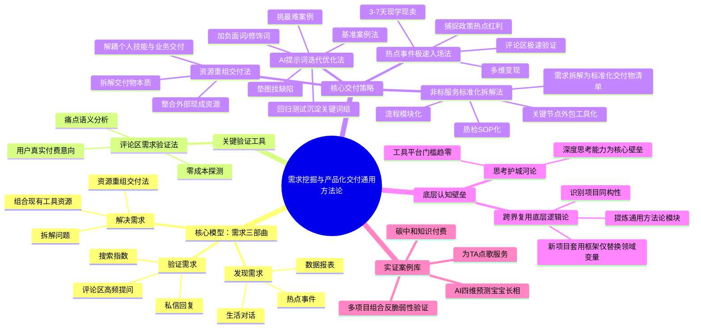
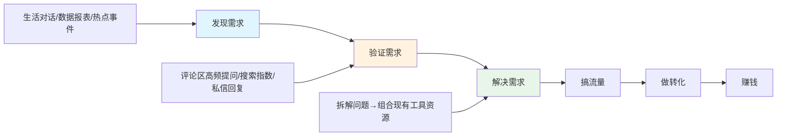
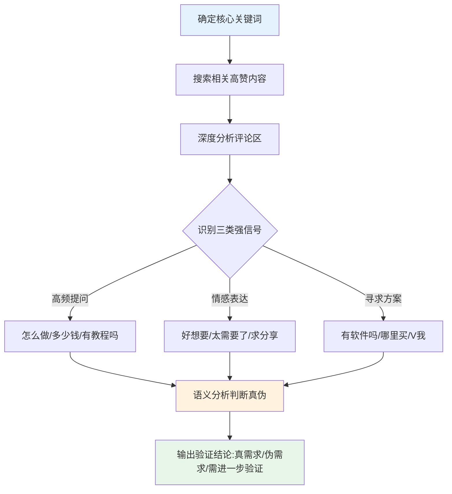
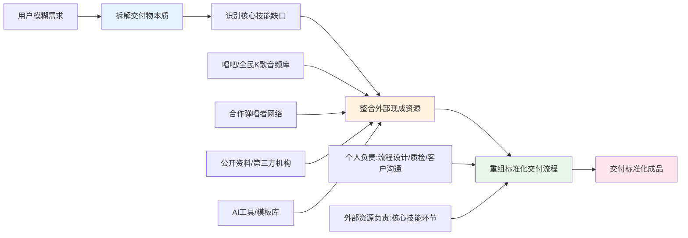
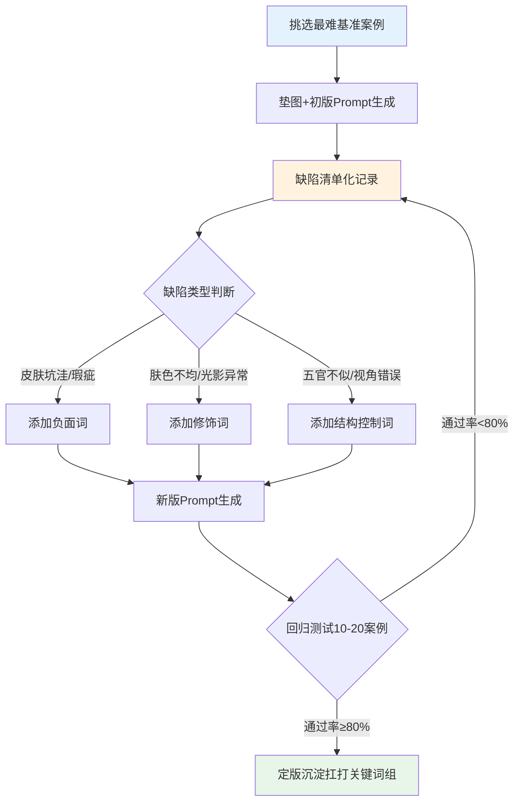
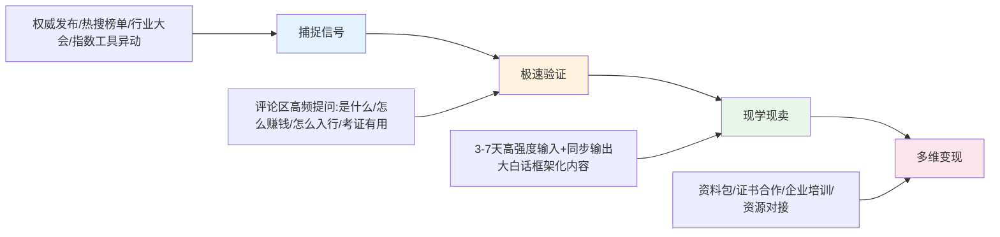
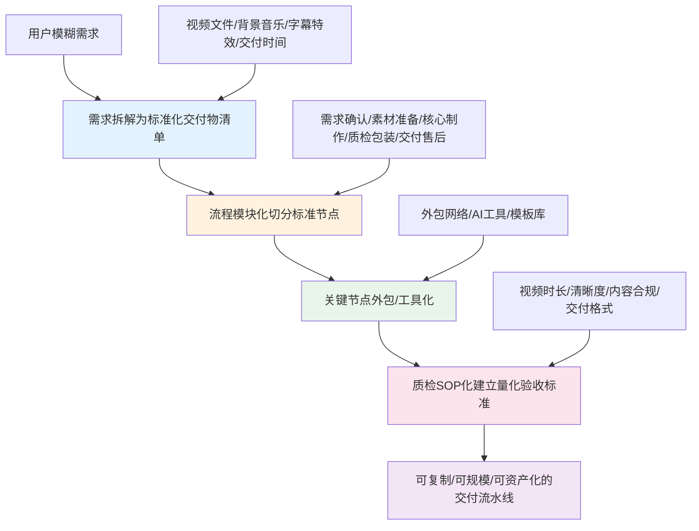

# 第 16 章 需求挖掘与产品化交付 —— 发现、验证、解决需求的通用三部曲
作者：龙哥

## 学习目标

- 理解需求三部曲（发现-验证-解决）的通用商业落地逻辑
- 掌握评论区需求验证法的实操步骤与语义分析技巧
- 了解资源重组交付法如何将非标服务标准化、低成本化
- 掌握AI提示词迭代优化法（基准案例法）构建稳定可控的生成指令集
- 理解热点事件极速入场法（现学现卖）的捕捉-验证-变现全流程
- 掌握非标服务标准化拆解法，将定制化服务转化为可复制SOP流水线
- 建立思考护城河认知：在工具平民化时代，深度思考能力是核心壁垒
- 掌握跨界复用底层逻辑：一套思维模型横扫多赛道的复利范式

## 16.1 生活类比

想象你是一名城市猎人，手里没有枪（不懂核心技术），但有一本《需求生存手册》：需求三部曲就是你的雷达-探针-瑞士军刀三件套。发现需求（雷达）是在街头巷尾的生活对话、卫星图般的数据报表、突发新闻的热点事件中扫描“猎物”踪迹；验证需求（探针）是潜伏在猎物聚集地（评论区），听它们嘀咕“想吃肉”、“哪有卖”、“多少钱”，确认真饿假饿；解决需求（瑞士军刀）是自己不会烹饪（不懂技术），但能组合现成食材（唱吧音频）、雇佣大厨（合作弹唱者）、用餐盒打包（剪辑视频），端上一顿“成品大餐”。AI提示词迭代则像调教猎犬：挑最难搞的猎物（最差四维图）试训，跑偏了（皮肤坑洼）就加绳索（负面词），咬人了（肤色不均）套嘴套（修饰词），直到十次十中（回归测试），得到一条“扛打”的猎犬（关键词组）。热点极速入场如同赶集赶趟：听说隔壁村来了神医（政策/热点），村民围着问“啥病能治”（评论区提问），你三天速成《神医妙方大白话版》（框架化内容），卖方子、卖药引、卖挂号号（多维变现），趁热度散去前收割一波。思考护城河就是猎人经验值：弓箭（AI工具）、陷阱（平台规则）人人都能买，唯有“读懂兽性、懂风向、知地形”的思考经验，让你换把新弓、换个新森林，依然“出手必有回响”。

## 16.2 概念地图



## 16.3 需求三部曲 —— 从生活细节中挖掘、验证并解决真需求的商业落地通法

### 为什么需要这个概念？

普通人创业常陷入“找不到项目”或“跟风工具/平台”的误区，导致试错成本高、成功率低。赚钱本质是解决用户真实需求，而非盲目跟风；项目本身不值钱，挖掘逻辑与思考能力才是持续变现源泉。缺乏一套通用、可复用的方法论，导致面对新赛道时无从下手，只能靠运气。

> "总结一下：1、发现需求：需求无处不在...所以，多留心；2、验证需求：你发现的需求可能是个伪需求...所以，多搜索；3、解决需求：你能解决用户需求...所以，多思考。"
>
> ——《甜瓜：需求挖掘与产品化交付通用方法论》[docs/202305/20230516_073.md]

作者在《需求挖掘与产品化交付通用方法论》中指出，我们要做的就是建立一套标准化的“雷达-探针-瑞士军刀”操作流程。

### 核心定义

**需求三部曲**包含三个连续动作：

1.  **发现需求**：从生活对话、数据报表、热点事件中捕捉用户痛点与渴望
2.  **验证需求**：通过平台评论区高频提问、搜索指数、私信回复等低成本手段，辨别真伪需求
3.  **解决需求**：将需求拆解为具体问题，通过思考组合现有工具/资源（而非硬核自研）逐步攻克

这个模型的关键性质在于：**通用性**（跨行业、跨周期）、**低成本**（验证靠公开数据，解决靠资源重组）、**迭代性**（先跑通、再优化、后规模化的MVP思维)。

### 方法演进流程



### 典型例子

**AI四维预测宝宝长相**：从孕妈群聊天/评论区“想看长相”发现需求，搜索指数/评论区验证，AI提示词迭代+医院合作解决。

**碳中和知识付费**：从政策热点发现需求，评论区“啥是碳中和/怎么赚钱”验证，3天速成输出大白话框架内容变现100万+。

**为TA点歌**：从“表白需求”发现，评论区验证，不会弹唱通过招募合作者/剪辑唱吧素材重组交付。

> "AI 很强大，而且会更强大，但思考以及思考产生的创意，才是最可贵的，很难取代。项目都不值钱，想法才是值钱的，思考才是能让你持续赚钱的源泉。"
>
> ——《甜瓜：需求挖掘与产品化交付通用方法论》[docs/202305/20230516_073.md]

### 边界条件

- 需求必须真实且可付费：伪需求（如仅点赞不买单）会导致后续变现失效
- 解决方案需具备可交付性：核心交付物必须可标准化（如视频、文档），不可标准化的服务难以规模化
- 思考能力是核心壁垒：工具、平台、渠道皆为基建，门槛趋近零；自我设限（不专业、不会技术）是最大拦路虎

---

## 16.4 评论区需求验证法 —— 用户真实声音的零成本探测雷达

### 为什么需要这个概念？

主观臆断的需求往往是伪需求，导致产品无人问津、资源浪费。传统调研成本高、周期长、样本小，不适合个人/小团队快速验证。我们需要一种即时、真实、量化的验证手段，在投入生产前确认市场存在。

### 核心定义

**评论区需求验证法**的操作步骤：

1.  进入短视频/内容平台搜索核心关键词
2.  深度分析高赞/高频评论内容
3.  重点捕捉三类强信号：
    - **高频提问**：“怎么做”、“多少钱”
    - **情感表达**：“好想要”、“太需要了”
    - **寻求方案**：“有软件吗”、“哪里买”
4.  语义分析：区分“凑热闹”与“真购买意向”，以追问细节、表达付费意愿为强信号

> "打开短视频平台...搜索 四维彩照，看相关内容的评论区都在说啥。正常情况下，去看同行的评论区，是最能直接验证需求的"
>
> ——《甜瓜：需求挖掘与产品化交付通用方法论》[docs/202305/20230516_073.md]

### 方法执行流程



### 关键性质

- **零成本**：无需付费工具，仅需时间浏览公开评论区
- **高真实性**：用户非被诱导，自发表达最真实痛点与渴望
- **可量化**：高频词统计、提问占比、情感倾向均可数据化呈现

### 典型例子

**四维预测项目**：评论区出现“有软件可以看长相么（不能再好，相当精准了）”精准锁定付费意向。

**碳中和项目**：评论区高频“碳中和是啥”、“怎么入行”、“考证有用么”验证入门级知识付费需求。

**点歌项目**：评论区“想送女朋友”、“不会弹唱找人帮忙”验证定制化情感服务需求。

> "评论区大致如下：接四维一切顺利...有软件可以看长相么（不能再好，相当精准了）"
>
> ——《甜瓜：需求挖掘与产品化交付通用方法论》[docs/202305/20230516_073.md]

### 边界条件

- 仅适用于已有内容沉淀的赛道：全新蓝海无评论区可参考，需结合搜索指数/测试投放
- 易受刷单/水军干扰：需结合账号权重、历史发言、语义逻辑综合判断真伪
- 只能验证“显性需求”：用户自己说不清、不知道的隐性需求（如乔布斯式创新）无法通过此法捕捉

---

## 16.5 资源重组交付法 —— 不会核心技能也能交付高价值服务的供应链整合术

### 为什么需要这个概念？

普通人常因“不会技术”、“不专业”、“无资质”自我设限，错失商机。传统交付模式强绑定个人核心技能，难以标准化、规模化、复制化。但客户真正需要的是“结果/交付物”（如视频、报告、方案），而非“过程/技能”本身。

### 核心定义

**资源重组交付法**包含四步动作：

1.  **拆解交付物本质**：将非标服务（如现场弹唱表白）拆解为标准化交付物（全程录屏视频）
2.  **识别核心技能缺口**：弹唱技能、专业知识、鉴定能力等个人不具备的硬性能力
3.  **整合外部现成资源**：唱吧/全民K歌素人音频库、合作弹唱者网络、公开资料整理、第三方专业机构
4.  **重组交付流程**：个人负责流程设计、质检、客户沟通；外部资源负责核心技能环节

> "思考二：我就想自己做，不想合作，怎么办？那就分析下我们最终交付了啥？...到底，其实最终交付的是一个视频。剪视频还不简单么~ 那如何满足视频中演唱的内容？只需要有一段素人唱歌的音频即可，那上哪弄呢？唱吧，全民K歌就有啊"
>
> ——《甜瓜：需求挖掘与产品化交付通用方法论》[docs/202305/20230516_073.md]

### 资源重组交付流程图



### 关键性质

- **解耦性**：个人能力与业务交付解耦，个人专注流程把控与客户体验
- **低成本**：利用边际成本近零的数字化资源（音频、模板、公开数据）替代高成本人力
- **可规模化**：标准化交付物+外部供应链网络，突破个人时间/精力上限

### 典型例子

**为TA点歌**：不会弹唱，通过“招募合作弹唱者”+“剪辑唱吧素人音频”双路径跑通，订单接到手软。

**碳中和项目**：不懂专业，通过“3天速成输入”+“大白话框架化输出”+“证书/培训资源对接”变现百万。

**AI四维预测**：不懂AI底层算法，通过“提示词迭代”+“医院渠道合作”构建B2B2C模式。

> "思考一：我不会，但有人会，找会弹唱的人合作...多找几个，男女都找，各种音色的都要"
>
> ——《甜瓜：需求挖掘与产品化交付通用方法论》[docs/202305/20230516_073.md]

### 边界条件

- 交付物必须可数字化/标准化：现场服务、强人际互动类业务难以完全重组
- 质量把控是生命线：外部资源质量不稳定需建立严格验收SOP（如音频质检、内容审核）
- 合规风险：虚拟资料版权、医疗/法律类资质外包、用户隐私保护需提前布局规避

---

## 16.6 AI提示词迭代优化法 —— 用最难案例倒逼出扛打的标准化指令集

### 为什么需要这个概念？

生成式AI（如Midjourney/SD）可控性差、随机性强，直接出图难以稳定商用。通用提示词模板泛化能力弱，垂直场景下细节崩坏（多指、肤色异常、不似）导致废片率高。我们需要一套可复用、可沉淀、可标准化的Prompt工程方法，将AI从“盲盒”变“流水线”。

### 核心定义：基准案例法

**AI提示词迭代优化法**采用逆向思维，不追求“一条Prompt通吃”，而是“基准案例定标准、边界案例测稳健”：

1.  **挑选基准案例**：精心挑选最难、最具代表性的边界案例（如模糊四维图、特殊肤色、复杂构图）
2.  **垫图生成**：上传基准图作为Image Prompt/ControlNet参考，结合初版提示词生成
3.  **缺陷清单化**：系统记录每轮生成的具体问题（皮肤坑洼、肤色不均、瑕疵、五官不似、视角错误）
4.  **针对性加词**：按缺陷类型添加负面词（去坑洼）、修饰词（肤色均匀）、结构词（五官细节、视角控制）
5.  **回归测试**：用10-20个多风格/多难度案例跑测，无重大缺陷则定版，沉淀为“扛打关键词组”

> "1、特意挑了一张看起来就很不好还原的四维图，先垫图... 2、问题出现了，就解决问题，加上相关的关键词，除去皮肤上的坑洼... 3、继续解决问题... 4、再加上关键词... 5、又尝试了其他的案例，出现不太像的问题，于是加上视角，以及五官细节的描述，还原度到位了。以上思考和实践，我们就有了扛打的关键词组。"
>
> ——《甜瓜：需求挖掘与产品化交付通用方法论》[docs/202305/20230516_073.md]

### 迭代优化标准化流程



### 伪代码表示迭代逻辑

```python
def prompt_iteration_optimization(baseline_cases, test_cases, target_pass_rate=0.8):
    """
    AI提示词基准案例法迭代优化主流程
    
    参数:
        baseline_cases: 基准案例集(最难/最具代表性的边界案例)
        test_cases: 回归测试案例集(10-20个多风格/多难度案例)
        target_pass_rate: 目标通过率(默认80%)
    
    返回:
        扛打关键词组(稳定可控的标准化指令集)
    """
    # 1. 选取最难基准案例
    worst_case = select_worst_case(baseline_cases)
    
    # 2. 初始化Prompt
    current_prompt = initialize_prompt()
    
    # 3. 迭代循环
    while True:
        # 垫图生成
        generated = generate_with_image_prompt(worst_case, current_prompt)
        
        # 缺陷清单化
        defects = analyze_defects(generated, worst_case)
        
        if not defects:
            break
            
        # 针对性加词
        for defect in defects:
            if defect.type in ['skin_pits', 'artifacts']:
                current_prompt.add_negative_words(defect.negative_keywords)
            elif defect.type in ['color_uneven', 'lighting_issue']:
                current_prompt.add_modifier_words(defect.modifier_keywords)
            elif defect.type in ['facial_dissimilar', 'angle_error']:
                current_prompt.add_structure_words(defect.structure_keywords)
        
        # 回归测试
        pass_rate = regression_test(current_prompt, test_cases)
        
        if pass_rate >= target_pass_rate:
            break
    
    return current_prompt.finalize_as_keyword_set()
```

上述伪代码实现了基准案例法的核心逻辑：以最难案例为基准，通过缺陷分类驱动的针对性加词策略，在回归测试达到目标通过率后沉淀出稳定可复用的关键词组。

### 关键性质

- **逆向思维**：不追求“一条Prompt通吃”，而是“基准案例定标准、边界案例测稳健”
- **资产化**：沉淀出的关键词组是可复用、可传承、可估值的核心数字资产
- **持续迭代**：模型版本更新、新场景接入时，仅需在基准案例库上增量测试调优

### 典型例子

**四维预测项目**：从“垫图生成→皮肤坑洼加负面词→肤色不均加修饰词→不似加五官结构词→多案例回归”5轮迭代，得出稳定关键词组。

**可复用至**：同类人像还原、老照片修复、虚拟试穿等所有“参考图生成高相似度人像”场景。

> "怎么把四维彩超变成相似度较高的宝宝图片呢？特意挑了一张看起来就很不好还原的四维图，先垫图，用一套简单的关键词，让它生成中国长相的婴儿..."
>
> ——《甜瓜：需求挖掘与产品化交付通用方法论》[docs/202305/20230516_073.md]

### 边界条件

- 依赖特定模型版本：Midjourney V5/V6、SDXL等模型迭代后关键词权重失效需重测
- 仅解决“相似度/可控性”问题：无法解决AI原生缺陷（如文本生成、逻辑推理、长视频一致性）
- 需领域知识支撑：懂摄影光影、人像解剖、色彩理论者迭代效率远高于纯试错

---

## 16.7 热点事件极速入场法 —— 蹭政策/热点红利的“现学现卖”变现范式

### 为什么需要这个概念？

宏观政策/重大事件（如碳中和、ChatGPT发布）会引发全网指数暴涨，形成短周期、高确定性的流量红利窗口。传统“深耕赛道”反应太慢，错过红利期；盲目跟风又无核心壁垒，陷入同质化内卷。我们需要一套“快速捕捉→极速验证→现学现卖→多渠道变现”的标准化动作包。

### 核心定义

**热点事件极速入场法**全流程：

1.  **捕捉信号**：监测权威发布、热搜榜单、行业大会、指数工具（百度指数/微信指数/抖音创意中心）异动
2.  **极速验证**：直奔评论区提取高频提问（“是什么”、“怎么赚钱”、“怎么入行”、“考证有用吗”），确认大众认知断层与付费意愿
3.  **现学现卖**：3-7天高强度输入，同步输出“大白话、条理化、框架化”内容（视频/文档/直播），不求学术深度，只求认知门槛最低
4.  **多维变现**：资料包（低客单引流）、证书合作（高客单分成）、企业培训（B端高复购）、资源对接（信息差佣金）

> "2021年，在大大就碳中和发表讲话后，碳中和的全网指数暴涨...刷了很多视频，尤其是看评论区，高频的评论是‘碳中和是啥’...我花了3天时间高强度输入，同步输出了几条视频...这个号2个月内为我带来100多万利润"
>
> ——《甜瓜：需求挖掘与产品化交付通用方法论》[docs/202305/20230516_073.md]

### 热点极速入场全流程图



### 关键性质

- **时间窗口短**：通常1-3个月红利期，过期即变常识，需极速执行
- **认知套利**：利用“专业信息”与“大众认知”的时间差，赚认知门槛降低的钱
- **产品形态灵活**：不绑定单一形式，视频、文档、社群、课程均可承载

### 典型例子

**碳中和项目**：大大讲话后指数暴涨→评论区“啥是碳中和/怎么赚钱”→3天速成输出→2个月变现100万+（资料包/证书/培训/资源对接）。

**可迁移至**：双碳、元宇宙、ChatGPT应用、银发经济、低空经济等所有“政策驱动+认知断层”赛道。

> "现学现卖，将复杂专业信息转化为‘大白话、条理化、框架化’的内容产品。资料包、证书合作、企业培训、资源对接"
>
> ——《甜瓜：需求挖掘与产品化交付通用方法论》[docs/202305/20230516_073.md]

### 边界条件

- 仅适合“认知型/工具型/资源型”产品：重资产、重供应链、重研发业务无法极速跟进
- 合规红线：证书类需核实机构资质、财税类需规避非法代理、医疗类严禁无资质传播
- 红利期结束后需转型：单一热点项目生命周期短，必须持续挖掘新热点或沉淀为长期IP/私域资产

---

## 16.8 非标服务标准化拆解法 —— 将定制化服务拆解为可复制的标准化交付流水线

### 为什么需要这个概念？

非标服务（定制视频、咨询方案、代写文案）高度依赖个人经验，难以复制、培训、规模化。客户需求看似千差万别，实则可拆解为有限的标准化模块组合。只有标准化，才能实现外包协作、质量把控、SOP沉淀、边际成本递减。

### 核心定义

**非标服务标准化拆解法**四步走：

1.  **需求拆解**：将用户模糊需求（如“帮我表白”）拆解为标准化交付物清单（视频文件、背景音乐、字幕特效、交付时间）
2.  **流程模块化**：将交付流程切分为“需求确认→素材准备→核心制作→质检包装→交付售后”标准节点
3.  **关键节点外包/工具化**：核心制作环节（弹唱、剪辑、写作、设计）通过外包网络/AI工具/模板库标准化解决
4.  **质检SOP化**：建立可量化的验收标准（视频时长、清晰度、内容合规、交付格式），替代主观“觉得好”

> "思考一：我不会，但有人会，找会弹唱的人合作...多找几个，男女都找，各种音色的都要...思考二：...到底，其实最终交付的是一个视频。剪视频还不简单么~ 那如何满足视频中演唱的内容？只需要有一段素人唱歌的音频即可"
>
> ——《甜瓜：需求挖掘与产品化交付通用方法论》[docs/202305/20230516_073.md]

### 非标服务标准化拆解流程



### 关键性质

- **复制性**：新人按SOP即可上手，不依赖资深专家经验
- **规模性**：单人可并行管理多个订单，突破个人时间上限
- **资产化**：SOP、模板库、供应商名单、质检清单均为可估值的组织资产

### 典型例子

**为TA点歌**：将“定制表白视频”拆解为“沟通需求→选歌/改词→对接弹唱素材→剪辑合成→发视频”5步SOP，单人日单量从<5提升至>50。

**写作店铺**：将“代写文案”拆解为“沟通大纲→匹配写手→初稿交付→修改定稿”流程，配合写手分级体系实现年入50万+。

**碳中和培训**：将“企业培训”拆解为“标准课件包+考核题库+证书对接”三件套，实现批量交付。

> "我用这套思维模式，还做成了很多赚钱的方向。比如，陪诊师培训，数藏，鉴渣，相亲盲盒等等"
>
> ——《甜瓜：需求挖掘与产品化交付通用方法论》[docs/202305/20230516_073.md]

### 边界条件

- 核心价值环节不可过度标准化：如高端咨询的“诊断洞察”、艺术创作的“审美判断”仍需专家把关
- 客户个性化需求边界：标准化覆盖80%通用需求，剩余20%高定需求需单独报价/拒单，避免服务异化
- 供应链管理复杂度：外包节点>3个时，协调成本指数级上升，需引入项目管理工具/专人跟进

---

## 16.9 多源对照：需求验证的不同流派

以下表格对比了四种主流需求验证流派的核心差异，数据来源为作者实战总结与行业通用认知综合：

| 维度 | **甜瓜流（本章核心）** | **传统调研流** | **数据分析流** | **MVP实验流** |
|------|------------------------|----------------|----------------|---------------|
| **验证手段** | 评论区语义分析+搜索指数+私信回复 | 问卷/访谈/焦点小组 | 爬虫抓取全网数据建模 | 直接上架测款/投流测品 |
| **成本** | 极低（时间成本） | 高（人力/样本费） | 中（工具/技术成本） | 中高（广告/样品成本） |
| **速度** | 分钟级-小时级 | 周级-月级 | 天级-周级 | 天级-周级 |
| **适用阶段** | 0-1冷启动、赛道切入 | 成熟业务优化、大决策 | 有一定数据积累后 | 有供应链/产品雏形后 |
| **核心优势** | 捕捉“活”的用户语义、情感、付费意愿 | 深度挖掘隐性需求、心理动机 | 样本量大、可量化建模 | 真实交易数据最硬核 |
| **核心劣势** | 受水军干扰、仅限显性需求 | 样本偏差、用户说谎、周期长 | 滞后、缺乏语义理解、工具门槛 | 失败成本高、暴露意图 |

---

## 16.10 设计中的取舍

为什么不用“问卷调研”而是“评论区验证”？问卷调研存在严重的“说做差距”：用户在问卷里说“愿意付费”，真到掏钱包时却消失了。评论区用户是在非被诱导、真实社交语境下自发表达，其追问细节（如“多少钱”、“怎么操作”、“V我”）本身就是高强度的购买信号。且评论区验证零成本、即时见效，完美适配个人/小团队“快速试错、低成本验证”的生存法则。

为什么“资源重组”优于“自学硬技能”？自学一个硬技能（如弹唱、专业剪辑、碳中和专家知识）通常需要数月甚至数年，机会成本极高，且个人精力有限，精通一个技能往往意味着忽略了流程设计、客户获取、质量把控等更高杠杆的环节。资源重组将“技能获取”替换为“供应链整合”，利用边际成本近零的数字化资源（唱吧音频、公开资料、AI工具）在几天内跑通交付闭环，把精力集中在“发现需求、设计流程、控制质量、获取客户”这些不可替代的高价值决策环节上。

“现学现卖”会不会害人？不会，前提是诚实标注“入门/大白话/框架化”定位，不贩卖“专家级/权威/保过”焦虑。大众在热点爆发初期需要的不是学术级深度报告，而是“听得懂、用得上、买得起”的认知脚手架。作者碳中和项目的用户反馈正是“终于听懂了”、“省去了大量筛选时间”，这才是真实价值。合规红线在于：不碰资质强制类（医疗/法律/财税执业）、不造假数据/案例、不承诺不可控结果。

---

## 16.11 动手练习

### 练习1：评论区需求验证实战

选定一个你感兴趣的细分赛道（如：AI老照片修复、考公资料整理、宠物训练教程），在抖音/小红书/视频号搜索核心关键词，找到点赞前10的相关笔记/视频：

1. 记录评论区高频提问TOP5（如‘怎么操作’、‘多少钱’、‘有教程吗’）
2. 统计表达付费意愿的评论占比（如‘想买’、‘多少钱买’、‘V我’）
3. 识别3个‘伪需求’信号（如单纯点赞、转发、无实质追问）
4. 基于真实需求，写出该赛道的‘最小可行性交付物’清单（如：一份PDF教程、一个视频演示、一套提示词）

回答问题：
- 如果评论区全是‘感谢分享’‘学到了’，没有追问细节，说明什么？
- 如何区分‘水军刷单评论’与‘真实用户需求’？

### 练习2：资源重组交付方案设计

假设你想做‘定制儿童绘本’生意（用户提供孩子照片/特征，生成主角是孩子的绘本故事视频），但你不会画画、不会写故事、不会剪辑：

1. 拆解核心交付物：用户最终拿到手的是什么？（提示：不是‘绘画服务’而是______）
2. 识别核心技能缺口：画画、写故事、剪辑、配音
3. 为每个缺口设计‘外部资源整合方案’（如：AI绘图工具、ChatGPT写故事、剪映模板、TTS配音、兼职插画师群、素材网站）
4. 设计标准化交付流程SOP（5-7步），明确你亲自做的环节（质检/沟通）与外包/工具化的环节

回答问题：
- 如果AI生成的绘本角色一致性很差（每页长相不一样），如何用‘资源重组’思路低成本解决？
- 当订单量从日单5单增至50单时，哪个环节最先成为瓶颈？如何标准化破局？

### 练习3：AI提示词迭代优化（基准案例法）

任务：用Midjourney/SD生成‘统一风格的IP形象三视图’（正面/侧面/背面），要求角色五官一致、服饰细节不变：

1. 选定1个最难的基准案例（如：复杂发型+花纹服饰+特殊肤色的角色设定图）
2. 写初版Prompt生成，记录3个主要缺陷（如：侧面脸型崩坏、服饰花纹断裂、背面视角错误）
3. 针对每个缺陷添加对应控制词（如：--cw权重、ControlNet OpenPose、负面词：asymmetry, broken pattern）
4. 用5个不同角色设定图回归测试，统计‘三视图一致性合格率’
5. 迭代至合格率≥80%，输出最终‘扛打关键词组’模板

回答问题：
- 为什么要用‘最难案例’做基准，而不是‘平均案例’？
- 模型版本更新（如MJ V6→V7）后，原关键词组失效，如何用最低成本完成迁移适配？

### 练习4：热点事件极速入场推演

假设今日发布重大利好政策：‘国家大力支持银发经济，鼓励开发适老化智能产品与服务’：

1. 立即去抖音/小红书/微信指数搜‘银发经济’‘适老化’，截取过去24小时指数走势图
2. 进入相关高赞视频评论区，提取高频用户提问TOP10（如：‘啥是银发经济’‘适老化手机怎么选’‘给老妈买啥好’）
3. 设计‘3天现学现卖’内容生产计划：每天输出3条‘大白话/框架化’视频/图文，标题直接对应高频提问
4. 规划4层变现产品矩阵：引流款（9.9元适老化选品清单）→ 信任款（99元适老化产品避坑指南）→ 核心款（499元子女陪伴指导课）→ 高客单（2999元机构适老化改造咨询/资源对接）

回答问题：
- 为什么要用‘大白话/框架化’而非‘专业深度分析’？
- 红利期预计1-3个月，如何在热度消退前完成‘私域沉淀→后端转化’闭环？

### 练习5：跨界复用思维模型迁移

回顾你过去半年接触的3个不同项目/副业尝试（哪怕失败的）：

1. 用‘需求三部曲’复盘每个项目：当时是如何‘发现-验证-解决’需求的？哪个环节做得最烂？
2. 抽象出可复用的‘标准动作模块’（如：评论区验证SOP、AI迭代SOP、资源重组清单、热点捕捉雷达）
3. 设想一个全新赛道（如：AI数字人直播带货、出海独立站、低空经济周边），尝试仅用上述模块拼装出该赛道的‘0-1启动清单’
4. 标注清单中哪些是‘通用模块’（直接复用），哪些需要‘领域知识注入’（需重新学习/找人）

回答问题：
- 为什么说‘思考模型跨域复用能力强于单一业务护城河’？结合你的复盘谈理解
- 如何避免‘拿着锤子找钉子’（生搬硬套模型而忽视赛道差异）？

---

## 16.12 本章小结

这一章中我们学习了一套从零开始挖掘并落地商业项目的通用思维模型——「需求三部曲」。首先，我们理解了**发现需求**是从生活对话、数据报表、热点事件中捕捉痛点的雷达；其次，我们掌握了**评论区需求验证法**这一零成本探针，通过分析高频提问、情感表达、寻求方案三类强信号辨别真伪需求；接着，我们学习了**资源重组交付法**，通过拆解交付物本质、整合外部现成资源，实现了个人能力与业务交付的解耦；然后，我们深入剖析了**AI提示词迭代优化法**（基准案例法），用最难案例倒逼出扛打的标准化指令集；最后，我们串联了**热点事件极速入场法**与**非标服务标准化拆解法**，并确立了**思考护城河论**与**跨界复用底层逻辑论**两大核心认知壁垒。

本章我们一起学习了以下概念：

| 概念 | 解释 |
|------|------|
| 需求三部曲 | 发现-验证-解决：通用商业落地闭环，项目不值钱，挖掘逻辑与思考能力才是持续变现源泉 |
| 评论区需求验证法 | 零成本探测用户真实付费意向：高频提问（怎么做/多少钱）、情感表达（好想要）、寻求方案（有软件吗） |
| 资源重组交付法 | 拆解交付物本质（视频而非现场技能）→整合外部资源（唱吧音频/合作网络）→实现个人能力与业务交付解耦 |
| AI提示词迭代优化法 | 基准案例法：挑最难案例垫图→发现缺陷→针对性加负面词/修饰词/结构词→多案例回归→沉淀扛打关键词组 |
| 热点事件极速入场法 | 捕捉政策/热点指数暴涨→评论区提取高频提问（是什么/怎么赚钱）→3-7天现学现卖输出大白话框架内容→多渠道变现 |
| 非标服务标准化拆解法 | 需求拆解为标准化交付物清单→流程模块化→关键节点外包/工具化→质检SOP化，实现可复制、可规模、可资产化 |
| 思考护城河论 | 工具/平台皆基建门槛趋零，核心壁垒在于问题定义/拆解/资源组合的深度思考能力，自我设限是最大拦路虎 |
| 跨界复用底层逻辑论 | 识别项目同构性→提炼通用方法论模块→新项目套用框架仅替换领域变量，实现‘分属不同行业，实为同一件事’的跨域复利 |

下一章中，我们将学习 **ChatGPT Plus 长期稳定访问基建 —— 网络、身份、支付三位一体合规方案**，看看如何构建跨境业务长期可复用的基础设施资产。

