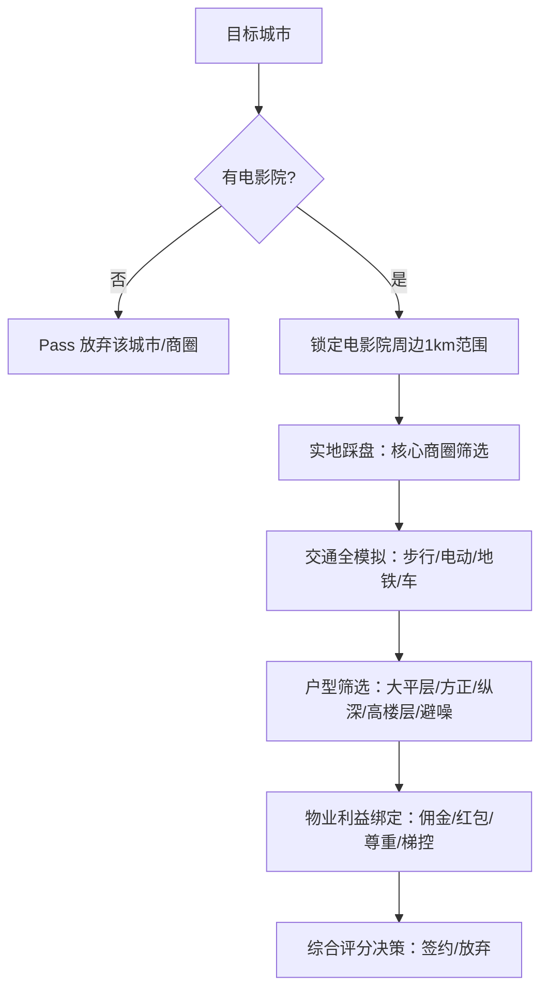
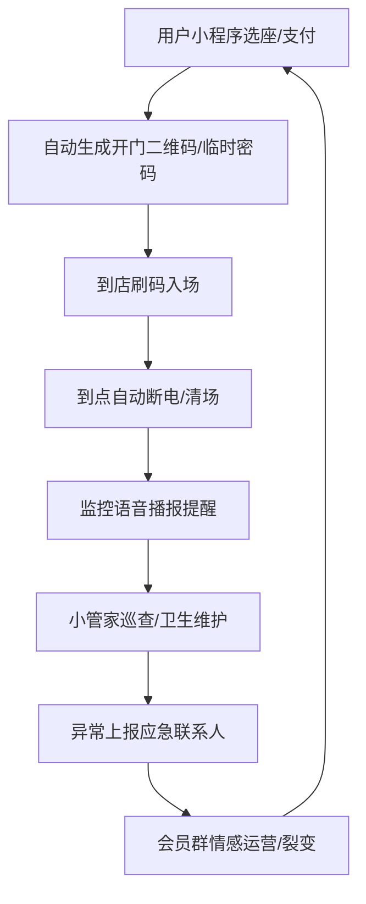
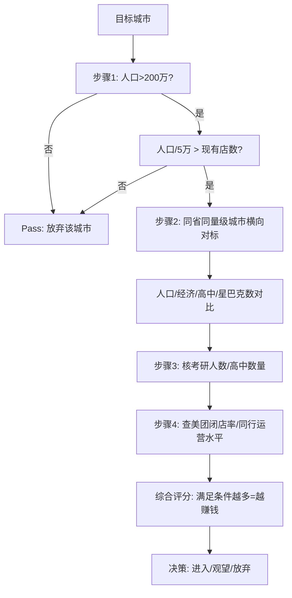

# 第 4 章 平民实体创业标准化手册 —— 消费力套利、选址法则、无人值守3.0模式

## 学习目标

- 理解消费力套利的核心逻辑与适用边界
- 掌握电影院选址法则与实地踩盘SOP的执行标准
- 掌握首年利润率公式与城市筛选四步判断法的量化决策流程
- 掌握极简装修交付标准与谈判签约组合拳的标准化动作库
- 理解无人值守3.0模式的系统架构与佛系运营的底层心理机制
- 能根据自身资源禀赋判断是否适合切入三四线实体创业赛道

## 4.1 生活类比

**隐喻一：自助餐厅里的「价格剪刀差」**  
想象一下，你在一个三四线城市的核心商圈，用一线城市的价格菜单、三线城市的房租成本，开了一家「自助餐厅」。食客自己拿餐盘取餐，结账时按一线城市的单价付费，但你的食材采购、场地租金、甚至偶尔请来帮忙收拾盘子的阿姨工资，全都按老家县城的价格结算。中间的差价，就是纯利润 —— 这就是**消费力套利**的直观写照。

**隐喻二：跟着巨头「蹭选址」**  
你不需要自己去研究人流、选址，直接跟着「肯德基、麦当劳、电影院」这些自带「选址大脑」的巨头走，它们选哪个商圈，你就开在隔壁1公里内，省去了踩点试错的学费 —— 这就是**电影院选址法则**的降维打击。

**隐喻三：像点外卖套餐一样「装修+签约+运营」**  
开店前，你先坐下来算笔账：客单价乘以翻台率乘以365天，除以年房租加装修设备，等于投资回报率；算不明白绝不签合同，把「赌概率」变成「算确定性」 —— 这就是**首年利润率公式**的决策前置威力。装修时，你像点外卖套餐一样下单：固定菜单（工艺、材料、品牌）、固定送达时间（5-7天）、固定价格（包干无增项）、固定质量（标准化清单），拒绝「厨师推荐、今日食材有变」的非标坑 —— 这就是**极简装修交付标准**的标准化交付。谈判租房时，你像买车一样：先装专家只挑缺点压预期，再砍到死价抛出「半年付/月付」现金流筹码换降价、免租、条款，最后塞进「不涨租、不卖房、配合证照」护身符，物业经理用一顿烟钱（100元）搞定整个利益链条 —— 这就是**谈判签约组合拳**的组合拆解逻辑。经营起来，餐厅变成了「智能图书馆」：手机下单（小程序选座）、刷码开门（电子门锁）、到点自动清场（断电）、会员自治（志愿者换免费时长）、保洁外包给楼上酒店阿姨（10元/天）、超卖座位（借鉴健身房逻辑）、羊毛党反而造氛围 —— 这就是**无人值守3.0模式**的零人力闭环。

这一整套打法，把实体创业从「靠运气、拼直觉、烧钱试错」变成了「算好账、按标准、可复制、低风险」的标准化手册。

## 4.2 概念地图

平民实体创业标准化手册
├── 核心商业逻辑
│   ├── 消费力套利  —— P001
│   │   ├── 定义：三四线城市同价异成本的价格剪刀差
│   │   ├── 核心公式：首年利润率 = (月卡价×座位数×85%×12)/(年租+软硬件成本)
│   │   ├── 适用业态：非标准化、强体验、高频次的休闲/学习/社交类消费
│   │   └── 典型验证：龙岩店首年255%/次年638%利润率、汕头vs佛山蓝海对标
│   ├── 三四线城市实体创业确定性定理  —— P001
│   └── 自习室人群分层与需求映射定理  —— P001
├── 选址决策体系
│   ├── 电影院选址法则  —— P002
│   │   ├── 唯一硬指标：有电影院开1公里内，无则Pass
│   │   ├── 底层逻辑：成熟商业体选址大脑的免费复用
│   │   └── 验证手段：交通全模拟(步行/电动/地铁/车)体感测算
│   ├── 实地踩盘SOP  —— P002
│   │   ├── 核心商圈筛选(电影院/麦肯/时尚业态)
│   │   ├── 户型筛选(大平层/方正/5.5-6m纵深/高楼层/避噪)
│   │   └── 物业利益绑定(佣金/红包/尊重/解决梯控门禁)
│   └── 城市筛选模型  —— P006
│       ├── 步骤1：人口>200万且人口/5万>现有店数
│       ├── 步骤2：同省同量级城市横向对比(人口/经济/高中/星巴克)
│       ├── 步骤3：核考研人数、高中数量
│       └── 步骤4：查美团闭店率及同行运营水平
├── 空间交付体系
│   ├── 极简装修交付标准  —— P003
│   │   ├── 五固定包干制：工艺/材料/品牌/工期/报价
│   │   ├── 5-7天极速交付流程
│   │   ├── 标准化清单：地毯拼装/匚字椅/小米AX6000/全软硬件清单
│   │   └── 结款比例：2:3:5或装完付费
│   └── 谈判签约组合拳  —— P005
│       ├── 看房话术：波澜不惊/装老手/只谈缺点
│       ├── 砍价策略：极限砍价→抛半年付/月付筹码→换让价
│       ├── 核心条款包：免租装修期/不涨租不卖房/配合证照/留开票权
│       └── 物业博弈：佣金/红包/尊重绑定利益群体
├── 运营管理体系
│   ├── 无人值守3.0模式  —— P004
│   │   ├── 硬件层：小程序选座/开门/断电/监控语音/远程门锁
│   │   ├── 组织层：会员制私域/小管家志愿者(课时换巡查)/酒店保洁(10元/天)
│   │   ├── 策略层：2倍超卖/佛系运营/情感连接(照片墙/打卡榜/早晚打卡送课时)
│   │   └── 零固定人力成本闭环
│   ├── 佛系运营  —— P001
│   │   ├── 容忍羊毛党造氛围/营造满座感
│       ├── 情感连接：上岸照片墙/打卡排行榜/早晚打卡送课时
│       └── 监控语音播报替代人工管控
│   ├── 产品矩阵定价法  —— P001
│       ├── 全价格带覆盖：次卡/小时卡/天/周/月/季/半年/年/固定/储值
│       ├── 长期卡营销化命名(如必过冲刺卡)
│       ├── 座位少则减短期卡筛选客群
│       └── 定价向目标产品倾斜/规则由商家制定
│   └── 私域裂变获客体系  —— P001
│       ├── 全平台铺货(美团/大众/小红书/抖音本地生活)
│       ├── 评论区人工干预/引导加微入群
│       ├── 小管家招募(送课时/专属团单)
│       └── 综合成本优势实现赢家通吃
└── 实证验证体系
├── 龙岩店实盘回测：首年255%/次年638%利润率  —— P006
├── 汕头vs佛山蓝海对标验证  —— P006
├── 物业利益绑定降维打击：100元搞定垃圾清运/全系统配合  —— P005
├── 小管家志愿者替代保洁/酒店保洁10元/天  —— P004
├── 存量市场赢家通吃演进定理  —— P001
└── 副业可行性与规模化临界点声明  —— P001

## 4.3 消费力套利 —— 让三四线城市拥有「一线价格·三线成本」的价格剪刀差

### 为什么需要这个概念？

你有没有想过，为什么在三四线城市开一家自习室、台球厅或咖啡店，反而比在北上广更容易赚钱？  

一二线城市实体创业房租人工高、回本周期长、抗风险差，普通人难以承担。但三四线城市居民对品质消费（瑞幸、台球、自习室）的心理价位与一二线基本持平，而房租、人工成本显著更低。这种「同价异成本」的错位，创造了小成本、高确定性、可复制的创业套利窗口。

> "我开店的逻辑有很多，最重要的一条，我装逼地把它叫做，「消费力套利」，起因是做社会实践的过程中发现一个很有意思的现象，就是三四线城市的休闲娱乐，生活消费往往不输一二线，但是人工和场地成本却远低于一二线城市"
> 
> ——《docs/202305/20230516_054.md [P001]》

> "人们对所谓「品质生活」的判定有着相差无几的标准，三两好友去吃个宵夜大排档，在舟山和在宁波，都要两百多，一杯瑞幸在广州和在中山，打台球，上网一小时在厦门和在龙岩，人们的心理价位，并没有太大的差别"
> 
> ——《docs/202305/20230516_054.md [P001]》

### 核心定义与推导

**消费力套利**（来源：《docs/202305/20230516_054.md [P001]》）

利用三四线城市消费支付意愿接近一线、但运营成本远低于一线的结构性错位，以低成本（3-6万）换取高回报（首年ROI 200%+）的商业逻辑。

核心公式：

$$
\text{首年利润率} = \frac{\text{月卡价格} \times \text{座位数} \times 85\% \times 12}{\text{全年房租} + \text{软硬件总成本}}
$$

**公式逐项拆解与推导说明：**

| 变量 | 含义 | 来源与设定依据 | 为什么这样设定 |
|------|------|----------------|----------------|
| 月卡价格 | 单位座位的月度定价 | 市场调研得出，三四线城市用户对品质自习室的心理价位与一线持平（如500元/月） | 直接决定收入上限，定价策略详见4.9节产品矩阵定价法 |
| 座位数 | 单店可售卖的工位总数 | 受限于可用面积与布局标准（如50座/80平米），非固定座位制下可超卖 | 分母成本基本固定时，座位数与收入成正比，边际收益递减点见练习1 |
| 85% | 运营折损系数 | 经验值：覆盖空置率、请假率、设备折旧、超卖与空置的抵消、非完美运营损耗 | 非90%（过于乐观）也非80%（过于保守），实测中等运营水平下的真实留存率 |
| 12 | 年化系数 | 将月度收入投射为年度收入 | 假设全年无长期停业，月卡连续售卖 |
| 全年房租 | 单店最大固定成本 | 合同锁定的年度现金流出，含免租期折算 | 决策前置的核心锚点，谈判目标为压低分子 |
| 软硬件总成本 | 一次性沉没成本 | 含装修包干、桌椅、智能门锁/路由器、小程序SaaS、软装/文具/零食/应急包等 | 首年计入分母，次年剔除（仅保留折旧），形成复利效应 |

这个公式展示了三个关键变量的乘积关系：(1) 单位座位的年化收入潜力（月卡价×12）；(2) 85% 的运营折损系数，覆盖空置、请假、设备折旧等隐性损耗；(3) 分母为全周期投入成本（房租+一次性软硬件投入）。租房前算透这个式子，创业就从「赌概率」变成了「算确定性」。

> "首年利润率=（月卡价格 x 座位数 x85%x12）/（全年房租+软硬件总成本）"
> 
> "这个公式牢牢记在心里，基本上还没租房，你就能知道今年要赚多少钱咯"
> 
> ——《docs/202305/20230516_054.md [P001]》

### 关键性质

- **决策前置性**：租房前即可测算盈利预期，将创业从「赌概率」变为「算确定性」。
- **成本结构极简**：除房租外几乎无循环成本（无库存、无人工、水电网极低）。
- **规模门槛低**：30-50座位、3-6万投资即可启动，适合个人/副业/小团队。

### 典型例子

- **龙岩店实测**：50座、月卡500元、年租10万、软硬件成本含首年 → 首年利润率255%，次年利润率跃升至638%。
- **汕头vs佛山对标**：同量级城市（400万人口），佛山100家自习室，汕头仅2家，经济/高中/星巴克/电影院数量相当，汕头被判定为典型蓝海。

> "举个例子，龙岩，低估单价，多算了成本，超卖的和空置抵消，按运营水平中等，再打个八五折， 首年，50 个座位的店，按月卡 500 来算，5005012*85%=255000/100000=255%， 首年之后，就是 5005012*85%=255000/40000=638%"
> 
> ——《docs/202305/20230516_054.md [P001]》

> "汕头 400 万人，佛山 400 万人，佛山 100 家自习室，汕头只有 2 家，两个城市经济差不多，高中数量差不多，电影院和星巴克的数量都差不多，那么，汕头，是不是机会？嗯嗯"
> 
> ——《docs/202305/20230516_054.md [P001]》

### 边界条件

- 仅适用于非标准化、强体验、高频次的休闲/学习/社交类消费（咖啡、台球、自习室、麻辣烫等）。
- 要求城市人口>200万，且满足「人口/5万 > 现有店数」的供需缺口测算。
- 依赖电影院等成熟商业体选址能力，无电影院城市需额外验证商业聚合度。

[需要补充文献] 关于「三四线城市消费支付意愿与一二线持平」的量化实证研究，建议引入《中国城市商业魅力排行榜》消费指数、尼尔森/凯度消费者面板数据、或《中国县域消费升级白皮书》作为交叉验证来源。

## 4.4 电影院选址法则 —— 用「成熟商业体的选址大脑」替代自己的选址直觉

### 为什么需要这个概念？

选址是实体店生死线，传统靠经验/直觉/中介推荐，失误率高、试错成本大。电影院是商业选址最顶级的「验证器」：其选址综合了人流、年轻客群、购买力、交通、商业成熟度。你需要一个可执行、可验证、零成本的硬性选址标准，降维打击选址失误。

### 核心定义

**电影院选址法则**（来源：《docs/202305/20230516_054.md [P002]》）

> "唯一法则，有电影院，只开在电影院周边一公里内，无电影院则 pass"
> 
> ——《docs/202305/20230516_054.md [P002]》

- 唯一硬指标：有电影院，只开在电影院周边1公里内；无电影院，则Pass（放弃该城市/商圈）。
- 电影院代表：成熟商业聚合能力 + 年轻高消费客群聚集度 + 完善交通配套 + 黄金商圈确认。

### 关键性质

- **排他性**：不看商场、不看写字楼、不看学校，只看电影院，决策链条极短。
- **可验证性**：打开地图搜「电影院」即可完成初筛，无需实地跑断腿。
- **抗周期性**：电影院生存周期长，代表商圈长期价值，而非短期热点。

### 实地踩盘SOP

作者进一步给出了「双脚丈量」的标准化动作库：

```
1. 核心商圈筛选：电影院1km、麦肯/肯德基选址参考、时尚业态聚集度
2. 交通全模拟：车/电动/地铁/步行全链路体感测算（模拟自己是来自习的学员）
3. 户型筛选：大平层、方正无柱、5.5-6m纵深、高楼层、避开餐饮噪音/违建
4. 物业利益绑定：佣金/红包/尊重/解决梯控门禁（物业是位卑权重，要的是尊重）
```

> "用双脚丈量你的江山，步行绕圈，用体感去品这个商圈的氛围"
> 
> ——《docs/202305/20230516_054.md [P002]》

> "必须模拟自己是个来自习的选手，从附近小区不行来自习，电动车来自习...将心比心，模拟全过程"
> 
> ——《docs/202305/20230516_054.md [P002]》

> "物业好不好说话...要和物业一条心，物业这块啊，是位卑权重，人要的甚至不是钱，是尊重"
> 
> ——《docs/202305/20230516_054.md [P002]》

### 选址决策流程图



这张流程图展示了从城市筛选到具体铺位决策的完整标准化路径：先用电影院这一硬指标做城市/商圈级初筛，再用双脚丈量的体感验证做微观决策，最后通过物业利益绑定锁定运营便利度。

### 典型例子

- 作者所有店均遵循此法则，龙岩店、汕头店选址均在电影院1公里范围内。
- 反面教材：曾因中介推荐偏离电影院商圈选址，导致引流困难、运营举步维艰。

### 边界条件

- 仅适用于面向年轻客群、依赖即时消费/社交属性的业态（自习室、咖啡、台球、麻辣烫等）。
- 电影院必须为正常运营的主流影院（非即将倒闭/偏远/仅放映特殊题材）。
- 1公里为物理距离，需结合「交通全模拟」验证实际到达便利度（步行/电动/地铁/车）。

[需要补充文献] 关于「电影院选址作为商业聚合度代理指标」的有效性，建议引入商业地产选址模型文献（如Huff模型改进版、重力模型在商业选址中的应用）或头部商管公司（万达/华润/大悦城）内部选址白皮书进行学术背书。

## 4.5 极简装修交付标准 —— 让装修像买套餐一样标准化、固定价、固定期、固定质量

### 为什么需要这个概念？

传统装修：增项多、工期长、质量不可控、垃圾清运扯皮、沟通成本极高，是创业最大坑之一。实体店核心竞争力在运营而非装修，装修只需「及格、耐用、标准、快」。我们需要将装修从「非标工程」转化为「标准化产品」，实现5-7天极速交付。

### 核心定义

**极简装修交付标准**（来源：《docs/202305/20230516_054.md [P003]》）

> "固定的装修标准，工艺，工期，材料，品牌，材质，装修垃圾都包处理，包工包料，包干（无任何其他费用）"
> 
> ——《docs/202305/20230516_054.md [P003]》

- 固定工艺、固定材料、固定品牌、固定工期、固定报价的「五固定」包干制。
- 包工包料、包垃圾清运、包消防验收、包软硬件全套清单（含路由器、椅子、文具、零食、急救包）。
- 结款比例：2:3:5（签约/进场/竣工）或装完付费，拒绝预付过多。

### 关键性质

- **极速性**：熟练团队5-7天完成全流程（硬装+软装+软硬件上架+网络调试+开业就绪）。
- **可复制性**：手绘/酷家乐出图 → 标准清单下单 → 熟练工人按SOP施工 → 验收交付，无需盯工地。
- **确定性**：规避增项、延期、偷工减料、垃圾堆积等传统装修90%的坑。

### 标准化物料清单

以下清单是极简装修交付标准的核心物料规范，所有项目按此清单采购、验收、上架，实现「像点外卖套餐一样装修」：

| 物料 | 标准规格 | 选择理由 |
|------|----------|----------|
| 椅子 | 匚字型静音椅 | 不刮地、不响、耐用、批量采购成本低 |
| 路由器 | 小米AX6000穿墙王 | 1000元以下穿墙性能极佳，单店1-2台覆盖全场 |
| 地毯 | 拼装式地毯块 | 单块可拆洗、可更换、运输便捷、施工无胶水污染 |
| 软硬件包 | 含消防/医疗/文具/零食/急救包 | 一站式上架，开业即用 |

> "熟练后我们 5-7 天可以装修完成一家店并投入运营"
> 
> ——《docs/202305/20230516_054.md [P003]》

> "椅子用那种匚字型的，静音小能手"
> 
> ——《docs/202305/20230516_054.md [P003]》

> "路由器，小米 ax6000 穿墙王，1000 块以下的极品"
> 
> ——《docs/202305/20230516_054.md [P003]》

> "手绘/酷家乐出图、包工包料包垃圾清运固定报价、地毯拼装化/椅子匚字型静音/小米AX6000穿墙王路由"
> 
> ——《docs/202305/20230516_054.md [P003]》

### 边界条件

- 适用于30-60平米、层高标准、水电基础完好的二次装修场景（非毛坯大改造）。
- 要求当地有熟悉该SOP的施工队，或自带标准化施工团队。
- 涉及消防/特种设备/承重墙改动等合规红线时，需单独走审批流程，不在标准包内。

## 4.6 谈判签约组合拳 —— 把租房谈判变成「标准化动作库」而非临场发挥

### 为什么需要这个概念？

租房是创业最大单笔固定成本锁定环节，谈得好坏直接决定利润空间、生存周期、抗风险能力。普通人谈判经验少、心态弱、易被房东/中介节奏带走，导致租贵、条款坑、后期扯皮。你需要一套可背诵、可复用、覆盖全流程（看房/砍价/付款/免租/条款/博弈）的标准化话术库。

### 核心定义

**谈判签约组合拳**（来源：《docs/202305/20230516_054.md [P005]》）

> "看房时候要波澜不惊，装老手，只谈缺点"
> 
> ——《docs/202305/20230516_054.md [P005]》

> "砍价，尽情砍，技巧，砍死后，来一句，大哥我半年付，能不能再少两百"
> 
> ——《docs/202305/20230516_054.md [P005]》

> "约定租期内别卖房，不涨租...整体框架是，「得寸进尺」"
> 
> ——《docs/202305/20230516_054.md [P005]》

### 标准化动作库

**看房话术**：
- 「波澜不惊、装老手、只谈缺点、不谈优点」，建立专业人设压低预期。

**砍价策略**：
- 「尽情砍 → 砍死后抛筹码：半年付/月付/押一 → 换取进一步让价」。

**核心条款包**：
- 免租装修期、租期内不涨租不卖房、房东配合证照办理、留开票权作博弈筹码、偏好有钱强势房东抗衡物业。

### 谈判组合拳执行流程


这个流程图将谈判从「临场发挥」固化为六步标准化动作：先建立人设压预期，再极限砍价建立锚点，接着抛出现金流筹码换实价，随后锁定长期权益条款，最后绑定物业利益消除运营阻力，每一步都有话术模板与回退预案。

### 关键性质

- **心理博弈**：用「半年付/月付」现金流诱惑置换「降价/免租/条款」长期权益。
- **风险前置**：将「卖房/涨租/不配合证照/物业刁难」等后期大概率风险，在合同期锁死。
- **组合拳打法**：单一条件谈不下来，组合「付款方式+租期+免租+条款」多维度组合拆解。

### 典型例子

- 砍价实战：「大哥我半年付，能不能再少两百」；「您放空半个月，就能给我少两百每月了」。
- 条款实战：「约定租期内别卖房，不涨租...整体框架是，得寸进尺」。
- 物业博弈：「搞定了物业，就是搞定了一整个利益群体，包括保洁，水电工，保安，物业经理」。

> "想当初，我二店装修，敲墙了啊，海量的装修垃圾，那个叫王燕楠的胖经理，颤巍巍的喊来了 4 个保安，一百块啊，就一百块，给我搞定了"
> 
> ——《docs/202305/20230516_054.md [P005]》

> "搞定了物业，就是搞定了一整个利益群体，包括保洁，水电工，保安，物业经理，相关人员在内的利益集团啊"
> 
> ——《docs/202305/20230516_054.md [P005]》

### 边界条件

- 核心前提：房东有出租意愿且决策权在手（非二房东/托管/产权纠纷房）。
- 付款方式（半年付/月付）需自身现金流支撑，不可为谈价透支导致资金链断裂。
- 物业利益绑定（佣金/红包/尊重）需在合规边界内，避免商业贿赂法律风险。

[需要补充文献] 关于「物业利益绑定（佣金/红包/尊重）在合规边界内的操作边界」，建议引入《反不正当竞争法》《刑法》商业贿赂罪司法解释、以及物业服务合同示范文本中的利益冲突条款作为法律合规参考。

## 4.7 无人值守3.0模式 —— 用「小程序+会员制+志愿者」构建零人力运营闭环

### 为什么需要这个概念？

人力是实体店最大变成本（工资、社保、流失、管理、情绪），且招聘难、留人难。传统无人值守1.0（刷卡开门）、2.0（密码锁）仍需人工巡查、清洁、处理异常。我们需要一套「全流程线上化、异常自处理、卫生自治理、氛围自生成」的3.0系统。

### 核心定义

**无人值守3.0模式**（来源：《docs/202305/20230516_054.md [P004]》）

> "3.0 时代，无人值守自习室，全程线上安排，小程序安排座位，领取开门二维码，到点自动断电，会员群，无人值守，客户中选出打扫志愿者，用人力换自习时长，私域稳固"
> 
> ——《docs/202305/20230516_054.md [P004]》

系统架构包含三层：

**硬件层**：
- 小程序选座/开门/到点断电/智能开关/监控语音播报/门锁远程管理

**组织层**：
- 会员制私域群（高粘性、高信任）
- 招募「小管家」（送课时/专属团单换巡查卫生）
- 同楼层酒店保洁阿姨（10元/天带走垃圾）

**策略层**：
- 超卖2倍（借鉴健身房逻辑）
- 佛系运营（容忍羊毛党造氛围）
- 情感连接（上岸照片墙/打卡榜/早晚打卡送课时）

### 关键性质

- **零固定人力成本**：无店长、无收银、无保洁、无巡查员，仅需本地应急联系人处理微小概率故障（停电/跳闸/门锁故障）。
- **自治闭环**：用户即管理者，小管家从用户中来、到用户中去，利益绑定最紧密。
- **体验反差**：表面「佛系不管」，实则「系统严控、文化强渗透」，用户自律率极高。

### 典型例子

> "小管家的招募...来做我们的小管家吧，给你送课时，还有就是可以在美团团单上单独开一个小管家专用团单"
> 
> ——《docs/202305/20230516_054.md [P004]》

> "终究，我们还是卖卡为主，和健身房一个逻辑，非固定座位，你可以两倍超卖，线上预约，无惧上座率"
> 
> ——《docs/202305/20230516_054.md [P004]》

> "佛系运营大法，不要害怕羊毛党，就让他们占便宜，谁能拒绝一家经常可以占便宜的店铺呢"
> 
> ——《docs/202305/20230516_054.md [P004]》

> "比如，考研上岸的照片墙，打卡签字排行榜，早来晚走送学时...是吧，这些套路，很得人心"
> 
> ——《docs/202305/20230516_054.md [P004]》

> "保洁阿姨基本能在同楼的酒店找到，便宜得很，10 元/天算高了，因为就是日常看一遍，带走垃圾袋"
> 
> ——《docs/202305/20230516_054.md [P004]》

### 数据流图：无人值守3.0系统运行流



这张数据流图展示了无人值守3.0模式的完整运行闭环：从用户线上选座支付开始，经由自动化硬件完成开门、断电、清场，再由监控语音与小管家构成的「软管控」层处理异常与维护秩序，最终汇聚至会员群完成情感运营与裂变获客，形成「获客-服务-留存-裂变」的飞轮。

### 边界条件

- 依赖成熟的小程序系统（开门/断电/选座/支付/会员/营销一体化），需自建或购买成熟SaaS。
- 适用于非固定座位、标准化程度高、用户自律性相对较强的场景（自习室、健身房、共享工位等）。
- 需要种子用户群建立初期私域文化，冷启动期需创始人高频运营群氛围。

## 4.8 佛系运营 —— 低控制高容错的用户自治哲学

### 核心定义

**佛系运营**（来源：《docs/202305/20230516_054.md [P001]》）

低控制、高容错的运营哲学：允许羊毛党薅羊毛造氛围、允许超时占座、依靠志愿者自治、用走心小技巧（上岸照片墙、早晚打卡送课时）建立情感连接，而非严格管控。

### 关键机制

以下表格系统梳理了佛系运营的四大核心机制、执行方式及其底层心理逻辑：

| 机制 | 执行方式 | 心理逻辑 |
|------|----------|----------|
| 羊毛党容忍 | 超时不走、薅免费时长 | 营造满座氛围、制造「买3小时学8小时」感知价值，利用社会认同效应吸引真付费用户 |
| 情感连接 | 上岸照片墙/打卡榜/早晚打卡送课时 | 将功能性空间转化为情感寄托空间，通过仪式感与归属感提升用户粘性与LTV |
| 监控语音替代人工 | 到点自动播报/异常语音干预 | 零人力成本的边界管控，规则冷酷但执行温和，利用权威性偏见降低对抗 |
| 志愿者自治 | 小管家从用户中来、到用户中去 | 利益绑定最紧密的自治组织形式，基于互惠原则与身份认同驱动主动维护 |

> "我们就算桌位断电了，对方还是可以不走的，我们巴不得这种人多点，营造气氛，人家还会觉得买 3 个小时可以学 8 个小时，我们无所谓的"
> 
> ——《docs/202305/20230516_054.md [P001]》

> "等到真的满座的时候...监控是有语音播报功能的...（放心啦，会来自习的，素质普遍高，没问题的）"
> 
> ——《docs/202305/20230516_054.md [P001]》

### 佛系运营分级干预流程图

```mermaid
flowchart TD
    A[监测到异常行为] --> B{行为性质判定}
    B -- 造氛围类:超时占座/薅羊毛 --> C[容忍/默许:营造满座感]
    B -- 破坏体验类:带味零食/大声喧哗/两人一座 --> D[一级干预:监控语音播报提醒]
    D --> E{是否停止}
    E -- 是 --> F[继续容忍/观察]
    E -- 否 --> G[二级干预:小管家私聊/群内@劝导]
    G --> H{是否停止}
    H -- 是 --> F
    H -- 否 --> I[三级干预:应急联系人上门/物理干预]
    I --> J[记录存档/调整规则/必要时清退]
```

这张流程图将佛系运营的「低控制高容错」具象化为四级分级干预机制：先判定行为性质，造氛围类直接容忍甚至欢迎；破坏体验类依次经历监控语音自动播报、小管家人工劝导、应急联系人物理干预三级升级，每一级都有明确触发条件与标准化话术，做到有章可循、不伤和气、成本极低。

[需要补充文献] 关于「羊毛党造氛围效应」与「用户自律文化形成」的心理学机制，建议引入社会认同理论、破窗效应逆向应用、公共物品博弈中的有条件合作策略等学术框架进行理论深化。

## 4.9 城市筛选模型与实盘回测 —— 用「四步判断法」在租房前锁定盈利确定性

### 为什么需要这个概念？

选错城市 = 所有努力归零，但大多数创业者凭感觉/老家/熟人选城市，无量化依据。我们需要一个「租房前即可执行、数据驱动、可跨城市对比」的标准化筛选模型，并需要真实财务数据回测验证模型有效性，建立「算好账就能赚钱」的信心锚点。

### 核心定义

**城市筛选四步法**（来源：《docs/202305/20230516_054.md [P006]》）

以下四个步骤均为完整可执行的判断动作，而非抽象短语：

1. **步骤一·人口基线校验**：确认目标城市常住人口>200万，并满足公式「人口/5万 > 现有自习室店数」，这是最保守的不亏本算法。
2. **步骤二·同省横向对标**：选取同省相似量级城市（人口、经济水平、高中数量、星巴克门店数、电影院数量）进行横向对比，消除宏观差异，聚焦供需缺口。
3. **步骤三·核心需求验证**：核实该城市考研报名人数、重点高中数量及在校生规模，验证自习室核心客群（考研/考公/高中生）的真实需求强度。
4. **步骤四·微观竞争洞察**：查询美团/大众点评上同业态闭店率，并考察存量竞品的运营水平（评论维护频次、私域运营有无、本地生活推广意识），判断市场成熟度与竞争强度。

> "满足下边第一条则基本不亏本，满足下边越多条，则越赚钱"
> 
> ——《docs/202305/20230516_054.md [P006]》

> "人口数/5 万＞已有店数，即可，这是最保守的算法"
> 
> ——《docs/202305/20230516_054.md [P006]》

### 城市筛选四步判断流程图



这张流程图将城市筛选从「拍脑袋决策」标准化为四步漏斗：先用人口与存量供需比做硬门槛，再用同省横向对标消除宏观差异聚焦供需缺口，继而用考研高中数据验证核心需求强度，最后用美团闭店率与同行运营水平洞察竞争微观结构，层层递进锁定蓝海机会。

### 关键性质

- **保守性**：人口/5万 > 现有店数 为最保守算法，留足生存余量。
- **横向对比**：同省同量级城市对标（汕头vs佛山），消除宏观经济差异，聚焦供需缺口。
- **微观验证**：美团闭店率、同行评论维护/私域/推广意识，判断市场成熟度与竞争强度。

### 实盘回测验证

#### 龙岩店财务回测

以下表格展示龙岩店首年与次年核心财务指标的实测回测数据，验证首年利润率公式的预测有效性与复利确定性：

| 指标 | 数值 | 说明 |
|------|------|------|
| 座位数 | 50 |  |
| 月卡价 | 500元 |  |
| 年租金 | 10万元 | 含首年软硬件 |
| 运营折损 | 85% | 含空置/超卖抵消/请假/折旧 |
| **首年利润率** | **255%** | (500×50×12×0.85)/100000 |
| **次年利润率** | **638%** | 分母扣除软硬件折旧后仅4万 |

> "举个例子，龙岩，低估单价，多算了成本，超卖的和空置抵消，按运营水平中等，再打个八五折， 首年，50 个座位的店，按月卡 500 来算，5005012*85%=255000/100000=255%， 首年之后，就是 5005012*85%=255000/40000=638%"
> 
> ——《docs/202305/20230516_054.md [P006]》

#### 汕头vs佛山蓝海对标

以下表格对比汕头与佛山两个同省同量级城市的关键指标，通过横向对标量化发现蓝海机会：

| 维度 | 佛山 | 汕头 | 判断 |
|------|------|------|------|
| 人口 | 400万 | 400万 | 持平 |
| 自习室数量 | 100家 | 2家 | 巨大缺口 |
| 经济水平 | 基准 | 相当 | 持平 |
| 高中数量 | 基准 | 相当 | 持平 |
| 星巴克数 | 基准 | 相当 | 持平 |
| 电影院数 | 基准 | 相当 | 持平 |
| **结论** | 红海 | **蓝海** | 极大概率为机会 |

> "汕头 400 万人，佛山 400 万人，佛山 100 家自习室，汕头只有 2 家，两个城市经济差不多，高中数量差不多，电影院和星巴克的数量都差不多，那么，汕头，是不是机会？嗯嗯"
> 
> ——《docs/202305/20230516_054.md [P006]》

#### 物业利益绑定降维打击

> "想当初，我二店装修，敲墙了啊，海量的装修垃圾，那个叫王燕楠的胖经理，颤巍巍的喊来了 4 个保安，一百块啊，就一百块，给我搞定了"
> 
> ——《docs/202305/20230516_054.md [P005]》

> "搞定了物业，就是搞定了一整个利益群体，包括保洁，水电工，保安，物业经理，相关人员在内的利益集团啊"
> 
> ——《docs/202305/20230516_054.md [P005]》

### 边界条件

- 模型假设：目标业态为自习室/同类休闲学习空间，其他业态需调整「人口/单店容量」系数。
- 数据源依赖：美团/大众点评/百度地图/统计年鉴数据真实性与时效性。
- 仅验证「不亏本/有机会」，不保证「必大赚」，执行力、运营细节、供应链仍为核心变量。

## 4.10 多源对照

本章核心概念主要来源于单一实战素材（P001），但在以下观点上存在内部一致性与互补性：

### 共识

- **消费力套利是核心锚点**：三四线城市同价异成本是结构性机会，而非偶然红利。
- **选址必须依托成熟商业体**：电影院法则与麦肯/肯德基参考形成互证，降低选址主观性。
- **标准化是规模化前提**：装修包干、谈判话术库、运营SOP均指向「可复制、可交付、可考核」。
- **私域是护城河**：会员制、小管家、情感连接构建用户资产壁垒。

### 分歧与张力

在超卖策略与用户体验之间存在张力：2倍超卖虽能最大化单位面积产出，但高峰期可能出现「有卡无座」的体验断层。实操中建议设置高峰时段限位逻辑、标准化补偿话术、会员优先权机制来平衡收益与体验。在佛系容忍羊毛党与付费用户权益之间也存在张力：羊毛党虽能造氛围，但可能挤占核心时段座位，需通过监控语音分级干预、小管家劝导、群内@预警等非物理手段维护边界，物理驱逐仅作为最后手段。在半年付谈价与现金流安全之间同样存在张力：前期现金流压力大时不宜强行争取半年付，应结合自身现金流状况灵活运用「装修期免租」作为缓冲筹码。

[需要补充文献] 以上分歧与张力点（超卖模型边界、羊毛党心理机制、物业博弈合规性、现金流与谈价杠杆的平衡）缺乏学术/行业文献系统支撑，建议后续版本引入：收益管理学文献（超卖最优模型）、行为经济学文献（羊毛党/免费心理学）、商业地产运营白皮书（物业租户博弈框架）、创业财务管理教材（现金流与谈判杠杆模型）进行交叉验证。

## 4.11 设计中的取舍

**问：为什么不用「重装修、重品牌、重运营」的传统实体店模式？**

答：传统模式在三四线城市面临三重死亡陷阱：(1) 装修溢价回不了本，二手转让折损巨大；(2) 雇佣店长/收银/保洁的固定人力成本吞噬微薄利润；(3) 依赖自然客流而非私域运营，抗周期性为零。本章模式通过「极简装修+无人值守+私域裂变」三重降维，将固定成本压至理论最低，将边际利润率推至理论最高。

**问：这种设计的 trade-off 是什么？**

答：收益是极低固定成本（无人力、装修包干）、极高确定性（租房前算透账）、私域资产可复用（会员/小管家/群）、物业利益绑定低成本解决梯控/垃圾/水电；代价与风险是依赖成熟SaaS系统与硬件稳定性（技术故障即停业）、仅适用于标准化程度高、非固定座位的业态（不适用餐饮/零售等强运营业态）、冷启动期需创始人高频投入群运营（无种子用户难跑通）、物业利益绑定需在合规边界操作（人员变动可能导致协议失效）。

[需要补充文献] 关于「标准化小店模型在非自习室业态（咖啡、台球、麻辣烫）的迁移边界与失效条件」，建议引入业态可标准化程度评估框架、服务蓝图复杂度分级模型、或连锁加盟行业「单店模型可复制性评分卡」作为判断工具。

## 4.12 动手练习

### 练习 1：手算一家自习室的首年利润率

假设你在某三四线城市核心商圈(有电影院)看中一处房源：
- 年租金：12万元（含免租装修期15天）
- 可用面积：80平米，规划50个座位(含走廊/卫生间/前台)
- 月卡拟定价：480元/月
- 软硬件一次性投入：桌椅50套@120元、路由器2台@800元、智能门锁/开关系统3000元、小程序SaaS年费2000元、装修包干3.5万元、软装/文具/零食/应急包等5000元
- 预估运营折损系数：85%（含空置/超卖抵消/请假/设备折旧）

请计算：
1. 全年房租+软硬件总成本 = ?
2. 满房年收入(不打折) = ?
3. 扣除85%折损后的首年实际收入 = ?
4. 首年利润率 = ?
5. 次年利润率(扣除软硬件折旧后) = ?

回答问题：
- 如果月卡价降至380元，利润率还能接受吗？临界价格是多少？
- 座位数增加到60个(更紧凑布局)，利润率如何变化？边际收益递减点在哪里？
- 为什么公式中用85%而非90%或80%？这个系数包含哪些隐性损耗？

### 练习 2：实地踩盘模拟决策：选址去留判断

你在某三线城市(人口280万，现有自习室3家)发现两个备选铺位，均在电影院1.2公里范围内(略超1公里红线)：

**铺位A**：某老牌商场4楼，年租10万(月付/押一)，大平层无柱，纵深6米，同层有KTV/网吧，物业费含水电网，物业经理态度强硬拒绝装修垃圾外运协助，需自行雇车(约2000元/次)，梯控需刷卡，客户上楼麻烦

**铺位B**：某新建写字楼3楼，年租13万(半年付/押一)，大平层有2根柱子，纵深5.5米，同层为教育培训/美甲/瑜伽业态聚集，物业费不含水电，物业经理同意装修垃圾免费清运、配合办证、提供2个免费车位、梯控可设访客模式，但要求签3年起租

请基于「选址实地踩盘SOP」与「谈判签约组合拳」进行决策：
1. 列出两铺位的核心优劣势对比表(含显性成本/隐性成本/流量质量/运营便利度/谈判空间)
2. 铺位A虽便宜3万/年，但物业不配合、梯控不便、同层业态干扰大，如何量化这些隐性成本？是否可通过谈判化解？
3. 铺位B贵3万/年，但物业全配合、同层业态协同、梯控友好、免费车位，这3万溢价的ROI如何测算？半年付现金流压力是否可承受？
4. 两铺位均超电影院1公里红线(1.2km)，是否可破例？需补充哪些验证数据(如实测步行/骑行时长、竞品分布、人流热力图)才能决策？
5. 若最终选择铺位B，设计谈判话术清单：如何用半年付换更多免租期？如何锁定3年不涨租/不卖房？如何把物业经理的口头承诺写入合同附件？

### 练习 3：无人值守3.0系统设计与异常预案推演

你决定复制无人值守3.0模式开一家50座自习室，小程序SaaS已购买(含选座/开门/到点断电/会员/营销模块)，硬件(智能门锁/开关系统/监控/路由器)已安装调试完毕，开业前需完成以下系统配置与预案设计：

1. **会员体系设计**：设置3个会员等级(L1/L2/L3)，分别对应什么权益(时长折扣/选座优先/小管家资格/专属团单)？如何设计升级路径(累计时长/邀请好友/打卡天数)形成留存飞轮？
2. **小管家招募与管理SOP**：招募话术/入职培训清单(巡查频次/卫生标准/异常上报/语录话术)/考核奖惩(课时增减/专属团单/除名机制)/排班表设计(覆盖早8晚23核心时段)
3. **超卖策略参数设定**：2倍超卖(100张月卡/50座)下，如何设置高峰时段(早8-10/晚19-22)限位逻辑？如何处理「到店无座」投诉？退款/补偿/升级座位标准化话术是什么？
4. **佛系运营边界界定**：羊毛党占座超时30分钟/吃带味零食/大声接打电话/两人占一座，哪些行为属于「造氛围」可容忍，哪些属于「破坏体验」必须干预？干预手段仅限监控语音/小管家劝导/群内@，拒绝物理驱逐，如何设计分级干预话术库？
5. **异常故障预案库(本地应急联系人/志愿者处理)**：
   - 停电/跳闸：门禁断电/路由断电/监控断电，恢复流程与用户通知话术
   - 智能门锁故障(卡死/掉线/电池耗尽)：远程开锁/临时密码/物理钥匙备用/用户安抚
   - 网络中断(运营商故障/路由器死机)：4G备用网卡/手机热点/离线开门码生成
   - 卫生突发(呕吐/洒饮料/厕所堵塞)：酒店保洁阿姨10元/天是否含应急处理？需额外约定什么响应时长/费用？
   - 消防/安检突击检查：证照摆放位置/消防器材检查/疏散指示标志/应急照明，小管家/应急联系人配合清单
6. **情感连接系统化运营**：上岸照片墙征集/打卡排行榜更新频次/早晚打卡送课时规则/生日/考试关键节点关怀/老带新裂变海报模板，设计全年运营日历关键节点

## 4.13 本章小结

这一章中我们学习了如何用「标准化手册」的思维，把实体创业从「靠运气赌概率」变成「算账定确定性」。首先我们确立了**消费力套利**这一核心商业逻辑：三四线城市用户对品质消费的心理价位与一二线持平，但房租人工成本远低，由此产生的价格剪刀差是普通人创业的战略锚点。其次我们掌握了**首年利润率公式**与**城市筛选四步法**，在租房前就能量化测算盈利预期，用横向对标（汕头vs佛山）锁定蓝海机会。接着我们拆解了**电影院选址法则**与**实地踩盘SOP**，用成熟商业体的选址大脑替代直觉，用双脚丈量验证体感流量。然后我们构建了**极简装修交付标准**（五固定包干、5-7天交付）与**谈判签约组合拳**（波澜不惊看房、半年付砍价、核心条款包、物业利益绑定），把空间交付与成本锁定标准化为固定动作库。最后我们深度解析了**无人值守3.0模式**（硬件层/组织层/策略层三层架构）与**佛系运营**（容忍羊毛党造氛围、情感连接建立自律文化、监控语音替代人工），实现零固定人力成本的自治闭环。实盘数据（龙岩店首年255%/次年638%、物业100元搞定垃圾清运）验证了这套体系的可复制性与确定性。

本章我们一起学习了以下概念：

| 概念 | 解释 |
|------|------|
| 消费力套利 | 三四线城市品质消费心理价位不变、成本显著更低的价格剪刀差，是小成本高确定性创业的战略锚点 |
| 首年利润率公式 | (月卡价×座位数×85%×12)/(年租+软硬件成本)，租房前即可测算盈利预期的量化决策工具 |
| 电影院选址法则 | 唯一硬指标：有电影院开1公里内，无则Pass，用成熟商业体选址大脑替代直觉降维打击选址失误 |
| 城市筛选四步法 | 人口/5万>现有店数 → 同省横向对比 → 考研高中数据 → 美团闭店率，租房前锁定盈利确定性 |
| 极简装修交付标准 | 五固定包干制(工艺/材料/品牌/工期/报价)，5-7天极速交付，将装修从非标工程标准化为固定套餐 |
| 谈判签约组合拳 | 波澜不惊看房→极限砍价→抛半年付筹码→争免租装修期→锁不涨租不卖房条款→物业利益绑定 |
| 无人值守3.0模式 | 小程序全流程线上化+会员制私域+志愿者替代保洁+2倍超卖+佛系运营，构建零人力运营闭环 |
| 佛系运营 | 容忍羊毛党造氛围、情感连接建立自律文化、监控语音替代人工管控，低控制高容错实现用户自治 |
| 产品矩阵定价法 | 全价格带覆盖+长期卡营销化命名+座位少减短期卡筛选客群+定价向目标产品倾斜 |
| 私域裂变获客体系 | 全平台铺货+评论区人工干预+引导加微入群+小管家招募(课时/团单激励)+综合成本优势赢家通吃 |
| 存量市场赢家通吃演进定理 | 早期同行推广帮教育用户，中期靠更低综合成本+互联网+私域+精细化运营建立效率护城河，最终赢家通吃 |
| 龙岩店实盘回测 | 50座/月卡500/年租10万：首年利润率255%，次年638%，验证公式有效性与复利确定性 |
| 汕头vs佛山蓝海验证 | 同量级城市(400万人口)，佛山100家vs汕头2家，经济/高中/星巴克/电影院相当，量化发现蓝海机会 |
| 物业利益绑定降维打击 | 装修垃圾100元搞定/全系统配合，验证位卑权重下利益绑定>对抗的社会学洞察与实操杠杆 |

下一章中，我们将学习 **第 5 章 银发知识付费红利窗口** —— 都市银发人群画像、降维打击、轻量化课程生产，看看如何在「高付费、强学习、重服务、习惯付费」的银发赛道里，用成熟赛道的SOP碾压初级市场，建立标准化课程生产线与私域高客单转化体系。


