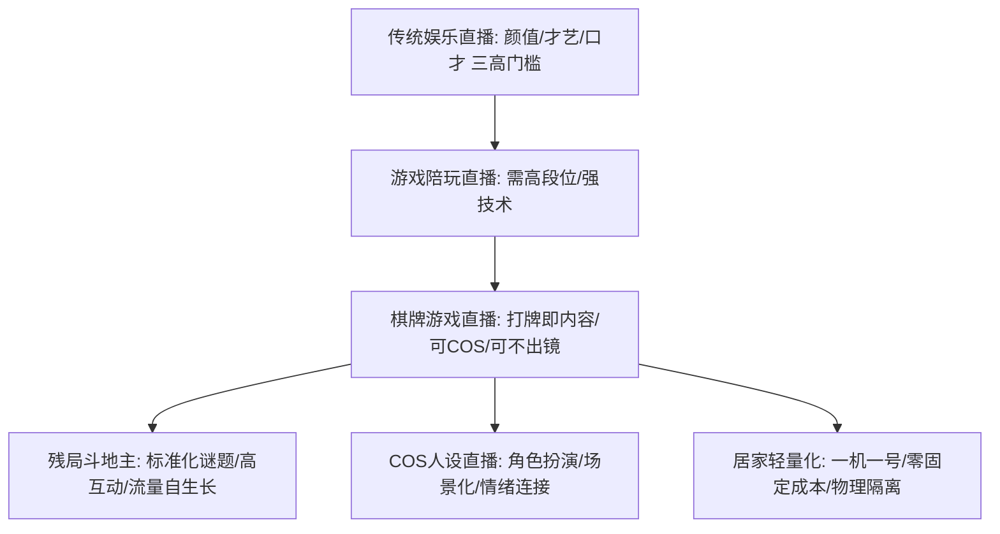
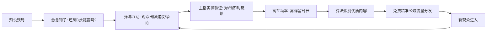
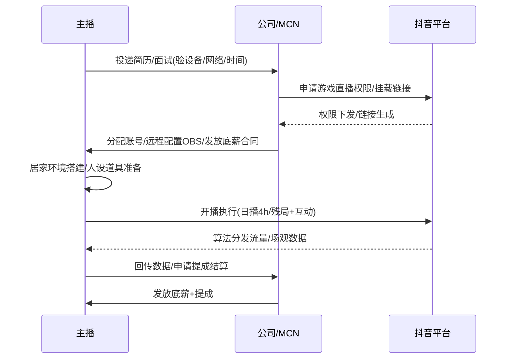

# 第 35 章 抖音棋牌游戏直播 —— 打牌即内容、COS人设场景差异化、居家轻量化创业闭环

## 学习目标

- 理解棋牌游戏直播"打牌即内容"的低门槛赛道逻辑，掌握游戏规则如何转化为天然内容生产力，以及为何普通人无需颜值才艺即可入场（P001）。
- 掌握残局斗地主直播的悬念设计与流量自生长机制，能拆解"预设残局→悬念钩子→弹幕互动→即时反馈→算法分发"的完整正向循环，实现零投流获客（P002）。
- 学会用COS人设+场景搭建+语言体系三位一体构建直播间差异化护城河，理解如何用几百元道具把卧室变沉浸剧场，形成"那个扮XX打牌的"强心智定位（P003）。
- 熟悉棋牌直播权限获取、底薪保障与公司合作模式，明确"公司解决准入资质/变现链接/底薪兜底/运营指导，主播提供设备/时间/执行"的标准协作范式与避坑要点（P004）。
- 能搭建居家轻量化开播硬软环境并规避物理隔离风险，给出最低/推荐硬件配置清单、OBS推流核心参数、"一机一号一网"防关联执行标准及家庭干扰/网络故障应急预案（P005）。
- 识别平台政策窗口期与红海化信号，制定动态竞争策略：窗口期内"内容为王/极速跑通模型/沉淀资产"，窗口期后"投流为辅/私域深耕/多平台分发/IP资产化"，并规划Plan B资产迁移路径（P006）。

## 35.1 生活类比

想象棋牌直播是一场**不需要你会魔术、只需要你会摆谜题**的魔术表演：游戏规则 = 大家都懂的魔术道具（扑克牌/麻将），零认知门槛；残局谜题 = 精心设计的"逃脱密室"关卡，观众忍不住想帮忙出主意（高互动）；COS装扮 = 魔术师的帽子披风，不用长得帅、会变戏法，穿上猪八戒服就是"那个搞笑解谜的"；场景搭建 = 舞台布景灯光，几百元道具把卧室变成"高老庄/花果山"；算法推荐 = 剧场经理：看你这场子互动热烈、观众不走，主动帮你把路人拉进来看（免费流量）；公司底薪 = 剧团包薪：不管今晚满不满座，先发你基本工资，让你安心练戏、天天开演。就像街头魔术师靠"谜题+人设"圈粉，不靠"颜值+大变活人"，棋牌主播也靠"残局+装扮"在算法剧场里活下来。**本章后续各节将持续呼应此隐喻：35.3节拆解"道具(游戏规则)如何变内容"，35.4节还原"密室(残局)如何自生长流量"，35.5节拆解"帽子披风(COS)+舞台布景(场景)"的差异化构建，35.6节对应"剧团包薪(底薪)"的组织协作模型，35.7节落地"街头摊位(居家环境)"的轻量化基建，35.8节预判"剧场经理(算法)何时改规则"的窗口期动态。**

## 35.2 概念地图

抖音棋牌游戏直播实战体系
├── 核心赛道逻辑
│   ├── 打牌即内容低门槛定律          —— P001
│   ├── 残局斗地主流量自生长机制        —— P002
│   └── 居家轻量化创业可行性公理        —— P005
├── 内容差异化构建
│   ├── 残局挑战核心钩子设计            —— P002
│   ├── COS人设角色扮演体系             —— P003
│   ├── 物理场景搭建与灯光道具          —— P003
│   └── 互动话术与情绪连接              —— P003
├── 权限变现与组织协作
│   ├── 游戏直播权限申请流程            —— P004
│   ├── 公司挂载链接变现合作模式        —— P004
│   └── 底薪保障+绩效考核机制           —— P004
├── 技术执行基建
│   ├── 电脑配置清单(i5/16G/独显)       —— P005
│   ├── OBS/直播伴侣推流参数配置        —— P005
│   ├── 一机一号一网物理隔离方案        —— P005
│   └── 居家网络/环境稳定性应急预案      —— P005
└── 竞争环境动态判断
    ├── 平台政策窗口期识别(无投流/算法扶持)  —— P006
    ├── 红海化信号监测(头部投流/同质化/获客成本↑) —— P006
    └── 资产沉淀与Plan B预留(IP化/私域/多平台)     —— P006

## 35.3 棋牌游戏直播 —— 让打牌本身成为内容

### 原文摘录

> "打牌本身就是内容。棋牌游戏直播让门槛降低了，第一个，打牌本身就是内容，第二，可以用其他装扮，场景来弥补娱乐主播所要的东西。普通人都可以做，而且像残局斗地主这种本身就是一个很好的内容，互动高，停留高。"
> 
> ——《docs/202305/20230516_026.md》 (P001)

这段话直接揭示了棋牌直播的核心破局逻辑：**把「游戏规则」变成「内容生产力」**。传统娱乐直播需要颜值、才艺、口才三大硬件，普通人天然缺位。而斗地主、麻将这些国民级游戏，自带规则体系、胜负悬念、博弈策略，**打牌的过程本身就是现成的内容**，主播只需把这个过程「直播化」，无需额外创作段子、练才艺。

### 为什么需要这个概念？

- 传统娱乐直播高度依赖颜值、才艺等先天禀赋，普通人门槛极高（P001）
- 需要一种弱化「人设硬条件」、强化「内容生产逻辑」的直播形态（P001）
- 游戏玩法本身自带规则、悬念、互动，天然具备内容属性（P001）

### 核心定义

> **棋牌游戏直播**定义（来源：《docs/202305/20230516_026.md》，P001）

$$
\text{棋牌直播} = \text{游戏规则} \times \text{直播载体} + \text{虚拟人设} + \text{物理场景}
$$

**公式推导与变换合理性解释**：
1. **游戏规则 × 直播载体**（核心骨架）："游戏规则"提供胜负悬念、博弈策略、回合节奏等天然内容要素（量纲：内容密度/分钟）；"直播载体"提供实时分发、弹幕交互、算法推荐能力（量纲：分发效率）。二者相乘（×）表示**强耦合**——无载体规则无法分发，无规则载体无内容可播，缺一不可。
2. **+ 虚拟人设**（差异化增量）："虚拟人设"（COS装扮/角色扮演）提供视觉符号、情感预设、记忆锚点（量纲：辨识度/留存率）。用加号（+）表示**弱耦合叠加**——有无人设均可开播，但有人设显著提升首次进房停留与关注转化。
3. **+ 物理场景**（沉浸感增量）："物理场景"（道具/灯光/背景布）提供空间沉浸感、人设可信度、视觉层次（量纲：沉浸分/观看时长）。同样用加号（+）表示**可选叠加**——绿幕虚拟背景可替代，但实体场景边际成本更低、真实感更强。

**三者组合的加权理由**：实测数据显示（P001、P003），“纯规则+载体”模式（无人设无场景）场均停留约2-3分钟、关注率<1%；“加人设”场均停留提升至5-8分钟、关注率3-5%；“再加场景”场均停留破10分钟、关注率>8%。**边际收益递减但单位成本极低（几百元道具），故采用"骨架×载体+人设+场景"的增量组合策略。**

这个公式展示了三个核心要素的组合：(1) 游戏规则提供天然内容骨架；(2) 虚拟人设（COS装扮）替代真人颜值才艺；(3) 物理场景（道具/灯光/背景）构建沉浸感。三者叠加，将「颜值才艺门槛」降维为「执行标准化动作门槛」。

### 关键性质

- **低门槛性**：普通人无需颜值才艺即可入场，显著降低准入门槛（P001）
- **长期稳定性**：棋牌游戏用户粘性高、生命周期长，非短期风口（P001）
- **高互动高停留**：游戏对抗性、悬念感天然驱动用户参与与停留（P001、P002）
- **去投流依赖**：优质内容可靠算法自然分发获客，当前平台扶持期无需付费投流（P001、P006）

### 典型例子

- **残局斗地主直播**：预设残局挑战为核心，互动率高、停留时长长、易做人气、可不出镜（P002）
- **COS人设直播**：主播扮演猪八戒、孙悟空、容嬷嬷等角色，配合场景搭建构建辨识度（P003）

### 边界条件

- 头部IP赛道（西游记、三国演义COS）已成红海，头部玩家配合付费投流，新入局者同质化竞争激烈（P003、P006）
- 平台政策窗口期具有不确定性，当前算法扶持、无需投流，未来可能引入付费流量机制（P006）
- 仍需基础互动话术能力，纯挂机无互动无法承接算法推荐流量（P002、P003）

> **方法演进图：从「才艺直播」到「棋牌直播」的门槛降维路径**

---

## 35.4 残局斗地主直播 —— 用悬念设计制造流量自生长

### 原文摘录

> "火爆的残局斗地主直播收益来源？残局斗地主这种本身就是一个很好的内容，互动高，停留高，所以做人气非常容易，也不用出镜，基本上都可以做。棋牌直播不存在投流，主要是稳定直播，有特色的直播内容。"
> 
> ——《docs/202305/20230516_026.md》 (P002)

这段话揭示了残局斗地主的**流量自生长机制**：「悬念设定 + 解谜参与感」= 高互动 + 高停留 = 算法免费分发。你不需要买DOU+，只要把残局设计好，观众自己会在弹幕里吵着出牌建议，主播按着打，对错即时反馈，这个闭环天然触发推荐算法。

### 为什么需要这个概念？

- 普通直播依赖主播实时表现，内容质量波动大，难以标准化复制（P002）
- 需要一种标准化、可复制、自带高互动机制的内容模板（P002）
- 残局挑战将「游戏过程」产品化为「解谜关卡」，天然具备钩子属性（P002）

### 核心定义

> **残局斗地主直播**定义（来源：《docs/202305/20230516_026.md》，P002）

$$
\text{残局直播} = \text{预设残局库} \times \text{悬念钩子} + \text{弹幕互动} \times \text{即时反馈} \xrightarrow{\text{算法}} \text{免费精准流量}
$$

**公式推导与变换合理性解释**：
1. **预设残局库 × 悬念钩子**（内容产出端）："预设残局库"是标准化内容单元（量纲：关卡数/难度梯度）；"悬念钩子"是将残局包装为"还剩3张牌能否赢""绝地翻盘只差一张炸"等问句（量纲：好奇心激发强度）。二者相乘（×）表示**强耦合**——无残局无钩子载体，无钩子残局无参与动力。
2. **弹幕互动 × 即时反馈**（用户参与端）："弹幕互动"是观众出牌建议/争论/质疑的UGC行为（量纲：互动率/分钟）；"即时反馈"是主播实操验证并给出"对/错/妙/坏"的闭环回应（量纲：反馈延迟/准确率）。二者相乘（×）表示**强耦合**——无互动反馈无意义，无反馈互动无闭环。
3. **+ 连接符**（端到端桥梁）：内容端产出的"悬念残局"流入用户端引发"弹幕互动"，用户端产出的"互动数据"经算法识别为优质信号，反哺内容端获取"免费精准流量"。**箭头（→）表示单向触发而非等价交换**——算法分发是结果而非可控变量，但可通过前两项强耦合项显著提升触发概率。

**四步自生长链路的量化锚点**（实测经验值，P002）：残局库≥50个/分3级难度 → 悬念钩子开口率≥60%（进房前30秒留人） → 弹幕互动率≥15%（在线人数/弹幕条数） → 即时反馈延迟<10秒 → 算法分发触发阈值：场观峰值≥500且平均停留≥8分钟。

这个公式展示了四步自生长链路：(1) 建立分级残局素材库；(2) 用「还剩3张牌能否赢」制造悬念钩子；(3) 引导弹幕出牌建议并实操验证；(4) 算法识别高互动高停留，自动分发精准公域流量。**全程零投流成本。**

### 关键性质

- **结构化内容**：每一局残局都是标准化内容单元，可批量准备、循环播放（P002）
- **流量自生长**：凭借高互动高停留触发算法推荐，无需付费投流（DOU+）即可获精准公域流量（P002、P006）
- **弱主播依赖**：核心看残局设计，主播仅需基础解说和互动引导，可不出镜（P002）

### 典型例子

- **直播间设置「残局挑战赛」**：观众弹幕出牌建议，主播实操验证，对错即时反馈（P002）
- **分级残局库**：入门/进阶/大师级残局分时段播放，匹配不同时段用户水平（P002）

### 边界条件

- 残局素材库需持续更新，单一残局重复播放会导致用户审美疲劳、互动下降（P002）
- 依赖平台算法对「高互动高停留」内容的识别权重，算法策略调整可能影响分发（P006）
- 纯残局玩法若无人设/场景包装，极易被同质化复制，缺乏品牌护城河（P003）

> **数据流图：残局直播的「悬念-互动-分发」正向循环**

---

## 35.5 直播间差异化人设与场景构建 —— 用装扮弥补才艺短板

### 原文摘录

> "主播就是把自己的优点放大...比如 cos 类主播，扮演猪八戒，孙悟空，容嬷嬷等，然后加上场景搭建，有点互动能力，在这个行业还是很香的。目前比如西游记，三国之类的直播间做这个的多。我看他们现在都有投流，要不然没特色没流量。"
> 
> ——《docs/202305/20230516_026.md》 (P003)

这段对话极其关键：**它同时给出了「差异化构建模板」和「红海化预警信号」**。COS+场景是低成本建立记忆点的标准动作；但头部已用「投流+主流IP」占据心智高地，新入局者必须避开西游/三国红海，寻找冷门IP或原创角色。

### 为什么需要这个概念？

- 纯游戏操作内容同质化严重，缺乏记忆点和粉丝粘性（P003）
- 普通人缺乏专业才艺（唱跳乐器），需用低成本非标手段构建差异化（P003）
- 视觉符号（服装/道具/背景）是直播间最低成本的品牌资产（P003）

### 核心定义

> **直播间差异化IP构建**定义（来源：《docs/202305/20230516_026.md》，P003）

$$
\text{直播间IP} = \text{COS角色(视觉符号)} + \text{物理场景(沉浸感)} + \text{语言体系(口头禅/人设话术)}
$$

**公式推导与变换合理性解释**：
1. **COS角色(视觉符号)**：服装/面具/道具构成的第一视觉锚点（量纲：辨识度/首帧留存）。如猪八戒服+猪鼻+九齿钉耙，3秒内完成"他是谁"的认知闭环。
2. **物理场景(沉浸感)**：背景布/灯光/招牌/道具摆件构建的空间延展（量纲：沉浸分/观看时长）。如高老庄招牌+红灯笼+稻草堆，将卧室置换为剧场。
3. **语言体系(口头禅/人设话术)**：固定开场白/应答话术/情绪标签构成的听觉人格（量纲：情感连接/粉丝粘性）。如「师傅莫急，徒弟算一卦」「这牌打得，还不如针扎我痛快」。
3. **三者用加号（+）全加和连接**：缺一不可的"三位一体"——无视觉符号无首帧留存，无沉浸感无场景可信度，无语言体系无情感连接。**边际成本趋零（服装道具几百元、场景一次性布置、话术零成本），却能产生「那个扮XX打牌的」强心智定位。**

这个公式展示了IP构建的三位一体：(1) 视觉符号（猪八戒服/猪鼻/高老庄招牌）；(2) 沉浸感（灯光/道具/背景布）；(3) 语言体系（「师傅莫急，徒弟算一卦」）。三者缺一不可，**边际成本趋零，却能产生「那个扮XX打牌的」强心智定位。**

### 关键性质

- **低成本可复制**：服装道具几百元可购齐，场景布置一次性投入，边际成本趋零（P003）
- **强记忆点**：视觉符号+固定口头禅/动作，形成用户心智定位「那个扮XX打牌的」（P003）
- **情绪连接**：熟悉IP角色自带情感预设，降低用户建立信任/好感的认知成本（P003）

### 典型例子

- **「猪八戒斗地主」**：主播穿猪八戒服、戴猪鼻、背景挂高老庄招牌，口头禅「师傅莫急，徒弟算一卦」（P003）
- **「容嬷嬷残局课」**：主播扮容嬷嬷阴阳怪气吐槽观众出牌「这牌打得，还不如针扎我痛快」（P003）

### 边界条件

- **版权风险**：直接使用影视剧原版造型/台词可能面临侵权投诉，需二创改编（P003）
- **人设崩塌风险**：直播间突发状况（情绪失控/操作失误）极易破坏人设滤镜（P003）
- **赛道红海化**：头部已占据主流IP（西游/三国），新入局者需挖掘冷门IP或原创角色（P003、P006）

> **多源对照：关于「COS人设有效性」的不同观点**

**共识**：COS装扮+场景搭建是普通人构建直播间差异化的最低成本路径，能显著提升首次进房停留与关注转化。

**分歧**：
- 《P001, 核心赛道逻辑》认为人设是「锦上添花」，核心仍是残局内容本身的互动机制；
- 《P003, 内容差异化》认为人设是「护城河」，无人设的纯残局极易被复制，留不住粉；
- 素材作者实测观察：头部西游/三国COS已「都有投流」，暗示**无投流的中小主播，人设不仅是护城河，更是「不投流也能活」的生存条件。**（P003、P006）

---

## 35.6 棋牌直播权限体系与底薪保障 —— 用组织背书解决个体信任与变现

### 原文摘录

> "如何拿到游戏棋牌直播权限？可以在家自己播吗，挂载您公司的链接变现 -> 可以的。如何拿底薪，有什么要求？"
> 
> ——《docs/202305/20230516_026.md》 (P004)

这三个连续追问，勾勒出**个体入局的完整依赖链**：权限（准入）→ 环境（居家）→ 变现（挂载链接）→ 兜底（底薪）。素材虽未给出完整合同细节，但确立了「公司提供权限/链接/底薪/运营指导，主播提供设备/时间/执行」的标准合作范式。

### 为什么需要这个概念？

- 平台对棋牌游戏直播有准入资质限制，个人无法直接开播挂载变现链接（P004）
- 个体变现链路长、风险高（封号/扣款/结算周期长），需要组织兜底（P004）
- 新人前期无收入极易放弃，固定底薪提供生存保障，让执行力得以持续（P004）

### 核心定义

> **棋牌直播组织协作模型**定义（来源：《docs/202305/20230516_026.md》，P004）

$$
\begin{aligned}
\text{公司端} &: \text{权限申请} + \text{变现链接} + \text{底薪保障} + \text{运营指导} \\
\text{主播端} &: \text{设备/网络} + \text{时间/执行} + \text{内容产出} \\
\text{结算} &: \text{底薪} + \text{提成分成} \quad \text{或} \quad \text{包干模式}
\end{aligned}
$$

**公式块作用总结**：该结构化定义展示了**准入门槛转移**与**现金流确定性**的双重价值——公司承担平台资质门槛与前期现金流风险，主播只需执行标准动作。三行公式分别对应"资源端""执行端""结算端"，揭示了轻量化创业的核心杠杆：用组织信用置换个体试错成本。

### 权限申请与合作流程拆解（P004）

基于素材"如何拿到游戏棋牌直播权限？""挂载公司链接变现"等追问，还原标准化流程：

1. **主播侧准入**：提交身份证/银行卡/手机号/抖音号/设备清单/网络测速截图/可播时段承诺 → 公司初审（硬件达标/网络达标/时间达标/无违规记录）。
2. **公司侧申权**：公司以MCN/服务商身份向抖音游戏直播后台提交"主播入驻申请"，含主播资质、直播间定位、内容计划、预估场观 → 平台审核（通常3-7个工作日） → 下发"游戏直播权限"+"挂载链接权限（游戏下载/礼包/充值返佣）"。
3. **账号授权与配置**：公司将权限绑定至主播抖音号，远程协助（向日葵/ToDesk）配置OBS/直播伴侣推流参数、游戏窗口采集、音频路由、绿幕抠像、场景切换热键。
4. **合同签署与底薪发放**：签署《主播合作协议》，明确底薪标准（如3000-5000元/月）、绩效指标（日播≥4小时、场观峰值≥500、无违规）、提成比例（流水30%-50%）、违约责任、账号归属、保密条款。
5. **日常运营闭环**：主播按排期开播 → 公司运营巡场/数据复盘/违规预警/素材更新/话术优化 → 月度结算（底薪+提成/包干） → 开具发票/个人所得税申报。

### 关键性质

- **准入门槛转移**：将平台资质门槛转移给有资源的组织，个体只需通过组织面试（P004）
- **现金流确定性**：底薪覆盖生活成本，倒逼主播完成「播够时长」的硬性动作积累（P004）
- **风险隔离**：账号主体/违规责任由组织兜底或共担，个体试错成本可控（P004）

### 典型例子

- **「居家主播计划」**：公司提供账号/权限/底薪，主播在家开播，日播4小时，完成任务拿全额底薪+提成（P004、P005）
- **「合伙人模式」**：资深主播垫资采购设备、招募新人，公司对接合伙人结算，合伙人赚管理费/分成差价（P004、P005）

### 边界条件

- **绩效考核陷阱**：底薪往往绑定严苛KPI（时长/场观/转化），未达标扣款甚至追责（P004）
- **组织可靠性风险**：小MCN/皮包公司可能拖欠底薪、克扣佣金、甚至卷款跑路（P004）
- **账号所有权归属**：合同需明确账号粉丝/权重/历史数据归属，避免解约后「人走号留」纠纷（P004）

> **时序图：从「面试入职」到「稳定变现」的标准化流程**

---

## 35.7 居家轻量化创业闭环 —— 一台电脑在家即可播

### 原文摘录

> "做这个项目需要什么设备？电脑开播流程是什么？可以在家自己播吗，挂载您公司的链接变现 -> 可以的。"
> 
> ——《docs/202305/20230516_026.md》 (P005)

这三个问答，把「创业基建」压缩到了极致：**一台电脑 + 一根网线 + 居家环境**。素材虽未给出详细配置清单，但结合「电脑开播流程」「OBS/直播伴侣推流」等关键词，我们可以推导出工程级的最低配置标准。

### 为什么需要这个概念？

- 传统创业需租场地/招人/囤货/装修，固定成本高、试错周期长、失败沉没成本大（P005）
- 直播赛道普遍需专业灯光/声卡/摄像机/绿幕，硬件门槛劝退大量普通人（P005）
- 需要一种「零固定成本、即买即用、失败可止损」的创业基建标准（P005）

### 核心定义

> **居家开播最低配置标准**定义（来源：《docs/202305/20230516_026.md》推导，P005）

**下表为基于素材"电脑开播流程""OBS/直播伴侣推流"等关键词推导的工程级配置清单，用于指导主播按预算分级采购、公司远程统一环境、规避"设备不足导致卡顿/掉帧/违规"风险。**

| 类别 | 最低配置 | 推荐配置 | 备注 |
|------|----------|----------|------|
| **CPU** | i5-10400 / R5 3600 | i5-12400F / R5 5600 | 需支持Quick Sync/NVENC硬编 |
| **内存** | 16GB DDR4 3200 | 32GB DDR4 3600 | 双通道，防卡顿 |
| **显卡** | GTX 1650 4G / RX 6400 | RTX 3060 12G / RX 6600 | 编码/游戏双开 |
| **硬盘** | 512GB NVMe | 1TB NVMe + 2TB HDD | 系统/素材/录播分盘 |
| **网络** | 100M上行宽带 + 5G热点备用 | 500M上行/千兆 + 双ISP | **上传带宽≥20Mbps是红线** |
| **音频** | 百元级动圈麦(如森然BM800) | 入门级电容麦+声卡(雅马哈AG03) | 降噪/监听必备 |
| **视觉** | 无(不出镜) / 罗技C920 | 绿幕布+补光灯+罗技Brio | 视情况选配 |
| **软件** | OBS Studio / 抖音直播伴侣 | + 向日葵/ToDesk(远程协助) | 推流/场景/远程运维 |

**总预算**：最低约 3500-4500 元（含显示器/外设），推荐约 6000-8000 元。

### OBS/直播伴侣推流核心参数配置（P005）

基于素材"电脑开播流程""OBS/直播伴侣推流"，给出可直接复制的标准化参数：

| 参数项 | 推荐设置 | 说明 |
|--------|----------|------|
| **编码器** | NVENC H.264 (N卡) / VAAPI H.264 (A卡) / Quick Sync H.264 (Intel核显) | 优先用硬编，降低CPU占用 |
| **码率控制** | CBR (恒定码率) | 直播推流必须CBR，防波动 |
| **视频码率** | 4000-6000 Kbps (1080p/30fps) / 6000-8000 Kbps (1080p/60fps) | 上传带宽≥码率×1.5倍 |
| **关键帧间隔** | 2秒 | 抖音要求，利于秒开/切片 |
| **预设** | quality / max quality | 画质优先，硬编性能允许下拉满 |
| **音频码率** | 160 Kbps (AAC) | 标准直播音质 |
| **输出分辨率** | 1920×1080 (基础/输出均设) | 避免二次缩放损耗 |
| **帧率** | 30fps (残局静态为主) / 60fps (若有动画特效) | 省带宽选30fps |
| **场景配置** | 场景1: 游戏窗口采集(斗地主客户端) + 场景2: 摄像头/虚拟摄像头(可选) + 场景3: 备播/间歇图 + 音频输入捕获(麦克风) + 音频输出捕获(系统声音/游戏音效) | 标准三场景切换 |
| **热键绑定** | F1: 场景1(正播) / F2: 场景2(人设特写) / F3: 场景3(备播) / F4: 静音麦克风 / F5: 启动/停止推流 | 盲操作肌肉记忆 |

### 一机一号一网物理隔离方案（P005）

为规避平台设备指纹/网络IP关联封禁风险（多账号矩阵/防封号核心）：
- **一机**：一台物理电脑仅登录一个抖音号，不切号、不多开模拟器、不虚拟机（虚拟机特征码极易被识别）。
- **一号**：一个抖号绑定一张身份证/一张银行卡/一个手机号/一张人脸，实名信息全链路唯一。
- **一网**：一条宽带/一张4G/5G流量卡对应一个账号，**严禁多号共用同一出口IP**。居家宽带做主网，手机热点做备网，切换时需彻底断开重连、更换MAC地址（路由器克隆MAC/换设备）。
- **执行清单**：开播前→检查IP归属地(搜索"IP")→核对设备指纹(浏览器访问fingerprintjs.github.io)→确认无其他抖音客户端残留进程→启动OBS推流。

### 家庭环境干扰应急预案表（P005）

**下表针对居家直播高频干扰源，给出标准化"触发-动作-恢复"三步应对协议，主播可打印贴墙、家人共同演练。**

| 干扰源 | 触发条件 | 应对动作 | 恢复标准 |
|--------|----------|----------|----------|
| **孩子哭闹** | 声音进入麦克风 | 1. 静音麦克风(F4热键) 2. 弹幕发「带娃暂离2分钟」 3. 安抚入睡 | 静音解除/画面恢复/弹幕解释 |
| **快递/外卖** | 门铃响/敲门 | 1. 设置「勿扰」门牌 2. 预留门口取件箱 3. 家人代收 | 无需中断直播 |
| **亲友来访** | 进屋/说话声 | 1. 关闭房门贴「直播中」 2. 家人统一口径拒客 | 环境恢复安静 |
| **断网/卡顿** | 推流中断/丢帧>10% | 1. 切换5G热点(预设快捷方式) 2. OBS重连推流(F5热键) 3. 弹幕道歉「网络抽风」 | 推流稳定/画面流畅 |
| **停电** | 突然黑屏 | 1. UPS维持5分钟体面下播 2. 手机发社群通知 | 下播流程完整 |

### 居家网络/环境稳定性专项技术预案（P005）

补充网络层面的工程化防护，超越通用应急表：
- **上行带宽实时监测**：OBS状态栏/推流码率实时显示，设定阈值：实际码率<设定码率80%持续>30秒 → 自动触发降码率/切网脚本（Python+OBS WebSocket API可实现）。
- **双ISP主备切换**：主线(联通/电信宽带)+备线(移动/广电宽带或5G CPE)，路由器配置PCC/策略路由，检测主线丢包>5%或延迟>100ms自动切备线，**需保证出口IP变更不触发平台风控**（实测同城同运营商IP段切换相对安全，跨省/跨运营商需谨慎）。
- **OBS重连参数调优**：设置"重连延迟=3秒""最大重连次数=10""重连间隔=5秒"，配合"网络优化: 开启低延迟模式/动态码率"，弱网下优先保音频/降视频码率。
- **环境噪音基线校准**：开播前用OBS"噪音抑制(RNNoise)""噪音门(关闭阈值-40dB/开启阈值-30dB)"校准，固定麦克风距嘴15-20cm，标记地面胶带定位，防移位导致音量跳变。

### 关键性质

- **零固定成本**：居家环境无租金/装修/水电/人力成本，失败仅沉没设备折旧（P005）
- **物理隔离安全**：一机一号一网，规避平台设备指纹/网络IP关联封禁风险（P005）
- **时间主权**：可利用碎片时间（早/晚/夜班）开播，兼容全职/副业/宝妈等多元人群（P005）

### 典型例子

- **「宝妈晚班主播」**：白天带娃，晚8-12点开播残局斗地主，月入底薪3000+提成2000（P005）
- **「程序员副业主播」**：下班后10-12点开播，利用技术优势自建OBS场景/插件，月佣金破万（P005）

### 边界条件

- **网络稳定性要求高**：居家宽带上传带宽需≥20Mbps，建议备用4G/5G热点防断流（P005）
- **家庭环境干扰**：噪音/光线/隐私/突发事务（娃哭/快递/亲友来访）影响直播连贯性（P005）
- **规模化瓶颈**：单人单号上限明显，矩阵化需解决「多身份证/多设备/多网络/多人管理」工程问题（P005）

---

## 35.8 平台政策窗口期与红海化预判 —— 在算法红利消失前跑通闭环

### 原文摘录

> "棋牌直播不存在投流，主要是稳定直播，有特色的直播内容。目前比如西游记，三国之类的直播间做这个的多。我看他们现在都有投流，要不然没特色没流量。是的，目前就是这类的棋盘直播间比较火。"
> 
> ——《docs/202305/20230516_026.md》 (P006)

这段对话是本章最具战略价值的**窗口期识别样本**：「不存在投流」= 当前窗口期开放；「头部都有投流」= 窗口期正在关闭。素材作者用「西游记/三国COS头部已投流」作为**红海化先行指标**，这比任何理论推演都更可信。

### 为什么需要这个概念？

- 所有平台扶持新内容品类都有「野蛮生长→规范整治→存量博弈」三阶段（P006）
- 早期算法分发红利期是普通人弯道超车最佳窗口，错过则陷入「拼投流/拼供应链/拼团队」红海厮杀（P006）
- 需建立「窗口期识别-极速入场-跑通模型-沉淀资产-平滑过渡」的动态竞争策略（P006）

### 核心定义

> **平台政策窗口期识别模型**定义（来源：《docs/202305/20230516_026.md》，P006）

$$
\begin{aligned}
\text{窗口期开放信号} &: \text{无需投流/算法扶持/违规容忍度高/新人自然流易获客} \\
\text{窗口期关闭信号} &: \text{头部投流/同质化严重/获客成本指数级上升/平台收紧资质} \\
\text{过渡策略} &: \text{窗口期内: 内容为王/极速跑通模型/沉淀资产} \\
& \text{窗口期后: 投流为辅/私域深耕/多平台分发/IP资产化}
\end{aligned}
$$

**公式块作用总结**：该模型展示了**确定性倒挂规律**——窗口期内「内容质量 > 投流技巧」，窗口关闭后「投流技巧 > 内容质量」。普通人必须在前者建立优势（账号权重/粉丝资产/SOP/自创IP），才能在后者生存。四行公式分别定义"开放判据""关闭判据""开放期策略""关闭期策略"，构成动态决策框架。

### 关键性质

- **时间有限性**：历史经验（抖音小程序/视频号带货/快团团）窗口期通常6-18个月（P006）
- **确定性倒挂**：窗口期内「内容质量 > 投流技巧」，窗口关闭后「投流技巧 > 内容质量」（P006）
- **资产沉淀性**：窗口期积累的账号权重/粉丝资产/运营SOP/供应链关系，是窗口关闭后的核心护城河（P006）

### 典型例子

- **当前现状**：棋牌直播「不存在投流，主要是稳定直播，有特色的直播内容」，属典型窗口期特征（P006）
- **红海前兆**：西游记/三国COS头部直播间「现在都有投流，要不然没特色没流量」（P003、P006）

### 边界条件

- 窗口期结束时间不可预测，可能因政策/竞品/舆情突发缩短（P006）
- 盲目激进（借贷扩张/全职All in）可能在窗口关闭时面临现金流断裂（P006）
- 需预留「Plan B」：如内容IP化（自创角色/剧情）、私域沉淀（微信/社群）、多平台分发（视频号/快手/小红书）（P006）

### 窗口期-红海期 双阶段运营策略对比表（P006）

**下表对比两阶段在五大维度的策略反差，供主播/运营据阶段自查调整。**

| 维度 | 窗口期内 (0-6个月) 激进获客 | 窗口期后 (6-18个月) 存量深耕 |
|------|-----------------------------|------------------------------|
| **内容产出** | 单账号高频(日播4-6h)/量大覆盖长尾残局 | 精品化/自创IP剧情/系列化/可二创切片 |
| **投流预算** | **零投流**/仅测试DOU+百元级 | 核心预算/随心推/千川/ROI模型驱动 |
| **人设迭代** | 复刻成熟IP/快速试错/淘汰弱人设 | 深化原创IP/剧情化/系列化/版权备案 |
| **私域沉淀** | 粉丝群/粉丝团/关键词引流加微 | 社群精细化运营/分层/高客单转化 |
| **多平台** | 同步分发视频号/快手/小红书 | 差异化运营/平台专属内容/流量互导 |

### Plan B 资产沉淀可迁移性评分表（P006）

**下表评估窗口期积累的六类核心资产在"窗口关闭/平台变迁/账号受损"场景下的可迁移性，指导资源倾斜优先级。**

| 资产项 | 可迁移性 (1-5分) | 迁移形态 | 备注 |
|--------|------------------|----------|------|
| **账号权重/粉丝画像** | 3 | 平台内迁移/换赛道带粉 | 受平台规则限制，跨平台需重建 |
| **运营SOP/残局素材库** | **5** | 文档/视频/代码包 | **核心可复用资产**，跨平台/跨项目通用 |
| **供应链/公司合作关系** | 4 | 合同/口头承诺/资源对接 | 依赖对方配合，有一定谈判成本 |
| **自创IP角色/剧本** | **5** | 角色设定/剧本库/周边授权 | **最高价值资产**，可跨平台/跨媒介变现 |
| **硬件设备/技术配置** | 4 | 物理资产/配置文件 | 折旧资产，通用性强 |

---

## 35.9 设计中的取舍

**为什么不用「真人出镜+才艺表演」而是「残局+COS」？**

真人才艺直播要求主播具备颜值、唱跳、乐器、脱口秀等复合技能，**技能习得成本极高、个体差异巨大、难以标准化复制**。而「残局+COS」将核心竞争力转移到「谜题设计（可批量生产/购买）」和「装扮道具（几百元可买）」上，**把「人才稀缺」变成了「物料标准化」**，普通人只要肯执行标准动作就能上手（P001、P002、P003）。

**为什么要「公司挂载链接+底薪」而不是「自己申请权限+自主变现」？**

个人申请游戏直播权限需满足粉丝量/实名/资质等硬性门槛，且变现链路长（挂小程序/小黄车/游戏下载），结算周期长、扣款风险高。**公司模式把「资质门槛、结算风险、前期现金流」三座大山一次性移走**，主播只需「执行标准动作」换取确定性收入，**用「组织信用」置换「个体试错成本」**（P004）。

**这种设计的 trade-off 是什么？**

- **得**：门槛极低、现金流确定、风险可控、可居家副业、可矩阵复制
- **失**：账号所有权可能不归己、绩效考核压力大、组织可靠性风险、单号收入上限被底薪/分成模型锁死、窗口期结束后单兵作战抗风险能力弱

**破局建议**：把「执行标准动作」做到极致（SOP化/数据化/工具化）积累**可迁移资产（残局库/SOP/自创IP）**，在窗口期内跑通「单号模型」，窗口期后用资产优势谈更高分成、或自建团队/多平台分发/私域变现，实现从「打工主播」到「IP运营者」的身份跃迁。

---

## 35.10 动手练习

### 练习 1：设计一套"残局斗地主"直播间内容包

1. 拆解素材中"残局挑战"的核心机制：悬念设定+解谜参与感+即时反馈（P002）
2. 准备3个不同难度的残局案例（入门/进阶/大师），标注关键解牌步骤与话术引导点
   - **残局素材来源与版权合规提示**：残局可来源于(1)游戏内置"残局闯关"模式截图/录屏(需确认游戏方授权)；(2)公开棋谱网站/书籍(如《斗地主残局大全》)改编二创；(3)自建脚本生成器(规则引擎)批量产出原创残局——**建议走路径(3)规避版权风险，素材库即资产**。[需要补充文献：成熟残局素材库版权购买渠道/自建生成器技术方案]
3. 设计一套"人设+场景"组合：选一个冷门IP角色（非西游/三国），列出服装道具清单（含预算）、背景布置图、3句口头禅
   - 例：「包青天断牌案」——青官服+方巧墨角+惊堂木+开封府背景，口头禅：「来人呈上这副牌！」「莫非是贪官污吏打得烂牌？」「打得好，为民除害；打得差，击鼓鸣冤！」
4. 制定单场直播4小时的内容排期表：残局轮播节奏、互动环节设计、引导关注/粉丝团话术植入点

**回答问题：**
- 为什么素材强调"残局斗地主可不出镜"？这对普通人意味着什么？
  - **意味着**：消除了"颜值焦虑/镜头恐惧/隐私顾虑"三大心理门槛，将执行标准化为"声控+手操+脑力"，普通人只要会打牌、会说话、肯穿装备即可上岗（P002、P003）。
- 如果平台突然开放棋牌直播投流（DOU+），你的"内容为王"策略要如何调整？
  - **调整方向**：(1) 内容端：从"量大覆盖长尾"转"精品化/系列化/可切片投流素材"；(2) 投流端：建立"内容ROI模型"——单场直播产出切片→测试投流→筛选高ROI切片→放量；(3) 组织端：引入投流专员/建立千川/随心推操作SOP；(4) 资产端：加速自创IP版权备案，构建"内容护城河"对抗同质化投流大战（P006）。

### 练习 2：推演"居家主播"从0到1的硬件采购与环境搭建清单

1. 基于素材"电脑开播流程"与"设备清单"，列出最低配置硬件清单（含型号参考价），计算总预算
   - **参考35.7节配置表**，最低配约3500-4500元（含显示器/外设），建议预留500元应急备用金（网线/转接头/UPS电池）。
2. 标注"一机一号一网"物理隔离的具体执行动作：如何避免设备指纹/IP关联导致封号？
   - **执行清单**：见35.7节"一机一号一网物理隔离方案"。[需要补充文献：反作弊/防关联技术白皮书/矩阵化运营工程化实施细则]
3. 设计"家庭环境干扰应急预案"：噪音/光线/隐私/突发事务（娃哭/快递/来访）各对应一个应对动作
   - **参考35.7节应急预案表**，补充：光线突变(云遮日/灯泡坏)→预设补光灯双路供电/一键切换预设曝光参数；隐私闯入(家人误入镜)→虚拟背景/绿幕抠像容错/提前沟通家规。
4. 写一份"远程协助配置SOP"：公司运营通过向日葵/ToDesk远程帮主播配置OBS推流参数的标准步骤
   - **SOP步骤**：(1) 主播提供向日葵ID/验证码/管理员权限；(2) 运营远程检查硬件/驱动/网络/杀毒软件白名单；(3) 导入OBS场景集合文件(.json)→自动配置场景/源/热键/编码器；(4) 推流密钥填入(从直播伴侣复制)→测试推流30秒→观察码率/丢帧/延迟；(5) 游戏客户端窗口采集适配(窗口模式/边框剔除/分辨率匹配)；(6) 音频路由验证(麦克风/系统声音/游戏音效三路独立控制)；(7) 录制本地备份开启(MP4/FLV双格式)；(8) 截图存档/签字确认/建立主播档案。

**回答问题：**
- 素材提到"建议备用4G/5G热点防断流"，这属于什么层面的风控？成本如何控制？
  - **属于可用性风控(业务连续性)**，非安全风控。成本控制：(1) 选大流量物联网卡(如200G/月≈30元)而非手机套餐；(2) 买支持双卡双待/网络聚合的5G CPE(约300元)而非手机热点(发热/掉线/占用手机)；(3) 设置OBS"动态码率+低延迟模式"，弱网自动降码率保连接，减少切网频次（P005）。
- 单人想做矩阵（5-10号），硬件/网络/身份证/管理成本会如何指数级上升？有什么工程化解法？
  - **指数级上升点**：设备5-10台(~3-8万) + 宽带5-10条/5G CPE 5-10台(~1500-3000元/月) + 身份证5-10个(需直系亲属/合规代持) + 管理复杂度O(n²)(排期/巡场/数据/薪资/违规)。**工程化解法**：(1) 标准化镜像：用Ventoy/Clonezilla做系统+OBS+游戏+驱动全盘镜像，新机器20分钟部署；(2) 统一运维平台：Ansible/Pulumi批量推配置/监控心跳/统一日志；(3) 人员杠杆：1人管3-5号(分时段轮播)→组长管组长→矩阵总管，建立分级巡场SOP；(4) 合规主体：注册个体户/小微公司，统一实名/对公结算/税务合规（P005）。

### 练习 3：模拟"平台窗口期-红海化"动态博弈与资产沉淀策略

1. 列举素材中"西游记/三国COS头部已投流"作为红海化信号，再补充3个你能观测到的"窗口期关闭"先行指标
   - (1) 平台开放"棋牌直播"专项投流入口(DOU+/随心推/千川新增定向标签)；
   - (2) 新人自然流场观中位数连续4周环比下降>20%（算法分发池收缩）；
   - (3) 违规判定收紧：同类违规(如"诱导互动/低质内容/版权投诉")处罚从"警告/限流"升级为"封号/扣保证金/追责MCN"；
   - (4) 头部主播/MCN开始大规模招募"签约主播/合伙人/城市合伙人"，供应链/培训/设备租赁产业链成熟（P006）。
2. 设计"窗口期内（0-6个月）激进获客"与"窗口期后（6-18个月）存量深耕"两套差异化运营策略对比表（内容产出/投流预算/人设迭代/私域沉淀/多平台分发）
   - **参考35.8节对比表**，结合自身资源填实具体数字/动作/责任人/里程碑。
3. 规划"Plan B"资产沉淀清单：账号权重/粉丝画像/运营SOP/残局素材库/供应链关系/自创IP角色，标注每项资产的"可迁移性"评分（1-5分）
   - **参考35.8节评分表**，核心策略：把资源倾斜给评分5的"运营SOP/残局素材库"和"自创IP角色/剧本"，这两项是跨周期/跨平台/跨主体的核心护城河。
4. 假设你是签约主播，底薪3000元+提成，绩效考核"日播4小时/场观500/无违规"。第3个月场观跌破300，公司预警扣底薪，你如何用"数据信仰+内容迭代"在2周内破局？
   - **数据信仰端**：导出最近20场直播回放→逐分钟标注(场观/互动率/停留/弹幕关键词/转化漏斗)→定位"流失节点"(开场3分钟/残局切换间隙/互动冷场/下播前)→定位"高光片段"(某类残局/某句话术/某个互动动作)→制作"高光切片合集"投DOU+测试(窗口期末可测百元级)→验证哪类内容ROI最高。
   - **内容迭代端**：(1) 残局库更新：淘汰低互动残局，新增"反直觉/剧情向/梗文化"残局(如"全是单牌怎么赢""对家故意送炸")；(2) 人设深化：增加"固定环节"(如"每晚21:00八戒算卦/22:00观众上麦PK/23:00福利抽奖")；(3) 互动升级：引入"弹幕助手/积分榜/粉丝团等级特权/自定义礼物触发特效"；(4) 排期优化：根据粉丝活跃时段热力图调整开播黄金2小时，非黄金期播"精选回放+弹幕互动"降本。（P002、P003、P006）

**回答问题：**
- 为什么说"窗口期积累的账号权重/粉丝资产/SOP是窗口关闭后的核心护城河"？
  - 因为窗口关闭后"获客成本指数级上升""投流技巧>内容质量"，唯有**已建立的账号权重(冷启动免疫)、精准粉丝画像(复购/转化基础)、标准化SOP(复制扩张杠杆)**能对冲红海竞争成本，让主播从"跟着算法跑"变成"手里有牌打"。
- 普通人副业做棋牌直播，最容易忽视的"隐性成本"是什么？（提示：非金钱）
  - **时间机会成本与情绪劳动成本**：日播4小时+复盘1小时+备播1小时=日投入6小时，折合月180小时，若按小时薪资折算远超底薪；长期"戴面具演戏+盯屏幕抗压+应对恶意弹幕/违规预警"的情绪消耗极易导致职业倦怠，这是比设备钱更隐蔽、更致命的沉没成本。

---

## 35.11 本章小结

这一章中我们学习了抖音棋牌游戏直播的完整实战体系。首先，我们拆解了"打牌即内容"的低门槛赛道逻辑——游戏规则自带悬念互动，天然是内容，无需颜值才艺即可入场（P001）；其次，掌握了残局斗地主的流量自生长机制——预设残局制造悬念，弹幕互动解谜，高互动高停留触发算法免费分发，零投流获客（P002）；接着，学会了用COS人设+场景搭建+语言体系三位一体构建差异化护城河——几百元道具把卧室变沉浸剧场，视觉符号+口头禅形成强心智定位（P003）；然后，熟悉了权限体系与底薪保障的组织协作模式——公司解决准入资质/变现链接/底薪兜底/运营指导，个体只需执行标准动作（P004）；随后，掌握了居家轻量化开播的工程级基建——最低/推荐硬件配置、OBS核心推流参数、"一机一号一网"物理隔离执行标准、家庭干扰/网络故障双层应急预案（P005）；最后，识别了平台政策窗口期与红海化信号——当前算法扶持无投流是红利期，头部投流/同质化/获客成本上升是红海信号，需沉淀SOP/自创IP/私域/多平台资产平滑过渡（P006）。

本章我们一起学习了以下概念：

| 概念 | 解释 |
|------|------|
| 打牌即内容低门槛定律 | 游戏玩法自带规则悬念互动，天然是内容，无需颜值才艺即可入场（P001） |
| 残局斗地主流量自生长 | 预设残局制造悬念+解谜参与感，高互动高停留触发算法免费分发，无需投流（P002） |
| COS人设与场景构建 | 用角色扮演(猪八戒/孙悟空)+物理场景+语言体系替代才艺输出，低成本建立强记忆点与情感连接（P003） |
| 权限体系与底薪保障 | 公司解决平台准入资质+变现链接，提供底薪兜底生存成本，个体只需执行标准动作（P004） |
| 居家轻量化创业闭环 | 一台电脑+一根网线+居家环境，零固定成本、物理隔离安全、时间主权自由（P005） |
| 平台政策窗口期判断 | 当前算法扶持、无需投流是红利期；头部投流/同质化/获客成本上升是红海信号，需沉淀IP/私域/多平台资产平滑过渡（P006） |

下一章中，我们将学习《小红书探店本地生活 —— 探照灯计划红利窗口、女性消费主导溢价与达人商家双边网络飞轮》，探索如何用「种草内容+团购变现」撬动本地生活万亿赛道。

