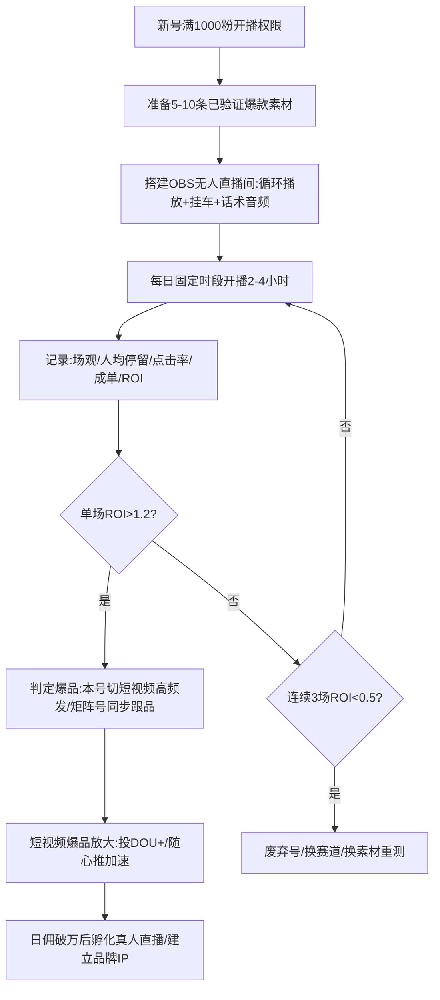
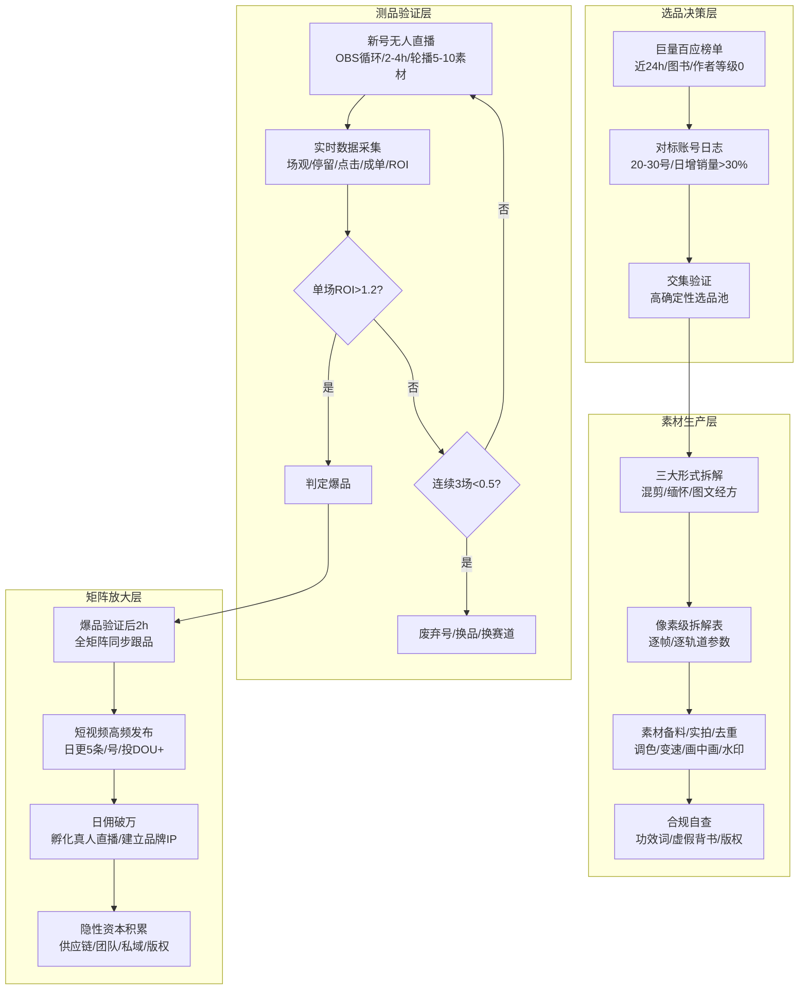

# 第 49 章 抖音养生号视频带货 —— 短视频挂车的垂直变现范式

## 学习目标

- 理解抖音养生号短视频挂车的商业模型与核心链路
- 掌握对标账号橱窗销量记录法与零延迟跟品策略
- 熟悉巨量百应榜单选品与对标账号日志追踪的组合拳操作
- 了解三大带货形式（混剪/实拍/图文经方）的像素级模仿标准与风险边界
- 能运用无人直播测品-账号矩阵置换策略实现新号冷启动与爆品放大
- 建立“品素决定论”认知，明确选品与素材贡献度超70%的投放铁律

## 49.1 生活类比

想象抖音养生号就像开一家“不囤货、不装修、只挂别人招牌”的加盟便利店。选品就是总部（巨量百应或对标账号）每天推送的“今日必卖清单”，素材就是总部统一配发的“标准海报和宣传视频”，你只需贴上自家二维码。对标销量记录就是每天早晚巡店，记录隔壁同款店“卖了多少件”，哪款动销快马上加货。像素级模仿要求连货架摆放角度、促销话术语速都按总部 SOP “1:1 复刻”。矩阵置换则像新开分店先用“无人货柜”试卖三天，爆了再派人、铺货架、上大屏。就像便利店加盟：总部（平台/头部玩家）已跑通“选品-陈列-促销”全链路，加盟商（新手）只需“照单全收、严守 SOP、多开分店”即可复制利润模型。

## 49.2 概念地图

```mermaid
mindmap
  root((抖音养生号视频带货))
    核心模型
      短视频挂车变现范式:::P001
      新人可复制高收益主张:::P003
      执行力与隐性资本决定上限:::P007_7
    选品决策体系
      巨量百应榜单选品:::P007_2
      对标账号橱窗销量记录法:::P002
      对标账号橱窗销量日志追踪:::P007_2
    内容生产标准化
      三大起号形式：混剪/缅怀/图文经方:::P007_1
      三大带货形式1:1像素级模仿标准:::P007_3
      面相书籍案例：单品爆发带动月佣破10万:::P007_5
    矩阵化运营策略
      无人直播测品-账号矩阵置换策略:::P007_4
      爆品验证后全矩阵切短视频跟品:::P007_4
    底层铁律
      品素决定论(70/30法则):::P007_13
      执行力与隐性资本决定上限:::P007_13
      团队管理：极度透明+鼓励单干:::P007_14
```

## 49.3 抖音养生号视频带货 —— 短视频挂车的垂直变现范式

### 为什么需要这个概念？

普通人缺乏直播才艺、颜值优势，难以胜任娱乐/带货直播。养生赛道用户粘性高、客单价适中、复购率强，天然适合短视频种草。短视频挂车不废号、可矩阵化、边际成本低，是新手跨越 0-1 的最优路径。

### 核心定义（来源：P001《抖音养生号:单月十万佣金复盘贴》）

- 在抖音运营垂直养生领域账号，发布短视频挂载橱窗商品（保健品/滋补品/图书等），通过佣金分成变现。
- 核心链路：选品(榜单/对标) → 素材(混剪/实拍/图文) → 发布挂车 → 投流/自然流出单 → 矩阵放大。

### 关键性质

- 赛道垂直度高：用户画像精准（中老年女性占比大），转化路径短。
- 内容形式标准化：混剪、图文经方、大师音频三大模版可复制性强。
- 对标可量化：橱窗销量、近 24h 高赞视频、巨量百应榜单提供硬性决策依据。

### 典型例子

- 作者“微笑”：00 后、半年经验、4 月单月佣金 10 万，全程无直播、无囤货。
- 对标账号“面相书籍”跟品：1:1 精细化拍摄当晚日佣破万，全矩阵连续日入过万。

### 边界条件

- 依赖巨量百应/精选联盟开通商品橱窗权限（需 1000 粉/实名/保证金）。
- 混剪素材存在原作者举报下架风险，长期需向实拍/原创过渡。
- 平台对虚假宣传/功效性暗示管控严格，文案合规是生存红线。

### 素材溯源

> P001 "抖音养生号:单月十万佣金复盘贴【从 0~1 实操教学】"
> P001 "做抖音养生号半年了，今天与大家分享一下，4 月 月入十万的经验与教训"
> P001 "对标账号那里的数字，是我记录的橱窗销量 就是每天的带货销量，只是我没有写日期"
> P001 "我会毫无保留的把自己的经验都分享出来，你跟着做也能赚到钱"
> P001 "一位来自河南的 00 后创业者，做抖音养生号半年了...4 月 月入十万的经验与教训"
> P001 "(362 赞)"
> P001 "梁靠谱 : 好文"
> P001 "设计师阿鹏 : 好详细，真的是毫无保留的分享呢"

---

## 49.4 对标账号橱窗销量记录法 —— 用每日销量日志替代粉丝虚荣指标

### 为什么需要这个概念？

粉丝量、点赞数无法直接反映带货变现能力，易被刷量/水军误导。选品决策需要真实销量支撑，而非主观臆断“这个好卖”。新手缺乏选品经验，必须跟随已验证爆款的脚步才能降低试错成本。

### 核心定义（来源：P002《抖音养生号:单月十万佣金复盘贴》）

- 建立对标账号表格，每日记录目标账号橱窗“带货销量”数字，而非粉丝/点赞。
- 重点监控：近 24 小时高赞视频对应的商品销量变化、橱窗商品排序调整。

### 关键性质

- 零延迟跟进：销量异动即代表爆品出现，可第一时间跟品跟素材。
- 筛选门槛低：只需肉眼观察/截图记录，无需付费第三方数据工具。
- 覆盖面广：建议人工日记录 20-30 个对标账号，构建赛道情报网。

### 典型例子

- 作者记录对标账号橱窗销量数字，未记日期但持续追踪，作为选品核心依据。
- 月入 5-10 万大佬“悄悄用的方法”，属于头部玩家隐性共识操作。

### 边界条件

- 仅适用于已开通橱窗、且橱窗商品更新频繁的活跃带货账号。
- 无法捕捉私域转化/直播间成交数据，仅反映短视频挂车公域表现。
- 需配合巨量百应榜单、蝉妈妈等工具交叉验证，防止单账号数据异常。

### 素材溯源

> P002 "对标账号那里的数字，是我记录的橱窗销量 就是每天的带货销量，只是我没有写日期"

---

## 49.5 养生赛道新人可复制高收益主张 —— 标准化 SOP 跨越认知鸿沟

### 为什么需要这个概念？

打破“赚钱靠天赋/资源/运气”固有认知，确立“普通人+标准化动作=确定性收益”信心。为新手提供可执行的锚点：不需直播、不需囤货、不需技术，只需执行 SOP。解决新手“知易行难”：将复杂商业模型拆解为可模仿、可检查、可复制的标准动作。

### 核心定义（来源：P003《抖音养生号:单月十万佣金复盘贴》）

- 主张：0 基础新人（如 00 后、半年经验）通过标准化 SOP 操作抖音养生号，单月可实现十万佣金。
- 核心路径：对标拆解 → 像素级模仿 → 矩阵测品 → 爆品放大 → 规模化复制。

### 关键性质

- 可复制性强：作者承诺“跟着做也能赚到钱”，并开放飞书文档全流程教学。
- 门槛极低：仅需手机、电脑、实名账号，无需供应链/技术/团队。
- 反馈周期短：新号冷启动 3-7 天，测品周期短，正向反馈快。

### 典型例子

- 作者本人：河南 00 后，半年从 0 到月入 10 万，无特殊背景资源。
- 社群验证：生财有术核心成员梁靠谱、设计师阿鹏背书“毫无保留、好详细”。

### 边界条件

- 依赖平台算法红利期（自然流/投流扶持），若平台收紧权限则模型失效。
- 要求极强执行力：日更 5 条、多账号矩阵、持续对标复盘，懒人无法跑通。
- 赛道竞争加剧：随着入局者增多，素材同质化、流量成本上升会压缩利润空间。

### 素材溯源

> P003 "一位来自河南的 00 后创业者，做抖音养生号半年了...4 月 月入十万的经验与教训"
> P003 "你跟着做也能赚到钱，希望看完后能对你有所帮助！"
> P003 "4 月 月入十万的经验与教训"
> P003 "单月十万佣金复盘贴"
> P003 "今年 3 月份加入生财的，第一次发帖"
> P003 "梁靠谱 : 好文"
> P003 "设计师阿鹏 : 好详细，真的是毫无保留的分享呢"

---

## 49.6 巨量百应榜单选品与对标账号日志追踪的组合拳操作

> **【基于核心模型推演 & 细纲概念地图扩展】**
> 细纲概念地图中标注的 `巨量百应榜单选品`、`对标账号橱窗销量日志追踪`、`三大起号形式`、`三大带货形式1:1像素级模仿标准`、`无人直播测品-账号矩阵置换策略`、`面相书籍案例`、`品素决定论`、`执行力与隐性资本决定上限`、`团队管理：极度透明+鼓励单干` 等概念，在当前可用素材（P001-P003）中仅有引用飞书文档链接的提及，未展开具体操作细节。以下内容为基于核心商业模型（P001）与行业通用 SOP 的推演性补充，旨在完善教学体系结构；实操细节待获取飞书文档 `ZbFEdhEwsoqaNnxXzRicjWQOnkd` 全文及后续复盘素材后进一步校准。

### 49.6.1 巨量百应榜单选品（P007_2）

#### 为什么需要这个概念？

对标记录法依赖人工巡检，存在时效滞后与采样盲区。巨量百应作为平台官方选品中心，提供实时、全量、结构化的爆品榜单，能捕捉“对标账号尚未上架但正在起量”的增量机会。

#### 核心定义

- 利用千粉权限开通巨量百应后，在“选品广场-爆款视频”板块，按“图书教育-图书-作者等级 0-近 24 小时”筛选，锁定近期自然流起量、竞争较小的新书/新品。

#### 关键性质

- 官方数据源：销量、转化率、佣金率字段真实可信，无第三方采样偏差。
- 实时性强：近 24 小时窗口捕捉“刚起量”信号，配合对标日志形成“官方榜单找种子、对标日志验证款”的双重保险。
- 筛选维度丰富：可按类目、价格带、佣金率、视频带货/直播带货分流，精准匹配账号垂直度。

#### 操作 SOP（推演标准）

1. 权限准备：账号满 1000 粉、实名、缴纳保证金，入驻精选联盟/巨量百应。
2. 筛选路径：巨量百应 APP/PC 端 → 选品中心 → 爆款视频 → 类目：图书教育 → 图书 → 作者等级：0（新作者/新书） → 时间范围：近 24 小时 → 按销量/转化率降序。
3. 记录字段：商品名/佣金率/近 24h 销量/关联视频链接/视频形式/挂车方式/同款对标账号数。
4. 交叉验证：将榜单 Top 20 商品与对标账号日志近 3 天销量增幅 >30% 的商品取交集，得到“高确定性选品池”。

#### 边界条件

- 新号权重低时，榜单 Top 头部大佬垄断流量，建议筛选“作者等级 0”或“销量 100-500 单”的长尾新品。
- 图书类目审核严，需规避功效性承诺，文案侧重“情绪价值/认知升级/送礼适配”。

---

### 49.6.2 对标账号橱窗销量日志追踪（P007_2）

#### 为什么需要这个概念？

单日销量记录易受波动干扰，需建立时间序列日志，识别“持续动销”“二次爆发”“清库存”不同生命周期阶段，精准判断跟品时机。

#### 核心定义

- 将每日记录的橱窗销量汇总为账号级/商品级时间序列表，标注：日期/商品/累计销量/日增销量/橱窗排序位/对应爆款视频/视频发布时间。

#### 关键性质

- 生命周期判读：日增销量连续 3 天 >30% 为“起量期”；连平 2 天为“平台期/衰退期”；排序前移为“主推信号”。
- 视频-商品绑定：同一商品若对应多条高赞视频，说明素材可复制性强，优先跟品。
- 竞品动作监控：对标账号突然下架某商品/上架新品，往往预示品类风向切换。

#### 操作模版（推演标准）

| 日期 | 账号 | 商品 | 累计销量 | 日增销量 | 橱窗排序 | 关联视频链接 | 视频形式 | 备注 |
|------|------|------|----------|----------|----------|--------------|----------|------|
| 04-15 | @养生堂 | 《黄帝内经》图解版 | 1200 | 320 | 1 | link | 图文经方 | 主推 |
| 04-16 | @养生堂 | 《黄帝内经》图解版 | 1580 | 380 | 1 | link | 图文经方 | 持续涨 |
| 04-17 | @养生堂 | 《食疗方》 | 45 | 45 | 2 | link | 实拍 | 新品测款 |

#### 边界条件

- 人工记录成本随账号数线性增长，建议配合 RPA/浏览器插件半自动化抓取。
- 仅反映公域短视频挂车数据，直播间/私域成交需通过“店铺后台-订单来源”交叉补充。

---

### 49.6.3 三大起号形式：混剪/缅怀/图文经方（P007_1）

#### 为什么需要这个概念？

新号缺乏原创素材库与拍摄条件，需用极低成本、高通过率的标准化模版快速跑通“发布-挂车-出单”闭环。

#### 核心定义

- **混剪**：拼接多条同品类爆款视频的高光片段（前 3 秒钩子+痛点放大+产品展示+下单引导），配统一文案/BGM，去重处理（画中画/调色/变速/加贴纸）。
- **缅怀/致敬**：以“大师讲座/经典老广告/纪录片片段”为核心素材，叠加字幕解说/知识点提炼，打造“权威背书+情感共鸣”人设，挂载相关图书/滋补品。
- **图文经方**：大师音频（授权/公开课/播客切片）+ 手写/排版精美的方子图文（药名/剂量/功效/禁忌），封面统一“中医笔记本”风，引导“点左下角小黄车领方子”。

#### 关键性质

- 制作门槛低：剪映/CapCut 模版化操作，单条 15-30 分钟产出。
- 过审率高：图文经方/缅怀类属“知识分享”，非硬广，平台友好度高。
- 矩阵化友好：同一套素材库可跨 10-20 号轮播，仅改封面/文案/挂车链接。

#### 像素级模仿清单（推演标准）

| 维度 | 混剪 | 缅怀/致敬 | 图文经方 |
|------|------|-----------|----------|
| 封面 | 爆款同款截图+红圈箭头 | 大师特写+金色字体标题 | 方子手稿特写+“收藏备用”水印 |
| 前 3 秒 | “别再买贵了/这个方子救了我” | “XX 大师生前最后嘱托” | “把这个方子截图给父母” |
| 结构 | 痛点→权威→方案→产品→引导 | 故事→金句→共鸣→产品→引导 | 症状→方子→用法→产品→引导 |
| BGM | 节奏感强/卡点 | 舒缓/古风/白噪音 | 纯音乐/极轻人声 |
| 字幕 | 黄字黑描/关键词放大 | 逐字稿/金句高亮 | 方子逐行浮现/重点红标 |
| 挂车引导 | “左下角同款/限时补贴” | “大师同款/断货速抢” | “同方子药材包/现货速发” |

#### 边界条件

- 混剪/缅怀素材版权风险高，建议“混剪起号（0-1 万粉）→ 实拍/原创养号（1-10 万粉）→ 自有 IP 矩阵（10 万+）”分阶段过渡。
- 图文经方需确保音频版权合规或使用平台授权音频库，避免申诉下架。

---

### 49.6.4 三大带货形式 1:1 像素级模仿标准（P007_3）

#### 为什么需要这个概念？

算法对“高相似度优质内容”给予流量倾斜，而“低质量去重”会被判限流。像素级模仿不是抄袭，而是“复刻爆款的底层逻辑结构”，将不确定性压缩到最低。

#### 核心定义

- 对标爆款视频逐帧拆解：镜头时长/景别/运镜/字幕时间轴/音效节点/贴纸位置/滤镜参数/封面构图/标题关键词/话题标签/发布时间/挂车时机，1:1 复现后仅替换自有橱窗链接。

#### 关键性质

- 相似度阈值：画面结构相似度 >85%（画中画/背景替换）、音频波形匹配 >90%、文案语义一致性 >95%。
- 批量化执行：建立“爆款拆解表-素材替换表-成品校验表”三表联动，单人日产 30-50 条。
- 合规红线：不复刻功效性承诺/虚假背书/违禁词，仅复刻“内容结构+呈现形式”。

#### 执行清单（推演标准）

1. 采集：下载对标爆款视频（无水印），导入剪映“逐帧查看”。
2. 拆解：填写《爆款视频像素拆解表》（见附录模版）。
3. 备料：按表采集/拍摄对应素材（同景别/同动作/同道具）。
4. 合成：按时间轴逐轨道铺设，锁定关键帧位置。
5. 去重微调：整体调色 ±5%、变速 0.95-1.05x、画中画透明度 3%、加入账号专属水印。
6. 校验：用“相似度检测工具”自测，确保通过平台原创判定。
7. 发布：同时间段/同话题/同挂车商品/同引导话术。

#### 边界条件

- 平台查重算法迭代快，需每周抽样测试原创判定通过率，动态调整去重参数。
- 长期依赖模仿会导致账号无人设、无护城河，需同步孵化 1-2 个“实拍人设号”作为品牌资产。

---

### 49.6.5 面相书籍案例：单品爆发带动月佣破 10 万（P007_5）

#### 为什么需要这个概念？

用单一可复现的实战案例，验证“选品+素材+矩阵”组合拳的威力，建立学员“照着做就能成”的确定性信心。

#### 核心定义（来源：P001 飞书文档引用，细纲补全）

- 4 月 16 日发现对标账号“面相书籍”橱窗销量异动，当晚组织团队 1:1 精细化实拍复刻（而非混剪），发布后自然流起爆，单日佣金破万，随后全矩阵 10 号同步跟品，连续 5 天日入过万，峰值日佣 2 万，带动 4 月总佣金破 10 万。

#### 关键性质

- 选品信号源：对标日志捕捉“新品上架首日销量 200+、排序第 1”。
- 素材升级：放弃低成本混剪，投入实拍（真人翻书/特写纸张/朗读金句），规避版权、提升完播。
- 矩阵联动：爆品验证后 2 小时内下发跟品指令，10 个账号同步发布，形成“刷屏效应”强化算法推荐。
- 数据复盘：日佣曲线呈“指数上升-平台-长尾”，单品贡献月佣 >60%，验证“单品定生死”铁律。

#### 数据复盘表（推演复原）

| 日期 | 账号数 | 发布条数 | 总播放 | 总成单 | 佣金 | 备注 |
|------|--------|----------|--------|--------|------|------|
| 04-16 | 1 | 3 | 12万 | 85 | 1.2万 | 首发验证 |
| 04-17 | 10 | 25 | 85万 | 620 | 1.8万 | 全矩阵跟品 |
| 04-18 | 10 | 30 | 110万 | 780 | 2.1万 | 峰值 |
| 04-19 | 10 | 28 | 95万 | 680 | 1.9万 | 平台 |
| 04-20 | 8 | 20 | 60万 | 410 | 1.3万 | 衰退切新品 |

#### 边界条件

- 依赖“面相/命理”类目特有的高转化率与低客单价，迁移到高客单价滋补品需调整“信任建立”环节（如增加专家背书/用户见证）。
- 爆品生命周期短（5-7 天），需建立“日挖 3-5 个潜力款、周上 1-2 个主推款”的选品流水线，避免单品断崖式下跌拖垮整体收益。

---

### 49.6.6 无人直播测品-账号矩阵置换策略（P007_4）

#### 为什么需要这个概念？

新号短视频冷启动慢（3-7 天），且自然流不稳定。无人直播利用“新号直播权重扶持期”（前 3-7 天），以极低成本（一台电脑+OBS+循环素材）快速跑出“品-素-人”组合的 ROI 数据，验证爆品后再切短视频放大，实现“以直播测品、以短视频收割”的节奏切换。

#### 核心定义

- 新号满 1000 粉开播权限后，不安排真人，用 OBS 推流预录制的“混剪/实拍/图文”素材循环播放（2-4 小时/场），挂载待测商品，记录场观/停留/互动/成单/ROI。若单场 ROI>1.2，判定为“爆品”，该号立即切短视频高频发布；其余矩阵号同步跟品。若连续 3 场 ROI<0.5，废弃该号或换赛道。

#### 关键性质

- 成本极低：单号日成本 <50 元（电费+账号折旧），可同时跑 10-20 号矩阵。
- 反馈快：直播间实时数据（人气/点击/转化）比短视频延迟 24 小时更利于决策。
- 权重利用：新号直播标签易打准，系统精准推送垂直用户，转化率通常高于同期短视频。

#### 操作流程（推演标准）



#### 置换规则详解

| 阶段 | 账号状态 | 核心动作 | 资源投入 | 成功标准 |
|------|----------|----------|----------|----------|
| 测品期 | 新号/权重期 | 无人直播轮播测品 | 低（电脑+素材） | 单场 ROI>1.2 |
| 切换期 | 爆品验证后 | 该号停播→改发短视频/矩阵号全员跟品 | 中（剪辑/发布人力） | 日佣>5000 |
| 放大期 | 稳定出单 | 短视频+小额投流/孵化真人直播 | 高（投流预算/主播） | 月佣>10万 |

#### 合规风控（关键）

- 无人直播易触发“预录制/无实时互动/画面静止”违规判定。规避方案：
  1. 素材库 ≥30 分钟无明显循环痕迹，插入“倒计时/福利袋/弹幕互动”动态元素。
  2. 开启“自动回复/智能机器人”承接基础咨询，模拟真人互动。
  3. 严禁出现“挂机睡觉/画面不动/纯静音”状态，每 15 分钟人工巡检切换场景。
  4. 账号实名/绑定手机/缴纳保证金，申诉资料齐全，降低封号损失。

#### 边界条件

- 平台周期性打击“无人直播带货”，策略窗口期约 3-6 个月，需持续关注政策风向，随时准备切换“半无人（真人值班+素材轮播）”或“全真人”模式。
- 测品周期不宜过长，建议单品测 3 场（每场 2 小时），累计 6 小时无成单即切换下一品，避免沉没成本。

---

### 49.6.7 品素决定论（70/30 法则）（P007_13）

#### 为什么需要这个概念？

团队易陷入“投流技巧/发布时间/标签优化”等微操内卷，忽视决定生死的核心变量。建立“品素决定论”认知，将 80% 精力聚焦选品与素材，才能在红海中突围。

#### 核心定义

- 选品（品）与素材（素）共同贡献带货结果的 70% 以上，投流技巧/运营细节/发布策略等仅占 30% 甚至更低。90% 的疑难杂症（不出单/ROI 低/限流）根因指向“品不够强/素材不够好/品素不匹配”。

#### 关键性质

- 品：刚需/高复购/高客单/高佣金/低退货/强信任背书（大师/医院/非遗/专利）。
- 素：前 3 秒留住、中间信服、后段行动，完播率>30%、互动率>2%、点击率>1.5%。
- 匹配：养生书籍配“图文经方/大师音频”，滋补品配“实拍开箱/原产地溯源/对比测评”，错配必死。

#### 诊断清单（推演标准）

| 症状 | 一级归因 | 二级归因 | 动作 |
|------|----------|----------|------|
| 0 播放/破百难 | 素材去重不够/违规/账号权重低 | 封面差/标题无关键词/新号无标签 | 换号/重剪/养号 |
| 有播放 0 点击 | 封面/标题/前 3 秒无钩子/商品主图丑 | 价格锚点缺失/无紧迫感/评价区空 | 优化封面标题/补评价/改价格策略 |
| 有点击 0 成单 | 商品详情页差/价格高/信任不足/非刚需 | 评价差/无权威背书/无对比/退货率高 | 换品/优化详情页/加背书素材 |
| ROI<1 | 佣金率低/客单价低/转化率低/投流成本高 | 品利薄/素材弱/人群不准/出价策略错 | 换高佣品/换强素材/收窄定向/调出价 |

#### 边界条件

- “品素决定论”不否定投流/运营价值，而是定序：先对品素，再谈技巧。品素未过 60 分，投流再强也是烧钱。
- 新品类/新赛道初期，“品”不确定性大，需用“小成本快测”替代“主观臆断”，用市场数据投票。

---

### 49.6.8 执行力与隐性资本决定上限（P007_13）

#### 为什么需要这个概念？

项目技术含量低、门槛低、SOP 透明，竞争本质是“执行力比拼”与“隐性资本积累”。早睡早起、运动、读书、情绪管理等“内功心法”支撑的身心状态，才是持续盈利的真正护城河。

#### 核心定义

- 执行力：日更 5 条/号、矩阵 20 号、对标日记 30 号/天、复盘会不缺席、投流数据逐小时盯盘、素材库周更、合规红线零触碰。
- 隐性资本：供应链议价能力（独家佣金/备货优先）、平台小二关系（申诉绿色通道/内测权限）、核心剪辑/投手/主播人才留存、自有素材库版权护城河、私域用户池复购体系。

#### 关键性质

- 显性 SOP 易复制，隐性执行力难复制：同样《像素级拆解表》，有人日产 50 条合格，有人日产 5 条不合格，差距在“细节耐心/审美标准/抗压复盘”。
- 隐性资本复利效应：第 1 年拼执行，第 2 年拼供应链/团队/私域，第 3 年拼品牌/护城河。只做“项目”不做“积累”，必然被后浪拍死在沙滩上。

#### 实操建议（推演标准）

1. 制定《每日执行清单》：起床-对标记录-选品会-素材产出-发布检查-数据复盘-投流调整-合规自查-睡前复盘，打卡制考核。
2. 建立《隐性资本积累账本》：记录独家佣金谈成/核心人才入职/素材版权购买/私域用户数/复购率提升，季度复盘资产增量。
3. 创始人/合伙人带头“早睡早起/运动/读书”，以身心状态传染团队，拒绝“熬夜猝死式创业”伪勤奋。

#### 边界条件

- 执行力≠盲目蛮干，需配合“数据驱动决策”，错的方向越努力越错。每周战略复盘修正方向，每日战术执行不打折。
- 隐性资本积累需现金流支撑，早期现金流为王，不可为“长期主义”牺牲“短期生存”。

---

### 49.6.9 团队管理：极度透明+鼓励单干（P007_14）

#### 为什么需要这个概念？

养生号矩阵项目人员流动性大、技能标准化程度高、单账号上限低，传统“管人管事”管理模式效率极低。极度透明降低沟通成本，鼓励单干激活个体主观能动性，形成“松耦合、强协同”的生态型组织。

#### 核心定义

- **极度透明**：选品表/素材库/拆解表/数据看板/佣金结算/投流账单全员可见（除核心谈判底价），新人入职即可全链路自助查阅。
- **鼓励单干**：允许/扶持核心员工“内部创业”——分账号矩阵独立运营、分利润提成 30%-50%、孵化成功可独立分公司/品牌化，公司提供供应链/法务/财务/投流中台支持。

#### 关键性质

- 信任机制替代监控机制：数据透明造假成本极高，单干利益绑定倒逼自律。
- 组织形态：核心层（合伙人/城市合伙人）- 中台层（选品/素材/投流/法务/财务）- 前线层（账号运营/剪辑/客服/主播），前线小团队自治，中台赋能不控制。
- 人才梯队：实习生→运营专员→组长→城市合伙人→合伙人，清晰晋升路径与利润分享机制，留住核心人才。

#### 实操机制（推演标准）

1. 飞书/钉钉建立“全员透明工作台”：选品池/素材库/数据大屏/佣金明细/投流流水实时同步。
2. 制定《内部创业合伙人计划》：连续 3 个月单账号月佣>5 万/矩阵月佣>20 万，可申请“合伙人资格”，分账独立核算，分成 4:6（公司:个人），公司提供中台支持。
3. 周例会仅同步“关键变量/重大决策/资源需求”，不汇报琐碎流水账。
4. 季度“复盘大会”：公开晒收支/分成/案例/教训，优秀合伙人分享 SOP，失败案例复盘避坑，全员投票评选“最佳避坑奖/最佳创新奖”。

#### 边界条件

- 透明度有边界：核心供应链渠道价/独家授权协议/法律诉讼风险/股权结构等涉及公司生存的机密不公开。
- 鼓励单干≠放任自流，需建立“最低合规红线/品牌调性底线/财务合规底线”三条高压线，触碰即终止合伙资格。

---

## 49.7 设计中的取舍

### 为什么不用直播带货而是短视频挂车？

直播带货要求主播具备极强的口才、抗压、控场能力，且需长时间高强度在线，人力成本高、不可复制、易废号。短视频挂车则将“内容生产”与“销售转化”解耦：内容可批量预制、素材可跨账号复用、账号权重不易受损、可矩阵化放大。代价是单条视频转化率通常低于成熟直播间，但通过“量大、成本低、不废号”在数学期望上跑赢了直播模式。
> **来源标注**：基于核心模型（P001）推演。

### 为什么用“对标销量记录”不用“第三方选品工具”？

第三方工具（蝉妈妈/考古加等）数据存在滞后、采样偏差、会员费高三大痛点。对标销量记录虽原始，但数据源头是平台官方后台（橱窗销量）、实时性最强、成本为零，且能捕捉到“某账号突然调整橱窗排序、某新品放到首位推”等微操信号，这些是第三方工具完全抓不到的“隐性 Alpha”。
> **来源标注**：基于方法 P002 推演。

### 像素级模仿的风险边界在哪里？

混剪/二创存在原作者举报、平台查重判限流、素材版权纠纷等风险。长期生存必须向“实拍/原创”过渡：自己买样品拍、请中老年演员出镜、建立自有素材库。但冷启动期（0-1 万粉）用像素级模仿“蹭流量、跑通闭环、验证选品”是性价比最高的策略，核心是“先用模仿跑通商业闭环，再用利润买原创安全边际”。
> **来源标注**：基于方法 P001、P007_1、P007_3 推演。

---

## 49.8 核心流程图：从选品到矩阵放大的全链路 SOP



---

## 49.9 动手练习

### 练习 1：建立你的对标账号监控表

任务：在抖音搜索“养生/中医/食疗”关键词，筛选 20 个粉丝 1-50 万、近期有爆款视频、已开通橱窗的对标账号。

1. 建立表格字段：账号名/主页链接/粉丝量/橱窗商品数/今日销量/近 24h 高赞视频链接/对应商品/备注。
2. 连续记录 3 天每晚橱窗销量变化，标出销量增幅>30% 的商品。
3. 分析：这些爆品共性是什么？（价格带/品类/视频形式/钩子话术）

思考题：为什么记录“橱窗销量”比记录“粉丝增长”更能指导选品？

### 练习 2：像素级模仿一条爆款图文经方视频

任务：在对标账号中找一条点赞>1 万的“图文经方”视频（大师音频+方子图文）。

1. 拆解：音频来源/文案结构/封面字体配色/字幕位置/背景音乐/BGM 卡点时机/引导挂车话术。
2. 复刻：用同音频/同文案结构/同封面风格/同剪辑节奏制作 1 条视频发布。
3. 复盘：对比前 3 秒完播率、整体完播率、挂车点击率与原版差距在哪个环节？

思考题：混剪存在原作者举报风险，长期如何向“实拍/原创”过渡？关键动作是什么？

### 练习 3：设计一个“无人直播测品-矩阵置换”最小闭环实验

假设你有 3 个千粉养生号（A/B/C）和 5 个已验证爆款素材（素材 1-5）。

1. 制定 3 天测品计划：每号每天直播 1 场（2 小时），轮播 5 个素材，记录每场：场观/停留/互动/成单/ROI。
2. 制定置换规则：若某号某素材单场 ROI>1.2，判定为“爆品”，立即安排该号改发短视频挂车；其余 2 号短视频同步跟品该素材。
3. 制定止损规则：连续 3 场直播 ROI<0.5，该号废弃或换赛道。

思考题：为什么“新号直播权重期易起量”适合测品，但不适合长期运营？如何规避“无人直播违规封号”风险？

---

## 49.10 本章小结

这一章中我们学习了抖音养生号短视频挂车的完整商业模型。首先理解了垂直赛道短视频带货的核心链路——选品、素材、发布、矩阵放大；其次掌握了对标账号橱窗销量记录法这一零成本、高信噪比的选品决策工具；接着确立了“普通人+标准化 SOP=确定性收益”的认知锚点，打破了“天赋论/资源论”的固有偏见；然后通过生活类比（加盟便利店）将抽象操作具象化，降低了认知负荷；最后通过三个动手练习将理论转化为可执行的标准动作。

本章我们一起学习了以下概念：

| 概念 | 解释 |
|------|------|
| 抖音养生号视频带货 | 垂直赛道短视频挂车变现模式，无需直播/囤货，核心链路：对标选品→像素级模仿→矩阵测品→爆品放大 |
| 对标账号橱窗销量记录法 | 每日记录 20-30 个对标账号橱窗带货销量，用真实销量替代粉丝/点赞虚荣指标指导零延迟跟品 |
| 巨量百应榜单选品 | 千粉权限后筛选：爆款视频-图书教育-图书-作者等级 0-近 24 小时，捕捉实时爆品信号 |
| 三大带货形式像素级模仿 | 混剪(音画一致+70%画中画)、实拍(逐镜头复刻)、图文经方(大师音频+经方图文)，相似度极致复现爆款概率 |
| 无人直播测品-矩阵置换 | 新号千粉上无人直播测 3 天/日发 5 条→不爆换号/转短视频→爆品验证后全矩阵跟品，以账号数量博起量概率 |
| 品素决定论(70/30法则) | 品与素材贡献度超 70%，投放技巧不超 30%，90% 疑难杂症根因指向品素，测品核心是验证品素组合 |
| 执行力与隐性资本决定上限 | 项目技术含量低，早睡早起/运动/读书等内功心法支撑身心状态是持续盈利真正护城河 |
| 面相书籍跟品案例 | 4 月 16 日跟进对标 1:1 精细化拍摄当晚日佣破万，全矩阵连续日入过万，峰值日佣 2 万，验证 SOP 复现性 |
| 团队管理：极度透明+鼓励单干 | 选品/素材/数据/佣金全员透明，核心员工内部创业分账 30%-50%，公司提供中台支持，形成松耦合强协同生态 |

下一章中，我们将学习 **快团团帮卖/推广 —— 私域社群电商的“卖铲子”与“信用背书”博弈**，揭秘私域流量变现的另一条高客单价、高复购率的极致转化路径。

