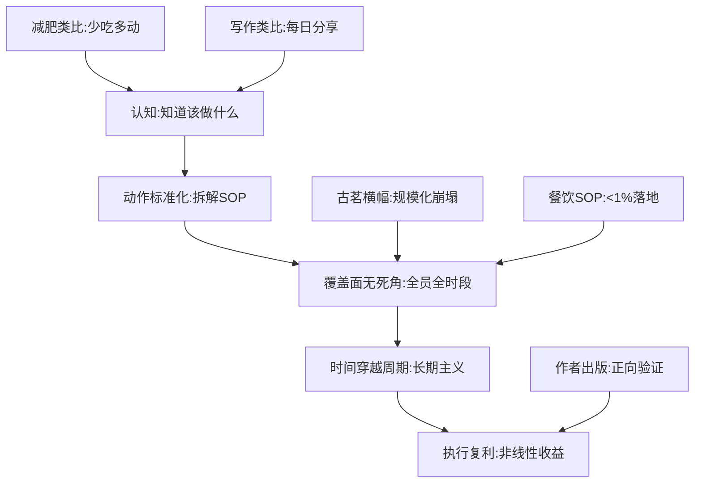
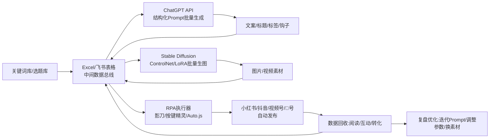

# 第 82 章 生财有术教程体系总览 —— 从认知地基到变现顶楼的摩天大楼蓝图

## 学习目标

- 理解生财有术教程体系的整体架构与核心逻辑
- 掌握认知底座构建：利他思维、执行力进化、承认无知、个人IP复利
- 掌握训练体系运作：生财小航海模式、项目筛选六大标准、MVP验证闭环
- 掌握流量底层架构：公域蓄水池、私域提款机、资料整理引流、SEO长尾复利
- 掌握AI生产力革命：ChatGPT+RPA自动化、SD云端部署、提示词工程、ControlNet控制
- 掌握实战项目库：小红书无货源/虚拟资料、视频号投流、闲鱼矩阵、AI短剧、知识付费、海外B2B/Mediabuy、长尾赛道
- 内化通用方法论资产：像素级拆解/模仿、MVP验证、异常值发现、水土匹配、废号资产化、形式迁移、复购率指标

## 82.1 生活类比

想象生财有术教程体系是一座**从认知地基到变现顶楼的摩天大楼**：

- **地基（认知底座）**：利他思维是混凝土，承认无知是钢筋，个人IP复利是预应力，执行力进化论是施工规范——不打牢地基，楼盖得再高也会塌；
- **骨架（流量架构）**：公域是蓄水池（小红书/抖音/视频号），私域是提款机（微信/社群），资料整理是连接管道，变现分层漏斗是过滤系统——水不流通，提款机就没水；
- **电梯（AI生产力）**：结构化Prompt是按钮，ControlNet是楼层选择，RPA是自动运行程序，LoRA训练是定制装修——不会按电梯只能爬楼梯（人工），电梯坏了（手动没跑通）也得靠腿；
- **样板间（实战项目库）**：八大验证模型是八套不同户型的精装修样板间（小红书/视频号/闲鱼/短剧/知识付费/海外B2B/Mediabuy/长尾），都有实测水电费数据（ROI/利润/周期）和避坑指南（风控/天花板/合规）；
- **万能钥匙（通用方法论）**：像素级拆解是开锁工具，MVP验证是试钥匙，异常值发现是看门眼，水土匹配是换锁芯，废号资产化是备用钥匙，形式迁移是通用钥匙胚，复购率是验收标准——掌握钥匙制作原理，换什么锁（新项目）都能配。

就像盖房子不能只买砖头（工具）不看蓝图（方法论），创业也不能只学招式（项目）不练内功（认知与方法论）。

## 82.2 概念地图

生财有术教程体系
├── 认知底座与训练体系
│   ├── 生财小航海           —— 训练营模式、项目筛选六大标准、0-1变现典型路径
│   ├── 执行力进化论         —— 彻底执行三重境界、笨功夫方法论、注意力守恒、主要矛盾原则、防守优先
│   ├── 认知重塑底座         —— 利他思维、承认无知三步法、个人IP复利、认知-行动耦合律、认知黑洞/三阶段决策/元认知/身心升级
│   └── 投资财富管理体系     —— 股债性价比择时、系统性/结构性行情识别、基金三好筛选、三阶段风控、五大被动收入、流动性优先
├── 流量与变现架构
│   ├── 公私域流量架构       —— 资料整理引流法、钩子设计/变现分层漏斗、付费筛选/信任交换、SEO长尾复利、微信生态内导流优势、合规引流边界
│   ├── AI生产力革命         —— 结构化Prompt/万金油词/Temperature策略、ControlNet多模态/LoRA五步流、RPA+AI协同架构/手动跑通前提、工具组合替代单一平台
│   └── 平民实体创业手册     —— 消费力套利、首年利润率公式/四步筛选、电影院选址/谈判组合拳/极简装修、无人值守3.0/超卖/志愿者/羊毛党
├── 实战项目库（八大验证模型）
│   ├── 小红书无货源/虚拟资料   —— 选品三维验证/蓝海比值/内容工业化/双引擎流量/SEO四因子/私域漏斗/避坑红线
│   ├── 视频号短视频挂车投流   —— 自然流vs投流、高客单选品/SKU套装、矩阵组织/三维选品/素材消重/双阶段测品/赔付/关停/黄金时间/分层放量/异常诊断/品素70-30/数据信仰/门槛红利
│   ├── 闲鱼矩阵无货源         —— 反养号/一机一卡/垂直店铺/三维选品/爆款八要素/矩阵霸屏/创业粉引流/见面交易/差评稀释/竞品反侧写/时间成本匹配/红海规模化/权重双核心/非核心城市组团/副业天花板/保姆级教程/二手书合规/快团团大团长
│   ├── AI短剧解说/CPS        —— 小说推文迁移/行动先于完美/选品定生死解说降维、新手四步走/AI批量化SOP/核心三要素/避坑清单/首月1.4万验证/社群精华帖/一机一号灰度
│   ├── 知识付费/写作变现     —— 养生号起号三式/巨量百应榜单/对标橱窗日志/像素级模仿三式/无人直播矩阵置换/面相书籍爆发/PPT IP 47天16.7万/1对1陪跑验证/统一封面转粉/写作BOSS模式/回忆录蓝海/315下架避险/服务超预期/执行力内功/透明管理
│   ├── 海外独立站B2B         —— 内容为王/五维判真/极简表单/极速响应/首轮反自嗨/留钩子成交/同行反向拆解/25天$4551验证
│   ├── 海外Mediabuy/Brand Bid —— 品牌词近零成本/CPC-EPC套利/三步执行/授权光谱/港币账户优势/Wise推荐同构/十年长期可行性
│   └── 长尾非标赛道         —— 二奢下行期红利/资金门槛/三分货盘/资金周转杠杆/轻重协同/同行裂变/鉴定师证书/飞阅会/全渠道货源图谱/分层出货/风控三重/直播标准化/崩盘重组验证/前员工拆分验证/全新爆款验证
└── 通用方法论资产库
    ├── 像素级拆解/逆向工程   —— 全链路复现式分析获取完整SOP
    ├── 像素级模仿           —— 1:1复刻降低认知负荷快速达及格线
    ├── MVP最小可行性验证   —— 8元成本跑通流量-转化-交付闭环
    ├── 异常值发现           —— 常态分布中识别偏离个案作为机会信号
    ├── 水土不服/人群匹配度   —— 同产品跨平台/人群转化率差异，调整素材实现指数级跃升
    ├── 废号资产化           —— 违规账号作低成本测试载体榨取残余价值
    ├── 形式大于内容/流量密码迁移 —— 直播形式跨品类复用降低技能门槛提高产出比
    ├── 复购率核心指标       —— 非标产品无高复购LTV不覆盖获客成本，高复购证明情绪价值真实性
    ├── 低成本验证优于完美策划 —— <1100元跑通闭环，真实交易数据唯一标准
    ├── 平台风控窗口期       —— 快进快出榨取价值而非硬刚平台，接受非长期主义属性
    └── 方法论资产>单项目收益 —— 内化迁移能力跨周期跨赛道复利，执行力是知识变现关键杠杆

## 82.3 生财有术教程体系总览 —— 从认知地基到变现顶楼的摩天大楼蓝图

### 为什么需要这个概念？

素材涵盖认知、流量、AI、项目、方法论五大板块，碎片化认知易导致“只见树木不见森林”。普通人创业常陷入“只学招式不练内功”误区，缺乏系统性知识地图。需要一个顶层架构图，建立“认知决定上限、执行决定下限、方法论决定复利”的全局观。

> "生财有术教程体系：认知底座→训练体系→流量架构→AI生产力→实战项目库→方法论资产库"
> 
> ——《SUMMARY.md》

> "执行力稀缺性定律：道理都懂却过不好这一生，核心缺口在于执行力而非认知"
> 
> ——《20230516_003.md》

> "彻底执行三重境界：SOP标准化、全员全时段、穿越周期"
> 
> ——《20230516_003.md》

> "利他思维：商业协作的底层逻辑，优先为用户创造价值"
> 
> ——《SUMMARY.md》

> "承认无能与无知：成长的起点，放下体面从最微小确定动作做起"
> 
> ——《SUMMARY.md》

> "个人IP复利策略：百年不改名，全域用同名，统一ID/头像/简介降低认知成本"
> 
> ——《SUMMARY.md》

> "公私域协同模型：蓄水池与提款机，资料整理引流法实测日均引私域180+"
> 
> ——《SUMMARY.md》

> "AI赚钱第一性原理：放大器而非救世主，核心竞争力在于提示词工程+业务拆解+自动化串联"
> 
> ——《SUMMARY.md》

> "八大验证模型：小红书/视频号/闲鱼/短剧/知识付费/海外B2B/Mediabuy/长尾赛道"
> 
> ——《SUMMARY.md》

> "需求三部曲：发现-验证-解决的通用商业落地模型，项目不值钱挖掘逻辑才值钱"
> 
> ——《Gn5NdifvBorUbdxvGl6ceQgXnpg.md》

> "方法论资产>单个项目收益：内化迁移能力跨周期跨赛道复利"
> 
> ——《DGw1dYHSsohHu7x1AXhc4cQVnEN.md》

### 核心定义

**生财有术教程体系**（来源：《SUMMARY.md》）

本教程体系基于生财有术社群2023年5月期周报素材，提炼出的普通人跨越知行鸿沟的完整知识体系。采用“摩天大楼”隐喻：地基(认知底座)→骨架(流量架构)→电梯(AI生产力)→样板间(实战项目库)→万能钥匙(通用方法论)。核心主张：方法论资产>单项目收益，执行力是知识变现关键杠杆。

### 关键性质

认知底座决定“能不能看懂机会”：利他思维、执行力、承认无知、个人IP复利。
训练体系解决“能不能跑通闭环”：生财小航海、项目筛选、SOP执行、MVP验证。
流量架构解决“流量从哪来、钱去哪里”：公私域联动、资料整理、SEO长尾、AI自动化。
实战项目库提供“可对标、可复制、有实证”的八大标准化验证模型。
通用方法论实现“跨周期跨赛道复利”：像素级拆解、MVP、异常值、水土匹配、废号资产化、形式迁移、复购率。

### 典型例子

- 小白程序员两周变现7000元：《CBJhdD0dTokH8tx8HKYc1nJSnnc》——绿灯思维+低成本试错+行动力闭环
- 心理咨询师根源一年从零到年入200万：《Gn5NdifvBorUbdxvGl6ceQgXnpg》——社群杠杆+积累大于收益+业务迁移五维路径
- 东哥视频号带货兼职到全职月入4万+：《20230516_024》——身份证矩阵+物理隔离硬件+测品爆款放大SOP+供应链熔断机制
- 凡响二奢从崩盘到单月GMV1500万峰值：《20230516_104》——轻重资产协同+资金周转杠杆+同行裂变+鉴定师证书+全渠道货源图谱

### 边界条件

认知升级需“制造清晰”而非被动等待，执行力无法替代方向正确性。
单一项目生命周期短，唯有方法论资产可跨周期复利。
平台红利窗口期有限，需“快进快出榨取价值”而非硬刚平台。
合规性是长期生存底线：虚拟产品私域交付规避风控、实体店电影院选址法则、投资流动性优先。

## 82.4 执行力进化论：从“知易行难”到“彻底执行”的三重境界

### 为什么需要这个概念？

你知道道理却过不好这一生，核心缺口不在于认知，而在于执行力。小马宋通过“减肥1/200成功率”与“餐厅SOP落地率<1%”的跨域数据，证明执行力而非认知是核心稀缺资源，揭示“知易行难”的人性根源。

> "经营一家企业，除了大方向走对了，剩下来的，就是做执行，执行的好，公司就会好，执行不彻底，生意就做不起来。那些做得彻底的公司是值得尊敬的。经营企业的道理其实一点也不复杂，跟减肥一样，难的是，你能不能彻底执行。"
> 
> ——《20230516_003.md》

> "我们明明给门店设计了很多销售动作，比如门口的门迎喊宾，客人走的时候要送客人，客人点餐的时候，要顺带推荐新菜或者小吃等等...古茗奶茶有一年提出了一个年度目标，就是要让所有门店都能拉起横幅。"
> 
> ——《20230516_003.md》

> "人都有惰性，做着做着就懈怠了。减肥从理论上来说一点都不难，只要少吃，多动，就能减下来，而且还要坚持少吃多动，才能维持身材。但 200 个减肥的人中，只有 1 个成功，就是不能做到彻底执行。"
> 
> ——《20230516_003.md》

> "一直做，那就难上加难，但你做到了，持续做，彻底执行，做久了就会有回报。我还没有坚持一年，都有人要找我把每日分享做出版了。我已经做到这件事 5 年了。"
> 
> ——《20230516_003.md》

### 核心定义与推导

**执行力稀缺性定律**（来源：《20230516_003.md》）

商业竞争的本质不是策略的高明度，而是基础动作执行彻底度的差异。99%的企业/个人知晓正确动作，但<1%能彻底执行并持久坚持，执行力是最稀缺的核心资产。

这个定律展示了三个层面的证据：(1) 餐饮SOP落地率<1%，即“每个服务员、每天、每一次”全流程合规的餐厅不足1%；(2) 减肥成功率仅0.5%，即200个减肥者仅1人成功，归因于人性底层惰性而非认知缺陷；(3) 古茗横幅案例：规模化执行的系统性崩塌，单店易执行，连锁难彻底。

**彻底执行三重境界**（来源：《20230516_003.md》）

$$
\text{彻底执行} = \text{SOP标准化} \times \text{全员全时段} \times \text{穿越周期}
$$

这个公式展示了彻底执行的三个必要维度：第一，动作颗粒度标准化（SOP），将抽象目标拆解为可观测、可复制的微观操作；第二，执行覆盖面无死角（全员/全时段/全流程），无折扣落地；第三，时间维度长期主义（穿越周期），跨越惰性周期与平台期，形成复利。

为什么用乘法而非加法？因为三个维度任一为零，彻底执行即为零。只有当SOP标准化、全员全时段覆盖、穿越周期坚持三者同时满足，才能产生非线性的复利收益。权重之所以均等，是因为每个维度都是必要不充分条件，缺一不可。

第一重境界——**SOP标准化**（动作颗粒度标准化）：将经营目标拆解为具体、可观测、可复制的微观操作动作，作为执行落地的最小颗粒度单元。古茗将年度目标设定为“全门店拉横幅”这一极低难度动作，降低理解成本，便于全链路考核与落地。

第二重境界——**全员全时段**（执行覆盖面无死角）：要求在全员、全时段、全流程中无折扣落地。餐饮案例中，尽管设计了“门迎喊宾、送客、交叉推荐”等明确促销动作，但能保证“每个服务员、每天、每一次”全流程合规的餐厅不足1%，量化了执行断层的严重程度。

第三重境界——**穿越周期**（时间维度长期主义）：彻底执行的价值随时间指数级增长。短期执行差异微乎其微，唯有跨越“懈怠期”和“平台期”的长期坚持，才能将微小动作转化为显著竞争壁垒。作者坚持“每日一条思考分享”未满一年即获出版邀约，实证了“低门槛高频动作+极致坚持”可快速转化为显性商业价值。

### 关键方法

**目标具象化为单一动作**（来源：《20230516_003.md》）

```
1. 设定抽象年度战略目标（如：提升门店业绩）
2. 拆解为单一、可视化、可验证的物理动作（如：全门店拉横幅）
3. 确立执行标准（如：横幅内容/位置/时间/拍照验收）
4. 建立全链路考核机制（全员/全时段/无折扣）
5. 长期坚持，穿越惰性周期
```

这段伪代码展示了如何将模糊战略转化为可执行、可考核、可复制的标准动作，古茗横幅案例即是典型应用。

**高频微动作坚持法**（来源：《20230516_003.md》）

```
1. 设定极低门槛的高频动作（如：每日10分钟早会、每日一条思考分享）
2. 承诺“动作本身不难”，承认“坚持很难”
3. 建立最小正反馈闭环（如：读书群分享→获得回响→强化动力）
4. 以“日拱一卒”穿越周期，积累执行复利
```

这段伪代码展示了如何通过微小动作的极致坚持，训练个人/组织的执行肌肉，作者每日分享实验即是典型应用。

**跨域类比验证法**（来源：《20230516_003.md》）

```
1. 识别目标领域的核心难题（如：商业执行难）
2. 寻找非目标领域的普世同构规律（如：减肥/个人写作）
3. 建立结构性映射关系（知易行难、简单正确>复杂错误、时间复利）
4. 用类比消解“复杂感”，将难题归因于人性底层惰性
5. 从类比中借用成熟解法（如：少吃多动→基础动作标准化）
```

这段伪代码展示了如何通过跨域类比，将商业执行难题降维为人性管理问题，增强认知说服力。

### 方法演进图



## 82.5 认知重塑底座：利他思维、承认无知、个人IP复利

### 为什么需要这个概念？

混沌源于认知不清，而非环境复杂。只有建立“利他思维”作为商业底层逻辑，通过“承认无知三步法”破除全能幻觉，确立“个人IP复利”作为最高杠杆资产，并训练“元认知微操作”升级身心底层硬件，才能实现认知-行动耦合，支撑穿越周期的高耗能挑战。

> "来生财一年后我终于明白什么是“利他”"
> 
> ——《SUMMARY.md》

> "这个学术上有个概念，叫身居高位产生的脑损伤，做高管做老板久了，他的镜像神经元会减少，共情能力会下降。"
> 
> ——《20230516_055.md》

> "做老板的人，常常会产生一种幻觉，觉得自己伟光正，什么都能，什么都懂……其实有的时候，你发了财不过就是赶上了风口，又因为运气好……但我们自己往往会觉得是因为自己决策正确，勤奋努力，聪明决定。"
> 
> ——《20230516_055.md》

> "承认自己在某些方面无能和无知，才能在经营中听得进去别人的意见和建议，也才能知道有些事你是做不了的，才知道你需要放弃一些你不擅长做的项目和内容。"
> 
> ——《20230516_055.md》

> "价值千万的个人 IP 策略-百年不改名，全域用同名"
> 
> ——《SUMMARY.md》

> "打造“不出镜”个人 IP，10 个月变现 7 位数的方法论"
> 
> ——《SUMMARY.md》

### 核心定义与推导

**利他思维**（来源：《SUMMARY.md》《20230516_046.md》）

在商业协作中，优先考虑为对方/用户创造价值、解决问题，而非单向索取。素材中被视为生财圈核心文化基因，也是高客单价、高复购业务的底层逻辑。资料整理引流法实测日均引私域180+用户，核心在于“提供附加产品-解决问题的方案”，而非单纯贩卖资料。

这个定义展示了利他思维的商业本质：(1) 价值先行——先给用户结果/资源/流量，再收取对价；(2) 信任源于交换——通过“交付价值-收取对价”的交易循环建立商业信任，而非聊天聊出来的；(3) 长期主义——拒绝一次性生意，追求LTV最大化，单客下单10次以上为常态。

**承认无知三步法**（来源：《20230516_055.md》）

$$
\text{认知校准} = \text{归因外部化(破全能幻觉)} \rightarrow \text{开放心态(听建议)} \rightarrow \text{知进退(放弃非擅长)}
$$

这个公式展示了管理者认知升级的三步走：第一步，将成功归因从“内部归因”（能力、努力）显性校准为“外部归因”（风口、运气），打破全能幻觉；第二步，持有“空杯心态”开放听取建议，承认特定领域的无能与无知；第三步，果断放弃非擅长项目，规避决策盲区，实现组织效能最大化。

为什么用箭头而非乘法？因为这是一个时序依赖的流程：必须先完成归因校准（破除幻觉），才能真正开放心态听建议；必须先开放心态，才能准确识别非擅长领域并知进退。三者是先后顺序的因果链条，而非同时并行的乘积关系。

第一步——**归因校准法**：创业者普遍将“风口+运气”的外部结果内化为“决策+努力+聪明”的内部功绩，导致认知膨胀。必须显性区分“运气归因”与“能力归因”，建立谦逊认知基座。

第二步——**开放心态听建议**：唯有承认特定领域的无能与无知，管理者才能听得进去别人的意见和建议。但识别自身无知的能力上限，由当前认知水平决定——低认知者陷入“不知不觉”的双重诅咒。

第三步——**知行合一验证法**：通过考察个体过往实绩（“做没做”、“做得如何”）而非言辞承诺，来验证专业度与可信度，规避管理者认知盲区被利用的风险。在“承认无知”与“防范忽悠”间建立动态平衡，是成熟管理者的必修课。

**个人IP复利策略**（来源：《SUMMARY.md》《GUHld91qQobms8x35tbcOUlSnZb.md》）

$$
\text{个人IP资产} = \text{统一ID(百年不改名)} \times \text{全域同名(降低认知成本)} \times \text{时间跨度(复利积累)} \times \text{内容资产沉淀(可复用SOP/课件/模板)}
$$

这个公式展示了个人IP作为普通人最高杠杆资产的构成要素：(1) 品牌一致性——全域统一ID/头像/简介，降低用户认知成本；(2) 时间复利——出名是赚钱的代价，但也是获取信任、降低获客成本、实现被动收入的核心护城河；(3) 形态多元——不出镜也能打造IP（资料号、工具号、笔记号），木子田PPT IP 47天变现16.7万、漫漫半年涨粉20万年变现40万、不讲李10个月7位数变现，均验证了“不出镜IP”的可行性。

为什么用乘法？因为四个要素缺一不可：没有统一ID就无法建立品牌一致性；没有全域同名就无法降低认知成本；没有时间跨度就无法产生复利效应；没有内容资产沉淀就没有可变现的载体。四者共同作用，呈指数级增长而非线性叠加。

**个人IP双路径选择**（来源：《SUMMARY.md》《GUHld91qQobms8x35tbcOUlSnZb.md》）

- **一技之长IP**：深耕行业经验，输出避坑指南与实操SOP（如木子田PPT、不讲李、写作BOSS老金）。
- **资源整合IP**：盘点公开信息、整理资料包、节省用户决策时间（如资料整理号、工具测评号、选品复盘号）。

两条路径均可实现“不出镜”建立IP，核心差异在于核心资产是“独家经验”还是“筛选整理能力”。

### 关键方法

**认知黑洞与三阶段决策模型**（来源：《20230516_056.md》《M5lpdRp7OoHZAYxuDiicgGtSnpg.md》）

```
1. 认知黑洞识别：否决即关上认知大门，抛开评判心，吸收优质信息
   - "鸡屎里找鸡蛋"：从低质信息源中提炼高价值认知
   - 反对即否决，否决即关门，保持开放接收
2. 三阶段决策：乐观构想 → 悲观计划 → 乐观实行
   - 阶段1：尽可能乐观地构想未来，打破认知边界
   - 阶段2：尽可能悲观地规划路径，预设所有风险与Plan B
   - 阶段3：尽可能乐观地执行落地，坚定穿越周期
3. 元认知微操作训练：
   - 选择前停留几秒：激活理智脑(系统2)，抑制冲动脑(系统1)
   - 情绪外化书写：写作复盘疏解情绪，将隐性认知显性化
   - 三维语言重塑：积极/和善/开放语言强制输出，重塑大脑决策回路
```

这段伪代码展示了如何从生理层面重塑大脑决策回路，规避理性思维对未知的排斥，实现认知升级。

**身心底层升级协议**（来源：《M5lpdRp7OoHZAYxuDiicgGtSnpg.md》）

```
1. 冥想增厚灰质：每日冥想增加前额叶皮层面积，提升专注力与情绪调节
2. 运动后黄金窗口：运动促生神经元，运动后1-2小时安排高强度脑力作业
3. 感受回归当下：焦虑时专注身体感受(呼吸/触觉/声音)，切断反刍回路，回归行动
```

这段伪代码展示了如何从硬件层面升级认知算力，科学实证支撑“冥想增大皮层面积”、“运动促生神经元”，以“感受回归当下”化解焦虑。

### 多源对照：认知升级的不同路径

不同素材对“认知如何升级”给出了不同但互补的答案。

**共识**：认知升级是主动行为而非被动等待，需打破“全能幻觉”，建立“利他思维”，通过刻意训练实现知行合一。

**分歧**：

- 《20230516_055.md》强调**归因校准**为核心：识别“运气归因于能力”的系统性偏差，通过“承认无知→听建议→知进退”三步法破局；
- 《20230516_056.md》《M5lpdRp7OoHZAYxuDiicgGtSnpg.md》强调**认知黑洞与决策模型**为核心：定义“否决即关门”，传授“三阶段决策”与“元认知微操作”，从生理层面重塑大脑回路；
- 《SUMMARY.md》强调**制造清晰**为核心：确立“混沌源于认知不清”，主张“认知清晰→行动坚定→高耗能执行”的传导机制；
- 《Gn5NdifvBorUbdxvGl6ceQgXnpg.md》强调**积累大于收益**：新手期应优先选择能积累资源（技能/人脉/杠杆产品）的项目，而非单纯追求现金流。

## 82.6 训练体系：生财小航海——新手0-1跨越的标准化训练场

### 为什么需要这个概念？

新手面临“知道却做不到”的执行鸿沟。生财小航海作为项目制训练营模式，通过截止节点、公开承诺、同伴监督、导师点评四大机制，强制成员在规定周期内跑通0-1商业闭环，是素材中大量成功案例的共同孵化器。

> "新手小白如何借助生财小航海每月多赚 2 万元（附：小航海项目筛选模型）"
> 
> ——《SUMMARY.md》

> "从 0 开始借助 ChatGPT 变现 7k 入生财经历分享"
> 
> ——《SUMMARY.md》

> "这套方法论由我经历的四个阶段组成：1. 初入生财：没日没夜地看几天精华帖... 2. 筛选项目... 3. 尝试动手... 4. 更加焦虑..."
> 
> ——《Gn5NdifvBorUbdxvGl6ceQgXnpg.md》

### 核心定义

**生财小航海**（来源：《SUMMARY.md》）

社群发起的项目制训练营模式，设定明确目标、时间节点与导师陪跑，强制成员在规定周期内跑通0-1商业闭环，解决“知道却做不到”的执行鸿沟。核心机制：截止节点(强制交付)、公开承诺(社会压力)、同伴监督(群体动能)、导师点评(专业纠偏)。

### 关键方法

**小航海项目筛选六大黄金标准**（来源：《SUMMARY.md》）

```
筛选适合新手的项目标准：
1. 正向现金流快（首笔收入预计周期短）
2. 无需复杂供应链/囤货（轻资产）
3. 可标准化/SOP化（核心流程可文档化/外包）
4. 可借力AI工具提效（核心环节可用AI大幅提效）
5. 有明确的公域获客路径（搜索/推荐/广告哪条路最通）
6. 后端有高复购/高客单产品（LTV能否>500元）
```

这个清单展示了如何从“挑选优质项目”转向“筛选匹配项目”，新手决策模式必须为“筛选匹配当下能力资源的项目”，而非大佬的“挑选最优项目”。

**新手四阶段通用方法论**（来源：《Gn5NdifvBorUbdxvGl6ceQgXnpg.md》）

```
阶段1 锻造武器：精华帖模块化拆解法
   - 按"流量-产品-变现"三维度拆解精华帖
   - 建立个人武器库表格：每拆解一篇得3个模块
   - 新项目即为模块重组(像搭积木)

阶段2 明确战场：新手项目筛选模型
   - 近20项参数决策表格(风险/收益/能力/时间/成本/匹配度)
   - 核心逻辑：筛选匹配度而非挑选优质项目
   - 四步筛选法：先筛原则→再筛能力→再筛收益→最后筛市场
   - 无结果时反查三问：条件太苛刻/看项目太少/参数不准确

阶段3 勇敢行动：最小可行性行动启动法 + 福格行为模型
   - 克服完美主义：注册账号→发布内容→无流量想获流→有流优转化
   - 遇阻诊断：B=MAP(行为=动机×能力×触发)
   - 外包/工具/提醒对症下药

阶段4 放大项目：增长模型拆解 + 业务迁移五维路径
   - 将收益拆解为乘法公式：收益=客单价×支付率×咨询率×添加率×触达率×私信率×阅读量
   - 识别每层转化率与基数，制定针对性提升策略
   - 五维迁移：同用户上下游/异用户同业务/变卖流量/卖影响力/卖模式(培训)
```

这个方法论展示了从认知对齐到规模化放大的完整闭环，毛韩通过该体系实现月净收益2万元并保持20%增长。

### 典型验证路径

下表展示了不同典型验证路径的核心动作、周期、结果及来源：

| 验证路径 | 核心动作 | 周期 | 结果 | 来源 |
|----------|----------|------|------|------|
| AI资料变现 | 资料整理+私域转化 | 1-3个月 | 月入3k-2w+ | CBJhdD0dTokH8tx8HKYc1nJSnnc |
| ChatGPT账号/Plus代充 | 信息差套利+分销 | 2周 | 变现7000元 | CBJhdD0dTokH8tx8HKYc1nJSnnc |
| 小红书资料引流 | SEO蓝海词+钩子设计 | 2个月 | 月入5万+ | RaMIdAe9aoB1XcxwSRocx2mmnad |
| 外卖差评删除 | 电销+小红书SEO | 4个月 | 月入2.25万 | Gn5NdifvBorUbdxvGl6ceQgXnpg |

## 82.7 公私域流量架构：蓄水池与提款机的底层通道

### 为什么需要这个概念？

所有平台玩法最终归宿：公域引流→私域沉淀→朋友圈/社群运营→高客单/高复购转化。资料整理、钩子设计、后端话术、附加产品/服务是私域转化率的核心决定因素。必须建立“公域是蓄水池、私域是提款机”的底层模型。

> "资料整理日均引私域 180+ 用户，最重要的是提供附加产品-解决问题的方案"
> 
> ——《SUMMARY.md》

> "通过优化后端朋友圈和话术，实现小红书资料引流月入 5 万+的复盘"
> 
> ——《SUMMARY.md》

> "小红书虚拟项目赛道选择、转化思路的案例拆解及全方位实操经验分享"
> 
> ——《SUMMARY.md》

### 核心定义

**公私域协同模型**（来源：《SUMMARY.md》《20230516_046.md》《BzIfdvAQloqLImxjEhKcERAXn5f.md》）

$$
\text{商业闭环} = \text{公域蓄水池(内容/SEO/算法)} \xrightarrow{\text{钩子设计}} \text{私域提款机(朋友圈/社群/1v1)} \xrightarrow{\text{变现分层漏斗}} \text{高客单/高复购}
$$

这个模型展示了流量变现的底层通道：公域(小红书/抖音/视频号/👸号/闲鱼/海外社媒)负责获客，私域(微信/社群)负责沉淀与转化，资料整理是连接管道，变现分层漏斗(资料→咨询→高客单体系)是过滤系统。

**连接关键动作四件套**（来源：《SUMMARY.md》）

```
钩子设计 → 诱饵投放 → 承接路径 → 转化话术
```

这四个动作构成了公私域连接的标准化动作链，每个动作都有具体的执行标准与避坑指南，缺一不可。

**变现分层漏斗**（来源：《20230516_046.md》《BzIfdvAQloqLImxjEhKcERAXn5f.md》）

$$
\text{分层变现} = \text{低价资料(筛选付费意向/建立信任)} \rightarrow \text{低价咨询(深度连接/挖掘需求/互惠红包)} \rightarrow \text{高客单产品/训练营/资源对接(核心利润/复利上限)}
$$

这个漏斗展示了三层递进变现路径：第一层，低价资料(9.9-99元)筛选付费意向、建立信任；第二层，低价咨询(199-299元)深度连接、挖掘需求、引导用户自发发红包(互惠心理/沉没成本)强化连接，实测99%用户发红包、30%转化高客单；第三层，高客单产品/训练营/资源对接(999-9999元)作为核心利润与复利上限。

**付费即筛选，信任源于交换**（来源：《BzIfdvAQloqLImxjEhKcERAXn5f.md》）

用户哪怕支付9.9元，即完成两重筛选：验证对垂直领域的强兴趣、验证具备知识付费意识。免费用户无法判断付费潜力，且易低估资料商业价值。商业信任仅通过价值交换建立——低价咨询是低风险的信任启动器，而非单纯赚取咨询费。

### 关键方法

**资料整理引流法**（来源：《SUMMARY.md》《20230516_046.md》《RaMIdAe9aoB1XcxwSRocx2mmnad.md》）

```
1. 选品定位：锁定垂直高需求赛道(考公/考证/职称/育儿/创业/英语/阅读)
2. 资料加工：高质量整理(结构化/可读性/实用性)→ 打包为PDF/网盘/文档
3. 钩子设计：封面/标题/正文植入"免费领资料"诱饵 → 引导评论区关键词/主页链接/私信
4. 公域分发：小红书(SEO长尾词/笔记矩阵) + 抖音/视频号(算法推荐) + 👸号(搜索/推荐)
5. 私域承接：主页简介挂号/粉丝群/集福利 → 私信自动回复/人工话术引导加微信
6. 朋友圈运营：人设价值成交互动 3:3:2:2 频次/时间段/内容比例 + 置顶分组可见
7. 分层转化：话术即时响应异议处理 → 朋友圈系统性展示价值 → 闭环成交 → 售后促复购裂变
```

这个流程展示了如何将“整理资料”这一零边际成本动作，标准化为“日均引私域180+用户”的可复制获客引擎，核心在于后端“提供附加产品-解决问题的方案”。

**小红书SEO长尾复利策略**（来源：《AVx7dEXmpoRJazx3nH8cceBOnhd.md》《RhRywNqifi3wjGkc4MacUiwXnxc.md》）

```
1. 关键词挖掘：官方数据源优先(百度关键词规划师/微信指数/抖音创意中心)拒绝第三方预估
2. 需求词与流量词决策分离：下拉框/联想词=需求词(知其然)；官方后台指数=流量词(知其多少)
3. 蓝海比值模型：笔记数/互动量比值越小越蓝海(供给稀缺需求旺盛)
4. 四维SEO排名因子：账号权重+笔记数据+用户行为+内容质量
5. 关键词全链路植入：标题(必带)→封面水印→文案开头正文→话题标签(≤5个精准)
6. 搜索冷启动刷量：小号/亲友搜关键词→筛最新→定位笔记→全套互动行为(模拟真实信号)
7. 长尾复利>推荐脉冲：搜索流量可持续半年以上，推荐流量脉冲式衰减
```

这个策略展示了如何以“平台无关、流量为本”公理，构建可持续的精准获客资产，实测“0点赞0收藏”的蓝海词笔记却获大量用户私信“分享笔记”，证明SEO搜索流量精准度极高。

**微信生态内导流优势**（来源：《20230516_078.md》）

视频号→👸号导流因无第三方跳转阻碍、平台默许链路短、转化率高，是私域获客性价比最高路径。视频号内容发布与👸号内容互通共同作用于微信指数排名，视频号运营可反哺提升👸号搜索权重与账号整体权重。

### 多源对照：引流钩子的不同形态

不同素材对“引流钩子”给出了不同形态的最佳实践。

**共识**：钩子必须是“高感知价值、低获取成本、强相关性”的虚拟资源，核心目的是筛选精准付费意向用户。

**分歧**：

- 《20230516_085.md》(PPT IP)：**工具型钩子**(源文件/模板/素材包/配色表/拆解源文件)转化率远高于理论资料(电子书/思维导图)，实测工具型钩子加微好友通过率及后续成交率显著更高；
- 《20230516_046.md》《BzIfdvAQloqLImxjEhKcERAXn5f.md》(资料整理)：**垂直资料包**(考证真题/教程/资源清单)作为通用钩子，配合“自动回复/人工话术”分层承接，日均引流180+；
- 《20230516_029.md》(学习资料)：**飞书文档完整SOP**作为高信任钩子，包含话术模板/朋友圈布局/引流操作步骤，评论区反馈“太细致”佐证可落地性；
- 《WzBCdY4A8omv2cxsneMcn1lJnEb.md》(实体老板IP)：**电子书裂变**(朋友圈文案合集)→评论区放钩子图→引导扫码进群→群内小号发微信号，虚拟电子书成本近零、合规安全；
- 《20230516_078.md》(视频号导流)：**关键词自动回复**+原文链接跳转，利用微信指数互通提升权重，聊天记录截图+卡点音乐形态验证轻素材重文案可行性。

## 82.8 AI生产力革命：从“会用工具”到“建流水线”的自动化范式

### 为什么需要这个概念？

单纯会用ChatGPT/MJ/SD不赚钱。AI是放大器而非救世主，核心竞争力在于“提示词工程+业务流程拆解+自动化串联”。AI降低了“从0到1”的技能门槛，但提高了“从1到N”的标准化要求。必须将业务拆解为标准化SOP，注入Prompt工程，再用RPA/代码/低代码平台串联成自动化流水线。

> "从 0 开始借助 ChatGPT 变现 7k 入生财经历分享"
> 
> ——《SUMMARY.md》

> "通过 ChatGPT+RPA 13 次拖拽实现文案全流程自动化"
> 
> ——《SUMMARY.md》

> "利用Colab和Stable Diffusion实现云端、免费、自动、批量、无限AI出图"
> 
> ——《SUMMARY.md》

> "【短剧CPS】如何利用ChatGPT批量生产解说类短剧视频"
> 
> ——《SUMMARY.md》

### 核心定义

**AI赚钱第一性原理**（来源：《SUMMARY.md》）

$$
\text{AI商业价值} = \text{Prompt工程(结构化指令)} \times \text{业务拆解(标准化SOP)} \times \text{自动化串联(RPA/代码/低代码)}
$$

这个公式展示了AI变现的三要素：单纯会用工具=0价值；必须将业务拆解为标准化SOP(业务拆解)，注入结构化Prompt工程(Prompt工程)，再用自动化工具串联成流水线(自动化串联)，才能构建护城河。

为什么用乘法？因为三个要素缺一不可：没有Prompt工程，AI输出不可控；没有业务拆解，无法将业务转化为AI可执行的标准步骤；没有自动化串联，只能停留在人工逐条操作的低效率。三者共同作用，产生指数级杠杆效应而非线性叠加。

**结构化Prompt工程**（来源：《HYrZdLBMRorB0qxKqFFcQ075nWf.md》《CBJhdD0dTokH8tx8HKYc1nJSnnc.md》）

```
通用结构 = [角色设定] + [任务目标] + [输入规范] + [输出格式] + [约束条件] + [少样本示例]
权重语法 = (关键词:权重值)  # 如 (masterpiece:1.2) (low quality:-0.5)
Temperature策略 = 0.3-0.7(保守连贯/带货文案) | 0.9(发散/创意文案)
```

这个模板展示了如何将模糊意图标准化为可复用、可批量、可控制的工程化指令，作者阿讯的“ChatGPT中文调教12步法”即是基于模仿的少样本微调范式。

**ControlNet多模态控制**（来源：《HYrZdLBMRorB0qxKqFFcQ075nWf.md》《ZXvbdq7RGoKEeLxryxAckCtSnPf.md》）

统一入口下切换预处理器/模型实现三大核心场景：
- **OpenPose**：骨骼关键点精确复现参考图姿态，保持面部特征
- **Canny**：反转输出颜色(白底黑线→黑底白线)，严格遵循线稿轮廓着色，细节丰富无越界
- **M-LSD**：提取几何线条，切换写实大模型输入风格关键词，保持墙面/门窗/梁柱结构不变，实现家具摆放/材质/色调整体风格化重设计

这个技术展示了如何在无需训练的情况下，实现构图/动作/线稿的像素级可控，满足连载/系列化/商业交付需求。

**LoRA训练标准化五步工作流**（来源：《ZXvbdq7RGoKEeLxryxAckCtSnPf.md》）

```
1. 训练集准备：筛选(高质量/一致性) → 裁剪(自动聚焦/正方形) → 打标(WD14自动+人工减标) → 减标(将权重迁移至触发词)
2. 模型训练：参数配置(学习率/网络维度/步数/保存间隔) → 启动训练
3. XYZ Grid测试复盘：多维度网格搜索(步数/权重/分辨率/采样器) → 选定最优参数组合
4. Metadata参数反推：秋叶解析工具拖拽识别类型 → PNG Info/Tagger反推参数 → 一键复现
5. 业务落地：触发词固化 → 推理部署 → 批量生成 → 质检交付
```

核心创新：**减标签将权重迁移至触发词**——删除通用标签(如 1girl, solo)，仅保留核心特征标签，迫使模型将概念权重绑定在触发词上，实现“一词召唤、稳定复现”。

**RPA+AI协同自动化架构**（来源：《20230516_070.md》《20230516_075.md》《IZx7dx2CSo9x23xioUFcNaHcnRd.md》）

```
架构模式：内容引擎(LLM) + 执行器(RPA) 解耦协作
LLM职责：文案生成/代码编写/数据分析/提示词构建
RPA职责：数据搬运/跨应用交互/流程编排/定时调度/异常重试
接口标准：剪贴板/文件/HTTP API/数据库
关键节点(影刀RPA 13次拖拽)：
获取网页句柄 → 打开表格 → 循环遍历(读Prompt → 聚焦输入框 → 发送 → 等待流式输出结束 → 抓取最后一条回复 → 写回表格)
```

这个架构展示了如何以“内容引擎+执行器”模式，解决长尾高频办公自动化需求，核心原则：**手动跑通是自动化前提定律**——任何RPA项目成功前提是手动标准化流程(SOP)已跑通验证可行；自动化解决规模化(1到100)而非验证可行性(0到1)问题。

**工具组合替代单一平台依赖**（来源：《20230516_075.md》）

组合专用小工具(热点宝选品、轻抖提取、超级写手生成、一帧秒创视频、RPA分发)构建最优链路，成本效率优于依赖单一大平台或全人工。需求驱动学习：发帖对接验证市场需求→接单驱动技术速成→交付方案→复用沉淀SOP，形成“需求-学习-交付”正向飞轮。

### 数据流图



## 82.9 实战项目库：八大验证模型的标准化复现

本节将八大验证模型的核心SOP、关键指标、避坑红线以对比表格形式呈现，供你根据自身资源禀赋快速定位赛道。

### 模型对比总览

下表展示了八大验证模型的核心SOP、关键指标、典型周期、启动成本、核心壁垒及典型案例：

| 验证模型 | 核心SOP | 关键指标 | 典型周期 | 启动成本 | 核心壁垒 | 典型案例 |
|----------|---------|----------|----------|----------|----------|----------|
| **小红书无货源/虚拟资料** | 选品三维验证→内容工业化→双引擎流量→私域分层漏斗 | 日引100-180+精准粉、客单99-2999元、月纯利30-50万 | 2-3个月 | 3000-4000元/店 | 选品判力、封面标题CTR、私域话术转化率 | AVx7dEXmpoRJazx3nH8cceBOnhd, WX87d3F4SoVZLHxDNGzcDDVRn6R |
| **视频号短视频挂车投流** | 选品→二创去重→挂车→千川测品(ROI>1.2)→放量→矩阵复制 | ROI 1:1.5-1:3、单账号月佣10-20万、冷启动3-7天 | 1-2个月 | 百元级测款/天 | 去重剪辑能力、选品判力、投流参数调优 | AxQ8duaITowcrCx54hocWSy4nnb, I8BLdIIfbobzkYxCLGBctYqbnae |
| **闲鱼矩阵无货源** | 反养号→一机一卡→垂直店铺→三维选品→爆款八要素→矩阵霸屏 | 7-400店、单店日出5-20单、月销千单/店 | 1个月 | 低(保证金/垫付) | 设备环境隔离、供应链稳定性、账号权重信用分 | 20230516_097, 20230516_105 |
| **AI短剧解说/CPS** | 选剧→ChatGPT改写→剪映TTS→智能剪辑模板→批量发布矩阵 | 单人日产50-100条、首月1.4万、多平台分发 | 2周-1个月 | <1100元 | 选剧定生死、解说模式降维打击、AI批量化SOP | 20230516_084, EL9Fdl8WFoFxaixaJcLcqnXjn7r |
| **知识付费/写作变现** | 个人IP信任背书→标准化交付(SOP/模板/社群)→持续内容输出 | 年入百万/月入5万+、边际成本趋零、复购70%+ | 3-6个月 | 低(时间成本) | IP人设打造、交付标准化、服务超预期 | G2Zwdm2H7ol8FYxHEn7c0H2dn3c, 20230516_041 |
| **海外独立站B2B** | 内容为王/SEO→五维判真→极简表单→极速响应→留钩子成交 | 25天成交$4551、100%毛利、单人可跑通 | 1-3个月 | $0-低预算 | 英语/工具/合规/收款渠道、内容SEO深度 | VILid7sleoZ6puxkchxcRM9vn6g |
| **海外Mediabuy/Brand Bid** | 品牌词近零CPC→CPC<EPC套利→Awin联盟→港币账户优势 | ROI 359-496%、单人年入百万、十年长期可行 | 即时-持续 | 账户开设成本 | 品牌词授权光谱、Google Ads账户质量、联盟审核 | M0hMdjWj3o8WtNxZdv4cLnfenIh |
| **长尾非标赛道(二奢/手机壳/写作店铺)** | 解决具体小问题→轻资产/服务标准化→私域高客单/复购 | 二奢年入300万/手机壳月入1万/写作店铺年入50万 | 3-12个月 | 资金门槛不等 | 供应链/鉴定能力/垂直专业度/信任资产 | 20230516_104, 20230516_103, 20230516_049 |

### 82.9.1 小红书无货源/虚拟资料：选品三维验证与私域分层漏斗

**核心SOP**（来源：《AVx7dEXmpoRJazx3nH8cceBOnhd.md》《RhRywNqifi3wjGkc4MacUiwXnxc.md》《20230516_033.md》）

```
阶段1 三维交叉验证选品：
   - 搜索人气(需求量) + 成交转化(支付意愿) + 直通车成交笔数(实锤销量) 三指标决策
   - 淘上红模式：利用淘宝成熟数据(直通车成交笔数)反向指导内容生产
   - 词根三级挖掘：通用词根→行业词根→细分领域词根(如启蒙→英语启蒙→蓝色考拉/反霸凌启蒙绘本)
   - 蓝海比值模型：笔记数/互动量比值越小越蓝海

阶段2 内容工业化生产：
   - 封面六大视觉法则：放大主体/制造视觉冲击/色彩对比/高饱和度/色块留白/重复排列
   - 标题关键词杂交公式：核心词+属性词+长尾词+情绪词/数字/符号(≤20字)
   - 文案采集改写SOP：收集优质笔记→拆解结构(钩子/痛点/方案/引导)→伪原创改写(换词/换序/注入真实体验/植入长尾词)
   - 素材四源二创：电商详情页/短视频/站内爆款/自拍实拍 → 去重(调参/镜像/调速/滤镜/混剪)

阶段3 双引擎流量运营：
   - 商城端：优化SKU/主图/标题/评价承接搜索 + 报名活动争取推荐
   - 内容端：矩阵号布局长尾词SEO截流 + 爆款笔记投流(薯条/薯店推广)获取推荐
   - 形成"种草-拔草"闭环

阶段4 私域分层漏斗：
   - 引流钩子：资料包/网盘/群/号 → 合规引流(主页/私信/群聊)
   - 朋友圈运营：人设价值成交互动 3:3:2:2 + 置顶分组可见
   - 话术分层：共情认同→价值锚定→社会背书→限时限量→闭环引导下单
   - 变现分层：资料(9.9-99) → 咨询(199-299) → 高客单训练营/社群(999-9999)
```

**避坑红线**（来源：《AVx7dEXmpoRJazx3nH8cceBOnhd.md》《20230516_030.md》）

客服话术三大红线：禁提他平台名(罚2000)、禁“描述不符”承诺(广告法罚10万)、禁明示“好评返现”。
发货罚款红线：超期3-30元/单、缺货5-100元/单，多备1-2家备选供应商。
违规笔记删除重发优于申诉修改：黑箱不可测，盲目修改易二次违规永久损权重。
退货地址设港澳台/海外，详细地址引导联系客服，防平台自动同意退货导致资损。
个人店/个体店批量矩阵：一照开三店第2/3店需蓝V认证(600元/年)，开通运费宝降低决策顾虑提升转化。

### 82.9.2 视频号短视频挂车投流：品素决定论与分层放量

**核心SOP**（来源：《AxQ8duaITowcrCx54hocWSy4nnb.md》《I8BLdIIfbobzkYxCLGBctYqbnae.md》《20230516_024.md》）

```
阶段1 用户画像锚定选品：
   - 视频号核心池：女性≥85%、50岁以上≥80% → 聚焦养生/保暖/家居等中老年高频刚需
   - 高客单高利润标准：利润率>70%、主打新奇特高溢价、排除黑五类功效品
   - SKU套装化：多件装+价格高到低排序提升客单利润，低价SKU承接千展消耗

阶段2 矩阵化测品组织：
   - 3-6人组 + 人均5台安卓机(红米Note 11T 8+128G~1700元) + 专职投手比(3组:1投手)
   - 身份证矩阵合规模型：一证五号，主号绑定运营者管理子号，物理隔离不同人员账号组
   - 核心指标：日测品数/素材数，头部团队日测70-100品保证高频出爆品

阶段3 三维选品法：
   - 拼多多榜单 + 蝉妈妈数据平台 + 同行爆品跟投(爆率最高)
   - 新团队建议先跟投同行爆品跑通流程拿正反馈，再自测

阶段4 素材搬运消重SOP：
   - 抖音/快手搬运(优选口播) → 采集软件解MD5 → 剪映/CR解搬运痕迹 → 消重软件解审核重复
   - 七步去重：调参/特效/变速/镜像/贴纸/换BGM/调色

阶段5 双阶段测品法：
   - 1测验品：1000豆/6h/出价900/无定向 → 仅验证"能否出单及ROI"，不达标Pass或换素材
   - 2测探价：2000豆/4-10条/出价阶梯降50 → 核心验证"最优流速出价"及"能否放量"

阶段6 分层放量与风控：
   - 赔付机制：达标(6赞/6关注/6单→更新4单)空消耗部分获平台赔付，兜底投放风险
   - 关停止损公式：利润>100时消耗达(利润/4-5)未出单关停；利润<100时消耗达(利润/3-5)关停
   - 黄金时间窗：测品上午9点前；放量晚上12点建12h计划或凌晨4点建计划效果最佳
   - 分层操盘：高客单走"大额+卡赔付"不关停；低客单走"小额叠投+勤关停"
   - 异常诊断决策树：不过审/不消耗/转化低三大异常的结构化排查动作

阶段7 核心铁律：
   - 品素决定论(70/30)：品与素材贡献度超70%，投放技巧不超30%，90%问题根因指向品素
   - 数据信仰：不相信感觉，只相信数据，测品不达标果断Pass或换素材重测
   - 门槛提升红利：0粉挂车取消/投放门槛提高/支付ROI内测/赔付标准调整实为"好事"，清洗无序竞争
```

**实证数据**（来源：《AxQ8duaITowcrCx54hocWSy4nnb.md》《20230516_024.md》）

新号冷启动曲线：首月3万+ → 315波动 → 稳定日销2000+ → 次月单号8万+净利30% ROI1.8-2.0。
头部团队月利润超100万不少于10个、日测70-100品。
东哥案例：兼职到全职、单号到20+账号矩阵、累计收益4万+，供应链失联导致实发率崩塌损失数千佣金、店铺体验分<4分触发隐形惩罚。

### 82.9.3 闲鱼矩阵无货源：反养号与矩阵霸屏

**核心SOP**（来源：《20230516_097.md》《20230516_105.md》《20230516_039.md》）

```
阶段1 账号体系建设：
   - 反养号论：养号仅提升买家标签，不提升卖家权重。权重核心=30天销量/点击率/收藏率/好评率/发布时间/售后/违规/二次访问
   - 一机一卡一号：同设备/网络下店铺违规关联受罚，避免使用曾卖过货的旧设备(历史污染)
   - 垂直店铺专业度信任模型：单店单品类，榜单上榜皆垂直，配合真实人设(真人头像/专业简介)强化转化

阶段2 三维选品法：
   - 榜单复制(头部验证品) + 蓝海挖掘(买家多卖家少小众如摩托配件) + 多渠道深度了解(多多/淘宝/同行/抖音/百度)
   - 时间成本匹配模型：按可支配时间碎片度匹配品类(重客服型/重运营型/重财务型/重客服转化型)

阶段3 爆款上架八要素：
   - 标题(高搜词+痛点钩子) + 文案(稀缺紧迫) + 主图(吸睛真实信息密) + 详情图(代入感人设关联)
   - 价格(新品低价引流后涨价) + 地址(产地/一二线城市借流量) + 标签(补词) + 圈子(辅助曝光)

阶段4 矩阵霸屏策略：
   - 7-8个店铺布局同一单品，占据搜索前5/前10多个位置
   - 通过曝光数据预判具体哪个链接会爆单，实现"必定有一个爆单"
   - 规模化必然导向非核心城市：山东聊城/滨州低成本组建铁三角团队(客服-运营-财务)

阶段5 私域引流闭环：
   - 创业粉引流：低价虚拟课钩子 → 文件过大引导加微 → 5元/个批发变现 → 分销代理授权裂变
   - 见面交易转好评：规避虚拟商品发货违规、快速提权重
   - 差评稀释与炼丹：动员老顾客刷长文好评制造标杆；召唤客服(输入12345)投诉违规内容删除差评
```

**核心指标**（来源：《20230516_105.md》）

店铺权重双核心指标：转化率进攻(咨询转单率驱动) - 售后风险防御(退款率/小二介入率拖累)。
“养号/擦亮/签到”边缘动作收益极低。
副业天花板：个人全职年入15-20万，有货源优势应切淘宝/拼多多。

### 82.9.4 AI短剧解说/CPS：小说推文经验迁移与AI批量化

**核心SOP**（来源：《20230516_084.md》《EL9Fdl8WFoFxaixaJcLcqnXjn7r.md》）

```
阶段1 赛道认知与迁移：
   - 短剧CPS与小说推文同构：剪辑片段挂载小程序链接用户充值分成佣金
   - 蓝海期红利：部分剧方给100%首充分成，平台宽松审核是普通新手最佳窗口
   - 行动先于完美计划：下场实操是获取真实反馈打破自我设限唯一路径

阶段2 核心三要素：
   - 选品决定上限(剧集自带流量/题材/节奏/爽点) → 选剧定生死
   - 执行决定下限(剪辑去重/文案钩子/发布坚持) → 解说模式新手护城河
   - 解说模式：原创音频二创剪辑更易过原创校验，将剪辑技巧门槛转移为文案逻辑门槛，可由AI大幅辅助

阶段3 新手四步走AI批量化SOP：
   1. 选爆款高佣剧
   2. ChatGPT按公式生成分集解说文案(输入剧情梗概输出口语化脚本)
   3. 剪映文本朗读/外部TTS生成音频
   4. 导入剪映智能匹配素材 → 手动按文案切点配剧情片段 → 套用模板出片
   - 标准化资产库：选题表/文案提示词库/配音预设/剪辑模板库/发布清单
   - 单条制作压缩至15-20分钟，批量导入素材/批量喂AI生成10条文案/批量合成语音/剪映一键成片模板/多账号矩阵定时发布

阶段4 避坑清单：
   - 授权只认官方大服务商，警惕收费授权/二手授权/扣量陷阱
   - 账号环境：实名一机一号，新号刷同城垂类3-5天再发(灰度空间存在)
   - 去重彻底：MD5修改/镜像翻转/调色/抽帧/加贴纸/字幕/边框
   - 数据复盘：关注完播率/点赞/转发/跳转率，数据差先优化前3秒钩子和CTA引导
```

**实证验证**（来源：《20230516_084.md》）

惟乔首月1.4万收益，普通社群成员无专业视频背景入场首月实操跑通。
社群精华帖作为隐性导师，高质量社群知识库对新手构建认知框架规避基础错误有显著替代传统导师作用。

### 82.9.5 知识付费/写作变现：个人IP信任背书与标准化交付

**核心SOP**（来源：《ZbFEdhEwsoqaNnxXzRicjWQOnkd.md》《20230516_085.md》《G2Zwdm2H7ol8FYxHEn7c0H2dn3c.md》）

```
阶段1 IP起号与信任构建：
   - 养生号起号三式：混剪/缅怀/图文经方(图文经方+大师音频最快：前3天日更3条、第4天起日更5条，5天千粉精准中老年画像)
   - 对标账号橱窗销量日志追踪：千粉权限进巨量百应筛选爆款视频/图书教育/作者等级0/近24小时；人工日记录20-30对标账号橱窗销量变化及高赞视频
   - 像素级模仿三式：混剪(音画一致+70%画中画) / 实拍(逐镜头复刻) / 真人出境(图文+音频/二创混剪规避镜头门槛)

阶段2 无人直播矩阵置换策略：
   - 新号千粉上无人直播测3天/日发5条 → 不爆换新号直播/旧号转短视频 → 爆品验证后全矩阵切短视频跟品
   - 4台无人直播日佣稳定过千至数千
   - 面相书籍案例：单品爆发带动月佣破10万，4月20日提前完成目标

阶段3 PPT项目拆解IP标准化(木子田案例)：
   - 对标拆解建立素材库/选题库/文案库，爆款四要素：封面统一大字报/文案黄金3秒钩子/BGM卡点/剪辑节奏快
   - 私域钩子：源文件/模板/素材包/配色表(工具型转化率远高于电子书)
   - 朋友圈三段式：专业/生活/营销 5:3:2 穿插发布，打造专业真实有温度人设
   - 咨询式成交五步法：诊断现状-揭示痛点-提供方案-展示案例-限时锚定促单
   - MVP思维：先卖再做，1对1陪跑(2999/4999)打磨SOP+FAQ → 降维标品(299/599/999)规模化

阶段4 写作BOSS模式(老金案例)：
   - 多平台矩阵开店(拼多多/淘宝/闲鱼/小红书/抖音/视频号)避坑
   - 私域物理隔离微信账号分层定价：微信A接高客单/微信B接拼多多，同质服务利润差40%+
   - 合规引流话术库：拼多多发文件/截图、闲鱼电话/图片、小红书大小号联动、抖音粉丝群小号托管
   - 三类客户分级过滤低价比价型
   - ChatGPT辅助SOP：角色设定→大纲→分段写作→口语化润色→搜爆文要素反哺指令
   - 写手团队四阶段进化：外包同行→兼职写手→收费招募培训→整合上游渠道成供给中心

阶段5 长期主义护城河：
   - 315等节点主动下架商品链接避险：保全大店存活，风波过后再上架
   - 服务质量超预期是高复购(70%+)唯一护城河：拒绝一次性生意，定金验收机制建立安全感
   - 执行力与隐性资本(作息/习惯/读书)决定上限：早睡早起/运动/读书等"内功心法"支撑身心状态
   - 团队管理：极度透明+鼓励单干+利益分配谈判，开放核心SOP、鼓励员工出去单干倒逼自身迭代
```

### 82.9.6 海外独立站B2B：内容为王与留钩子成交

**核心SOP**（来源：《VILid7sleoZ6puxkchxcRM9vn6g.md》《20230516_100.md》）

```
阶段1 流量获取：
   - 内容为王，技术为辅：Google算法已足够智能，唯有持续输出高质量专业博客文章是核心
   - 外链建设/过度技术优化属于低ROI行为，2个月拿到精选摘要第0名验证有效性
   - 同行反向拆解选题法：同行做不好直接切入抢排名；同行做好则拆解内容结构/关键词/角度，制定"做得更好"的超越计划

阶段2 询盘处理SOP：
   - 五维判真：邮箱/域名/留言/页面/IP 五维判断真伪
   - 极简表单：仅设Email+Message必填降低门槛
   - 首轮极速响应：传递重视信号并抢占候选集(客户群发10家仅3家快速回复)

阶段3 首轮回复反模式与留钩子成交：
   - 拒绝"自嗨式"公司介绍：客户不关心你是谁，只关心能解决什么问题
   - 标准动作：确认需求→精简报价单→详细参数→埋设钩子
   - 留钩子成交法：报价后主动承担风险咨询角色——"万一买回去不合适？主动提供测试文件建议模拟"
   - 诱导客户回复建立深度连接，将被动报价转为主动技术咨询，锁定高利润成交

阶段4 实证验证：
   - 25天成交法国B端订单$4551.7，2pcs，100%毛利
   - 客户补单邮件明确感谢"提前考虑模拟测试"，印证留钩子为关键触点
   - 极简表单未阻碍高质量线索获取
```

### 82.9.7 海外Mediabuy/Brand Bid：近零CPC套利模型

**核心数学模型**（来源：《M0hMdjWj3o8WtNxZdv4cLnfenIh.md》）

$$
\text{品牌词近零成本定理}：\text{质量得分满分} + \text{无竞争} \rightarrow \text{实际CPC} \rightarrow 0.01 \text{当地货币}
$$

$$
\text{CPC/EPC套利}：\text{CPC} < \text{EPC} \text{即稳赚}
$$
- 品牌词CPC压至0.01以下，联盟Offer EPC极少低于0.01$
- 三组实盘：ROI 359%-496%，佣金$5715/$7218/$3988 对应花费$1220/$1210/$867

这个公式揭示了品牌词竞价的核心数学原理：当质量得分满分且无竞争对手时，实际CPC会压缩至最小计费单位(0.01当地货币)；只要联盟Offer的EPC(每次点击收益)高于这个极低的CPC，即构成无风险套利。三组实盘数据验证了该模型的稳定盈利能力。

**三步标准化执行流程**（来源：《M0hMdjWj3o8WtNxZdv4cLnfenIh.md》）

```
1. 准备Google Ads账户(个人/代理)
2. 注册Awin等双周支付联盟，筛选大体量品牌词/允许竞价/EPC高的Offer并申请通过
3. 创建搜索广告竞价品牌词/竞品词，最终URL直填联盟追踪链接(Direct Linking)，无需建站
```

**商家品牌词授权光谱**：显性允许/默许/仅禁止自有品牌词允许竞品词三层级，项目可行性建立在“总能找到允许竞价的大品牌Offer”市场现实上，已运行十余年非短期漏洞。

**港币账户成本优势**：0.01 HKD ≈ 0.0013 USD，成本再降7倍(理论推演)；单人年净利破百万人民币“非常轻松”。

**Wise推荐计划同构验证**：品牌词低价竞价(£0.01-0.02) + $50/单佣金 + 即时结算，单日佣金破万英镑，优于广告联盟长账期。

### 82.9.8 长尾非标赛道：二奢/手机壳/写作店铺的“小而美”生意

**二奢核心模型**（来源：《20230516_104.md》）

```
三分货盘分层：
- 全新爆款(高周转薄利/海外买手/专柜折扣/15天物流3天抛售/单件利润1000+)
- 中古深库存(非标高毛利/鉴定眼光)
- 二奢利润品(现代款标准化中/核心利润)

资金周转杠杆模型：
月利润 = 自有资金 × 周转次数/月 × 单次毛利率
资金流动比例 3:1(压货:流动)、动销率决定收益上限
150万资金月转300万业务利润30万；日出货3件月转1圈利润5万、9件则15万

轻重资产协同生存法则：
重资产供应链(压货/鉴定/仓储)与轻资产直播间(流量/转化/客服)剥离深度绑定
直播间解决供应链动销率难题，供应链解决直播间货源稳定成本难题
中间商赚"信息差+资金周转效率差"

同行社交裂变增长法：
建60+同行群、微商相册高频发圈(日更100条详细描述词)
养号1个月+单日加好友≤12人+换群间隔3h/次≤10人+广告图≤3张/4h
同行即客户/供应商/情报源，低成本获取双向流量

鉴定师证书准入资产：7天脱产2万学费考证，建立"小绿牌"标准化信任体系
全渠道货源地图：闲鱼/小红书/微信群/展会/奢当家SaaS/大型回收商/日本中古交易所/得物供货
分层出货：标品/高周转→闲鱼/得物/同行批发/固定直播间；非标/高毛利→包展/私域高净值/定向直播；积压尾货→包展清仓/同行低收
风控三重防线：闲鱼验货宝(78元含赔)→本地鉴定师(30不包赔/90包赔/软件辅助)→深度绑定鉴定师关系(免费/优先)+小绿牌标准化流转
直播间标准化复制模板：精品标品号(可复制/2人配置/垂类二奢包包/月利10万) vs 达人流量号(不可复制)
```

**崩盘重组验证**（来源：《20230516_104.md》）

崩盘源于“重轻失衡与资源错配”：资源倾斜重运营/长周期/低毛利直播部门，导致现金奶牛(同行贸易)断奶、资金链断裂、核心骨干离职。
革命友谊>商业契约：共同经历生死、相互补位、系统性思考高效执行的信任关系，是穿越周期实现反转根本原因。
重组后“轻量化直播”单月GMV 700万→1000万→1500万峰值、月利稳定30万+。
前员工拆分4小团队(各3-5人)反而人均效能利润率更高：中古团月转300万2圈利润60万、定向找货团月利十几万、快进快出团50万资金滚动、门店对接团单人月入十几万。
全新爆款‘15天物流+3天抛售’单件净利1000元、桐庐同行闲鱼模式月GMV200万利润20万资金需100万。

## 82.10 通用方法论资产库：跨周期跨赛道复利的万能钥匙

### 为什么需要这个概念？

单一项目生命周期短，唯有方法论资产可跨周期复利。生财思维的核心在于将实战经验内化为可迁移的认知工具：像素级拆解/模仿获取SOP、MVP低成本验证、异常值捕捉机会、水土匹配指数级跃升、废号资产化榨取残值、形式迁移降维打击、复购率验证商业可行性。

> "像素级拆解/逆向工程：全链路复现式分析获取完整SOP"
> 
> ——《DGw1dYHSsohHu7x1AXhc4cQVnEN.md》

> "像素级模仿：1:1复刻降低认知负荷快速达及格线"
> 
> ——《DGw1dYHSsohHu7x1AXhc4cQVnEN.md》

> "最小可行性验证：8元成本跑通流量-转化-交付闭环"
> 
> ——《DGw1dYHSsohHu7x1AXhc4cQVnEN.md》

> "异常值发现：常态分布中识别偏离个案作为机会信号"
> 
> ——《DGw1dYHSsohHu7x1AXhc4cQVnEN.md》

> "水土不服/人群匹配度：同产品跨平台/人群转化率差异，调整素材实现指数级跃升"
> 
> ——《DGw1dYHSsohHu7x1AXhc4cQVnEN.md》

> "废号资产化：违规账号作低成本测试载体榨取残余价值"
> 
> ——《DGw1dYHSsohHu7x1AXhc4cQVnEN.md》

> "形式大于内容/流量密码迁移：直播形式跨品类复用降低技能门槛提高产出比"
> 
> ——《DGw1dYHSsohHu7x1AXhc4cQVnEN.md》

> "复购率核心指标：非标产品无高复购LTV不覆盖获客成本，高复购证明情绪价值真实性"
> 
> ——《DGw1dYHSsohHu7x1AXhc4cQVnEN.md》

> "低成本验证优于完美策划：<1100元跑通闭环，真实交易数据唯一标准"
> 
> ——《DGw1dYHSsohHu7x1AXhc4cQVnEN.md》

> "平台风控窗口期：快进快出榨取价值而非硬刚平台，接受非长期主义属性"
> 
> ——《DGw1dYHSsohHu7x1AXhc4cQVnEN.md》

> "方法论资产>单项目收益：内化迁移能力跨周期跨赛道复利，执行力是知识变现关键杠杆"
> 
> ——《DGw1dYHSsohHu7x1AXhc4cQVnEN.md》

### 核心方法论工具箱

下表展示了核心方法论工具箱的各项工具、核心定义、适用场景及典型案例：

| 方法论工具 | 核心定义 | 适用场景 | 典型案例 |
|------------|----------|----------|----------|
| **像素级拆解/逆向工程** | 对标杆全链路全细节复现式分析(进直播间/扫码/加微/客服话术/下单/交付/朋友圈运营每个像素动作记录还原) | 陌生赛道快速获取完整商业闭环SOP | 视频定制直播项目全链路拆解《DGw1dYHSsohHu7x1AXhc4cQVnEN.md》 |
| **像素级模仿** | 1:1复刻标杆头像/简介/企微/自动回复/直播间搭建/OBS场景/标点符号，降低认知负荷规避试错快速达及格线 | 执行层面“先抄再超”策略，新手冷启动 | 不讲李PPT排版/剪辑节奏被大量后来者像素级模仿成赛道标准《GUHld91qQobms8x35tbcOUlSnZb.md》 |
| **MVP最小可行性验证** | 在约束下聚焦最高优先级，8元成本(域名/工具)一个月赚2万+，先跑通“流量-转化-交付”闭环验证需求真实性 | 新项目/新赛道/新模式的零成本试错 | 视频定制项目：8元模板+废号+现有电脑<1100元成本跑通商业闭环《DGw1dYHSsohHu7x1AXhc4cQVnEN.md》 |
| **异常值发现** | 在常态分布中识别显著偏离个案(无人播弱交互却高场观高互动高客单)作为潜在机会信号 | 选品/选题起点方法论，打破认知盲区 | 无人直播场观异常高企→切入视频定制赛道《DGw1dYHSsohHu7x1AXhc4cQVnEN.md》 |
| **水土不服/人群匹配度** | 同一产品不同平台/年龄层/需求场景转化率巨大差异，调整素材(广州塔→美女试驾)实现人货场匹配，转化率指数级跃升 | 跨平台/跨人群复用素材与产品的核心调优杠杆 | 素材A(广州塔/年轻)日单<3转化0.015% vs 素材B(美女试驾/中老年)单场破万转化0.5-1%《DGw1dYHSsohHu7x1AXhc4cQVnEN.md》 |
| **废号资产化** | 违规扣分限流即将报废账号作为低成本测试载体，高频短时直播榨取残余流量价值，规避主力账号风险 | 平台风控收紧期的生存策略，沉没成本边际收益最大化 | 同批账号带货仅几十场观，切换视频定制稳稳几万场观《DGw1dYHSsohHu7x1AXhc4cQVnEN.md》 |
| **形式大于内容/流量密码迁移** | 直播形式可迁移性(AE改文字直播→AI绘画/AI聊天/虚拟主播带货)，核心降低主播技能门槛提高产出比 | 跨品类复用成熟形式降维打击，无需主播高强度输出 | AI虚拟主播为该直播形式最优进化方向《DGw1dYHSsohHu7x1AXhc4cQVnEN.md》 |
| **复购率核心指标** | 非标产品无高复购LTV无法覆盖获客成本(单价30元非标定制视频最多20单/人)，高复购证明情绪价值/社交货币需求真实性与高频性 | 商业模式可行性验证，从“赚快钱”向“做生意”演进基石 | 单客下单10次以上为常态，LTV最大化《G2Zwdm2H7ol8FYxHEn7c0H2dn3c.md》 |
| **低成本验证优于完美策划** | 不到一个月赚2万+，800元电脑第一场回本，真实交易数据检验需求唯一标准 | 资源受限新手的生存法则，拒绝大而全规划 | 视频定制项目实测ROI极高《DGw1dYHSsohHu7x1AXhc4cQVnEN.md》 |
| **平台风控窗口期** | 接受项目非长期主义属性，不想和平台对抗，蓝V认证疑系统Bug照样判引流，快进快出榨取价值 | 灰产/擦边项目的生存哲学，风控收紧期的应对策略 | 单场3-4万场观/超1小时/高频引导加微必触发引流判定直播掐断《DGw1dYHSsohHu7x1AXhc4cQVnEN.md》 |

## 82.11 设计中的取舍

### 为什么不用“全能型创业者”模式而是“专注单点突破+方法论迁移”？

因为认知带宽有限，普通人试图同时精通选品、运营、投流、供应链、团队管理、财务法务等全链路，会导致每个环节都停留在业余水平，无法形成核心壁垒。素材中所有头部玩家均采用“单点极致深耕(如木子田只做PPT IP、东哥只做视频号投流、凡响只做二奢)+ 方法论跨域迁移”策略。Trade-off：放弃全面性换取单点深度，用方法论资产对冲单点风险。

### 为什么不用“原创内容”而是“模仿-微创-标准化”？

因为原创成本极高、成功率极低、不可复制。素材验证：像素级模仿能将“从0到1”的认知负荷降至最低，快速达及格线；微创新(如封面统一风格、前3秒钩子优化)建立差异化；标准化SOP实现规模化复制。Trade-off：放弃“独特性”换取“确定性”与“可复制性”，用执行力填补创意差距。

### 为什么不用“公域品牌广告”而是“私域信任漏斗”？

因为公域流量归平台、成本上涨、转化率低、不可控；私域流量归自己、边际成本趋零、信任可积累、LTV可最大化。素材验证：资料整理日均引私域180+、朋友圈运营+话术分层实现高客单转化、复购率70%+支撑长期复利。Trade-off：放弃“流量规模”换取“转化质量”，用时间换空间，用信任换利润。

### 为什么不用“重资产自建供应链”而是“轻资产组合现有资源”？

因为重资产锁定现金流、放大风险、降低灵活性；轻资产利用外部现成资源(一件代发/合作网络/公开资料/唱吧素人音频)重组交付流程，实现个人能力与业务交付解耦。素材验证：为TA点歌零技能交付(招募合作者+剪辑素人音频)、资料整理引流(资料是别人的/产品必须是自己的)、海外B2B代采模式。Trade-off：放弃“控制权”换取“速度”与“抗风险”，用资源整合能力替代资本密集型投入。

## 82.12 动手练习

### 练习 1：生财小航海项目筛选实战演练

假设你是一名月薪8000的程序员，想利用业余时间做副业，手头有5000元启动资金，擅长Python和数据分析，对AI绘图感兴趣。请使用“生财小航海项目筛选六大黄金标准”逐项评估以下三个备选项目，并决定选择哪一个启动：

- 项目A：开发一款AI绘图提示词优化的Chrome插件，挂载Chrome商店收费订阅
- 项目B：在小红书运营“AI绘图提示词教程”账号，引流私域卖9.9元资料包，后端转化299元训练营
- 项目C：采购二手显卡搭建本地Stable Diffusion服务，接单帮人出图，单价50元/百张

评估维度：
1. 正向现金流速度（首笔收入预计周期）
2. 供应链/囤货复杂度（是否涉及实物/硬件/库存）
3. SOP标准化程度（核心流程能否文档化/外包）
4. AI工具杠杆率（核心环节是否可用AI大幅提效）
5. 公域获客路径明确性（搜索/推荐/广告哪条路最通）
6. 后端高客单/高复购产品可行性（LTV能否>500元）

回答问题：
- 哪个项目综合得分最高？为什么？
- 如果你只有每晚2小时碎片时间，结论会改变吗？
- 如果启动资金增加到5万元，会考虑新项目吗？

### 练习 2：视频号带货投流参数手算与决策

某视频号带货账号测品数据如下：计划预算200元/天，投放时长6小时，消耗180元，曝光15万，点击1200，加购45，下单12，实付金额2400元，佣金率30%，商品售价200元/单，利润率40%(扣除成本后)。请手算以下指标并判断决策：

1. CTR（点击率）= 点击/曝光
2. CVR（转化率）= 下单/点击
3. ROI（投资回报率）= 佣金收入/消耗
4. 单次下单成本（CPA）= 消耗/下单数
5. 估算EPC（每次点击收益）= 佣金收入/点击数

决策题：
- 根据“双阶段测品法”，这是1测还是2测？该进入“放量”还是“换素材/关停”？
- 若进入2测探价阶段，建议出价策略如何设定？（参考：出价阶梯降50）
- 若该素材后续3天数据波动：Day2 ROI=1.1，Day3 ROI=0.9，Day4 ROI=1.3，如何应用“关停止损公式”与“分层放量操盘”决策？
- 该账号处于“高客单走大额卡赔付”还是“低客单走小额叠投勤关停”策略层？依据是什么？

### 练习 3：AI内容自动化流水线搭建推演

目标：搭建一条“选题→生成文案→生成配图→排版成图→定时发布→数据回收”的全自动化小红书笔记生产线。可用工具：ChatGPT (API)、Stable Diffusion (本地/Colab)、RPA工具 (按键精灵/Auto.js/Coze)、Excel/飞书表格、Notion。

请设计完整流程并回答：
1. Prompt工程层：如何设计“结构化提示词模板”覆盖选题生成、标题生成、正文生成、标签生成四个节点？请给出一个通用模板结构示例。
2. 数据流层：如何用Excel/飞书表格作为“中间数据总线”，实现“关键词库→ChatGPT批量生成→SD批量生图→RPA读取发布”的解耦？关键字段有哪些？
3. RPA执行层：小红书发布端自动化的关键难点有哪些？（提示：登录态保持、图文上传顺序、定位发布按钮、频控规避、数据回写）
4. 成本核算：假设单条笔记调用ChatGPT $0.002、SD生图$0.001(Colab免费但算时间成本)、RPA运行$0.01/条(人工监管摊销)，日产50条，月成本几何？人工成本对比(时薪50元，手工单条20分钟)下，自动化盈亏平衡点在哪里？
5. 风控预案：若小红书升级风控导致RPA失效(如滑块验证码、设备指纹检测)，应急方案是什么？如何利用“废号资产化”和“手动跑通是自动化前提”原则快速恢复？

### 练习 4：需求三部曲与MVP验证实战

场景：你发现身边很多宝妈在抱怨“孩子不爱吃饭、挑食严重、辅食做法不会”，怀疑这是一个高需求赛道。请严格遵循“需求三部曲：发现-验证-解决”完成以下任务：

阶段1 发现：列举3个具体的“留心生活对话/数据/热点”信息来源，并记录至少5句原始痛点语录。

阶段2 验证：设计“评论区需求验证法”操作步骤：在小红书/抖音/知乎搜索什么关键词？重点分析评论区哪3类高频语义？(如“怎么做”、“多少钱”、“求推荐”) 如何量化“需求强度指数”？

阶段3 解决：假设你不会做辅食、不懂营养学、没供应链。请运用“资源重组交付法”设计交付物：核心交付物是什么？(视频/文档/社群/咨询？) 外部资源从哪获取？(唱吧素人/公开课/合作营养师/母婴品牌方？) 如何拆解“不会核心技能”的交付流程？

MVP验证：设计一个“8元成本/7天跑通”的最小闭环：买什么域名/工具？发什么钩子内容？引流到哪？卖什么首单产品？多少钱？成功标准是什么？(如：进私域>20人，成交>3单，ROI>1)

反脆弱性检验：如果该赛道3个月后变红海(竞品涌入、流量成本上升)，你的“思维模型跨域复用”能力如何迁移到新赛道？请列举3个可迁移的核心模块。

### 练习 5：个人IP与财富管理复盘沙盘

角色设定：你是一名已跑通“小红书资料引流+私域卖课”模型的创业者，月纯利稳定5万元，私域好友3000人，想进入财富管理与IP资产化的下半场。

任务1 个人IP资产化审计：
- 当前全域同名覆盖率？(小红书/抖音/视频号/👸号/B站/知乎/小宇宙)
- 内容资产沉淀度？(爆款笔记数/可复用SOP文档数/标准化课件模块数)
- 信任资产指标？(私域好友数/高客单成交客户数/复购率/转介绍率)

任务2 三阶段风控配置模拟：
- 假设年收入60万，净资产30万，无房贷/幼儿。请按“三阶段风控模型”填写：
  - 一阶段(守收入)：年亏损上限设多少？投资仓位上限？
  - 二阶段(守净资产)：净资产20%上限=6万，引入2倍杠杆后可投资额度？标普资产配置比例建议？
  - 三阶段(搭台利他)：何时触发？核心动作是什么？

任务3 五大被动收入支柱布局可行性评估：
对经纪佣金、超短线委托、淘宝客裂变、可转债百户代打、四大行存款套利五个支柱，结合你的“程序员背景+私域流量+5万月结余”，逐项打分(1-5分，5分最易上手)并说明核心阻力点。

任务4 “名利分离定理”压力测试：
- 如果你的某篇笔记意外上热门，单日涨粉5万，媒体求访谈、广告找上门、陌生人加微信骚扰。此时你是选择“放大流量变现”还是“主动隐退/物理隔离/社交防火墙”？依据“名气是赚钱后的代价”理论，写出你的决策理由与执行清单。

## 82.13 本章小结

这一章中我们学习了生财有术教程体系的完整架构与核心逻辑。首先，我们建立了“摩天大楼”隐喻的整体认知地图：认知底座决定上限，执行力决定下限，方法论决定复利。其次，我们深度拆解了执行力进化论的三重境界——SOP标准化、全员全时段、穿越周期，用跨域数据证明执行力而非认知是核心稀缺资源。接着，我们构建了认知重塑底座的四大支柱：利他思维作为商业底层逻辑、承认无知三步法破除全能幻觉、个人IP复利作为最高杠杆资产（含一技之长IP与资源整合IP双路径）、元认知与身心升级重塑决策硬件。然后，我们解析了生财小航海训练体系的四阶段方法论与项目筛选六大黄金标准，验证了新手0-1跨越的标准化路径。之后，我们建立了公私域流量架构的底层通道模型：公域蓄水池→钩子设计→私域提款机→变现分层漏斗，重点掌握了资料整理引流法与SEO长尾复利策略，并显性对应了“钩子设计→诱饵投放→承接路径→转化话术”四件套术语体系。随后，我们揭示了AI生产力革命的第一性原理：Prompt工程×业务拆解×自动化串联，详细拆解了结构化Prompt、ControlNet多模态控制、LoRA五步工作流、RPA+AI协同架构。再然后，我们系统对比了八大验证模型的核心SOP、关键指标与避坑红线，覆盖小红书无货源/虚拟资料、视频号投流、闲鱼矩阵、AI短剧、知识付费、海外B2B、Mediabuy、长尾赛道。最后，我们内化了通用方法论资产库的十大万能钥匙：像素级拆解/模仿、MVP验证、异常值发现、水土匹配、废号资产化、形式迁移、复购率指标、低成本验证、风控窗口期、方法论>单项目。

本章我们一起学习了以下概念：

| 概念 | 解释 |
|------|------|
| 生财有术教程体系 | 基于社群2023年5月周报提炼的普通人跨越知行鸿沟完整知识体系，采用“摩天大楼”隐喻五层架构 |
| 生财小航海 | 项目制训练营模式：截止节点/公开承诺/同伴监督/导师点评四机制强制跑通0-1商业闭环 |
| 执行力稀缺性定律 | 商业竞争本质是基础动作执行彻底度差异，99%知晓<1%彻底执行，执行力是最稀缺核心资产 |
| 彻底执行三重境界 | SOP标准化(动作颗粒度) × 全员全时段(覆盖面无死角) × 穿越周期(时间维度长期主义) |
| 利他思维 | 商业协作底层逻辑：优先为用户创造价值解决问题而非单向索取，高客单/高复购业务基石 |
| 承认无知三步法 | 归因外部化(破全能幻觉)→开放心态(听建议)→知进退(放弃非擅长)，管理者认知升级必经路径 |
| 个人IP复利策略 | 统一ID(百年不改名)×全域同名(降低认知成本)×时间跨度(复利积累)×内容资产沉淀(可复用SOP/课件) |
| 公私域协同模型 | 公域蓄水池(内容/SEO/算法)→钩子设计→私域提款机(朋友圈/社群/1v1)→变现分层漏斗(资料→咨询→高客单) |
| AI赚钱第一性原理 | Prompt工程(结构化指令)×业务拆解(标准化SOP)×自动化串联(RPA/代码/低代码)，AI是放大器非救世主 |
| 需求三部曲 | 发现(生活对话/数据/热点)→验证(评论区/搜索指数/私信)→解决(拆解问题+组合现有资源非硬核自研) |
| 像素级拆解/模仿 | 对标杆全链路复现式分析获取完整SOP / 1:1复刻降低认知负荷快速达及格线 |
| MVP最小可行性验证 | 8元成本跑通流量-转化-交付闭环，真实交易数据检验需求唯一标准 |
| 方法论资产>单项目收益 | 内化迁移能力跨周期跨赛道复利，执行力是知识变现关键杠杆 |

下一章中，我们将学习如何将本章建立的体系认知，落地为具体的“第一个赚钱项目”实战部署——从赛道筛选、MVP验证、到首笔收入闭环的完整操作手册。


