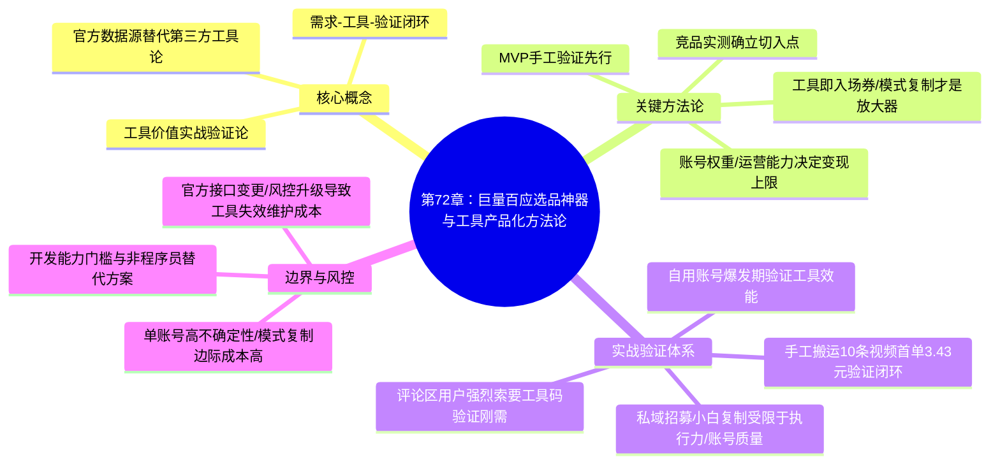
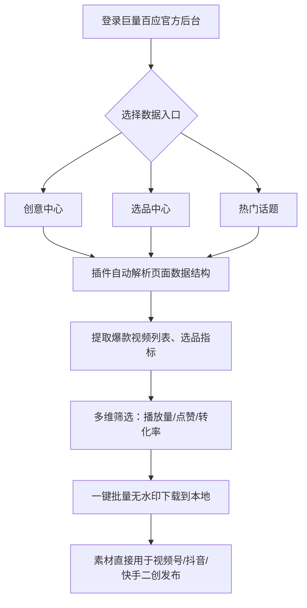
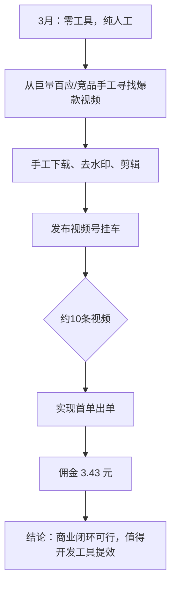
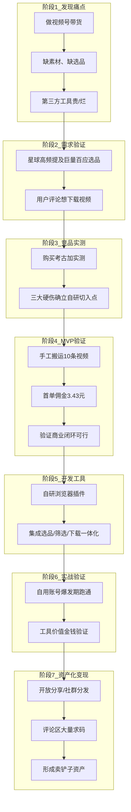

# 第 72 章 巨量百应选品神器与工具产品化方法论

## 学习目标

- 理解为何官方数据源（巨量百应）优于第三方采集工具，掌握零成本获取爆款素材的核心逻辑
- 掌握工具价值实战验证论：以“能跑通商业闭环产生真实收益”为唯一标准，拒绝无业务造工具
- 掌握需求-工具-验证闭环完整产品化路径：发现痛点→MVP验证→开发工具→实战验证→资产化变现
- 了解账号权重/运营能力是同素材变现结果的核心变量，工具仅解决素材获取必要条件
- 能根据自身技术能力选择自研/低代码/外包/购买成熟工具等不同路径获取工具使用权

## 72.1 生活类比

想象你在淘金热中。第三方工具就像卖铲子的商贩，铲子贵、钝、还要排队买，这对应着数据滞后、收费高、依赖下载器的痛点；巨量百应官方后台则是金矿源头，黄金就在脚下，但需要自己会挖，这需要开发能力或部署门槛；自研插件是你打造的专属挖掘机，一次制造、终身免费挖，实现了零边际成本和数据源头级获取；MVP手工验证就是先用镐头手工挖出第一块金子（首单3.43元），确认这块地有金，再造挖掘机不亏；工具价值验证则是挖掘机好不好，不看说明书多炫酷，看能不能真挖出金子卖钱，也就是能否跑通商业闭环；账号权重和运营能力是你的体力、技术和选矿厂，光有挖掘机（工具）没力气推、没厂炼，金子也出不来。就像淘金：工具只是入场券，能不能发财，靠的是选对矿（选品）、有力气挖（执行）、有厂炼（运营/供应链），工具只是帮你省了买铲子的钱、提了挖的效率。

## 72.2 概念地图

## 72.3 官方数据源替代第三方工具 —— 让选品素材“零成本直采”

### 为什么需要这个概念？

当你想做视频号带货、抖音带货，甚至小红书探店，第一步往往是“找素材、找选品”。市面上最火的工具叫“考古加”“亨亨猫”等第三方选品平台，但它们有三大硬伤：一是**收费贵**，年费几百到两千不等；二是**数据滞后**，毕竟是二次采集加工，实时性打折；三是**链路长**，下载视频往往还得再买/再找第三方去水印下载器，体验极差。

而抖音官方后台**巨量百应**拥有最权威、最实时、最准确的爆款视频与选品数据——那是“一手货源”。普通创作者缺乏开发能力，无法直连官方接口，被迫为“信息差”向第三方工具买单。本章核心主张：**直接调用巨量百应官方数据，开发自动化工具集成选品分析、爆款筛选、素材下载，实现“选品+爆款素材”一体化免费获取。**

> "用的好从此不用购买第三方工具，就可以直接下载爆款素材，所谓选品+爆款素材集一身。"
> 
> ——《20230516_063.md》[P001]

### 核心定义

**官方数据源替代第三方工具**（来源：《20230516_063.md》[P001]）

- **数据源头级**：直连巨量百应后台，获取创意中心、选品中心、热门话题的实时爆款视频数据，无二次筛选失真与滞后
- **零边际成本**：一次开发/部署，长期免费使用，单用户年省会员费 500 元+
- **链路打通**：从“看数据”到“拿素材”到“发视频”形成完整生产闭环，支持批量无水印下载

该定义量化了“源头级/零成本/链路打通”三大核心价值：它将“数据权威性”从定性描述转化为可对比的工程指标（无二次筛选失真与滞后）；将“省钱”转化为可计算的边际成本归零模型（一次性投入换长期收益）；将“体验好”转化为可落地的工程闭环（选品-下载-投产一体化）。这三条指标直接指导工具开发优先级——先打通登录态与数据解析（保源头级），再做批量下载与去水印（保链路打通），最后做多维筛选 UI（保零成本复用），避免了“界面先行、核心链路不通”的典型开发倒置。

### 关键实现路径

下图展示了将官方数据转化为可用素材的完整工程化流程。这一**数据流图**描述了从登录官方后台、选择数据入口、插件自动解析、多维筛选到批量下载并直接投产的全链路打通过程。

**数据流图：巨量百应数据自动化获取与素材化流程**

此流程展示了如何把“官方数据”变成“可用素材”的完整工程化动作：登录态维护、数据解析、批量下载、多维筛选、直接投产。每一步都是为了消除人工操作的摩擦。

### 典型例子与实证

作者在视频号带货项目中实战验证：使用该工具获取素材、选品、制作视频、挂车投流，**首单佣金 3.43 元**，跑通了商业闭环。

> "这个巨量百应工具已经在视频号上得到过金钱上验证。"
> 
> ——《20230516_063.md》[P001]

评论区大量用户“求码”，侧面印证了市场对“集成选品+下载”的强烈刚需。

### 边界条件

- **部署门槛**：需具备基础开发/部署能力（或使用现成打包工具），纯小白可能面临环境配置门槛
- **维护风险**：官方接口若变更/限流/风控升级，工具需维护更新，存在不可控维护成本
- **必要非充分**：仅解决“素材获取”必要条件，不解决“账号权重/运营能力/选品判力”充分条件，**同素材不同号结果方差极大**（当天见效 vs 0 收益）

---

## 72.4 工具价值实战验证论 —— 以“能跑通商业闭环”为唯一标准

### 为什么需要这个概念？

工具市场鱼龙混杂，功能清单写得花哨，实战一用拉胯。更可怕的是，很多开发者陷入“造工具自我感动”陷阱：没跑通业务先造工具，工具上线无人用、用了不赚钱，最后烂尾。我们需要一个**硬性指标**切割噪音，倒逼工具开发回归业务价值。

### 核心定义

**工具价值实战验证论**（来源：《20230516_063.md》[P001]）

> 工具的有效性不以功能清单为准，而以**能否在实际项目中跑通商业闭环、产生真实收益**为唯一标准。
> 
> 开发前必须先用人工/MVP跑通业务流程（如视频号搬运带货出单），验证商业逻辑自洽，再开发工具提效。

这个定义确立了“业务先行，工具后行”的铁律。它把工具从“功能堆砌”拉回“问题解决”的本质。

### 关键性质

工具价值实战验证论具有三大关键性质：第一，**反向倒逼**，要求先有业务验证，再有工具诞生，彻底拒绝“无业务造工具”的资源错配；第二，**结果导向**，工具迭代方向完全由实战中的卡点（如下载慢、去重难、选品准）决定，而非用户提的功能愿望单，确保每一行代码都服务于商业闭环的关键路径；第三，**自用即最强测试**，作者自用账号进入爆发期，虽后续波动（最坏结果 23.76 元/结果可能 0），但证明了工具能跑通链路，这种“吃自己的狗粮”验证比任何用户调研都可靠。

### MVP 手工验证先行

作者在开发工具前，先做了最笨但最硬的验证。下面的**方法演进图**展示了从零工具纯人工操作，到手工寻找爆款、下载剪辑、发布挂车，最终实现首单出单、验证商业闭环可行的完整路径。

**方法演进图：MVP 手工验证商业闭环流程**

这段流程展示了**“不写一行代码，先跑通业务”**的标准动作。只有当“选品→素材→制作→发布→出单”全链路人工跑通，工具开发才有明确的优化目标（哪里慢优化哪里、哪里痛解决哪里），避免了“造了没人用的功能”。

### 竞品实测确立切入点

作者购买市面主流工具“考古加”实测，发现三大硬伤。以下表格对比了竞品硬伤与自研切入点的对应关系：

**表 72-1 竞品硬伤与自研切入点对照**

| 硬伤 | 表现 | 影响 | 自研切入点 |
|------|------|------|------------|
| 无法直接下载 | 只能看数据，下载需跳转/额外操作 | 效率低、体验断层 | 一键批量无水印下载 |
| 数据非一手 | 二次采集，滞后、失真 | 选品判断失准 | 直连官方接口，源头级实时数据 |
| 依赖第三方下载器 | 去水印还得买别的工具 | 成本叠加、链路脆弱 | 集成去水印下载，链路一体化 |

这三大硬伤直接确立了自研切入点：**集成“选品分析+爆款筛选+无水印下载”一体化**，精准击穿用户痛点。

### 自用账号实战验证工具效能

工具上线后，作者自用账号进入爆发期，验证工具能显著提效。但也观察到单账号高不确定性：

> "自用账号进入爆发期但后续展示‘最坏结果23.76元/结果可能0’，揭示单账号运营高不确定性"
> 
> ——《20230516_063.md》[P002]

这提醒我们：**工具解决的是“素材获取效率”（必要条件），变现上限取决于“账号权重/运营能力/供应链稳定性”（充分条件）。**

### 工具即入场券，模式复制才是放大器

> "工具即入场券，模式复制才是放大器：自研工具解决获取素材效率成本(省会员费)，但单账号上限有限；私域招募/统一选品分发/标准化SOP模式复制才能突破时间瓶颈指数级放大"
> 
> ——《20230516_063.md》[P002]

作者尝试私域招募小白、统一供料（选品+素材）复制模式，结果：

- 最好记录：当天发当天见效
- 普遍现象：最差结果 0，小白自己选品难
- 作者不得不**亲自每天分发素材**（走 QQ 防压缩），模式复制边际成本高、标准化程度低

这揭示了一个残酷真相：**同素材分发不同账号，结果极大方差（当天见效 vs 0 收益），素材是必要条件，运营能力才是充分条件。** 工具只能帮你省下买会员的钱、提高下载效率，不能帮你练运营、养权重、搞供应链。

---

## 72.5 需求-工具-验证闭环 —— 从“被动买工具”到“主动造工具”的产品化范式

### 为什么需要这个概念？

创作者常陷入“缺工具→买工具→工具不好用/贵→继续买”的被动消费循环。实际业务痛点（选品难、素材难下、数据不准）极其具体，通用工具难以精准命中。掌握“造工具”能力，能将内部痛点转化为对外可交付的数字化资产（工具/插件/SaaS），开辟“卖铲子”第二曲线。

### 核心定义

**需求-工具-验证闭环**（来源：《20230516_063.md》[P001][P002]）

> 完整产品化路径：发现具体业务痛点（需求） → 开发最小可用工具解决问题（工具） → 实战项目验证工具价值（验证） → 开放分享/商业化变现（闭环）
> 
> 核心节奏：先人工跑通业务（MVP） → 再开发工具提效（自动化） → 最后工具反哺业务/变现（资产化）

这个闭环把“工具”从消耗品变成了资产，把“用户”变成了“开发者/分销商”。

### 关键性质

需求-工具-验证闭环包含三大关键性质：第一，**问题导向**，工具源于问题而非技术，别以为软件是万能的，解决方案不一定是软件（Excel/RPA/人工也可），这避免了“为了用技术而用技术”的工程陷阱；第二，**低成本验证**，工具开发前必须手工跑通商业闭环（作者仅投入 10 条视频人工搬运即验证出单），避免无效开发沉没成本，将风险压缩在最小可行性范围内；第三，**资产沉淀**，工具一旦成型，即成为可复用、可分发、可定价的数字化资产（如作者工具上线后评论区大量索要码，验证强刚需），实现了从“消耗型投入”到“资产型产出”的质变。

### 完整路径复盘：作者的“造工具”全历程

下面的**方法演进图**完整复盘了作者从发现痛点、需求验证、竞品实测、MVP验证、开发工具、实战验证到资产化变现的全产品化路径。

**方法演进图：需求-工具-验证闭环完整产品化路径**

此流程完整复盘了从“被动买工具”到“主动造工具”的产品化全路径，每个阶段都有明确的输入产出与验证标准。

### 同构案例对照：Wise 推荐计划套利

下表对比了两个同构的“需求-工具-验证闭环”案例：

**表 72-2 同构案例对照：巨量百应工具 vs Wise 套利**

| 维度 | 巨量百应工具 | Wise 套利 |
|------|--------------|-----------|
| 痛点 | 缺爆款素材、选品数据 | 缺低成本获客渠道 |
| 方案 | 直连官方数据源自研插件 | Google 品牌词竞价 + 联盟佣金 |
| MVP | 手工搬运 10 条视频出单 | 手工跑广告验证 CPC < EPC |
| 工具化 | 浏览器插件自动化 | 广告账户+追踪链接标准化 |
| 验证 | 自用账号爆发、首单 3.43 元 | 三组实盘 ROI 359%-496% |
| 资产化 | 插件可分发/卖会员/带徒弟 | 账户体系可复制/规模化 |

两者同构于：**发现信息差/效率差 → 搭建最小链路验证 → 工具化/标准化放大 → 资产化变现。**

### 多源对照：工具开发的不同路径选择

当同一痛点（获取巨量百应数据）面对不同技术能力的人，有多种解决路径。下表对比了五种路径的优劣：

**表 72-3 工具获取路径多源对照**

| 路径 | 适用人群 | 成本 | 可控性 | 维护负担 |
|------|----------|------|--------|----------|
| **自研插件/脚本** | 懂前端/爬虫/扩展开发 | 时间成本 | 高 | 自负 |
| **低代码/RPA** (按键精灵/Auto.js/Coze) | 懂逻辑不懂代码 | 学习成本 | 中 | 平台依赖 |
| **外包开发** | 有预算无技术 | 几千-几万 | 低（需验收） | 合同约定 |
| **购买成熟工具/源码** | 想快速上手 | 一次性买断 | 低（依赖卖家） | 卖家负责/无维护 |
| **人工/Excel/现成工具组合** | 零技术、零预算 | 时间成本极高 | 高 | 无 |

#### 共识

核心是“拥有工具使用权”而非“会写代码”。非程序员完全可以用 RPA/低代码/外包/买源码拿到同等能力。

#### 分歧

作者主张“自研可控”，但也承认“非程序员可借助低代码/RPA/外包/现成源码/购买成熟工具获取使用权”。实战中，**手工验证闭环（MVP）比工具开发本身更重要**——没跑通业务，买再贵的工具、外包再强的团队，也是零。

### 边界与风控

1. **官方接口维护风险**：平台接口变更、风控升级、账号体系迭代均可能导致工具失效，需持续投入维护精力
2. **开发能力门槛**：非程序员需借助低代码/RPA/外包/现成源码实现，或直接购买成熟工具
3. **工具非万能钥匙**：账号权重/运营能力/供应链稳定性等“软实力”往往是变现上限的真正决定因素，工具仅解决“硬通道”问题
4. **单账号高不确定性**：同素材不同号结果方差极大，工具无法包装变现结果
5. **模式复制边际成本高**：统一供料仍需人工分发、防压缩、防风控，标准化程度低，难以指数级放大

---

## 72.6 设计中的取舍

为什么不用第三方成熟工具（考古加/亨亨猫）而要自研？因为第三方工具存在“数据非一手、无法直下、依赖下载器”三大硬伤，且年费持续出血。自研一次性投入，长期零边际成本，数据源头级实时，且能按实战卡点定制迭代（如增加选品筛选维度、优化下载并发）。这是用一次性开发/学习成本，换取长期数据主权、成本归零、迭代自主权。

为什么不直接买现成源码/成品工具？买源码/成品工具看似快，但面临：卖家跑路不维护、接口变更无人修、核心逻辑加密不可改、甚至植入后门。自研/低代码自建虽慢，但掌握核心资产在自己手里，实战中发现新卡点（如某类目视频下载失败）能立刻改代码/改流程，不受制于人。

为什么强调“先人工跑通业务（MVP）再开发工具”？因为“工具开发”极易陷入完美主义陷阱：界面要漂亮、功能要全、架构要牛。但业务真正需要的往往只有 20% 核心功能。先人工跑通，能精准锁定那 20% 高频刚需痛点，**避免 80% 无效开发沉没成本**。作者仅用 10 条视频人工搬运就验证出单，极其低成本。

---

## 72.7 动手练习

### 练习 1：工具选型决策实战

**场景**：你想做视频号带货，需要巨量百应的爆款视频素材和选品数据。

请对比并决策：
1. 直接购买考古加/亨亨猫等成熟第三方工具会员（年费 500-2000 元）
2. 自己/外包开发基于巨量百应的自动化插件（一次性成本/学习成本）
3. 使用 RPA/低代码工具（如按键精灵、Auto.js、Coze）搭建自动化流程
4. 完全人工手工搬运下载（零工具成本，高时间成本）

**回答问题**：
- 不同阶段（0-1验证期 / 1-10放量期 / 10-100矩阵期）各该选哪种方案？为什么？
- 如何用最低成本在“0-1验证期”完成 MVP 验证？具体操作步骤是什么？
- 当官方接口变更导致自研工具失效时，你的备选预案是什么？

### 练习 2：工具价值验证压力测试

假设你已开发/获得一个巨量百应选品下载工具，请设计一套“实战验证标准”来判断它是否真正有效：

1. 设定验证周期：建议多少天？为什么？
2. 核心指标：除“能下载视频”外，必须包含哪些业务级指标？（提示：商业闭环相关）
3. 对照组设计：如何证明是工具带来了收益提升，而非运气/选品/账号权重？
4. 止损线：连续多少天/条视频无出单/ROI<1 时，判定工具/模式无效并停止投入？
5. 记录模版：设计一个最简验证记录表（字段含：日期、选品逻辑、素材来源、发布账号、投放金额、出单金额、ROI、备注）

### 练习 3：需求-工具-验证闭环复盘

选择一个你熟悉的副业/项目（如：小红书资料引流、闲鱼无货源、公众号 SEO、AI 绘图变现等），完整复盘其“工具化”潜力：

1. 痛点挖掘：当前流程中最耗时、最贵、最不稳定、最依赖人工经验的环节是什么？
2. 竞品实测：市面上现有工具（免费/付费）的三大硬伤是什么？（参考作者实测考古加：无法直接下载/数据非一手/依赖第三方下载器）
3. MVP 验证：不开发任何工具，用人工/Excel/RPA/现成工具组合，能否在 1 周内跑通“获客→转化→交付”最小闭环？预期投入产出比？
4. 工具化判断：若 MVP 验证通过，该痛点是否具备：高频刚需、标准化程度高、边际复制成本低、可对外收费/分发？若全是，则值得开发工具。
5. 变现路径：工具成型后，如何变现？（自用省钱 / 卖工具会员 / 卖模式/带徒弟 / 卖素材/账号）哪条最适合你？

---

## 72.8 本章小结

这一章中我们学习了如何利用官方数据源（巨量百应）替代第三方付费工具，建立“需求-工具-验证”闭环，实现选品素材的零成本直采与工具资产化。首先我们拆解了**官方数据源替代第三方工具**的核心逻辑：直连源头、数据权威、零边际成本、链路打通；其次我们确立了**工具价值实战验证论**的铁律：不看功能清单，只看能否跑通商业闭环产生真金白银，并演示了 MVP 手工验证与竞品实测的标准动作；接着我们完整复盘了**需求-工具-验证闭环**的产品化范式：从痛点发现、竞品实测、MVP 验证、工具开发、实战验证到资产化变现的全路径，并对照了 Wise 套利同构案例；最后我们剖析了工具只是入场券、运营能力才是放大器的残酷真相，以及官方接口维护、开发门槛、单账号不确定性等边界条件。

本章我们一起学习了以下概念。下表汇总了本章核心概念及其解释：

**表 72-4 本章核心概念汇总**

| 概念 | 解释 |
|------|------|
| 官方数据源替代第三方工具 | 直接调用巨量百应官方数据，集成选品/筛选/下载，零成本替代考古加等付费工具，数据源头级、实时、准确 |
| 工具价值实战验证论 | 工具好坏唯一标准：能否在实战项目中跑通商业闭环产生真实收益，而非功能清单华丽度 |
| 需求-工具-验证闭环 | 发现痛点→人工MVP跑通业务→开发工具提效→实战验证→开放分享/商业化，形成产品化完整闭环 |
| MVP手工验证先行 | 工具开发前必须先人工跑通业务流程（如手工搬运10条视频出单），验证商业逻辑自洽，避免无效开发 |
| 工具即入场券/模式复制才是放大器 | 工具解决素材获取效率（必要条件），但账号权重/运营能力/供应链才是变现上限（充分条件），想赚更多钱必须复制模式 |
| 账号权重/运营能力核心变量 | 同素材分发不同账号结果极大方差（当天见效 vs 0收益），素材必要条件，运营能力充分条件 |
| 私域模式复制瓶颈 | 招募小白统一供料，作者需亲自每天分发素材（走QQ防压缩），模式复制边际成本高、标准化程度低，受限于执行力与账号质量 |
| 官方接口维护风险 | 平台接口变更、风控升级、账号体系迭代均可能导致工具失效，存在不可控的持续维护成本 |
| 开发能力门槛与替代方案 | 非程序员可借助低代码/RPA/外包/现成源码/购买成熟工具获取使用权，核心是拥有工具使用权而非会写代码 |

