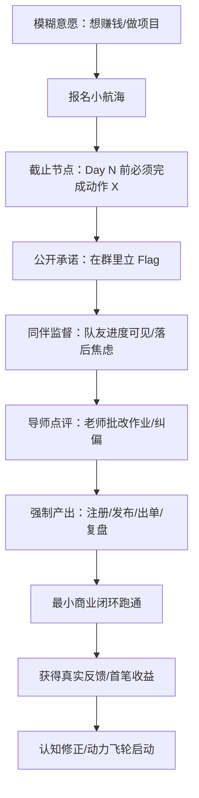
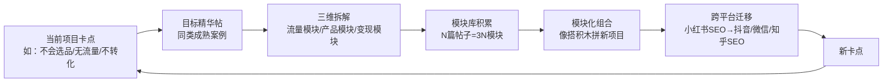
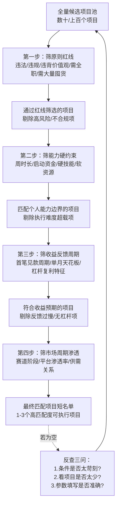
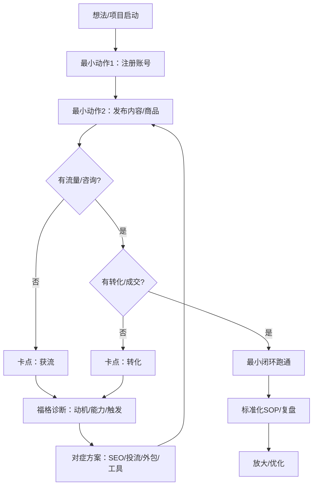
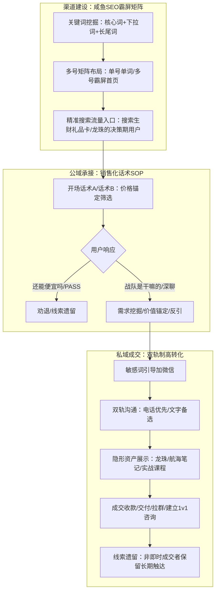
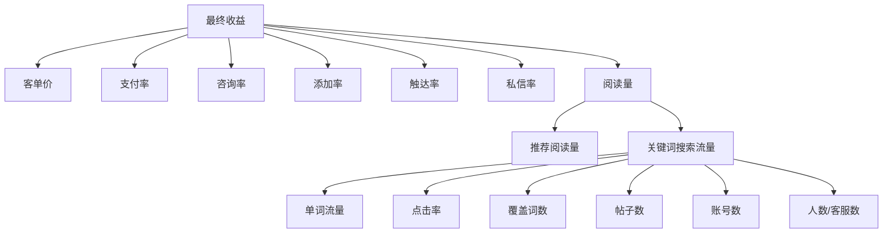
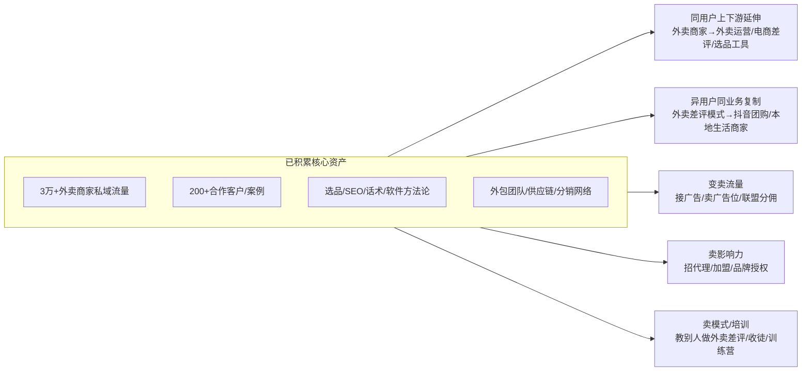
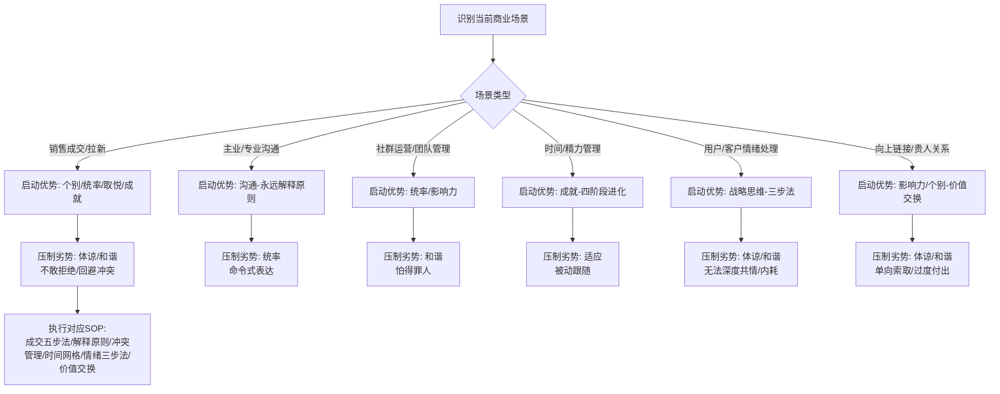

# 第 50 章 生财有术 —— 社群杠杆加速普通人从 0 到 1

## 学习目标

- 理解生财有术社群核心机制（航海、精华帖、贵人链接）如何成为新手跨越认知鸿沟、缩短试错周期、实现商业闭环的核心杠杆
- 掌握小航海机制的四大外部约束（截止节点、公开承诺、同伴监督、导师点评）及其在强制执行 0-1 跑通最小商业闭环中的作用
- 熟练运用精华帖逆向拆解法，按“流量-产品-变现”三大模块拆解成熟案例，实现模块化复用与“以战代练”式学习
- 建立新手项目筛选模型（含近 20 项参数），区分“挑选优质项目”与“筛选匹配度项目”的决策差异，掌握四步筛选法与飞书工具表单复用技巧
- 掌握最小可行性行动启动法（注册-发布-获流-优转化）与福格行为模型（B=MAP）在执行卡点诊断中的实战应用
- 理解项目增长模型（乘法公式拆解指标）与业务迁移五维路径（同用户上下游、异用户同业务、变卖流量、卖影响力、卖模式）在 1-N 放大阶段的组合策略
- 掌握公域陌生流量私域化闭环全流程：闲鱼 SEO 霸屏矩阵建设、销售化引流话术 SOP（天龙八部）、价格锚定筛选、差异化服务打包、私域高转化成交实操
- 理解盖洛普才干主题在商业决策中的场景化应用：优势启动、阴暗面压制、时间管理四阶段进化、用户情绪处理三步法、向上链接价值交换模型
- 验证核心定律：社群杠杆加速论、行动先于完美准备、增长飞轮验证论、精准搜索流量>泛推荐流量、拉新本质是销售非营销、积累复利大于现金流、新手决策不对称定理

## 50.1 生活类比

想象生财有术社群是一个**“创业特训营+资源超市+高端人脉局”**的三合一综合体：

- **小航海 = 训练营教官**：给你截止日期、强制打卡、同伴监督、教官点评，逼你在规定时间内跑完“注册店铺-上架商品-出单-复盘”的完整 5 公里越野，哪怕你只想躺平
- **精华帖 = 作弊码攻略库**：别人已经通关留下的详细路线图、BOSS 打法、隐藏道具位置，你带着“当前卡在哪一关”去查，直接抄作业拿模块，不用自己从头摸索
- **项目筛选模型 = 体测选项表**：根据你的体能（能力）、装备（资源）、时间（周期）、耐受度（风险），算法推荐适合你当下级别的副本，拒绝新手去刷地狱难度
- **最小可行性行动 = 先跑起来再调姿势**：别在起跑线上研究完美跑鞋（完美 SOP），先迈开腿跑两步（注册账号发内容），累了喘不上气（没流量）再想补给站策略（SEO/投流），腿抽筋（不转化）再拉伸动作（优化话术）
- **公域陌生流量私域化 = 在闹市摆摊卖高客单价课程**：不是在朋友圈（熟人）吆喝，而是在闲鱼（公域搜索流量）按关键词摆摊，来的人都是搜“生财礼品卡”主动找上门的精准客，再用专业销售话术（天龙八部）当面成交，像卖房子一样卖“入场券+陪伴服务”
- **盖洛普才干 = 角色天赋树**：知其为（点出天赋）、知何不可为（避开阴暗面）、知如何做得更好（加点主线技能）。高影响力低和谐是“狂战士”职业，主动认账（夺回主动权）、立边界（保护领地）、找贵人组队（价值交换），打团本（社群运营）才能无伤通关
- **项目放大 = 从“单人刷怪”到“建公会开分部”**：第一步把单号打法练到极致（增长模型极值化），第二步用积累的装备/秘籍/人脉（资产）开新分部（业务迁移五维），把“打螺丝换厂（纯现金流无积累）”升级为“技术员跳槽（技能迁移复利）”

## 50.2 概念地图

生财有术新手成长体系
├── 认知重构层
│   ├── 社群杠杆加速论  —— 以好文章+对的人实现降维打击
│   ├── 行动先于完美准备  —— 突破源于开始行动那一刻
│   └── 承认无能是起点  —— 接纳无资源现实，从最小确定性动作做起
├── 训练机制层
│   ├── 生财航海  —— 截止节点/公开承诺/同伴监督/导师点评四大机制强制跑通 0-1
│   ├── 精华帖逆向拆解法  —— 带着卡点拆解流量/产品/变现模块，像搭积木组合新项目
│   └── 新手项目筛选模型  —— 近 20 项参数动态决策表，筛选匹配度而非挑选优质，四步筛选法+飞书工具化
├── 执行方法层
│   ├── 最小可行性行动启动法  —— 注册→发布→获流→优转化，福格模型(B=MAP)诊断卡点
│   ├── 公域陌生流量私域化闭环  —— 闲鱼 SEO 霸屏矩阵+天龙八部销售话术+价格锚定+差异化服务包装
│   └── 盖洛普才干主题商业化应用  —— 场景化组合拳/阴暗面克制/时间管理四阶段/情绪三步法/贵人价值交换
├── 放大增长层
│   ├── 项目增长模型  —— 乘法公式层层拆解至可操作变量(阅读量=推荐+关键词流量×点击率×覆盖词数×帖子数×账号数×人数)
│   ├── 业务迁移五维路径  —— 同用户上下游/异用户同业务/变卖流量/卖影响力/卖模式
│   └── 积累复利大于现金流  —— 技能/资源/人脉/杠杆产品具备跨周期迁移性
└── 验证实证层
├── 毛韩案例：小透明→月入 2 万+ 20% 月增长
├── 根源案例：心理咨询师一年从零到年入 200 万
├── 小怪兽案例：7 天咨询 300+→加微 81(27%)→成交 41(50.6%)平均 2.6h
└── 梁靠谱案例：体制内医生→年入百万副业 IP/生财拉新冠军

## 50.3 生财航海 —— 新手跨越执行鸿沟的外部约束容器

### 为什么需要这个概念？

你是否有过这样的体验：加入了高质量社群，收藏了无数干货，却迟迟不敢迈出第一步？毛韩在 2020 年加入生财有术，整整一年都是“小透明”，只看不做，零收益。直到 2021 年 9 月参加小航海，才在外部约束下强制跑通了 0-1，月净收益达 2 万且保持 20% 月增长。根源（心理咨询师）同样借航海+社群资源，一年从零到年入 200 万。

> "从 2020 年加入生财的小透明，到 2021 年 9 月份开始行动，再到如今跑通一个项目，并每月净收益约 2w 块。而且每月还保持着近 20%的增长率"
> 
> ——《毛韩复盘：如何借助生财航海每月多赚 2 万元？》 [P014]

> "9 年传统行业 1 年时间，从一无所有，到年入 200 万"
> 
> ——《心理咨询师-根源：知识付费赛道转型复盘》 [P042]

这揭示了一个残酷真相：**认知过剩但执行力不足，单纯靠自律极难突破舒适区，需要结构化的训练机制**。正如生活类比中“小航海 = 训练营教官”所喻：它给你截止日期、强制打卡、同伴监督、教官点评，逼你在规定时间内跑完“注册店铺-上架商品-出单-复盘”的完整 5 公里越野，哪怕你只想躺平。航海不是教你新知识，而是用“截止节点、公开承诺、同伴监督、导师点评”四大机制，把你模糊的意愿变成确定性的行动。

### 核心定义

**生财航海**（来源：《毛韩复盘》 [P014]、《毛韩飞书长文》 [PGn5]、《根源复盘》 [P042]）

生财有术社群内部的一种目标导向、有期限、有监督、有复盘的集体行动训练营机制。核心四大机制：

1. **截止节点**：强制你在特定日期前完成既定动作（如“Day 3 前必须出单”）
2. **公开承诺**：在群里立 Flag，产生社会压力
3. **同伴监督**：队友进度可见，落后会焦虑
4. **导师点评**：老师定期批改作业，纠正方向

这四个机制构成了一个**外部约束容器**，解决“知道却做不到”的执行鸿沟。

#### 航海四大机制作用于 0-1 闭环的流程图



**流程图解读**：该流程图展示了航海如何将“模糊意愿”通过四大外部约束机制（截止节点→公开承诺→同伴监督→导师点评），层层传导压力与支持，最终强制产出“注册-发布-出单-复盘”的最小商业闭环动作，进而获得市场真实反馈，启动“认知修正-动力飞轮”的正向循环。

### 关键性质

**生财航海的关键性质包括：**

- **强制执行**：生财航海将模糊意愿转化为确定性行动。通过设定明确的截止节点（如“Day 3 前必须出单”）、要求公开承诺（在群里立 Flag）、建立同伴监督机制（队友进度可见、落后会焦虑）以及导师点评（老师定期批改作业、纠正方向），构成了一个外部约束容器，强制解决“知道却做不到”的执行鸿沟。
- **低成本试错**：生财航海提供了一个容错框架，让新手在其中跑通最小商业闭环，赚到第一桶金。毛韩在航海期间，第一天打 13 个电话就成交 1 单，前期外包同行单价 50 元赚首笔 200+，试错成本极低。
- **标准化产出**：生财航海要求沉淀 SOP、复盘文档，为后续放大奠定基础。毛韩通过航海跑通外卖差评删除项目后，将单月收益从 1.8 万推至 2.25 万（环比 20% 增长），并沉淀了选品/SEO/话术/软件方法论、外包团队等核心资产。

### 典型例子

毛韩的案例完整展示了从“小透明”到“跑通 0-1”的蜕变路径。他在 2020 年加入生财有术，整整一年处于只看不做的“小透明”状态，零收益。直到 2021 年 9 月报名小航海，在截止节点、公开承诺、同伴监督、导师点评这四大机制的外部约束下，他被强制推着在规定时间内完成了“注册店铺、上架商品、出单、复盘”的全流程动作，最终跑通了外卖差评删除项目，实现月净收益 2 万元并保持 20% 的月环比增长率。根源（心理咨询师）的路径高度相似：同样借助航海机制与社群资源，在一年内从零起步实现年入 200 万的商业跃迁。这两个案例共同验证了：航海不是传授新知识，而是提供了一种结构化的外部约束容器，解决新手“知道却做不到”的核心执行鸿沟。正如生活类比所言，小航海就是那个“训练营教官”，逼着你在规定时间内跑完 5 公里越野。

### 边界条件

- 航海仅是催化剂，真正突破源于“开始行动”那一刻的主观决心
- 仅适用于 0-1 跑通闭环阶段，不直接解决 1-N 规模化放大问题
- 效果强依赖导师质量与同伴圈层，需主动链接高质量贵人

---

## 50.4 精华帖逆向拆解法 —— 带着问题去“偷”成熟模块

### 为什么需要这个概念？

新手常陷入“收藏夹吃灰、低水平勤奋”陷阱：盲目阅读大量精华帖，却无法将他人经验转化为可复用的行动模块。毛韩发现，**阅读精华帖的目的不是学习，而是“带着当前项目卡点”去拆解**。

> "阅读精华帖的目的是什么？既然每个项目都符合这个模型，那么如何引流、如何搭建产品、如何设置变现方式其实就是最基本的武器。"
> 
> ——《毛韩复盘》 [P014]

> "当我们拆解完两篇帖子后，会得到共计 6 个模块。当我们要去做其他项目时，其实只需要把这几个模块拼在一起，就能得到一个新的模式。"
> 
> ——《毛韩飞书长文》 [PGn5]

正如生活类比中“精华帖 = 作弊码攻略库”所喻：别人已经通关留下的详细路线图、BOSS 打法、隐藏道具位置，你带着“当前卡在哪一关”去查，直接抄作业拿模块，不用自己从头摸索。

### 核心定义

**精华帖逆向拆解法**（来源：《毛韩复盘》 [P014]、《毛韩飞书长文》 [PGn5]）

将商业项目拆解为“流量-产品-变现”三大核心模块，带着“当前项目卡点”去精华帖中寻找同类项目的关键动作、避坑指南、资源清单，像搭积木一样组合模块，快速生成新项目雏形。

#### 拆解-组合-迁移闭环流程图



**流程图解读**：该流程图揭示了“精华帖逆向拆解法”的核心闭环：起点是“当前项目卡点”而非泛泛学习；通过按“流量-产品-变现”三维拆解成熟案例，积累可复用模块库；新项目即为模块重组；掌握一类流量形态（如关键词流量）后可低成本迁移至同形态其他平台；新项目跑动中产生新卡点，再次触发拆解循环，形成“以战代练”的螺旋上升学习范式。

### 关键性质

**精华帖逆向拆解法的关键性质包括：**

- **模块化复用**：一篇帖子拆解得 3 个模块，N 篇得 3N 模块，新项目即为模块重组。毛韩拆解“外卖差评删除+小红书 SEO”帖子，得到流量模块（小红书 SEO 关键词布局）、产品模块（差评删服务标准化交付流程）、变现模块（服务费/软件费分层定价），随后将流量模块迁移至抖音 SEO、快手 SEO、微信搜一搜、知乎等同形态平台，实现流量池局部垄断。
- **流量形态三分类**：它们分别属于不同的三种形式：1. 关键词——通过关键词链接到用户。2. 关系链——通过关系链链接到用户。3. 算法推荐——让算法将自己推荐给目标用户。掌握一类举一反三。这一分类直接支撑了后文的“流量形态可迁移性定理”。
- **目的导向**：不为学习而学习，为解决当下卡点而拆解。阅读精华帖的目的是什么？既然每个项目都符合这个模型，那么如何引流、如何搭建产品、如何设置变现方式其实就是最基本的武器。

### 典型例子

毛韩拆解“外卖差评删除+小红书 SEO”帖子，得到：
- **流量模块**：小红书 SEO 关键词布局
- **产品模块**：差评删服务标准化交付流程
- **变现模块**：服务费/软件费分层定价

随后将流量模块迁移至抖音 SEO、快手 SEO、微信搜一搜、知乎等同形态平台，实现流量池局部垄断。这一过程完美印证了“流量形态三分类与迁移性定理”：掌握关键词流量的核心打法（寻找关键词、铺设关键词、SEO 布局）后，可将同一套逻辑低成本复制到抖音、快手、微信搜一搜、知乎等所有基于搜索分发的平台，实现流量池的横向扩张。正如生活类比所言，精华帖就是“作弊码攻略库”，你带着“当前卡在哪一关”去查，直接抄作业拿模块。

### 边界条件

- 前提是已有具体项目或明确卡点，无项目带着拆解易陷入“伪勤奋”
- 模块拆解质量取决于精华帖源头真实性，需甄别幸存者偏差
- 仅解决“知什么”，不解决“怎么做”的执行细节，需结合 SOP 落地

---

## 50.5 新手项目筛选模型 —— 筛选匹配度而非挑选优质项目

### 为什么需要这个概念？

新手盲目套用大佬“挑选”标准（市场大、上限高、护城河深），导致无项目可做。毛韩创新提出：**新手决策模式为“筛选匹配度”而非大佬的“挑选优质”**。

> "老师们判断项目的标准其实和新手不太一样...我们新手更应该关注自己的能力和资源和项目是否匹配。模型很简单，其实只是一系列参数组成的表格，目前覆盖了近 20 项参数。"
> 
> ——《毛韩复盘》 [P014]

> 
> ——《毛韩飞书长文》 [PGn5]

正如生活类比中“项目筛选模型 = 体测选项表”所喻：根据你的体能（能力）、装备（资源）、时间（周期）、耐受度（风险），算法推荐适合你当下级别的副本，拒绝新手去刷地狱难度。

### 核心定义

**新手项目筛选模型**（来源：《毛韩复盘》 [P014]、《毛韩飞书长文》 [PGn5]）

含近 20 项参数（风险、收益、附加价值、市场、能力、时间、成本、个人匹配度等）的决策表格。核心逻辑：**筛选匹配度而非挑选优质**。四步筛选法：

1. **筛原则红线**：违法、违规、违背价值观、需全职投入、需大量囤货资金 → 一票否决
2. **筛能力硬约束**：可投入周时长、启动资金、现有硬技能、现有软资源
3. **筛收益反馈周期**：首笔收入见款周期、单月天花板、是否具备杠杆/复利/复购特征
4. **筛市场周期渗透**：赛道阶段、平台渗透率、供需关系

#### 四步筛选法漏斗流程图



**流程图解读**：该漏斗流程图直观展示了“新手项目筛选模型”的四步决策逻辑：从全量候选池出发，依次通过“原则红线（一票否决）→ 能力硬约束（执行边界）→ 收益反馈周期（反馈速度/杠杆）→ 市场周期渗透（赛道时机）”四层漏斗筛选，最终得到 1-3 个高匹配度可执行项目。若筛选结果为空，模型内置“反查三问”机制引导用户放宽过度苛刻条件、扩大候选池或修正参数填写，而非盲目放弃。这体现了“匹配度优于绝对质量”的新手决策核心逻辑。

### 关键性质

**新手项目筛选模型的关键性质包括：**

- **动态可调**：参数权重可根据个人认知修改，支持飞书多维表格在线复制使用。毛韩将该模型工具化交付为飞书多维表格，支持“创建副本”到自己飞书文档，用户可根据自认知修改每个项目的参数、新增维度，实现了方法论从隐性知识到显性工具的降维打击式交付。
- **红线否决制**：违法、违规、违背价值观等一票否决。这是筛选的第一道关卡，确保项目的基本合规性和底线安全。
- **匹配度优先**：一个匹配度高的小项目优于匹配度低的大项目。新手不能套用大佬“挑选”标准（市场大、上限高、护城河深），而应关注自己的能力和资源与项目是否匹配。

### 典型例子

毛韩的实测极具说服力：他按初始严苛条件（周期 10 年/成本<1 万/时间<2h/无资源需求/月内见款）跑模型，匹配结果为 0 个项目。这看似模型失效，实则暴露了“持续周期 10 年”这一参数对新手过度苛刻。仅将“持续周期”放宽至 1 年，模型立即匹配出“小红书资料引流”、“闲鱼无货源”等可执行项目。更关键的是，毛韩将该模型工具化交付为飞书多维表格，支持“创建副本”到自己飞书文档，用户可根据自认知修改每个项目的参数、新增维度，实现了方法论从隐性知识到显性工具的降维打击式交付。

### 多源对照：新手 vs 大佬决策模式

| 维度 | 大佬“挑选”模式 | 新手“筛选”模式 |
|------|----------------|----------------|
| 视野 | 全量项目视野 | 受限视野 |
| 资源 | 充足资源 | 有限资源 |
| 核心逻辑 | 从所有项目中挑最优 | 从可做项目中筛最匹配 |
| 关注指标 | 市场大小、上限高、护城河深 | 能力匹配、反馈快、资源可调动 |

> "老师们好像看一眼就知道一个项目的全貌...所以老师们是在'挑选'项目。但新手不能，新手还没有那种商业'网感'...所以新手选项目，是'筛选'。"
> 
> ——《毛韩飞书长文》 [PGn5]

**共识**：都需要评估项目可行性。
**分歧**：大佬看市场上限，新手看个人匹配度。盲目套用大佬标准会导致新手“无项目可做”。

---

## 50.6 最小可行性行动启动法 —— 在行动中修正认知

### 为什么需要这个概念？

新手陷入“完美主义拖延”：想把账号养好再发、想把 SOP 写全再干。毛韩倡导：**先跑通、再优化、后放大**。

> "比如你要做淘宝蓝海，别管其他的，先注册个店铺、随便上传个商品；然后你会发现，怎么没流量呢？接下来就是想办法获取流量；之后会发现，怎么有浏览但没转化呢？那就想办法优化转化率"
> 
> ——《毛韩飞书长文》 [PGn5]

> "简单点讲，福格行为模型=动机 x 能力 x 触发物。当你遇到挫折、或者行为与预期不符的情况时，可以通过这个模型来分析一下自己为什么没做到。"
> 
> ——《毛韩飞书长文》 [PGn5]

正如生活类比中“最小可行性行动 = 先跑起来再调姿势”所喻：别在起跑线上研究完美跑鞋（完美 SOP），先迈开腿跑两步（注册账号发内容），累了喘不上气（没流量）再想补给站策略（SEO/投流），腿抽筋（不转化）再拉伸动作（优化话术）。

### 核心定义

**最小可行性行动启动法**（来源：《毛韩飞书长文》 [PGn5]、《毛韩复盘》 [P014]）

克服完美主义拖延：注册账号→发布内容→无流量想获流→有流无转化优转化。遇阻即用福格行为模型（B=MAP）诊断：动机（是否想做）、能力（是否太难/不会）、触发（是否忘记/无提醒），外包/工具/提醒对症下药。

#### 行动闭环与福格模型诊断流程图



**流程图解读**：该流程图将“最小可行性行动启动法”可视化为一个“注册-发布-获流-转化”的渐进式闭环。核心在于：不预设完美路径，而是以“最小动作”启动，在真实市场反馈中暴露卡点（无流量/不转化），随即引入福格行为模型（B=动机×能力×触发）进行三维诊断，给出“外包/工具/提醒/SEO/投流”等对症方案，快速闭环修正。这正是“行动先于完美准备”定律的操作化落地：认知突破的本质是在行动中获得反馈修正认知。

#### 福格行为模型（B=MAP）在执行卡点诊断中的应用

下表展示了福格行为模型在执行卡点诊断中的具体应用：

| 卡点现象 | 诊断维度 | 对症方案 |
|----------|----------|----------|
| 不想发内容 | 动机不足 | 重连目标、公开承诺、找同伴监督 |
| 不会剪辑/选品 | 能力不足 | 外包同行、买工具、看教程、找导师 |
| 忘记打卡/发布 | 触发缺失 | 设定闹钟、日历提醒、自动化脚本 |

**公式作用解释**：福格行为模型公式 B=M×A×P（行为=动机×能力×触发）将执行失败这一模糊现象，拆解为三个可独立排查、可针对性干预的独立变量。当“行为不发生”（如不发内容、不打电话）时，不再笼统归因于“懒/拖延”，而是系统性检查：是 M（动机）不足需重连目标/立 Flag？是 A（能力）不足需外包/买工具/学教程？还是 P（触发）缺失需设闹钟/自动化提醒？这种结构化诊断思维，将执行力问题从“意志力层面”降维为“系统设计层面”，是新手从“靠自律”进阶到“靠机制”的关键认知跃迁。

### 典型例子

**外卖差评删除项目**完整演示了该方法论的威力：
- Day 1：电销 13 通，成交 1 单（注册账号、发布服务、直接打电话获流）
- Day 2：电销 50 通，成交 2 单（优化话术、提升转化）
- Day 3：加 20 好友，成交 1 单（私域承接、成交）
- 前期外包同行单价 50 元赚首笔 200+（能力不足→外包解决）
- 自购软件月入 2000 → 全职电销月入 1 万 → 引入小红书 SEO 月入 1.8 万→2.25 万（环比 20% 增长）

**小红书账号**：仅 1 个号、近 7 天发 2 篇笔记，却占据搜索 Top 20 中 5 席，日均引流 5+ 商家。这验证了“先跑通、再优化、后放大”的核心逻辑：不等账号养好、不等内容库存足，先发笔记占坑，在真实搜索流量反馈中迭代关键词布局与内容结构，最终以极低维护成本实现长尾复利产出。

### 关键性质

- **行动先于认知**：认知突破的本质是在行动中获得反馈修正认知
- **低成本试错**：电销首日打 13 通成交 1 单，前期外包同行单价 50 元赚首笔 200+
- **正向飞轮**：有反馈才有动力，有动力才有行动，形成正向循环

### 边界条件

- 仅适用于低边际成本、可快速迭代的轻资产项目（虚拟服务、内容引流等）
- 重资产、长周期、强合规项目（实体店、医疗、金融）不适用
- 福格模型诊断依赖自我觉察力，弱者易误判卡点性质

---

## 50.7 公域陌生流量私域化闭环 —— 用销售套路做引流

### 为什么需要这个概念？

传统运营过度依赖熟人裂变（朋友圈/社群），忽视公域平台巨大增量红利。小怪兽在生财 418 拉新活动中，另辟蹊径利用闲鱼公域平台，7 天实测：咨询 300+ → 加微 81（27%） → 成交 41（微信转化 50.6%），平均 2.6 小时成交。

> "身边朋友们拉新通常是发朋友圈，👸号，拉群成交。而忽略了公域平台上仍能挖掘很多流量。我通过在咸鱼上做 SEO，霸屏，多账户上架引流拉新，我用销售产品的套路，引道私域进行闭环成交。"
> 
> ——《小怪兽实操：咸鱼 SEO+销售话术拉新》 [P015]

> "时间跨度：7 天 闲鱼咨询量：300+（多号操作未去重） 转换微信好友数量：81 个【27%加微信转换】 成功转换成交数量：41 个【50.6%微信好友转换】 平均成交时间：2.6 小时"
> 
> ——《小怪兽飞书长文》 [PE0a]

正如生活类比中“公域陌生流量私域化 = 在闹市摆摊卖高客单价课程”所喻：不是在朋友圈（熟人）吆喝，而是在闲鱼（公域搜索流量）按关键词摆摊，来的人都是搜“生财礼品卡”主动找上门的精准客，再用专业销售话术（天龙八部）当面成交，像卖房子一样卖“入场券+陪伴服务”。

### 核心定义

**公域陌生流量私域化闭环**（来源：《小怪兽实操》 [P015]、《小怪兽飞书长文》 [PE0a]）

在闲鱼等公域平台通过 SEO 霸屏、多账号矩阵获取精准搜索流量，引入“天龙八部”销售话术（聆听、探询、产品介绍、支持、举证、解说、反引、成交）标准化承接，价格锚定筛选：双价制（礼品卡价 vs 战队价）劝退比价党，聚焦高意向用户。

#### 怪兽四步法完整成交链路流程图



**流程图解读**：该流程图完整呈现了“怪兽四步法”的全链路闭环。第一阶段**渠道建设**通过关键词挖掘与多号矩阵霸屏，获取“搜索生财礼品卡/龙珠”的决策期精准流量；第二阶段**公域承接**移植“天龙八部”销售话术，用价格锚定（双价制）在咨询瞬间完成意向筛选——劝退比价党、深聊高意向客；第三阶段**私域成交**采用“电话优先+文字备选”的双轨制，利用隐形资产（个人实战积累）建立权威信任，实现平均 2.6 小时、最高 50.6% 微信好友转化率的极速成交；第四阶段**线索遗留**对非即时成交者保留长期触达通道。整个链路将“引流”重构为“销售”，实现了公域陌生流量的高效私域化变现。

### 关键性质

**公域陌生流量私域化闭环的关键性质包括：**

| 定律 | 说明 |
|------|------|
| 精准搜索流量 > 泛推荐流量 | 搜索“生财礼品卡”用户已处决策期，意图强、转化效率高、路径短，远优于推荐算法分发的认知期流量 |
| 拉新本质是销售非营销 | 1v1 深度沟通解决疑虑、匹配需求、提供确定性陪伴，而非单纯内容分发 |
| 个人实战积累是最高级销售素材 | 过往项目经验是解答疑虑、建立权威的核心杠杆 |

### 标准化 SOP：怪兽四步法

**怪兽四步法** 是公域陌生流量私域化闭环的标准化操作程序，包含四个严丝合缝的阶段：

1. **渠道建设**：咸鱼 SEO 霸屏+多号矩阵获取精准搜索流量。挖掘核心词（生财门票、生财礼品卡、生财龙珠）+ 下拉词 + 长尾词（生财第 7 期、生财有星球、生财门票优惠等），单账号单词布局，多账号矩阵霸屏首页前 4 位，最大化曝光入口。
2. **需求挖掘**：公域聆听探询+价格锚定筛选非敏感用户。开场两套标准化话术模板：模板 A（低价筛选）——“宝，礼品卡 XXX 元，战队渠道 1965 元，我更建议你选 1965”，用户回复“还能便宜吗”即 PASS（劝退），回复“战队是干嘛的”即深聊（高意向）；模板 B（价值锚定）——“战队渠道贵 200，但含：高客单课程(999)+高价值社群(666)+1v1咨询(199)+龙珠获取路径，算账后性价比极高”。
3. **价值交付**：差异化服务包装+个人 IP 背书+话术 SOP 推进。将“买入场券”重构为“买确定性服务”：战队陪伴（大佬带玩、不再独自折腾）、个人 IP 背书（过往抖音团购、小说推文、flomo 笔记法实战经验）、赠课/资源打包（高客单课程+高价值社群+1v1 咨询+龙珠获取路径）。
4. **私域成交**：电话/文字双轨制+线索遗留+隐形资产展示。电话沟通显著优于文字：可判断语气意向、主导节奏、快速建立信任；展示龙珠持有量、航海风向标推荐笔记、实战课程赠送等隐形资产，精准击中用户痛点；对非即时成交者留线索、不强推、长期触达。

#### 价格锚定筛选法（核心心理机制）

```
话术模板 A（低价筛选）：
"宝，礼品卡 XXX 元，战队渠道 1965 元，我更建议你选 1965"
→ 用户回复"还能便宜吗" → PASS（劝退）
→ 用户回复"战队是干嘛的" → 深聊（高意向）

话术模板 B（价值锚定）：
"战队渠道贵 200，但含：高客单课程(999)+高价值社群(666)+1v1咨询(199)+龙珠获取路径，算账后性价比极高"
```

**伪代码作用解释**：上述伪代码将“价格锚定筛选法”显性化为可执行的条件分支逻辑。核心心理机制在于：设置“礼品卡低价”作为锚点，引入“战队高价”制造价格张力，用户的即时反应（讨价还价 vs 询问价值）天然揭示其价格敏感度与意向强度。讨价还价者 = 纯价格敏感型/低意向，直接 PASS 节省沉没成本；询问价值者 = 内容/服务敏感型/高意向，投入精力深度转化。这种“劝退即筛选”的反直觉设计，将销售精力精准聚焦于高 ROI 客群，是“拉新本质是销售非营销”定律在话术层面的精准落地。

### 典型数据验证

| 指标 | 数值 | 含义 |
|------|------|------|
| 咨询量 | 300+ | 公域流量获取能力 |
| 加微率 | 27% | 引流话术有效性 |
| 微信转化率 | 50.6% | 私域销售闭环强度 |
| 平均成交时长 | 2.6 小时 | 决策周期极短 |
| 1 小时内成交 | 15 单 | 冲动/强需求决策模型 |

### 电话 vs 文字沟通 A/B 测试

> "这里我做了一个测试，打字聊天转化率比电话聊艰难。语音可以判断对方的兴趣，低迷大概率只是想咨询，主动问的大概率是存在诉求"
> 
> ——《小怪兽飞书长文》 [PE0a]

电话沟通显著优于文字：语气判断意向、主导节奏、快速建立信任。

### 边界条件

- 依赖平台搜索规则稳定性，算法调整可能导致流量断崖式下跌
- 高强度 1v1 沟通难规模化，需后续标准化话术、引入助理分流
- 价格锚定溢价能力取决于差异化服务真实价值（战队陪伴、IP 背书、赠课）

---

## 50.8 项目增长模型与业务迁移五维路径 —— 从极值化到第二增长曲线

### 为什么需要这个概念？

跑通 0-1 后，面临“如何放大”困境：盲目加人、砸钱投流、乱开品类。毛韩提出**两步走放大论**：

> "通常情况下，一个项目有两种放大方法：1. 业务本身... 2. 其他业务... 放大一个项目业务本身的收益，就是将每一个环节的转化率都提到最高，同时将最源头的流量提到最高即可。"
> 
> ——《毛韩飞书长文》 [PGn5]

正如生活类比中“项目放大 = 从‘单人刷怪’到‘建公会开分部’”所喻：第一步把单号打法练到极致（增长模型极值化），第二步用积累的装备/秘籍/人脉（资产）开新分部（业务迁移五维），把“打螺丝换厂（纯现金流无积累）”升级为“技术员跳槽（技能迁移复利）”。

### 核心定义

**项目增长模型**（来源：《毛韩飞书长文》 [PGn5]）

将商业项目用乘法公式代表，层层拆解至可操作变量。

**外卖差评项目收益公式**：

$$
\text{收益} = \text{客单价} \times \text{支付率} \times \text{咨询率} \times \text{添加率} \times \text{触达率} \times \text{私信率} \times \text{阅读量}
$$

**阅读量递归拆解**：

$$
\text{阅读量} = \text{推荐阅读量} + \text{单词流量} \times \text{点击率} \times \text{覆盖词数} \times \text{帖子数} \times \text{账号数} \times \text{人数}
$$

**公式推导与作用解释**：这两个公式展示了如何将抽象的“想赚更多钱”拆解为具体的“优化私信回复速度提升添加率”、“矩阵号增加账号数提升源头流量”等可执行动作。第一个公式将最终收益拆解为 7 个一级先行指标（客单价、支付率、咨询率、添加率、触达率、私信率、阅读量），这是一个典型的漏斗模型：流量进入漏斗（阅读量）→ 触达用户（触达率）→ 发起私信（私信率）→ 添加好友（添加率）→ 产生咨询（咨询率）→ 完成支付（支付率）→ 确定客单价（客单价）。第二个公式将“阅读量”这一源头流量指标进一步递归拆解为“推荐阅读量 + 搜索流量”，并将搜索流量继续拆解为 6 个可独立操作、可量化投入的变量（单词流量、点击率、覆盖词数、帖子数、账号数、人数）。这种层层拆解使“增长”从模糊愿景变为具体的“优化私信回复速度提升添加率”、“增加矩阵账号数提升源头流量”、“提升关键词覆盖词数扩大流量池”等可执行、可考核、可复盘的具体动作。

#### 增长模型拆解树



**拆解树解读**：该树状图将“最终收益”这一滞后指标，递归拆解为 7 个一级先行指标（客单价、支付率、咨询率、添加率、触达率、私信率、阅读量），并进一步将“阅读量”这一流量总量指标拆解为“推荐流量 + 搜索流量”两大来源，且将“搜索流量”继续拆解为 6 个可独立操作、可量化投入的变量（单词流量、点击率、覆盖词数、帖子数、账号数、人数）。这种层层拆解使“增长”从模糊愿景变为具体的“优化私信回复速度提升添加率”、“增加矩阵账号数提升源头流量”、“提升关键词覆盖词数扩大流量池”等可执行、可考核、可复盘的具体动作。

**业务迁移五维路径**（来源：《毛韩飞书长文》 [PGn5]）

基于已积累的流量（粉丝）或产品（货源）资源：

1. **同用户上下游延伸**：外卖商家 → 外卖运营、电商差评
2. **异用户同业务复制**：把外卖差评模式复制到抖音团购商家
3. **变卖流量**：接广告、卖广告位
4. **卖影响力**：招代理、加盟
5. **卖模式/培训**：教别人做外卖差评

#### 业务迁移五维路径图



**路径图解读**：该图谱展示了“业务迁移五维路径”如何基于同一组核心资产（私域流量、合作案例、方法论资产、运营基建）衍生出五条截然不同的增长曲线。关键洞见在于：第一步“极值化”将单一业务模型的各变量推向极致（如把账号数、人数、转化率做到极限），积累起上述核心资产；第二步“迁移”利用这些资产的可复用性，在不改变核心能力边界的前提下，通过改变“服务对象”（上下游/异用户）、“变现对象”（流量/影响力/模式”）开辟第二、第三增长曲线。这正是“积累复利大于现金流”定律的战略层面体现：打螺丝换厂（纯现金流无积累）vs 技术员跳槽（技能迁移复利）。

### 关键性质

**项目增长模型与业务迁移五维路径的关键性质包括：**

- **两步走放大论**：第一步现有框架内推极值（矩阵、投放、流程优化）；第二步利用资产迁移开新曲线。毛韩外卖差评项目先将单月收益从 1.8 万推至 2.25 万（环比 20% 增长），客源结构为小红书 7k/电销 1.4 万/推荐 1.1k，完成极值化；再基于积累的 3 万+外卖商家私域流量、200+ 合作客户、选品/SEO/话术/软件方法论、外包团队等核心资产，规划扩展“外卖运营”（同用户下游）、“电商差评”（同用户下游/异用户同业务）、“抖音团购商家开发”（异用户同业务）、“收徒培训”（卖模式）等多条增长曲线。
- **指标拆解可递归**：阅读量可继续拆解至单账号、单人维度。增长模型不仅停留在一级指标，还可递归拆解子系统（如招聘漏斗），实现全链路精准优化。
- **积累复利 > 现金流**：早期优化积累价值（技能、资源、人脉、杠杆产品），积累具有跨周期迁移性。毛韩指出：“积累能让我步入下一个阶层，但收益不能。钱只能判断我现在有钱，积累才是让我未来更加值钱的。创业做有积累的项目和无积累的项目区别就像‘在厂里打螺丝和做技术员的区别一样’。”

### 典型例子

外卖差评项目的放大实战完美诠释了两步走策略：
- **第一步极值化**：优化私信回复速度提升添加率、引入矩阵号增加账号数提升源头流量、标准化电销话术提升咨询率，将单月收益从 1.8 万推至 2.25 万（环比 20% 增长），客源结构为小红书 7k/电销 1.4 万/推荐 1.1k。
- **第二步迁移**：基于积累的 3 万+外卖商家私域流量、200+ 合作客户、选品/SEO/话术/软件方法论、外包团队等核心资产，规划扩展“外卖运营”（同用户下游）、“电商差评”（同用户下游/异用户同业务）、“抖音团购商家开发”（异用户同业务）、“收徒培训”（卖模式）等多条增长曲线。

这验证了“增长飞轮验证论”：一个项目真正跑通的标志不仅是单月盈利，而是具备“月复利 20%”的可持续增长能力，说明核心模型已验证，进入放大期；且“积累复利大于现金流”指导了放大期的资源分配决策——优先投入能沉淀为可迁移资产（方法论、工具、人脉、品牌）的动作，而非单纯榨取现金流。

### 边界条件

- 增长模型假设变量相对独立，实际存在强耦合（如提高客单价可能降低支付率）
- 业务迁移需核心资产可复用（流量可迁移、产品可标准化），强人身依附业务难迁移
- 第二增长曲线启动时机难把握：过早分心、过晚错失窗口

---

## 50.9 盖洛普才干主题商业化应用 —— 知其为、知何不可为、知如何做得更好

### 为什么需要这个概念？

普通人不了解天赋主题，导致“优势没发挥、阴暗面拉满”、选错赛道、内耗严重。梁靠谱（生财首席医官、拉新冠军）通过 CliftonStrengths 工具与两位贵人指引，将原生家庭带来的性格缺陷（高影响力/统率、低和谐/体谅）转化为商业优势，实现从体制内医生到年入百万副业 IP 的逆袭。

> "知道了这个识别人需求的能力叫'个别'，提供情绪价值的能力叫'取悦'，不畏惧冲突的能力叫'统率'...知其为，知其所以为，知何不可为，以及清楚如何做得更好，就是学盖洛普最大的意义"
> 
> ——《梁靠谱：盖洛普才干主题商业化复盘》 [P016]

> "优势没怎么发挥出来，天赋的阴暗面倒是给拉满了"
> 
> ——《梁靠谱复盘》 [P016]

正如生活类比中“盖洛普才干 = 角色天赋树”所喻：知其为（点出天赋）、知何不可为（避开阴暗面）、知如何做得更好（加点主线技能）。高影响力低和谐是“狂战士”职业，主动认账（夺回主动权）、立边界（保护领地）、找贵人组队（价值交换），打团本（社群运营）才能无伤通关。

### 核心定义

**盖洛普才干主题商业化应用**（来源：《梁靠谱复盘》 [P016]）

将 CliftonStrengths 34 项才干主题（影响力、执行力、战略思维、关系建立）作为自我认知与商业决策底层操作系统。核心主张：知其为（知道才干名）、知其所以为（知原理）、知何不可为（知阴暗面）、知如何做得更好（知开发路径）。

### 才干阴暗面与正向开发对照表

下表展示了才干主题的阴暗面与正向开发的对照关系：

| 才干主题 | 阴暗面（未自觉） | 正向开发（刻意练习） |
|----------|------------------|----------------------|
| 统率 | 霸道、强控 | 领导力、立规则 |
| 取悦 | 虚伪、讨好 | 共情力、情绪价值 |
| 成就 | 鸡血、焦虑 | 专业价值、结果导向 |
| 个别 | 过度关注细节 | 精准识别需求 |
| 沟通 | 攻击性表达 | 类比解释、永远解释原则 |
| 体谅/和谐 | 无边界、内耗 | 适度克制、保护自我 |

**表格作用解释**：该表格揭示了才干主题的双刃剑特性——同一才干在未被自觉管理时表现为破坏性行为（阴暗面），通过后天刻意练习可转化为核心优势（正向开发）。例如“统率”未加克制会变成“霸道、强控”，刻意练习后转化为“领导力、立规则”；这正是“知其为、知何不可为、知如何做得更好”三层认知跃迁的直观体现。

### 场景化组合拳：销售/社群/时间管理/情绪处理

下表展示了不同商业场景下的才干启动与压制策略：

| 场景 | 启动优势才干 | 压制劣势才干 | 核心 SOP |
|------|--------------|--------------|----------|
| **销售成交** | 个别（识别需求）、统率（定义痛点）、取悦（情绪价值）、成就（专业价值） | 体谅（不敢拒绝）、和谐（回避冲突） | **靠谱成交五步法**：建立联系→同步信息→挖掘需求→解决顾虑→达成成交 |
| **主业沟通** | 沟通（类比解释） | 统率（命令式） | **永远解释原则**：心脏=房子、超声=查墙门、CT=查水管 |
| **社群运营** | 统率（立规）、影响力（批量转化） | 和谐（怕得罪人） | **冲突管理**：公开即时制止违规，向围观者传递立场 |
| **时间管理** | 成就（目标导向） | 适应（被动跟随） | **四阶段进化**：切块(加法)→砍非盈利/外包(减法)→资源置换协同(乘法/网格化)→筛选客户圈子(护情绪) |
| **用户情绪** | 战略思维（生物学视角） | 体谅（无法共情） | **三步法**：描述感受→定位成因→给目标引导行动 |
| **向上链接** | 影响力、个别 | 体谅、和谐 | **价值交换模型**：提供专业/情绪/渠道价值，让贵人投资产生强正反馈 |

**表格作用解释**：该表格将盖洛普才干主题的“场景化组合拳”显性化为“场景→优势启动/劣势压制→执行 SOP”的三层决策结构。核心逻辑是：不同商业场景对才干的调用优先级不同，销售场需高频调用“个别/统率/取悦/成就”四大才干并压制“体谅/和谐”；专业沟通场需启动“沟通”才干的“永远解释原则”压制“统率”的命令式表达；社群运营需启动“统率/影响力”压制“和谐”；时间管理需启动“成就”推进四阶段进化压制“适应”；情绪处理需启动“战略思维”代偿“体谅/和谐”；向上链接需启动“影响力/个别”压制“体谅/和谐”的单向索取倾向。这种“知其为、知何不可为、知如何做得更好”的场景化映射，是才干主题从“性格标签”转化为“商业操作系统”的关键跃迁。

#### 场景化组合拳决策树



**决策树解读**：该决策树将盖洛普才干主题的“场景化组合拳”可视化为“场景识别→优势启动/劣势压制→执行 SOP”三层决策结构。核心逻辑是：不同商业场景对才干的调用优先级不同，销售场需高频调用“个别/统率/取悦/成就”四大才干并压制“体谅/和谐”；专业沟通场需启动“沟通”才干的“永远解释原则”压制“统率”的命令式表达；社群运营需启动“统率/影响力”压制“和谐”；时间管理需启动“成就”推进四阶段进化压制“适应”；情绪处理需启动“战略思维”代偿“体谅/和谐”；向上链接需启动“影响力/个别”压制“体谅/和谐”的单向索取倾向。这种“知其为、知何不可为、知如何做得更好”的场景化映射，是才干主题从“性格标签”转化为“商业操作系统”的关键跃迁。

### 核心 SOP 详解

#### 靠谱成交五步法

```
1. 建立联系：同步信息（一句话定位，拒绝信息过载）
2. 挖掘需求：Why+陈述句反问，掌握提问权
   "您关注这个的核心原因是？" → 对方直接思考 Why
3. 解决顾虑：精准击中痛点卖点
   "你的产品也许有一百个卖点，要迅速找出哪个点能打动对方"
4. 成交：及时止损，避免边际效应递减
```

**伪代码作用解释**：该伪代码将“靠谱成交五步法”结构化为可执行的标准化流程。关键设计点在于：步骤 1“同步信息/拒绝信息过载”解决了新手常犯的“上来就倾倒产品参数”问题；步骤 2“Why+陈述句反问”利用大脑对“为什么”的自动应答机制，将提问权从对方夺回自己手中（“谁提问，谁掌握主动权”）；步骤 3“精准击中痛点卖点”要求从百个卖点中秒级筛选出击中当前用户痛点的那一个，体现“个别”才干的精准识别能力；步骤 4“及时止损”避免过度推销导致的边际效应递减，体现“统率”才干的决断力。这套 SOP 直接成交七位数订单，并被圈友全流程复制实现当年在广州买房的业绩跃迁。

#### 时间管理四阶段进化

| 阶段 | 核心动作 | 代价 | 产出 |
|------|----------|------|------|
| 1. 加法 | 严格切块时间（起床/吃饭/工作/娱乐） | 累 | 秩序感 |
| 2. 减法 | 砍非盈利业务、外包非核心环节 | 舍得 | 专注度 |
| 3. 乘法 | 与适合的人资源置换协同（用别人时间+时间协同） | 信任成本 | 杠杆 |
| 4. 筛选 | 筛选客户与圈子，保护情绪能量 | 放弃 | 可持续 |

**表格作用解释**：该表格将时间管理从“单一技巧”升维为“四阶段进化模型”，揭示了个人效能提升的本质路径：第一阶段“加法”通过严格切块建立秩序感，代价是“累”；第二阶段“减法”通过砍掉非盈利业务、外包非核心环节换取专注度，代价是“舍得”；第三阶段“乘法”通过与适合的人资源置换、时间网格化协同（使用别人的时间+发生时间协同）获得杠杆，代价是“信任成本”；第四阶段“筛选”通过筛选客户与圈子保护情绪能量，实现可持续高产出，代价是“放弃”。这种从“独自硬扛”到“借力协同”再到“边界护航”的进化轨迹，精准对应了“成就”才干从“自我驱动”到“系统驱动”再到“生态驱动”的开发路径。

#### 用户情绪处理三步法（生物学视角去共情）

```
1. 引导描述感受（启动理性大脑抑制情绪大脑）
   "不是劝他控制情绪，而是让他把情绪描述出来"
2. 定位情绪成因
3. 给予目标/引导行动
```
适用于成人、儿童、客服、亲密关系。

**伪代码作用解释**：该伪代码将“用户情绪处理三步法”显性化为可标准化执行的对话协议。核心创新在于第一步“引导描述感受”而非常规的“劝导控制情绪”：当人处于情绪脑（杏仁核）主导状态时，任何讲道理、劝控制都是无效甚至火上浇油的；引导对方“把情绪描述出来”强制启动前额叶（理性大脑），从生物学机制上抑制情绪脑，完成“情绪→认知”的通道切换。第二步“定位成因”完成归因，第三步“给目标/引导行动”将能量从“纠结过去”导向“解决未来”。这套协议不依赖“体谅/和谐”天赋（作者天生靠后），而是用“战略思维/生物学知识”作为代偿机制，实现了低共情天赋者的高情商操作化。

#### 向上链接价值交换模型

核心逻辑：**大佬也是投资人，人才投资需要强正反馈**。为贵人提供三类价值：
- 专业价值：用主业/副业技能解决贵人具体问题（如梁靠谱用医生专业背书为醒醒/苏姐提供健康咨询）
- 情绪价值：做吃水不忘挖井人的“支棱者”，让贵人投资产生成就感（如约定一生见一万面、互推用户、共研产品、情绪互助）
- 渠道价值：用自己的流量/资源/社群为贵人分发（如联合群发售、互推拉新）

让贵人在你身上的投资产生强正反馈（支棱、吃水不忘挖井人），形成势力连成一片的复利关系。

### 核心定律

**正反馈驱动人生定律**：
> "正是因为盖洛普，我笃定了自己并不适合这个行业...在这些场景下，我的才干才能得到正反馈，正反馈无比重要。如果这样咨询下来，来访者会很有压迫感，我自己也会因为克制，得不到多巴胺"
> ——《梁靠谱复盘》 [P016]

**认账即自由公理**：
> "一个人想扩展自己的生存空间...第一审视那些自己还没有的东西...第二审视那些自己已经有的东西...所以对于我们这些影响力主题的人来说...你不可以边抱怨，边挑剔，又继续忍受现状。认账一念起，天地就宽了"
> ——《梁靠谱复盘》 [P016]

**边界感即保护他人与自我**：
> "影响力主题的人呢，领地意识很强，所以有时候会无意得罪人...我自知骨子里自带的，对全力的渴望，对金钱的渴望，所以与其伤人伤己，不可控住，不如从一开始就不要去。喜欢就是放肆，但你是成年人，要有所克制"
> ——《梁靠谱复盘》 [P016]

### 典型验证

- **生财拉新冠军**：团队第七期位居榜首，创造历史最佳；个人连续两届个人拉新第 2、第 1 名；运营近百个快闪群
- **副业变现**：月收入稳定 50 万+，微商冷启动四个季度全国前 20
- **成交五步法**：直接成交七位数订单；圈友复制执行当年在广州买房
- **贵人复利**：与醒醒（互推用户、共研产品、情绪互助、约定一生见一万面）、苏姐（师生转合伙、流量冷启动、私教手把手、联合群发售）

### 边界条件

- 才干测试工具需付费（CliftonStrengths 官方约 $50），存在获取门槛
- 才干开发需长期刻意练习（如沟通才干从惜字如金转永远解释原则），非速成
- 高影响力低和谐人群特有生存法则（认账、边界感、提升实力降低心气），不具备普适性

---

## 50.10 设计中的取舍

**为什么不用“完美 SOP 先行”而是“最小可行性行动启动”？**

完美 SOP 是大佬跑通模型后的产物，新手写不出来也用不上。先跑通最小闭环（注册-发布-出单），在市场反馈中发现真实卡点，再针对性补 SOP。这是“在行动中修正认知”而非“在认知中完美准备”的区别。

**为什么不用“泛推荐流量（小红书/抖音）”而选“精准搜索流量（闲鱼 SEO）”做拉新？**

搜索“生财礼品卡”的用户已处决策期，意图强、转化率高（50.6%）、周期短（2.6h）；推荐算法分发的多为认知期流量，需漫长的信任建设。对于高客单价、强服务属性的产品，精准搜索流量 ROI 碾压泛推荐流量。

**为什么不用“挑选优质项目”而主张“筛选匹配度项目”？**

大佬有全量视野和充足资源，能从所有项目中挑最优；新手视野受限、资源有限，盲目套用大佬标准会导致“无项目可做”。匹配度高的小项目，胜过匹配度低的大项目。

**这种设计的 trade-off 是什么？**

| 设计选择 | 获得 | 失去/风险 |
|----------|------|-----------|
| 最小行动启动 | 快速获得市场反馈、低试错成本 | 早期混乱、品牌感弱、易走弯路 |
| 精准搜索流量 | 高转化、短周期、高客单价 | 依赖平台规则、流量上限受限、难规模化 |
| 筛选匹配度 | 可执行、反馈快、资源匹配 | 可能错过大赛道、上限被个人能力锁死 |

---

## 50.11 动手练习

### 练习 1：设计你的专属『新手项目筛选模型』

基于你当下的真实情况，填写以下核心参数（可在飞书多维表格复制模型后修改）：

1. **核心红线（一票否决）**：违法/违规/违背价值观/需全职投入/需大量囤货资金
2. **硬性能力约束**：可投入周时长 \_\_\_h，启动资金 \_\_\_元，现有硬技能 \_\_\_，现有软资源(人脉/渠道/账号) \_\_\_
3. **收益预期**：首笔收入见款周期 \_\_\_天，单月天花板 \_\_\_元，是否具备杠杆/复利/复购特征(是/否)
4. **市场周期**：赛道处于导入期/增长期/成熟期/衰退期，平台渗透率高/低，供需关系紧缺/平衡/过剩
5. **个人匹配度打分(1-10分)**：兴趣 \_\_\_，擅长 \_\_\_，长期规划一致性 \_\_\_

**回答问题**：
- 若筛选结果为 0 项目，哪个参数最可能是“过度苛刻”的瓶颈？如何放宽？
- 对比“大佬挑选逻辑”（市场大、上限高、护城河深）与“新手筛选逻辑”（匹配度高、反馈快、资源可调动），你当下更适合哪种？为什么？
- 选定一个项目后，用“最小可行性行动启动法”写出前 3 步具体动作（如：Day 1 注册账号、Day 2 发 3 条内容、Day 3 研究同行选品表）

### 练习 2：精华帖逆向拆解实战——以『闲鱼无货源』为例

找一篇生财有术精华帖《闲鱼无货源保姆级教程体系：12大章 64 小章覆盖全流程》（或同类实操帖），按『流量-产品-变现』三维度拆解填表：

**【流量模块】**
- 核心流量形态：关键词/关系链/算法推荐(单选) \_\_\_\_\_\_
- 关键动作：选品→养号→发布→SEO 关键词布局→矩阵霸屏→评论区引流
- 关键指标：曝光量、点击率、咨询率、店铺权重
- 避坑指南：一机一卡一号设备隔离、垂直店铺专业度、反养号论

**【产品模块】**
- 产品形态：实物一件代发/虚拟资料/服务/其他 \_\_\_\_\_\_
- 核心交付链路：拼多多/1688 下单→发货→售后→好评引导
- 差异化护城河：选品判力(三维选品法)、文案真实感(捡漏心理)、见面交易转好评策略

**【变现模块】**
- 变现方式：赚差价/赚佣金/赚服务费/卖工具/卖培训 \_\_\_\_\_\_
- 客单价区间：\_\_\_元，复购周期：\_\_\_天，LTV 预估：\_\_\_元
- 规模化关键：供应链稳定性、账号矩阵管理、客服外包 SOP、财务对账体系

**回答问题**：
- 该项目的“流量形态”属于哪一类？若你想迁移至抖音/小红书，核心打法需如何调整？
- 该项目的“积累资产”有哪些（如货源渠道/选品方法论/账号矩阵/客户群）？这些资产能否支撑『业务迁移五维路径』中的哪几条？
- 若你是新手，用『新手项目筛选模型』评估该项目匹配度打几分？主要扣分项在哪里？

### 练习 3：公域陌生流量私域化闭环——模拟『闲鱼 SEO+销售话术』成交推演

假设你要在闲鱼卖『生财有术 418 入场券/龙珠』，模拟完整成交链路：

**【渠道建设】**
1. 关键词挖掘：列出核心词+下拉词+长尾词至少 10 个（如：生财门票、生财礼品卡、生财龙珠、生财第 7 期、生财有星球、生财门票优惠...）
2. 矩阵布局：需准备 \_\_\_ 个闲鱼号，每号布局 \_\_\_ 个关键词，目标首页占据 \_\_\_ 个位置

**【公域承接】**
3. 话术模板 A（低价筛选）："宝，礼品卡 XXX 元，战队渠道 1965 元，我更建议你选 1965" → 用户回复"还能便宜吗" → PASS(劝退) / "战队是干嘛的" → 深聊
4. 话术模板 B（价值锚定）："战队渠道贵 200，但含：高客单课程(999)+高价值社群(666)+1v1咨询(199)+龙珠获取路径，算账后性价比极高"

**【私域成交】**
5. 引导加微信："这里敏感词多，换个地方聊(发微信号/二维码)"
6. 双轨沟通：电话优先(判断意向/主导节奏/建立信任) / 文字备选
7. 成交收款：发收款码/转账截图确认 → 交付入场券/龙珠 → 拉入战队群/赠送课程/建立 1v1 咨询关系

**回答问题**：
- 为什么“精准搜索流量”转化率远高于“泛推荐流量”？结合用户决策旅程（认知期→考虑期→决策期）解释
- 『天龙八部销售话术』(聆听/探询/产品介绍/支持/举证/解说/反引/成交)中，哪 3 步在闲鱼引流场景最关键？如何精简为 3 步 SOP？
- 『价格锚定筛选法』的核心心理机制是什么？若改卖 9.9 元虚拟资料，该策略是否适用？如何改良？
- 实测数据：咨询 300+ → 加微 81(27%) → 成交 41(50.6%) → 平均 2.6h 成交。若你要将『加微率』提升至 40%，『成交率』提升至 70%，会在哪 3 个环节优化？

### 练习 4：盖洛普才干主题场景化应用——销售成交五步法复盘

结合你的盖洛普才干报告（或自测前 5 大才干），复盘一次真实的销售/拉新/面试/说服场景：

**【场景还原】**
对象：\_\_\_  目标：\_\_\_  结果：成交/未成交  耗时：\_\_\_

**【才干诊断】**
1. 该场景下你启动了哪些优势才干？（如：个别-识别需求、统率-定义痛点、取悦-提供情绪价值、成就-专业价值解决、沟通-类比解释）
2. 哪些劣势才干的阴暗面跳出来了？（如：体谅-不敢拒绝、和谐-回避冲突、适应-被动跟随、内省-过度分析导致行动迟缓）
3. 用『靠谱成交五步法』对标：建立联系(是否同步信息/拒绝信息过载) → 挖掘需求(是否用 Why+陈述句反问/掌握提问权) → 解决顾虑(是否精准击中痛点卖点) → 成交(是否及时止损/避免边际效应递减)

**【改进方案】**
4. 下次同场景，你会如何『场景化组合拳』启动优势、压制劣势？写出 3 条具体微动作（如：开场先问“您关注这个的核心原因是？”启动个别；报价后直接问“这个价格在您预算内吗？”启动统率；拒绝时说“我理解，那我们保留联系，您想清楚随时找我”压制取悦阴暗面）

**回答问题**：
- 『正反馈驱动人生定律』提示：你的核心才干组合在哪类商业场景(医生/销售/顾问/运营/技术/创作)能获得持续正反馈？为何当前场景可能属于‘强行克制’区？
- 『认账即自由』对你意味着什么？列出 3 个你正在“边抱怨边挑剔又忍受”的现状，以及对应的“认账行动”（如：抱怨收入低/挑剔项目烂/忍受不学习 → 认账：承认当下能力匹配度低，决定本月只跑通一个 MVP，不再看新项目）
- 『边界感即保护他人与自我』：你是否有“无意吸粉损害他人”或“付出后想要回报”的经历？如何建立“不进入重叠赛道、不建立无法兑现承诺关系”的边界清单？

### 练习 5：项目增长模型拆解与业务迁移路径设计

选取你正在做或即将启动的一个项目（如：小红书资料引流/视频号带货/知识付费/闲鱼无货源），完成以下拆解：

**【增长模型公式化】**
1. 最终收益 = 客单价 × 支付率 × 咨询率 × 添加率 × 触达率 × 私信率 × 阅读量
2. 将『阅读量』继续递归拆解：阅读量 = 推荐阅读量 + (单词流量 × 点击率 × 覆盖词数 × 帖子数 × 账号数 × 人数)
3. 当前各项指标实测值/预估值填表：
   - 客单价：\_\_\_  支付率：\_\_\_%  咨询率：\_\_\_%  添加率：\_\_\_%  触达率：\_\_\_%  私信率：\_\_\_%  推荐阅读量：\_\_\_  单词流量：\_\_\_  点击率：\_\_\_%  覆盖词数：\_\_\_  帖子数：\_\_\_  账号数：\_\_\_  人数：\_\_\_
4. 识别『最短板环节』(数值最低/提升空间最大)与『最高杠杆环节』(微调即放大效应明显)

**【极值化优化策略(第一步放大)】**
5. 针对最短板环节，列出 3 个具体提升动作（如：添加率低→优化私信回复速度/话术/诱饵设计；账号数少→批量注册养号矩阵）

**【业务迁移五维路径(第二步放大)】**
6. 基于已积累资产(流量/粉丝/产品/货源/方法论/工具/人脉)，设计 2 条可落地的迁移路径：
   - 路径 A(同用户上下游)：现有用户 \_\_\_，上游需求 \_\_\_，下游需求 \_\_\_，拟开发产品 \_\_\_
   - 路径 B(异用户同业务)：复制现有模式至人群 \_\_\_，渠道 \_\_\_，核心调整 \_\_\_
   - 路径 C(变卖流量/卖影响力/卖模式)：拟出售广告位/招代理/开培训，定价 \_\_\_，交付标准 \_\_\_

**回答问题**：
- 『积累复利大于现金流』在本项目中如何体现？列出 3 项可跨周期迁移的积累资产（如：选品方法论文档、自动化发布脚本、高信任种子用户群、成交话术库），并标注哪项最具杠杆价值
- 若项目进入『成熟期/衰退期』(平台政策收紧/竞品饱和/流量见顶)，你的『第二增长曲线』启动触发条件是什么？预留多少精力/资金启动新曲线？

---

## 50.12 本章小结

这一章中我们学习了如何利用生财有术社群的核心机制，帮助普通人从“小透明”跨越执行鸿沟，实现 0-1 商业闭环并放大增长。首先我们理解了**生财航海**作为外部约束容器，通过截止节点、公开承诺、同伴监督、导师点评四大机制强制跑通最小商业闭环；正如生活类比所喻，小航海就是“训练营教官”，逼着你在规定时间内跑完 5 公里越野。其次掌握了**精华帖逆向拆解法**，按流量-产品-变现三模块拆解成熟案例，实现模块化复用；正如“精华帖 = 作弊码攻略库”，带着卡点去查，直接抄作业拿模块。接着建立了**新手项目筛选模型**，区分大佬“挑选”与新手“筛选”的决策不对称，用近 20 项参数动态匹配当下能力；正如“项目筛选模型 = 体测选项表”，根据体能装备推荐适合当下级别的副本。然后实践了**最小可行性行动启动法**，结合福格行为模型诊断执行卡点，在行动中修正认知；正如“最小可行性行动 = 先跑起来再调姿势”，别在起跑线研究完美跑鞋，先迈开腿跑两步。随后构建了**公域陌生流量私域化闭环**，用闲鱼 SEO 霸屏获取精准搜索流量，移植天龙八部销售话术实现高转化成交；正如“公域陌生流量私域化 = 在闹市摆摊卖高客单价课程”，按关键词摆摊，来的都是决策期精准客。接着用**项目增长模型**将收益拆解为乘法公式指导极值化优化，并规划**业务迁移五维路径**开辟第二增长曲线；正如“项目放大 = 从单人刷怪到建公会开分部”，先练极致单号打法，再用积累资产开新分部。最后应用**盖洛普才干主题**进行场景化优势启动与劣势压制，掌握认账即自由、边界感护身等核心心法；正如“盖洛普才干 = 角色天赋树”，知其为、知何不可为、知如何做得更好。

本章我们一起学习了以下概念：

| 概念 | 解释 |
|------|------|
| 生财航海 | 新手跨越执行鸿沟的外部约束容器：截止节点+公开承诺+同伴监督+导师点评，强制跑通 0-1 最小商业闭环 |
| 精华帖逆向拆解法 | 带着项目卡点去“偷”成熟模块：将案例拆解为流量/产品/变现三模块，像搭积木组合新项目，实现以战代练 |
| 新手项目筛选模型 | 含近 20 项参数的动态决策表：核心逻辑是筛选匹配度而非挑选优质，四步筛选法(红线→能力→收益→市场)+飞书工具化交付 |
| 最小可行性行动启动法 | 注册→发布→获流→优转化的行动闭环，遇阻用福格模型(B=动机×能力×触发)诊断卡点，外包/工具/提醒对症下药 |
| 项目增长模型 | 用乘法公式拆解业务指标至可操作变量(如收益=客单价×支付率×咨询率×...×阅读量)，指导精准优化各环节转化率与源头流量 |
| 业务迁移五维路径 | 基于已积累资产的横向扩展：同用户上下游延伸、异用户同业务复制、变卖流量(广告)、卖影响力(加盟/代理)、卖模式(培训) |
| 公域陌生流量私域化闭环 | 闲鱼 SEO 霸屏矩阵获取精准搜索流量+天龙八部销售话术 SOP 承接+价格锚定筛选非敏感用户+差异化服务包装(战队陪伴+IP 背书+赠课)实现高转化 |
| 引流即销售 | 拉新本质是销售非营销：1v1 深度沟通解决疑虑匹配需求提供确定性陪伴，个人实战积累是最高级销售素材 |
| 盖洛普才干主题商业化 | 知其为/知何不可为/知如何做得更好：场景化启动优势(销售场个别/统率/取悦/成就)、压制劣势、时间管理四阶段进化(加法-减法-乘法-筛选) |
| 积累复利大于现金流 | 早期优化积累价值(技能/资源/人脉/杠杆产品)而非现金流，积累具备跨周期迁移性，打螺丝换厂 vs 技术员跳槽的本质区别 |
| 社群杠杆加速论 | 普通个体善用社群成熟训练营机制(航海)、沉淀知识资产(精华帖)、高质量社交关系(大哥指导)，可大幅缩短 0-1 探索周期降低试错成本 |
| 精准搜索流量>泛推荐流量 | 搜索“生财礼品卡”的用户已处决策期，意图强、转化效率高、路径短，远优于推荐算法分发的认知期流量 |
| 新手与大佬决策不对称 | 大佬全量视野挑选最优，新手受限视野必须筛选匹配当下能力的项目，盲目套用大佬标准导致无项目可做 |
| 流量形态三分类与迁移性 | 关键词/关系链/算法推荐三大流量形态，掌握一类核心打法可低成本迁移至同形态其他平台(小红书 SEO→抖音/微信/知乎 SEO) |
| 认账即自由 | 高影响力低和谐人群打破“得不到/不得不”内耗的唯一钥匙：承认现实、为选择负责、停止内耗，夺回主动权 |

下一章中，我们将学习如何构建个人知识创作系统，从“囤资料”进化为“生产知识资产”，实现知识复利与商业变现的双重飞轮。


