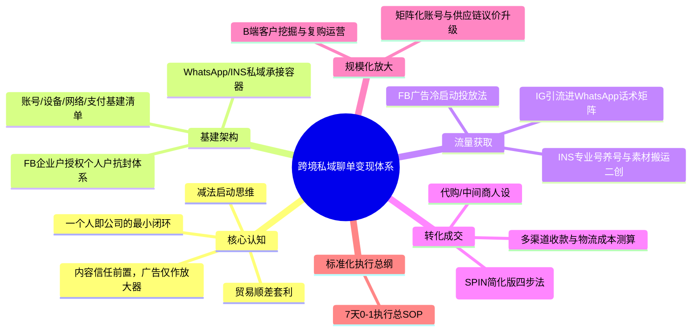
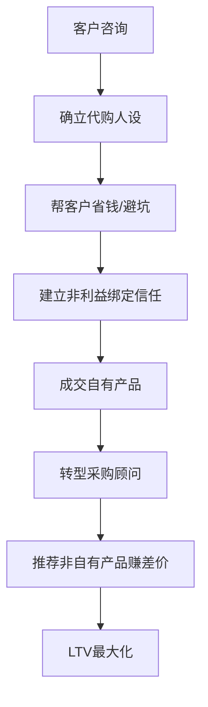
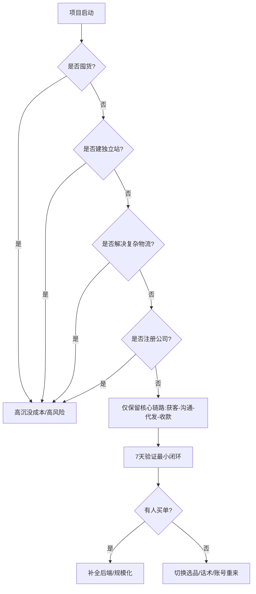
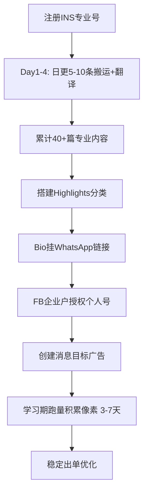
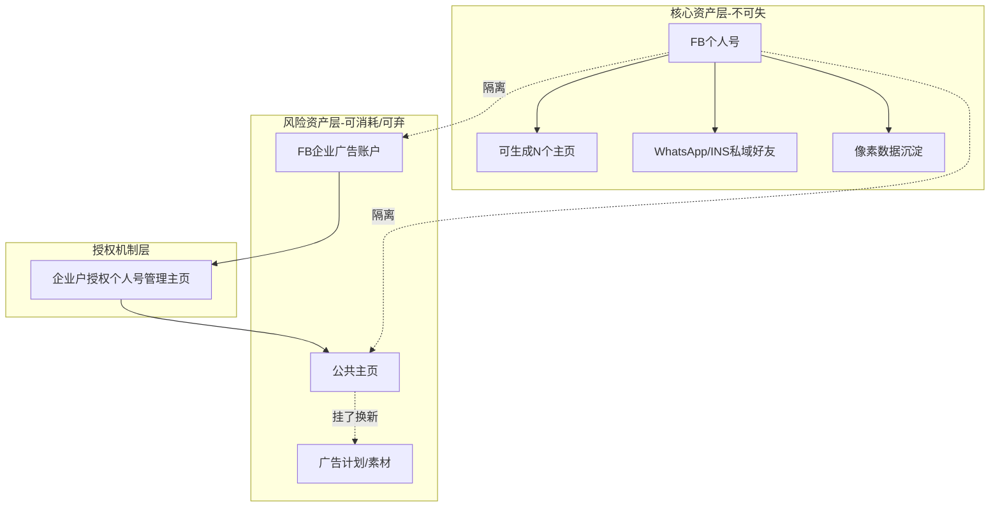
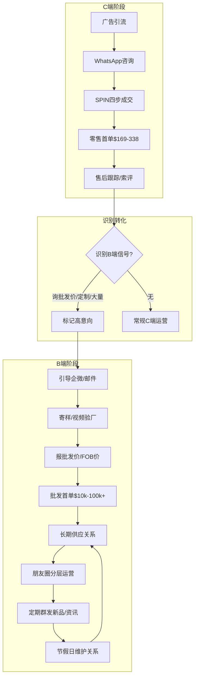
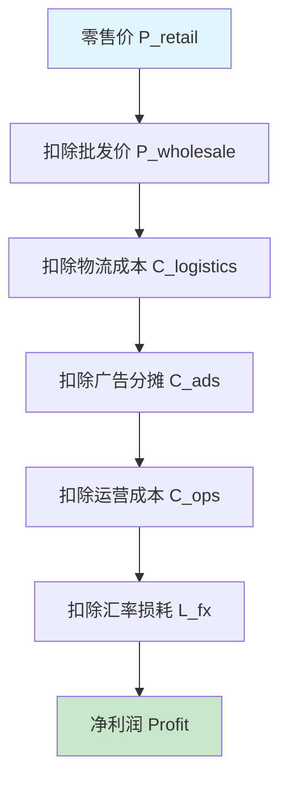
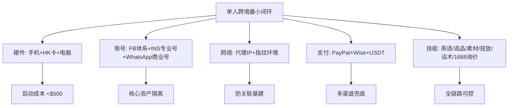
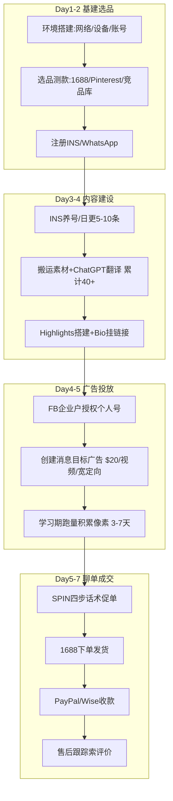

# 第 67 章 跨境私域聊单变现体系

## 学习目标

- 理解跨境私域聊单模式的核心逻辑与优势
- 掌握“减法启动思维”在跨境电商中的应用与执行标准
- 学会搭建 FB 企业户授权个人户的抗封账号体系
- 掌握 INS 内容信任前置与 FB 低预算冷启动投放的标准化流程
- 能运用 SPIN 简化版四步话术实现私域高客单价成交
- 掌握从 C 端零售挖掘 B 端批发客户的复购运营路径
- 理解贸易顺差套利的选品定价与供应链议价逻辑
- 能按 7 天 SOP 从零跑通‘一人即公司’的跨境最小闭环

## 67.1 生活类比

想象跨境私域聊单像开一家“只接预约、不备库存”的高端定制裁缝铺。裁缝不买布、不雇工、不租大店面，只租个橱窗（INS主页）挂几件样衣，这就是减法启动。橱窗里挂满成品细节图、客户试穿视频、面料科普，路人看了才敢进门，这就是内容信任前置。在报纸投广告（付费流量）引人进橱窗，广告语只写“源头定制、限量手工”，这就是 FB 广告投放。裁缝自称“帮你找顶级面料厂、避坑劣质货”，而非“卖衣服给你”，这就是代购人设。客人进门：先展示面料工艺，再问“参加什么场合？”，再问“预算多少？”，最后现场打电话问厂家底价、报给客人含工费价，这就是 SPIN 四步话术。给常客做西装时发现他是采购经理，转而承接他公司 2000 套工装大单，这就是 B 端挖掘。面料从批发市场进价 50 元，定制西装卖 1000 元，中间差价覆盖房租广告还赚了，这就是贸易顺差套利。就像裁缝铺不靠堆库存赚钱，而靠“信任+信息差+灵活供应链”赚钱，跨境聊单也靠“私域信任+中国供应链价格差+标准化话术”赚钱。

## 67.2 概念地图



## 67.3 代购/中间商人设

### 67.3.1 为什么需要这个概念？

传统卖家身份带有强推销感，易触发客户防备心理，尤其高客单价（$100+）决策周期长、信任成本高。跨境私域聊单模式下，客户无法实地验货，信任成为核心转化杠杆。代购/买手身份天然站在“帮客户省钱/避坑”一方，消除对抗感，建立非利益绑定的专业顾问形象。【P001: docs/202305/20230516_101.md, P002: docs/202305/Nt9IdI0b0okp1MxGKBacQtxSn3e.md】

### 67.3.2 核心定义

**代购/中间商人设**（来源：P001、P002）

角色定位为非以商家身份卖货，而是以“帮客户找厂家/找产品/避坑”的代购/中间商身份对话；信任逻辑是利用信息差（中国供应链价格优势）为客户创造价值，而非单向推销库存；后期延展为成交后自然转型为“全品类采购顾问”，推荐非自有产品赚取差价，实现 LTV 最大化。

### 67.3.3 关键性质

信任建立速度快，首次沟通即确立“站在客户一方”的心理定位；转化率高，实测高客单价（$169-$338）产品更易成交；扩展性强，不受单一 SKU 限制，可按需求灵活选品、组品；抗风险，无库存压力，供应链端可随时切换。

### 67.3.4 典型例子

太阳镜案例：以代购身份帮客户定制采购，客单价 $169-$338，7 天变现 $2000+。门锁 B 端大单：前期 C 引流积累信任，后期转型采购顾问，单笔意向 2000 把门锁。【P001: docs/202305/20230516_101.md, P002: docs/202305/Nt9IdI0b0okp1MxGKBacQtxSn3e.md】

### 67.3.5 边界条件

需具备基础英语沟通能力或熟练使用翻译工具；需懂基本供应链对接（1688/阿里巴巴询价、打样、发货流程）；纯小白缺乏销售直觉、抗风控基建能力时，试错成本极高，不推荐直接入场。【P001: docs/202305/20230516_101.md】

### 67.3.6 方法演进图：人设转化流程



### 67.3.7 原文引用

> "角色定位就是卖家,对话中是因为和客户熟悉后,可以主动告知可以提供其他一些产品信息,如果有需要的话,那么这中间就能产生利润"【P001: docs/202305/20230516_101.md】
>
> "看截图好像是用代购的身份(中间商)帮客户找厂家/找产品，不像是以商家的身份卖产品"【P001: docs/202305/20230516_101.md】
>
> "代购/买手身份天然站在‘帮客户省钱/避坑’一方，消除了‘卖家推销’的对抗感，更易成交 $100+ 高客单；成交后可自然转型为‘全品类采购顾问’实现 LTV 最大化。"【P002: docs/202305/Nt9IdI0b0okp1MxGKBacQtxSn3e.md】
>
> "这个项目的核心是不断的能够积累B端用户... 下图是客户打算采购2000把门锁"【P002: docs/202305/Nt9IdI0b0okp1MxGKBacQtxSn3e.md】

## 67.4 减法启动思维

### 67.4.1 为什么需要这个概念？

创业者常陷入“完美准备”陷阱：搭建独立站、囤货备库存、解决复杂物流、注册公司主体等重资产动作，导致试错周期长、沉没成本高、甚至死在起跑线上。跨境电商链路长、不确定性高，必须先用最小成本验证“能否卖出去”，再补全后端体系。资源匮乏的个人/小团队，只有极简启动才能在承受范围内持续迭代。【P002: docs/202305/Nt9IdI0b0okp1MxGKBacQtxSn3e.md, P001: docs/202305/20230516_101.md】

### 67.4.2 核心定义

**减法启动思维**（来源：P002、P001）

启动原则为不囤货、不建独立站、不解决复杂物流、不注册公司主体；核心链路为获客（广告/内容）→ 沟通（WhatsApp/IG）→ 代采/一件代发（1688/供应链）→ 收款（PayPal/Wise/USDT）；选品逻辑为卖什么不重要、有没有货不重要、物流在哪不重要，先跑通“有人买单”这一最小闭环。

### 67.4.3 关键性质

试错成本极低，仅需手机、HK 卡、电脑、FB 账号体系，广告日预算 $20 即可启动；反馈速度极快，7 天内可验证选品、素材、话术、转化全链路；灵活性高，选品随时切换、供应链随时替换、账号随时重来；可迁移，同一套“减法 SOP”可复用至不同品类、不同平台。

### 67.4.4 典型例子

太阳镜项目：0 库存、0 独立站，用搬运素材+广告投放+聊单成交，7 天出单 $2000+。门锁项目：前期同模式测款，后期挖掘 B 端批发需求，单笔意向 2000 把。【P002: docs/202305/Nt9IdI0b0okp1MxGKBacQtxSn3e.md, P001: docs/202305/20230516_101.md】

### 67.4.5 边界条件

仅适用于“非标品/高客单/强信任/需定制/长尾需求”品类，标品低客单走常规货架电商更高效；依赖个人销售能力与供应链响应速度，难以规模化为标准化自动化流程；收款、物流、售后等后端环节仍需合规兜底，不能因“减法”而触碰法律红线。

### 67.4.6 方法演进图：减法启动决策流



### 67.4.7 原文引用

> "我们开始一个项目之前,应该最大限度的去给自己做减法而不是给自己设置障碍"【P002: docs/202305/Nt9IdI0b0okp1MxGKBacQtxSn3e.md】
>
> "卖什么其实不重要,有没有货不重要,物流在哪里也不重要"【P002: docs/202305/Nt9IdI0b0okp1MxGKBacQtxSn3e.md】
>
> "前期准备工作：1：科学上网 2：一部手机+HK手机卡一张 3：电脑一台 4：FB个号+FB广告户"【P001: docs/202305/20230516_101.md】
>
> "一个人也能利用贸易差开启跨境之旅"【P001: docs/202305/20230516_101.md】
>
> "如果是纯小白的话,不推荐... 如果是之前做过私域或者微商,在会一点投放技巧,那么这篇文章完全适合你"【P001: docs/202305/20230516_101.md】

## 67.5 内容信任前置，广告仅作放大器

### 67.5.1 为什么需要这个概念？

直接投放广告而无内容积累，主页空白、无信任背书，导致点击进来即跳出，转化率极低，烧钱买教训。跨境私域高客单模式下，客户决策高度依赖“专业感”与“真实感”，内容是低成本建立信任的唯一路径。算法机制下，优质内容能获得免费自然流量，降低综合获客成本 (CAC)。【P002: docs/202305/Nt9IdI0b0okp1MxGKBacQtxSn3e.md, P001: docs/202305/20230516_101.md】

### 67.5.2 核心定义

**内容信任前置**（来源：P002、P001）

先内容、后广告：INS 专业号需预先填充 40+ 篇专业内容（耗时 4 天，日更 5-10 条），建立信任背书，再开启广告投放。素材来源为小红书/抖音同品类爆款素材（图文/视频）+ ChatGPT 翻译本地化文案。内容类型包括产品细节、工厂实拍、客户见证、发货视频、常见问答、专业科普。主页即落地页：Bio 写清价值点 + WhatsApp 链接；Highlights 分类沉淀核心信任素材。

### 67.5.3 关键性质

信任前置，内容是转化率的决定变量，广告只是放大器；成本可控，搬运二创+AI翻译，单条内容边际成本趋近零；复利效应，内容资产长期留存，持续产生自然流量与信任背书；可复制，标准化“扒素材→翻译→发布→整理 Highlights”SOP，新号 4 天即可建立基础信任框架。

### 67.5.4 典型例子

太阳镜/门锁案例：INS 连续发贴 4 天积累 40+ 篇专业帖，配合 ChatGPT 翻译，随后开广告，单次有效对话成本 ≤$5。无内容支撑直接投放对照：作者宣称转化率极低，验证“内容信任前置”必要性。【P002: docs/202305/Nt9IdI0b0okp1MxGKBacQtxSn3e.md, P001: docs/202305/20230516_101.md】

### 67.5.5 边界条件

需具备基本审美与选素材能力，辨别什么是“高质量/高转化”素材；ChatGPT 翻译需人工把关，避免机翻腔破坏专业感；内容仅是前置条件，非核心变现动作，不可陷入“做内容”而忽略“投流测款与聊单成交”主线。

### 67.5.6 方法演进图：内容建设到投放时间轴



### 67.5.7 原文引用

> "首先注册一个ins账户... Ins账户每天选择发5-10篇图文或者视频贴... INS连续发贴4天,也就是已经有了最少40篇帖子... 完成设置后 登录FB个户切换到公共主页... 创建广告"【P002: docs/202305/Nt9IdI0b0okp1MxGKBacQtxSn3e.md】
>
> "素材来源：小红书,抖音 比如我是卖太阳镜的直接去搜 扒素材"【P002: docs/202305/Nt9IdI0b0okp1MxGKBacQtxSn3e.md】
>
> "在这里使用chatgpt来进行翻译简直是如虎添翼"【P002: docs/202305/Nt9IdI0b0okp1MxGKBacQtxSn3e.md】
>
> "内容信任前置，广告仅作放大器"【P002: docs/202305/Nt9IdI0b0okp1MxGKBacQtxSn3e.md】
>
> "IG 主页搭建 -> 开广告 -> 引导进 WhatsApp -> 聊单成交"【P001: docs/202305/20230516_101.md】

## 67.6 FB 企业户授权个人户抗封体系

### 67.6.1 为什么需要这个概念？

FB 广告投放封号率极高，个人户、主页、BM、像素频繁失效，导致账号资产归零、历史数据清零、投放中断。传统做法：主号投放、主号养号、主号挂主页，一荣俱荣一损俱损，风险不可控。需要一套“核心资产隔离、风险资产可弃、快速复活”的账号基建架构。【P002: docs/202305/Nt9IdI0b0okp1MxGKBacQtxSn3e.md, P001: docs/202305/20230516_101.md】

### 67.6.2 核心定义

**FB 企业户授权个人户抗封体系**（来源：P002、P001）

核心资产为 FB 个人号（可生成 N 个公共主页）、WhatsApp/INS 私域好友、像素数据；风险资产/耗材为 FB 企业广告账户、公共主页、广告计划。授权机制为企业户授权个人号创建/管理公共主页投放；主页挂了解绑换新主页，个人号、像素、私域好友不受影响。操作流程为登录 FB 个号 → 切换到公共主页 → 使用 FB 企业户授权 FB 个号 → 创建广告。

### 67.6.3 关键性质

资产安全，核心身份与私域流量沉淀在个人号，不随广告账户生死波动；快速复活，主页/广告户死掉后，换新主页、新授权即可继续投放，停机时间极短；成本可控，企业户、主页按需购买/养成，边际成本低；规模化基础，一个个号可生成 N 个主页，支撑矩阵化投放与测款。

### 67.6.4 典型例子

作者实操：FB 个号 + 企业户授权体系，支撑 7 天出单、后续 B 端大单持续投放。对比：INS 自带推广工具极易封号，稳定性远不如 FB 企业户授权体系。【P002: docs/202305/Nt9IdI0b0okp1MxGKBacQtxSn3e.md, P001: docs/202305/20230516_101.md】

### 67.6.5 边界条件

需解决 FB 企业户采购/养号渠道（通常需外部服务商），存在供应链依赖风险；个人号仍需养号、实名、双重验证，避免因个人号挂掉导致全盘崩塌；代理 IP、指纹浏览器/真机环境、BM/像素配置等基建仍是硬性前置，授权体系只解决“广告端风险隔离”，不解决“环境端关联风控”。【P001: docs/202305/20230516_101.md】

### 67.6.6 方法演进图：资产隔离架构图



### 67.6.7 原文引用

> "登录FB个户切换到公共主页,使用FB企业户授权FB个户 这样做的好处就是 广告挂了以后 我们重新绑定一个公共主页就可以了 一个FB个户是可以生成N个主页的"【P002: docs/202305/Nt9IdI0b0okp1MxGKBacQtxSn3e.md】
>
> "核心资产沉淀在个人号（可生成N个主页）和WhatsApp/INS私域好友中，广告账户与主页视为可消耗耗材，通过企业户授权机制实现资产与风险隔离。"【P002: docs/202305/Nt9IdI0b0okp1MxGKBacQtxSn3e.md】
>
> "其实需要准备大量的账号和设备,而且很难快速拿到结果"【P001: docs/202305/20230516_101.md】
>
> "BM、像素、代理、指纹浏览器/真机、WhatsApp 耐用号"【P001: docs/202305/20230516_101.md】

## 67.7 低预算 FB 广告冷启动投放法

### 67.7.1 为什么需要这个概念？

新号/新品无像素数据，直接跑转化目标极易学习失败、成本失控。高客单聊单模式下，目标是“进私域聊单”而非“网站购买”，需匹配“消息”目标引流至 WhatsApp/IG。预算有限的个人/小团队，需一套低成本、可标准化、可快速判断成败的测款 SOP。【P002: docs/202305/Nt9IdI0b0okp1MxGKBacQtxSn3e.md, P001: docs/202305/20230516_101.md】

### 67.7.2 核心定义

**低预算 FB 广告冷启动投放法**（来源：P002、P001）

预算为日预算 $20 起步，单次有效对话成本控制 ≤$5。目标首选“消息”目标（引流至 WhatsApp/IG），积累像素数据后转“转化/加购”目标。定向为宽定向（仅国家+年龄+性别），不加兴趣词，依赖算法找人。素材推荐视频形式（UGC 实拍/客户见证/工厂发货），文案强调“限量/手工/源头价”。学习期为新号跑互动积累像素，通常 3-7 天进入稳定出单期。

### 67.7.3 关键性质

成本低、节奏快，单日 $20 即可测款、测素材、测话术；标准化程度高，固定“预算-目标-定向-素材”四要素，降低主观判断干扰；数据导向，以“有效对话成本≤$5”“出单 ROI>1”为唯一止损/放量标准；可迁移，同一套投放 SOP 适用于不同品类、不同账号。

### 67.7.4 典型例子

太阳镜项目：日预算 $20，视频素材，消息目标，7 天出单 $2000+，单次对话成本 ≤$5。门锁项目：同投放逻辑测款，后期挖掘 B 端批发需求。【P002: docs/202305/Nt9IdI0b0okp1MxGKBacQtxSn3e.md, P001: docs/202305/20230516_101.md】

### 67.7.5 边界条件

依赖稳定的 FB 企业户、BM、像素、代理 IP、指纹环境基建，基建不稳投放数据全是噪音；仅适用于“高客单、需聊单、私域转化”模式，标品低客单走“转化目标+落地页”更优；素材质量是天花板：烂素材跑再好投放也无法回本，需配合“内容信任前置”产出高质量素材。【P001: docs/202305/20230516_101.md】

### 67.7.6 方法演进图：冷启动投放决策树

```mermaid
graph TD
    A[新号/新品上线] --> B{有像素数据?}
    B -->|无| C[目标:消息/互动]
    B -->|有| D[目标:转化/加购]
    C --> E[预算:$20/天]
    D --> E
    E --> F[定向:宽定向(国+龄+性)]
    F --> G[素材:视频优先]
    G --> H[文案:限量/手工/源头价]
    H --> I[监控:有效对话成本]
    I --> J{≤$5?}
    J -->|是| K[放量/优化]
    J -->|否| L[停损/换素材/换选品]
    K --> M[3-7天进入稳定期]
    M --> N[转转化目标跑购买]
```

### 67.7.7 原文引用

> "预算可以设置20美金,受众和国家看大家是选择的什么产品... 接下来就是设置广告素材,以及引导话术,推荐使用视频素材效果会很好"【P002: docs/202305/Nt9IdI0b0okp1MxGKBacQtxSn3e.md】
>
> "一般一个有效对话的成本控制在5美金内"【P002: docs/202305/Nt9IdI0b0okp1MxGKBacQtxSn3e.md】
>
> "新号跑‘互动/消息’目标 -> 积累像素数据 -> 转‘转化/加购’目标"【P001: docs/202305/20230516_101.md】
>
> "广告组层级按‘国家+年龄+性别’基础定向，不加兴趣词（宽定向）"【P001: docs/202305/20230516_101.md】
>
> "投放技巧"【P001: docs/202305/20230516_101.md】

## 67.8 标准化私域成交话术（SPIN 简化版）

### 67.8.1 为什么需要这个概念？

私域聊单高度依赖个人销售能力，非标准化、难复制、难培训、转化率波动大。高客单价（$100+）非标品决策链路长，客户异议多（物流、退换、定制周期、信任），无话术框架极易聊死。需将顶级销售的隐性经验显性化为“可复制、可考核、可迭代”的标准动作库。【P002: docs/202305/Nt9IdI0b0okp1MxGKBacQtxSn3e.md, P001: docs/202305/20230516_101.md】

### 67.8.2 核心定义

**标准化私域成交话术（SPIN 简化版）**（来源：P002、P001）

四步成交法：第一步介绍产品建立专业感（发视频/细节图/对比，展示专业度）；第二步询问使用场景挖掘需求（SPIN 中 Situation/Problem：用在什么场合？解决什么痛点？）；第三步询问预算锚定价格（SPIN 中 Implication/Need-payoff：预算范围？心理价位？）；第四步现场阿里巴巴比价报价收单（现场搜 1688，展示成本价，叠加服务费/运费报最终价，建立“帮你省钱”信任）。话术原则为不推销、只帮选、现场比价、透明利润、多渠道收款（Wise/PayPal/USDT）。

### 67.8.3 关键性质

标准化，新人拿到话术库即可上手，转化率有下限保障；信任导向，代购人设+现场比价，将“议价博弈”转为“共同找好货”；效率高，单次聊单 20-40 分钟可闭环，避免无效闲聊；可迭代，按异议类型（物流/价格/信任/定制）沉淀话术分支，持续优化。

### 67.8.4 典型例子

太阳镜案例：介绍偏光/材质/定制 → 问婚礼/旅拍/日常场景 → 问 $150-200 预算 → 现场 1688 搜同款 $30 成本 → 报 $169 含运费 → 客户下单。门锁 B 端案例：问工程/批发场景 → 问 2000 把采购量 → 现场 1688 批发价核算 → 报 FOB 价 → 客户二次购买。【P002: docs/202305/Nt9IdI0b0okp1MxGKBacQtxSn3e.md, P001: docs/202305/20230516_101.md】

### 67.8.5 边界条件

仅适用于“高客单、非标、需定制、决策周期长”产品，标品低客单走自动化漏斗更高效；依赖销售英语沟通能力，语言不通话术再好也无法执行；供应链响应速度（报价、打样、发货）是话术兑现的物理基础，供应链慢则话术失效。

### 67.8.6 方法演进图：SPIN 四步对话流程

```mermaid
graph TD
    A[客户咨询] --> B[步骤1: 发视频/细节图/对比图 建立专业感]
    B --> C[步骤2: 问场景/痛点 "用在什么场合?解决什么问题?"]
    C --> D[步骤3: 问预算 "心理价位/预算范围?"]
    D --> E[步骤4: 现场搜1688 核算成本价]
    E --> F[报价: 成本价+服务费+运费=最终价]
    F --> G{客户决定}
    G -->|成交| H[下单发货]
    G -->|异议| I[按类型回复:物流/价格/信任/定制]
    I --> C
```

### 67.8.7 SPIN 四步法结构化拆解

```text
SPIN 简化版四步法结构化定义

输入：客户咨询进入 WhatsApp/IG 私域
前置条件：已建立代购人设，INS 主页有 40+ 专业内容背书

步骤 1：介绍产品建立专业感
  输入：产品素材库（视频/细节图/对比图/工厂实拍）
  动作：发送 2-3 条核心素材 + 专业话术（“源头工厂/手工定制/材质参数”）
  判断逻辑：客户回复表现出兴趣/追问细节 → 进入步骤 2
  关键话术触发条件：客户问“多少钱？”或“你们是工厂吗？” → 直接进入步骤 3/4

步骤 2：询问使用场景挖掘需求
  输入：SPIN 问题库
  动作：提问“用在什么场合？”/“解决什么痛点？”/“给谁买/自己用？”
  判断逻辑：客户描述具体场景/痛点 → 记录关键词 → 进入步骤 3
  关键话术触发条件：客户说“就是随便看看” → 反问“平时有没有遇到 XXX 痛点？”引导说出隐性需求

步骤 3：询问预算锚定价格
  输入：心理价位探测话术
  动作：提问“预算范围大概在多少？”/“心理价位是多少？”
  判断逻辑：
    - 客户给出具体区间（如 $150-200） → 记录锚点 → 进入步骤 4
    - 客户说“不知道/没概念” → 抛出参考价“同款市面零售价 $300+，我们源头价 $169 含运费” → 观察反应 → 进入步骤 4

步骤 4：现场阿里巴巴比价报价收单
  输入：1688/阿里巴巴实时搜索能力 + 物流成本表 + 服务费标准
  动作：
    1) 屏幕共享/发送截图：现场搜同款/同参数产品，展示批发价 $X
    2) 口头/文字核算：“工厂成本 $X + 国际物流 $Y + 我的服务费 $Z = 最终价 $P”
    3) 强调“帮你省了中间商差价，还包售后/质检/定制”
  判断逻辑：客户接受报价 → 发送收款链接（PayPal/Wise/USDT） → 成交
  关键话术触发条件：
    - 客户嫌贵 → 拆解成本项，对比市面零售价，或提供低配版选项
    - 客户担心质量/售后 → 发送过往客户见证/发货视频/退换承诺

输出：订单成交 / 标记异议类型入库 / 进入售后/复购流程

作用说明：该结构化拆解将隐性的销售经验转化为可执行、可考核、可迭代的标准动作库。每一步都有明确的输入、动作、判断逻辑与触发条件，新人可按图索骥执行，管理者可按节点复盘优化。配合“代购人设”，将原本对抗性的“议价”重构为协作性的“共同找好货”，显著提升高客单价（$100+）非标品的转化率与客户信任度。
```

### 67.8.8 原文引用

> "如何成交,尽量简单明了 介绍成品 询问客户使用场景 询问客户预算 阿里巴巴比价/报价/成交"【P002: docs/202305/Nt9IdI0b0okp1MxGKBacQtxSn3e.md】
>
> "1 建立人设信任（代购身份+生活化朋友圈） -> 2 挖掘需求（场景/预算/风格） -> 3 专业推荐（发视频/细节图/对比） -> 4 处理异议（物流/退换/定制周期） -> 5 制造稀缺（限量/涨价/手工周期） -> 6 促单收款（WISE/PayPal/USDT 多渠道） -> 7 售后跟踪+索要评价+二次推荐其他品类赚差价。"【P001: docs/202305/20230516_101.md】
>
> "角色定位就是卖家...中间就能产生利润"【P001: docs/202305/20230516_101.md】

## 67.9 B 端客户挖掘与复购运营

### 67.9.1 为什么需要这个概念？

C 端零售单客单价虽高（$169-$338），但频次低、获客成本高、天花板受限于个人消费频次。B 端批发单笔金额大（千把/万把级）、复购率高、决策理性、信任一旦建立极难替换，是业务规模化的核心杠杆。私域积累的精准用户中，隐含采购意向的 B 端客户常被忽视，需主动筛选、培育、转化。【P002: docs/202305/Nt9IdI0b0okp1MxGKBacQtxSn3e.md, P001: docs/202305/20230516_101.md】

### 67.9.2 核心定义

**B 端客户挖掘与复购运营**（来源：P002、P001）

识别信号包括询问批发价/定制 LOGO/大量采购/工程项目/连锁门店配货等。转化路径为 C 端零售成交 → 售后跟踪+索评价 → 发现采购意向 → 引导加企业微信/邮件沟通 → 寄样/视频验厂 → 报批发价/FOB 价 → 成交首单 → 建立长期供应关系。运营动作为朋友圈分层运营（C 端看生活/产品，B 端看工厂/资质/案例）、定期群发新品/展会/行业资讯、节假日问候维护关系。

### 67.9.3 关键性质

客单价指数级跃升，单笔从百美元级 → 万/十万美金级；复购率极高，B 端一旦认准供应商，更换成本极高，长周期复购确定性强；护城河深，信任+供应链稳定性+沟通效率 构成复合壁垒，非价格战可比拟；现金流优，通常预付定金、尾款发货，资金占用低。

### 67.9.4 典型例子

门锁案例：C 端引流成交 → 私域积累信任 → 客户透露采购 2000 把门锁意向 → 报批发价成交 → 二次复购。太阳镜案例：客户从个人购买 → 转为店铺批发采购 → 稳定下单。【P002: docs/202305/Nt9IdI0b0okp1MxGKBacQtxSn3e.md, P001: docs/202305/20230516_101.md】

### 67.9.5 边界条件

需具备 B 端供应链能力：批发价体系、大货生产周期控制、质检标准、出口报关/物流方案；需懂 B 端决策流程：多角色决策、打样确认、合同条款、支付方式（T/T、L/C）；前期 C 端积累是筛选 B 端的漏斗，不可本末倒置直接做 B 端品牌（成本太高、周期太长）。【P001: docs/202305/20230516_101.md】

### 67.9.6 方法演进图：C2B 转化路径



### 67.9.7 原文引用

> "这个项目的核心是不断的能够积累B端用户... 下图是客户打算采购2000把门锁"【P002: docs/202305/Nt9IdI0b0okp1MxGKBacQtxSn3e.md】
>
> "图中的客户已经属于二次购买了."【P002: docs/202305/Nt9IdI0b0okp1MxGKBacQtxSn3e.md】
>
> "利用贸易顺差和客户链接更多的可能"【P002: docs/202305/Nt9IdI0b0okp1MxGKBacQtxSn3e.md】
>
> "介绍成品 询问客户使用场景 询问客户预算 阿里巴巴比价/报价/成交"【P002: docs/202305/Nt9IdI0b0okp1MxGKBacQtxSn3e.md】

## 67.10 贸易顺差套利

### 67.10.1 为什么需要这个概念？

跨境电商本质是利用中国完备供应链（成本低、反应快、品类全）与海外市场零售价（高溢价、强品牌溢价、长尾需求）之间的结构性价差。无货源/一件代发模式下，不承担库存风险，仅赚取“信息差+信任溢价+服务溢价”的中间利润。理解该本质，才能在选品、定价、供应链谈判中抓住核心矛盾。【P002: docs/202305/Nt9IdI0b0okp1MxGKBacQtxSn3e.md, P001: docs/202305/20230516_101.md】

### 67.10.2 核心定义

**贸易顺差套利**（来源：P002、P001）

价格剪刀差为 1688/阿里巴巴批发价（成本端）vs 欧美零售价/独立站价/亚马逊价（零售端），常见 5-20 倍价差。套利模式为私域信任溢价锁定零售端价格 → 现场 1688 比价锁定成本端价格 → 差价即利润（扣除广告/物流/运营成本后净利）。核心公式为利润 = 零售价 - (批发价 + 国际物流 + 广告分摊 + 运营成本 + 汇率损耗)。

$$
\text{Profit} = P_{retail} - (P_{wholesale} + C_{logistics} + C_{ads} + C_{ops} + L_{fx})
$$

### 67.10.3 公式作用解释

该公式将“贸易顺差套利”从模糊概念显性化为可量化的决策模型。在**选品定价**时，先锁定 $P_{retail}$（竞品零售价/目标客群支付意愿），反推最大可承受 $P_{wholesale} + C_{logistics}$，据此在 1688 筛选供应商；在**供应链谈判**时，以单量承诺换取 $P_{wholesale}$ 下探，每降 $1 直接增加净利 $1；在**ROI 预估**时，代入实测 $C_{ads}$、$C_{ops}$、$L_{fx}$ 计算盈亏平衡单量，指导广告预算与放量节奏。公式揭示：利润来源不再是“低买高卖”的简单倒卖，而是“私域信任溢价锁定高零售价”+“实时比价锁定低批发价”双向作用的结构性套利。

### 67.10.4 关键性质

选品即选价差，选品标准 = 高零售溢价 + 低批发成本 + 低物流体积重 + 非标/定制/强视觉/强情感属性；供应链议价权随单量增长，单量上去后可直接对接工厂、定制模具、压低成本、独家供货；汇率杠杆，人民币计价成本、美元/欧元计价收入，汇率波动含隐性套利空间；无库存风险，一件代发/代采模式，资金占用极低，ROI 极高。

### 67.10.5 典型例子

太阳镜：1688 批发 $30 → 私域零售 $169-$338，毛利率 >80%。门锁：1688 批发 $5-10 → B 端批发 $15-30/把，2000 把单笔 GMV $30k-$60k。【P002: docs/202305/Nt9IdI0b0okp1MxGKBacQtxSn3e.md, P001: docs/202305/20230516_101.md】

### 67.10.6 边界条件

物流成本吞噬利润：大件/重货（如门锁单票物流 $100-$300）必须走海运/仓储/海外仓，小件走空运/小包。合规红线：知识产权/认证/标准（CE/FCC/ROHS）合规成本可能抹平价差，选品需提前排雷。供应链稳定性：断货/延发/质量不稳会瞬间摧毁私域信任，需建立多供应商备选机制。【P002: docs/202305/Nt9IdI0b0okp1MxGKBacQtxSn3e.md】

### 67.10.7 方法演进图：套利利润分解流程



### 67.10.8 原文引用

> "利用贸易顺差和客户链接更多的可能"【P002: docs/202305/Nt9IdI0b0okp1MxGKBacQtxSn3e.md】
>
> "介绍成品 询问客户使用场景 询问客户预算 阿里巴巴比价/报价/成交"【P002: docs/202305/Nt9IdI0b0okp1MxGKBacQtxSn3e.md】
>
> "一个人也能利用贸易差开启跨境之旅"【P001: docs/202305/20230516_101.md】
>
> "目前欧美正常一单100-300物流费"【P002: docs/202305/Nt9IdI0b0okp1MxGKBacQtxSn3e.md】

## 67.11 一个人即公司的跨境最小闭环

### 67.11.1 为什么需要这个概念？

普通人认为跨境电商需要公司、团队、仓库、ERP、客服、美工、运营等重资产配置，门槛认知偏差导致不敢开始。实际上，数字化工具（广告后台、翻译 AI、即时通讯、支付工具、供应链平台）已将单人所需基建压缩至极致。建立“最小闭环清单”可消除恐惧、聚焦核心动作、快速验证商业模式可行性。【P002: docs/202305/Nt9IdI0b0okp1MxGKBacQtxSn3e.md, P001: docs/202305/20230516_101.md】

### 67.11.2 核心定义

**一个人即公司的跨境最小闭环**（来源：P002、P001）

硬件为 1 部手机（双卡/备用机）、1 张 HK 实体电话卡（接码/注册）、1 台电脑（投放/运营）。账号为 1 套 FB 账号体系（个人号+企业户+BM+像素+主页）、1 个 INS 专业号、1 个 WhatsApp 商业号。网络为稳定代理 IP（住宅/机房）、指纹浏览器/真机环境（防关联）。支付为 PayPal 个人/商业账号、Wise 账号、USDT 钱包（多渠道兜底）。技能为基本英语/翻译工具、选品判力、素材搬运二创、广告投放基操、聊单成交话术、1688 询价下单。

### 67.11.3 关键性质

启动成本极低，硬件账号网络合计 < $500，广告预算 $20/天可控；全链路可控，单人掌握从选品到收款全过程，决策链路极短，迭代极快；可复制放大，跑通单人闭环后，可招人、分工、矩阵化、系统化，但核心逻辑不变；抗风险，无固定资产投入，随时可停、可换赛道、可重来。

### 67.11.4 典型例子

作者 Albert：单人操盘太阳镜→门锁，7 天出单、月入 $2000+、后续 B 端大单。社群反馈：多位圈友复制该模式跑通不同品类（饰品、家居、工具等）。【P002: docs/202305/Nt9IdI0b0okp1MxGKBacQtxSn3e.md, P001: docs/202305/20230516_101.md】

### 67.11.5 边界条件

仅适合“高客单、聊单成交、非标品、轻资产”模式，标品/重运营/重供应链模式仍需团队；单人精力上限约支撑 5-10 个有效对话/天，突破需招聘销售/客服分流；合规兜底：收款合规、知识产权合规、税务合规不可因“单人”而简化。

### 67.11.6 方法演进图：单人闭环基建清单



### 67.11.7 原文引用

> "一个人也能利用贸易差开启跨境之旅"【P002: docs/202305/Nt9IdI0b0okp1MxGKBacQtxSn3e.md】
>
> "前期准备工作：1：科学上网 2：一部手机+HK手机卡一张 3：电脑一台 4：FB个号+FB广告户"【P001: docs/202305/20230516_101.md】
>
> "如果是纯小白的话,不推荐... 如果是之前做过私域或者微商,在会一点投放技巧,那么这篇文章完全适合你"【P001: docs/202305/20230516_101.md】
>
> "其实需要准备大量的账号和设备,而且很难快速拿到结果"【P001: docs/202305/20230516_101.md】

## 67.12 7 天 0-1 执行总 SOP

### 67.12.1 为什么需要这个概念？

新手面对陌生链路无从下手，需一套“按天执行、有明确产出、可自我检查”的标准化周计划。将隐性经验显性化为“Day 1-7 每日必做动作清单”，降低认知负荷，克服拖延与焦虑。标准化 SOP 是复制、教学、外包、矩阵化的前提。【P002: docs/202305/Nt9IdI0b0okp1MxGKBacQtxSn3e.md, P001: docs/202305/20230516_101.md】

### 67.12.2 核心定义

**7 天 0-1 执行总 SOP**（来源：P002、P001）

Day 1-2：环境搭建（科学上网/手机卡/电脑/FB账号体系/代理/指纹）+ 选品测款（1688/Pinterest/竞品广告库选 3-5 款）+ 注册 INS/WhatsApp。Day 3-4：INS 专业号养号/内容填充（日更 5-10 条，搬运小红书/抖音素材+ChatGPT翻译，累计 40+ 篇）+ Highlights 搭建 + Bio 挂 WhatsApp 链接。Day 4-5：FB 企业户授权个人户 + 创建广告（消息目标/$20天/视频素材/宽定向）+ 学习期跑量积累像素。Day 5-7：私域聊单促单（四步话术：介绍品/问场景/问预算/比价成交）+ 1688 下单发货 + PayPal/Wise 收款 + 售后跟踪索评价。核心节奏为前 3 天搭建信任状（账号/内容/主页），后 4 天跑通转化（广告/聊单/发货/收款）。

### 67.12.3 关键性质

时间压缩，强制 7 天跑通，倒逼聚焦核心动作，拒绝完美主义；里程碑清晰，每天有明确产出（账号就绪/内容 40+ 篇/广告跑通/首单成交）；可复盘，按 SOP 执行后，按“数据-动作”复盘，快速定位卡点（选品/素材/投放/话术/发货）；可迁移，同一 SOP 适用于不同品类、不同账号、不同人员。

### 67.12.4 典型例子

太阳镜项目：严格按 7 天 SOP 执行，Day 7 实现首单 $169，首周 GMV $2000+。门锁项目：复用同一 SOP，前期测款，后期挖掘 B 端。【P002: docs/202305/Nt9IdI0b0okp1MxGKBacQtxSn3e.md, P001: docs/202305/20230516_101.md】

### 67.12.5 边界条件

基建（账号/网络/支付）若不就绪，Day 1-2 会严重拖延，需提前采购/养号；素材搬运/翻译/发布若外包，需建立质检标准，防止低质内容破坏主页专业感；广告学习期波动大，Day 4-5 可能无询盘，需心理预期管理，坚持跑完 7 天再复盘止损。

### 67.12.6 方法演进图：7 天 SOP 执行流程



### 67.12.7 原文引用

> "7 天内从 0 到 1 利用 Instagram+Facebook 完成私域变现 2000 刀"【P001: docs/202305/20230516_101.md】
>
> "选品 -> 搭建主页 -> 开广告 -> 引导进 WhatsApp -> 聊单成交"【P001: docs/202305/20230516_101.md】
>
> "前期准备工作：1：科学上网 2：一部手机+HK手机卡一张 3：电脑一台 4：FB个号+FB广告户"【P001: docs/202305/20230516_101.md】
>
> "首先注册一个ins账户... Ins账户每天选择发5-10篇图文或者视频贴... INS连续发贴4天... 完成设置后 登录FB个户切换到公共主页... 创建广告... 接下来就是等待客户主动询价... 介绍成品 询问客户使用场景 询问客户预算 阿里巴巴比价/报价/成交"【P002: docs/202305/Nt9IdI0b0okp1MxGKBacQtxSn3e.md】
>
> "这个项目我从起号到出单,时间是一周"【P002: docs/202305/Nt9IdI0b0okp1MxGKBacQtxSn3e.md】

## 67.13 多源对照

本章核心方法论均源自 Albert 同一套实战体系的两篇素材（P001 `docs/202305/20230516_101.md` 与 P002 `docs/202305/Nt9IdI0b0okp1MxGKBacQtxSn3e.md`），两篇素材作者一致、案例一致、逻辑互补，不存在多源冲突。

### 共识

核心模式一致：均主张“INS 内容+FB 广告→WhatsApp 私域→聊单成交”的轻量化闭环。人设一致：均强调“代购/中间商人设”而非“卖家人设”。减法思维一致：均反对前置囤货、建站、复杂物流。投放策略一致：均采用“消息目标、宽定向、视频素材、$20/天”冷启动法。话术核心一致：均采用“介绍品→问场景→问预算→比价成交”四步法。B 端延展一致：均验证了“C 端引流→私域信任→B 端批发”的高天花板路径。【P001: docs/202305/20230516_101.md, P002: docs/202305/Nt9IdI0b0okp1MxGKBacQtxSn3e.md】

### 分歧

无实质分歧。两篇素材仅在表述细节上有差异：P001 更侧重“账号基建门槛”（BM、像素、代理、指纹浏览器、WhatsApp 耐用号）的实操难点提示；P002 更侧重“方法论抽象”（减法思维、内容信任前置、资产隔离、SPIN 话术）的体系化总结。【P001: docs/202305/20230516_101.md, P002: docs/202305/Nt9IdI0b0okp1MxGKBacQtxSn3e.md】

## 67.14 设计中的取舍

为何选择“私域聊单”而非“独立站直转”或“货架电商”模式？独立站模式需自建收款、物流、客服体系，建站周期长、信任建立慢、前置成本高，私域聊单模式利用 INS/WhatsApp 现成社交信任基建，跳过“建站-收款-物流”三座大山，将验证周期从月级压缩至周级。货架电商（亚马逊/速卖通）需囤货备库存、承担滞销风险、面临平台规则/流量算法不可控、陷入价格战红海，私域聊单模式无库存、高客单、强信任、自主定价，避开了“比价-比图-比服务”的标品内卷。这种设计的 trade-off 在于：得——极低启动成本、极快验证速度、高客单高利润、沉淀可复购私域资产、可迁移至多品类；失——高度依赖个人销售能力（难标准化自动化）、单人精力天花板低（日均 5-10 单为极限）、供应链响应速度成话术兑现的物理约束、账号风控对抗为长期博弈、合规风险自担。

## 67.15 动手练习

### 练习 1：设计你的‘一人跨境’最小启动清单

假设你要卖一款客单价 $150 的定制家居饰品，列出你需要准备的：

1. 硬件设备清单（手机、电脑、网络环境等）
2. 账号体系清单（FB 个人号/企业户/BM/像素、INS 专业号、WhatsApp 商业号）
3. 支付与收款渠道（PayPal、Wise、USDT 等）
4. 选品验证渠道（1688、Pinterest、竞品广告库）

回答问题：
- 哪一项是你目前最欠缺、获取难度最大的？为什么？
- 如果预算只有 $300，你会砍掉哪一项？如何替代？

### 练习 2：实操：INS 专业号 4 天内容填充计划

针对上述定制家居饰品，制定 Day 1-4 每日发布 10 条内容的选题表：

1. 素材来源：从小红书/抖音搜索关键词，筛选 40 条高互动素材（图文/视频）
2. 文案本地化：用 ChatGPT 将中文文案翻译为地道英文，要求保留‘手工/源头/定制/限量’等信任关键词
3. 发布节奏：Reels 与图文比例、发布时段（欧美高峰期）、Highlights 分类规划

回答问题：
- 如何判断一条搬运素材是否‘高质量/高转化’？
- ChatGPT 翻译出‘机翻腔’如何人工快速修正？

### 练习 3：模拟一次私域聊单全过程

角色扮演：你是代购，客户在 WhatsApp 咨询‘定制logo太阳镜’，预算 $200。按 SPIN 四步法写出完整对话脚本：

1. 介绍产品建立专业感（发什么视频/图？怎么讲工艺/材质？）
2. 询问使用场景挖掘需求（问什么问题？如何引导说出痛点？）
3. 询问预算锚定价格（如何自然问出预算？客户说‘不知道’怎么办？）
4. 现场阿里巴巴比价报价收单（如何现场搜 1688？怎么报‘成本+服务费+运费’总价？）

回答问题：
- 客户最常见的 3 个异议是什么？每个异议的标准化回复话术是什么？
- 如何在聊单中自然植入‘二次推荐其他品类’的钩子？

### 练习 4：推演：从 C 端首单到 B 端批发的转化路径

假设一位客户买了 2 副定制太阳镜（$169/副），他在聊天中透露‘我们公司年会要采购 200 份礼品’。

1. 你如何判断他是真实 B 端采购意向还是闲聊？关键信号有哪些？
2. 设计从‘零售客户’到‘批发客户’的朋友圈分层运营策略（内容差异、发布频次、可见范围）
3. 报批发价时，如何利用‘现场 1688 比价’话术同时保护零售价体系与利润率？

回答问题：
- B 端大单通常需要哪些供应链配合能力（打样、质检、包装、物流、报关）？你目前具备几项？
- 如果客户要求 ‘先寄样、满意再下大单’，你的风控底线与操作流程是什么？

---

## 67.16 本章小结

这一章中我们学习了一套可落地、可复制、可迭代的跨境私域聊单变现体系。首先我们理解了**代购/中间商人设**如何通过“站在客户一方”重构信任关系，消除推销对抗感；其次掌握了**减法启动思维**，将创业前置条件砍至“手机+HK卡+电脑+FB账号体系”的最小集合；接着建立了**内容信任前置**原则，用 4 天 40+ 篇专业内容铺垫信任背书，再开广告放大转化；然后搭建了**FB 企业户授权个人户抗封体系**，实现核心资产（个人号/私域好友/像素）与风险资产（广告户/主页）的物理隔离；随后制定了**低预算 FB 广告冷启动投放法**，以 $20/天、消息目标、宽定向、视频素材为标准参数跑通获客链路；紧接着将私域成交拆解为**SPIN 简化版四步话术**，把非标销售的隐性经验显性化为标准动作库；进而挖掘了**B 端客户复购运营**路径，实现从百美元零售到万美金批发的客单价跃迁；揭示了**贸易顺差套利**的底层盈利公式，锁定“零售价-批发价-物流-广告-运营”的差价结构；确立了**一个人即公司的最小闭环**清单，打破跨境创业的重资产认知壁垒；最后给出了**7 天 0-1 执行总 SOP**，将全链路压缩为按天可执行、可检查、可复盘的标准化周计划。

本章我们一起学习了以下概念：

| 概念 | 解释 |
|------|------|
| 跨境私域聊单模式 | 无需囤货建站，用 IG/FB 广告引流至 WhatsApp，凭代购人设与 SPIN 话术高客单成交 |
| 减法启动思维 | 刻意砍掉备货、建站、复杂物流等前置条件，仅跑通‘获客-沟通-代发-收款’核心闭环 |
| 内容信任前置 | INS 先发 40+ 篇专业内容建立信任背书，再开广告；无内容直接投放转化极低 |
| FB 企业户授权个人户 | 核心资产（个人号、像素、私域好友）与风险资产（广告户、主页）隔离，挂了换主页秒复活 |
| 低预算 FB 冷启动 | $20/天、消息目标、宽定向、视频素材，单次有效对话成本 ≤$5 |
| 代购/中间商人设 | 非卖家身份，站在‘帮客户省钱/避坑’一方，消除对抗感，易成交 $100+ 高客单 |
| SPIN 简化版四步法 | 介绍品→问场景→问预算→现场 1688 比价报价，标准化、可复制、信任导向 |
| B 端挖掘与复购 | 从 C 端零售识别采购意向，转型批发大单，客单价指数级跃升，复购率极高 |
| 贸易顺差套利 | 利用 1688 批发价与欧美零售价的 5-20 倍剪刀差，私域信任溢价锁定利润 |
| 7 天 0-1 SOP | Day1-2 基建选品，Day3-4 内容广告，Day5-7 聊单成交，标准化周计划可复制迁移 |

下一章中，我们将学习 **Mediabuy 品牌词套利模式** —— 如何利用 Google Ads 竞价商家品牌词（近零 CPC）直链联盟追踪链接，实现单人、近零成本、高 ROI 的美元项目操盘手册。


