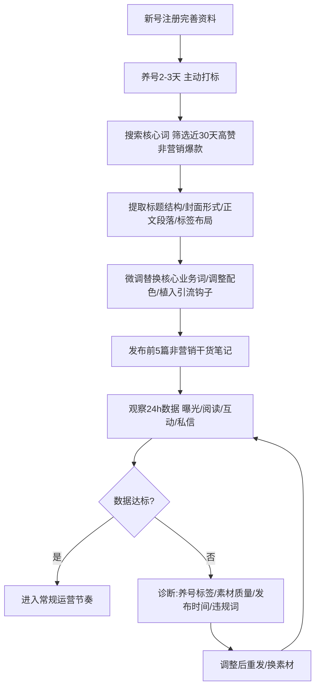
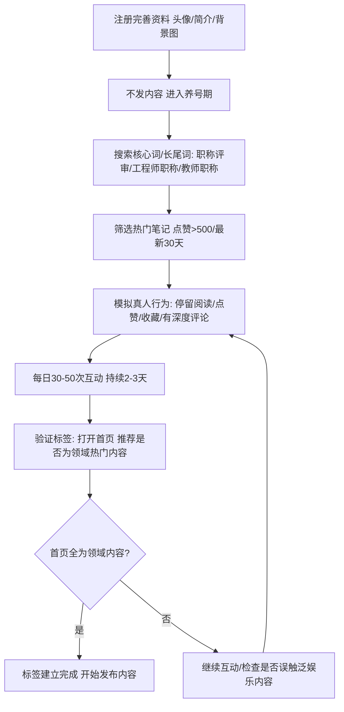
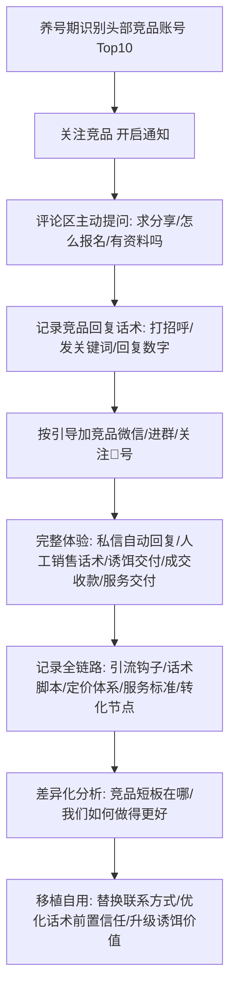
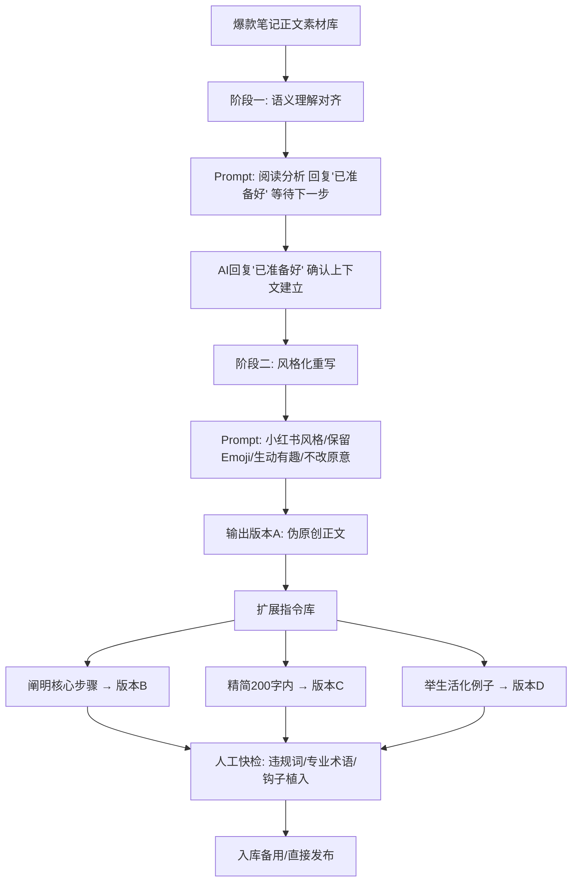
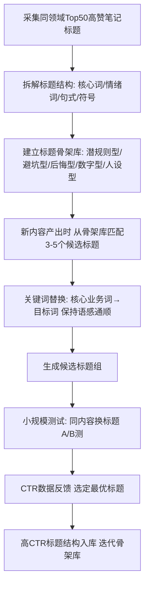
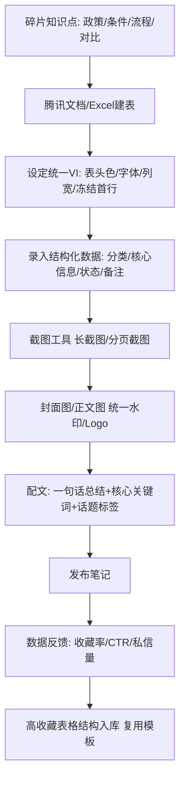
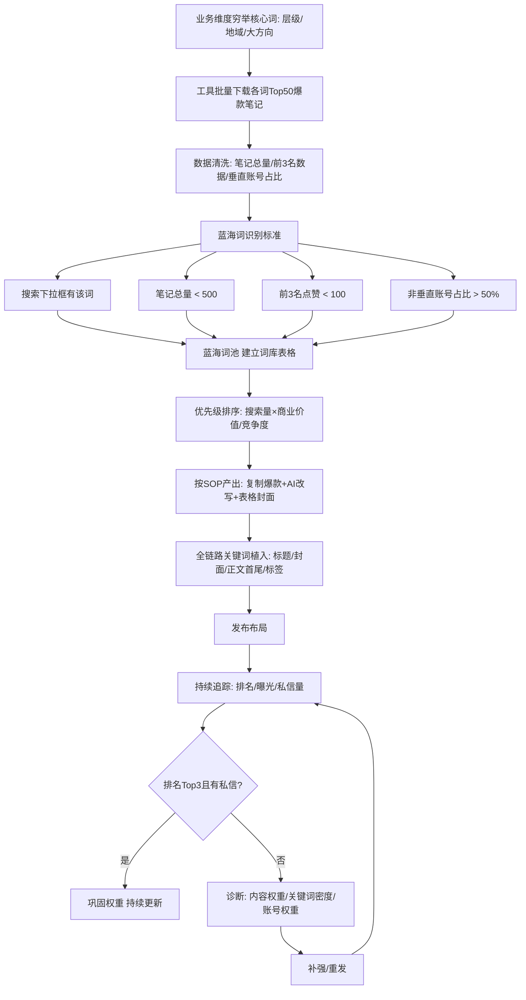
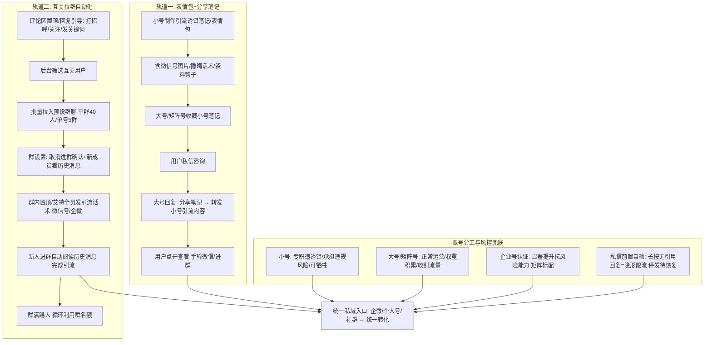
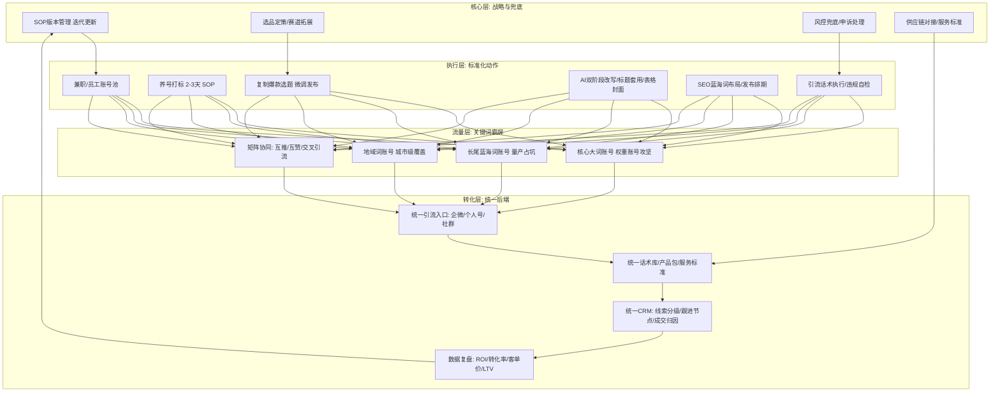

# 第 22 章 小红书职称赛道实战体系 —— 复制爆款起号、SEO蓝海词布局与双轨安全引流矩阵化复制
作者：龙哥

## 学习目标

- 理解小红书冷启动期“复制爆款”核心逻辑与执行标准
- 掌握养号-标签化机制的操作SOP与底层算法原理
- 掌握对标账号业务路径逆向工程的实操步骤与情报提取要点
- 熟练运用AI双阶段伪原创工作流实现内容工业化量产
- 掌握数据驱动标题套用法与表格封面合集化制作技巧
- 理解小红书SEO蓝海词布局式策略的核心定义、关键性质与执行标准
- 掌握双轨安全引流体系（表情包+分享笔记、互关拉群）的技术原理与操作细节
- 理解矩阵化横向复制模型的组织架构设计与SOP标准化要求

## 22.1 生活类比

想象小红书运营是一场“开分店”的连锁加盟游戏：总部把“爆款菜单”（已验证的选题、标题、封面）直接发给新店，新店照着做，开业即爆，不用自己研发新菜；新店开业前，店长先去竞品店“吃饭”（搜索互动），让美团大数据（算法）给新店打上“正宗川菜店”标签，开业自带精准食客；潜入竞品店当“神秘顾客”，从进门迎宾（评论引导）到点单结账（私信成交）全流程录像，回家照搬服务话术单；中央厨房（AI）预制半成品（语义理解），分店只需“现炒”（风格化重写），5分钟出餐，标准化复制无需大厨；不用请设计师做海报，用“标准菜单表”（Excel表格截图）当招牌，信息全、成本低、顾客爱拍照存图（收藏）；不在大街发传单（推荐流量），而是在“附近美食榜”（搜索排名）把“正宗麻婆豆腐哪家强”（长尾词）的榜一位置占了，来的全是冲着麻婆豆腐来的精准食客；直接发微信号会被城管（风控）罚款，于是把微信号印在“会员卡”（表情包图片）里，服务员（大号）递菜单时顺手塞给顾客；或者拉顾客进“美食交流群”（互关拉群），群公告自动发优惠券，封店（禁言）也能偷偷卖；单店跑通模型后，拿SOP（操作手册）招加盟商（兼职、合伙人），成都开店卖川菜，广州开店卖粤菜，同套手册、互不抢客、总部收加盟费。

## 22.2 概念地图

```mermaid
graph TD
    A[小红书职称赛道实战体系]
    A --> B[账号冷启动体系]
    A --> C[内容工业化生产体系]
    A --> D[精准流量获取体系]
    A --> E[安全引流转化体系]
    A --> F[组织规模化复制体系]
    
    B --> B1[复制爆款起号法 —— 爆款基因可迁移定律/前5篇非营销红线]
    B --> B2[养号-标签化机制 —— 账号标签先于内容分发原则/2-3天主动打标SOP]
    B --> B3[对标账号业务路径逆向工程 —— 评论引导/私信话术/落地页全流程复刻]
    B --> B4[老号冷启动修复可行性 —— 断更+重养+复制爆款可恢复权重]
    
    C --> C1[AI双阶段伪原创工作流 —— 语义对齐/风格化重写/阐明精简举例扩展指令]
    C --> C2[数据驱动标题套用法 —— 爆款标题结构提取/关键词替换/标题公式套用]
    C --> C3[表格封面合集化 —— Excel/腾讯文档结构化/5分钟产出/高收藏高CTR]
    C --> C4[爆款笔记挖掘提取法 —— 批量下载/互动排序/非营销筛选/OCR提取/素材库建设]
    C --> C5[关键词全景梳理与蓝海词挖掘 —— 业务维度穷举/工具批量下载/蓝海词识别/优先生产占坑]
    
    D --> D1[小红书SEO蓝海词策略 —— 搜索需求大/竞争内容少/长尾词定义]
    D --> D2[布局式SEO执行原则 —— 无视公域数据/只占坑排名/核心KPI=关键词排名+私信量]
    D --> D3[四维SEO排名因子 —— 账号权重/笔记数据/用户行为/内容质量]
    D --> D4[搜索冷启动刷量战术 —— 小号/亲友模拟真实搜索行为加速权重]
    D --> D5[视频优先分发策略 —— 图文过剩视频稀缺/官方扶持流量红利]
    
    E --> E1[表情包话术规避违规 —— 非文本形式/隐晦词汇/分享笔记功能/零违规实测]
    E --> E2[互关拉群自动化引流 —— 互关拉群/历史消息可见/单号日处理200人/禁言期可操作]
    E --> E3[小号隔离引流大号收割 —— 小号造诱饵担风险/大号分享笔记收割/风险隔离模型]
    E --> E4[私信前置检测机制 —— 长按无引用回复=隐形限流/停发等待恢复]
    E --> E5[群聊单账号日承接上限 —— 5群×40人=200人/踢人循环/量化产能基准]
    E --> E6[企业号抗风险能力验证 —— 升级企业号显著提升抗风险/矩阵标配建议]
    
    F --> F1[矩阵化横向复制模型 —— 核心产SOP/执行层跑标准动作/流量层覆盖词/转化层统一CRM]
    F --> F2[标准化SOP必要充分条件 —— 全流程固化可量化可考核可替换/个人经验转组织资产]
    F --> F3[职称赛道地域护城河 —— 强地域属性天然隔离/同套SOP不同城不竞争/适合加盟]
    F --> F4[聚光投流适配性前瞻 —— 高客单/标准化路径理论适配投放/留作后续优化方向]
```

## 22.3 复制爆款起号法 —— 用已验证的爆款基因规避冷启动风险

### 为什么需要这个概念？

新号冷启动面临选题、标题、封面、合规四大不确定性，原创试错成本高、周期长。爆款笔记已通过市场验证，其核心要素（选题角度、标题钩子、封面设计、合规性）具备跨账号可迁移性。平台查重机制宽松，重发微调后的爆款内容大概率复现爆发，是普通人低成本突围的最优解。

### 核心定义

> **爆款基因可迁移定律**（来源：docs/202305/RhRywNqifi3wjGkc4MacUiwXnxc.md [origin]）

一篇笔记成为爆款的核心要素（选题角度、标题钩子、封面设计、合规性）具有跨账号、跨时间的可复用性；新号发布经过微调的爆款内容，大概率复现爆款表现，平台查重机制不构成有效阻碍。

> "👉先说结论，秘诀就是「复制爆款」。因为一篇笔记如果成为了爆款，那么它基本是规避了「选题、标题或封面不佳」和「笔记违规」的问题。"
> 
> "真相是「小红书不怎么查重」，重发的笔记依然有流量，并且很大概率再次成为爆款。"
> 
> —— docs/202305/RhRywNqifi3wjGkc4MacUiwXnxc.md [origin]

这个定律展示了三个层面的价值：选题层面，爆款选题已被市场验证有需求；形式层面，标题、封面组合已通过算法偏好测试；合规层面，内容已通过风控审核，重发即继承“安全基因”。

> "目前不仅应用于起号，同时也应用于兼职团队，横向复制。"
> 
> —— docs/202305/RhRywNqifi3wjGkc4MacUiwXnxc.md [improve]

### 关键性质

- **低门槛**：无需原创能力，只需筛选、微调、发布执行力
- **高确定性**：复用已验证的“选题-标题-封面”组合，爆款复现率远高于原创
- **可规模化**：SOP标准化后，兼职团队可横向复制执行，单人可管多号

### 典型例子

- 作者团队：新号复制爆款笔记，前5篇非营销干货，迅速建立权重并起号
- 兼职团队横向复制：核心账号产出SOP，兼职账号执行“复制爆款”标准动作，多号覆盖关键词人群

### 边界条件

- 仅适用于起号期及矩阵量产期，长期依赖搬运易遭原作者举报，需平滑过渡至原创/二创
- 必须严守“前2天前5篇非营销”红线，违者权重受损难恢复
- 跨平台搬运需注意水印、平台特有术语去除，避免被判搬运营销号

> "通常来说，至少前两天前五篇都不要复制营销性质的爆款，营销笔记与干货很好区别"
> 
> —— docs/202305/RhRywNqifi3wjGkc4MacUiwXnxc.md [origin]

### 方法演进图：复制爆款起号标准化流程

## 22.4 养号-标签化机制 —— 主动诱导算法打标，让流量精准找上门

### 为什么需要这个概念？

新号无标签，首批推荐流量为泛流量，精准度低，难建立垂直权重。被动等待算法打标周期长且不可控，主动模拟真人行为可在2-3天内强行打上垂直标签。同时规避“营销号”判定，避免因前期行为异常（如频繁发广告）被限流。

### 核心定义

> **账号标签先于内容分发原则**（来源：docs/202305/RhRywNqifi3wjGkc4MacUiwXnxc.md [origin]）

账号在发布首篇内容前的行为轨迹（搜索、互动对象）决定了算法赋予的初始标签，进而决定了首批推荐流量池的精准度；主动打标比被动等待标签形成效率高得多。

> "我们在正常互动的过程中，最好先去搜索所做领域的关键词，并与热门笔记进行互动，因为平台是个性化推荐，会根据我们的阅读偏好打上标签，进行首页内容的推荐。"
> 
> "如果我们多与领域热门笔记互动，那么当我们打开小红书时，首页推荐就不仅仅是当天的平台热门，也会给你推荐关注领域的近期热门，而这些内容有很多的好处，比如有的可以直接拿来当素材..."
> 
> —— docs/202305/RhRywNqifi3wjGkc4MacUiwXnxc.md [origin]

这个原则展示了双重收益：获取精准标签，首批推荐流量即为目标人群；首页变成“免费素材库”，竞品爆款、选题灵感、文案参考触手可及。

> "如果账号前期笔记普遍低于100个阅读量，通常是养号没做好，可以断更几天，再快速起号，依然可行"
> 
> —— docs/202305/RhRywNqifi3wjGkc4MacUiwXnxc.md [improve]

### 关键性质

- **时效性强**：通常2-3天即可完成标签建立，切勿拖延
- **行为真实性**：必须模拟真人节奏（停留时长、互动深度），机械化操作易触发风控
- **标签锚定**：一旦打标完成，后续发布内容优先分发给同标签人群，冷启动成功率指数级提升

### 典型例子

- 职称赛道：搜“职称评审、工程师职称、教师职称”，互动点赞高的同行笔记，首页推荐全变同行爆款
- 同时发现大量可直接用的素材：通知文件、政策解读、客户咨询高频问题

### 边界条件

- 严禁在养号期发布任何营销内容，甚至避免频繁修改简介、头像
- 新号养号2-3天 vs 老号修复需断更数日+重新养号，成本更高
- 标签一旦偏离（如误互动娱乐内容），需注销重来，边际成本极高

### 方法演进图：养号-标签化SOP

## 22.5 对标账号业务路径逆向工程 —— 走一遍竞品流程，偷走成熟商业闭环

### 为什么需要这个概念？

光会做内容不够，必须会“卖货”，竞品的“评论引导-私信话术-落地页-成交”是现成的转化模板。自己摸索话术、引流路径极易触碰平台红线，复制成熟路径规避试错风险。养号期顺手完成，零额外成本获取最高价值情报。

### 核心定义

> **对标账号业务路径逆向工程**（来源：docs/202305/RhRywNqifi3wjGkc4MacUiwXnxc.md [origin]）

养号互动时，主动在竞品爆款笔记下评论“求分享/怎么报名”，触发其引流话术；加竞品微信、进竞品群，完整体验其“私信回复-诱饵交付-销售话术-成交收款-交付服务”全流程；记录话术脚本、引流钩子（资料/群/号）、定价体系、服务标准，直接移植自用。

> "「拆解」并「学习模仿」同行业务路径 具体做法是走一遍他们的业务流程，比如评论区有人问“求分享”，看同行回复话术；如果同行回复的是“打个招呼”，那我们就去打个招呼，看同行私信话术..."
> 
> —— docs/202305/RhRywNqifi3wjGkc4MacUiwXnxc.md [origin]

这个方法展示了三重价值：实战性，比任何课程都真实，是活的转化漏斗；合规性参考，竞品能存活的话术、钩子，大概率通过当前风控，可直接套用；差异化机会，体验中发现竞品服务短板（响应慢、资料旧、无售后），即为切入差异化优势点。

> "用小号做引流图，其他账号收藏笔记，私信时分享笔记...建议统一用小号做引流笔记"
> 
> "评论区置顶评论，引导私信，参考话术：“有需要的姐妹打个招呼”...互关拉群，艾特所有人，参考话术：“大家的私信和评论，已经看了，加一下薇，统一处理，👇是薇”"
> 
> —— docs/202305/RhRywNqifi3wjGkc4MacUiwXnxc.md [apply]

### 关键性质

- **实战性**：比任何课程都真实，是活的转化漏斗
- **合规性参考**：竞品能存活的话术、钩子，大概率通过当前风控，可直接套用
- **差异化机会**：体验中发现竞品服务短板（响应慢、资料旧、无售后），即为切入差异化优势点

### 典型例子

- 作者养号期走完职称竞品流程：评论“打招呼”→私信“发资料”→群内“艾特全员发微信”→成交咨询服务
- 发现竞品引流用“打招呼”两字，作者优化为“发具体关键词”提高筛选精准度

### 边界条件

- 仅作参考模板，不可完全照搬（如竞品微信号、联系方式必须替换为自己的）
- 竞品可能处于“存量收割期”，其话术针对老客户，新号需调整“建立信任”前置环节
- 严禁恶意举报、骚扰竞品，纯学习目的，体验完即退出

### 方法演进图：对标账号逆向工程全流程

## 22.6 AI双阶段伪原创工作流 —— 将写作拆解为标准化Prompt工程任务

### 为什么需要这个概念？

直接让AI写小红书文案，风格生硬、营销味重、伪原创度低，易被判搬运。爆款文案结构复杂（钩子、痛点、方案、引导、Emoji、口语化），单次Prompt难控制全要素。内容量产需标准化：输入爆款文案 → 输出高质量伪原创，像工厂流水线一样可批量复制。

### 核心定义

> **ChatGPT双阶段改写Prompt工程**（来源：docs/202305/RhRywNqifi3wjGkc4MacUiwXnxc.md [origin]）

标准化AI改写协议：第一阶段【语义理解对齐】：喂给ChatGPT爆款文案，指令“阅读分析，回复‘已准备好’”，建立上下文记忆；第二阶段【风格化重写】：指令“用小红书风格改写，保留Emoji/生动有趣/不改原意”，产出伪原创正文；扩展指令：阐明、精简、举例 → 生成差异化原创段落，提升内容独特度。

> "参考文案：接下来我将向你提供一段文案，请先阅读并分析，完成后只需要回复“已准备好”，并等待我的下一步指令。"
> 
> "参考文案：请将这段文案，用小红书的风格，在不改变原意的前提下进行改写，要求有emoji表情，语言最好生动有趣（设置语言风格有助于提高伪原创质量）"
> 
> "我通常还会用chatGPT的阐明/精简/举例的指令打造出一些纯原创的文案，用于正文。"
> 
> —— docs/202305/RhRywNqifi3wjGkc4MacUiwXnxc.md [origin]

这个工作流展示了三个核心优势：结构化，双阶段分离“理解”与“生成”，显著提升输出质量稳定性；可标准化，Prompt固化为模板，新人换文案即用，培训成本极低；成本极低，单条成本几分钱，替代专业文案编辑月薪数万。

### 关键性质

- **结构化**：双阶段分离“理解”与“生成”，显著提升输出质量稳定性
- **可标准化**：Prompt固化为模板，新人换文案即用，培训成本极低
- **成本极低**：单条成本几分钱，替代专业文案编辑月薪数万

### 典型例子

- 爆款文案输入 → ChatGPT回复“已准备好” → 指令改写 → 输出带Emoji、口语化、排版整齐的伪原创
- 结合“阐明指令”生成原创正文段落，配合表格封面，日产20+条高质量笔记

### 边界条件

- 必须基于爆款文案改写，空手套白狼让AI凭空创作质量不可控
- 改写后需人工快速扫读：查违规词、核对专业术语准确性、确保联系方式已植入钩子
- 同一文案不可无限改写复用，建议同一素材库文案轮换使用，避免平台查重

### 方法演进图：AI双阶段伪原创标准化工作流

## 22.7 数据驱动标题套用法 —— 相信数据不相信AI，用爆款标题结构套用新内容

### 为什么需要这个概念？

AI生成标题往往中规中矩，缺乏“流量密码”关键词，点击率（CTR）低。爆款标题隐含平台算法偏好的结构、关键词、情绪钩子，直接套用比重新创作成功率高。标题决定打开率，是流量漏斗最关键环节，容不得半点主观臆断。

### 核心定义

> **数据驱动标题套用法**（来源：docs/202305/RhRywNqifi3wjGkc4MacUiwXnxc.md [origin]）

从同领域高数据笔记提取标题骨架：如“潜规则”、“摸到门道”、“后悔没早点知道”、“避坑指南”；保留结构、关键词、情绪词，替换核心业务词：如“职称评审避坑指南”→“教师资格证避坑指南”；备选：套用“小红书爆款标题公式”（数字+痛点+结果+人设+符号），批量生成候选标题测试。

> "我也试过用chatGPT取标题，但效果并不满意，最后还是选择相信数据（最靠谱），提取了两个合适的标题...稍微替换关键词用于文案标题。"
> 
> "也可以套用「小红书爆款标题公式」，以及「有流量密码效果的标题关键词」，测试多遍，同样效果很好。"
> 
> —— docs/202305/RhRywNqifi3wjGkc4MacUiwXnxc.md [origin]

> "用腾讯文档表格（其他同类软件也行）制作成合集类笔记的封面（最容易出爆款的封面之一），大多数图片类笔记都可以切换成这种风格去展示"
> 
> —— docs/202305/RhRywNqifi3wjGkc4MacUiwXnxc.md [apply]

这个方法展示了实证优于理论：作者实测AI取标题效果不满意，数据驱动套用法显著提升CTR。

### 关键性质

- **实证优于理论**：作者实测AI取标题效果不满意，数据驱动套用法显著提升CTR
- **低成本**：无需创意天赋，只需“拆解-替换-组合”机械动作，新手即可上手
- **可量化**：标题池积累至50+，每条笔记测试3-5个标题，数据反馈最优解

### 典型例子

- 提取竞品标题“二级职称评审潜规则，摸到门道后悔没早点知道” → 套用为“中级职称评审潜规则，摸到门道后悔没早点知道”
- 爆款标题库积累：按领域分类存储高CTR标题结构，新内容来了直接套用

### 边界条件

- 标题必须与内容强相关，标题党（严重不符）会导致用户举报、完读率低、权重暴跌
- 关键词替换需保证语句通顺、符合小红书语言习惯，生硬拼凑反而降低点击欲望
- 同一标题结构高频使用会导致用户审美疲劳，需定期更新标题库

### 方法演进图：数据驱动标题套用SOP

## 22.8 表格封面合集化 —— 零设计门槛的高点击、高收藏封面范式

### 为什么需要这个概念？

图文笔记封面决定点击率，但大多数人不会设计、没审美、找素材慢。碎片化知识点（如“各城市职称政策”）用长图、拼图展示信息密度低、阅读体验差。需要一种“零设计、高产出、高信息密度、高收藏率”的标准化封面制作范式。

### 核心定义

> **表格封面合集化**（来源：docs/202305/RhRywNqifi3wjGkc4MacUiwXnxc.md [origin]）

用Excel、腾讯文档、飞书表格将碎片知识整理为结构化表格（分类、核心信息、状态、备注）；截图表格作为封面图（首图）及正文主体图，配合简短文字总结即可发布；核心优势：制作5分钟/条、信息密度极高、天然适配“收藏”动作、视觉统一性强。

> "用腾讯文档表格（其他同类软件也行）制作成合集类笔记的封面（最容易出爆款的封面之一），大多数图片类笔记都可以切换成这种风格去展示"
> 
> "图片篇的爆款笔记，其实不需要有详细的正文内容也可以，简单总结一下内容就行。"
> 
> —— docs/202305/RhRywNqifi3wjGkc4MacUiwXnxc.md [origin]

这个范式展示了三大核心优势：通用性，适用于所有“合集、清单、对比、流程、政策”类内容，覆盖率>80%；算法友好，高收藏率信号强，推荐权重高；表格文字可被OCR识别，利于SEO关键词覆盖；品牌资产，统一配色、字体、表头风格，形成账号视觉识别系统（VI），主页专业感强。

### 关键性质

- **通用性**：适用于所有“合集、清单、对比、流程、政策”类内容，覆盖率>80%
- **算法友好**：高收藏率信号强，推荐权重高；表格文字可被OCR识别，利于SEO关键词覆盖
- **品牌资产**：统一配色、字体、表头风格，形成账号视觉识别系统（VI），主页专业感强

### 典型例子

- “广东各地级市二级职称申报通知合集”：表格列“城市/文件名/下载状态/截止时间”，截图为封面
- “PPT配色表合集”：表格列“场景/主色/辅助色/色值/适用风格”，做成系列封面持续出爆款

### 边界条件

- 不适用于强视觉冲击类内容（美妆、穿搭、旅游、美食），此类需实拍、高颜值图
- 表格列数建议≤6列，行数≤15行，超出需分页、多图，否则手机端字太小体验差
- 必须定期更新数据（如政策变动），过期表格会引发用户投诉、差评、信任崩塌

### 方法演进图：表格封面合集化5分钟生产流

## 22.9 小红书SEO蓝海词布局式策略 —— 占坑长尾词，精准截获高意向搜索流量

### 为什么需要这个概念？

推荐流量脉冲式、不可控、泛粉多、转化率低，不适合高客单价、决策周期长、地域性强的小众赛道。搜索流量意图极强（主动搜“广东二级职称条件”=精准需求），转化率高、周期长、复利效应强。头部大词竞争激烈（同行专业号、官方号霸榜），长尾蓝海词“有搜索无内容”是普通人切入口。

### 核心定义

> **小红书SEO蓝海词策略**（来源：docs/202305/RhRywNqifi3wjGkc4MacUiwXnxc.md [origin]）

蓝海词定义：搜索需求大（下拉框有、搜索量高），但优质内容少（笔记总量少、前排笔记数据差、非垂直账号）；布局式执行：挖掘蓝海词 → 生产高权重内容（复制爆款+AI改写+表格封面） → 占据搜索首位 → 持续截获精准流量；核心KPI：不看点赞、阅读，只看“关键词排名”+“私信咨询量”，零互动也可判定成功。

> "目标人群会去搜索，但没什么同行发过相关笔记的关键词，我称之为「有潜力的蓝海词」。"
> 
> "当这样的蓝海词被搜索时，即使某个同行发过的笔记数据不是很好，但因为相关笔记实在是太少了，而它的笔记因为精准度高，还是会排在前面，吃掉大部分的精准流量。"
> 
> —— docs/202305/RhRywNqifi3wjGkc4MacUiwXnxc.md [origin]

> "有个同行叫“老刘”，经常发广东各地的职称申报通知文件...有了小红书SEO思路后，不管数据好不好，都学他这么布局各个城市，现在每天都有一定的私信数量，是求分享通知文件的。"
> 
> "前段时间，我们把领域的关键词都捋了一遍：工程师职称的...教师职称的...职称大方向的...",
> 
> "有一个做工程师职称的账号，私信被咨询的跨度广了，比如有一篇笔记，虽然没有一个点赞和收藏，但被用户私信「分享笔记」了很多次..."
> 
> —— docs/202305/RhRywNqifi3wjGkc4MacUiwXnxc.md [improve]

这个策略展示了三大关键性质：复利效应，内容发布后权重随时间积累，半年、一年后仍持续带来精准流量，一次生产长期受益；精准度极高，搜索用户=主动需求+高意向，咨询即高意向线索，成交转化率远超推荐流；护城河，词库布局越全，竞品切入越难；先发优势+权重积累形成时间护城河。

### 关键性质

- **复利效应**：内容发布后权重随时间积累，半年、一年后仍持续带来精准流量，一次生产长期受益
- **精准度极高**：搜索用户=主动需求+高意向，咨询即高意向线索，成交转化率远超推荐流
- **护城河**：词库布局越全，竞品切入越难；先发优势+权重积累形成时间护城河

### 典型例子

- “二级造价师职称评审条件2023广东”：搜索量中、竞品笔记少且数据差，作者布局后稳居首位，日均私信10+
- “零互动精准获客”：某工程师职称账号一篇0赞0藏笔记，因精准命中蓝海词，收获大量“分享笔记”私信
- 同行“老刘”：发布各地通知文件（公域数据差），作者模仿布局全城市，日均私信稳定，验证“布局式SEO”商业有效性

### 边界条件

- 仅适用于“用户有主动搜索习惯”的赛道（考证、职称、技能、疾病、法律、装修等），娱乐、颜值、情感类不适用
- 需长期坚持：前期布局期（1-3个月）流量极少，易劝退，需“无视数据、只占坑”的定力
- 关键词植入必须全链路：标题必带、封面水印、正文开头、结尾、话题标签≤5个精准词，缺一不可

### 方法演进图：蓝海词挖掘与布局式SEO全流程

## 22.10 双轨安全引流体系 —— 表情包话术+分享笔记、互关拉群，形式对抗风控

### 为什么需要这个概念？

小红书严打引流：直接发微信号、二维码、联系方式、引导词必封禁，传统私信、评论引流已基本失效。账号权重来之不易，主号引流违规导致限流、封号得不偿失，需“风险隔离”架构。引流承接能力成瓶颈：人工回私信日处理<50人，无法匹配爆款笔记带来的流量洪峰。

### 核心定义

> **引流风控对抗：形式大于内容原则**（来源：docs/202305/RhRywNqifi3wjGkc4MacUiwXnxc.md [origin]）

平台风控核心针对文本语义与直接联系方式识别；将引流载体从“文本、直接发图”转移至“表情包图片、分享笔记卡片、群聊系统消息”等非标准化检测路径，可大幅降低违规判定概率。

> "把你的话术，先做成图片，再添加到表情包...试过发图片也提醒违规，所以才做成表情，目前还没收到违规提醒"
> 
> "用小号做引流图，其他账号收藏笔记，私信时分享笔记"
> 
> "互关可以直接拉群...群聊设置，笔记挂群聊➡️取消进群确认➡️打开新成员展示历史消息👉新人进群自动被引导"
> 
> "目测最多可拉40人！...一个号可以建5个群，所以一个号一天能处理200人，完全够用！再循环利用，5个群拉满了，把1群的人踢出去，重新再拉40人！"
> 
> "即使账号禁言状态，也可以互关拉人，也可以在群聊讲话"
> 
> "我们试过升级成企业号，事实证明确实更抗风险"
> 
> —— docs/202305/RhRywNqifi3wjGkc4MacUiwXnxc.md [origin/improve]

这个原则展示了双轨体系的核心逻辑：轨道一【表情包+分享笔记】：小号制作引流诱饵笔记、表情包（含微信号图片、隐晦话术） → 大号收藏小号笔记 → 私信回复时“分享笔记”转发小号内容 → 利用非文本形式绕过关键词、语义拦截；轨道二【互关拉群自动化】：评论区引导“打招呼、关注” → 筛选互关用户 → 后台批量拉群（单群40人、单号5群、日处理200人） → 群设置“取消进群确认+新成员看历史消息” → 新人进群自动阅读置顶引流话术 → 群满踢人循环利用；账号分工：小号（引流诱饵制作、承担违规风险）+ 大号/矩阵号（正常运营、收藏小号笔记、分享转发、收割流量）。

### 关键性质

- **合规性**：利用平台原生功能（分享笔记、群聊、表情包）而非对抗规则，实测“目前还没收到违规提醒”
- **高并发**：单号日承接200人，矩阵N号线性扩展，禁言期亦可操作（群聊不受禁言限制），鲁棒性极强
- **低成本**：表情包制作一次永久用，群聊自动化零人工，边际成本趋近零

### 典型例子

- 作者团队：小号做引流图、笔记，大号私信“分享笔记”转发，配合隐晦词汇，持续运行零违规
- 群聊裂变：单号5群×40人=200人/天，群满踢人循环，甚至封禁期也能通过群聊引流

### 边界条件

- 微信号、联系方式必须做成图片、表情包，不能发文本；复杂微信号需简化（如加下划线、缩写）提高用户手输通过率
- 引流钩子（资料、群、课程）必须高价值、即时交付，否则用户进群即退、举报、拉黑，破坏账号权重
- 群聊运营需设置“全员禁言/仅管理员可发”或“艾特全员发广告”二选一，避免群内刷屏、骂人触发群封禁

### 方法演进图：双轨安全引流体系架构

## 22.11 矩阵化横向复制模型 —— 用标准化SOP将个人经验变为组织资产

### 为什么需要这个概念？

单账号流量上限低、抗风险弱、人力瓶颈强，无法规模化放大收益。个人经验隐性化、依赖人、不可复制，必须显性化为SOP才能交付给兼职、员工执行。赛道具备“地域护城河”（职称强地域属性），不同城市运营同套SOP不竞争，天然适合矩阵、加盟。

### 核心定义

> **标准化SOP是矩阵扩张的必要充分条件**（来源：docs/202305/RhRywNqifi3wjGkc4MacUiwXnxc.md [origin]）

只有将“选题挖掘、AI改写、封面制作、发布排期、引流话术、风控应对”全流程固化为可量化、可考核、可替换的SOP，才能实现兼职团队、矩阵账号的横向复制，将个人经验转化为组织资产。

> "因为「搬运老号爆款」的方法有效，所以目前不仅应用于起号，同时也应用于兼职团队，横向复制。"
> 
> "这一章节主要是小红书笔记创作的高效流程...我探索出了两种高效的玩法...均是验证过至少20条以上的爆款、且整体的操作思路与流程保持基本一致。"
> 
> —— docs/202305/RhRywNqifi3wjGkc4MacUiwXnxc.md [origin]

> "成都圈友跟我学习了，跟我也不是竞争关系...职称公司，一般只能做省内人群的生意"
> 
> "这个赛道按道理很适合做投流（聚光投放），我也懂这个，有需要的可以找我聊天..."
> 
> —— docs/202305/RhRywNqifi3wjGkc4MacUiwXnxc.md [improve]

这个条件展示了矩阵模型的四层架构：核心层：创始人、核心团队负责SOP迭代、选品定策、风控兜底、供应链对接；执行层：兼职、员工账号执行“养号-复制爆款-AI改写-表格封面-发布-SEO布局-引流话术”标准动作；流量层：多账号矩阵覆盖核心词、长尾词、地域词，形成关键词霸屏效应；转化层：统一引流入口（企微、个人号、社群） → 统一话术、产品、服务、交付 → 统一CRM管理。

### 关键性质

- **可复制性**：SOP颗粒度细至“账号编号、发布时间、回复话术、表格模板、违规自检动作”，新人1天上手
- **可考核**：以“日发笔记数、蓝海词覆盖数、私信回复率、引流转化率、违规次数”量化考核，结果导向
- **可替换**：账号、人员损耗不影响体系运转，新号按SOP跑即可，组织资产沉淀而非个人依赖

### 典型例子

- 作者团队：核心账号产SOP，兼职团队横向复制，成都、广州、深圳等地圈友同套打法互不竞争
- 职称加盟模式：授权城市合伙人用同套SOP，总部提供供应链、技术、品牌，合伙人跑本地流量、转化、服务

### 边界条件

- 前提：单账号模型已跑通（0-1验证可行），未跑通直接铺矩阵=放大亏损
- SOP需持续迭代：平台规则变、算法变、竞品变，核心层需月度复盘更新SOP版本号
- 质量控制：兼职人员执行力参差不齐，需建立“种子账号示范、随机抽检、违规连坐”机制

### 方法演进图：矩阵化横向复制四层架构

## 22.12 多源对照

### 单元1：复制爆款起号法
**共识**：origin与improve角色素材均确认“复制爆款”为核心起号策略，平台查重宽松，重发微调大概率复现爆发，且已延展至兼职团队横向复制。
**分歧/补充**：origin侧重起号期“前5篇非营销”红线与爆款基因理论阐述；improve补充了该方法在矩阵量产期的规模化应用验证，确认“验证过至少20条以上爆款、操作思路流程基本一致”。

### 单元2：养号-标签化机制
**共识**：origin与improve均强调主动搜索互动建立垂直标签，首页变素材库的双重收益。
**分歧/补充**：improve新增“老号冷启动修复可行性”实证：前期阅读<100的废号，经断更+重养+复制爆款可恢复权重，账号权重非不可逆，降低了试错成本。

### 单元3：对标账号业务路径逆向工程
**共识**：origin定义了逆向工程的核心动作（评论触发、全流程体验、话术移植）。
**分歧/补充**：apply角色素材将逆向工程成果直接转化为具体执行话术模板（评论区“打个招呼”、私信“发资料”、群内“艾特全员发微信”），并衍生出“小号隔离引流大号收割”的账号分工模型，实现了从情报获取到体系构建的闭环。

### 单元4：AI双阶段伪原创工作流
**共识**：origin提供了完整的双阶段Prompt协议（语义对齐→风格化重写）及扩展指令（阐明/精简/举例）。
**分歧/补充**：单一素材源，无多角色对照，但扩展指令的引入表明从单纯伪原创向“半原创化”演进，提升内容独特度应对平台查重升级。

### 单元5：数据驱动标题套用法
**共识**：origin确立“相信数据不相信AI”原则，提取竞品高数据标题骨架替换核心词。
**分歧/补充**：apply角色素材侧面印证表格封面合集化与标题套用的协同效应——“大多数图片类笔记都可以切换成这种风格”，暗示标题结构与封面形式存在组合最优解。

### 单元6：表格封面合集化
**共识**：origin确立了“零设计、5分钟产出、高收藏、利于OCR/SEO”的范式定义与核心优势。
**分歧/补充**：单一素材源，但“图片篇爆款不需要详细正文”这一发现，重新定义了图文笔记的内容生产边界：封面即内容，收藏即转化。

### 单元7：小红书SEO蓝海词布局式策略
**共识**：origin与improve共同确立蓝海词定义（有搜索无优质内容）、布局式执行逻辑、核心KPI（排名+私信量而非公域互动）。
**分歧/补充**：improve提供了三层关键实证：关键词全景梳理的操作细节（工程师/教师/大方向三维度）、同行“老刘”通知类布局的商业验证、零互动笔记精准获客的反直觉案例，将理论落地为可执行的验证体系。

### 单元8：双轨安全引流体系
**共识**：origin与improve共同构建了“表情包+分享笔记”与“互关拉群”双轨体系，确立形式大于内容的风控对抗原则。
**分歧/补充**：improve补充了关键量化指标（单群40人、单号5群、日处理200人、踢人循环、禁言期可操作）、私信前置检测机制（长按无引用回复=隐形限流）、企业号抗风险实测验证，将战术细节完善为可落地的工程化标准。

### 单元9：矩阵化横向复制模型
**共识**：origin与improve均确认SOP标准化为矩阵扩张前提，地域护城河使同套方法论跨城不竞争。
**分歧/补充**：improve拓展了商业模式边界：从内部兼职团队横向复制，延展为城市合伙人加盟模式；并前瞻性判断聚光投流理论适配性，为后续规模化留出优化方向。

## 22.13 设计中的取舍

**问：为什么不用原创内容起号？**
答：原创选题、标题、封面、合规四大不确定性叠加，冷启动失败率极高；复制爆款将不确定性压缩至“微调执行力”单一变量，成功率指数级提升。代价是长期依赖搬运面临举报风险，需规划原创过渡期。

**问：为什么不直接发微信号引流？**
答：文本、图片直接发联系方式触发风控概率≈100%，账号权重归零。表情包+分享笔记利用平台原生功能规避语义检测，虽增加用户手输成本，但账号存活率从0提升至接近100%，ROI反而更高。

**问：为什么不追求点赞、阅读等公域数据？**
答：小众高客单赛道，公域互动指标（点赞、收藏）与商业转化（私信、成交）相关性极低；布局式SEO以“关键词排名+私信量”为核心KPI，零互动笔记同样能带来高意向客户，避免了为虚荣指标浪费资源。

**问：为什么选SEO蓝海词不选推荐流大词？**
答：推荐流量脉冲式、泛粉多、决策周期长的高客单赛道转化极低；搜索流量用户主动表达需求，意图强度高，长尾词竞争弱，普通人可通过“占坑”策略以低成本获取高精准流量，且具复利效应。

**问：为什么用小号隔离引流不直接大号引流？**
答：大号承载权重与资产，一次违规即归零；小号成本低、可批量注册、牺牲可控。大号仅执行“分享笔记”这一平台原生合规动作，实现风险零传导。

**问：为什么用表格封面不做精美长图？**
答：精美长图依赖设计师、制作周期长、信息密度低、难标准化；表格封面零设计门槛、5分钟产出、结构化信息天然高收藏、OCR友好利于SEO，综合ROI碾压长图。

## 22.14 动手练习

### 练习 1：复制爆款起号实操演练

任务：在小红书搜索你的目标赛道核心词（如“职称评审”），按“最新”排序筛选近30天点赞>500的非营销爆款笔记5篇。

1. 记录这5篇笔记的：标题结构、封面形式、正文段落结构、标签布局。
2. 选取1篇爆款笔记，按“复制爆款”标准进行微调：替换核心业务词、调整封面配色、植入自己的引流钩子（如“资料包”）。
3. 新号养号2天后发布，观察24小时数据（曝光/阅读/互动/私信）。

回答问题：
- 为什么要求前5篇必须为非营销内容？违反会有什么后果？
- 如何判断一篇笔记是“营销性质”还是“干货性质”？
- 如果发布后曝光<100，应该如何诊断并调整？

### 练习 2：AI双阶段伪原创工作流标准化测试

准备：找一篇同领域高赞爆款笔记正文（含Emoji、口语化表达）。

1. 阶段一：发送Prompt『接下来我将向你提供一段文案，请先阅读并分析，完成后只需要回复“已准备好”，并等待我的下一步指令。』粘贴文案，确认AI回复“已准备好”。
2. 阶段二：发送Prompt『请将这段文案，用小红书的风格，在不改变原意的前提下进行改写，要求有emoji表情，语言最好生动有趣』，获得版本A。
3. 扩展测试：对同一文案追加指令『请阐明其中的核心步骤』/『精简为200字以内』/『举一个生活化例子说明』，获得版本B/C/D。

回答问题：
- 为什么要分两阶段而非一次性给完整指令？对比单阶段Prompt的输出质量差异。
- 版本A/B/C/D中，哪个最适合做笔记正文？哪个适合做评论区回复？哪个适合做私域转化话术素材？
- 如何快速人工校验AI输出的合规性（违规词/专业术语/联系方式植入）？

### 练习 3：蓝海词挖掘与布局式SEO验证

任务：针对你的业务赛道，完成关键词全景梳理与蓝海词筛选。

1. 穷举核心词：按“层级/地域/大方向”三维度列出20个核心词（如“二级造价师/广东/职称评审条件”）。
2. 批量下载：用工具下载每个核心词下的Top50爆款笔记数据。
3. 识别蓝海词：筛选条件——搜索下拉框有该词/笔记总量<500/前3名笔记点赞<100/非垂直账号占比>50%。
4. 选取3个蓝海词，按“复制爆款+AI改写+表格封面”SOP各产出1篇笔记发布。
5. 持续观察7天：记录每日搜索排名、曝光量、私信咨询量。

回答问题：
- 为什么蓝海词笔记“零点赞”也能判定成功？核心KPI是什么？
- 关键词全链路植入（标题/封面/正文开头结尾/话题标签）缺一不可的原因是什么？
- 布局期（前1-3个月）流量极少时，如何用数据指标（而非感觉）判断是否坚持？

### 练习 4：双轨安全引流体系压力测试

场景：假设某篇笔记意外爆发，单日引流咨询量达300人，超出人工私信回复上限。

1. 设计“表情包+分享笔记”话术包：制作3版不同风格的引流表情包（含微信号图片/隐晦话术），配套3篇不同角度的引流诱饵笔记（资料/群/低价课）。
2. 设计“互关拉群”自动化流程：设置群聊“取消进群确认+新成员看历史消息”，准备群内置顶引流话术（艾特全员模板）。
3. 账号分工演练：小号发引流诱饵笔记，大号收藏。模拟私信回复“分享笔记”操作，验证大号无违规提醒。
4. 压力测试：模拟单日200人进群，验证“群满踢人循环”、“禁言期可操作”、“私信前置检测机制”自检流程。

回答问题：
- 为什么微信号必须做成图片/表情包不能发文本？复杂微信号如何提高用户手输通过率？
- 引流钩子（资料/群/课程）必须具备什么特质？否则会发生什么？
- 群聊运营“全员禁言”vs“仅管理员可发”vs“艾特全员发广告”三种模式的优劣势对比？

### 练习 5：矩阵化横向复制SOP标准化设计

任务：将“养号-起号-做号-引流”全流程拆解为可交付给兼职人员执行的像素级SOP文档。

1. 动作颗粒度拆解：将每个环节拆解至“点击哪个按钮/输入什么文案/几点发布/回复什么话术”级别。
2. 量化考核指标体系设计：定义“日发笔记数/蓝海词覆盖数/私信回复率/引流转化率/违规次数”的及格线/优秀线。
3. 质量控制机制：设计“种子账号示范/随机抽检/违规连坐/版本号管理”的SOP迭代与合规保障流程。
4. 兼职人员上手测试：招募1名零基础兼职，仅给SOP文档不口头教学，观察其首周执行情况与产出质量。

回答问题：
- SOP颗粒度细到什么程度才算“像素级”？举3个具体例子。
- 如何平衡“SOP标准化执行”与“平台规则/算法变化需灵活应变”的矛盾？
- 兼职人员执行力参差不齐时，核心层应建立什么样的“兜底与淘汰”机制？

## 22.15 本章小结

这一章中我们学习了小红书职称赛道从0到1的完整实战体系。首先，我们掌握了**复制爆款起号法**，利用爆款基因可迁移定律，让新号开业即爆；其次，我们理解了**养号-标签化机制**，主动诱导算法打标，让精准流量找上门；接着，我们学会了**对标账号业务路径逆向工程**，走一遍竞品流程偷走成熟商业闭环；然后，我们熟练运用了**AI双阶段伪原创工作流**，将写作拆解为标准化Prompt工程任务；随后，我们掌握了**数据驱动标题套用法**与**表格封面合集化**，用爆款标题结构和零设计封面提升点击与收藏；之后，我们深入理解了**小红书SEO蓝海词布局式策略**，占坑长尾词精准截获高意向搜索流量；然后，我们构建了**双轨安全引流体系**，用表情包话术和互关拉群形式对抗风控；最后，我们建立了**矩阵化横向复制模型**，用标准化SOP将个人经验变为组织资产。

本章我们一起学习了以下概念：

| 概念 | 解释 |
|------|------|
| 复制爆款起号法 | 新号直接搬运同领域老号历史爆款笔记微调发布，利用爆款基因可迁移定律规避冷启动风险 |
| 养号-标签化机制 | 发内容前2-3天模拟真人搜索互动领域热门笔记，主动诱导算法打垂直标签 |
| 对标账号业务路径逆向工程 | 养号期完整体验竞品“评论引导-私信话术-落地页成交”全流程，复制成熟商业闭环模板 |
| AI双阶段伪原创工作流 | 第一阶段语义理解对齐，第二阶段风格化重写，可扩展阐明/精简/举例生成原创 |
| 数据驱动标题套用法 | 从高数据笔记提取标题骨架关键词替换核心词，或套用爆款标题公式，实测优于AI生成 |
| 表格封面合集化 | 用Excel/腾讯文档将碎片知识整理为结构化表格截图作封面正文，5分钟产出、高收藏 |
| 小红书SEO蓝海词策略 | 挖掘“搜索需求大、竞争内容少”长尾词，生产高权重内容抢占搜索首位截获精准流量 |
| 布局式SEO执行原则 | 无视公域互动指标，核心KPI为关键词排名+私信量，零互动亦可判定成功 |
| 表情包话术规避违规 | 将敏感引流话术制作为图片表情包发送，配合分享笔记功能传递诱饵，零违规实测 |
| 互关拉群自动化引流 | 利用“互关可拉群”及“群聊历史可见”机制：评论引导互关→批量拉群→新成员自动阅读历史引流消息 |
| 小号隔离引流大号收割 | 小号专职制作引流诱饵承担违规风险，大号正常运营收藏小号笔记，引流时大号“分享笔记”转发小号内容 |
| 矩阵化横向复制模型 | 核心账号产出SOP→兼职账号执行标准动作→多号覆盖关键词人群→统一引流入口→后端统一转化 |
| 标准化SOP必要充分条件 | 全流程固化为可量化、可考核、可替换的SOP，才能实现矩阵横向复制 |
| 职称赛道地域护城河 | 强地域属性天然形成区域护城河，不同城市运营者同套方法论不竞争，适合加盟 |
| 爆款基因可迁移定律 | 爆款笔记的选题/标题/封面/合规性具有跨账号可迁移性，平台查重宽松，重发微调后大概率复现爆发 |
| 账号标签先于内容分发原则 | 账号发布前行为轨迹决定算法初始标签，进而决定首批推荐流量池精准度，主动打标效率远高于被动等待 |
| 小众赛道SEO高于推荐流量价值定理 | 高客单/长决策/强地域赛道中，搜索流量用户意图强度远超推荐流，布局长尾蓝海词ROI更高且具复利效应 |
| 引流风控对抗：形式大于内容原则 | 平台风控针对文本语义/直接联系方式，将载体转移至表情包/分享笔记/群聊系统消息等非标准检测路径可大幅降低违规判定 |
| 零互动笔记精准获客验证 | 0点赞0收藏的蓝海词笔记因精准命中搜索意图，仍获大量“分享笔记”私信，证明公域互动指标不代表商业价值 |
| 通知类布局式SEO商业验证 | 同行发布通知文件类公域数据差但日均私信稳定，验证布局式SEO对长尾需求覆盖的商业有效性 |

下一章中，我们将学习 **视频号生态内导流👸号** —— 共情文案卡点剪辑、混剪去重与微信指数权重联动，揭秘生态内导流优于跨平台导流的底层逻辑与实操SOP。

