# 第 7 章 财富跃迁与风险防守体系 —— 从负债19万到年入百万的多渠道组合、三阶段风控、防守优先
作者：龙哥

## 学习目标

- 理解记账复盘体系作为财务管理基础设施的核心价值与搭建方法
- 掌握三阶段风险测算体系的动态红线逻辑与资产量级匹配原则
- 掌握被动收入锚定策略在心理账户构建与高风险投资仓位管理中的作用
- 理解信用价值变现与合伙人制杠杆的无本万利放大模型与风控边界
- 确立流动性优先原则的绝对优先级与三大致命坑（融资融券/消息票/他人代管）的识别与规避
- 内化防守优先定理与双腿走路模型，能根据个人生命周期阶段制定职业与投资策略
- 能复盘四年财务跃迁曲线，识别可复制项目特征与不可复制主观交易的边界
- 掌握少年创业认知跃迁七阶的核心认知阶梯：从虚拟冷启动到风口果断转型的通用路径

## 7.1 生活类比

财富管理像一场**马拉松长跑**。**记账**是你手腕上的配速器与心率监测：实时掌握身体状态（财务全貌），告诉你何时该加速冲刺、何时必须减速补给，没有它你就是盲跑。**三阶段风控**是分段配速策略：起跑阶段靠年收入兜底保体力（守收入），中程阶段靠净资产20%红线控风速（守净资产），冲刺阶段切换标普配速表实现稳健巡航（标普配置）。**被动收入**是赛道旁固定的补给站：持续提供能量胶（现金流），让你敢于在高风险坡道（股票投资）上全力冲刺而不怕断糖。**信用杠杆与合伙人制**是借力跑：利用他人账户、额度、粉丝（顺风车、接力棒）放大单位步频产出，把原本一个人的独跑变成团队接力。**流动性优先**是穿自带水壶跑：拒绝沿途不明饮料（融资融券、消息票、他人代管），防止中毒退赛，宁可慢一点也要保证补给安全。**防守优先与双腿走路**是穿护膝护踝（保险、社保、主业）跑：护具虽重但能保膝盖（城池）不碎，副业是备用跑鞋，两条腿轮流发力才能跑完全程。**少年创业七阶**是青少年组冠军成长录：1元报名费起跑 → 碎片时间练基本功 → 抓住赛事红利期All-in → 混入专业队训练 → 完美复制冠军动作 → 单人包揽全项目 → 伤病期果断转项。

## 7.2 概念地图

```mermaid
graph TD
    A[财富跃迁与风险防守体系] --> B[基础设施层]
    A --> C[风控体系层]
    A --> D[战略决策层]
    A --> E[实证验证层]
    A --> F[认知底座层]

    B --> B1[记账复盘体系 —— P001, P003]
    B --> B2[多渠道收入组合 —— P001]

    C --> C1[三阶段风险测算 —— P002, P003]
    C1 --> C1a[一阶段：年收入兜底]
    C1 --> C1b[二阶段：净资产20%+2倍杠杆]
    C1 --> C1c[三阶段：标普配置+利他平台]
    C --> C2[被动收入锚定策略 —— P001, P003]
    C2 --> C2a[经纪佣金/淘宝客/转债/套利]
    C2 --> C2b[心理底气与仓位管理]
    C --> C3[信用价值变现与合伙人制 —— P003]
    C3 --> C3a[征信/授信/人脉→低成本融资]
    C3 --> C3b[出资/出技/出源三方分成]
    C --> C4[流动性优先原则 —— P003, P005]
    C4 --> C4a[资金不出自有卡]
    C4 --> C4b[拒绝融资融券/消息票/代管]
    C4 --> C4c[绝对优先级：流动性>收益率]
    C --> C5[三大致命坑实证 —— P003]

    D --> D1[防守优先定理 —— P005, P006]
    D --> D2[双腿走路模型 —— P005, P006]
    D2 --> D2a[防守：主业/社保/保险/城池]
    D2 --> D2b[进攻：副业/投资/选项值]
    D --> D3[金钟罩（保险四件套） —— P005, P006]
    D --> D4[性格-资源匹配决策律 —— P006]

    E --> E1[四年财务跃迁曲线 —— P001, P007]
    E1 --> E1a[19年负债19万→23年年净32万+]
    E1 --> E1b[可复制性梯度排序]
    E --> E2[少年创业认知跃迁七阶 —— P008]
    E2 --> E2a[1元启动/虚拟冷启动]
    E2 --> E2b[碎片时间资产化]
    E2 --> E2c[平台红利窗口捕捉]
    E2 --> E2d[向上社交/圈层渗透]
    E2 --> E2e[守破离像素级模仿]
    E2 --> E2f[单人全链路闭环]
    E2 --> E2g[风口判断果断转型]

    F --> F1[靠谱真诚积累商机 —— P001]
    F --> F2[稳字当头/投资忌梭哈 —— P003]
    F --> F3[投资即投人七维标准 —— P003]
    F --> F4[利他即利己/搭台跃迁 —— P003]
```

## 7.3 记账复盘体系 —— 让财务拥有“导航仪”

### 7.3.1 为什么需要这个概念？

普通人往往不知道钱花哪了，更不知哪个项目赚钱、哪个亏钱。无数据支撑下的投资决策本质是赌博，极易梭哈导致万劫不复。只有掌握全貌，才能实现“开源节流”与“项目级盈亏测算”。

> "特感谢我们教会我记账的朋友，是他让我学会了如何做流水账，让我能掌控我的财务，对盈利数据进行分析，引导我更好的投资"
> 
> ——《老吴说投资复盘分享 / 素材ID: P001 / 角色: origin》

### 7.3.2 核心定义与推导

**记账复盘体系**是指：每日记录全账户流水（可用挖财APP等工具），分类覆盖生活、主业、各副业项目，形成自动报表，支持按项目/时间/类别的多维盈亏复盘。

这个定义展示了三个核心要素：(1) 全账户覆盖，不留盲区；(2) 项目级分类，而非简单的收支类别；(3) 自动化报表输出，用于决策而非存档。

### 7.3.3 关键性质

- **基础设施属性**：是多项目并行管理、三阶段风控、被动收入锚定的前置条件。没有记账，风控红线无法计算，被动收入无法核算。
- **复利杠杆**：数据积累越久，决策边际收益越高。作者通过长期数据识别出淘宝客利润年年下滑、四大行套利单季度爆发20万，从而动态调整资源分配。
- **低门槛高坚持**：养成习惯约需1个月，之后边际成本极低。作者回忆："我是从19年开始记账的。养成这个习惯花了一个月的时间。后面就很顺其自然的每天习惯记账了" 《老吴实战复盘 / 素材ID: P003 / 角色: improve》。

### 7.3.4 典型例子

作者2019年起坚持记账，从负债19万走到年净收益近百万，记账贯穿始终。通过项目级报表发现：
- 淘宝客利润：21年70万 → 22年50万 → 23年月均4万（结构性衰退）
- 四大行套利：21年10万+ → 22年20万 → 23年Q1单季20万（新增长极）

这种动态调整能力，完全依赖于"每笔有归属、每项目有账"的会计思维。

### 7.3.5 边界条件

- 仅记流水不分类、不复盘，等于没记，无法支撑决策。
- 夫妻/家庭共同财务需统一记账口径，否则数据失真。
- 工具只是载体，核心是"每笔有归属、每项目有账"的会计思维。

---

## 7.4 三阶段风险测算体系 —— 给资金配置“安全阀”

### 7.4.1 为什么需要这个概念？

投资忌梭哈：10次成功1次归零即万劫不复，必须预设最坏后果。不同资产量级承受风险能力不同，静态止损线会导致要么过度保守、要么暴雷。普通人缺乏机构级风控模型，需要一套简单可执行的动态红线。

> "第一阶段：测算可承受最大的风险系数：可能性最大亏损金额<平均月收入*12"
> 
> ——《老吴实战复盘 / 素材ID: P003 / 角色: origin》

> "第二阶段：我的投资最大亏损金额=身家（不含房子）*20%...可以适当放一些杠杆上去，一半最好就2倍以内"
> 
> ——《老吴实战复盘 / 素材ID: P003 / 角色: origin》

> "第三阶段了：最近听到一句话，穷人拆台、富人补台、智者搭台...第三阶段，我将按照标准普尔去投资了，然后就是要搭个利他型的平台"
> 
> ——《老吴实战复盘 / 素材ID: P003 / 角色: origin》

### 7.4.2 核心定义

**三阶段风险测算体系**是根据资产量级划分的动态风控模型：

**第一阶段（积累期）**：最大亏损额 < 年收入（以人力资本兜底）
**第二阶段（增长期）**：最大亏损额 < 净资产20%，可引入2倍内杠杆
**第三阶段（成熟期）**：按标普资产配置标准搭建利他平台，实现钱生钱

这个体系展示了风控红线如何随资产阶段动态升级：起步靠劳动收入托底，发展靠净资产比例控制，成熟靠资产配置与平台效应。

### 7.4.3 逐层拆解

#### 第一阶段：年收入兜底

**直觉**：当你净资产很少时，最大的资产是你赚钱的能力（人力资本）。亏损上限锁定在"一年工资"，意味着最坏情况下你用一年劳动收入就能填平坑，不伤筋动骨。

**形式化定义**：
$$
L_{max}^{(1)} = \text{年收入} = \text{月收入} \times 12
$$

**具体例子**：作者早期以经纪人佣金（12-20万/年）为收入锚点，亏损上限锁定在年薪范围内。这意味着哪怕股票全仓归零，顶多白干一年，翻身有期。

#### 第二阶段：净资产20% + 2倍杠杆

**直觉**：当净资产积累到一定规模，人力资本相对权重下降，必须保护存量财富。20%是一个"痛但不死"的阈值，配合2倍杠杆上限，既放大收益又控制回撤。

**形式化定义**：
$$
L_{max}^{(2)} = \text{净金融资产} \times 20\%
$$
$$
\text{杠杆上限} = 2\times
$$

**为什么是20%？** 作者实测："没亏损超过15%，后面也都回来了" 《老吴实战复盘 / 素材ID: P003 / 角色: origin》。15%-20%区间是可控回撤的心理与数学边界。

**具体例子**：作者资产增长后，以净资产20%为红线操作股票委托投资，最大回撤未超15%。杠杆通过"盈利50%作风险预算、5倍杠杆上限、15-20%强平线"的动态公式控制：

$$
\text{增资上限} = (\text{已实现盈利} \times 0.5) \times 5
$$

**该公式的作用**：将“已实现盈利的一半”作为最大可承受亏损预算，在此预算内最高可加5倍杠杆。这意味着只有赚到钱才敢加杠杆，且亏损上限永远锁定在“盈利的一半”以内，保证本金永不回撤超过安全线。

#### 第三阶段：标普配置 + 利他平台

**直觉**：当被动收入覆盖生活支出、拥有搭台整合资源能力时，目标从"赚钱"转向"管钱"和"聚人"。标普配置提供全球分散的Beta收益，利他平台通过资源整合获取Alpha。

**形式化定义**：
$$
\text{配置比例} \approx \text{标普全球资产配置模型}
$$
$$
\text{核心指标} = \text{现金流稳定性} > \text{单期收益率}
$$

**具体例子**：作者将四大行套利、可转债等确定性收益纳入类标普配置，年化稳健产出；同时通过"出资/出技/出源"三方合伙人制搭建利他平台，实现规模化复制。

### 7.4.4 边界条件

- **房产不计入流动净资产**（变现慢、居住属性强），风控基数仅含金融资产。
- **杠杆仅限"可控账户、可随时平仓、止损线硬性执行"的标准化交易**。
- **三阶段转型标志**是"被动收入覆盖生活支出"且"拥有搭台整合资源能力"，非单纯金额阈值。

---

## 7.5 被动收入锚定策略 —— 让高风险投资有“底气”

### 7.5.1 为什么需要这个概念？

无现金流托底的投资极易因恐惧而止损过早、或因贪婪而梭哈不出。主业工资单一且不可控（裁员/降薪），需构建"睡后收入"对冲职业风险。被动收入是心理账户的"安全垫"，让风险投资真正做到"亏得起、拿得住"。

> "因为有被动收入，让我各项的投资有了一定的底气，秉承着大不了我亏掉这些额外收入的心思"
> 
> ——《老吴实战复盘 / 素材ID: P003 / 角色: origin》

> "你的主业副业被动收入，真的很关键"
> 
> ——《老吴实战复盘 / 素材ID: P003 / 角色: origin》

> "这个利他不是无条件让人白嫖...我考虑投资的优先选择是能增加我的被动式收入"
> 
> ——《老吴实战复盘 / 素材ID: P003 / 角色: origin》

### 7.5.2 核心定义

**被动收入锚定策略**包含三层逻辑：

1. **识别/构建**：经纪佣金、淘宝客返利、可转债打新、银行套利等高确定性现金流
2. **锚定逻辑**：被动收入覆盖基本生活支出 → 心理底气 → 高风险仓位可独立决策
3. **再投资导向**：优先将主动收益转化为新的被动收入资产（如买车位收租）

### 7.5.3 五大被动收入支柱实操SOP

以下是作者像素级拆解的五大确定性项目：

| 项目 | 年收益区间 | 核心操作模式 | 关键杠杆 |
|------|-----------|-------------|----------|
| **经纪佣金** | 12-20万 | 考取从业资格→挂靠券商→多渠道引流→承接大户资管(28分成)→多券商布局 | 牌照+流量渠道 |
| **淘宝客返利** | 50万（峰值） | 悠哉机器人+自产粉(小红书/知乎)+合伙人制(出号/出资/出运营) | 私域裂变+工具化 |
| **可转债打新** | 6-10万 | 整合100户(亲友/企业户)代打→收益对半分→企业户破解门槛 | 百户规模化+合伙人制 |
| **四大行套利** | 20万(Q1单季) | 对接行长考核任务→自有卡操作→资金不出自有卡→阶梯分润 | 信用额度+信息差 |
| **超短线委托** | 分红20-50万 | 自有账户授权专业操盘→3层仓+T+0理财→动态增资公式→15-20%止损 | 专业操盘+风控模型 |

这个表格展示了作者如何通过"低门槛起步→工具化/合伙人制放大→规模化复制"的路径，构建起多元化的被动收入矩阵。

### 7.5.4 关键性质

- **非劳动性**：不直接出卖时间，边际成本趋近零（代码/资源/信用复用）
- **抗周期性**：股市下跌时佣金/套利收益不减甚至逆势上扬，天然对冲
- **可规模化**：通过合伙人制、工具化、供应链整合放大单位时间产出

### 7.5.5 典型例子

作者靠经纪人佣金（12-20万）支撑早期股票试错，后以淘宝客（50万/年）为核心底座放大可转债、套利规模。四大行套利更是教科书级案例：自有资金在官方APP操作，前后<10分钟，资金不出自有卡，年化50-60万极稳健。

### 7.5.6 边界条件

- 淘宝客等平台依赖型收入有生命周期（作者实测年均下滑），不能作为永久锚点。
- 被动收入建设初期极其耗时（如淘宝客裂变需养号、引流、防封），前期ROI极低。
- 必须剔除"主观股票投资"伪被动收入：波动大、需专业能力、不可复制。

---

## 7.6 信用价值变现与合伙人制杠杆 —— 把“信用分”变成“印钞机”

### 7.6.1 为什么需要这个概念？

普通人缺本金、缺额度、缺渠道，但拥有"征信良好、人脉优质、纳税达标"的隐性资产。银行授信额度、亲友闲置账户、企业纳税资质均可转化为低成本融资工具。单打独斗规模受限，合伙人制能将边际成本降为零、实现规模化复制。

### 7.6.2 核心定义

**信用价值变现**：
$$
\text{征信/授信/人脉} \xrightarrow{\text{低成本融资}} \text{抵押贷/经营贷/纳税贷} \xrightarrow{\text{存贷套利/存款冲量}} \text{无本万利收益}
$$

**合伙人模型**：
$$
\text{出资方(账户/资金/粉丝)} + \text{出技术方(SOP/工具/运营)} + \text{出资源方(渠道/额度)} \xrightarrow{\text{分成制}} \text{收益分成、风险分摊}
$$

> "这个东西投资的是人脉投资，投资金额很难估算。最大的成本就是你的信用价值"
> 
> ——《老吴实战复盘 / 素材ID: P003 / 角色: origin》

> "我自己备用了几百万放着，随时要用随时可以用"
> 
> ——《老吴实战复盘 / 素材ID: P003 / 角色: origin》

> "像我，可以一下子搞出500万的银行额度。一年关键几天的净利润收益也有3万起"
> 
> ——《老吴实战复盘 / 素材ID: P003 / 角色: origin》

> "小微信号合伙人出钱出微信号，我们出钱出人管。合作共赢"
> 
> ——《老吴实战复盘 / 素材ID: P003 / 角色: origin》

> "100个户在代打，收益分一半，包括自己家里人户头"
> 
> ——《老吴实战复盘 / 素材ID: P003 / 角色: origin》

> "他负责他的人脉圈子里提供和寻找匹配银行需求资源，我负责高端客户资源"
> 
> ——《老吴实战复盘 / 素材ID: P003 / 角色: origin》

### 7.6.3 三大实战场景详解

#### 场景一：可转债百户代打

- **痛点**：个人账户需2年交易经验+10万日均资产，额度极低
- **破局**：整合100个亲友/企业账户代打，单户年均1000-2000元，年入6-10万
- **创新**：企业户无需2年/10万门槛，店群模式同步优化纳税贷资质

#### 场景二：淘宝客合伙人制

- **结构**：合伙人出微信号/资金，作者出机器人/运营
- **单位经济**：单号3000精准粉年利3-4万，封号风险共担
- **扩张**：悠哉机器人+腾讯云服务器标准化部署，新人可复制

#### 场景三：存款套利资源整合

- **模式**：对接行长考核任务 → 自有卡操作 → 高净值合伙人提供额度/资源
- **单日峰值**：10万利润
- **分工**：作者负责高端客户资源，合伙人负责人脉圈层匹配

### 7.6.4 关键性质

- **无本万利**：核心成本是"信用价值"而非自有本金，资金不出自有卡
- **规模化复制**：百户代打可转债、多号淘宝客、团队存款套利，单人上限被打破
- **利益绑定**：分成制（如对半分、28分成）天然对齐激励，解决代理问题

### 7.6.5 边界条件

- **合伙人筛选标准**：靠谱（有交代/有回音/有落实）、理性消费、无不良嗜好、朋友圈层质量高
- **财务透明化**：必须建立独立核算体系，杜绝资金池混用、账目不清（曾因外卖CPS合伙人挪用资金仅回本80%）
- **合规红线**：严禁融资融券、严禁他人代管账户、严禁资金离开自有银行卡体系

---

## 7.7 流动性优先原则与三大致命坑 —— 资金链断了，神仙难救

### 7.7.1 为什么需要这个概念？

历史惨案证明：融资融券爆仓、消息票梭哈、他人代管账户挪用，均源于放弃资金控制权。流动性是生存底线：宁可错过风口、赚少点，也要保证资金随时可赎回、自有卡可控。复利前提是"不死"，流动性优先是"不死"的硬性协议。

> "资金的流动性，这一条，一定要牢牢控制住。你可以不投资，但手头一定要有临时备用的资金"
> 
> ——《老吴实战复盘 / 素材ID: P003 / 角色: origin》

> "所有的资金都是在自己名下银行卡内互转！不转给他人，不用买理财产品，随时可以快速赎回"
> 
> ——《老吴实战复盘 / 素材ID: P003 / 角色: origin》

> "从此以后，怎么样都不碰融资融券"
> 
> ——《老吴实战复盘 / 素材ID: P003 / 角色: origin》

### 7.7.2 核心定义

**流动性优先原则**包含三条铁律：
1. 所有资金在自己名下银行卡内互转，不转给他人
2. 不买不可速赎理财，随时可快速赎回
3. 拒绝清单：融资融券（不可控账户）、消息票/内幕交易（无止损梭哈）、他人代管账户（财务不透明）

**绝对优先级排序**：
$$
\text{流动性} > \text{收益率} > \text{规模} > \text{速度}
$$

### 7.7.3 三大致命坑实证

以下表格展示了三大致命坑的典型惨案与核心教训：

| 致命坑 | 典型惨案 | 核心教训 |
|--------|----------|----------|
| **融资融券爆仓** | 亲戚账户被拿做接盘侠，100万资金说没就没，10万仅剩1万 | 永久杜绝融资融券，账户控制权不可让渡 |
| **消息票梭哈** | 兄弟听信"中天金融"重组消息，融资300万梭哈，亏至60万成老赖 | 无止损的单边押注必死，消息源不可信 |
| **他人代管挪用** | 淘宝达人/外卖CPS项目被合伙人挪用资金、平台扣量，30万投入仅回本80% | 财务不透明+平台风险=必亏，资金池混用必死 |

这些案例的共同点：**一旦资金离开自有卡体系，风险失控概率趋近100%**。

### 7.7.4 关键风控动作

- **止损纪律**：股票委托投资设"盈利50%作风险预算、5倍杠杆上限、15-20%强平线"
- **账户隔离**：投资账户、生活账户、备用金账户物理隔离，防止挪用
- **备用金池**：始终保留3-6个月家庭支出+核心项目周转金的绝对流动性储备

### 7.7.5 边界条件

- 即使是高信任合伙人（亲兄弟、发小），资金账户也不共享，仅通过分成结算
- 任何承诺"保本高收益、资金由我代管"的项目，直接判定为诈骗/高风险
- 备用金池必须物理隔离，不可挪作他用

---

## 7.8 防守优先定理与双腿走路模型 —— 先筑“金钟罩”，再谈“拓疆土”

### 7.8.1 为什么需要这个概念？

绝大多数普通人处于：有房贷、有幼儿、积蓄有限、学历/职场资本未饱和的"防守期"。盲目裸辞创业/全职自媒体是"裸奔进攻"：放弃社保公积金、收入波动大、平台依赖度高、无劳动法保护。防守成本（保费/社保/时间）远低于进攻失败的恢复成本（职场断层/信用破产/家庭破裂）。

> "防守比进攻重要！"
> 
> ——《二丫职场思考 / 素材ID: P005 / 角色: origin》

> "GJ 给的保障只是基础的，它不能转换成你的金钟罩，但是保险可以。"
> 
> ——《二丫职场思考 / 素材ID: P005 / 角色: origin》

> "人生是一场长跑，在某个阶段因为什么事情暂时停下来了，有了金钟罩，在你想启程的时候，你可以继续启程的。"
> 
> ——《二丫职场思考 / 素材ID: P005 / 角色: origin》

> "毕业 10 年，我打下的江山有哪一些呢？一张大专的毕业证、一个家、一个小孩、在上海一套房、一个还算健康的身体和一个月薪两万的工作。这些都是我毕业 10 年来打下的江山。守住这些，才是我的当务之急。"
> 
> ——《二丫职场思考 / 素材ID: P005 / 角色: origin》

### 7.8.2 核心定义

**防守（主业/城池）**：稳定现金流、五险一金、职场资历、学历背书、房产/家庭/健康存量资产
**进攻（副业/拓土）**：自媒体、投资、电商等额外收入，提供选项值与增量收益
**金钟罩（保险四件套）**：意外险（杠杆高）、重疾险（赔付收入损失）、医疗险（报销医疗费）、寿险（传承责任）

### 7.8.3 双腿走路模型详解

**模型公式**：
$$
\text{总收益} = \text{主业现金流} + \text{副业增量} + \text{选项值}
$$
$$
\text{风险} = \frac{\text{单一收入源风险}}{\text{双腿分散效应}}
$$

**公式作用说明**：第一个公式量化了“双腿走路”的收益结构——主业提供确定性现金流底座，副业提供增量收益与未来转型的期权价值（选项值）；第二个公式揭示风险分散机制：当双腿收入相关性低时，分母放大，整体风险显著低于单一收入源。

**关键性质**：
- **阶段性**：防守不是永不进攻，而是"等孩子大些、房贷还清、护城河建好"再发起进攻
- **叠加性**：双腿走路（主业+副业）抗风险收益 > 单腿跳跃（全职创业）
- **认知门槛**：能觉得"钱够用"、拒绝"出名是捷径"，是高阶认知稀缺品

### 7.8.4 典型例子

**作者案例**：主业月薪2万+公积金，副业👸号年入十多万，保费2万/年配齐四件套，社保未断缴，裸辞3个月后果断回职场。

**弟弟案例**：大专/月薪15K/无保单，作者用"防守/城池"逻辑说服其买5700元重疾险，认知升级驱动防守行为。

**评论区共识**：乾"别破釜沉舟"、叫我李同学"一切基础基于原来的稳定"、飞掌柜"先做好防守再寻找进攻"。

### 7.8.5 全职自媒体 = "帮平台打工" 的深度解析

> "在平台上做账号得依赖平台流程和政策，其实就是在帮平台打工。"
> 
> ——《二丫职场思考 / 素材ID: P005 / 角色: origin》

> "你必须要频繁更新、持续地创作，工作量比打工只多不少。"
> 
> ——《二丫职场思考 / 素材ID: P005 / 角色: origin》

**本质对比**：

| 维度 | 正式职场雇佣 | 全职自媒体(平台打工) |
|------|-------------|---------------------|
| 收入稳定性 | 固定工资+社保公积金 | 极不稳定，算法依赖 |
| 风险承担 | 企业承担经营风险 | 个人承担政策/算法风险 |
| 劳动保护 | 劳动法全覆盖 | 无劳动法保护 |
| 退出成本 | 低（随时可换工作） | 高（职场断层/技能折旧） |
| 选项值 | 高（积累职场资本） | 低（平台特定技能难迁移） |

### 7.8.6 性格-资源匹配决策律

> "首先我的性格不适合创业，我不是一个适合进攻的人，我是一个偏好于防守的人。"
> 
> ——《二丫职场思考 / 素材ID: P005 / 角色: origin》

> "我弟的资质就是，学历不高，大专毕业，资质平平，也不是很聪明，胆子也不是很大，没有庞大的家庭背景给他做基础，所以他选择打工是很正确的。"
> 
> ——《二丫职场思考 / 素材ID: P005 / 角色: origin》

> "当然，我也是。我更适合当别人的合伙人或者打工，并不适合带头闯。"
> 
> ——《二丫职场思考 / 素材ID: P005 / 角色: origin》

**决策矩阵**：

| 人格/资源 | 进攻型(胆大/有背景/高学历/强抗压) | 防守型(资质平平/胆子小/无背景/重稳定) |
|-----------|-----------------------------------|-----------------------------------------|
| **资源充裕** | 可全职创业/投资 | 稳健配置+小比例进攻 |
| **资源受限** | 高风险投机(不推荐) | **双腿走路(最优解)** |

作者及弟弟均为"防守型+资源受限"，强行进攻违背客观规律。

### 7.8.7 面试空窗期话术重构

针对自由职业/裸辞空窗期在求职面试中的解释策略：
> "当面试官问我，你这三个月干什么去了？我就会说：我朋友开了一个自媒体公司，叫我过去帮忙，正好家里房子装修，我就把家里的事忙完，顺便做了三个月自媒体后，又回来了。"
> 
> ——《二丫职场思考 / 素材ID: P005 / 角色: origin》

**核心逻辑**：将"主观创业意图"重构为"客观被动/临时性行为"，消除HR对"稳定性/忠诚度"的顾虑，保护主业城池再入场机会。

### 7.8.8 边界条件

- 无房贷、无育儿责任、高学历/高技能、有风投/家庭托底者，可适当前置进攻
- 全职自媒体本质是"帮平台打工"：无社保公积金、工作量更大、算法依赖、政策风险自担
- 性格-资源匹配：防守型人格强行进攻违背客观规律

---

## 7.9 四年财务跃迁曲线与实操性副业验证 —— 从负债19万到年入百万的“可复制路径图”

### 7.9.1 为什么需要这个概念？

打破"财富自由=运气/天赋/暴富"迷思，展示普通人靠实操项目、标准化执行实现指数级跃迁。验证"除主观股票外均可复制"：淘宝客、可转债、银行套利等项目有明确SOP与收益区间。为读者提供可参照的阶段性里程碑与收入结构基准。

### 7.9.2 核心定义：四年跃迁数据轨迹

| 年份 | 净收益 | 关键事件 | 收入结构变化 |
|------|--------|----------|-------------|
| **2019** | -19万(负债) | 金融民工，开始记账 | 单一工资收入 |
| **2020** | +22万 | 入行证券+记账+副业探索 | 经纪佣金起步 |
| **2021** | +96万 | 买24万车位，淘宝客爆发 | 经纪+淘客70万+转债+套利雏形 |
| **2022** | +93万 | 买38万车位，套利放大 | 经纪+淘客50万+转债6-10万+套利20万 |
| **2023** | +32万(前几月) | 淘客下滑，套利成新极 | 套利单季20万成新增长极 |

> "2019 年还负债 19 万，2020 年净收益 22 万，2021 年买了 24 万的车位后净收益 96 万，2022 年买了一个 38 万的车位后净收益 93 万，2023 年截止目前为止净收益 32 万"
> 
> ——《老吴说投资复盘分享 / 素材ID: P001 / 角色: origin》

### 7.9.3 关键性质

- **多元化结构**：单一年份确定性收入（经纪+淘客+转债+套利）合计远超主观股票收益
- **阶段跃迁**：主业积累本金/认知 → 副业爆发期（淘客） → 规模化/合伙人制（转债/套利） → 利他平台搭建
- **可复制性梯度**：
  $$
  \text{套利/转债/经纪佣金(高)} > \text{淘宝客(中，需运营)} > \text{主观股票(低，不可复制)}
  $$

### 7.9.4 典型实证

**淘宝客全周期复盘**（来源：P003）：
- 总投入50万，19年底-20年初投入
- 21年初回本，21年净赚70万，22年净赚50万
- 23年月均净利4万（下滑趋势）
- 验证了"合伙人制+自产粉+自建机器人"模型的高收益与衰退周期

**四大行套利规模化**（来源：P003）：
- 21年入行，首年10万+
- 22年20万
- 23年Q1单季20万（单日峰值10万）
- 预计全年50-60万
- 验证了"考核信息差+信用额度+自有卡操作"的高确定性与放大潜力

**股票委托投资风控**（来源：P003）：
- 18年起投，累计账面盈利百万级
- 年分红20-50万
- 最大回撤未超15%，严格执行纪律
- 避免了融资融券爆仓风险

**佣金流水规模佐证**（来源：P001）：
- 评论区用户"云端"看到"佣金 1.13 千万"截图，侧面印证业务体量真实性

### 7.9.5 边界条件

- **起点依赖**：证券从业资格、金融基础认知、抗压性格、贵人引路（叶总/股丰登/李总/老胡）
- **淘宝客模式已结构性衰退**（流量分流、佣金下降、搜索失效），新人切入需极高运营能力
- **套利项目依赖银行考核政策窗口期、高净值人脉/授信额度**，存在政策收紧/合规收敛风险
- **核心复制资产非项目本身**，而是"靠谱/真诚/执行力/记账/风控/信用"的底层操作系统

---

## 7.10 少年创业认知跃迁七阶 —— 13岁1元启动到月入六位数的“守破离”进化史

### 7.10.1 为什么需要这个概念？

打破"创业需资金/学历/人脉/成年"刻板印象，展示极度资源受限环境下的认知升级路径。将创业抽象为可迁移的七个认知阶梯，而非不可复制的运气故事。验证"执行力>资源"、"试错成本随年龄递增"、"风口有窗口期需果断转型"等核心定律。

### 7.10.2 核心定义：七阶认知阶梯

以下表格展示了少年创业从13岁到20岁的七个认知跃迁阶段：

| 阶段 | 年龄 | 核心动作 | 认知跃迁 |
|------|------|----------|----------|
| **1. 虚拟冷启动** | 13-14岁 | 1元红包→QQ名片赞倒卖→卡盟分站躺赚差价 | 从0到1的商业闭环验证 |
| **2. 碎片时间资产化** | 初中 | 衡水模式月休1天→吃饭/通勤看精华文章/刷风向标 | 信息敏感度资产化 |
| **3. 平台红利捕捉** | 高中 | 快手内测/抖音影视早期/拼多多带货三波红利All-in | 红利窗口期识别与执行 |
| **4. 向上社交渗透** | 高中 | 2000人QQ群门槛入"茗门"团队→资源互换实现认知跃迁 | 圈层渗透获取信息差 |
| **5. 守破离像素级模仿** | 高中/大学 | 同行全链路复制→理解底层逻辑优化细节→形成个人打法 | 从模仿到创新 |
| **6. 单人全链路闭环** | 大学 | 选品/剪辑/直播/转化/交付全自营→极致利润率 | 组织成本最小化 |
| **7. 风口判断果断转型** | 大学 | 影视解说3月仅涨1万粉→切入拼多多/抖音直播创业粉 | 沉没成本无视与果断止损 |

> "梦宸小课堂：虽然当时年纪比较小，对于新奇的事物，敢想敢干，并且可以达到执行力拉满，其实赚钱并不难，比的就是你的执行力"
> 
> ——《梦宸创业回忆录 / 素材ID: P008 / 角色: origin》

> "创业就是一场孤独的战争，你站在未来看你现在的孤独都是值得的，All in 进来就是猛干，遇事不决，执行力拉满直接all in，不留后路，背水一战才是我的性格"
> 
> ——《梦宸创业回忆录 / 素材ID: P008 / 角色: origin》

### 7.10.3 关键方法论详解

#### 方法一：虚拟业务冷启动四步法（阶段1）
1. 以极低成本自购产品建立信任背书（4毛刷1万赞）
2. 超低价服务熟人完成首单破冰（1元帮刷）
3. 建立私域流量池（QQ群）沉淀用户
4. 搭建分销系统（卡盟分站）实现躺赚差价

#### 方法二：平台规则套利与账号批量化（阶段3）
- 利用早期规则漏洞：无设备限制、无IP限制、实名即开权限
- 单设备多开账号（iPhone5同时注册5个快手号）
- 批量养号至具备变现资质，转手出售给号商

#### 方法三：人性弱点引流法（贯穿全程）
- 针对目标画像设计诱饵：男性→擦边视频、学生→免费资料、大众→白嫖心理
- 三天引流首个2000人QQ群，满足"茗门"团队入群门槛

#### 方法四：短视频爆款复制与直播转化SOP（阶段3-6）
1. 对标同行拆解爆款结构（钩子/高潮/悬念）
2. 知识付费学习平台底层推流算法
3. 高频发布测试，账号被限流即注销重来（5次注销重建）
4. 爆款视频挂载直播间，单场单一转化目标

#### 方法五：跨平台差异化运营（阶段3）
- 拒绝一键分发，针对算法偏好定制：
  - 抖音：重剪辑节奏
  - 快手：重混剪原创
  - 拼多多：重带货转化

### 7.10.4 典型实证案例

以下表格展示了四个关键实证案例的投入产出与核心洞察：

| 案例 | 投入 | 产出 | 关键洞察 |
|------|------|------|----------|
| **快手内测期套利** | 1元启动资金，暑假2月 | 纯利润五位数(~10万+) | 平台早期红利+批量化=高确定性收益 |
| **抖音影视剪辑** | 5次注销重建，高强度剪辑 | 单条5600万播/120万赞，直播单场59万在线/收徒400+@499 | 死磕算法+高频试错可行，但账号极不稳定 |
| **拼多多带货+直播收徒** | 499元学费 | 3月佣金4.6万，4月收徒400+，GMV约20万 | "带货现金流+收徒高利润"组合拳ROI极高 |
| **影视解说红利消退** | 日更3条/单条3小时/坚持3月 | 仅涨1万粉/峰值400万播 | 边际产出不足支撑全职，**果断转型** |

### 7.10.5 核心定律总结

**执行力大于资源论**：
> "其实赚钱并不难，比的就是你的执行力"
> "遇事不决，执行力拉满直接all in，不留后路，背水一战才是我的性格"
> 
> ——《梦宸创业回忆录 / 素材ID: P008 / 角色: origin》

**认知变现阶梯论**：
信息差搬运 → 规则套利 → 流量掌握 → 私域沉淀 → 知识付费/供应链整合

**试错成本递增定律**：
$$
\text{初中} < \text{高中} < \text{大学} < \text{职场}
$$
大学专科两年是最后低成本试错窗口。

**风口生命周期判断**：
当持续高强度投入后增量停滞、边际收益递减，即判定风口结束，**必须果断切换**而非固守沉没成本。

### 7.10.6 边界条件

- **家庭/学业硬约束**：成绩下滑只能上专科、父母强势干涉摔手机/逼签保证书、学校强制住校月休1天
- **被迫路径**：单招/租房创业是夹缝求生的折中，而非主动战略选择
- **单人模式上限**：受限于精力/时间，规模化需转型组织/供应链/合伙人制
- **核心可复制资产**：异常值捕捉能力、MVP验证思维、像素级模仿执行力、风口识别嗅觉

---

## 7.11 多源对照：风控体系的不同流派视角

以下对比展示了老吴流派、传统机构风控与激进投机流派在关键维度上的共识与分歧：

| 维度 | 老吴流派(P003) | 传统机构风控 | 激进投机流派 |
|------|----------------|--------------|--------------|
| **杠杆上限** | 二阶段2倍内杠杆，严控强平线 | 通常1-1.5倍，压力测试更严 | 5-10倍甚至更高 |
| **止损纪律** | 15-20%硬性止损，真亏就撤 | 组合层面VaR控制，单票止损更宽 | 往往无止损，靠加仓摊平成本 |
| **资产配置** | 三阶段按标普配置+利他平台 | 经典60/40或风险平价模型 | 集中押注高Beta标的 |
| **合伙人制** | 核心放大杠杆，三方分成 | 极少使用，合规成本高 | 常用资金池/通道模式，风极高 |
| **主观交易** | 明确不鼓励，不可复制 | 核心Alpha来源，雇佣专业团队 | 核心盈利手段，信技术分析 |

---

## 7.12 设计中的取舍

**问：为什么不用"全仓梭哈"而要分阶段风控？**

因为复利的数学本质是生存。$100\%$收益需要$50\%$回撤才能回本，$90\%$回撤需要$900\%$收益才能回本。一次归零，万劫不复。分阶段风控本质是**为复利买保险**：用确定的上限约束（年收入/净资产20%），换取在不确定市场中持续参与的资格。

**问：为什么被动收入要选"确定性高"而非"上限高"？**

因为心理账户需要确定性。淘宝客峰值年入50万但已衰退，四大行套利年入50-60万且极稳健。作者选择后者作为新锚点，因为"确定性现金流带来的心理底气，比波动的高收益更能支撑高风险仓位的独立决策"。

**问：合伙人制的trade-off是什么？**

**收益放大 vs 信任成本**。合伙人制能将规模放大10-100倍（百户代打、多号淘客），但需要极高的筛选标准（靠谱/有交代/有回音/有落实）、财务透明化体系、法律合同兜底。作者曾因外卖CPS合伙人挪用资金仅回本80%，这是信任成本的实证。

**问：为什么防守优先，而不是"年轻就该折腾"？**

因为折腾的代价是非对称的。防守失败（生大病/断社保/房贷断供/职场断层）的恢复成本是指数级的，且往往不可逆；进攻失败（副业亏损/项目关闭）在双腿走路模型下仅损失增量收益，主业城池完好。作者裸辞3个月的隐性成本：社保代缴1800/月（现不可行）、公积金断缴、30+岁再就业难度指数级上升、心理焦虑。

---

## 7.13 动手练习

### 练习 1：三阶段风控红线实战推演

假设你当前年收入20万，净金融资产50万（不含自住房），无房贷，单身。
1. 根据三阶段体系，你当前处于哪个阶段？最大可承受亏损额是多少？是否可引入杠杆？
2. 若两年后净金融资产增至200万，年收入增至30万，阶段如何切换？红线如何变化？
3. 若此时遇到一个"年化20%、需融资融券、资金托管他人账户"的项目，依据流动性优先原则，列出至少3条拒绝理由。

**回答问题**：
- 为什么二阶段杠杆上限设为2倍而非更高？
- 房产为何不计入流动净资产风控基数？

### 练习 2：被动收入锚定与心理账户构建

你月生活支出1.5万，主业月薪2万（扣社保后到手1.7万），目前无被动收入。
1. 设计一个12个月的被动收入建设计划，目标：覆盖基本生活支出（1.5万/月），列出3个可执行的低门槛项目及预期时间线。
2. 计算：被动收入达标前，你的高风险投资（如股票）最大仓位建议为主动收入的多少比例？达标后可提升至多少？
3. 识别下列哪个伪装成"被动收入"的项目：A. 编写自动化脚本售卖 B. 信托理财产品 C. 需每日盯盘的网格交易 D. 版税收入

**回答问题**：
- 为什么淘宝客等平台依赖型收入不能作为永久锚点？
- 主观股票投资为何被定性为"伪被动收入"？

### 练习 3：防守优先定理的个人适配性自测

填写你的"城池清单"与"防守缺口表"：
1. 核心资产（城池）：学历___ 房产___ 家庭责任___ 健康___ 主业月薪___ 社保年限___ 公积金余额___
2. 防守缺口：商业保险(意外/重疾/医疗/寿)配置情况___ 是否有3-6个月支出备用金___ 是否有反诈骗认知体系___
3. 进攻意愿测试：若裸辞全职做副业，你的现金流能维持几个月？期间社保/公积金如何解决？心理焦虑成本如何量化？
4. 基于性格-资源匹配决策律，判断你是进攻型还是防守型人格？（参考：胆识/背景/资质/抗压性）

**回答问题**：
- 为什么作者认为全职自媒体本质是"帮平台打工"？
- 面试空窗期话术重构的核心逻辑是什么？如何应用到你的简历中？

### 练习 4：少年创业认知跃迁七阶的迁移应用

你今年28岁，主业程序员，想利用周末启动副业（AI工具开发/内容变现/跨境电商任选其一）。
1. 对照七阶模型，你目前处于哪个认知阶梯？缺失哪些关键动作？
2. 设计一个"虚拟业务冷启动四步法"的周末版执行计划（预算<100元，时间<20小时/周）。
3. 识别你所选赛道当前是否处于"平台红利窗口期"？判断依据为何？（参考：规则松/流量廉/变现清晰）
4. 制定"风口判断果断转型"的止损指标：连续多少周投入产出比<1:1触发转型？

**回答问题**：
- 为什么说"执行力大于资源"在资源受限环境下是核心变量？
- 如何避免陷入"沉没成本陷阱"而错过转型最佳期？

---

## 7.14 本章小结

这一章中我们学习了如何从零构建一套能穿越牛熊周期的财富管理体系。首先我们建立了**记账复盘体系**作为财务导航仪，让每笔钱有归属、每个项目有账；接着构建了**三阶段风险测算体系**作为动态安全阀，根据资产量级自动切换红线——一阶段守收入、二阶段守净资产20%+2倍杠杆、三阶段按标普配置搭利他平台；然后确立了**被动收入锚定策略**，用经纪佣金/淘宝客/转债/套利四大支柱覆盖生活支出，为高风险投资提供心理底气；随后拆解了**信用价值变现与合伙人制杠杆**，把征信/授信/人脉变印钞机，通过三方分成实现无本万利的规模化复制；紧接着立下**流动性优先原则**这条生存铁律，识别并规避融资融券/消息票/他人代管三大致命坑；进而内化**防守优先定理与双腿走路模型**，在有房贷/幼儿/积蓄有限阶段筑好金钟罩（保险四件套/社保/主业）守住城池，副业提供选项值；最后复盘了**四年财务跃迁曲线**验证多渠道组合抗周期稳健性，以及**少年创业七阶**展示极度资源受限下的认知跃迁通用路径。

本章我们一起学习了以下概念：

| 概念 | 解释 |
|------|------|
| 记账复盘体系 | 财务导航仪：每笔有归属、每项目有账，支撑开源节流与项目级盈亏测算 |
| 三阶段风险测算 | 动态安全阀：一阶段守收入、二阶段守净资产20%+2倍杠杆、三阶段按标普配置搭台 |
| 被动收入锚定 | 心理安全垫：经纪佣金/淘宝客/转债/套利覆盖生活支出，让高风险投资亏得起、拿得住 |
| 信用价值变现 | 把征信/授信/人脉变印钞机：低成本融资→存贷套利/存款冲量，合伙人制实现规模化复制 |
| 合伙人制杠杆 | 出资/出技/出源三方分成：边际成本趋零、风险分摊、利益天然绑定 |
| 流动性优先原则 | 生存铁律：资金不出自有卡、随时可赎回、拒绝融资融券/消息票/他人代管，流动性>收益率 |
| 三大致命坑 | 融资融券爆仓、消息票梭哈、他人代管挪用——均源于放弃资金控制权 |
| 防守优先定理 | 有房贷/幼儿/积蓄有限阶段，防守（主业/社保/保险/城池）边际收益>进攻（裸辞创业） |
| 双腿走路模型 | 主业防守+副业进攻：稳定现金流托底风险，副业提供增量与选项值，抗风险收益>单腿跳跃 |
| 金钟罩（保险四件套） | 意外/重疾/寿险/医疗：将国家基础保障转化为个体高强度抗风险能力，降低试错沉没成本 |
| 城池 | 学历/房产/家庭/健康/主业收入：毕业10年积累的核心资产组合，守住才是当务之急 |
| 四年财务跃迁曲线 | 19年负债19万→20年22万→21年96万→22年93万→23年32万+，验证多渠道组合抗周期稳健性 |
| 可复制性梯度 | 套利/转债/经纪佣金(高) > 淘宝客(中，需运营) > 主观股票(低，不可复制) |
| 少年创业七阶 | 1元启动→碎片时间资产化→平台红利窗口→向上社交→守破离模仿→单人全链路→风口果断转型 |
| 试错成本递增定律 | 初中<高中<大学<职场，大学专科两年是最后低成本试错窗口 |
| 靠谱真诚积累商机 | 执行力与信用是穷人逆袭唯一杠杆：说到做到赢得贵人提携与合伙人信任 |
| 稳字当头/投资忌梭哈 | 10次成功1次归零即万劫不复，预设最坏后果（祸不及家人），只做有沉淀的赛道 |

下一章中，我们将学习**名利观重构与终身成长范式**——出名是代价、退休即再创业、内向者创造优势，指引高阶段位的生命策略选择。

（如果没有下一章，则是，感谢你读到了这里，恭喜你，你已经完成了财富跃迁与风险防守体系的完整学习。）

