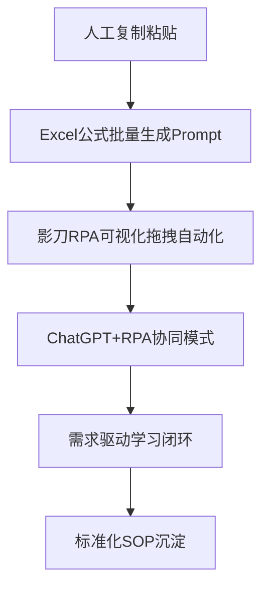
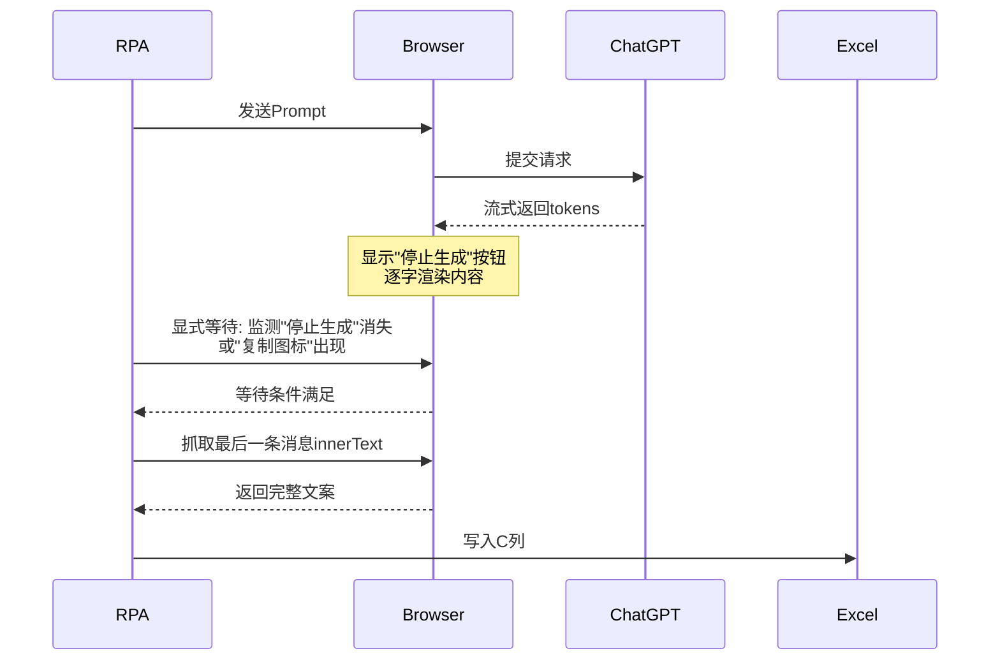
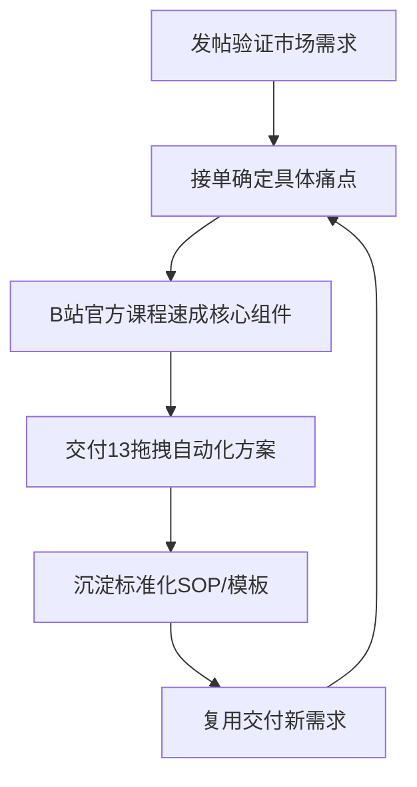
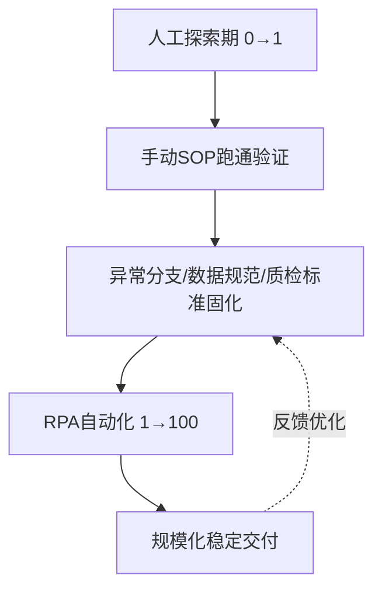
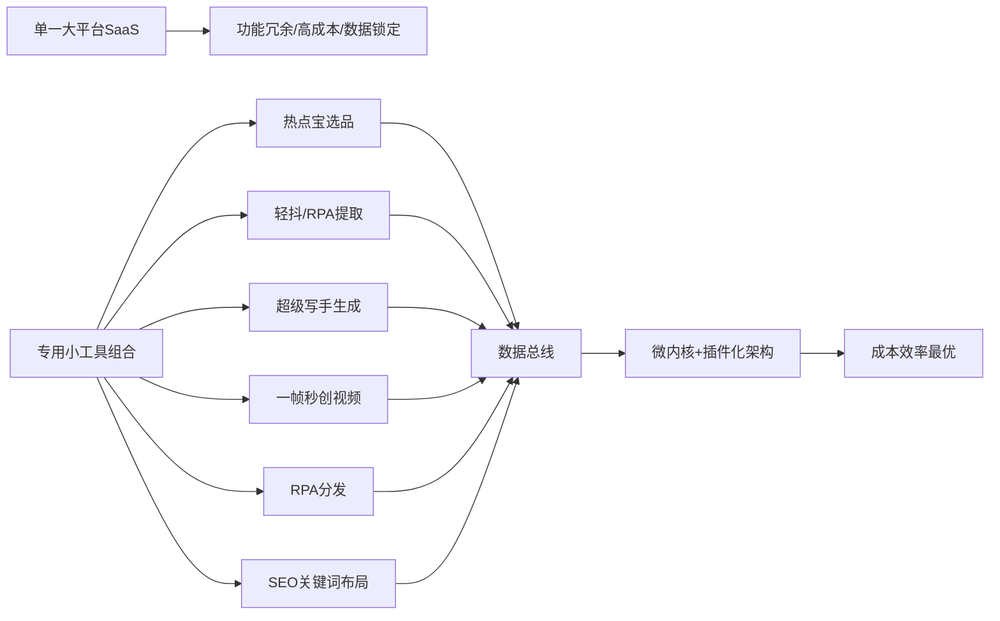

# 第 12 章 RPA + AI 协同自动化 —— 把重复劳动装进生产线
作者：龙哥

## 学习目标

- 理解ChatGPT+RPA协同自动化架构的核心价值：内容引擎+执行器模式
- 掌握提示词公式化/参数化方法：利用Excel CONCAT函数批量生成结构化Prompt
- 掌握可视化拖拽式RPA开发流程：影刀RPA关键节点编排实现13次拖拽构建全流程自动化
- 理解网页版ChatGPT流式输出等待机制：显式等待生成完成后再抓取最后一条回复
- 掌握需求驱动学习与交付闭环：先验证市场需求再接单驱动技术速成
- 理解手动跑通是自动化前提定律：SOP先行工具在后，自动化解决1到100而非0到1
- 掌握工具组合替代单一平台依赖策略：专用小工具拼装最佳实践链路
- 理解RPA自学门槛低见效快：官方分级教程支撑业务人员自主速成交付长尾自动化需求

## 12.1 生活类比

想象RPA+AI自动化是一个**智能工厂流水线**。在这个流水线上，**ChatGPT** 扮演 **首席设计师** 的角色：它只负责根据需求单（Prompt）创作设计稿（内容），完全不碰具体的生产制造环节；**RPA机器人** 则是 **自动化工人**：它们负责从原料仓库搬运原料（Excel数据）、将需求单送达设计师、耐心等待设计完成、取回成品、最后整理归档入库；**Excel表格** 就是 **原料仓库兼成品仓库**：A列存放原料（标题），B列存放加工单（Prompt），C列收纳成品（文案）；**流式输出等待** 对应 **质检工序**：必须等设计师画完最后一笔（生成结束），工人才能拿走成品，不然拿到的只是半成品；**手动跑通先行** 则是 **试产验证**：流水线正式开工前，必须先由师傅手工走一遍全流程确认无误，再交给机器人量产。就像工厂分离“研发设计”与“生产制造”一样，自动化的核心在于将“内容生产”与“流程执行”解耦，各司其职。

## 12.2 概念地图

RPA+AI协同自动化
├── 核心架构
│   ├── ChatGPT+RPA协同模式  —— P001 (来源：docs/202305/20230516_070.md、docs/202305/IZx7dx2CSo9x23xioUFcNaHcnRd.md、docs/202305/20230516_075.md)
│   │   ├── LLM内容生成引擎
│   │   ├── RPA执行编排器
│   │   └── 标准化接口解耦(剪贴板/文件/API)
│   └── 需求驱动学习闭环  —— P005 (来源：docs/202305/20230516_070.md、docs/202305/IZx7dx2CSo9x23xioUFcNaHcnRd.md)
│       ├── 发帖验证需求
│       ├── 接单驱动速成
│       └── 交付沉淀SOP
├── 关键技术
│   ├── 提示词公式化/参数化  —— P002 (来源：docs/202305/IZx7dx2CSo9x23xioUFcNaHcnRd.md、docs/202305/20230516_075.md)
│   │   ├── Excel CONCAT函数分离指令与变量
│   │   └── 批量化Prompt工程
│   ├── 可视化拖拽式RPA开发  —— P003 (来源：docs/202305/20230516_070.md、docs/202305/IZx7dx2CSo9x23xioUFcNaHcnRd.md)
│   │   ├── 影刀RPA组件化封装
│   │   ├── 13次拖拽全流程构建
│   │   └── 所见即所得可视化调试
│   └── 流式输出等待机制  —— P004 (来源：docs/202305/IZx7dx2CSo9x23xioUFcNaHcnRd.md、docs/202305/20230516_070.md)
│       ├── 显式等待生成完成
│       ├── 监测停止按钮消失/复制图标出现
│       └── 设置最大超时容错
├── 方法论原则
│   ├── 手动跑通是自动化前提  —— P006 (来源：docs/202305/20230516_075.md、docs/202305/IZx7dx2CSo9x23xioUFcNaHcnRd.md)
│   │   ├── SOP验证可行性(0→1)
│   │   └── RPA解决规模化(1→100)
│   └── 工具组合替代单一平台  —— P007 (来源：docs/202305/20230516_075.md)
│       ├── 热点宝选品+轻抖提取+超级写手生成
│       ├── 一帧秒创视频+RPA分发
│       └── 微内核+插件化数据总线
└── 典型应用场景
├── 文案批量生成自动化
├── 抖音带货全链路自动化
├── SEO关键词矩阵布局
└── 电商订单同步处理

## 12.3 ChatGPT+RPA协同自动化架构 —— 内容引擎+执行器模式

### 为什么需要这个概念？

你是否有过这样的经历：每天要把几十个标题从Excel复制到ChatGPT网页版，等待生成，再把生成的文案一条条复制回表格？这种“复制-粘贴-等待-复制-粘贴”的循环，不仅消耗大量时间，还极易出错。正如素材中圈友的痛点：“需求是因为平时比较忙，经常需要将文案标题重复粘贴到 ChatGPT 再将文案手动粘贴出来，比较浪费时间。”（《docs/202305/20230516_070.md》）这正是**ChatGPT+RPA协同模式**要解决的问题。大模型擅长内容生成（文案/代码/分析），RPA擅长数据搬运、跨应用交互、流程编排。两者通过标准化接口（剪贴板/文件/API）解耦，各司其职，解决长尾高频办公自动化需求。作者自用案例印证了这一路径：“Excel批量生成Prompt → RPA自动发送ChatGPT网页版 → 等待流式输出结束 → 抓取最后一条回复回填表格”（《docs/202305/IZx7dx2CSo9x23xioUFcNaHcnRd.md》）。抖音带货全链路更展示了该架构在复杂业务中的延展：“热点宝选品 → 轻抖/RPA提取文案 → 超级写手改写 → 一帧秒创视频 → RPA多平台分发 → SEO关键词布局，形成闭环标准化作业流程”（《docs/202305/20230516_075.md》）。

### 核心定义

**ChatGPT+RPA协同模式**（来源：《docs/202305/20230516_070.md》P001、《docs/202305/IZx7dx2CSo9x23xioUFcNaHcnRd.md》P001、《docs/202305/20230516_075.md》P001）

- **LLM内容生成引擎**：负责根据Prompt产出文案、代码、分析等非结构化内容
- **RPA执行编排器**：负责浏览器操作、Excel读写、循环遍历、异常捕获等确定性流程
- **标准化接口**：两者通过剪贴板、文件落地、API调用等方式传递数据，互不侵入内部逻辑

核心流程如下：

```
Excel数据准备与Prompt构建 
    ↓
影刀RPA流程编排（打开资源/循环/交互/等待/抓取/写回）
    ↓
执行监控与异常重试
```

这段伪代码展示了端到端自动化的三大阶段：数据层通过Excel CONCAT公式完成Prompt批量化准备；执行层由影刀RPA编排浏览器操作、循环遍历、交互等待、元素抓取、回写入库等原子动作；监控层负责异常捕获与重试，保证流程鲁棒性。

### 关键性质

这一模式具有三个核心性质。首先，**低代码/无代码**：影刀RPA仅需13次拖拽即可搭建完整流程，类似积木搭建，业务人员可自主交付。其次，**需求驱动学习**：先验证市场需求（发帖对接），再接单驱动技术速成，形成“需求-学习-交付”正向飞轮。最后，**手动跑通是自动化前提**：任何RPA项目成功前提是手动标准化流程（SOP）已跑通验证可行；自动化解决规模化（1到100）而非验证可行性（0到1）。

### 典型例子

**王小蒙案例**（来源：《docs/202305/20230516_070.md》P001）：基于圈友“文案标题批量生成”需求，用影刀RPA 13次拖拽实现全流程自动化，解决重复粘贴浪费时间痛点。  
**作者自用案例**（来源：《docs/202305/IZx7dx2CSo9x23xioUFcNaHcnRd.md》P001）：Excel批量生成Prompt → RPA自动发送ChatGPT网页版 → 等待流式输出结束 → 抓取最后一条回复回填表格。  
**抖音带货全链路**（来源：《docs/202305/20230516_075.md》P001）：热点宝选品 → 轻抖/RPA提取文案 → 超级写手改写 → 一帧秒创视频 → RPA多平台分发 → SEO关键词布局，形成闭环标准化作业流程。

### 边界条件

必须显式处理ChatGPT网页版流式输出的“等待输入完毕”节点，否则会抓取到不完整回复。仅适用于高频、重复、规则固定的长尾办公场景，非标准化、多变的业务难以直接套用。RPA脆弱性：页面元素变动（如输入框选择器失效）会导致流程中断，需维护成本。

### 方法演进图



---

## 12.4 提示词公式化/参数化 —— Excel批量生成结构化Prompt

### 为什么需要这个概念？

手动逐条编写Prompt效率极低，且难以保证结构一致性。当你需要为100个小红书笔记标题生成对应的爆款文案Prompt时，逐个手写不仅慢，还容易漏掉关键指令（如“带Emoji”“分段清晰”“前3秒钩子”）。素材中给出的解法是：“利用CONCAT函数将固定指令模板与变量数据分离，实现数据与指令解耦的批量化Prompt工程，配合RPA实现端到端自动化”（《docs/202305/IZx7dx2CSo9x23xioUFcNaHcnRd.md》P002）。

### 核心定义

**提示词公式化/参数化**（来源：《docs/202305/IZx7dx2CSo9x23xioUFcNaHcnRd.md》P002、《docs/202305/20230516_075.md》P002）

利用Excel CONCAT等公式，将固定指令模板与变量数据（标题/关键词等）分离，批量生成结构化Prompt。

**公式示例**：

```excel
=CONCAT("写一篇","“",A2,"”的文章，标题+正文")
```

这个公式展示了：将固定指令前缀`"写一篇“"`与A列变量标题`A2`拼接，再加上后缀`"的文章，标题+正文"`，生成完整的结构化Prompt到B列。该公式的作用是将“指令模板”与“业务数据”彻底解耦：修改模板只需改公式，全列自动更新；修改数据只需改A列，B列自动刷新，实现了Prompt的批量化、版本化管理。

### 逐式解释

第一步：`"写一篇“"` — 固定指令前缀，包含引号包裹的开始标记  
第二步：`A2` — 变量数据单元格，存放具体的标题（如"普通人副业月入5000的3个路径"）  
第三步：`"的文章，标题+正文"` — 固定指令后缀，补充输出格式要求  

**为什么可以这样变？**  
Excel的CONCAT函数支持多参数拼接，将字符串常量与单元格引用混合使用，实现“模板+数据”的解耦。修改模板只需改公式，全列自动更新；修改数据只需改A列，B列自动刷新。

### 关键性质

这一技术具有三个关键性质。首先，**结构固定、变量可控**：指令骨架统一，仅替换核心变量，保证输出格式稳定。其次，**易于版本迭代**：修改公式模板即可全量更新Prompt，无需逐条修改。最后，**可配合RPA实现端到端自动化**：Excel作为数据中台，RPA读取B列Prompt直接注入大模型。

### 典型例子

**文案批量生成场景**：A列填100个选题标题，B列公式拼接出100条标准化Prompt，RPA循环读取B列发送ChatGPT。  
**SEO文章矩阵**：核心词+长尾词组合生成Prompt矩阵，批量产出覆盖长尾关键词的文章。

### 边界条件

仅适用于指令结构高度固定、仅核心实体变化的场景；复杂多轮对话、需上下文记忆的任务不适用。Excel行数限制（1048576行）及公式计算性能为上限，超大规模需迁移至数据库+代码方案。Prompt模板设计质量决定上限，模板本身有缺陷会批量放大错误。

### 方法演进图


---

## 12.5 可视化拖拽式RPA开发 —— 13次拖拽构建文案全流程自动化

### 为什么需要这个概念？

传统自动化开发需编写代码（Python/Selenium等），门槛高、周期长、维护难。业务人员最懂痛点却不会代码，程序员不懂业务细节，沟通成本高。影刀RPA等可视化工具让“懂业务的人”直接用鼠标搭建流程，像搭积木一样完成自动化交付。素材中作者实测：“影刀rpa整体来说真心比较简单...过程中基本不用任何代码，有点类似小孩玩儿的编程机器人”（《docs/202305/IZx7dx2CSo9x23xioUFcNaHcnRd.md》P003）。

### 核心定义

**可视化拖拽式RPA开发**（来源：《docs/202305/20230516_070.md》P003、《docs/202305/IZx7dx2CSo9x23xioUFcNaHcnRd.md》P003）

影刀RPA提供的无代码/低代码开发模式，通过拖拽预置组件（获取网页、循环、输入、等待、抓取、写入）快速搭建自动化流程。

**核心节点编排**：

```
1. 获取已打开的ChatGPT网页句柄
2. 打开/激活Excel表格
3. 循环遍历行：
   3.1 读取B列Prompt
   3.2 聚焦ChatGPT输入框
   3.3 发送内容
   3.4 【核心】等待流式输出结束
   3.5 定位并抓取最后一条回复元素
   3.6 写回目标列/表
```

这段伪代码展示了影刀RPA构建文案自动化流程的标准节点序列：从获取浏览器句柄、激活数据源开始，进入逐行循环，在循环体内完成“读取-聚焦-发送-等待-抓取-写回”六步原子操作，其中第3.4步“等待流式输出结束”是保证回复完整性的关键节点。

### 关键性质

这一开发模式具有三个关键性质。首先，**所见即所得**：流程图即代码，业务逻辑可视化，调试时可单步运行观察每步执行结果。其次，**组件化封装**：浏览器操作、Excel读写、等待逻辑等均为预置组件，无需关心底层API。最后，**非侵入式**：模拟人工键鼠操作，无需目标系统提供API接口，适配性极强（网页版ChatGPT、各类ERP/CRM）。

### 典型例子

**文案自动化案例**：仅13次拖拽完成从零到跑通的完整流程开发，全程基本不用代码。  
**电商订单同步**：拖拽组件实现“后台下单 → 打印面单 → 回填单号”全流程，替代人工复制粘贴。

### 边界条件

依赖UI界面稳定性：目标网页/软件界面改版（如按钮位置、class名变动）会导致元素定位失效。并发性能弱：单机单线程模拟人工操作，吞吐量受限于操作耗时，高并发需分布式RPA或API方案。复杂逻辑表达受限：涉及复杂算法、数据结构、多线程同步等仍需写代码（影刀支持JS/VB脚本扩展）。

### 数据流图


---

## 12.6 网页版ChatGPT交互自动化难点：流式输出等待

### 为什么需要这个概念？

ChatGPT网页版采用流式逐字输出（SSE），RPA若不等待直接抓取，只能获取到生成初期的不完整片段。这是Web自动化对接大模型网页版的特有技术坑，必须在流程中显式设计“等待生成完成”逻辑。素材明确指出：“在chatgpt填写文案标题(过程中等待chatgpt输入完毕)、抓取最后一条回复”（《docs/202305/IZx7dx2CSo9x23xioUFcNaHcnRd.md》P004）。

### 核心定义

**流式输出等待机制**（来源：《docs/202305/IZx7dx2CSo9x23xioUFcNaHcnRd.md》P004、《docs/202305/20230516_070.md》P004）

针对ChatGPT网页版流式逐字输出特性，RPA流程必须包含“等待输入完毕”的显式等待节点，判断生成结束标志（如“停止生成”按钮消失、光标恢复、新消息元素出现），再抓取最后一条完整回复。

### 关键性质

这一机制具有三个关键性质。首先，**时序强依赖**：等待时间不固定（取决于输出长度、网络、模型负载），不能用固定睡眠，需显式等待元素状态变化。其次，**定位策略**：通常监测“发送按钮变为停止生成按钮”的状态切换，或监测最新消息元素的“复制/重新生成”图标出现。最后，**容错设计**：需设置最大超时时间（如120秒），超时则判定失败重试或记录日志人工介入。

### 典型例子

**影刀RPA实战**：在循环节点中插入“等待元素出现/消失”组件，目标选定“停止生成按钮消失”或“最后一条消息的复制图标出现”，通过后再执行“获取文本”。  
**按键精灵/Auto.js方案**：轮询检测网页DOM中是否存在“result-streaming”类名，消失则代表生成结束。

### 边界条件

仅适用于网页版自动化；调用官方API（流式/非流式）有标准的`finish_reason`或`done`字段，无此难点。网页版UI更新（如按钮样式、DOM结构变更）会导致等待条件失效，需同步维护选择器。极长输出（如万字长文）可能触发浏览器渲染卡顿，导致RPA判定超时误判。

### 时序图



### 方法演进图


---

## 12.7 需求驱动学习与交付闭环 —— 先验证需求再学技术

### 为什么需要这个概念？

传统学习路径“学工具→找需求”易导致学无所用、动力不足、技术过时。许多技术（如RPA）看似复杂，实则核心组件极少，真实需求倒逼“即学即用”效率最高。作者的实战路径：“4 月 12 号在生财朋友圈发了一条关于 rpa 的资源对接，主要是 2 个目的： 1、确定市场是不是有需求； 2、通过圈友的需求推动学习 rpa 解决具体问题。”（《docs/202305/20230516_070.md》P005）。

### 核心定义

**需求驱动学习闭环**（来源：《docs/202305/20230516_070.md》P005、《docs/202305/IZx7dx2CSo9x23xioUFcNaHcnRd.md》P005）

发帖对接验证市场需求 → 接单驱动技术速成（B站官方课程） → 交付方案 → 复用沉淀SOP，形成“需求-学习-交付”正向飞轮，极大降低技术学习机会成本。

### 关键性质

这一闭环具有三个关键性质。首先，**目标导向**：学习范围严格限定在“解决当前需求所需的最小知识集”上。其次，**正反馈驱动**：真实订单/需求提供强正向激励，克服学习初期挫折感。最后，**资产沉淀**：每次交付沉淀可复用的SOP/模板/代码片段，边际成本递减。

### 典型例子

**作者案例**：生财朋友圈发资源对接帖验证RPA需求 → 接单 → 3天速成影刀RPA（B站官方课） → 交付13拖拽方案 → 沉淀为标准化服务产品。  
**圈友反馈**：“我目前也在学习影刀”，验证该学习路径可复制。

### 边界条件

适用于“工具型、标准化程度高、见效快”的技能（RPA、剪辑、特定API调用）；底层算法、架构设计等深度技术不适用。需具备基本的“问题分解+工具选型”元能力，纯小白可能无法完成“需求→技术方案”的映射。商业伦理：不应承诺超出能力范围的交付，需在接单前快速评估技术可行性。

### 方法演进图



---

## 12.8 手动跑通是自动化前提定律 —— SOP先行，工具在后

### 为什么需要这个概念？

许多新手上来就买RPA工具、学代码，却不知业务流程本身未跑通、逻辑不清、异常未处理。自动化冻结的是流程逻辑，若手动流程有漏洞，自动化只会“更快地犯错、批量地报废”。素材强调：“手动流程梳理清楚了，再利用通过 RPA 文案生成+视频制作+视频上传全部都批量自动化了”“自动化，批量更多的是解决从 1 到 100 的问题而不是解决从 0 到 1 的问题”（《docs/202305/20230516_075.md》P006）。

### 核心定义

**手动跑通是自动化前提定律**（来源：《docs/202305/20230516_075.md》P006、《docs/202305/IZx7dx2CSo9x23xioUFcNaHcnRd.md》P006）

任何RPA项目成功前提：手动标准化流程（SOP）已跑通并验证可行。
- 手动阶段解决：业务逻辑梳理、异常分支处理、数据格式规范、质量验收标准
- 自动化阶段仅解决：重复执行的效率、稳定性、并发规模

### 关键性质

这一定律具有三个关键性质。首先，**SOP即需求文档**：手动跑通的标准化操作步骤，直接转化为RPA流程设计蓝图。其次，**边界清晰**：自动化不负责业务决策（如“这个选题行不行”），只负责确定性执行。最后，**成本守恒**：手动跑通成本（时间/精力）是自动化收益的前置投入，不可跳过。

### 典型例子

**文案自动化**：先人工完成“选题→大纲→正文→标题→发布”全流程，确认出稿质量稳定、出单转化，再逐步用RPA替代“发布/数据回收”等环节。  
**电商发货**：先人工完成“下单→打单→发货→回填”百单无误，确认供应链稳定、面单格式固定，再上RPA/ERP自动化。

### 边界条件

探索性业务（如新赛道选品测试）初期不适合上自动化，需先人工小批量跑通验证模型。非标准化、高决策依赖人工判断的环节（如客服沟通、创意策划）难以通过RPA自动化，需AI辅助决策而非RPA执行。团队协作流程中，若上下游接口人未就绪、规范未统一，强行自动化会放大混乱。

### 方法演进图



---

## 12.9 工具组合替代单一平台依赖 —— 最佳实践链路拼装

### 为什么需要这个概念？

单一大平台（如某全功能SaaS）往往功能冗余、定价高、定制难、数据锁定、单点故障风险大。专用小工具各司其职，组合成最优链路。素材给出的工具清单：“本文用到的工具清单：1.抖音热点宝 2.total control 3.轻抖 4.uibot 5.chatgpt 6.temperature 7.webchatgpt 8.一帧秒创”“算上时间成本，花钱是最便宜的方案”（《docs/202305/20230516_075.md》P007）。

### 核心定义

**工具组合替代单一平台**（来源：《docs/202305/20230516_075.md》P007）

组合专用小工具构建最佳实践链路：热点宝选品 → 轻抖/RPA提取文案 → ChatGPT超级写手改写 → 一帧秒创/剪映生成视频 → RPA多平台分发 → SEO关键词布局。核心原则：成本效率优于依赖单一大平台或全人工。

### 关键性质

这一策略具有三个关键性质。首先，**微内核+插件化架构思维**：Excel/飞书表格作为数据总线，各工具通过标准格式（CSV/JSON/API）对接。其次，**单点最优**：每个环节选用该细分领域性价比最高的工具，而非求全平台的平庸功能。最后，**数据主权在己**：核心数据（选品库、文案库、账号池）沉淀在自有表格/数据库，不锁定在特定工具云端。

### 典型例子

**抖音带货全链路**：热点宝(选品) + 轻抖(提取) + 超级写手(改写) + 一帧秒创(视频) + RPA(分发) + 关键词工具(SEO)。

**成本对比**：组合工具年成本约几千元（含RPA授权），全功能SaaS年费常超万元且难定制。

### 边界条件

集成维护成本：工具间对接靠人工导表/RPA模拟操作，若工具端升级导致接口变更，需及时适配。适用于“标准化流程明确、各环节工具成熟”的场景；早期探索期、流程频繁变动时，全人工或单平台更灵活。需具备基本的工具选型评估能力（功能覆盖、稳定性、导出格式、售后响应）。

### 方法演进图



---

## 12.10 多源对照

### 共识

三份素材（P001/P002/P003）在以下核心观点上达成一致：

1. **ChatGPT+RPA协同是低成本自动化最优范式**：LLM负责生成，RPA负责执行，两者通过标准化接口解耦
2. **手动跑通是前提**：SOP验证可行性(0→1)，RPA解决规模化(1→100)
3. **可视化RPA降低门槛**：影刀RPA等工具让业务人员可自主交付，无需专业开发
4. **需求驱动学习高效**：真实订单倒逼技能速成，沉淀可复用资产

### 分歧

以下表格展示了三份素材在核心维度上的分歧对比。表格来源：综合《docs/202305/20230516_070.md》（P001/王小蒙案例）、《docs/202305/20230516_075.md》（P002/抖音带货全链路）、《docs/202305/IZx7dx2CSo9x23xioUFcNaHcnRd.md》（P003/文案自动化实战）三份素材的核心维度差异。

| 维度 | P001 (王小蒙案例) | P002 (抖音带货全链路) | P003 (文案自动化实战) |
|------|-------------------|------------------------|----------------------|
| **核心场景** | 通用文案批量生成 | 抖音带货内容全链路 | 单一ChatGPT网页版交互 |
| **RPA工具** | 影刀RPA | UiBot + 影刀 | 影刀RPA |
| **Prompt管理** | 简要提及Excel公式 | 结构化卖点迁移Prompt + Temperature策略 | CONCAT公式批量生成 |
| **流式输出处理** | 隐含在"等待输入完毕" | 未详细展开 | 显式强调为核心技术难点 |
| **学习路径** | 需求驱动+B站官方课 | 隐含在实战积累中 | 需求驱动+官方分级教程 |

---

## 12.11 设计中的取舍

在实际落地中，我们面临多个关键的技术选型决策，每个决策都伴随着明确的得与失。

**为什么不用Python+Selenium/Playwright而是影刀RPA？** Python方案虽然灵活、并发强，但开发周期长（天级）、维护需专业开发、业务人员无法自主迭代。影刀RPA“13次拖拽”即可交付，业务人员自己能改、能调、能扩展，对于“长尾、高频、规则固定”的办公自动化，交付速度与维护成本的综合ROI远优于代码方案。这一选择意味着我们获得了分钟级交付能力和业务自主迭代权，但失去了高并发性能，且面临UI变动导致选择器失效的维护风险，同时被锁定在特定RPA平台生态中。

**为什么不用官方API而是网页版自动化？** 官方API有调用频率限制、需付费、不支持某些网页版特有功能（如联网搜索、插件、特定模型版本）。网页版自动化虽脆弱（UI变动易坏），但零额度限制、支持完整网页功能、无需审核额度，对于中小规模、非高并发场景性价比最高。这一选择让我们获得了零门槛接入和完整功能覆盖，但承担了UI脆弱性风险和无法规模化并发的天花板。

**RPA自学门槛低见效快这一特性如何影响团队技能建设？** 影刀RPA等工具提供官方分级教程，业务人员可自学速成交付长尾自动化需求，这意味着企业无需招聘专业RPA开发工程师即可消化大量长尾自动化需求，但也要求业务人员具备基本的流程拆解与工具选型元能力，纯小白可能无法完成“需求→技术方案”的映射。

---

## 12.12 动手练习

### 练习 1：设计一个Excel提示词批量生成器

**场景**：需要为100个小红书笔记标题生成对应的爆款文案Prompt

1. 在Excel A列填入100个标题(如：'普通人副业月入5000的3个路径')
2. 设计B列公式，将固定指令模板与A列标题拼接
   提示词模板参考：'请以小红书爆款风格，针对标题「{标题}」写一篇笔记，要求：前3秒钩子+干货步骤+引导互动，带Emoji、分段清晰'
3. 下拉填充B列，检查生成的Prompt结构是否统一

**回答问题**：
- 如果标题中包含引号，CONCAT公式会如何处理？如何规避？
- 如何将生成的B列Prompt批量导入RPA流程？
- 当Prompt模板需迭代升级时，如何实现全量更新而不改动数据源？

### 练习 2：影刀RPA流程设计：网页版ChatGPT自动化交互

**任务**：设计影刀RPA流程节点，实现‘读取Excel B列Prompt → 发送ChatGPT网页版 → 等待生成完成 → 抓取回复 → 写回C列’

请按顺序列出关键组件及配置要点：
1. 获取网页句柄：目标URL、浏览器类型
2. 打开/激活Excel：文件路径、工作表名
3. 循环遍历：起始行、结束行、步长
4. 循环体内关键动作节点（按执行顺序）：
   - 读取单元格：B列Prompt
   - 聚焦输入框：ChatGPT网页版输入框选择器
   - 发送内容：模拟键盘输入/粘贴
   - 【核心难点】等待生成完成：判定条件选择器(如'停止生成按钮消失'或'最后一条消息的复制图标出现')、最大超时时间
   - 抓取文本：最后一条回复元素选择器、获取属性(innerText)
   - 写入单元格：C列、当前行

**回答问题**：
- 为什么不能使用'固定等待N秒'替代'显式等待元素状态'？
- 如果ChatGPT网页版更新UI导致选择器失效，如何快速定位并修复？
- 如何处理生成超时、网络异常、内容违规拦截等异常分支？

### 练习 3：业务流程自动化可行性评估清单

某团队想用RPA自动化'每日从竞品👸号采集爆款标题 → ChatGPT改写 → 发布到自有矩阵号'的流程

请基于'手动跑通是自动化前提'定律，设计评估清单判断该业务是否适合上RPA：

1. 手动流程标准化度检查：
   - 采集规则是否固定(关键词/账号/时间范围)？
   - 改写Prompt模板是否稳定？输出格式是否可校验？
   - 发布流程(登录/选封面/填标签/定时)是否完全标准化？

2. 异常处理覆盖度：
   - 采集反爬/IP封禁如何处理？
   - ChatGPT输出不合格(字数/违规/风格偏差)如何重试？
   - 发布审核不通过/限流如何兜底？

3. ROI测算：
   - 手动单次耗时 vs RPA开发维护成本(含选择器维护)
   - 日处理量级是否达到'1到100'规模化阈值？

4. 工具选型建议：
   - 采集环节：RPA模拟 vs 官方API vs 第三方采集工具
   - 改写环节：网页版ChatGPT+RPA vs 官方API调用
   - 发布环节：RPA模拟 vs 官方开放平台接口

**回答问题**：
- 哪个环节最不适合用RPA？为什么？
- 若手动流程尚未跑通(如改写质量不稳定)，强行上RPA会带来什么后果？
- 如何设计'最小可行性自动化'(MVP)分阶段落地？

---

## 12.13 本章小结

这一章中我们学习了如何将RPA与AI协同，把重复劳动装进生产线。首先我们理解了ChatGPT+RPA协同模式的核心架构：LLM作为内容引擎，RPA作为执行器，通过标准化接口解耦协作。其次我们掌握了提示词公式化/参数化方法，利用Excel CONCAT函数实现数据与指令分离的批量化Prompt工程。接着我们学习了可视化拖拽式RPA开发流程，仅需13次拖拽即可构建完整自动化流程。然后我们深入剖析了网页版ChatGPT流式输出等待机制这一关键技术难点，理解了显式等待元素状态变化的必要性。随后我们建立了需求驱动学习与交付闭环，通过真实需求倒逼技能速成与资产沉淀。再次我们确立了手动跑通是自动化前提这一铁律，区分了验证可行性(0→1)与规模化复制(1→100)的不同阶段目标。最后我们掌握了工具组合替代单一平台依赖的策略，用专用小工具拼装最佳实践链路。同时我们认识到RPA自学门槛低见效快，官方分级教程支撑业务人员自主速成交付长尾自动化需求。

本章我们一起学习了以下概念：

以下表格汇总了本章核心概念及其解释。表格来源：基于本章12.3-12.9节核心概念定义汇总，旨在提供快速查阅索引。

| 概念 | 解释 |
|------|------|
| ChatGPT+RPA协同模式 | LLM负责内容生成，RPA负责流程执行，标准化接口解耦协作 |
| 提示词公式化/参数化 | Excel CONCAT函数分离固定指令模板与变量数据，实现Prompt批量化管理 |
| 可视化拖拽式RPA开发 | 影刀RPA组件化封装，13次拖拽构建全流程，所见即所得降低门槛 |
| 流式输出等待机制 | 针对网页版ChatGPT逐字输出，显式等待生成完成标志(停止按钮消失/复制图标出现)再抓取 |
| 需求驱动学习闭环 | 发帖验证需求→接单驱动速成→交付沉淀SOP，形成正向飞轮降低学习成本 |
| 手动跑通是自动化前提 | SOP验证业务可行性(0→1)，RPA仅解决规模化复制(1→100)，不可本末倒置 |
| 工具组合替代单一平台 | 专用小工具拼装最优链路(选品/提取/生成/视频/分发)，成本效率优于大平台或全人工 |
| RPA自学门槛低见效快 | 影刀RPA等工具提供官方分级教程，业务人员可自学速成交付长尾自动化需求 |

下一章中，我们将学习 Stable Diffusion 实战体系 —— 从零部署到工业化量产。


