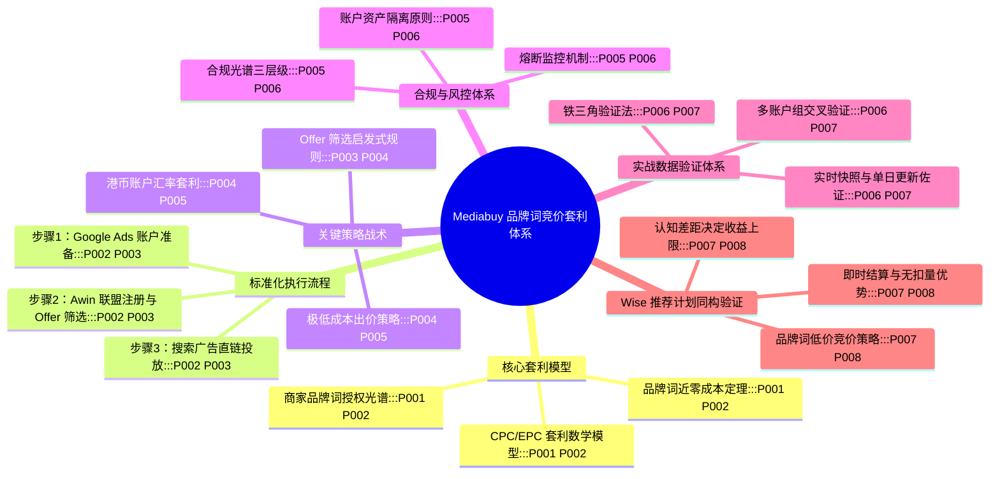
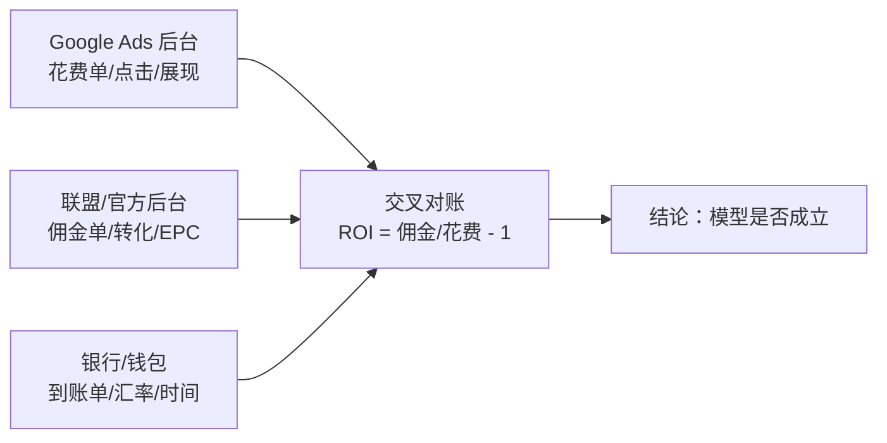
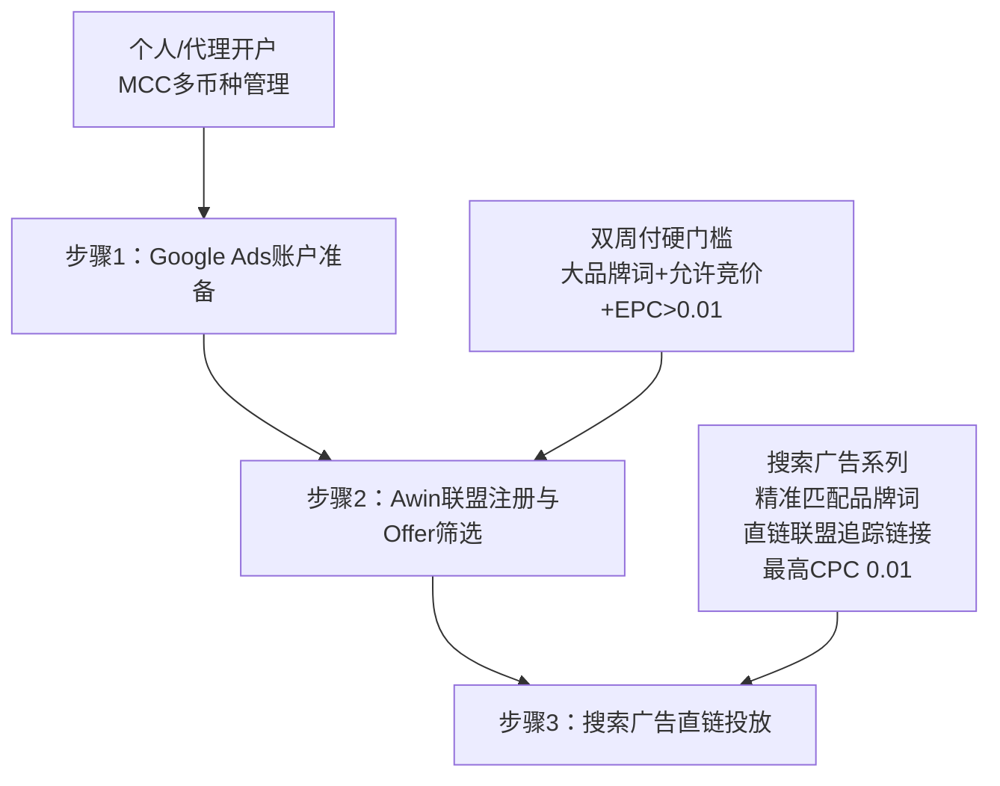
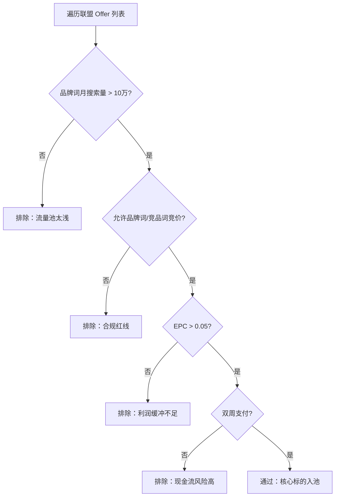
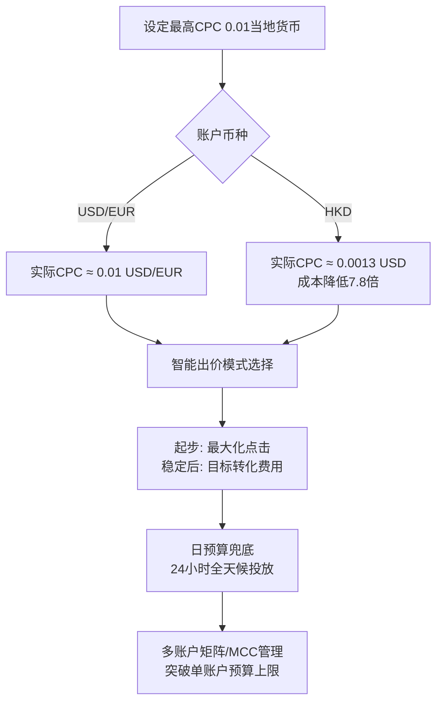
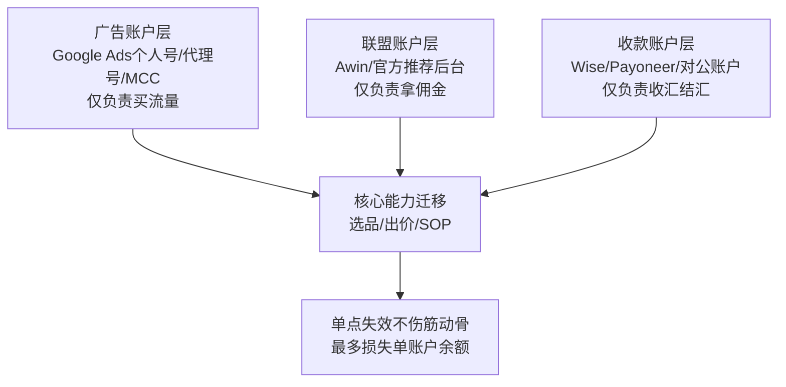

# 第 68 章 Mediabuy 品牌词竞价 —— 用近零 CPC 撬动联盟佣金杠杆

## 学习目标

- 理解 Mediabuy 品牌词竞价的核心套利逻辑：利用品牌词近零 CPC 与联盟 EPC 的差价获利
- 掌握 Google Ads 账户准备、Awin 联盟选品、直链投放的三步标准化执行流程
- 掌握 Offer 筛选的四大硬指标：大体量品牌词、允许竞价、EPC>0.01、双周支付
- 掌握极低成本出价策略：最高 CPC 设 0.01 当地货币、港币账户进一步降本 7 倍
- 理解合规性边界与风控体系：品牌词授权光谱、账户资产隔离、熔断机制
- 建立实战数据验证思维：铁三角验证法（联盟后台+广告后台+到账单）、多账户多周期交叉验证
- 能独立跑通 Mediabuy 品牌词竞价的最小商业闭环，并具备规模化复制的判断力
- 掌握 Wise 推荐计划同构案例：品牌词 CPC £0.01-0.02、单笔佣金£50、日佣破万镑的实操逻辑
- 理解广告联盟长账期与扣量风险，官方推荐计划即时结算、无扣量的优势
- 建立认知差距决定收益上限的思维模型：敢于在确定性高的模型上重注并执行

## 68.1 生活类比

想象 Mediabuy 品牌词竞价是**在品牌官方旗舰店门口发传单赚佣金**。品牌词就是想进旗舰店买货的精准顾客搜索入口；Google Ads 竞价就是你在门口支个小摊位，成本极低，因为品牌方默许或无人竞争；联盟追踪链接就是你手里的专属推荐码或二维码；EPC 减去 CPC 就是顾客扫码买货你赚的佣金减去摊位费，正向差价即利润；Awin 双周付就是结账快、信誉好、不赖账的财务公司。就像守在品牌流量必经之路，用近乎零成本的摊位，把官方原本免费的自然流量“合法截胡”变现。Wise 案例如同在银行官方 App 门口推荐开户：官方自带推荐奖励（£50/单），无需走联盟审核；品牌词竞价成本 £0.01-0.02，转化率极高；广告成本可忽略不计，日入万镑靠执行力与认知差距。

> **章节衔接说明**：第 67 章介绍的“跨境私域代购模式”依赖 Facebook/Instagram 社交兴趣流量与 INS 内容建设，转化路径为“广告→私域聊单→收款发货”；本章介绍的“Mediabuy 品牌词竞价”则依赖 Google/Bing 搜索意图流量与 Direct Linking 直链投放，转化路径为“搜索广告→联盟链接→自动结算佣金”。两者**流量获取逻辑截然不同**（社交兴趣定向 vs 搜索意图精准捕捉）、**内容必要性相反**（INS 需 40+ 篇内容建信任 vs 品牌词竞价无需建站无需落地页）、**风控体系各异**（FB 企业户授权抗封 vs Google/联盟/收款三分离隔离）。读者可根据自身资源禀赋择一深耕，或组合运行：私域模式沉淀长期客户资产，品牌词竞价跑确定性现金流。

## 68.2 概念地图

## 68.3 Mediabuy品牌词竞价 —— 用近零CPC撬动联盟佣金杠杆

### 68.3.1 为什么需要这个概念？

传统联盟营销依赖 SEO 或内容自然流量，周期长、不稳定、难放大；广告联盟账期长、存在扣量风险、佣金相对较低。我们需要一种可控、即时结算、高 ROI 的付费流量变现闭环。素材作者 M0hMdjWj3o8WtNxZdv4cLnfenIh 与 静水流深 分别从广告联盟与官方推荐计划两个切入点，验证了同一套底层逻辑：**利用 Google Ads 竞价品牌词，以近零成本获取高意向流量，直接变现为佣金差价**。

> "Mediabuy Brand Bid: 通俗的理解就是付费流量购买，通过付费的方式购买流量来推广商家的链接，赚取佣金和流量费用支出中的利差。"
> 
> ——【P001】《Mediabuy Brand Bid 单人出海赚美元项目》（作者：M0hMdjWj3o8WtNxZdv4cLnfenIh，文件：docs/202305/M0hMdjWj3o8WtNxZdv4cLnfenIh.md）

> "个人用户推荐可以获得 50 英镑的佣金，这样我们就可以用 Mediabuy 的方式，谷歌或者 Bing 购买相关关键词，赚取利差。"
> 
> ——【P002】《通过 Wise 的推荐项目，每天躺赚一万英镑+》（作者：静水流深，文件：docs/202305/20230516_050.md）

### 68.3.2 核心定义与套利模型

**Mediabuy Brand Bid（媒体购买品牌词竞价）定义**（来源：【P001】《Mediabuy Brand Bid 单人出海赚美元项目》，作者：M0hMdjWj3o8WtNxZdv4cLnfenIh，文件：docs/202305/M0hMdjWj3o8WtNxZdv4cLnfenIh.md）

$$
\text{利润} = (\text{EPC} - \text{CPC}) \times \text{点击量}
$$

其中：
- **CPC (Cost Per Click)**：广告点击成本，即你在 Google Ads 里每次点击付出的真金白银；
- **EPC (Earnings Per Click)**：每次点击收益，即联盟后台或官方推荐计划里，平均每次点击能带来的佣金收入；
- **品牌词**：广告主自身的品牌名称、商标词（如 "Wise"、"TransferWise"、"Nike" 等）。

这个公式展示了项目的**唯一盈利条件**：**CPC < EPC**。只要单次点击成本低于单次点击收益，规模放大即为纯利。该公式是整个套利模型的数学基石，EPC 由商家转化率与佣金决定，CPC 由 Google 广告拍卖机制决定，两者相互独立，形成套利空间。

**品牌词近零成本定理**（来源：【P001】《Mediabuy Brand Bid 单人出海赚美元项目》，作者：M0hMdjWj3o8WtNxZdv4cLnfenIh，文件：docs/202305/M0hMdjWj3o8WtNxZdv4cLnfenIh.md）

Google Ads 广告排序机制决定了实际点击价格：

$$
\text{Ad Rank} = \text{Max CPC} \times \text{Quality Score}
$$
$$
\text{Actual CPC} = \frac{\text{Next Ad Rank}}{\text{Your Quality Score}} + \delta
$$

其中 $\delta$ 为 Google 允许的最小计费增量（通常为 0.01 当地货币）。品牌词因满足两个极致条件，导致实际 CPC 无限接近于零：
1. **质量得分满分/极高**：你的广告关键词、广告文案、落地页（联盟链接最终指向官网）与用户搜索意图完美匹配，Google 给予最高质量分（QS ≈ 10）；
2. **无竞争护城河**：商家通常不竞价自己品牌词（自然流量免费），竞争对手受合规/商标政策限制不敢竞，导致下一名广告排序值 Next Ad Rank ≈ 0。

代入公式可得：

$$
\text{Actual CPC} \approx \frac{0}{10} + 0.01 = 0.01 \text{ (当地货币最小单位)}
$$

> "因为你是出价品牌词，品牌词实际谷歌出价是无限接近于零，也是免费，所以只要你设置没问题，单价到 0.01 完全没有问题。"
> 
> ——【P001】《Mediabuy Brand Bid 单人出海赚美元项目》（作者：M0hMdjWj3o8WtNxZdv4cLnfenIh，文件：docs/202305/M0hMdjWj3o8WtNxZdv4cLnfenIh.md）

此推导说明了为何品牌词竞价能将实际点击成本压至理论最低值：极高的质量得分分母与近乎为零的竞争者排序值分子，使得实际 CPC 仅取决于 Google 的最小计费单位。

**商家品牌词授权光谱**（来源：【P001】《Mediabuy Brand Bid 单人出海赚美元项目》，作者：M0hMdjWj3o8WtNxZdv4cLnfenIh，文件：docs/202305/M0hMdjWj3o8WtNxZdv4cLnfenIh.md）

并非所有商家禁止品牌词竞价，存在三层合规光谱：
- **显性允许（白名单）**：联盟条款/AM 口头/邮件明确许可竞价品牌词；
- **默许（灰名单）**：条款未写、AM 不回复、但长期运行未被投诉；
- **仅允许竞品词（红线内）**：禁止竞价自有品牌词，但明确允许竞价竞争对手品牌词。

> "国外有很多商家，允许你出价他们的品牌词，而且一定可以出价他们竞争对手的品牌词。此方法不是违规的吗？这句话对，也不对。"
> 
> ——【P001】《Mediabuy Brand Bid 单人出海赚美元项目》（作者：M0hMdjWj3o8WtNxZdv4cLnfenIh，文件：docs/202305/M0hMdjWj3o8WtNxZdv4cLnfenIh.md）

项目可行性建立在**“总能找到允许竞价的大品牌 Offer”**这一市场现实之上，而非钻单一商家的空子。

### 68.3.3 多源对照

#### 共识

两份素材均确认了品牌词竞价的核心套利逻辑：利用极低 CPC（约 0.01 当地货币）与高 EPC（联盟佣金或官方推荐奖励）之间的差价获利。两者都指出品牌词因高相关性、无竞争，质量得分极高，实际 CPC 可压至最小计费单位。两者都验证了该模式的高 ROI（359%-496% 或日入万镑），并强调合规光谱的存在——并非所有商家禁止，总能找到允许竞价的大品牌。两者都主张 Direct Linking 直链投放，无需建站，降低技术门槛与审核风险。

#### 分歧

| 维度 | 【P001】Mediabuy Brand Bid | 【P002】Wise 推荐计划 |
|------|----------------------------|------------------------|
| **变现对象** | Awin 等广告联盟 Offer（CPA/EPC 模式） | Wise 官方自带推荐计划（固定 £50/单） |
| **结算周期** | 双周支付，存在账期风险 | **即时结算**，3 单即可提现，无账期 |
| **扣量风险** | 存在，联盟/广告主可能扣量 | **无扣量**，官方直接打款，信誉极高 |
| **佣金稳定性** | EPC 波动，依赖 Offer 转化表现 | **固定 £50/单**，确定性极强 |
| **操作门槛** | 需申请联盟、申请 Offer、通过审核 | 仅需注册 Wise 获取推荐链接，无审核门槛 |
| **放量上限** | 受限于 Offer 上限、联盟预算、合规收紧 | 单日可破万镑，受限于品牌词搜索量上限 |
| **核心主张差异** | 强调“十余年存续、单人年入百万轻松”的长期可行性 | 强调“认知差距决定收益上限”、执行力与敢于重注 |

素材 【P001】 侧重于广告联盟生态下的标准化可复制模型，提供了三组完整账户的铁三角验证数据；素材 【P002】 则发现了同构但更优的官方推荐计划切入点，指出联盟长账期、扣量、佣金较低的痛点，主张直接对接高信誉广告主自带推荐计划，实现降维打击。

### 68.3.4 实战数据验证：三组账户的铁三角证据

素材提供了三组独立账户的完整闭环数据，完成了**联盟后台佣金单 + Google Ads 后台花费单 + 汇率换算透明**的铁三角验证。以下表格汇总了三组账户的核心盈利指标（来源：【P001】《Mediabuy Brand Bid 单人出海赚美元项目》，作者：M0hMdjWj3o8WtNxZdv4cLnfenIh，文件：docs/202305/M0hMdjWj3o8WtNxZdv4cLnfenIh.md）：

| 账户组 | 佣金收入 (多币种汇总) | 美元折算佣金 | 广告花费 (USD) | 净利润 (USD) | ROI |
|--------|----------------------|--------------|----------------|--------------|-----|
| 组1    | 3403£ + 835€ + 369$  | $5,715       | $1,220         | $4,495       | 368% |
| 组2    | 4913£ + 685€ + 67$   | $7,218       | $1,210         | $6,008       | 496% |
| 组3    | 3031£ + 37$          | $3,988       | $867           | $3,121       | 359% |

这三组数据的核心启示：
- **ROI 极高且稳定**：均在 350%~500% 区间，方差极小，证明是确定性模型而非运气；
- **多币种真实结算**：英镑/欧元/美元混合，真实还原跨境收款场景，拒绝单一货币虚高业绩；
- **实时快照佐证**：素材附带 Google Ads 后台实时数据截图，显示当日花费与转化价值对比，印证“自动化运行”而非人工干预的一次性爆发；
- **单日更新**：作者于 2023 年 4 月 4 日更新单日数据，单账户当日收入远超成本，再次强调 CPC 0.01 条件下“任何产品都会赚钱”的边际安全性。

**方法演进图：铁三角验证数据流向**

上图展示了铁三角验证的数据流向：三大数据源独立产出，汇聚至交叉对账节点，输出模型验证结论。这一机制确保了单一数据源造假或错误无法通过验证。

### 68.3.5 Wise 推荐计划同构验证：官方推荐计划的降维打击

静水流深在《通过 Wise 的推荐项目，每天躺赚一万英镑+》中披露了一个**同构但更优**的案例：**Wise 官方自带推荐计划**（来源：【P002】docs/202305/20230516_050.md）。

| 维度 | 广告联盟 | Wise 官方推荐计划 |
|------|----------|-------------------|
| 佣金模式 | CPA/EPC 波动 | 固定 £50/单 |
| 结算周期 | 月付/双周付/长账期 | **即时结算**，3单即可提现 |
| 扣量风险 | 存在 | **无扣量**，官方直接打款 |
| 转化追踪 | 联盟像素/Postback | 官方后台实时可见 |
| 品牌词 CPC | $0.01-0.02 | £0.01-0.02 |
| 单日佣金上限 | 受限于 Offer 上限 | **单日破万英镑** |

> "其实一开始只需要出价 0.01 即可，后面因为我要放天量，成本上升到了 0.02。广告成本在这个项目里完全不决定你是否赚钱，因为可以忽略不计。"
> 
> ——【P002】《通过 Wise 的推荐项目，每天躺赚一万英镑+》（作者：静水流深，文件：docs/202305/20230516_050.md）

> "因为 Wise 确实信誉好，我每天点 50 英镑点得手都累了，因为只要三个用户满足条件，这边立即显示可以取现 50 英镑。"
> 
> ——【P002】《通过 Wise 的推荐项目，每天躺赚一万英镑+》（作者：静水流深，文件：docs/202305/20230516_050.md）

**核心差异**：联盟是“帮商家卖货赚佣金”，官方推荐计划是“帮平台获客赚奖励”。后者链路更短、信任度更高、结算更快、无扣量。**凡是具备“高信誉+高额固定推荐奖励+允许品牌词竞价”三要素的平台，均可复制此模式。**

### 68.3.6 认知差距决定收益上限

> "这个案例其实大多数人都知道，没人敢像我这样玩，这就是认知的差距。认知就是你可以预判结果，而结果几乎跟你预判一样。"
> 
> ——【P002】《通过 Wise 的推荐项目，每天躺赚一万英镑+》（作者：静水流深，文件：docs/202305/20230516_050.md）

作者指出：**技术门槛不高（开户、选品、出价），真正的门槛是“敢不敢在确定性模型上重注并持续执行”**。大多数人止步于“我知道”，少数人跨越到“我做且做成了”，这中间隔着**认知差距**。

---

## 68.4 三步标准化执行流程 —— 从开户到直链投放的最小闭环

### 68.4.1 为什么需要这个概念？

降低技术门槛：无需建站、搭建落地页、配置复杂追踪；规避审核风险：直链联盟链接减少 Google Ads 拒登概率；可复制性强：标准化 SOP 让新手能快速跑通 0-1。

> **执行范式对比**：第 67 章采用“Day 1-7 时间轴 SOP”（私域模式需内容预热、养号、信任建设）；本章采用“步骤 1-3 逻辑轴 SOP”（搜索竞价模式依赖基建就绪即可开跑）。两者本质差异在于：**私域模式的时间成本在“信任建设”，搜索竞价模式的时间成本在“账户基建与合规审核”**。统一的标准化执行范式定义为：**最小可执行单元（MVE）= 必需基建动作集合 + 核心变现动作 + 验证反馈回路**。

### 68.4.2 标准化三步走

> "1，准备一个 Google Ads 的帐号，个人开户或者代理商开户均可。2，注册一个广告联盟的帐号，找到有大体量品牌词的广告。3，申请到广告利用 Google Ads，出价他们的品牌词，但是广告链接是你自己的即可。"
> 
> ——【P001】《Mediabuy Brand Bid 单人出海赚美元项目》（作者：M0hMdjWj3o8WtNxZdv4cLnfenIh，文件：docs/202305/M0hMdjWj3o8WtNxZdv4cLnfenIh.md）

**步骤 1：Google Ads 账户准备**
- 个人开户：自备资料、信用卡、网络环境，适合测试；
- 代理商开户/MCC 管理：稳定性高、额度大、支持多币种（港币/美元/欧元），适合规模化；
- **核心指标**：账户质量得分、历史消费记录、通过审核率。

**步骤 2：Awin 联盟注册与 Offer 筛选**
- 注册 Awin (Affiliate Window)：**双周支付**是硬门槛，现金流安全第一；
- 筛选标准（详见 68.5 节）：大体量品牌词 + 允许竞价 + EPC > $0.01 + 双周付；
- 申请通过：新号通过率低，需包装资质（如已有流量网站/社媒账号）或找渠道。

**步骤 3：搜索广告直链投放**
- 创建**搜索广告系列**，目标选“销售”或“潜在客户”；
- 关键词：精准匹配品牌词（`[Brand Name]`）+ 竞品词（`[Competitor Brand]`）；
- **最终 URL 直填联盟追踪链接**，无需自建落地页；
- 出价策略：手动 CPC / 最大化点击，**最高 CPC 设 0.01 当地货币**；
- 预算：日预算兜底，防止异常流量烧光本金。

> "注册 Wise 获取推荐链接（隐含步骤），谷歌或者 Bing 购买相关关键词，出价 0.01 即可... 立即显示可以取现 50 英镑。"
> 
> ——【P002】《通过 Wise 的推荐项目，每天躺赚一万英镑+》（作者：静水流深，文件：docs/202305/20230516_050.md）

**方法演进图：三步标准化执行流程**

上图展示了从账户准备到直链投放的标准化三步流程，每一步的关键动作与决策点均已标注。

### 68.4.3 关键性质

**Direct Linking 策略**：广告落地页直接用联盟链接，省去建站成本与维护，也规避了 Google 对“桥页/低质落地页”的审核；**账户体系分离**：个人号/代理号、MCC 管理、多币种账户（港币/美元/欧元）物理隔离，单点失效不伤筋动骨；**数据依赖**：直链模式无法植入自有追踪代码，数据分析完全依赖联盟后台与 Google Ads 转化列。

> **内容/落地页必要性边界界定**：第 67 章私域模式**必须**建设 INS 内容（4 天 40+ 篇）建立信任前置，因为私域聊单依赖人设与内容转化；本章搜索竞价模式**无需**建站落地页，因为品牌词流量意图极强、官网信任度最高、Direct Linking 直达官网转化率反而更高。两者模式不同，**内容建设的必要性取决于“流量信任缺口大小”**：社交兴趣流量信任缺口大→需内容填补；搜索品牌词流量信任缺口小（用户主动搜索品牌）→无需内容。

---

## 68.5 Offer 筛选启发式规则 —— 只捡确定性高的钱

### 68.5.1 为什么需要这个概念？

联盟 Offer 数以万计，盲目测试极其浪费时间和广告费；品牌词竞价合规性差异大，选错 Offer 直接导致封号或佣金不结算。需要一套快速筛选高胜率标的的标准化清单。

### 68.5.2 四大硬指标

以下表格汇总了 Offer 筛选的四大硬指标及其验证方法（来源：【P001】《Mediabuy Brand Bid 单人出海赚美元项目》，作者：M0hMdjWj3o8WtNxZdv4cLnfenIh，文件：docs/202305/M0hMdjWj3o8WtNxZdv4cLnfenIh.md；《通过 Wise 的推荐项目，每天躺赚一万英镑+》，作者：静水流深，文件：docs/202305/20230516_050.md）：

| 硬指标 | 定义 | 验证方法 | 权重 |
|--------|------|----------|------|
| **大体量品牌词** | 月搜索量大、品牌知名度高、天然流量池深 | Google Keyword Planner / Ahrefs / Semrush 查搜索量 | ★★★★★ |
| **允许竞价品牌词/竞品词** | 读 TOS 条款、咨询 AM、小额测试验证 | 邮件书面确认 > AM 口头 > 条款默许 > 仅允许竞品词 | ★★★★★ |
| **EPC 显著 > $0.01** | 留足利润缓冲，规避 CPC 波动/汇率波动亏损 | 联盟后台 30/90 天 EPC 数据，要求 ≥ $0.05 更稳 | ★★★★☆ |
| **双周支付周期** | 现金流安全，降低平台跑路/拖欠风险 | 联盟付款条款页确认，月付/季付直接 Pass | ★★★★★ |

> "找到有大体量品牌词的广告。国外有很多商家，允许你出价他们的品牌词，而且一定可以出价他们竞争对手的品牌词。很少见到有 EPC 低于 0.01 的广告联盟里的 Offer。广告联盟虽然有很多有信誉又好的广告联盟，我们一般用 Biweekly 支付的 Awin 广告联盟来说明。"
> 
> ——【P001】《Mediabuy Brand Bid 单人出海赚美元项目》（作者：M0hMdjWj3o8WtNxZdv4cLnfenIh，文件：docs/202305/M0hMdjWj3o8WtNxZdv4cLnfenIh.md）

### 68.5.3 关键性质

品牌词量级决定流量上限：小众品牌词搜索量不足，无法放量，日预算花不出去；合规光谱判断：显性允许 > 默许 > 仅允许竞品词，优先级递减。新手建议只碰“显性允许+双周付”的标的；EPC 波动容忍度：EPC 越高，抗 CPC 上涨/汇率波动能力越强。EPC 在 $0.01~0.03 区间属高风险区；支付周期即风控：月付/季付联盟资金占用成本高，双周付为准入线。

### 68.5.4 典型例子与反面教材

正例：Awin 网盟中筛选大品牌（知名 SaaS、电商平台、金融服务商），EPC $0.1+，双周付，显性允许品牌词；同构正例：Wise 自带推荐计划：品牌词 Wise/TransferWise，EPC 固定 £50/单，转化率极高，即时结算；反例：作者曾在广告联盟测试 Wise 推广，因担心账期长、扣量风险及佣金较低，果断放弃联盟转投官方推荐计划。

**方法演进图：Offer 筛选决策流程**

---

## 68.6 极低成本出价策略 —— 让流量成本趋近于零

### 68.6.1 为什么需要这个概念？

CPC 是项目唯一显性成本，压低 CPC 直接等于提高净利率；品牌词天然具备低 CPC 基因，但出价策略决定能否吃到红利；汇率差异提供额外套利空间，是单人放大规模的关键杠杆。

### 68.6.2 核心定义与推导

**出价公式**：

$$
\text{Max CPC} = 0.01 \times \text{当地货币单位}
$$

**实际 CPC 形成机制**（Google Ads 广告排序）：

$$
\text{Ad Rank} = \text{Max CPC} \times \text{Quality Score}
$$
$$
\text{Actual CPC} = \frac{\text{Next Ad Rank}}{\text{Your Quality Score}} + 0.01
$$

因为品牌词 **Quality Score ≈ 10（满分）**，且 **Next Ad Rank ≈ 0（无竞争对手）**，所以：

$$
\text{Actual CPC} \approx 0.01 \text{ (当地货币最小单位)}
$$

> "品牌词实际谷歌出价是无限接近于零，也是免费，所以只要你设置没问题，单价到 0.01 完全没有问题。"
> 
> ——【P001】《Mediabuy Brand Bid 单人出海赚美元项目》（作者：M0hMdjWj3o8WtNxZdv4cLnfenIh，文件：docs/202305/M0hMdjWj3o8WtNxZdv4cLnfenIh.md）

此推导说明了为何品牌词竞价能将实际点击成本压至理论最低值：极高的质量得分分母与近乎为零的竞争者排序值分子，使得实际 CPC 仅取决于 Google 的最小计费单位。

### 68.6.3 港币账户汇率套利（理论推演）

> "如果你了解各个国家的汇率，这个 0.01 是当地货币的 0.01，比如港币的 0.01 港币成本远小于美元的 0.01 美元。这里面如果是用港币账户，成本还可以降低至少七倍。"
> 
> ——【P001】《Mediabuy Brand Bid 单人出海赚美元项目》（作者：M0hMdjWj3o8WtNxZdv4cLnfenIh，文件：docs/202305/M0hMdjWj3o8WtNxZdv4cLnfenIh.md）

**换算验算**（汇率 1 USD = 7.8 HKD）：

以下表格展示了不同币种账户下的成本对比（来源：【P001】《Mediabuy Brand Bid 单人出海赚美元项目》，作者：M0hMdjWj3o8WtNxZdv4cLnfenIh，文件：docs/202305/M0hMdjWj3o8WtNxZdv4cLnfenIh.md）：

| 账户币种 | 设定 Max CPC | 实际 CPC (USD 折算) | 成本降低倍数 |
|----------|--------------|---------------------|--------------|
| 美元账户 | $0.01        | $0.01               | 1x (基准)    |
| 港币账户 | HK$0.01      | $0.00128            | **7.8x**     |

**作者注**：港币账户成本虽低 7 倍，但“与项目是否赚钱关系不大，也没必要在本身比较低的项目成本上过度优化”。**真正的杠杆在“敢不敢放量”，而非“省不省那几个钱”。**

### 68.6.4 实操细节

- 智能出价辅助：起步用“最大化点击”+ 最高 CPC 0.01 跑数据，稳定后可切“目标转化费用”；
- 预算控制：日预算设定兜底，防止异常流量烧光本金；
- 投放时段：24 小时全天候，品牌词搜索无明显时段性波动；
- 多账户矩阵：单账户日预算上限限制放量，规模化需 MCC 管理多账户。

**方法演进图：极低成本出价策略决策树**

---

## 68.7 合规性边界与风险控制 —— 在灰度地带安全生存

### 68.7.1 为什么需要这个概念？

品牌词竞价处于商家合规、联盟条款、Google 政策三重夹缝。违规后果：Google 封号、联盟扣佣/封号、商家投诉法律追责。必须建立合规红线与熔断机制，实现长期可持续操作。

> **风控术语体系对比**：第 67 章核心风控为“FB 企业户授权个人户抗封体系”（平台账号层面的授权隔离）；本章核心风控为“账户资产三分离”（广告/联盟/收款三层物理隔离）与“合规授权光谱”（商家许可层面的合规分级）。两者**隔离对象不同**（前者隔离广告投放主体，后者隔离业务资产链路）、**隔离层级不同**（前者单平台双层，后者跨平台三层）、**风控颗粒度不同**（前者以账号存活为核心，后者以资金安全与合规证据链为核心）。

### 68.7.2 合规光谱三层级

以下表格定义了合规光谱的三个层级及其对应的操作建议（来源：【P001】《Mediabuy Brand Bid 单人出海赚美元项目》，作者：M0hMdjWj3o8WtNxZdv4cLnfenIh，文件：docs/202305/M0hMdjWj3o8WtNxZdv4cLnfenIh.md；《通过 Wise 的推荐项目，每天躺赚一万英镑+》，作者：静水流深，文件：docs/202305/20230516_050.md）：

| 层级 | 定义 | 风险等级 | 操作建议 |
|------|------|----------|----------|
| **显性允许** | 联盟条款/AM 书面明确许可竞价品牌词 | 低 | 核心标的，可重仓放量 |
| **默许** | 条款未写、AM 不回复、但长期运行未被投诉 | 中 | 可测试，保留证据链，设熔断线 |
| **仅允许竞品词** | 禁止自有品牌词，明确允许竞价竞争对手品牌词 | 中低 | 安全备选，流量略低但合规性强 |

> "国外有很多商家，允许你出价他们的品牌词，而且一定可以出价他们竞争对手的品牌词。此方法不是违规的吗？这句话对，也不对。"
> 
> ——【P001】《Mediabuy Brand Bid 单人出海赚美元项目》（作者：M0hMdjWj3o8WtNxZdv4cLnfenIh，文件：docs/202305/M0hMdjWj3o8WtNxZdv4cLnfenIh.md）

### 68.7.3 账户资产隔离原则

**三分离架构**：
- **广告账户层**：Google Ads 个人号/代理号/MCC，仅负责买流量；
- **联盟账户层**：Awin/官方推荐后台，仅负责拿佣金；
- **收款账户层**：Wise/Payoneer/对公账户，仅负责收汇结汇。

**隔离价值**：单点失效（如某 Google 号被封、某联盟号被封、某收款号冻结）不伤筋动骨，最多损失单账户数据与余额，核心能力（选品/出价/操作 SOP）可迁移至新账户组继续跑。

> **跨境收款方案库对比**：第 67 章收款为 PayPal/Wise/USDT 多渠道（侧重私域收款灵活性）；本章收款为 Wise/Payoneer/对公账户（侧重联盟结算合规性与大额结汇）。两者术语重合度低，建议形成统一的“跨境收款方案库”：PayPal（私域小额/即时）、Wise（联盟/官方推荐中大额/合规）、Payoneer（联盟批量/企业对公）、USDT（特定地区/规避风控）、对公账户（规模化/税务合规）。

**方法演进图：账户资产三分离架构**

### 68.7.4 熔断监控机制

以下表格定义了熔断监控的四个维度与红线阈值（来源：【P001】《Mediabuy Brand Bid 单人出海赚美元项目》，作者：M0hMdjWj3o8WtNxZdv4cLnfenIh，文件：docs/202305/M0hMdjWj3o8WtNxZdv4cLnfenIh.md）：

| 监控维度 | 红线阈值 | 触发动作 |
|----------|----------|----------|
| 单账户日亏损 | > 日预算 50% | 立即暂停该账户广告系列 |
| 单 Offer 异常 | 连续 3 天 0 转化或 EPC < CPC | 暂停该 Offer，排查合规/素材/落地页 |
| 账户健康度 | Google Ads 违规警告/联盟合规邮件 | 24 小时内响应，暂停相关计划，保留申诉证据 |
| 汇率波动 | 单日汇率变动 > 3% | 计算实际 ROI，必要时锁汇或暂停该币种账户 |

---

## 68.8 实战数据验证体系 —— 用真金白银说话

### 68.8.1 为什么需要这个概念？

网络项目充斥着忽悠与幸存者偏差，唯有完整账单数据可信；单账户波动大，需多账户、多周期、多币种交叉验证；数据透明化是建立信任、招募合伙人、复制模式的前提。

### 68.8.2 铁三角验证法

**验证闭环**：

上图展示了铁三角验证的数据流向：三大数据源独立产出，汇聚至交叉对账节点，输出模型验证结论。这一机制确保了单一数据源造假或错误无法通过验证。

**关键指标**：
- **ROI** = (佣金收入 - 广告花费) / 广告花费，要求 > 300%（素材实测 359%~496%）；
- **EPC vs CPC**：EPC 必须持续显著高于 CPC，且留有 ≥ 3x 缓冲；
- **现金流节奏**：双周付联盟 → 14 天回款周期，需垫资能力匹配。

### 68.8.3 多账户组交叉验证

素材三组账户 **独立运行、不同时段、不同 Offer 组合**，却均稳定在 ROI 350%+，方差极小。这排除了“单账户运气好/单一 Offer 爆发”的幸存者偏差，证明**模型本身具有确定性**。

### 68.8.4 实时快照与单日更新佐证

实时快照：Google Ads 后台当日花费 vs 转化价值截图，证明自动化稳定盈利；单日更新：作者连续更新单日 P&L，而非只晒累计总数，拒绝“累计大、近期亏”的虚高业绩。

---

## 68.9 设计中的取舍

**为什么不用 SEO/内容营销做联盟？**
SEO 依赖搜索引擎算法，见效周期通常为 3-12 个月，且排名受核心更新波动大，流量不稳定；放大需持续产出内容与建设外链，边际成本随规模递增。品牌词竞价则是**当天开户、当天出单、可无限放量**，唯一代价是需垫资广告费。两者的本质差异在于：SEO 是“种树等果”，品牌词竞价是“租地收租”，后者将时间成本换成了可控的资金成本，适合追求确定性现金流的操盘手。

**为什么不用 Facebook/TikTok 信息流广告？**
信息流广告依赖创意素材迭代与受众建模，测试素材成本高、衰减快（通常 3-7 天疲劳），且受平台审核政策波动大；搜索品牌词**意图最强、转化率最高、创意要求低（文字广告即可）**，唯一代价是流量池受品牌词搜索量上限限制。搜索广告是“捕捉确定需求”，信息流是“制造潜在需求”，前者转化路径短、ROI 可预测性强，后者更适合品牌建设而非直接响应套利。

> **流量获取逻辑对比**：第 67 章 FB/IG 广告基于“兴趣/行为/相似人群”定向，属于**推式营销**（Push），需创意素材激发潜在需求；本章 Google/Bing 搜索广告基于“品牌词/竞品词”精准匹配，属于**拉式营销**（Pull），捕捉已存在的强购买意图。前者 CPC 相对较高但流量池大，后者 CPC 极低但流量池有上限。

**为什么不用月付/季付联盟？**
月付联盟隐性资金成本 = 垫资金额 × 年化资金成本率 ÷ 12。假设垫资 $10,000、资金成本 10%，月付隐性成本约 $83/月；双周付仅占用 14 天资金，隐性成本减半。更严重的是，月付/季付联盟平台跑路、拖欠、扣量概率随账期拉长呈指数级上升。双周付是现金流安全的底线，也是筛选优质联盟的硬指标——能做到双周付的联盟，通常现金流健康、合规严格、广告主质量高。

**为什么不建站、不用落地页？**
建站涉及域名、服务器、SSL、页面设计、追踪代码部署、合规隐私条款等，单站启动成本约 $50-200、周期 1-3 天；Google 对落地页体验评分严格，桥页/低质页面极易导致质量分低、CPC 高、甚至拒登。Direct Linking 直链联盟追踪链接**一步到位**，用户直接落地官网，转化率不降反升（官网信任度最高），同时规避了“落地页体验差”导致的质量分惩罚。技术门槛归零，运维成本归零，审核风险归零，是降维打击。

---

## 68.10 动手练习

### 练习 1：手算一次套利账单
某账户推广某 SaaS 产品品牌词，数据如下：
- 联盟后台显示：点击量 12,500，佣金收入 $3,750（含汇率换算）
- Google Ads 后台显示：花费 $850，展现量 450,000，点击率 2.78%

请计算：
1. EPC（每次点击收益）
2. CPC（每次点击成本）
3. ROI（投资回报率）
4. 利润率

回答问题：
- 如果该品牌词 CPC 突然涨到 $0.05，EPC 不变，项目还能做吗？为什么？
- 为什么要求 Offer 必须双周支付？月付联盟有什么隐性风险？

### 练习 2：Offer 筛选实战演练
在 Awin 后台发现三个 Offer，请按筛选规则判断是否通过，并说明理由：
- Offer A：知名电商平台，品牌词月搜索量 200 万，条款明确允许联盟竞价品牌词，EPC $0.12，月付。
- Offer B：小众工具软件，品牌词月搜索量 5 万，AM 口头默许竞价，EPC $0.08，双周付。
- Offer C：头部金融服务商，品牌词月搜索量 150 万，条款禁止品牌词但允许竞品词，EPC $0.03，双周付。

回答问题：
- 哪个 Offer 最优？次优？为何排除最差的？
- 如果 Offer A 改为双周付，它会成为首选吗？为什么？

### 练习 3：合规红线压力测试
你的账户组正常运行 3 个月，突然某核心 Offer 的 AM 发邮件通知："检测到品牌词竞价违规，要求 24 小时内暂停相关广告活动，否则封号扣佣。"
请设计应急预案：
1. 即时动作（1 小时内）
2. 短期调整（24 小时内）
3. 中期策略（1 周内）

回答问题：
- 如何判断该 Offer 是“显性允许”转“禁止”，还是原本就是“默许”灰区？
- 账户资产隔离原则在这一刻如何保护你的整体业务？

### 练习 4：港币账户成本优势验算
假设汇率：1 USD = 7.8 HKD。
同一品牌词，美元账户最高 CPC 设 $0.01，港币账户最高 CPC 设 HK$0.01。
请计算：
1. 港币账户实际美元成本是多少？
2. 成本降低倍数是多少？
3. 如果日预算 $100，美元账户可买约 10,000 次点击，港币账户约多少次？

回答问题：
- 为什么作者说“港币账户成本再降 7 倍，但与项目是否赚钱关系不大”？
- 港币账户开户难度大、汇率波动风险，实操中如何权衡？

### 练习 5：Wise 同构案例拆解
Wise 推荐计划：单笔佣金 £50，品牌词 'Wise/TransferWise'，作者出价 £0.01-£0.02。
请分析：
1. 该模式的 EPC 固定为多少？
2. 为什么说“广告成本完全不决定是否赚钱，可以忽略不计”？
3. 相比 Awin 联盟 Offer，Wise 官方推荐计划的核心优势在哪三点？

回答问题：
- 如果 Wise 突然降低推荐奖励到 £10，该模式还成立吗？临界点在哪里？
- 为什么作者强调“认知差距决定收益上限”？这个项目的认知门槛在哪里？

---

## 68.11 本章小结

这一章中我们学习了 Mediabuy 品牌词竞价的完整套利体系。首先理解了核心套利模型：利用品牌词极高的质量得分与无竞争特性，将 CPC 压至 0.01 当地货币，配合 EPC > $0.01 的联盟 Offer，实现 CPC < EPC 的数学确定性盈利。其次掌握了三步标准化执行流程：Google Ads 开户、Awin 联盟选品、直链投放，无需建站，Direct Linking 降维打击技术门槛。接着学会了 Offer 筛选四大硬指标：大体量品牌词、允许竞价、EPC 显著大于 0.01、双周支付，只捡确定性高的钱。然后深入了极低成本出价策略：最高 CPC 设 0.01、港币账户汇率套利再降 7 倍，让流量成本趋近于零。之后建立了合规性边界与风控体系：合规光谱三层级、账户资产三分离、熔断监控机制，在灰度地带安全生存。最后建立了实战数据验证体系：铁三角验证法（联盟+广告+到账）、多账户交叉验证、实时快照佐证，用真金白银说话。同时通过 Wise 推荐计划同构案例，验证了官方推荐计划即时结算、无扣量、固定高佣金的降维打击优势，并确立了“认知差距决定收益上限”的核心心法。

本章我们一起学习了以下概念：

| 概念 | 解释 |
|------|------|
| Mediabuy Brand Bid | 付费竞价品牌词直链联盟链接，吃 CPC 与 EPC 差价 |
| 品牌词近零成本定理 | 品牌词相关性极高、无竞争，实际 CPC 稳定在 0.01 当地货币 |
| CPC/EPC 套利模型 | 只要 CPC < EPC 即稳赚，实测 ROI 359%-496% |
| 三步执行流程 | 开户→选 Offer→直链投放，无需建站，Direct Linking 降维打击 |
| Offer 筛选四指标 | 大品牌词、允许竞价、EPC>0.01、双周付，只捡确定性高的钱 |
| 极低出价策略 | 最高 CPC 设 0.01，港币账户再降 7 倍，成本趋近于零 |
| 合规授权光谱 | 显性允许>默许>仅允许竞品词，总能找到合规大品牌 |
| 账户资产隔离 | 广告户/联盟户/收款户三分离，单点失效不伤筋动骨 |
| 铁三角验证法 | 联盟佣金单+广告花费单+到账单三单对账，拒绝幸存者偏差 |
| 长期可行性断言 | 十余年存续，三方博弈平衡点稳定，单人年入百万轻松达成 |
| Wise 推荐计划套利 | 官方自带推荐奖励£50/单，品牌词 CPC £0.01-0.02，即时结算、无扣量 |
| 认知差距决定收益上限 | 大多数人都知道，但没人敢大规模操作，根本原因在于认知差距 |

下一章中，我们将学习 **第 69 章：海外独立站 B2B 获客与成交 —— 内容为王、极速响应、留钩子成交**，探讨如何用 Google SEO 博客文章以零预算获取精准 B2B 询盘，并通过极简表单、极速响应、留钩子成交法实现高毛利外贸订单闭环。

